# Buildings / Achaean

[All groups](README.md)

## Footprint

`openfa:building/legacy/151`

**First available iteration — canonical-game-remaster**

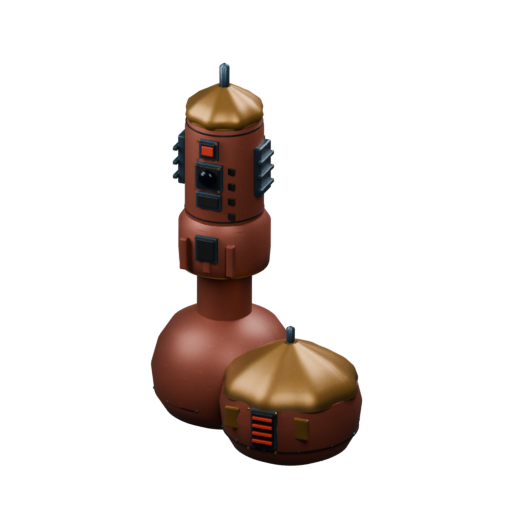

[Blend](../sources/objects/achaean/footprint/model.blend) · [GLB](../sources/objects/achaean/footprint/model.glb)

Additional views: [Legacy-based ImageGen concept (interpreted details)](../gallery/media/concepts/achaean/ac01-review-1.png) · [Actual independent GLB](../gallery/media/objects/achaean/footprint/imported-front-quarter.png) · [Actual independent GLB rear](../gallery/media/objects/achaean/footprint/imported-rear-quarter.png)

## Anti-Rad Screen

`openfa:building/legacy/152`

**First available iteration — canonical-game-remaster**

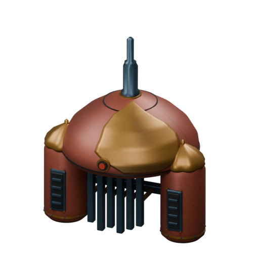

[Blend](../sources/objects/achaean/anti-rad-screen/model.blend) · [GLB](../sources/objects/achaean/anti-rad-screen/model.glb)

Additional views: [Legacy-based ImageGen concept (interpreted details)](../gallery/media/concepts/achaean/ac02-review-1.png) · [Actual independent GLB](../gallery/media/objects/achaean/anti-rad-screen/imported-front-quarter.png) · [Actual independent GLB rear](../gallery/media/objects/achaean/anti-rad-screen/imported-rear-quarter.png)

## Environmental Control

`openfa:building/legacy/153`

**First available iteration — canonical-game-remaster**

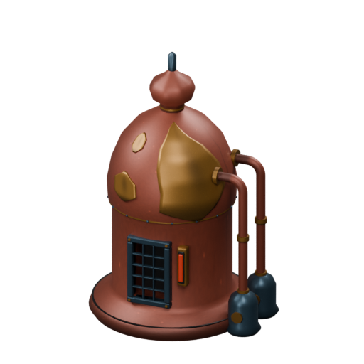

[Blend](../sources/objects/achaean/environmental-control/model.blend) · [GLB](../sources/objects/achaean/environmental-control/model.glb)

Additional views: [Legacy-based ImageGen concept (interpreted details)](../gallery/media/concepts/achaean/ac03-review-1.png) · [Actual independent GLB](../gallery/media/objects/achaean/environmental-control/imported-front-quarter.png) · [Actual independent GLB rear](../gallery/media/objects/achaean/environmental-control/imported-rear-quarter.png)

## Filtration Vats

`openfa:building/legacy/154`

**First available iteration — canonical-game-remaster**

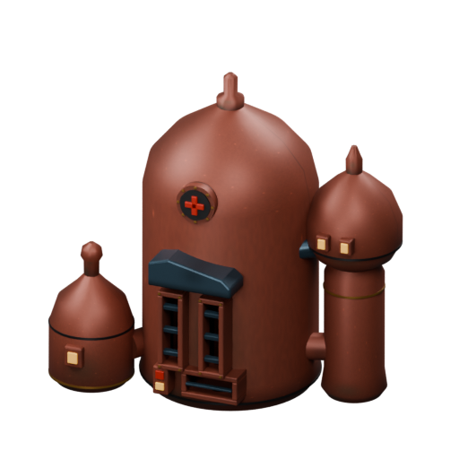

[Blend](../sources/objects/achaean/filtration-vats/model.blend) · [GLB](../sources/objects/achaean/filtration-vats/model.glb)

Additional views: [Legacy-based ImageGen concept (interpreted details)](../gallery/media/concepts/achaean/ac04-review-1.png) · [Actual independent GLB](../gallery/media/objects/achaean/filtration-vats/imported-front-quarter.png) · [Actual independent GLB rear](../gallery/media/objects/achaean/filtration-vats/imported-rear-quarter.png)

## Nutrient Vats

`openfa:building/legacy/155`

**First available iteration — canonical-game-remaster**

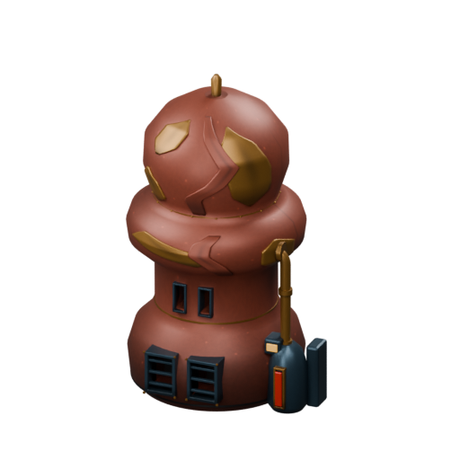

[Blend](../sources/objects/achaean/nutrient-vats/model.blend) · [GLB](../sources/objects/achaean/nutrient-vats/model.glb)

Additional views: [Legacy-based ImageGen concept (interpreted details)](../gallery/media/concepts/achaean/ac05-review-1.png) · [Actual independent GLB](../gallery/media/objects/achaean/nutrient-vats/imported-front-quarter.png) · [Actual independent GLB rear](../gallery/media/objects/achaean/nutrient-vats/imported-rear-quarter.png)

## Habitat

`openfa:building/legacy/156`

**First available iteration — canonical-game-remaster**

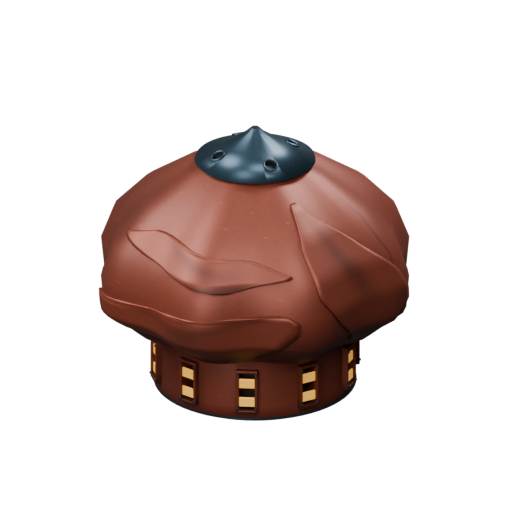

[Blend](../sources/objects/achaean/habitat/model.blend) · [GLB](../sources/objects/achaean/habitat/model.glb)

Additional views: [Legacy-based ImageGen concept (interpreted details)](../gallery/media/concepts/achaean/ac06-review-1.png) · [Actual independent GLB](../gallery/media/objects/achaean/habitat/imported-front-quarter.png) · [Actual independent GLB rear](../gallery/media/objects/achaean/habitat/imported-rear-quarter.png)

## Pharmacopeion

`openfa:building/legacy/157`

**First available iteration — canonical-game-remaster**

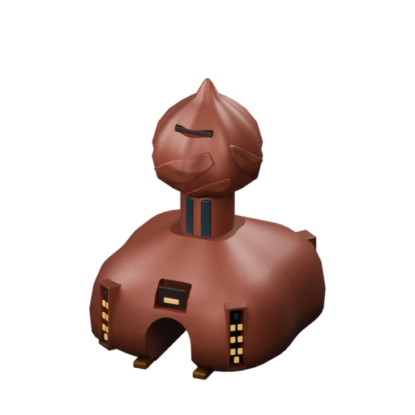

[Blend](../sources/objects/achaean/pharmacopeion/model.blend) · [GLB](../sources/objects/achaean/pharmacopeion/model.glb)

Additional views: [Legacy-based ImageGen concept (interpreted details)](../gallery/media/concepts/achaean/ac07-review-1.png) · [Actual independent GLB](../gallery/media/objects/achaean/pharmacopeion/imported-front-quarter.png) · [Actual independent GLB rear](../gallery/media/objects/achaean/pharmacopeion/imported-rear-quarter.png)

## Gathering Ground

`openfa:building/legacy/158`

**First available iteration — canonical-game-remaster**

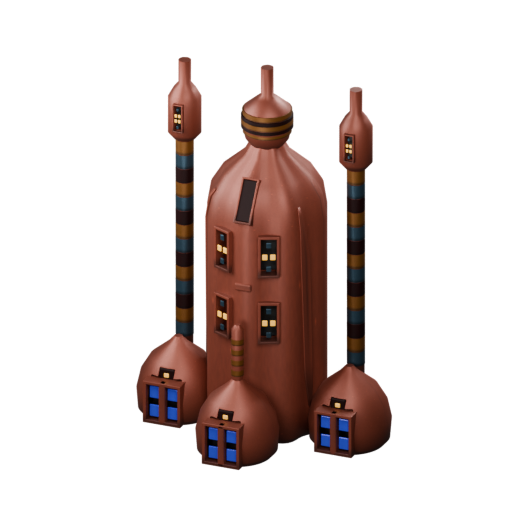

[Blend](../sources/objects/achaean/gathering-ground/model.blend) · [GLB](../sources/objects/achaean/gathering-ground/model.glb)

Additional views: [Legacy-based ImageGen concept (interpreted details)](../gallery/media/concepts/achaean/ac08-review-1.png) · [Actual independent GLB](../gallery/media/objects/achaean/gathering-ground/imported-front-quarter.png) · [Actual independent GLB rear](../gallery/media/objects/achaean/gathering-ground/imported-rear-quarter.png)

## Market

`openfa:building/legacy/159`

**First available iteration — canonical-game-remaster**

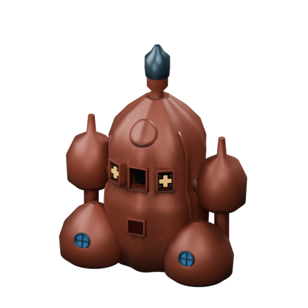

[Blend](../sources/objects/achaean/market/model.blend) · [GLB](../sources/objects/achaean/market/model.glb)

Additional views: [Legacy-based ImageGen concept (interpreted details)](../gallery/media/concepts/achaean/ac09-review-1.png) · [Actual independent GLB](../gallery/media/objects/achaean/market/imported-front-quarter.png) · [Actual independent GLB rear](../gallery/media/objects/achaean/market/imported-rear-quarter.png)

## Communications Central

`openfa:building/legacy/160`

**First available iteration — canonical-game-remaster**

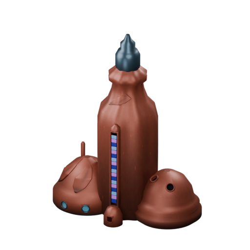

[Blend](../sources/objects/achaean/communications-central/model.blend) · [GLB](../sources/objects/achaean/communications-central/model.glb)

Additional views: [Legacy-based ImageGen concept (interpreted details)](../gallery/media/concepts/achaean/ac10-review-1.png) · [Actual independent GLB](../gallery/media/objects/achaean/communications-central/imported-front-quarter.png) · [Actual independent GLB rear](../gallery/media/objects/achaean/communications-central/imported-rear-quarter.png)

## Shipyard

`openfa:building/legacy/161`

**First available iteration — canonical-game-remaster**

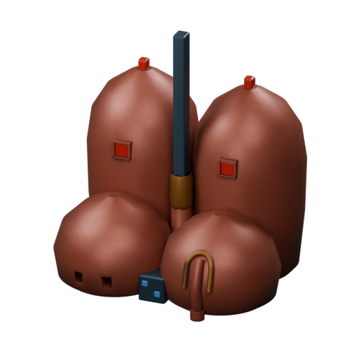

[Blend](../sources/objects/achaean/shipyard/model.blend) · [GLB](../sources/objects/achaean/shipyard/model.glb)

Additional views: [Legacy-based ImageGen concept (interpreted details)](../gallery/media/concepts/achaean/ac11-review-1.png) · [Actual independent GLB](../gallery/media/objects/achaean/shipyard/imported-front-quarter.png) · [Actual independent GLB rear](../gallery/media/objects/achaean/shipyard/imported-rear-quarter.png)

## Landing Pad

`openfa:building/legacy/162`

**First available iteration — canonical-game-remaster**

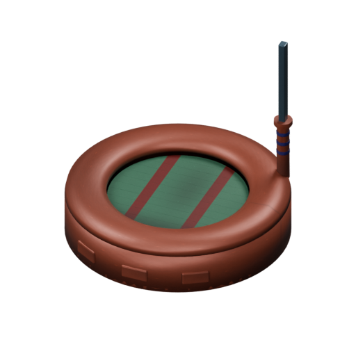

[Blend](../sources/objects/achaean/landing-pad/model.blend) · [GLB](../sources/objects/achaean/landing-pad/model.glb)

Additional views: [Legacy-based ImageGen concept (interpreted details)](../gallery/media/concepts/achaean/ac12-review-1.png) · [Actual independent GLB](../gallery/media/objects/achaean/landing-pad/imported-front-quarter.png) · [Actual independent GLB rear](../gallery/media/objects/achaean/landing-pad/imported-rear-quarter.png)

[Play animation: LaunchFacilityCycle](../gallery/media/objects/achaean/landing-pad/animation-00.webm)

## Missile Launcher

`openfa:building/legacy/163`

**First available iteration — canonical-game-remaster**

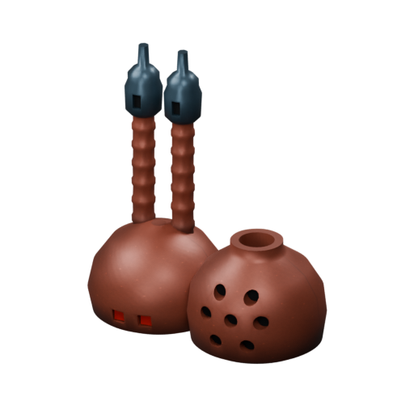

[Blend](../sources/objects/achaean/missile-launcher/model.blend) · [GLB](../sources/objects/achaean/missile-launcher/model.glb)

Additional views: [Legacy-based ImageGen concept (interpreted details)](../gallery/media/concepts/achaean/ac13-review-1.png) · [Actual independent GLB](../gallery/media/objects/achaean/missile-launcher/imported-front-quarter.png) · [Actual independent GLB rear](../gallery/media/objects/achaean/missile-launcher/imported-rear-quarter.png)

## Data Gatherer

`openfa:building/legacy/164`

**First available iteration — canonical-game-remaster**

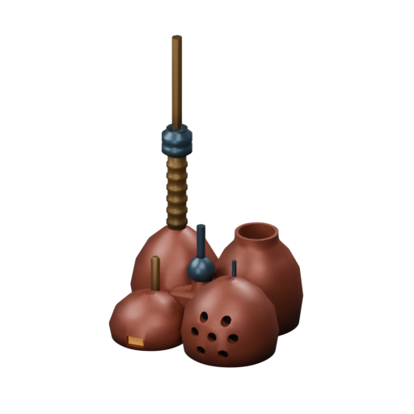

[Blend](../sources/objects/achaean/data-gatherer/model.blend) · [GLB](../sources/objects/achaean/data-gatherer/model.glb)

Additional views: [Legacy-based ImageGen concept (interpreted details)](../gallery/media/concepts/achaean/ac14-review-1.png) · [Actual independent GLB](../gallery/media/objects/achaean/data-gatherer/imported-front-quarter.png) · [Actual independent GLB rear](../gallery/media/objects/achaean/data-gatherer/imported-rear-quarter.png)

## Listening Device

`openfa:building/legacy/165`

**First available iteration — canonical-game-remaster**

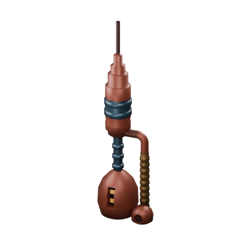

[Blend](../sources/objects/achaean/listening-device/model.blend) · [GLB](../sources/objects/achaean/listening-device/model.glb)

Additional views: [Legacy-based ImageGen concept (interpreted details)](../gallery/media/concepts/achaean/ac15-review-1.png) · [Actual independent GLB](../gallery/media/objects/achaean/listening-device/imported-front-quarter.png) · [Actual independent GLB rear](../gallery/media/objects/achaean/listening-device/imported-rear-quarter.png)

## Manoeuvring Device

`openfa:building/legacy/166`

**First available iteration — canonical-game-remaster**

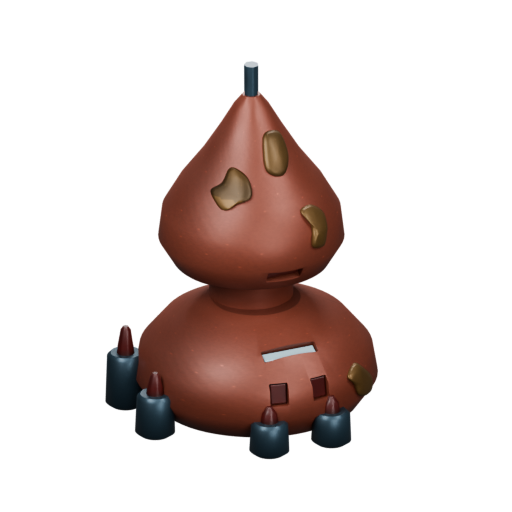

[Blend](../sources/objects/achaean/manoeuvring-device/model.blend) · [GLB](../sources/objects/achaean/manoeuvring-device/model.glb)

Additional views: [Legacy-based ImageGen concept (interpreted details)](../gallery/media/concepts/achaean/ac16-review-1.png) · [Actual independent GLB](../gallery/media/objects/achaean/manoeuvring-device/imported-front-quarter.png) · [Actual independent GLB rear](../gallery/media/objects/achaean/manoeuvring-device/imported-rear-quarter.png)

## Destination Beam

`openfa:building/legacy/167`

**First available iteration — canonical-game-remaster**

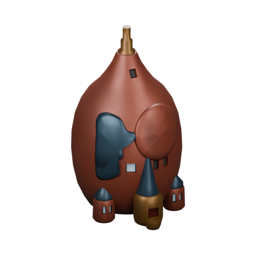

[Blend](../sources/objects/achaean/destination-beam/model.blend) · [GLB](../sources/objects/achaean/destination-beam/model.glb)

Additional views: [Legacy-based ImageGen concept (interpreted details)](../gallery/media/concepts/achaean/ac17-review-1.png) · [Actual independent GLB](../gallery/media/objects/achaean/destination-beam/imported-front-quarter.png) · [Actual independent GLB rear](../gallery/media/objects/achaean/destination-beam/imported-rear-quarter.png)

## Reactor Cores

`openfa:building/legacy/168`

**First available iteration — canonical-game-remaster**

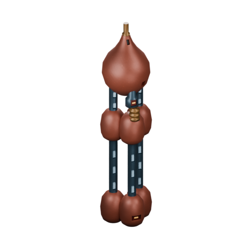

[Blend](../sources/objects/achaean/reactor-cores/model.blend) · [GLB](../sources/objects/achaean/reactor-cores/model.glb)

Additional views: [Legacy-based ImageGen concept (interpreted details)](../gallery/media/concepts/achaean/ac18-review-1.png) · [Actual independent GLB](../gallery/media/objects/achaean/reactor-cores/imported-front-quarter.png) · [Actual independent GLB rear](../gallery/media/objects/achaean/reactor-cores/imported-rear-quarter.png)

## Asteroid Shield

`openfa:building/legacy/169`

**First available iteration — canonical-game-remaster**

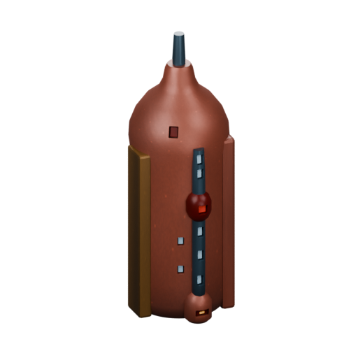

[Blend](../sources/objects/achaean/asteroid-shield/model.blend) · [GLB](../sources/objects/achaean/asteroid-shield/model.glb)

Additional views: [Legacy-based ImageGen concept (interpreted details)](../gallery/media/concepts/achaean/ac19-review-1.png) · [Actual independent GLB](../gallery/media/objects/achaean/asteroid-shield/imported-front-quarter.png) · [Actual independent GLB rear](../gallery/media/objects/achaean/asteroid-shield/imported-rear-quarter.png)

## Defence Battery

`openfa:building/legacy/170`

**First available iteration — canonical-game-remaster**

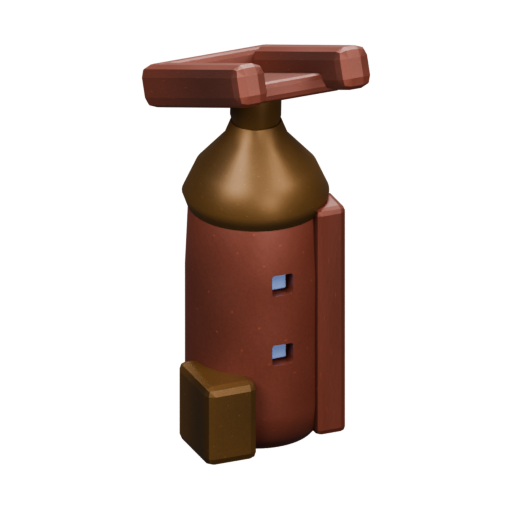

[Blend](../sources/objects/achaean/defence-battery/model.blend) · [GLB](../sources/objects/achaean/defence-battery/model.glb)

Additional views: [Legacy-based ImageGen concept (interpreted details)](../gallery/media/concepts/achaean/ac20-review-1.png) · [Actual independent GLB](../gallery/media/objects/achaean/defence-battery/imported-front-quarter.png) · [Actual independent GLB rear](../gallery/media/objects/achaean/defence-battery/imported-rear-quarter.png)

[Play animation: Animation](../gallery/media/objects/achaean/defence-battery/animation-00.webm)

## Commonbore

`openfa:building/legacy/171`

**First available iteration — silhouette-study**

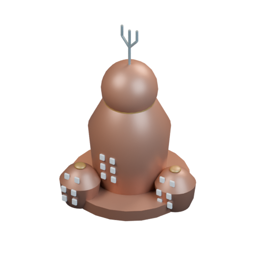

[Blend](../sources/docs/assets/bootstrap-3d/full-catalogue/achaean/ac21/model.blend) · [GLB](../sources/docs/assets/bootstrap-3d/full-catalogue/achaean/ac21/model.glb)

## Deepbore

`openfa:building/legacy/172`

**First available iteration — silhouette-study**

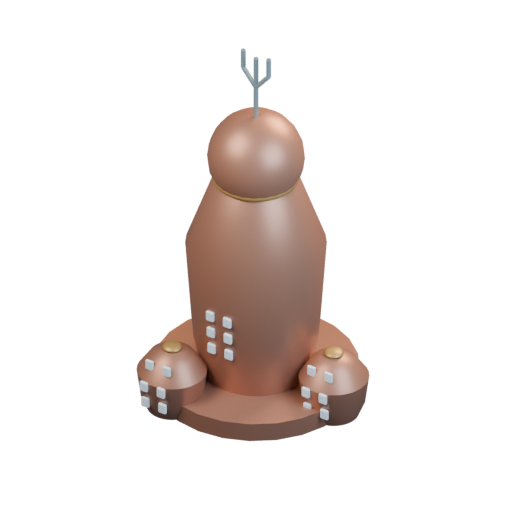

[Blend](../sources/docs/assets/bootstrap-3d/full-catalogue/achaean/ac22/model.blend) · [GLB](../sources/docs/assets/bootstrap-3d/full-catalogue/achaean/ac22/model.glb)

## Ore Yard

`openfa:building/legacy/173`

**First available iteration — silhouette-study**

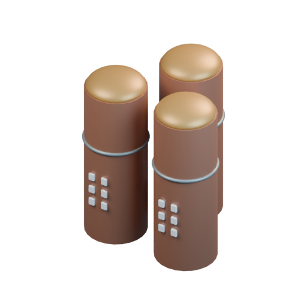

[Blend](../sources/docs/assets/bootstrap-3d/full-catalogue/achaean/ac23/model.blend) · [GLB](../sources/docs/assets/bootstrap-3d/full-catalogue/achaean/ac23/model.glb)

## Goods Yard

`openfa:building/legacy/174`

**First available iteration — silhouette-study**

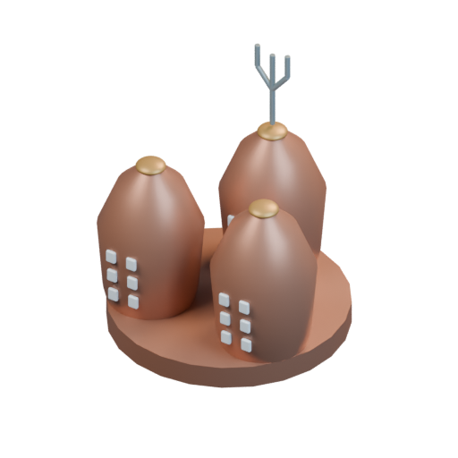

[Blend](../sources/docs/assets/bootstrap-3d/full-catalogue/achaean/ac24/model.blend) · [GLB](../sources/docs/assets/bootstrap-3d/full-catalogue/achaean/ac24/model.glb)

## Stun Tower

`openfa:building/legacy/175`

**First available iteration — silhouette-study**

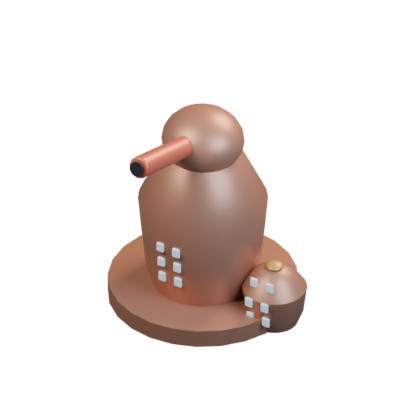

[Blend](../sources/docs/assets/bootstrap-3d/full-catalogue/achaean/ac25/model.blend) · [GLB](../sources/docs/assets/bootstrap-3d/full-catalogue/achaean/ac25/model.glb)

[Play animation: Animation](../gallery/media/docs/assets/bootstrap-3d/full-catalogue/achaean/ac25/animation-00.webm)

## Power Tower

`openfa:building/legacy/176`

**First available iteration — silhouette-study**

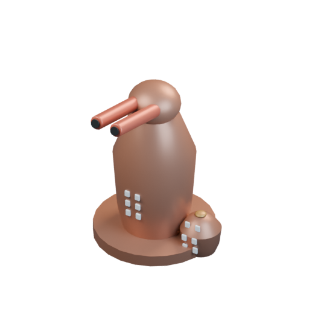

[Blend](../sources/docs/assets/bootstrap-3d/full-catalogue/achaean/ac26/model.blend) · [GLB](../sources/docs/assets/bootstrap-3d/full-catalogue/achaean/ac26/model.glb)

[Play animation: Animation](../gallery/media/docs/assets/bootstrap-3d/full-catalogue/achaean/ac26/animation-00.webm)
