# Buildings / Artemian

[All groups](README.md)

## SoftCore

`openfa:building/legacy/107`

**First available iteration — canonical-game-remaster**

[Blend](../sources/objects/artemian/softcore/model.blend) · [GLB](../sources/objects/artemian/softcore/model.glb)

Additional views: [Front](../gallery/media/objects/artemian/softcore/front.png) · [Rear quarter](../gallery/media/objects/artemian/softcore/rear-quarter.png) · [Front CPU fittings](../gallery/media/objects/artemian/softcore/front-fittings-detail.png) · [Layered metal shell](../gallery/media/objects/artemian/softcore/layered-shell-detail.png) · [Canonical technical wireframe](../gallery/media/objects/artemian/softcore/technical-wireframe.png) · [Concept and actual GLB](../gallery/media/objects/artemian/softcore/concept-glb-comparison.jpg)

## Environmental Stabiliser

`openfa:building/legacy/108`

**First available iteration — canonical-game-remaster**

[Blend](../sources/objects/artemian/environmental-stabiliser/model.blend) · [GLB](../sources/objects/artemian/environmental-stabiliser/model.glb)

Additional views: [Front](../gallery/media/objects/artemian/environmental-stabiliser/front.png) · [Rear quarter](../gallery/media/objects/artemian/environmental-stabiliser/rear-quarter.png) · [Shell and source insets](../gallery/media/objects/artemian/environmental-stabiliser/shell-and-insets-detail.png) · [Connected rear pipework](../gallery/media/objects/artemian/environmental-stabiliser/rear-pipe-detail.png) · [Canonical technical wireframe](../gallery/media/objects/artemian/environmental-stabiliser/technical-wireframe.png) · [Concept and actual GLB](../gallery/media/objects/artemian/environmental-stabiliser/concept-glb-comparison.jpg)

## Filtration Tanks

`openfa:building/legacy/109`

**First available iteration — silhouette-study**

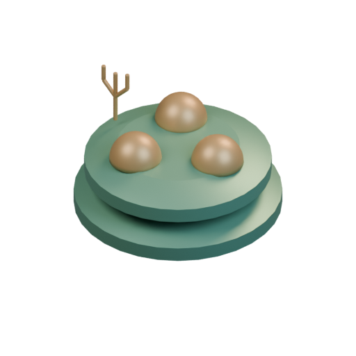

[Blend](../sources/docs/assets/bootstrap-3d/full-catalogue/artemian/ar03/model.blend) · [GLB](../sources/docs/assets/bootstrap-3d/full-catalogue/artemian/ar03/model.glb)

## Canisters

`openfa:building/legacy/110`

**First available iteration — silhouette-study**

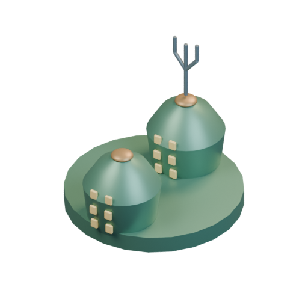

[Blend](../sources/docs/assets/bootstrap-3d/full-catalogue/artemian/ar04/model.blend) · [GLB](../sources/docs/assets/bootstrap-3d/full-catalogue/artemian/ar04/model.glb)

## Nurseries

`openfa:building/legacy/111`

**First available iteration — silhouette-study**

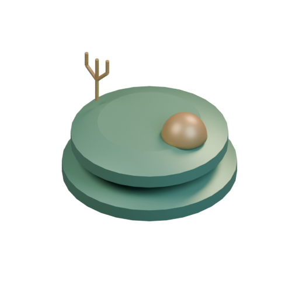

[Blend](../sources/docs/assets/bootstrap-3d/full-catalogue/artemian/ar05/model.blend) · [GLB](../sources/docs/assets/bootstrap-3d/full-catalogue/artemian/ar05/model.glb)

## Healing Quarters

`openfa:building/legacy/112`

**First available iteration — silhouette-study**

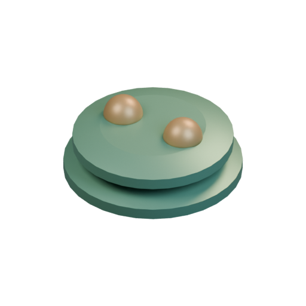

[Blend](../sources/docs/assets/bootstrap-3d/full-catalogue/artemian/ar06/model.blend) · [GLB](../sources/docs/assets/bootstrap-3d/full-catalogue/artemian/ar06/model.glb)

## House of the Axe

`openfa:building/legacy/113`

**First available iteration — silhouette-study**

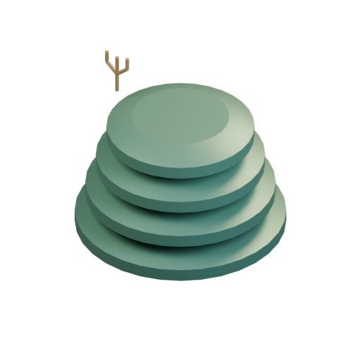

[Blend](../sources/docs/assets/bootstrap-3d/full-catalogue/artemian/ar07/model.blend) · [GLB](../sources/docs/assets/bootstrap-3d/full-catalogue/artemian/ar07/model.glb)

## Naval Dockyard

`openfa:building/legacy/114`

**First available iteration — silhouette-study**

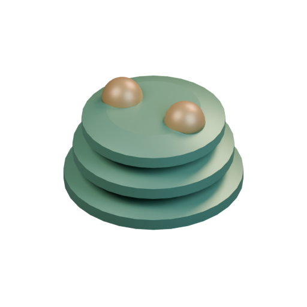

[Blend](../sources/docs/assets/bootstrap-3d/full-catalogue/artemian/ar08/model.blend) · [GLB](../sources/docs/assets/bootstrap-3d/full-catalogue/artemian/ar08/model.glb)

## Launch Pads

`openfa:building/legacy/115`

**First available iteration — silhouette-study**

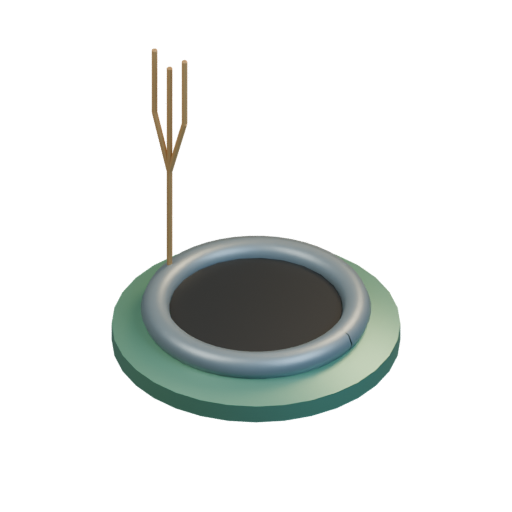

[Blend](../sources/docs/assets/bootstrap-3d/full-catalogue/artemian/ar09/model.blend) · [GLB](../sources/docs/assets/bootstrap-3d/full-catalogue/artemian/ar09/model.glb)

## Deep Probes

`openfa:building/legacy/116`

**First available iteration — silhouette-study**

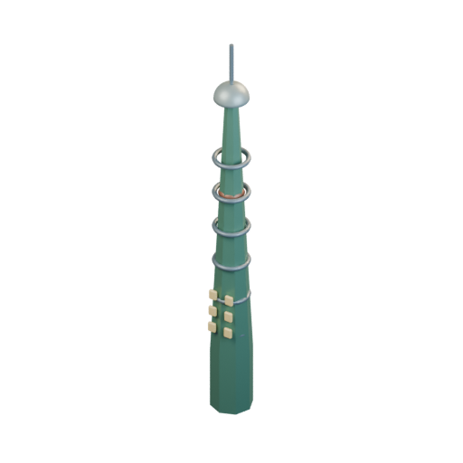

[Blend](../sources/docs/assets/bootstrap-3d/full-catalogue/artemian/ar10/model.blend) · [GLB](../sources/docs/assets/bootstrap-3d/full-catalogue/artemian/ar10/model.glb)

## Gravitic Converter

`openfa:building/legacy/117`

**First available iteration — silhouette-study**

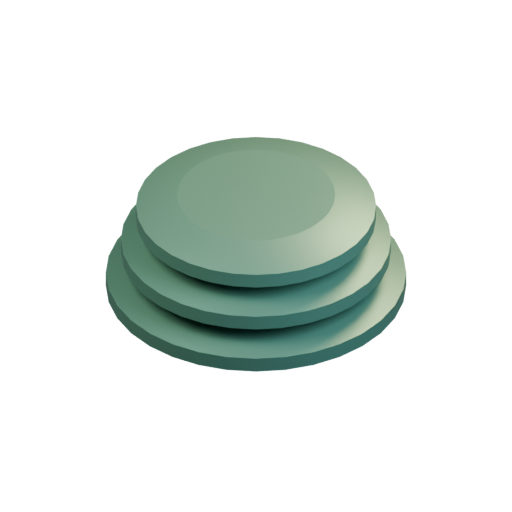

[Blend](../sources/docs/assets/bootstrap-3d/full-catalogue/artemian/ar11/model.blend) · [GLB](../sources/docs/assets/bootstrap-3d/full-catalogue/artemian/ar11/model.glb)

## Shielded Solars

`openfa:building/legacy/118`

**First available iteration — silhouette-study**

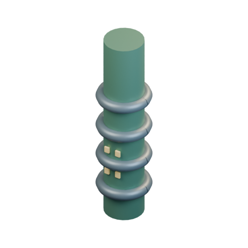

[Blend](../sources/docs/assets/bootstrap-3d/full-catalogue/artemian/ar12/model.blend) · [GLB](../sources/docs/assets/bootstrap-3d/full-catalogue/artemian/ar12/model.glb)

## Shell

`openfa:building/legacy/119`

**First available iteration — silhouette-study**

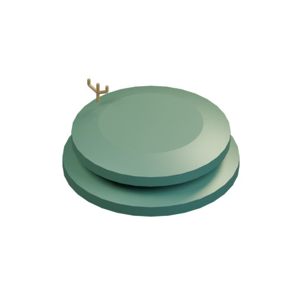

[Blend](../sources/docs/assets/bootstrap-3d/full-catalogue/artemian/ar13/model.blend) · [GLB](../sources/docs/assets/bootstrap-3d/full-catalogue/artemian/ar13/model.glb)

## Arms Forge

`openfa:building/legacy/120`

**First available iteration — silhouette-study**

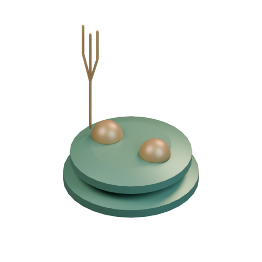

[Blend](../sources/docs/assets/bootstrap-3d/full-catalogue/artemian/ar14/model.blend) · [GLB](../sources/docs/assets/bootstrap-3d/full-catalogue/artemian/ar14/model.glb)

## Star Bars

`openfa:building/legacy/121`

**First available iteration — silhouette-study**

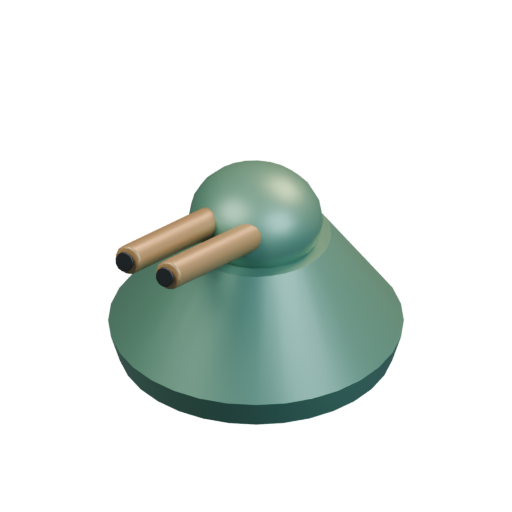

[Blend](../sources/docs/assets/bootstrap-3d/full-catalogue/artemian/ar15/model.blend) · [GLB](../sources/docs/assets/bootstrap-3d/full-catalogue/artemian/ar15/model.glb)

[Play animation: Animation](../gallery/media/docs/assets/bootstrap-3d/full-catalogue/artemian/ar15/animation-00.webm)

## Missile Launcher

`openfa:building/legacy/122`

**First available iteration — silhouette-study**

[Blend](../sources/docs/assets/bootstrap-3d/full-catalogue/artemian/ar16/model.blend) · [GLB](../sources/docs/assets/bootstrap-3d/full-catalogue/artemian/ar16/model.glb)

**Additional iteration — verified-launch-mechanism**

[Blend](../sources/docs/assets/reconstruction/launch-facilities/artemian/ar16/model.blend) · [GLB](../sources/docs/assets/reconstruction/launch-facilities/artemian/ar16/model.glb)

[Play animation: LaunchFacilityCycle](../gallery/media/docs/assets/reconstruction/launch-facilities/artemian/ar16/animation-00.webm)

## Auto-deterrent

`openfa:building/legacy/123`

**First available iteration — silhouette-study**

[Blend](../sources/docs/assets/bootstrap-3d/full-catalogue/artemian/ar17/model.blend) · [GLB](../sources/docs/assets/bootstrap-3d/full-catalogue/artemian/ar17/model.glb)

[Play animation: Animation](../gallery/media/docs/assets/bootstrap-3d/full-catalogue/artemian/ar17/animation-00.webm)

## Super-deterrent

`openfa:building/legacy/124`

**First available iteration — silhouette-study**

[Blend](../sources/docs/assets/bootstrap-3d/full-catalogue/artemian/ar18/model.blend) · [GLB](../sources/docs/assets/bootstrap-3d/full-catalogue/artemian/ar18/model.glb)

[Play animation: Animation](../gallery/media/docs/assets/bootstrap-3d/full-catalogue/artemian/ar18/animation-00.webm)

## Force Fields

`openfa:building/legacy/125`

**First available iteration — silhouette-study**

[Blend](../sources/docs/assets/bootstrap-3d/full-catalogue/artemian/ar19/model.blend) · [GLB](../sources/docs/assets/bootstrap-3d/full-catalogue/artemian/ar19/model.glb)

## Advanced Ore Extractor

`openfa:building/legacy/126`

**First available iteration — silhouette-study**

[Blend](../sources/docs/assets/bootstrap-3d/full-catalogue/artemian/ar20/model.blend) · [GLB](../sources/docs/assets/bootstrap-3d/full-catalogue/artemian/ar20/model.glb)

## Rare Ore Extractor

`openfa:building/legacy/127`

**First available iteration — silhouette-study**

[Blend](../sources/docs/assets/bootstrap-3d/full-catalogue/artemian/ar21/model.blend) · [GLB](../sources/docs/assets/bootstrap-3d/full-catalogue/artemian/ar21/model.glb)

## Ore Depot

`openfa:building/legacy/128`

**First available iteration — silhouette-study**

[Blend](../sources/docs/assets/bootstrap-3d/full-catalogue/artemian/ar22/model.blend) · [GLB](../sources/docs/assets/bootstrap-3d/full-catalogue/artemian/ar22/model.glb)

## Refining Forge

`openfa:building/legacy/129`

**First available iteration — silhouette-study**

[Blend](../sources/docs/assets/bootstrap-3d/full-catalogue/artemian/ar23/model.blend) · [GLB](../sources/docs/assets/bootstrap-3d/full-catalogue/artemian/ar23/model.glb)
