# Buildings / Artemian

[All groups](README.md)

## SoftCore

`openfa:building/legacy/107`

**First available iteration — canonical-game-remaster**

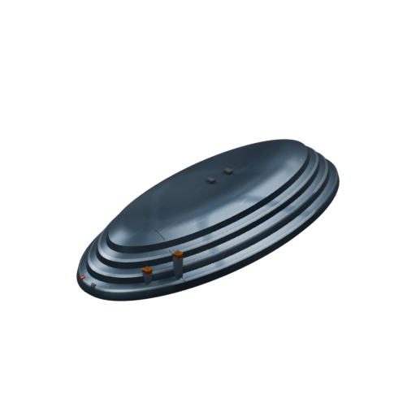

[Blend](../sources/objects/artemian/softcore/model.blend) · [GLB](../sources/objects/artemian/softcore/model.glb)

Additional views: [Front](../gallery/media/objects/artemian/softcore/front.png) · [Rear quarter](../gallery/media/objects/artemian/softcore/rear-quarter.png) · [Front CPU fittings](../gallery/media/objects/artemian/softcore/front-fittings-detail.png) · [Layered metal shell](../gallery/media/objects/artemian/softcore/layered-shell-detail.png) · [Canonical technical wireframe](../gallery/media/objects/artemian/softcore/technical-wireframe.png) · [Concept and actual GLB](../gallery/media/objects/artemian/softcore/concept-glb-comparison.jpg)

## Environmental Stabiliser

`openfa:building/legacy/108`

**First available iteration — canonical-game-remaster**

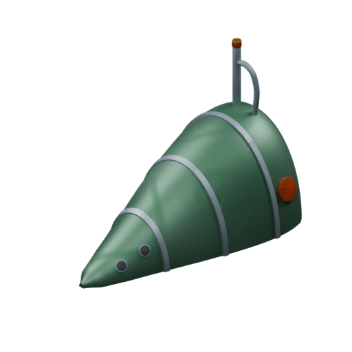

[Blend](../sources/objects/artemian/environmental-stabiliser/model.blend) · [GLB](../sources/objects/artemian/environmental-stabiliser/model.glb)

Additional views: [Front](../gallery/media/objects/artemian/environmental-stabiliser/front.png) · [Rear quarter](../gallery/media/objects/artemian/environmental-stabiliser/rear-quarter.png) · [Shell and source insets](../gallery/media/objects/artemian/environmental-stabiliser/shell-and-insets-detail.png) · [Connected rear pipework](../gallery/media/objects/artemian/environmental-stabiliser/rear-pipe-detail.png) · [Canonical technical wireframe](../gallery/media/objects/artemian/environmental-stabiliser/technical-wireframe.png) · [Concept and actual GLB](../gallery/media/objects/artemian/environmental-stabiliser/concept-glb-comparison.jpg)

## Filtration Tanks

`openfa:building/legacy/109`

**First available iteration — canonical-game-remaster**

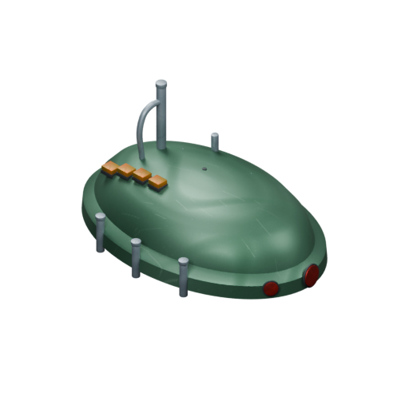

[Blend](../sources/objects/artemian/filtration-tanks/model.blend) · [GLB](../sources/objects/artemian/filtration-tanks/model.glb)

Additional views: [Front](../gallery/media/objects/artemian/filtration-tanks/front.png) · [Rear quarter](../gallery/media/objects/artemian/filtration-tanks/rear-quarter.png) · [Side fittings and amber modules](../gallery/media/objects/artemian/filtration-tanks/side-fittings-and-module-detail.png) · [Rear pipe and front markers](../gallery/media/objects/artemian/filtration-tanks/rear-pipe-and-front-marker-detail.png) · [Canonical technical wireframe](../gallery/media/objects/artemian/filtration-tanks/technical-wireframe.png) · [Concept and actual GLB](../gallery/media/objects/artemian/filtration-tanks/concept-glb-comparison.jpg)

## Canisters

`openfa:building/legacy/110`

**First available iteration — canonical-game-remaster**

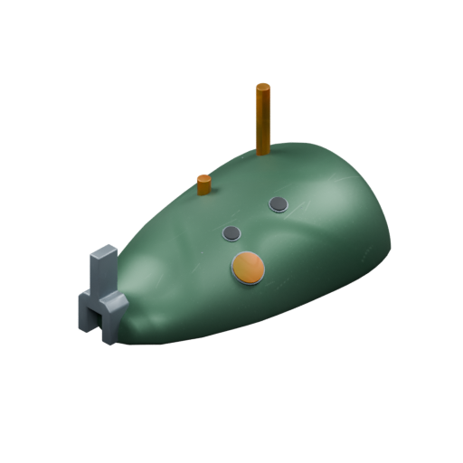

[Blend](../sources/objects/artemian/canisters/model.blend) · [GLB](../sources/objects/artemian/canisters/model.glb)

Additional views: [Front](../gallery/media/objects/artemian/canisters/front.png) · [Rear quarter](../gallery/media/objects/artemian/canisters/rear-quarter.png) · [Silver fork and roof insets](../gallery/media/objects/artemian/canisters/fork-and-roof-insets-detail.png) · [Amber uprights and shell](../gallery/media/objects/artemian/canisters/amber-uprights-and-shell-detail.png) · [Canonical technical wireframe](../gallery/media/objects/artemian/canisters/technical-wireframe.png) · [Concept and actual GLB](../gallery/media/objects/artemian/canisters/concept-glb-comparison.jpg)

## Nurseries

`openfa:building/legacy/111`

**First available iteration — canonical-game-remaster**

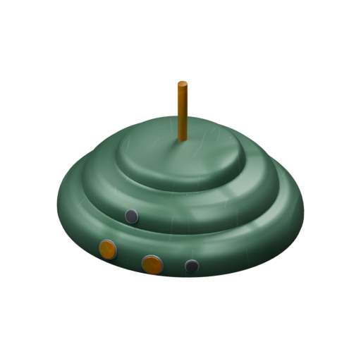

[Blend](../sources/objects/artemian/nurseries/model.blend) · [GLB](../sources/objects/artemian/nurseries/model.glb)

Additional views: [Front](../gallery/media/objects/artemian/nurseries/front.png) · [Rear quarter](../gallery/media/objects/artemian/nurseries/rear-quarter.png) · [Front insets and shell](../gallery/media/objects/artemian/nurseries/front-insets-and-shell-detail.png) · [Central upright and terraces](../gallery/media/objects/artemian/nurseries/central-upright-and-terraces-detail.png) · [Canonical technical wireframe](../gallery/media/objects/artemian/nurseries/technical-wireframe.png) · [Concept and actual GLB](../gallery/media/objects/artemian/nurseries/concept-glb-comparison.jpg)

## Healing Quarters

`openfa:building/legacy/112`

**First available iteration — canonical-game-remaster**

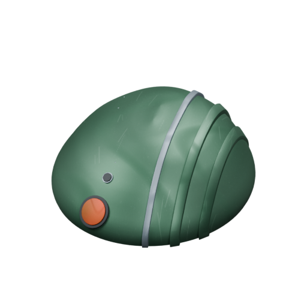

[Blend](../sources/objects/artemian/healing-quarters/model.blend) · [GLB](../sources/objects/artemian/healing-quarters/model.glb)

Additional views: [Front](../gallery/media/objects/artemian/healing-quarters/front.png) · [Rear quarter](../gallery/media/objects/artemian/healing-quarters/rear-quarter.png) · [Copper inset and dark point](../gallery/media/objects/artemian/healing-quarters/copper-inset-and-dark-point-detail.png) · [Silver and raised green ribs](../gallery/media/objects/artemian/healing-quarters/silver-rib-and-green-ribs-detail.png) · [Canonical technical wireframe](../gallery/media/objects/artemian/healing-quarters/technical-wireframe.png) · [Concept and actual GLB](../gallery/media/objects/artemian/healing-quarters/concept-glb-comparison.jpg)

## House of the Axe

`openfa:building/legacy/113`

**First available iteration — canonical-game-remaster**

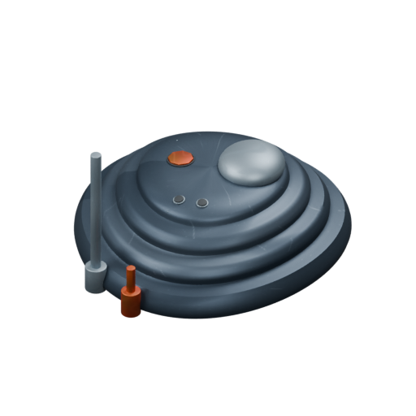

[Blend](../sources/objects/artemian/house-of-the-axe/model.blend) · [GLB](../sources/objects/artemian/house-of-the-axe/model.glb)

Additional views: [Front](../gallery/media/objects/artemian/house-of-the-axe/front.png) · [Rear quarter](../gallery/media/objects/artemian/house-of-the-axe/rear-quarter.png) · [Front uprights and sleeves](../gallery/media/objects/artemian/house-of-the-axe/front-uprights-and-sleeves-detail.png) · [Roof lobe and three points](../gallery/media/objects/artemian/house-of-the-axe/roof-lobe-and-three-insets-detail.png) · [Canonical technical wireframe](../gallery/media/objects/artemian/house-of-the-axe/technical-wireframe.png) · [Concept and actual GLB](../gallery/media/objects/artemian/house-of-the-axe/concept-glb-comparison.jpg)

## Naval Dockyard

`openfa:building/legacy/114`

**First available iteration — canonical-game-remaster**

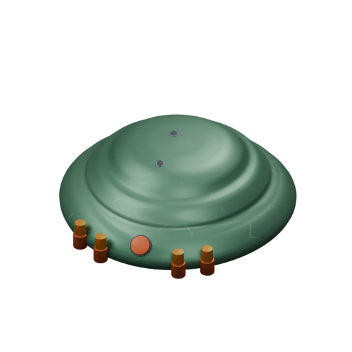

[Blend](../sources/objects/artemian/naval-dockyard/model.blend) · [GLB](../sources/objects/artemian/naval-dockyard/model.glb)

Additional views: [Front](../gallery/media/objects/artemian/naval-dockyard/front.png) · [Rear quarter](../gallery/media/objects/artemian/naval-dockyard/rear-quarter.png) · [Four front fittings and copper inset](../gallery/media/objects/artemian/naval-dockyard/four-front-fittings-and-copper-inset-detail.png) · [Two roof points and shell](../gallery/media/objects/artemian/naval-dockyard/two-roof-points-and-shell-detail.png) · [Canonical technical wireframe](../gallery/media/objects/artemian/naval-dockyard/technical-wireframe.png) · [Concept and actual GLB](../gallery/media/objects/artemian/naval-dockyard/concept-glb-comparison.jpg)

## Launch Pads

`openfa:building/legacy/115`

**First available iteration — canonical-game-remaster**

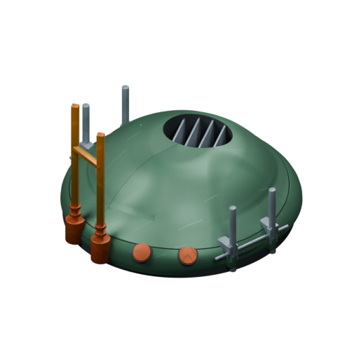

[Blend](../sources/objects/artemian/launch-pads/model.blend) · [GLB](../sources/objects/artemian/launch-pads/model.glb)

Additional views: [Front](../gallery/media/objects/artemian/launch-pads/front.png) · [Rear quarter](../gallery/media/objects/artemian/launch-pads/rear-quarter.png) · [Brass frame and copper fittings](../gallery/media/objects/artemian/launch-pads/brass-frame-and-copper-fittings-detail.png) · [Real recessed well and four baffles](../gallery/media/objects/artemian/launch-pads/recessed-well-and-four-baffles-detail.png) · [Canonical technical wireframe](../gallery/media/objects/artemian/launch-pads/technical-wireframe.png) · [Concept and actual GLB](../gallery/media/objects/artemian/launch-pads/concept-glb-comparison.jpg)

## Deep Probes

`openfa:building/legacy/116`

**First available iteration — canonical-game-remaster**

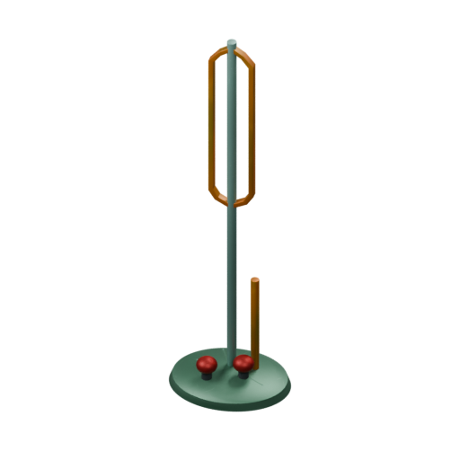

[Blend](../sources/objects/artemian/deep-probes/model.blend) · [GLB](../sources/objects/artemian/deep-probes/model.glb)

Additional views: [Front](../gallery/media/objects/artemian/deep-probes/front.png) · [Rear quarter](../gallery/media/objects/artemian/deep-probes/rear-quarter.png) · [Small plinth and two red housings](../gallery/media/objects/artemian/deep-probes/small-plinth-and-two-red-housings-detail.png) · [Open capsule frame and mast](../gallery/media/objects/artemian/deep-probes/open-capsule-frame-and-mast-detail.png) · [Canonical technical wireframe](../gallery/media/objects/artemian/deep-probes/technical-wireframe.png) · [Concept and actual GLB](../gallery/media/objects/artemian/deep-probes/concept-glb-comparison.jpg)

## Gravitic Converter

`openfa:building/legacy/117`

**First available iteration — canonical-game-remaster**

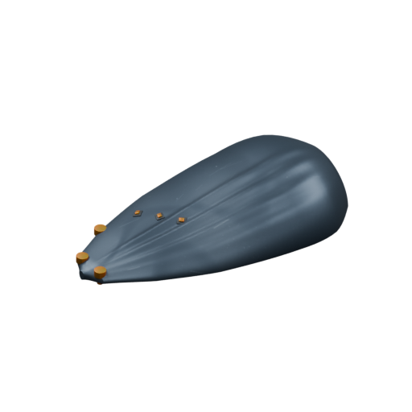

[Blend](../sources/objects/artemian/gravitic-converter/model.blend) · [GLB](../sources/objects/artemian/gravitic-converter/model.glb)

Additional views: [Front](../gallery/media/objects/artemian/gravitic-converter/front.png) · [Rear quarter](../gallery/media/objects/artemian/gravitic-converter/rear-quarter.png) · [Three brass stubs and aligned yellow front lights](../gallery/media/objects/artemian/gravitic-converter/three-brass-stubs-and-roof-points-detail.png) · [Integral longitudinal ribs](../gallery/media/objects/artemian/gravitic-converter/integrated-longitudinal-ribs-detail.png) · [Canonical technical wireframe](../gallery/media/objects/artemian/gravitic-converter/technical-wireframe.png) · [Concept and actual GLB](../gallery/media/objects/artemian/gravitic-converter/concept-glb-comparison.jpg)

## Shielded Solars

`openfa:building/legacy/118`

**First available iteration — canonical-game-remaster**

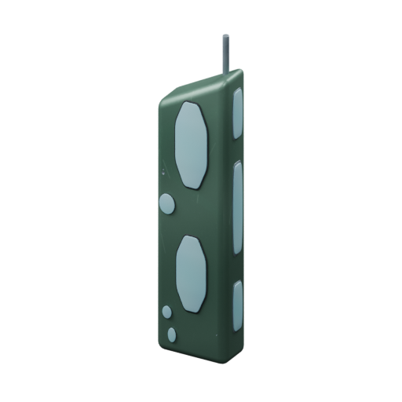

[Blend](../sources/objects/artemian/shielded-solars/model.blend) · [GLB](../sources/objects/artemian/shielded-solars/model.glb)

Additional views: [Front](../gallery/media/objects/artemian/shielded-solars/front.png) · [Rear quarter](../gallery/media/objects/artemian/shielded-solars/rear-quarter.png) · [Front collector faces](../gallery/media/objects/artemian/shielded-solars/front-collector-detail.png) · [Side collectors and mast](../gallery/media/objects/artemian/shielded-solars/side-collectors-and-mast-detail.png) · [Canonical technical wireframe](../gallery/media/objects/artemian/shielded-solars/technical-wireframe.png) · [Concept and actual GLB](../gallery/media/objects/artemian/shielded-solars/concept-glb-comparison.jpg)

## Shell

`openfa:building/legacy/119`

**First available iteration — canonical-game-remaster**

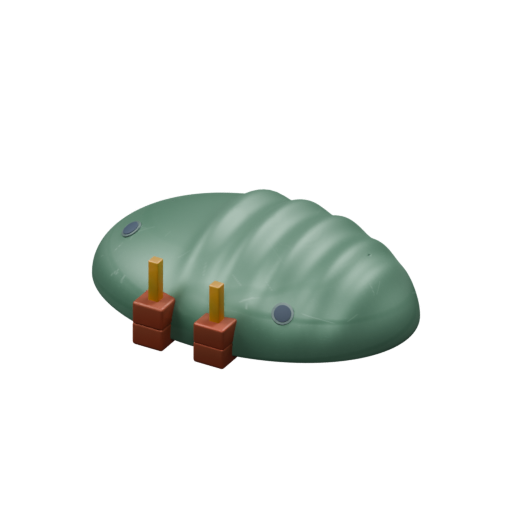

[Blend](../sources/objects/artemian/shell/model.blend) · [GLB](../sources/objects/artemian/shell/model.glb)

Additional views: [Front](../gallery/media/objects/artemian/shell/front.png) · [Rear quarter](../gallery/media/objects/artemian/shell/rear-quarter.png) · [Double copper blocks and brass pins](../gallery/media/objects/artemian/shell/double-block-brass-fittings-detail.png) · [Integral shell ribs](../gallery/media/objects/artemian/shell/integral-shell-ribs-detail.png) · [Canonical technical wireframe](../gallery/media/objects/artemian/shell/technical-wireframe.png) · [Concept and actual GLB](../gallery/media/objects/artemian/shell/concept-glb-comparison.jpg)

## Arms Forge

`openfa:building/legacy/120`

**First available iteration — canonical-game-remaster**

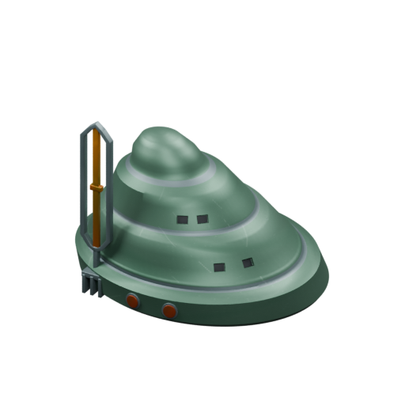

[Blend](../sources/objects/artemian/arms-forge/model.blend) · [GLB](../sources/objects/artemian/arms-forge/model.glb)

Additional views: [Front](../gallery/media/objects/artemian/arms-forge/front.png) · [Rear quarter](../gallery/media/objects/artemian/arms-forge/rear-quarter.png) · [Open frame and grounded support](../gallery/media/objects/artemian/arms-forge/open-frame-and-rooted-prongs-detail.png) · [Recessed right-flank pairs and copper insets](../gallery/media/objects/artemian/arms-forge/tier-pairs-and-copper-insets-detail.png) · [Canonical technical wireframe](../gallery/media/objects/artemian/arms-forge/technical-wireframe.png) · [Concept and actual GLB](../gallery/media/objects/artemian/arms-forge/concept-glb-comparison.jpg)

## Star Bars

`openfa:building/legacy/121`

**First available iteration — canonical-game-remaster**

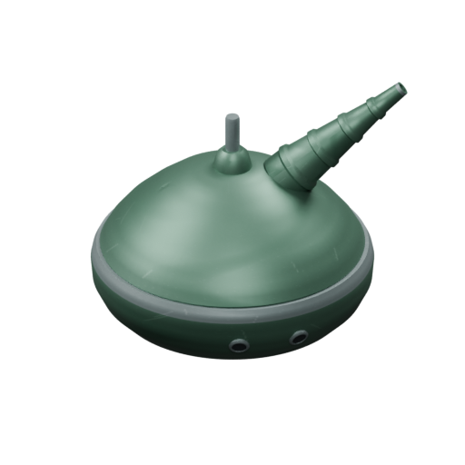

[Blend](../sources/objects/artemian/star-bars/model.blend) · [GLB](../sources/objects/artemian/star-bars/model.glb)

Additional views: [Front](../gallery/media/objects/artemian/star-bars/front.png) · [Rear quarter](../gallery/media/objects/artemian/star-bars/rear-quarter.png) · [Emitter,stem and bearing](../gallery/media/objects/artemian/star-bars/emitter-stem-and-bearing-detail.png) · [Fixed bowl and paired points](../gallery/media/objects/artemian/star-bars/fixed-bowl-paired-points-detail.png) · [Canonical technical wireframe](../gallery/media/objects/artemian/star-bars/technical-wireframe.png) · [Concept and actual GLB](../gallery/media/objects/artemian/star-bars/concept-glb-comparison.jpg)

[Play animation: StarBarsAzimuth](../gallery/media/objects/artemian/star-bars/animation-00.webm)

## Missile Launcher

`openfa:building/legacy/122`

**First available iteration — silhouette-study**

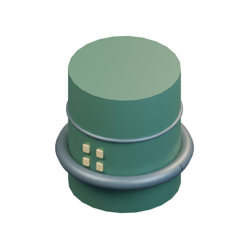

[Blend](../sources/docs/assets/bootstrap-3d/full-catalogue/artemian/ar16/model.blend) · [GLB](../sources/docs/assets/bootstrap-3d/full-catalogue/artemian/ar16/model.glb)

**Additional iteration — verified-launch-mechanism**

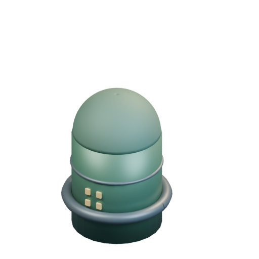

[Blend](../sources/docs/assets/reconstruction/launch-facilities/artemian/ar16/model.blend) · [GLB](../sources/docs/assets/reconstruction/launch-facilities/artemian/ar16/model.glb)

[Play animation: LaunchFacilityCycle](../gallery/media/docs/assets/reconstruction/launch-facilities/artemian/ar16/animation-00.webm)

## Auto-deterrent

`openfa:building/legacy/123`

**First available iteration — silhouette-study**

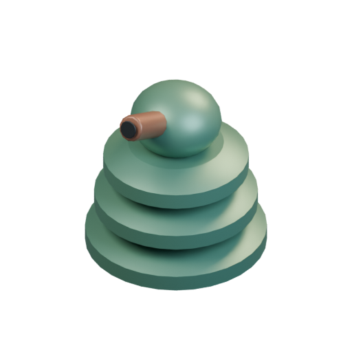

[Blend](../sources/docs/assets/bootstrap-3d/full-catalogue/artemian/ar17/model.blend) · [GLB](../sources/docs/assets/bootstrap-3d/full-catalogue/artemian/ar17/model.glb)

[Play animation: Animation](../gallery/media/docs/assets/bootstrap-3d/full-catalogue/artemian/ar17/animation-00.webm)

## Super-deterrent

`openfa:building/legacy/124`

**First available iteration — silhouette-study**

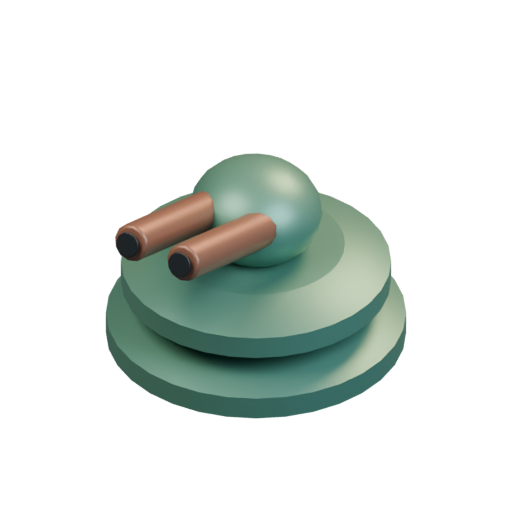

[Blend](../sources/docs/assets/bootstrap-3d/full-catalogue/artemian/ar18/model.blend) · [GLB](../sources/docs/assets/bootstrap-3d/full-catalogue/artemian/ar18/model.glb)

[Play animation: Animation](../gallery/media/docs/assets/bootstrap-3d/full-catalogue/artemian/ar18/animation-00.webm)

## Force Fields

`openfa:building/legacy/125`

**First available iteration — silhouette-study**

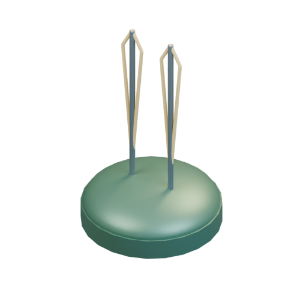

[Blend](../sources/docs/assets/bootstrap-3d/full-catalogue/artemian/ar19/model.blend) · [GLB](../sources/docs/assets/bootstrap-3d/full-catalogue/artemian/ar19/model.glb)

## Advanced Ore Extractor

`openfa:building/legacy/126`

**First available iteration — silhouette-study**

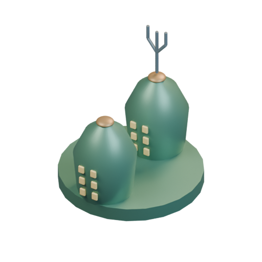

[Blend](../sources/docs/assets/bootstrap-3d/full-catalogue/artemian/ar20/model.blend) · [GLB](../sources/docs/assets/bootstrap-3d/full-catalogue/artemian/ar20/model.glb)

## Rare Ore Extractor

`openfa:building/legacy/127`

**First available iteration — silhouette-study**

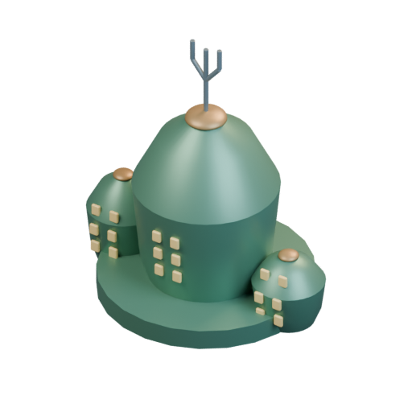

[Blend](../sources/docs/assets/bootstrap-3d/full-catalogue/artemian/ar21/model.blend) · [GLB](../sources/docs/assets/bootstrap-3d/full-catalogue/artemian/ar21/model.glb)

## Ore Depot

`openfa:building/legacy/128`

**First available iteration — silhouette-study**

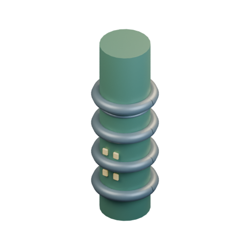

[Blend](../sources/docs/assets/bootstrap-3d/full-catalogue/artemian/ar22/model.blend) · [GLB](../sources/docs/assets/bootstrap-3d/full-catalogue/artemian/ar22/model.glb)

## Refining Forge

`openfa:building/legacy/129`

**First available iteration — silhouette-study**

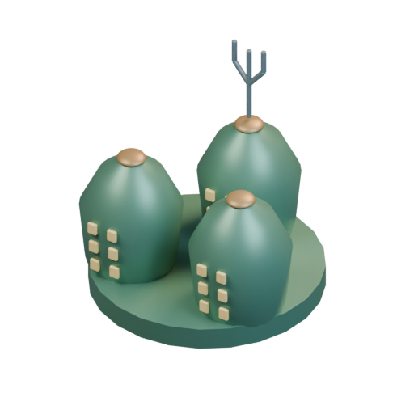

[Blend](../sources/docs/assets/bootstrap-3d/full-catalogue/artemian/ar23/model.blend) · [GLB](../sources/docs/assets/bootstrap-3d/full-catalogue/artemian/ar23/model.glb)
