# Buildings / Braccatian

[All groups](README.md)

## First Step

`openfa:building/legacy/063`

**First available iteration — silhouette-study**

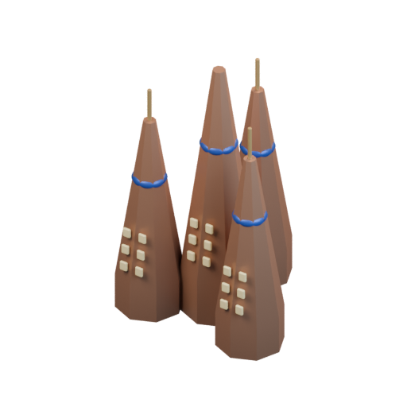

[Blend](../sources/docs/assets/bootstrap-3d/full-catalogue/braccatian/br01/model.blend) · [GLB](../sources/docs/assets/bootstrap-3d/full-catalogue/braccatian/br01/model.glb)

## Clan Heart

`openfa:building/legacy/064`

**First available iteration — silhouette-study**

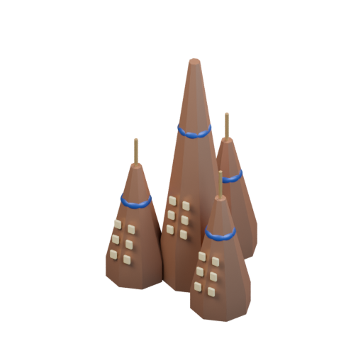

[Blend](../sources/docs/assets/bootstrap-3d/full-catalogue/braccatian/br02/model.blend) · [GLB](../sources/docs/assets/bootstrap-3d/full-catalogue/braccatian/br02/model.glb)

## Radiation Shield

`openfa:building/legacy/065`

**First available iteration — silhouette-study**

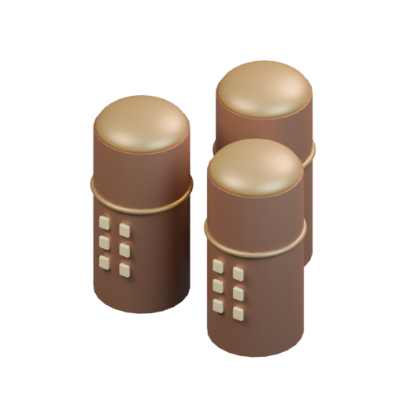

[Blend](../sources/docs/assets/bootstrap-3d/full-catalogue/braccatian/br03/model.blend) · [GLB](../sources/docs/assets/bootstrap-3d/full-catalogue/braccatian/br03/model.glb)

## Source

`openfa:building/legacy/066`

**First available iteration — silhouette-study**

[Blend](../sources/docs/assets/bootstrap-3d/full-catalogue/braccatian/br04/model.blend) · [GLB](../sources/docs/assets/bootstrap-3d/full-catalogue/braccatian/br04/model.glb)

## Aesir's Hall

`openfa:building/legacy/067`

**First available iteration — silhouette-study**

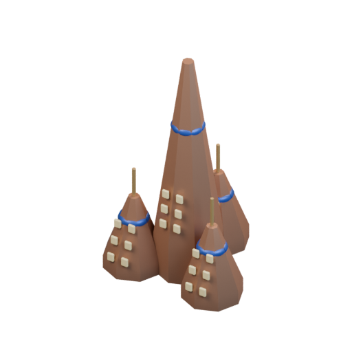

[Blend](../sources/docs/assets/bootstrap-3d/full-catalogue/braccatian/br05/model.blend) · [GLB](../sources/docs/assets/bootstrap-3d/full-catalogue/braccatian/br05/model.glb)

## Longhouse

`openfa:building/legacy/068`

**First available iteration — silhouette-study**

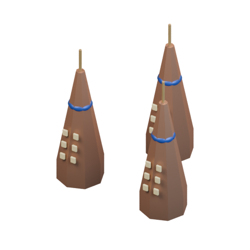

[Blend](../sources/docs/assets/bootstrap-3d/full-catalogue/braccatian/br06/model.blend) · [GLB](../sources/docs/assets/bootstrap-3d/full-catalogue/braccatian/br06/model.glb)

## Sports Hall

`openfa:building/legacy/069`

**First available iteration — silhouette-study**

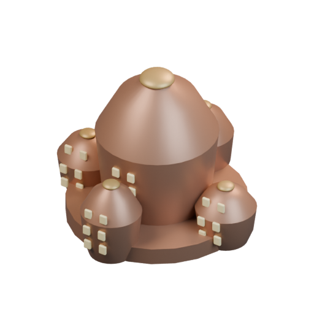

[Blend](../sources/docs/assets/bootstrap-3d/full-catalogue/braccatian/br07/model.blend) · [GLB](../sources/docs/assets/bootstrap-3d/full-catalogue/braccatian/br07/model.glb)

## Field Hospital

`openfa:building/legacy/070`

**First available iteration — silhouette-study**

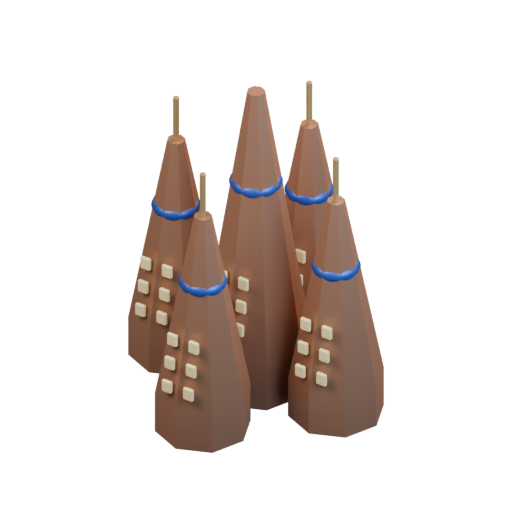

[Blend](../sources/docs/assets/bootstrap-3d/full-catalogue/braccatian/br08/model.blend) · [GLB](../sources/docs/assets/bootstrap-3d/full-catalogue/braccatian/br08/model.glb)

## Glasshouse

`openfa:building/legacy/071`

**First available iteration — silhouette-study**

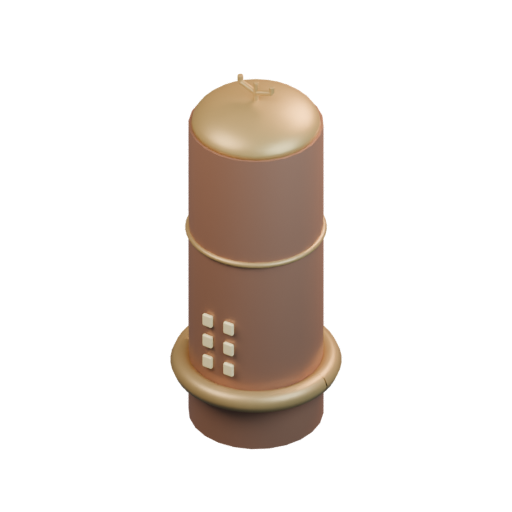

[Blend](../sources/docs/assets/bootstrap-3d/full-catalogue/braccatian/br09/model.blend) · [GLB](../sources/docs/assets/bootstrap-3d/full-catalogue/braccatian/br09/model.glb)

## TechMech

`openfa:building/legacy/072`

**First available iteration — silhouette-study**

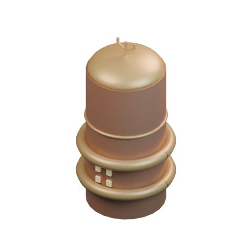

[Blend](../sources/docs/assets/bootstrap-3d/full-catalogue/braccatian/br10/model.blend) · [GLB](../sources/docs/assets/bootstrap-3d/full-catalogue/braccatian/br10/model.glb)

## Launch Site

`openfa:building/legacy/073`

**First available iteration — silhouette-study**

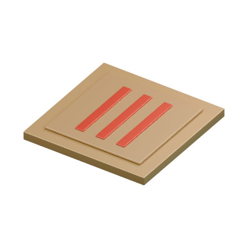

[Blend](../sources/docs/assets/bootstrap-3d/full-catalogue/braccatian/br11/model.blend) · [GLB](../sources/docs/assets/bootstrap-3d/full-catalogue/braccatian/br11/model.glb)

**Additional iteration — verified-launch-mechanism**

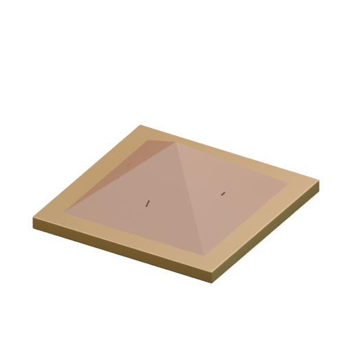

[Blend](../sources/docs/assets/reconstruction/launch-facilities/braccatian/br11/model.blend) · [GLB](../sources/docs/assets/reconstruction/launch-facilities/braccatian/br11/model.glb)

## Eyes-in-the-Sky

`openfa:building/legacy/074`

**First available iteration — silhouette-study**

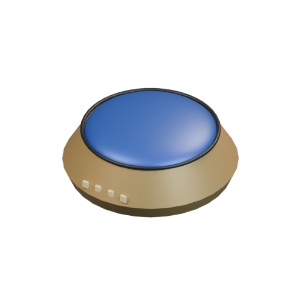

[Blend](../sources/docs/assets/bootstrap-3d/full-catalogue/braccatian/br12/model.blend) · [GLB](../sources/docs/assets/bootstrap-3d/full-catalogue/braccatian/br12/model.glb)

## Eyes-and-Ears

`openfa:building/legacy/075`

**First available iteration — silhouette-study**

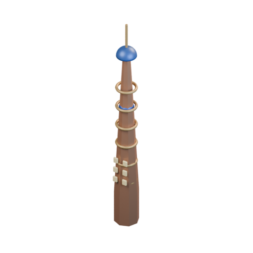

[Blend](../sources/docs/assets/bootstrap-3d/full-catalogue/braccatian/br13/model.blend) · [GLB](../sources/docs/assets/bootstrap-3d/full-catalogue/braccatian/br13/model.glb)

## Anchor

`openfa:building/legacy/076`

**First available iteration — silhouette-study**

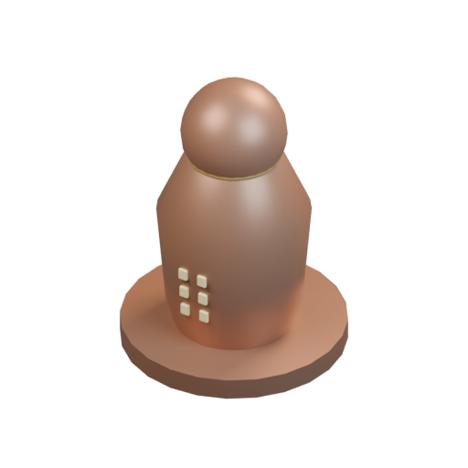

[Blend](../sources/docs/assets/bootstrap-3d/full-catalogue/braccatian/br14/model.blend) · [GLB](../sources/docs/assets/bootstrap-3d/full-catalogue/braccatian/br14/model.glb)

## Heart-of-the-Sun

`openfa:building/legacy/077`

**First available iteration — silhouette-study**

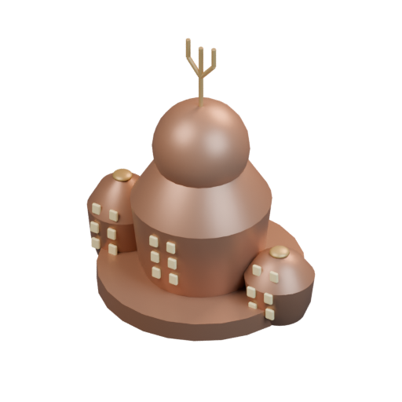

[Blend](../sources/docs/assets/bootstrap-3d/full-catalogue/braccatian/br15/model.blend) · [GLB](../sources/docs/assets/bootstrap-3d/full-catalogue/braccatian/br15/model.glb)

## Aegis

`openfa:building/legacy/078`

**First available iteration — silhouette-study**

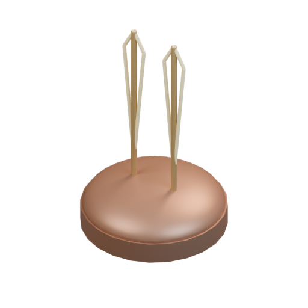

[Blend](../sources/docs/assets/bootstrap-3d/full-catalogue/braccatian/br16/model.blend) · [GLB](../sources/docs/assets/bootstrap-3d/full-catalogue/braccatian/br16/model.glb)

## Forge

`openfa:building/legacy/079`

**First available iteration — silhouette-study**

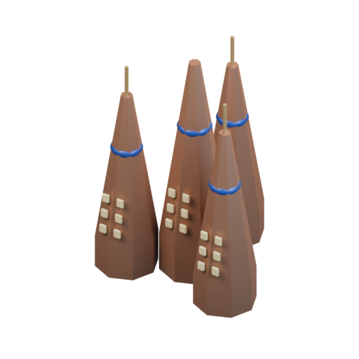

[Blend](../sources/docs/assets/bootstrap-3d/full-catalogue/braccatian/br17/model.blend) · [GLB](../sources/docs/assets/bootstrap-3d/full-catalogue/braccatian/br17/model.glb)

## Anti-Battery

`openfa:building/legacy/080`

**First available iteration — silhouette-study**

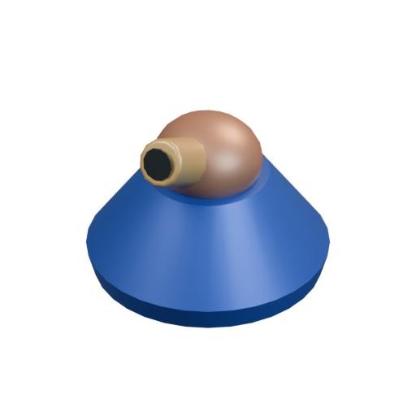

[Blend](../sources/docs/assets/bootstrap-3d/full-catalogue/braccatian/br18/model.blend) · [GLB](../sources/docs/assets/bootstrap-3d/full-catalogue/braccatian/br18/model.glb)

## Battery

`openfa:building/legacy/081`

**First available iteration — silhouette-study**

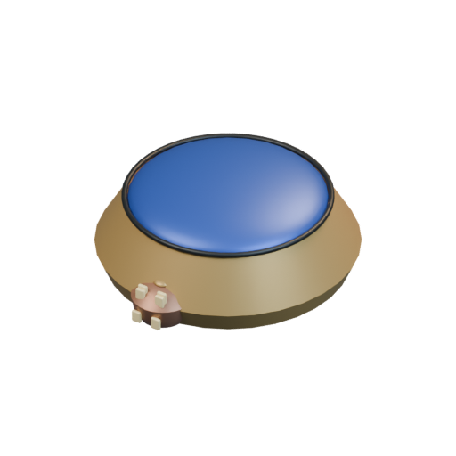

[Blend](../sources/docs/assets/bootstrap-3d/full-catalogue/braccatian/br19/model.blend) · [GLB](../sources/docs/assets/bootstrap-3d/full-catalogue/braccatian/br19/model.glb)

## Turret

`openfa:building/legacy/082`

**First available iteration — silhouette-study**

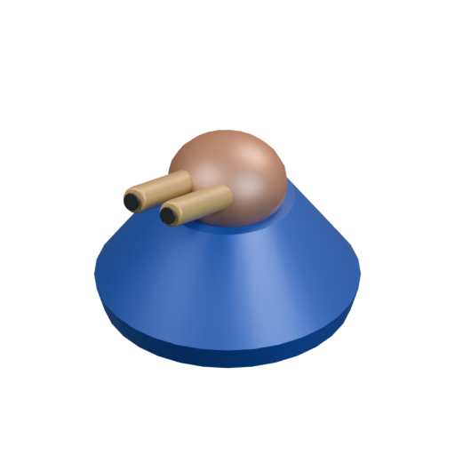

[Blend](../sources/docs/assets/bootstrap-3d/full-catalogue/braccatian/br20/model.blend) · [GLB](../sources/docs/assets/bootstrap-3d/full-catalogue/braccatian/br20/model.glb)

## Subterranean Extractor

`openfa:building/legacy/083`

**First available iteration — silhouette-study**

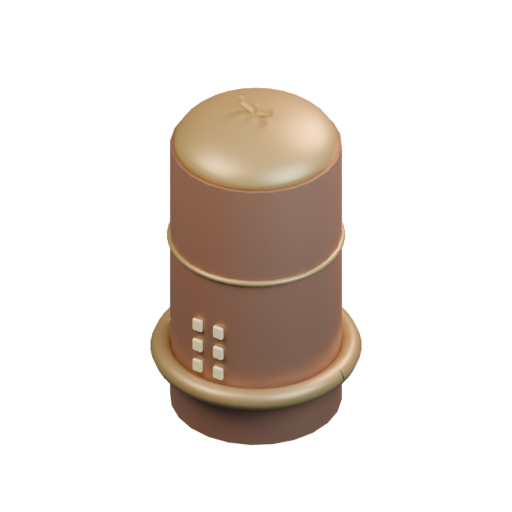

[Blend](../sources/docs/assets/bootstrap-3d/full-catalogue/braccatian/br21/model.blend) · [GLB](../sources/docs/assets/bootstrap-3d/full-catalogue/braccatian/br21/model.glb)

## Pithoi

`openfa:building/legacy/084`

**First available iteration — silhouette-study**

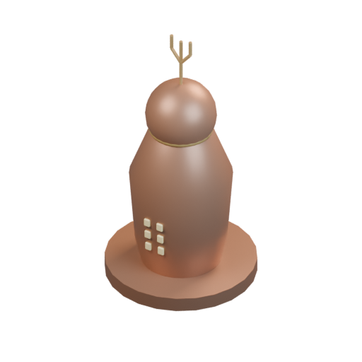

[Blend](../sources/docs/assets/bootstrap-3d/full-catalogue/braccatian/br22/model.blend) · [GLB](../sources/docs/assets/bootstrap-3d/full-catalogue/braccatian/br22/model.glb)

## Fire Power

`openfa:building/legacy/085`

**First available iteration — silhouette-study**

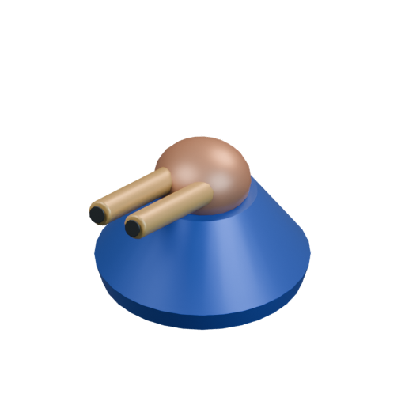

[Blend](../sources/docs/assets/bootstrap-3d/full-catalogue/braccatian/br23/model.blend) · [GLB](../sources/docs/assets/bootstrap-3d/full-catalogue/braccatian/br23/model.glb)
