# Buildings / Braccatian

[All groups](README.md)

## First Step

`openfa:building/legacy/063`

**Canonical version — joined-clan-complex-refinement**

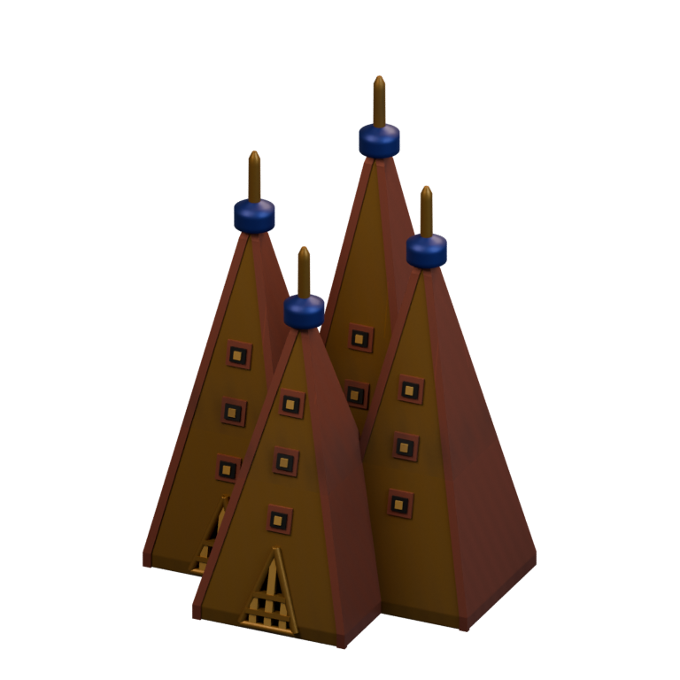

[Blend](../sources/docs/assets/reconstruction/braccatian-refined/br01/model.blend) · [GLB](../sources/docs/assets/reconstruction/braccatian-refined/br01/model.glb)

## Clan Heart

`openfa:building/legacy/064`

**Canonical version — joined-clan-complex-refinement**

[Blend](../sources/docs/assets/reconstruction/braccatian-refined/br02/model.blend) · [GLB](../sources/docs/assets/reconstruction/braccatian-refined/br02/model.glb)

## Radiation Shield

`openfa:building/legacy/065`

**Canonical version — visible-mast-facility-refinement**

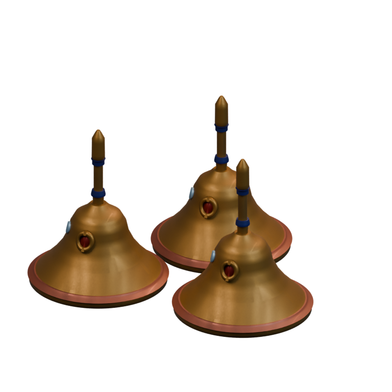

[Blend](../sources/docs/assets/reconstruction/braccatian-refined/br03/model.blend) · [GLB](../sources/docs/assets/reconstruction/braccatian-refined/br03/model.glb)

## Source

`openfa:building/legacy/066`

**Canonical version — visible-vessel-refinement**

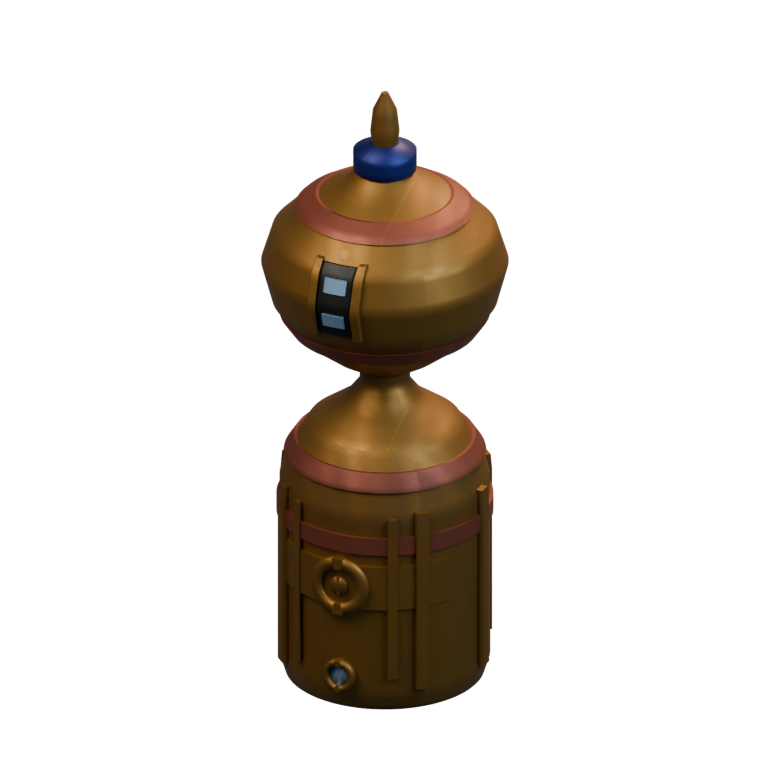

[Blend](../sources/docs/assets/reconstruction/braccatian-refined/br04/model.blend) · [GLB](../sources/docs/assets/reconstruction/braccatian-refined/br04/model.glb)

## Aesir's Hall

`openfa:building/legacy/067`

**Canonical version — joined-clan-complex-refinement**

[Blend](../sources/docs/assets/reconstruction/braccatian-refined/br05/model.blend) · [GLB](../sources/docs/assets/reconstruction/braccatian-refined/br05/model.glb)

## Longhouse

`openfa:building/legacy/068`

**Canonical version — joined-terraced-longhouse-refinement**

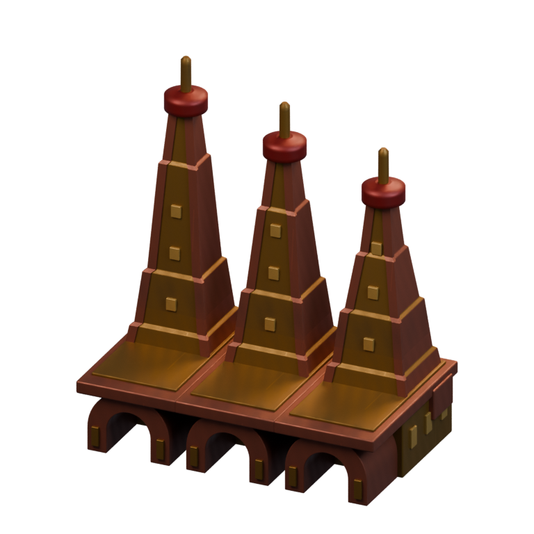

[Blend](../sources/docs/assets/reconstruction/braccatian-refined/br06/model.blend) · [GLB](../sources/docs/assets/reconstruction/braccatian-refined/br06/model.glb)

## Sports Hall

`openfa:building/legacy/069`

**Canonical version — public-facility-structural-refinement**

[Blend](../sources/docs/assets/reconstruction/braccatian-refined/br07/model.blend) · [GLB](../sources/docs/assets/reconstruction/braccatian-refined/br07/model.glb)

## Field Hospital

`openfa:building/legacy/070`

**Canonical version — work-facility-structural-refinement**

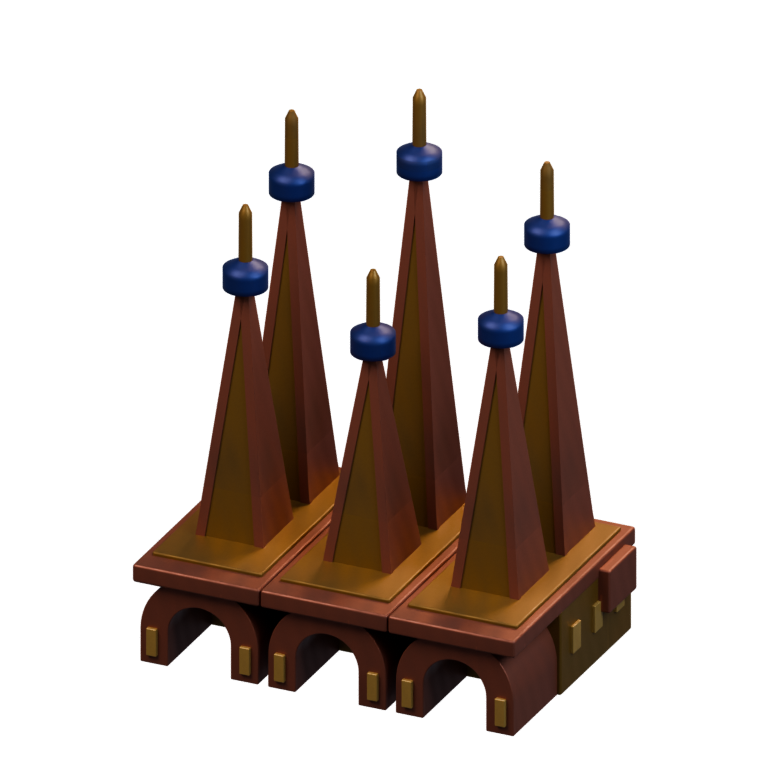

[Blend](../sources/docs/assets/reconstruction/braccatian-refined/br08/model.blend) · [GLB](../sources/docs/assets/reconstruction/braccatian-refined/br08/model.glb)

## Glasshouse

`openfa:building/legacy/071`

**Canonical version — public-facility-structural-refinement**

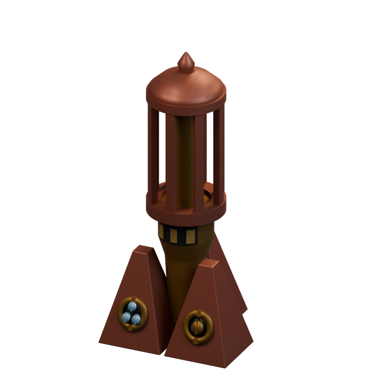

[Blend](../sources/docs/assets/reconstruction/braccatian-refined/br09/model.blend) · [GLB](../sources/docs/assets/reconstruction/braccatian-refined/br09/model.glb)

## TechMech

`openfa:building/legacy/072`

**Canonical version — public-facility-structural-refinement**

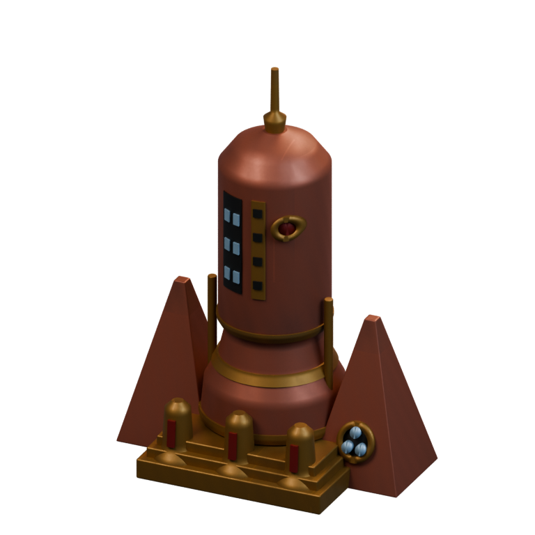

[Blend](../sources/docs/assets/reconstruction/braccatian-refined/br10/model.blend) · [GLB](../sources/docs/assets/reconstruction/braccatian-refined/br10/model.glb)

## Launch Site

`openfa:building/legacy/073`

**Canonical version — launch-casing-refinement**

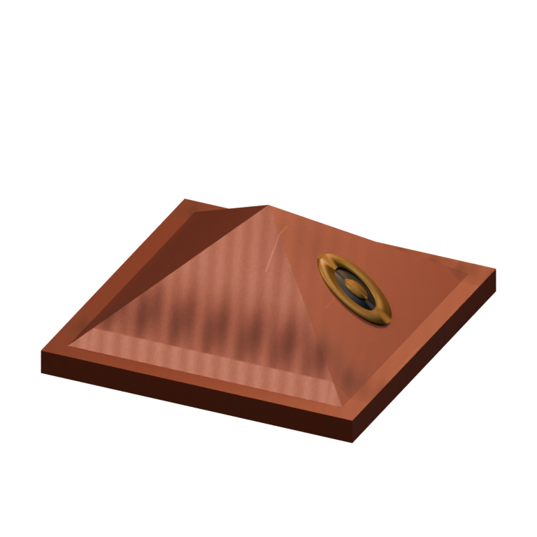

[Blend](../sources/docs/assets/reconstruction/braccatian-refined/br11/model.blend) · [GLB](../sources/docs/assets/reconstruction/braccatian-refined/br11/model.glb)

[Play animation: LaunchFacilityCycle](../gallery/media/docs/assets/reconstruction/braccatian-refined/br11/animation-00.webm)

## Eyes-in-the-Sky

`openfa:building/legacy/074`

**Canonical version — launch-casing-refinement**

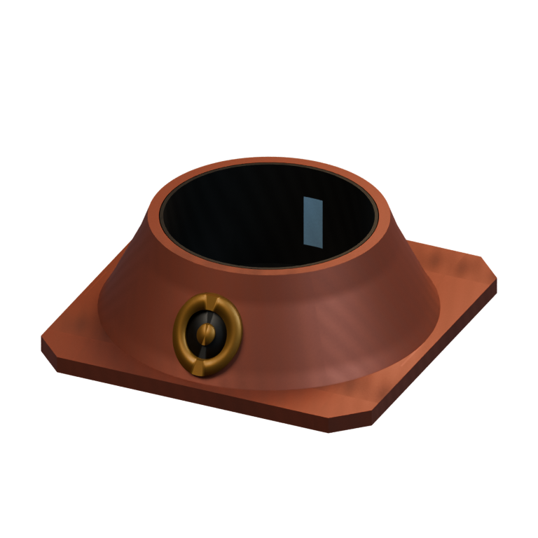

[Blend](../sources/docs/assets/reconstruction/braccatian-refined/br12/model.blend) · [GLB](../sources/docs/assets/reconstruction/braccatian-refined/br12/model.glb)

## Eyes-and-Ears

`openfa:building/legacy/075`

**Canonical version — visible-mast-facility-refinement**

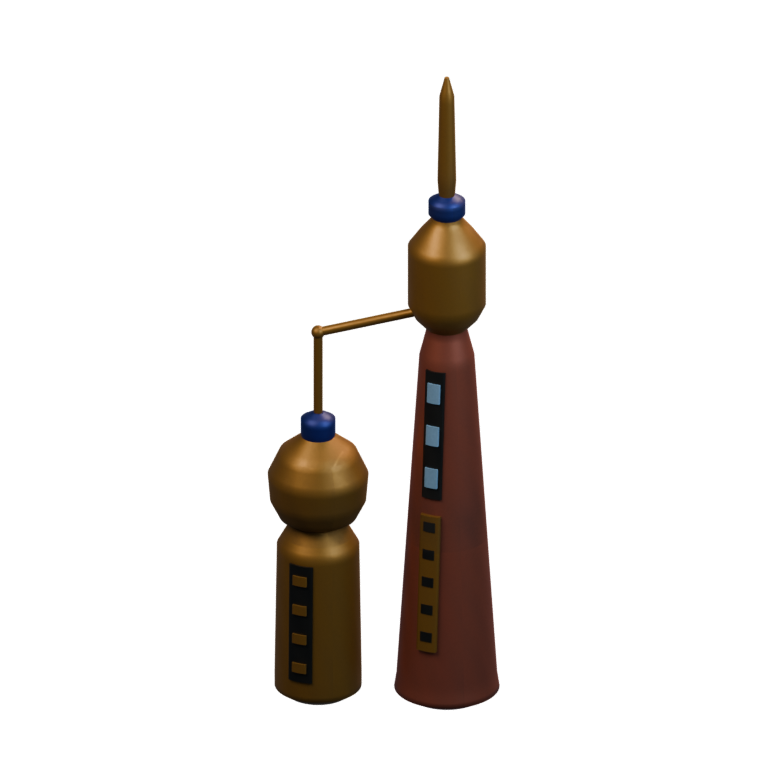

[Blend](../sources/docs/assets/reconstruction/braccatian-refined/br13/model.blend) · [GLB](../sources/docs/assets/reconstruction/braccatian-refined/br13/model.glb)

## Anchor

`openfa:building/legacy/076`

**Canonical version — visible-vessel-refinement**

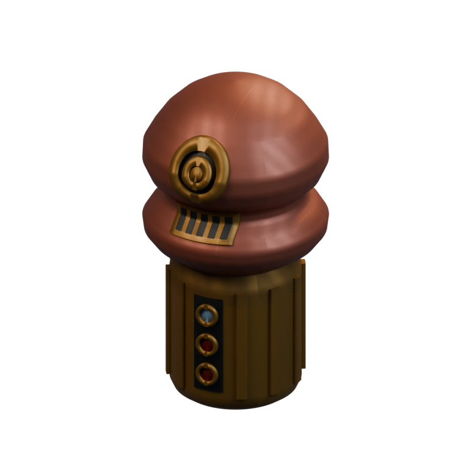

[Blend](../sources/docs/assets/reconstruction/braccatian-refined/br14/model.blend) · [GLB](../sources/docs/assets/reconstruction/braccatian-refined/br14/model.glb)

## Heart-of-the-Sun

`openfa:building/legacy/077`

**Canonical version — visible-vessel-refinement**

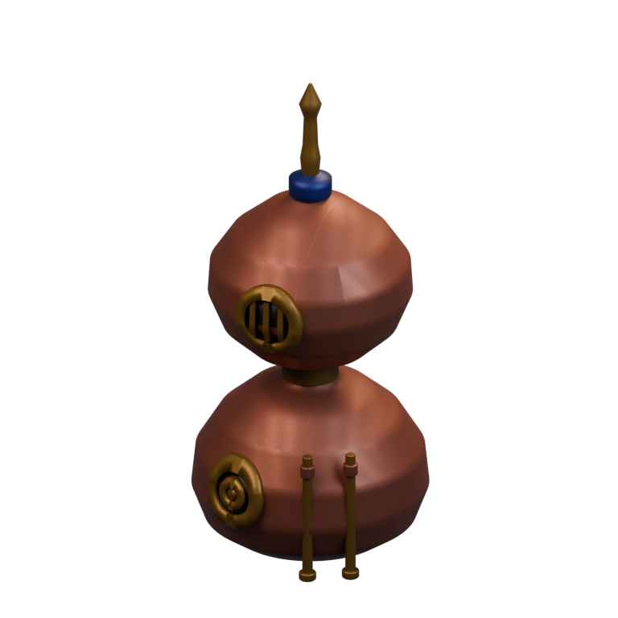

[Blend](../sources/docs/assets/reconstruction/braccatian-refined/br15/model.blend) · [GLB](../sources/docs/assets/reconstruction/braccatian-refined/br15/model.glb)

## Aegis

`openfa:building/legacy/078`

**Canonical version — visible-mast-facility-refinement**

[Blend](../sources/docs/assets/reconstruction/braccatian-refined/br16/model.blend) · [GLB](../sources/docs/assets/reconstruction/braccatian-refined/br16/model.glb)

## Forge

`openfa:building/legacy/079`

**Canonical version — work-facility-structural-refinement**

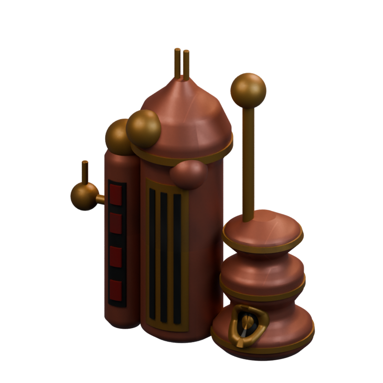

[Blend](../sources/docs/assets/reconstruction/braccatian-refined/br17/model.blend) · [GLB](../sources/docs/assets/reconstruction/braccatian-refined/br17/model.glb)

## Anti-Battery

`openfa:building/legacy/080`

**Canonical version — directional-weapon-refinement**

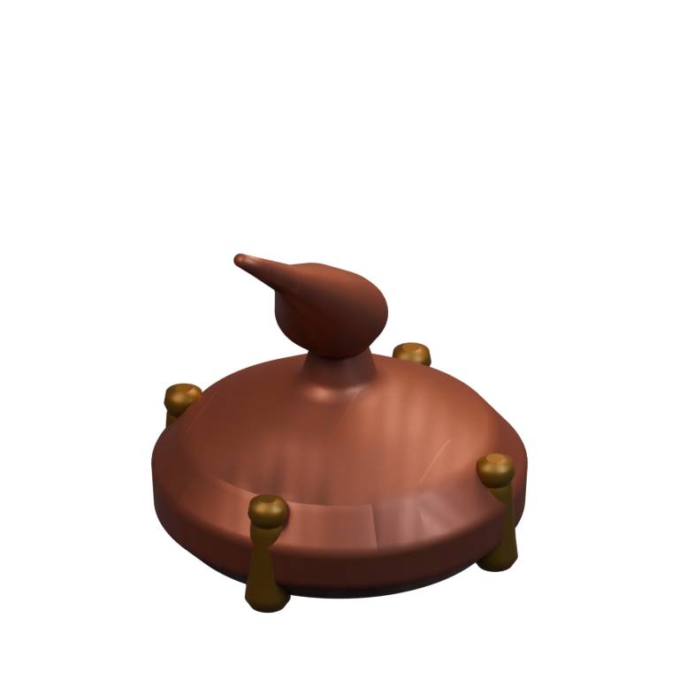

[Blend](../sources/docs/assets/reconstruction/braccatian-refined/br18/model.blend) · [GLB](../sources/docs/assets/reconstruction/braccatian-refined/br18/model.glb)

[Play animation: Animation](../gallery/media/docs/assets/reconstruction/braccatian-refined/br18/animation-00.webm)

## Battery

`openfa:building/legacy/081`

**Canonical version — launch-casing-refinement**

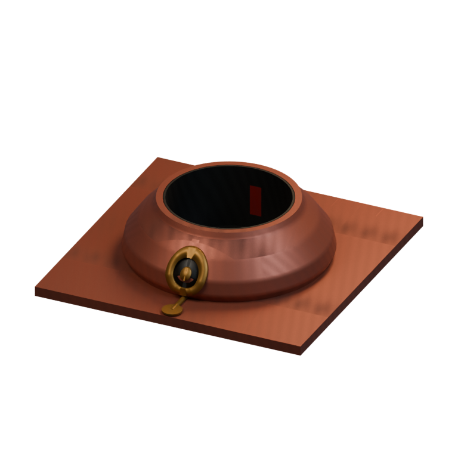

[Blend](../sources/docs/assets/reconstruction/braccatian-refined/br19/model.blend) · [GLB](../sources/docs/assets/reconstruction/braccatian-refined/br19/model.glb)

## Turret

`openfa:building/legacy/082`

**Canonical version — directional-weapon-refinement**

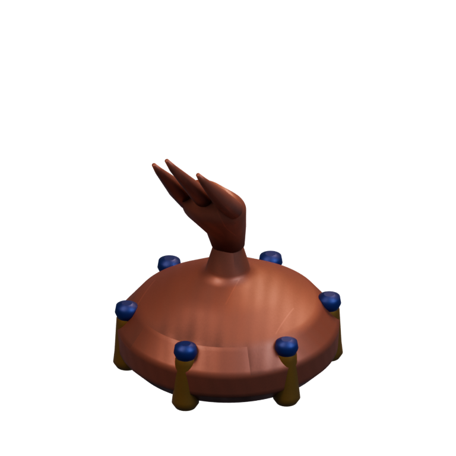

[Blend](../sources/docs/assets/reconstruction/braccatian-refined/br20/model.blend) · [GLB](../sources/docs/assets/reconstruction/braccatian-refined/br20/model.glb)

[Play animation: Animation](../gallery/media/docs/assets/reconstruction/braccatian-refined/br20/animation-00.webm)

## Subterranean Extractor

`openfa:building/legacy/083`

**Canonical version — work-facility-structural-refinement**

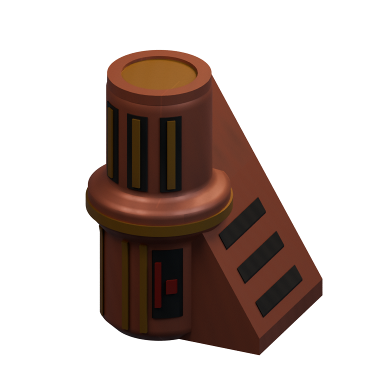

[Blend](../sources/docs/assets/reconstruction/braccatian-refined/br21/model.blend) · [GLB](../sources/docs/assets/reconstruction/braccatian-refined/br21/model.glb)

## Pithoi

`openfa:building/legacy/084`

**Canonical version — visible-jar-refinement**

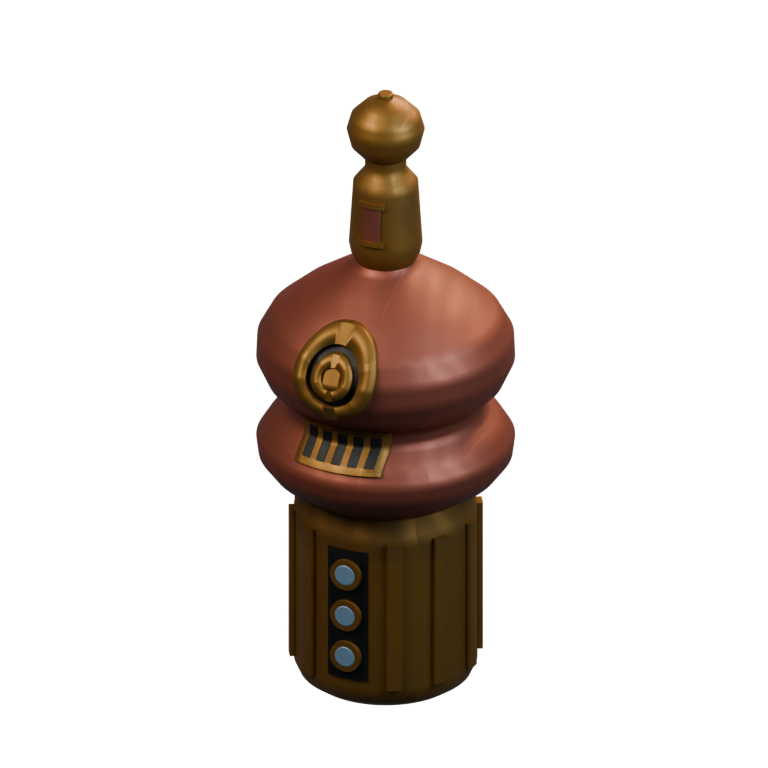

[Blend](../sources/docs/assets/reconstruction/braccatian-refined/br22/model.blend) · [GLB](../sources/docs/assets/reconstruction/braccatian-refined/br22/model.glb)

## Fire Power

`openfa:building/legacy/085`

**Canonical version — directional-weapon-refinement**

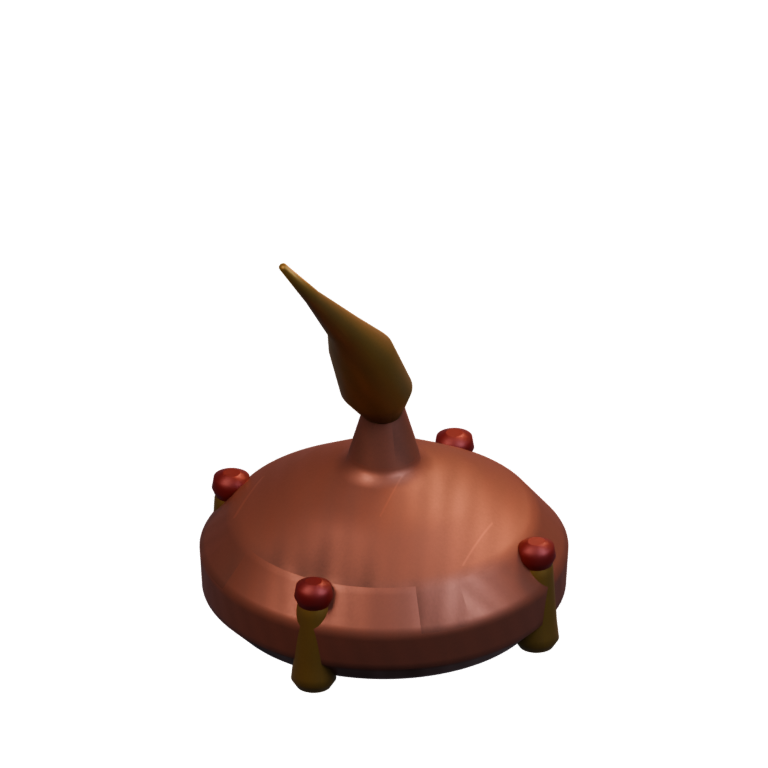

[Blend](../sources/docs/assets/reconstruction/braccatian-refined/br23/model.blend) · [GLB](../sources/docs/assets/reconstruction/braccatian-refined/br23/model.glb)

[Play animation: Animation](../gallery/media/docs/assets/reconstruction/braccatian-refined/br23/animation-00.webm)
