# Buildings / Mauna

[All groups](README.md)

## Base Block

`openfa:building/legacy/130`

**First available iteration — canonical-game-remaster**

[Blend](../sources/objects/mauna/base-block/model.blend) · [GLB](../sources/objects/mauna/base-block/model.glb)

Additional views: [Front](../gallery/media/objects/mauna/base-block/front.png) · [Rear quarter](../gallery/media/objects/mauna/base-block/rear-quarter.png) · [Roof pad and concrete spall](../gallery/media/objects/mauna/base-block/roof-pad-and-concrete-spall-detail.png) · [Recesses and gold-tipped buttresses](../gallery/media/objects/mauna/base-block/recesses-and-gold-tipped-buttresses-detail.png) · [Canonical technical wireframe](../gallery/media/objects/mauna/base-block/technical-wireframe.png) · [Concept and actual GLB](../gallery/media/objects/mauna/base-block/concept-glb-comparison.jpg)

## Shielding Block

`openfa:building/legacy/131`

**First available iteration — canonical-game-remaster**

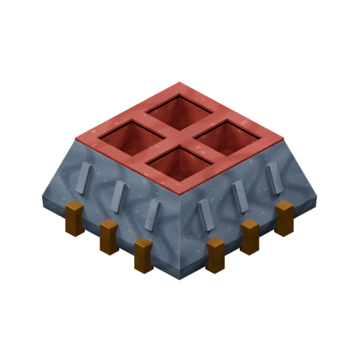

[Blend](../sources/objects/mauna/shielding-block/model.blend) · [GLB](../sources/objects/mauna/shielding-block/model.glb)

Additional views: [Front](../gallery/media/objects/mauna/shielding-block/front.png) · [Rear quarter](../gallery/media/objects/mauna/shielding-block/rear-quarter.png) · [Four red roof wells](../gallery/media/objects/mauna/shielding-block/four-red-roof-wells-detail.png) · [Pale ribs and brass feet](../gallery/media/objects/mauna/shielding-block/pale-ribs-and-brass-feet-detail.png) · [Canonical technical wireframe](../gallery/media/objects/mauna/shielding-block/technical-wireframe.png) · [Concept and actual GLB](../gallery/media/objects/mauna/shielding-block/concept-glb-comparison.jpg)

## Nutrition Block

`openfa:building/legacy/132`

**First available iteration — canonical-game-remaster**

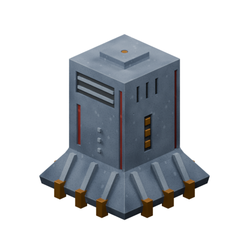

[Blend](../sources/objects/mauna/nutrition-block/model.blend) · [GLB](../sources/objects/mauna/nutrition-block/model.glb)

Additional views: [Front](../gallery/media/objects/mauna/nutrition-block/front.png) · [Rear quarter](../gallery/media/objects/mauna/nutrition-block/rear-quarter.png) · [Low roof cap and small point](../gallery/media/objects/mauna/nutrition-block/low-roof-cap-and-small-point-detail.png) · [Service recesses and base buttresses](../gallery/media/objects/mauna/nutrition-block/service-recesses-and-base-buttresses-detail.png) · [Canonical technical wireframe](../gallery/media/objects/mauna/nutrition-block/technical-wireframe.png) · [Concept and actual GLB](../gallery/media/objects/mauna/nutrition-block/concept-glb-comparison.jpg)

## Off-duty Block

`openfa:building/legacy/133`

**First available iteration — canonical-game-remaster**

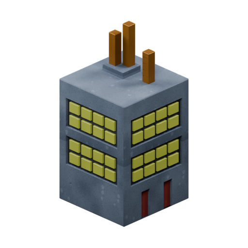

[Blend](../sources/objects/mauna/off-duty-block/model.blend) · [GLB](../sources/objects/mauna/off-duty-block/model.glb)

Additional views: [Front](../gallery/media/objects/mauna/off-duty-block/front.png) · [Rear quarter](../gallery/media/objects/mauna/off-duty-block/rear-quarter.png) · [Three roof stacks and plinth](../gallery/media/objects/mauna/off-duty-block/three-roof-stacks-and-plinth-detail.png) · [Recessed window banks and red panels](../gallery/media/objects/mauna/off-duty-block/recessed-window-banks-and-red-panels-detail.png) · [Canonical technical wireframe](../gallery/media/objects/mauna/off-duty-block/technical-wireframe.png) · [Concept and actual GLB](../gallery/media/objects/mauna/off-duty-block/concept-glb-comparison.jpg)

## Health Block

`openfa:building/legacy/134`

**First available iteration — canonical-game-remaster**

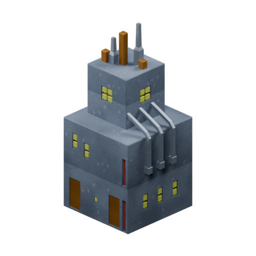

[Blend](../sources/objects/mauna/health-block/model.blend) · [GLB](../sources/objects/mauna/health-block/model.glb)

Additional views: [Front](../gallery/media/objects/mauna/health-block/front.png) · [Rear quarter](../gallery/media/objects/mauna/health-block/rear-quarter.png) · [Five roof elements](../gallery/media/objects/mauna/health-block/five-roof-elements-detail.png) · [Three attached conduits and service fields](../gallery/media/objects/mauna/health-block/three-attached-conduits-and-service-fields-detail.png) · [Canonical technical wireframe](../gallery/media/objects/mauna/health-block/technical-wireframe.png) · [Concept and actual GLB](../gallery/media/objects/mauna/health-block/concept-glb-comparison.jpg)

## The Cube

`openfa:building/legacy/135`

**First available iteration — canonical-game-remaster**

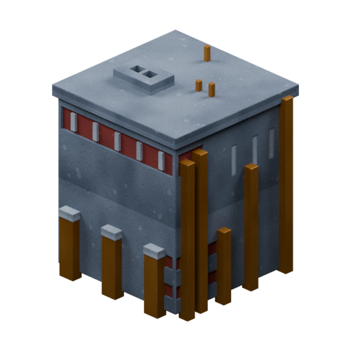

[Blend](../sources/objects/mauna/the-cube/model.blend) · [GLB](../sources/objects/mauna/the-cube/model.glb)

Additional views: [Front](../gallery/media/objects/mauna/the-cube/front.png) · [Rear quarter](../gallery/media/objects/mauna/the-cube/rear-quarter.png) · [Slotted roof block and three pins](../gallery/media/objects/mauna/the-cube/slotted-roof-block-and-three-pins-detail.png) · [Red bands,pale slits and unequal staves](../gallery/media/objects/mauna/the-cube/red-bands-pale-slits-and-unequal-staves-detail.png) · [Canonical technical wireframe](../gallery/media/objects/mauna/the-cube/technical-wireframe.png) · [Concept and actual GLB](../gallery/media/objects/mauna/the-cube/concept-glb-comparison.jpg)

## Elite Block

`openfa:building/legacy/136`

**First available iteration — canonical-game-remaster**

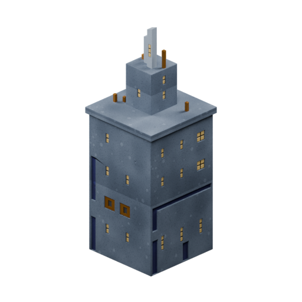

[Blend](../sources/objects/mauna/elite-block/model.blend) · [GLB](../sources/objects/mauna/elite-block/model.glb)

Additional views: [Front](../gallery/media/objects/mauna/elite-block/front.png) · [Rear quarter](../gallery/media/objects/mauna/elite-block/rear-quarter.png) · [Split sensor mast and five roof pins](../gallery/media/objects/mauna/elite-block/split-sensor-mast-and-roof-pins-detail.png) · [Blue L and command panels](../gallery/media/objects/mauna/elite-block/blue-l-field-and-command-panels-detail.png) · [Canonical technical wireframe](../gallery/media/objects/mauna/elite-block/technical-wireframe.png) · [Concept and actual GLB](../gallery/media/objects/mauna/elite-block/concept-glb-comparison.jpg)

## Construction Area

`openfa:building/legacy/137`

**First available iteration — canonical-game-remaster**

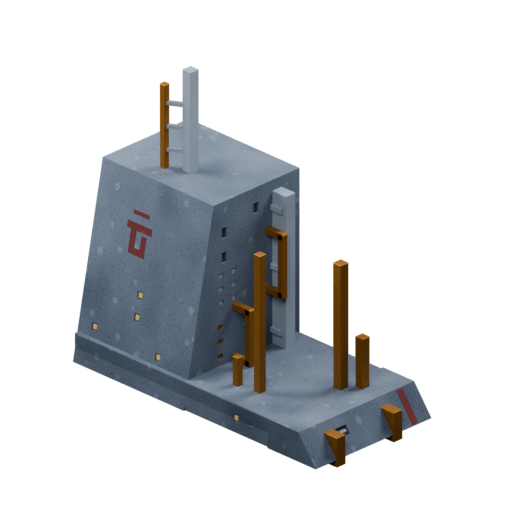

[Blend](../sources/objects/mauna/construction-area/model.blend) · [GLB](../sources/objects/mauna/construction-area/model.glb)

Additional views: [Front](../gallery/media/objects/mauna/construction-area/front.png) · [Rear quarter](../gallery/media/objects/mauna/construction-area/rear-quarter.png) · [Paired roof mast and service uprights](../gallery/media/objects/mauna/construction-area/paired-roof-mast-and-service-uprights-detail.png) · [Inclined emblem wall and service nose](../gallery/media/objects/mauna/construction-area/inclined-emblem-and-service-nose-detail.png) · [Canonical technical wireframe](../gallery/media/objects/mauna/construction-area/technical-wireframe.png) · [Concept and actual GLB](../gallery/media/objects/mauna/construction-area/concept-glb-comparison.jpg)

## Launch Area

`openfa:building/legacy/138`

**First available iteration — canonical-game-remaster**

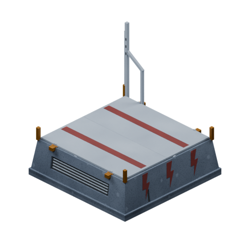

[Blend](../sources/objects/mauna/launch-area/model.blend) · [GLB](../sources/objects/mauna/launch-area/model.glb)

Additional views: [Front](../gallery/media/objects/mauna/launch-area/front.png) · [Rear quarter](../gallery/media/objects/mauna/launch-area/rear-quarter.png) · [Braced mast and source markings](../gallery/media/objects/mauna/launch-area/braced-mast-and-source-markings-detail.png) · [Downward doors and hinge bearings](../gallery/media/objects/mauna/launch-area/downward-doors-and-hinge-bearings-detail.png) · [Canonical technical wireframe](../gallery/media/objects/mauna/launch-area/technical-wireframe.png) · [Concept and actual GLB](../gallery/media/objects/mauna/launch-area/concept-glb-comparison.jpg) · [Fully open launch shaft](../gallery/media/objects/mauna/launch-area/imported-open-front-quarter.png) · [Mauna Type5 clearance at proposal40](../gallery/media/objects/mauna/launch-area/clearance-surveillance-craft-type-5.png) · [Mauna Type1.5 clearance at proposal56 aligned45deg](../gallery/media/objects/mauna/launch-area/clearance-combat-craft-type-1-5.png) · [Supplementary Terran Assault Fighter](../gallery/media/objects/mauna/launch-area/clearance-assault-fighter.png) · [Supplementary Terran Combat Eagle](../gallery/media/objects/mauna/launch-area/clearance-combat-eagle.png) · [Supplementary Terran Scoutship](../gallery/media/objects/mauna/launch-area/clearance-scoutship.png)

[Play animation: LaunchFacilityCycle](../gallery/media/objects/mauna/launch-area/animation-00.webm)

## Satellite Pad

`openfa:building/legacy/139`

**First available iteration — canonical-game-remaster**

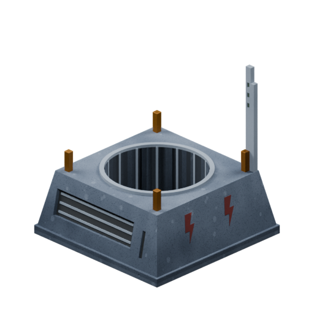

[Blend](../sources/objects/mauna/satellite-pad/model.blend) · [GLB](../sources/objects/mauna/satellite-pad/model.glb)

Additional views: [Front](../gallery/media/objects/mauna/satellite-pad/front.png) · [Rear quarter](../gallery/media/objects/mauna/satellite-pad/rear-quarter.png) · [Open well rim and inner flutes](../gallery/media/objects/mauna/satellite-pad/open-well-rim-and-flutes-detail.png) · [Single mast and source markings](../gallery/media/objects/mauna/satellite-pad/single-mast-and-source-markings-detail.png) · [Canonical technical wireframe](../gallery/media/objects/mauna/satellite-pad/technical-wireframe.png) · [Concept and actual GLB](../gallery/media/objects/mauna/satellite-pad/concept-glb-comparison.jpg)

## Fast Breeder Reactor

`openfa:building/legacy/140`

**First available iteration — canonical-game-remaster**

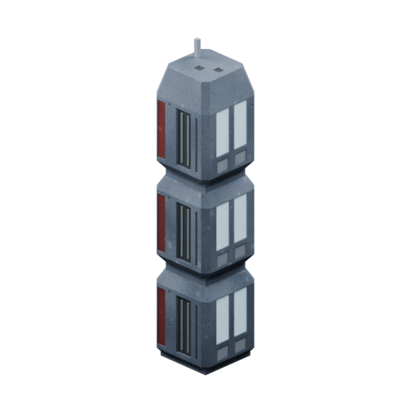

[Blend](../sources/objects/mauna/fast-breeder-reactor/model.blend) · [GLB](../sources/objects/mauna/fast-breeder-reactor/model.glb)

Additional views: [Front](../gallery/media/objects/mauna/fast-breeder-reactor/front.png) · [Rear quarter](../gallery/media/objects/mauna/fast-breeder-reactor/rear-quarter.png) · [Physically connected module waists](../gallery/media/objects/mauna/fast-breeder-reactor/connected-module-waists-detail.png) · [Paired service fields and roof](../gallery/media/objects/mauna/fast-breeder-reactor/paired-service-fields-and-roof-detail.png) · [Canonical technical wireframe](../gallery/media/objects/mauna/fast-breeder-reactor/technical-wireframe.png) · [Concept and actual GLB](../gallery/media/objects/mauna/fast-breeder-reactor/concept-glb-comparison.jpg)

## Arms Block

`openfa:building/legacy/141`

**First available iteration — canonical-game-remaster**

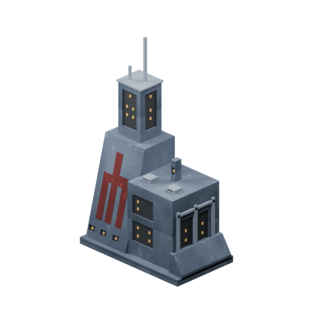

[Blend](../sources/objects/mauna/arms-block/model.blend) · [GLB](../sources/objects/mauna/arms-block/model.glb)

Additional views: [Front](../gallery/media/objects/mauna/arms-block/front.png) · [Rear quarter](../gallery/media/objects/mauna/arms-block/rear-quarter.png) · [Tower, masts and source warm fields](../gallery/media/objects/mauna/arms-block/tower-masts-and-warm-fields-detail.png) · [Inclined red emblem and connected service block](../gallery/media/objects/mauna/arms-block/red-emblem-and-service-block-detail.png) · [Canonical technical wireframe](../gallery/media/objects/mauna/arms-block/technical-wireframe.png) · [Concept and actual GLB](../gallery/media/objects/mauna/arms-block/concept-glb-comparison.jpg)

## Defence Pods

`openfa:building/legacy/142`

**First available iteration — canonical-game-remaster**

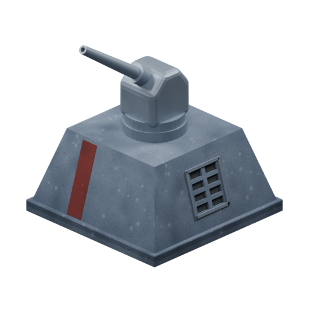

[Blend](../sources/objects/mauna/defence-pods/model.blend) · [GLB](../sources/objects/mauna/defence-pods/model.glb)

Additional views: [Front](../gallery/media/objects/mauna/defence-pods/front.png) · [Rear quarter](../gallery/media/objects/mauna/defence-pods/rear-quarter.png) · [Compact head and single recessed barrel](../gallery/media/objects/mauna/defence-pods/head-and-single-recessed-barrel-detail.png) · [Cast base, red strip and eight vent cells](../gallery/media/objects/mauna/defence-pods/cast-base-red-strip-and-eight-cell-vent-detail.png) · [Canonical technical wireframe](../gallery/media/objects/mauna/defence-pods/technical-wireframe.png) · [Concept and actual GLB](../gallery/media/objects/mauna/defence-pods/concept-glb-comparison.jpg)

[Play animation: Animation](../gallery/media/objects/mauna/defence-pods/animation-00.webm)

## Attack Pods

`openfa:building/legacy/143`

**First available iteration — canonical-game-remaster**

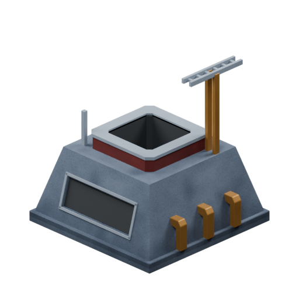

[Blend](../sources/objects/mauna/attack-pods/model.blend) · [GLB](../sources/objects/mauna/attack-pods/model.glb)

Additional views: [Front](../gallery/media/objects/mauna/attack-pods/front.png) · [Rear quarter](../gallery/media/objects/mauna/attack-pods/rear-quarter.png) · [Open well, red band and supported crosshead](../gallery/media/objects/mauna/attack-pods/open-well-red-band-and-supported-crosshead-detail.png) · [Three bent brass fittings and cast recess](../gallery/media/objects/mauna/attack-pods/three-bent-brass-fittings-and-cast-recess-detail.png) · [Canonical technical wireframe](../gallery/media/objects/mauna/attack-pods/technical-wireframe.png) · [Concept and actual GLB](../gallery/media/objects/mauna/attack-pods/concept-glb-comparison.jpg)

## Pulse Tower

`openfa:building/legacy/144`

**First available iteration — canonical-game-remaster**

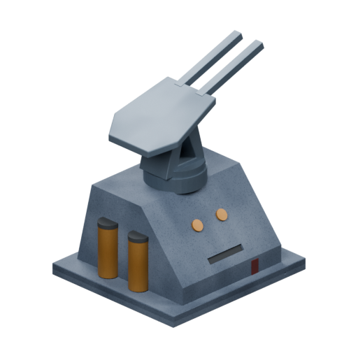

[Blend](../sources/objects/mauna/pulse-tower/model.blend) · [GLB](../sources/objects/mauna/pulse-tower/model.glb)

Additional views: [Front](../gallery/media/objects/mauna/pulse-tower/front.png) · [Rear quarter](../gallery/media/objects/mauna/pulse-tower/rear-quarter.png) · [Fork head and real triangular support](../gallery/media/objects/mauna/pulse-tower/fork-head-and-triangular-support-detail.png) · [Two reservoirs and opaque front fittings](../gallery/media/objects/mauna/pulse-tower/two-reservoirs-and-front-fittings-detail.png) · [Canonical technical wireframe](../gallery/media/objects/mauna/pulse-tower/technical-wireframe.png) · [Concept and actual GLB](../gallery/media/objects/mauna/pulse-tower/concept-glb-comparison.jpg)

[Play animation: Animation](../gallery/media/objects/mauna/pulse-tower/animation-00.webm)

## Screening Pods

`openfa:building/legacy/145`

**First available iteration — canonical-game-remaster**

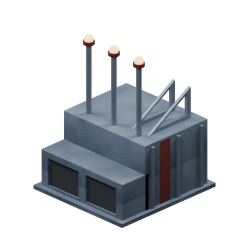

[Blend](../sources/objects/mauna/screening-pods/model.blend) · [GLB](../sources/objects/mauna/screening-pods/model.glb)

Additional views: [Front](../gallery/media/objects/mauna/screening-pods/front.png) · [Rear quarter](../gallery/media/objects/mauna/screening-pods/rear-quarter.png) · [Three warm caps and open roof brackets](../gallery/media/objects/mauna/screening-pods/three-warm-caps-and-open-roof-brackets-detail.png) · [Two front fields and red side stripe](../gallery/media/objects/mauna/screening-pods/two-front-recesses-and-red-side-flutes-detail.png) · [Canonical technical wireframe](../gallery/media/objects/mauna/screening-pods/technical-wireframe.png) · [Concept and actual GLB](../gallery/media/objects/mauna/screening-pods/concept-glb-comparison.jpg)

## Advanced Extraction Unit

`openfa:building/legacy/146`

**First available iteration — canonical-game-remaster**

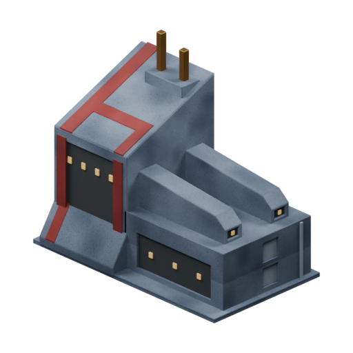

[Blend](../sources/objects/mauna/advanced-extraction-unit/model.blend) · [GLB](../sources/objects/mauna/advanced-extraction-unit/model.glb)

Additional views: [Front](../gallery/media/objects/mauna/advanced-extraction-unit/front.png) · [Rear quarter](../gallery/media/objects/mauna/advanced-extraction-unit/rear-quarter.png) · [Inclined red crown, two brass posts and four points](../gallery/media/objects/mauna/advanced-extraction-unit/inclined-red-crown-two-brass-posts-and-four-points-detail.png) · [Two ducts, front points and stacked end fields](../gallery/media/objects/mauna/advanced-extraction-unit/two-roof-ducts-front-points-and-stacked-end-fields-detail.png) · [Canonical technical wireframe](../gallery/media/objects/mauna/advanced-extraction-unit/technical-wireframe.png) · [Concept and actual GLB](../gallery/media/objects/mauna/advanced-extraction-unit/concept-glb-comparison.jpg)

## Superior Extraction Unit

`openfa:building/legacy/147`

**First available iteration — silhouette-study**

[Blend](../sources/docs/assets/bootstrap-3d/full-catalogue/mauna/mn18/model.blend) · [GLB](../sources/docs/assets/bootstrap-3d/full-catalogue/mauna/mn18/model.glb)

## Ores Block

`openfa:building/legacy/148`

**First available iteration — silhouette-study**

[Blend](../sources/docs/assets/bootstrap-3d/full-catalogue/mauna/mn19/model.blend) · [GLB](../sources/docs/assets/bootstrap-3d/full-catalogue/mauna/mn19/model.glb)

## Motion Units

`openfa:building/legacy/149`

**First available iteration — silhouette-study**

[Blend](../sources/docs/assets/bootstrap-3d/full-catalogue/mauna/mn20/model.blend) · [GLB](../sources/docs/assets/bootstrap-3d/full-catalogue/mauna/mn20/model.glb)

## Laser Boost

`openfa:building/legacy/150`

**First available iteration — silhouette-study**

[Blend](../sources/docs/assets/bootstrap-3d/full-catalogue/mauna/mn21/model.blend) · [GLB](../sources/docs/assets/bootstrap-3d/full-catalogue/mauna/mn21/model.glb)

[Play animation: Animation](../gallery/media/docs/assets/bootstrap-3d/full-catalogue/mauna/mn21/animation-00.webm)
