# Buildings / Mauna

[All groups](README.md)

## Base Block

`openfa:building/legacy/130`

**First available iteration — canonical-game-remaster**

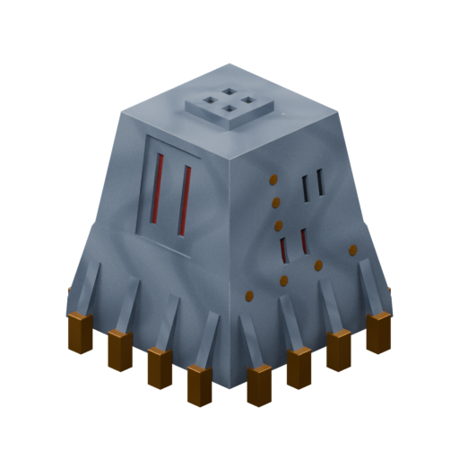

[Blend](../sources/objects/mauna/base-block/model.blend) · [GLB](../sources/objects/mauna/base-block/model.glb)

Additional views: [Front](../gallery/media/objects/mauna/base-block/front.png) · [Rear quarter](../gallery/media/objects/mauna/base-block/rear-quarter.png) · [Roof pad and concrete spall](../gallery/media/objects/mauna/base-block/roof-pad-and-concrete-spall-detail.png) · [Recesses and gold-tipped buttresses](../gallery/media/objects/mauna/base-block/recesses-and-gold-tipped-buttresses-detail.png) · [Canonical technical wireframe](../gallery/media/objects/mauna/base-block/technical-wireframe.png) · [Concept and actual GLB](../gallery/media/objects/mauna/base-block/concept-glb-comparison.jpg)

## Shielding Block

`openfa:building/legacy/131`

**First available iteration — silhouette-study**

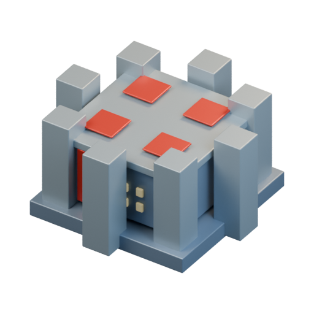

[Blend](../sources/docs/assets/bootstrap-3d/full-catalogue/mauna/mn02/model.blend) · [GLB](../sources/docs/assets/bootstrap-3d/full-catalogue/mauna/mn02/model.glb)

## Nutrition Block

`openfa:building/legacy/132`

**First available iteration — silhouette-study**

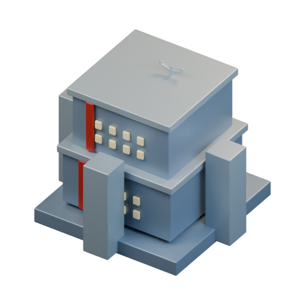

[Blend](../sources/docs/assets/bootstrap-3d/full-catalogue/mauna/mn03/model.blend) · [GLB](../sources/docs/assets/bootstrap-3d/full-catalogue/mauna/mn03/model.glb)

## Off-duty Block

`openfa:building/legacy/133`

**First available iteration — silhouette-study**

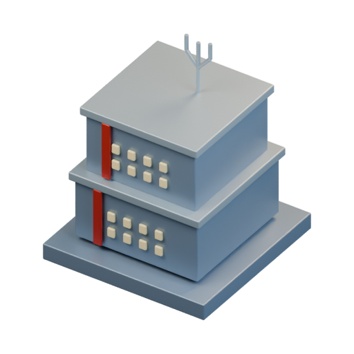

[Blend](../sources/docs/assets/bootstrap-3d/full-catalogue/mauna/mn04/model.blend) · [GLB](../sources/docs/assets/bootstrap-3d/full-catalogue/mauna/mn04/model.glb)

## Health Block

`openfa:building/legacy/134`

**First available iteration — silhouette-study**

[Blend](../sources/docs/assets/bootstrap-3d/full-catalogue/mauna/mn05/model.blend) · [GLB](../sources/docs/assets/bootstrap-3d/full-catalogue/mauna/mn05/model.glb)

## The Cube

`openfa:building/legacy/135`

**First available iteration — silhouette-study**

[Blend](../sources/docs/assets/bootstrap-3d/full-catalogue/mauna/mn06/model.blend) · [GLB](../sources/docs/assets/bootstrap-3d/full-catalogue/mauna/mn06/model.glb)

## Elite Block

`openfa:building/legacy/136`

**First available iteration — silhouette-study**

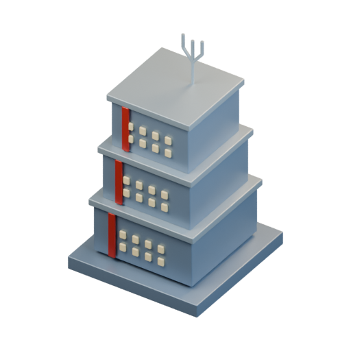

[Blend](../sources/docs/assets/bootstrap-3d/full-catalogue/mauna/mn07/model.blend) · [GLB](../sources/docs/assets/bootstrap-3d/full-catalogue/mauna/mn07/model.glb)

## Construction Area

`openfa:building/legacy/137`

**First available iteration — silhouette-study**

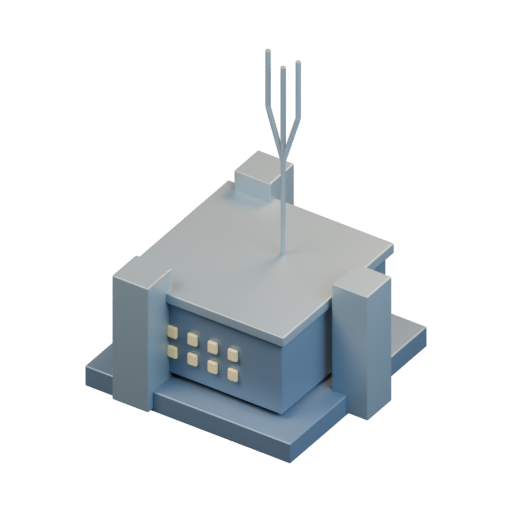

[Blend](../sources/docs/assets/bootstrap-3d/full-catalogue/mauna/mn08/model.blend) · [GLB](../sources/docs/assets/bootstrap-3d/full-catalogue/mauna/mn08/model.glb)

## Launch Area

`openfa:building/legacy/138`

**First available iteration — silhouette-study**

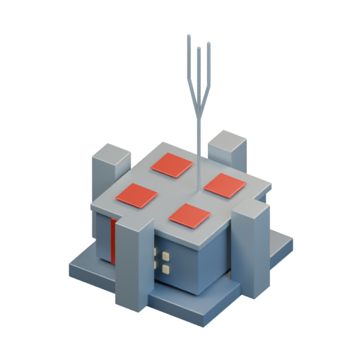

[Blend](../sources/docs/assets/bootstrap-3d/full-catalogue/mauna/mn09/model.blend) · [GLB](../sources/docs/assets/bootstrap-3d/full-catalogue/mauna/mn09/model.glb)

**Additional iteration — verified-launch-mechanism**

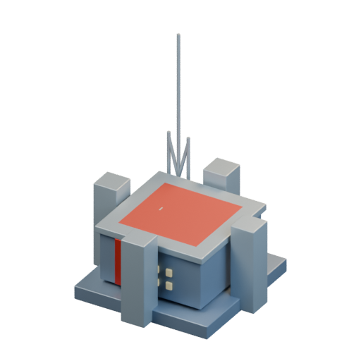

[Blend](../sources/docs/assets/reconstruction/launch-facilities/mauna/mn09/model.blend) · [GLB](../sources/docs/assets/reconstruction/launch-facilities/mauna/mn09/model.glb)

[Play animation: LaunchFacilityCycle](../gallery/media/docs/assets/reconstruction/launch-facilities/mauna/mn09/animation-00.webm)

## Satellite Pad

`openfa:building/legacy/139`

**First available iteration — silhouette-study**

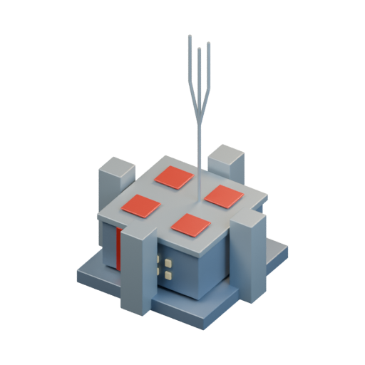

[Blend](../sources/docs/assets/bootstrap-3d/full-catalogue/mauna/mn10/model.blend) · [GLB](../sources/docs/assets/bootstrap-3d/full-catalogue/mauna/mn10/model.glb)

**Additional iteration — verified-launch-mechanism**

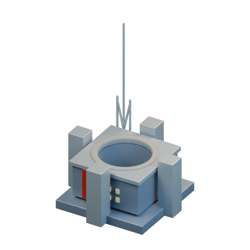

[Blend](../sources/docs/assets/reconstruction/launch-facilities/mauna/mn10/model.blend) · [GLB](../sources/docs/assets/reconstruction/launch-facilities/mauna/mn10/model.glb)

## Fast Breeder Reactor

`openfa:building/legacy/140`

**First available iteration — silhouette-study**

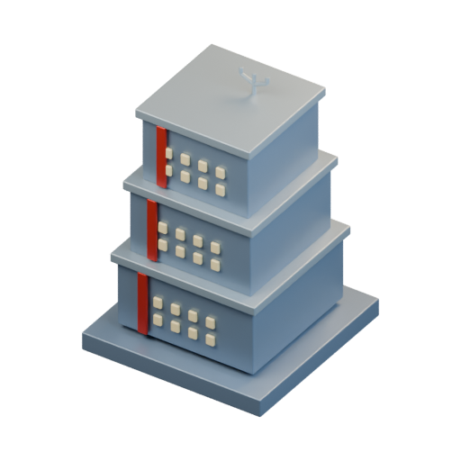

[Blend](../sources/docs/assets/bootstrap-3d/full-catalogue/mauna/mn11/model.blend) · [GLB](../sources/docs/assets/bootstrap-3d/full-catalogue/mauna/mn11/model.glb)

## Arms Block

`openfa:building/legacy/141`

**First available iteration — silhouette-study**

[Blend](../sources/docs/assets/bootstrap-3d/full-catalogue/mauna/mn12/model.blend) · [GLB](../sources/docs/assets/bootstrap-3d/full-catalogue/mauna/mn12/model.glb)

## Defence Pods

`openfa:building/legacy/142`

**First available iteration — silhouette-study**

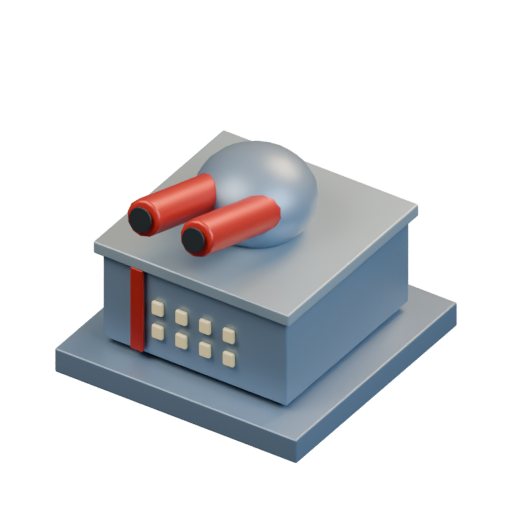

[Blend](../sources/docs/assets/bootstrap-3d/full-catalogue/mauna/mn13/model.blend) · [GLB](../sources/docs/assets/bootstrap-3d/full-catalogue/mauna/mn13/model.glb)

[Play animation: Animation](../gallery/media/docs/assets/bootstrap-3d/full-catalogue/mauna/mn13/animation-00.webm)

## Attack Pods

`openfa:building/legacy/143`

**First available iteration — silhouette-study**

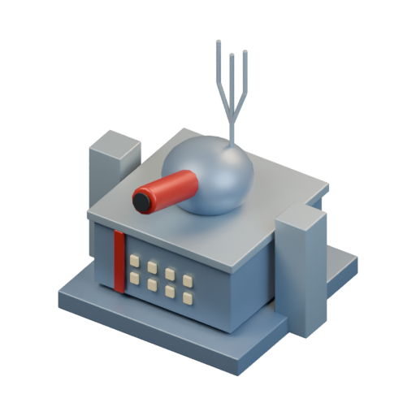

[Blend](../sources/docs/assets/bootstrap-3d/full-catalogue/mauna/mn14/model.blend) · [GLB](../sources/docs/assets/bootstrap-3d/full-catalogue/mauna/mn14/model.glb)

[Play animation: Animation](../gallery/media/docs/assets/bootstrap-3d/full-catalogue/mauna/mn14/animation-00.webm)

**Additional iteration — verified-launch-mechanism**

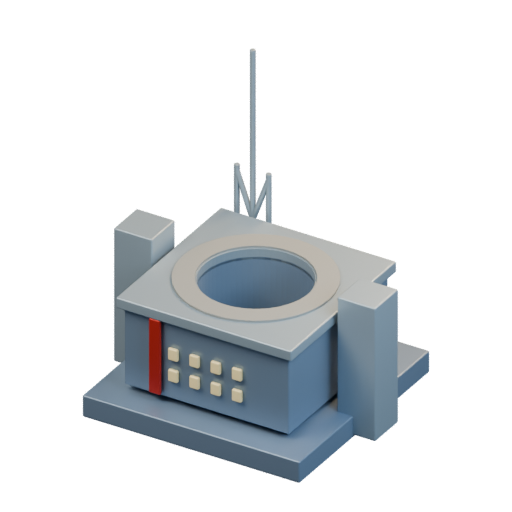

[Blend](../sources/docs/assets/reconstruction/launch-facilities/mauna/mn14/model.blend) · [GLB](../sources/docs/assets/reconstruction/launch-facilities/mauna/mn14/model.glb)

## Pulse Tower

`openfa:building/legacy/144`

**First available iteration — silhouette-study**

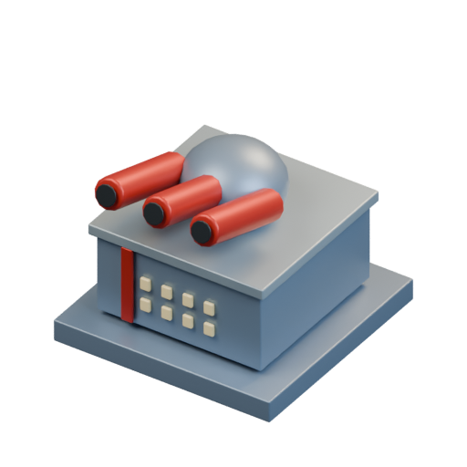

[Blend](../sources/docs/assets/bootstrap-3d/full-catalogue/mauna/mn15/model.blend) · [GLB](../sources/docs/assets/bootstrap-3d/full-catalogue/mauna/mn15/model.glb)

[Play animation: Animation](../gallery/media/docs/assets/bootstrap-3d/full-catalogue/mauna/mn15/animation-00.webm)

## Screening Pods

`openfa:building/legacy/145`

**First available iteration — silhouette-study**

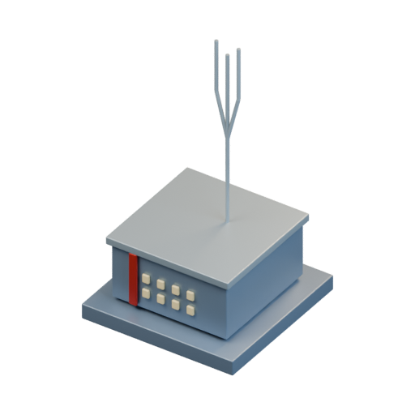

[Blend](../sources/docs/assets/bootstrap-3d/full-catalogue/mauna/mn16/model.blend) · [GLB](../sources/docs/assets/bootstrap-3d/full-catalogue/mauna/mn16/model.glb)

## Advanced Extraction Unit

`openfa:building/legacy/146`

**First available iteration — silhouette-study**

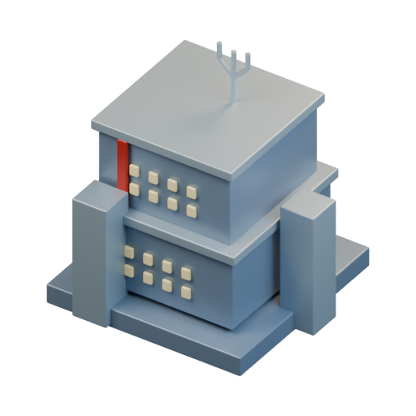

[Blend](../sources/docs/assets/bootstrap-3d/full-catalogue/mauna/mn17/model.blend) · [GLB](../sources/docs/assets/bootstrap-3d/full-catalogue/mauna/mn17/model.glb)

## Superior Extraction Unit

`openfa:building/legacy/147`

**First available iteration — silhouette-study**

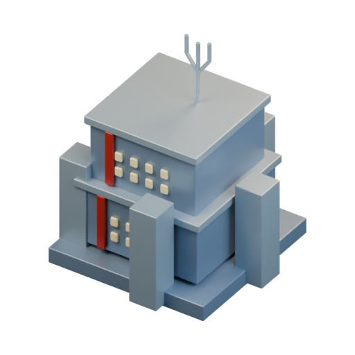

[Blend](../sources/docs/assets/bootstrap-3d/full-catalogue/mauna/mn18/model.blend) · [GLB](../sources/docs/assets/bootstrap-3d/full-catalogue/mauna/mn18/model.glb)

## Ores Block

`openfa:building/legacy/148`

**First available iteration — silhouette-study**

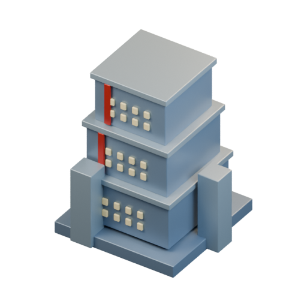

[Blend](../sources/docs/assets/bootstrap-3d/full-catalogue/mauna/mn19/model.blend) · [GLB](../sources/docs/assets/bootstrap-3d/full-catalogue/mauna/mn19/model.glb)

## Motion Units

`openfa:building/legacy/149`

**First available iteration — silhouette-study**

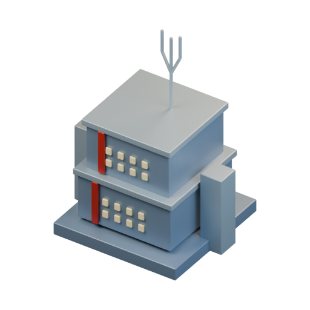

[Blend](../sources/docs/assets/bootstrap-3d/full-catalogue/mauna/mn20/model.blend) · [GLB](../sources/docs/assets/bootstrap-3d/full-catalogue/mauna/mn20/model.glb)

## Laser Boost

`openfa:building/legacy/150`

**First available iteration — silhouette-study**

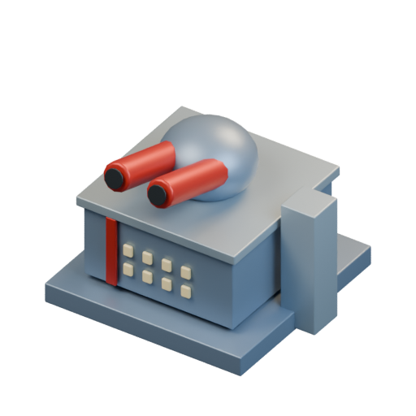

[Blend](../sources/docs/assets/bootstrap-3d/full-catalogue/mauna/mn21/model.blend) · [GLB](../sources/docs/assets/bootstrap-3d/full-catalogue/mauna/mn21/model.glb)

[Play animation: Animation](../gallery/media/docs/assets/bootstrap-3d/full-catalogue/mauna/mn21/animation-00.webm)
