# Buildings / Mikotaj

[All groups](README.md)

## Base Crystal

`openfa:building/legacy/086`

**Canonical version — canonical-game-remaster**

[Blend](../sources/objects/mikotaj/base-crystal/model.blend) · [GLB](../sources/objects/mikotaj/base-crystal/model.glb)

Additional views: [Front](../gallery/media/objects/mikotaj/base-crystal/front.png) · [Rear quarter](../gallery/media/objects/mikotaj/base-crystal/rear-quarter.png) · [Canonical technical wireframe](../gallery/media/objects/mikotaj/base-crystal/technical-wireframe.png) · [Concept and actual GLB](../gallery/media/objects/mikotaj/base-crystal/concept-glb-comparison.jpg)

## Stability

`openfa:building/legacy/087`

**Canonical version — canonical-game-remaster**

[Blend](../sources/objects/mikotaj/stability/model.blend) · [GLB](../sources/objects/mikotaj/stability/model.glb)

Additional views: [Front](../gallery/media/objects/mikotaj/stability/front.png) · [Rear quarter](../gallery/media/objects/mikotaj/stability/rear-quarter.png) · [Canonical technical wireframe](../gallery/media/objects/mikotaj/stability/technical-wireframe.png) · [Concept and actual GLB](../gallery/media/objects/mikotaj/stability/concept-glb-comparison.jpg)

## Purity

`openfa:building/legacy/088`

**Canonical version — canonical-game-remaster**

[Blend](../sources/objects/mikotaj/purity/model.blend) · [GLB](../sources/objects/mikotaj/purity/model.glb)

Additional views: [Front](../gallery/media/objects/mikotaj/purity/front.png) · [Rear quarter](../gallery/media/objects/mikotaj/purity/rear-quarter.png) · [Canonical technical wireframe](../gallery/media/objects/mikotaj/purity/technical-wireframe.png) · [Concept and actual GLB](../gallery/media/objects/mikotaj/purity/concept-glb-comparison.jpg)

## Fulfilment

`openfa:building/legacy/089`

**Canonical version — canonical-game-remaster**

[Blend](../sources/objects/mikotaj/fulfilment/model.blend) · [GLB](../sources/objects/mikotaj/fulfilment/model.glb)

Additional views: [Front](../gallery/media/objects/mikotaj/fulfilment/front.png) · [Rear quarter](../gallery/media/objects/mikotaj/fulfilment/rear-quarter.png) · [Canonical technical wireframe](../gallery/media/objects/mikotaj/fulfilment/technical-wireframe.png) · [Concept and actual GLB](../gallery/media/objects/mikotaj/fulfilment/concept-glb-comparison.jpg)

## Internal

`openfa:building/legacy/090`

**Canonical version — canonical-game-remaster**

[Blend](../sources/objects/mikotaj/internal/model.blend) · [GLB](../sources/objects/mikotaj/internal/model.glb)

Additional views: [Front](../gallery/media/objects/mikotaj/internal/front.png) · [Rear quarter](../gallery/media/objects/mikotaj/internal/rear-quarter.png) · [Canonical technical wireframe](../gallery/media/objects/mikotaj/internal/technical-wireframe.png) · [Concept and actual GLB](../gallery/media/objects/mikotaj/internal/concept-glb-comparison.jpg)

## Dream

`openfa:building/legacy/091`

**Canonical version — canonical-game-remaster**

[Blend](../sources/objects/mikotaj/dream/model.blend) · [GLB](../sources/objects/mikotaj/dream/model.glb)

Additional views: [Front](../gallery/media/objects/mikotaj/dream/front.png) · [Rear quarter](../gallery/media/objects/mikotaj/dream/rear-quarter.png) · [Canonical technical wireframe](../gallery/media/objects/mikotaj/dream/technical-wireframe.png) · [Concept and actual GLB](../gallery/media/objects/mikotaj/dream/concept-glb-comparison.jpg)

## Resonance

`openfa:building/legacy/092`

**Canonical version — canonical-game-remaster**

[Blend](../sources/objects/mikotaj/resonance/model.blend) · [GLB](../sources/objects/mikotaj/resonance/model.glb)

Additional views: [Front](../gallery/media/objects/mikotaj/resonance/front.png) · [Rear quarter](../gallery/media/objects/mikotaj/resonance/rear-quarter.png) · [Canonical technical wireframe](../gallery/media/objects/mikotaj/resonance/technical-wireframe.png) · [Concept and actual GLB](../gallery/media/objects/mikotaj/resonance/concept-glb-comparison.jpg)

## Fa-lanth

`openfa:building/legacy/093`

**Canonical version — canonical-game-remaster**

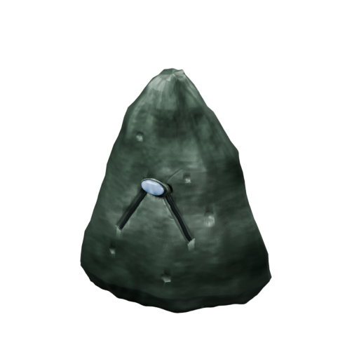

[Blend](../sources/objects/mikotaj/fa-lanth/model.blend) · [GLB](../sources/objects/mikotaj/fa-lanth/model.glb)

Additional views: [Front](../gallery/media/objects/mikotaj/fa-lanth/front.png) · [Rear quarter](../gallery/media/objects/mikotaj/fa-lanth/rear-quarter.png) · [Canonical technical wireframe](../gallery/media/objects/mikotaj/fa-lanth/technical-wireframe.png) · [Concept and actual GLB](../gallery/media/objects/mikotaj/fa-lanth/concept-glb-comparison.jpg)

## Mask

`openfa:building/legacy/094`

**Canonical version — canonical-game-remaster**

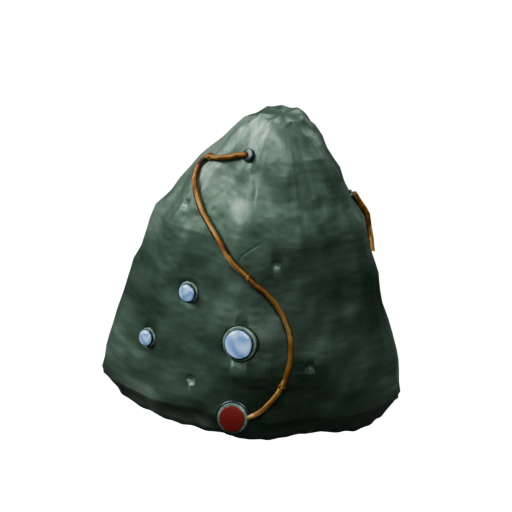

[Blend](../sources/objects/mikotaj/mask/model.blend) · [GLB](../sources/objects/mikotaj/mask/model.glb)

Additional views: [Front](../gallery/media/objects/mikotaj/mask/front.png) · [Rear quarter](../gallery/media/objects/mikotaj/mask/rear-quarter.png) · [Canonical technical wireframe](../gallery/media/objects/mikotaj/mask/technical-wireframe.png) · [Concept and actual GLB](../gallery/media/objects/mikotaj/mask/concept-glb-comparison.jpg)

## Structures Matrix

`openfa:building/legacy/095`

**Canonical version — canonical-game-remaster**

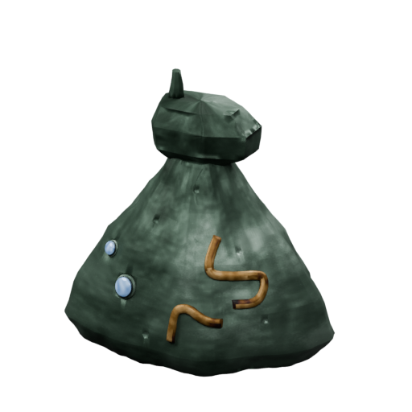

[Blend](../sources/objects/mikotaj/structures-matrix/model.blend) · [GLB](../sources/objects/mikotaj/structures-matrix/model.glb)

Additional views: [Front](../gallery/media/objects/mikotaj/structures-matrix/front.png) · [Rear quarter](../gallery/media/objects/mikotaj/structures-matrix/rear-quarter.png) · [Canonical technical wireframe](../gallery/media/objects/mikotaj/structures-matrix/technical-wireframe.png) · [Concept and actual GLB](../gallery/media/objects/mikotaj/structures-matrix/concept-glb-comparison.jpg)

## Volition

`openfa:building/legacy/096`

**Canonical version — canonical-game-remaster**

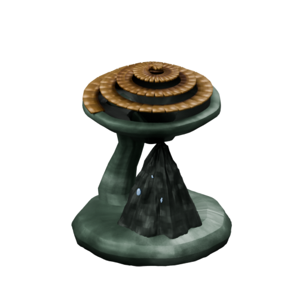

[Blend](../sources/objects/mikotaj/volition/model.blend) · [GLB](../sources/objects/mikotaj/volition/model.glb)

Additional views: [Front](../gallery/media/objects/mikotaj/volition/front.png) · [Rear quarter](../gallery/media/objects/mikotaj/volition/rear-quarter.png) · [Canonical technical wireframe](../gallery/media/objects/mikotaj/volition/technical-wireframe.png) · [Spiral fully open](../gallery/media/objects/mikotaj/volition/state-open.png) · [Concept and actual GLB](../gallery/media/objects/mikotaj/volition/concept-glb-comparison.jpg)

[Play animation: LaunchFacilityCycle](../gallery/media/objects/mikotaj/volition/animation-00.webm)

## Visibility

`openfa:building/legacy/097`

**Canonical version — canonical-game-remaster**

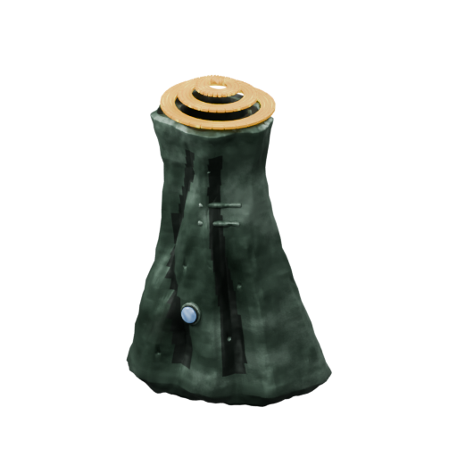

[Blend](../sources/objects/mikotaj/visibility/model.blend) · [GLB](../sources/objects/mikotaj/visibility/model.glb)

Additional views: [Front](../gallery/media/objects/mikotaj/visibility/front.png) · [Rear quarter](../gallery/media/objects/mikotaj/visibility/rear-quarter.png) · [Canonical technical wireframe](../gallery/media/objects/mikotaj/visibility/technical-wireframe.png) · [Spiral fully open](../gallery/media/objects/mikotaj/visibility/state-open.png) · [Concept and actual GLB](../gallery/media/objects/mikotaj/visibility/concept-glb-comparison.jpg)

[Play animation: LaunchFacilityCycle](../gallery/media/objects/mikotaj/visibility/animation-00.webm)

## Perception

`openfa:building/legacy/098`

**Canonical version — canonical-game-remaster**

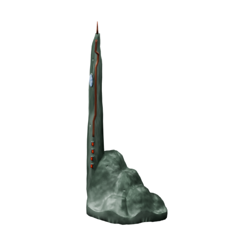

[Blend](../sources/objects/mikotaj/perception/model.blend) · [GLB](../sources/objects/mikotaj/perception/model.glb)

Additional views: [Front](../gallery/media/objects/mikotaj/perception/front.png) · [Rear quarter](../gallery/media/objects/mikotaj/perception/rear-quarter.png) · [Upper inset detail](../gallery/media/objects/mikotaj/perception/upper-inset-detail.png) · [Lower status cells detail](../gallery/media/objects/mikotaj/perception/lower-status-detail.png) · [Mineral foundation detail](../gallery/media/objects/mikotaj/perception/foundation-detail.png) · [Canonical technical wireframe](../gallery/media/objects/mikotaj/perception/technical-wireframe.png) · [Concept and actual GLB](../gallery/media/objects/mikotaj/perception/concept-glb-comparison.jpg)

## Capacitors

`openfa:building/legacy/099`

**Canonical version — canonical-game-remaster**

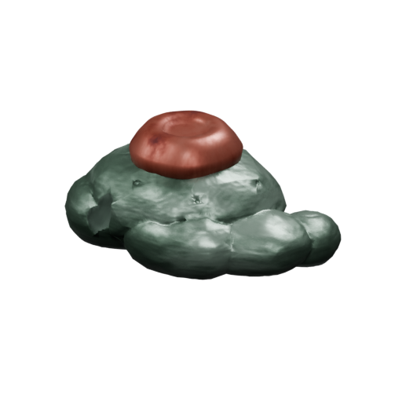

[Blend](../sources/objects/mikotaj/capacitors/model.blend) · [GLB](../sources/objects/mikotaj/capacitors/model.glb)

Additional views: [Front](../gallery/media/objects/mikotaj/capacitors/front.png) · [Rear quarter](../gallery/media/objects/mikotaj/capacitors/rear-quarter.png) · [Copper crown detail](../gallery/media/objects/mikotaj/capacitors/copper-crown-detail.png) · [Mineral cleft detail](../gallery/media/objects/mikotaj/capacitors/mineral-cleft-detail.png) · [Canonical technical wireframe](../gallery/media/objects/mikotaj/capacitors/technical-wireframe.png) · [Concept and actual GLB](../gallery/media/objects/mikotaj/capacitors/concept-glb-comparison.jpg)

## Lanth

`openfa:building/legacy/100`

**Canonical version — canonical-game-remaster**

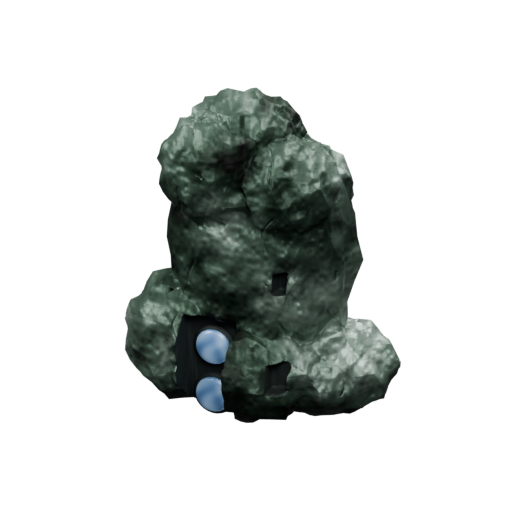

[Blend](../sources/objects/mikotaj/lanth/model.blend) · [GLB](../sources/objects/mikotaj/lanth/model.glb)

Additional views: [Front](../gallery/media/objects/mikotaj/lanth/front.png) · [Rear quarter](../gallery/media/objects/mikotaj/lanth/rear-quarter.png) · [Paired front lens detail](../gallery/media/objects/mikotaj/lanth/paired-lens-detail.png) · [Upper mineral detail](../gallery/media/objects/mikotaj/lanth/upper-mineral-detail.png) · [Canonical technical wireframe](../gallery/media/objects/mikotaj/lanth/technical-wireframe.png) · [Concept and actual GLB](../gallery/media/objects/mikotaj/lanth/concept-glb-comparison.jpg)

## Sharir

`openfa:building/legacy/101`

**Canonical version — canonical-game-remaster**

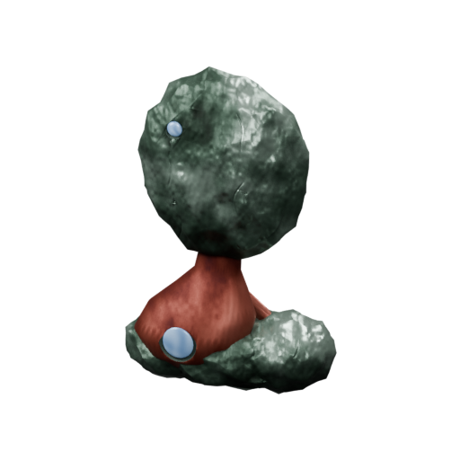

[Blend](../sources/objects/mikotaj/sharir/model.blend) · [GLB](../sources/objects/mikotaj/sharir/model.glb)

Additional views: [Front](../gallery/media/objects/mikotaj/sharir/front.png) · [Rear quarter](../gallery/media/objects/mikotaj/sharir/rear-quarter.png) · [Lower copper fitting and inset](../gallery/media/objects/mikotaj/sharir/lower-copper-detail.png) · [Upper mineral detail](../gallery/media/objects/mikotaj/sharir/upper-mineral-detail.png) · [Canonical technical wireframe](../gallery/media/objects/mikotaj/sharir/technical-wireframe.png) · [Concept and actual GLB](../gallery/media/objects/mikotaj/sharir/concept-glb-comparison.jpg)

## Shrekn

`openfa:building/legacy/102`

**Canonical version — canonical-game-remaster**

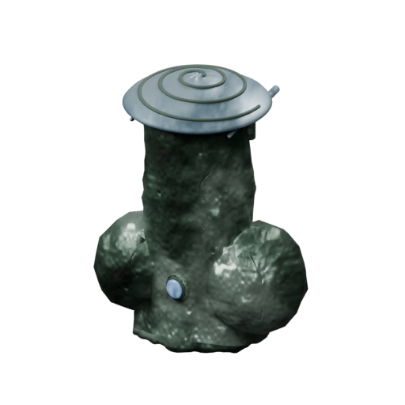

[Blend](../sources/objects/mikotaj/shrekn/model.blend) · [GLB](../sources/objects/mikotaj/shrekn/model.glb)

Additional views: [Front](../gallery/media/objects/mikotaj/shrekn/front.png) · [Rear quarter](../gallery/media/objects/mikotaj/shrekn/rear-quarter.png) · [Canonical technical wireframe](../gallery/media/objects/mikotaj/shrekn/technical-wireframe.png) · [Rigid cap fully rear-stowed](../gallery/media/objects/mikotaj/shrekn/state-open.png) · [Silver cap detail](../gallery/media/objects/mikotaj/shrekn/silver-cap-detail.png) · [Actual rear guides](../gallery/media/objects/mikotaj/shrekn/rear-guides-detail.png) · [Concept and actual GLB](../gallery/media/objects/mikotaj/shrekn/concept-glb-comparison.jpg)

[Play animation: LaunchFacilityCycle](../gallery/media/objects/mikotaj/shrekn/animation-00.webm)

## Ruth-feror

`openfa:building/legacy/103`

**Canonical version — canonical-game-remaster**

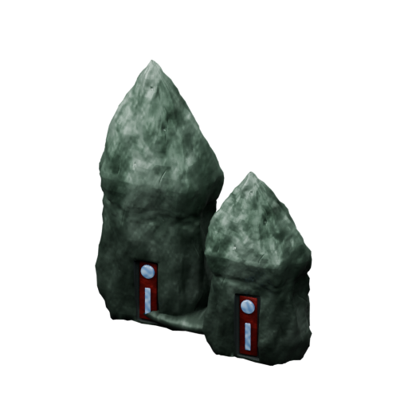

[Blend](../sources/objects/mikotaj/ruth-feror/model.blend) · [GLB](../sources/objects/mikotaj/ruth-feror/model.glb)

Additional views: [Front](../gallery/media/objects/mikotaj/ruth-feror/front.png) · [Rear quarter](../gallery/media/objects/mikotaj/ruth-feror/rear-quarter.png) · [Front socket pair](../gallery/media/objects/mikotaj/ruth-feror/socket-pair-detail.png) · [Mineral pinnacle detail](../gallery/media/objects/mikotaj/ruth-feror/mineral-pinnacle-detail.png) · [Canonical technical wireframe](../gallery/media/objects/mikotaj/ruth-feror/technical-wireframe.png) · [Concept and actual GLB](../gallery/media/objects/mikotaj/ruth-feror/concept-glb-comparison.jpg)

## Ruth-fett

`openfa:building/legacy/104`

**Canonical version — canonical-game-remaster**

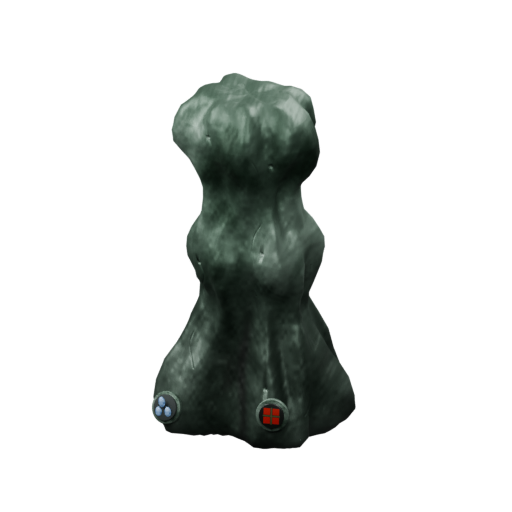

[Blend](../sources/objects/mikotaj/ruth-fett/model.blend) · [GLB](../sources/objects/mikotaj/ruth-fett/model.glb)

Additional views: [Front](../gallery/media/objects/mikotaj/ruth-fett/front.png) · [Rear quarter](../gallery/media/objects/mikotaj/ruth-fett/rear-quarter.png) · [Lower blue/red fittings](../gallery/media/objects/mikotaj/ruth-fett/lower-fittings-detail.png) · [Stacked mineral crown](../gallery/media/objects/mikotaj/ruth-fett/stacked-crown-detail.png) · [Canonical technical wireframe](../gallery/media/objects/mikotaj/ruth-fett/technical-wireframe.png) · [Concept and actual GLB](../gallery/media/objects/mikotaj/ruth-fett/concept-glb-comparison.jpg)

## Merl

`openfa:building/legacy/105`

**Canonical version — canonical-game-remaster**

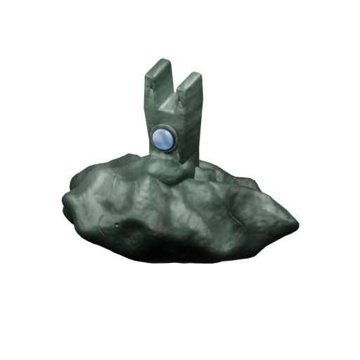

[Blend](../sources/objects/mikotaj/merl/model.blend) · [GLB](../sources/objects/mikotaj/merl/model.glb)

Additional views: [Front](../gallery/media/objects/mikotaj/merl/front.png) · [Rear quarter](../gallery/media/objects/mikotaj/merl/rear-quarter.png) · [Fork and front lens](../gallery/media/objects/mikotaj/merl/fork-and-lens-detail.png) · [Mineral mound](../gallery/media/objects/mikotaj/merl/mineral-mound-detail.png) · [Canonical technical wireframe](../gallery/media/objects/mikotaj/merl/technical-wireframe.png) · [Source-supported gold pulse](../gallery/media/objects/mikotaj/merl/pulse-peak.png) · [Concept and actual GLB](../gallery/media/objects/mikotaj/merl/concept-glb-comparison.jpg)

[Play animation: PlasmaDischarge](../gallery/media/objects/mikotaj/merl/animation-00.webm)

## Na-Shrekn

`openfa:building/legacy/106`

**Canonical version — canonical-game-remaster**

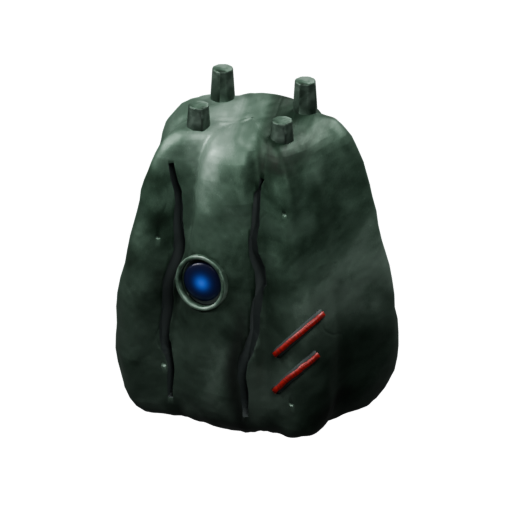

[Blend](../sources/objects/mikotaj/na-shrekn/model.blend) · [GLB](../sources/objects/mikotaj/na-shrekn/model.glb)

Additional views: [Front](../gallery/media/objects/mikotaj/na-shrekn/front.png) · [Rear quarter](../gallery/media/objects/mikotaj/na-shrekn/rear-quarter.png) · [Crown and front focus](../gallery/media/objects/mikotaj/na-shrekn/crown-and-front-focus-detail.png) · [Right red strips](../gallery/media/objects/mikotaj/na-shrekn/right-red-strips-detail.png) · [Canonical technical wireframe](../gallery/media/objects/mikotaj/na-shrekn/technical-wireframe.png) · [Source-supported gold pulse](../gallery/media/objects/mikotaj/na-shrekn/pulse-peak.png) · [Concept and actual GLB](../gallery/media/objects/mikotaj/na-shrekn/concept-glb-comparison.jpg)

[Play animation: PhotonDischarge](../gallery/media/objects/mikotaj/na-shrekn/animation-00.webm)
