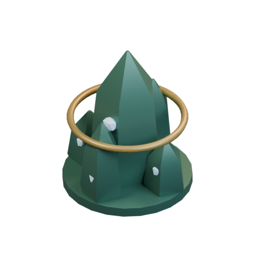
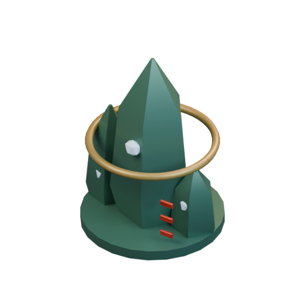
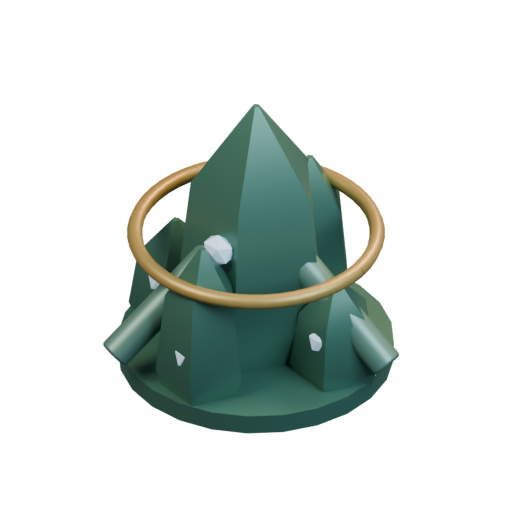
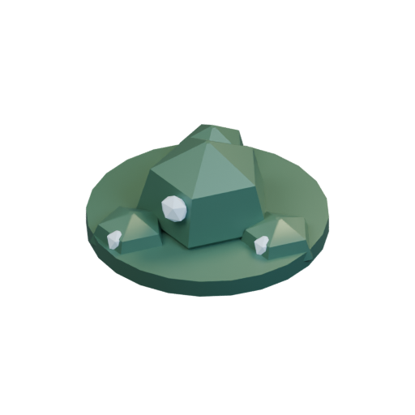
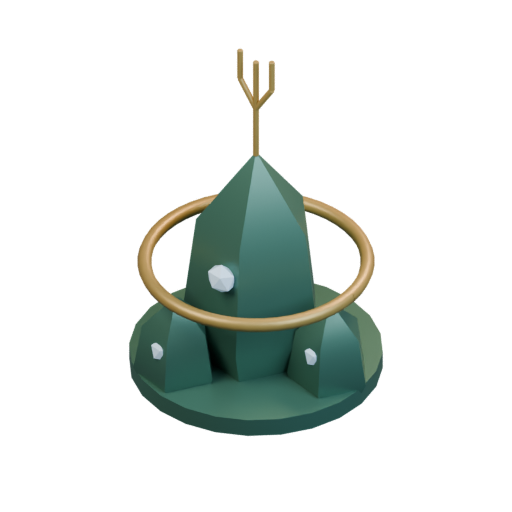
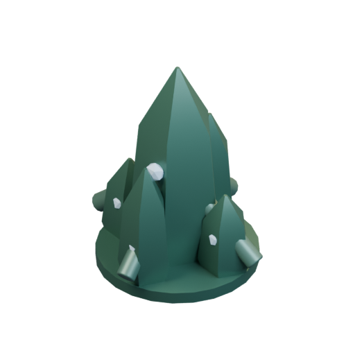

# Buildings / Mikotaj

[All groups](README.md)

## Base Crystal

`openfa:building/legacy/086`

**First available iteration — silhouette-study**

[Blend](../sources/docs/assets/bootstrap-3d/full-catalogue/mikotaj/mk01/model.blend) · [GLB](../sources/docs/assets/bootstrap-3d/full-catalogue/mikotaj/mk01/model.glb)

## Stability

`openfa:building/legacy/087`

**First available iteration — silhouette-study**

[Blend](../sources/docs/assets/bootstrap-3d/full-catalogue/mikotaj/mk02/model.blend) · [GLB](../sources/docs/assets/bootstrap-3d/full-catalogue/mikotaj/mk02/model.glb)

## Purity

`openfa:building/legacy/088`

**First available iteration — silhouette-study**

[Blend](../sources/docs/assets/bootstrap-3d/full-catalogue/mikotaj/mk03/model.blend) · [GLB](../sources/docs/assets/bootstrap-3d/full-catalogue/mikotaj/mk03/model.glb)

## Fulfilment

`openfa:building/legacy/089`

**First available iteration — silhouette-study**

[Blend](../sources/docs/assets/bootstrap-3d/full-catalogue/mikotaj/mk04/model.blend) · [GLB](../sources/docs/assets/bootstrap-3d/full-catalogue/mikotaj/mk04/model.glb)

## Internal

`openfa:building/legacy/090`

**First available iteration — silhouette-study**

[Blend](../sources/docs/assets/bootstrap-3d/full-catalogue/mikotaj/mk05/model.blend) · [GLB](../sources/docs/assets/bootstrap-3d/full-catalogue/mikotaj/mk05/model.glb)

## Dream

`openfa:building/legacy/091`

**First available iteration — silhouette-study**

[Blend](../sources/docs/assets/bootstrap-3d/full-catalogue/mikotaj/mk06/model.blend) · [GLB](../sources/docs/assets/bootstrap-3d/full-catalogue/mikotaj/mk06/model.glb)

## Resonance

`openfa:building/legacy/092`

**First available iteration — silhouette-study**

[Blend](../sources/docs/assets/bootstrap-3d/full-catalogue/mikotaj/mk07/model.blend) · [GLB](../sources/docs/assets/bootstrap-3d/full-catalogue/mikotaj/mk07/model.glb)

## Fa-lanth

`openfa:building/legacy/093`

**First available iteration — silhouette-study**

[Blend](../sources/docs/assets/bootstrap-3d/full-catalogue/mikotaj/mk08/model.blend) · [GLB](../sources/docs/assets/bootstrap-3d/full-catalogue/mikotaj/mk08/model.glb)

## Mask

`openfa:building/legacy/094`

**First available iteration — silhouette-study**

[Blend](../sources/docs/assets/bootstrap-3d/full-catalogue/mikotaj/mk09/model.blend) · [GLB](../sources/docs/assets/bootstrap-3d/full-catalogue/mikotaj/mk09/model.glb)

## Structures Matrix

`openfa:building/legacy/095`

**First available iteration — silhouette-study**

[Blend](../sources/docs/assets/bootstrap-3d/full-catalogue/mikotaj/mk10/model.blend) · [GLB](../sources/docs/assets/bootstrap-3d/full-catalogue/mikotaj/mk10/model.glb)

## Volition

`openfa:building/legacy/096`

**First available iteration — silhouette-study**

[Blend](../sources/docs/assets/bootstrap-3d/full-catalogue/mikotaj/mk11/model.blend) · [GLB](../sources/docs/assets/bootstrap-3d/full-catalogue/mikotaj/mk11/model.glb)

**Additional iteration — verified-launch-mechanism**

[Blend](../sources/docs/assets/reconstruction/launch-facilities/mikotaj/mk11/model.blend) · [GLB](../sources/docs/assets/reconstruction/launch-facilities/mikotaj/mk11/model.glb)

[Play animation: LaunchFacilityCycle](../gallery/media/docs/assets/reconstruction/launch-facilities/mikotaj/mk11/animation-00.webm)

## Visibility

`openfa:building/legacy/097`

**First available iteration — silhouette-study**

[Blend](../sources/docs/assets/bootstrap-3d/full-catalogue/mikotaj/mk12/model.blend) · [GLB](../sources/docs/assets/bootstrap-3d/full-catalogue/mikotaj/mk12/model.glb)

**Additional iteration — verified-launch-mechanism**

[Blend](../sources/docs/assets/reconstruction/launch-facilities/mikotaj/mk12/model.blend) · [GLB](../sources/docs/assets/reconstruction/launch-facilities/mikotaj/mk12/model.glb)

[Play animation: LaunchFacilityCycle](../gallery/media/docs/assets/reconstruction/launch-facilities/mikotaj/mk12/animation-00.webm)

## Perception

`openfa:building/legacy/098`

**First available iteration — silhouette-study**

[Blend](../sources/docs/assets/bootstrap-3d/full-catalogue/mikotaj/mk13/model.blend) · [GLB](../sources/docs/assets/bootstrap-3d/full-catalogue/mikotaj/mk13/model.glb)

## Capacitors

`openfa:building/legacy/099`

**First available iteration — silhouette-study**

[Blend](../sources/docs/assets/bootstrap-3d/full-catalogue/mikotaj/mk14/model.blend) · [GLB](../sources/docs/assets/bootstrap-3d/full-catalogue/mikotaj/mk14/model.glb)

## Lanth

`openfa:building/legacy/100`

**First available iteration — silhouette-study**

[Blend](../sources/docs/assets/bootstrap-3d/full-catalogue/mikotaj/mk15/model.blend) · [GLB](../sources/docs/assets/bootstrap-3d/full-catalogue/mikotaj/mk15/model.glb)

## Sharir

`openfa:building/legacy/101`

**First available iteration — silhouette-study**

[Blend](../sources/docs/assets/bootstrap-3d/full-catalogue/mikotaj/mk16/model.blend) · [GLB](../sources/docs/assets/bootstrap-3d/full-catalogue/mikotaj/mk16/model.glb)

## Shrekn

`openfa:building/legacy/102`

**First available iteration — silhouette-study**

[Blend](../sources/docs/assets/bootstrap-3d/full-catalogue/mikotaj/mk17/model.blend) · [GLB](../sources/docs/assets/bootstrap-3d/full-catalogue/mikotaj/mk17/model.glb)

**Additional iteration — verified-launch-mechanism**

[Blend](../sources/docs/assets/reconstruction/launch-facilities/mikotaj/mk17/model.blend) · [GLB](../sources/docs/assets/reconstruction/launch-facilities/mikotaj/mk17/model.glb)

[Play animation: LaunchFacilityCycle](../gallery/media/docs/assets/reconstruction/launch-facilities/mikotaj/mk17/animation-00.webm)

## Ruth-feror

`openfa:building/legacy/103`

**First available iteration — silhouette-study**

[Blend](../sources/docs/assets/bootstrap-3d/full-catalogue/mikotaj/mk18/model.blend) · [GLB](../sources/docs/assets/bootstrap-3d/full-catalogue/mikotaj/mk18/model.glb)

## Ruth-fett

`openfa:building/legacy/104`

**First available iteration — silhouette-study**

[Blend](../sources/docs/assets/bootstrap-3d/full-catalogue/mikotaj/mk19/model.blend) · [GLB](../sources/docs/assets/bootstrap-3d/full-catalogue/mikotaj/mk19/model.glb)

## Merl

`openfa:building/legacy/105`

**First available iteration — silhouette-study**

[Blend](../sources/docs/assets/bootstrap-3d/full-catalogue/mikotaj/mk20/model.blend) · [GLB](../sources/docs/assets/bootstrap-3d/full-catalogue/mikotaj/mk20/model.glb)

[Play animation: Animation](../gallery/media/docs/assets/bootstrap-3d/full-catalogue/mikotaj/mk20/animation-00.webm)

## Na-Shrekn

`openfa:building/legacy/106`

**First available iteration — silhouette-study**

[Blend](../sources/docs/assets/bootstrap-3d/full-catalogue/mikotaj/mk21/model.blend) · [GLB](../sources/docs/assets/bootstrap-3d/full-catalogue/mikotaj/mk21/model.glb)

[Play animation: Animation](../gallery/media/docs/assets/bootstrap-3d/full-catalogue/mikotaj/mk21/animation-00.webm)
