# Buildings / Mikotaj

[All groups](README.md)

## Base Crystal

`openfa:building/legacy/086`

**First available iteration — canonical-game-remaster**

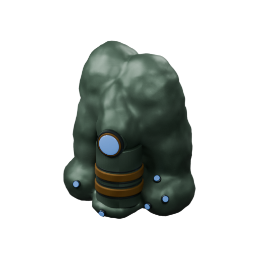

[Blend](../sources/objects/mikotaj/base-crystal/model.blend) · [GLB](../sources/objects/mikotaj/base-crystal/model.glb)

Additional views: [Front](../gallery/media/objects/mikotaj/base-crystal/front.png) · [Rear quarter](../gallery/media/objects/mikotaj/base-crystal/rear-quarter.png) · [Canonical technical wireframe](../gallery/media/objects/mikotaj/base-crystal/technical-wireframe.png) · [Concept and actual GLB](../gallery/media/objects/mikotaj/base-crystal/concept-glb-comparison.jpg)

## Stability

`openfa:building/legacy/087`

**First available iteration — canonical-game-remaster**

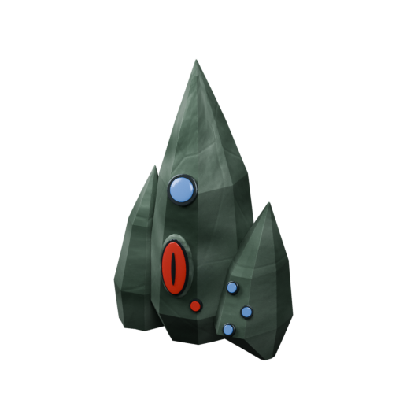

[Blend](../sources/objects/mikotaj/stability/model.blend) · [GLB](../sources/objects/mikotaj/stability/model.glb)

Additional views: [Front](../gallery/media/objects/mikotaj/stability/front.png) · [Rear quarter](../gallery/media/objects/mikotaj/stability/rear-quarter.png) · [Canonical technical wireframe](../gallery/media/objects/mikotaj/stability/technical-wireframe.png) · [Concept and actual GLB](../gallery/media/objects/mikotaj/stability/concept-glb-comparison.jpg)

## Purity

`openfa:building/legacy/088`

**First available iteration — canonical-game-remaster**

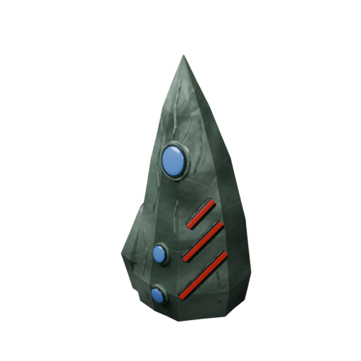

[Blend](../sources/objects/mikotaj/purity/model.blend) · [GLB](../sources/objects/mikotaj/purity/model.glb)

Additional views: [Front](../gallery/media/objects/mikotaj/purity/front.png) · [Rear quarter](../gallery/media/objects/mikotaj/purity/rear-quarter.png) · [Canonical technical wireframe](../gallery/media/objects/mikotaj/purity/technical-wireframe.png) · [Concept and actual GLB](../gallery/media/objects/mikotaj/purity/concept-glb-comparison.jpg)

## Fulfilment

`openfa:building/legacy/089`

**First available iteration — canonical-game-remaster**

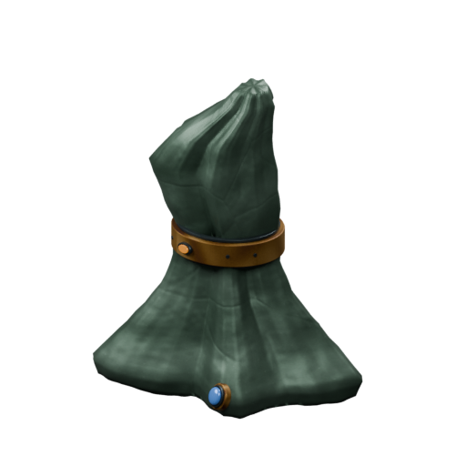

[Blend](../sources/objects/mikotaj/fulfilment/model.blend) · [GLB](../sources/objects/mikotaj/fulfilment/model.glb)

Additional views: [Front](../gallery/media/objects/mikotaj/fulfilment/front.png) · [Rear quarter](../gallery/media/objects/mikotaj/fulfilment/rear-quarter.png) · [Canonical technical wireframe](../gallery/media/objects/mikotaj/fulfilment/technical-wireframe.png) · [Concept and actual GLB](../gallery/media/objects/mikotaj/fulfilment/concept-glb-comparison.jpg)

## Internal

`openfa:building/legacy/090`

**First available iteration — canonical-game-remaster**

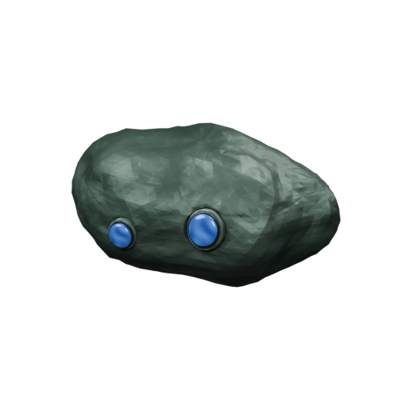

[Blend](../sources/objects/mikotaj/internal/model.blend) · [GLB](../sources/objects/mikotaj/internal/model.glb)

Additional views: [Front](../gallery/media/objects/mikotaj/internal/front.png) · [Rear quarter](../gallery/media/objects/mikotaj/internal/rear-quarter.png) · [Canonical technical wireframe](../gallery/media/objects/mikotaj/internal/technical-wireframe.png) · [Concept and actual GLB](../gallery/media/objects/mikotaj/internal/concept-glb-comparison.jpg)

## Dream

`openfa:building/legacy/091`

**First available iteration — canonical-game-remaster**

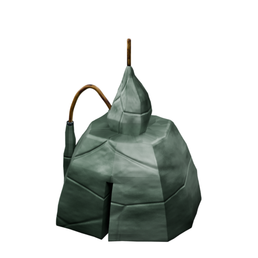

[Blend](../sources/objects/mikotaj/dream/model.blend) · [GLB](../sources/objects/mikotaj/dream/model.glb)

Additional views: [Front](../gallery/media/objects/mikotaj/dream/front.png) · [Rear quarter](../gallery/media/objects/mikotaj/dream/rear-quarter.png) · [Canonical technical wireframe](../gallery/media/objects/mikotaj/dream/technical-wireframe.png) · [Concept and actual GLB](../gallery/media/objects/mikotaj/dream/concept-glb-comparison.jpg)

## Resonance

`openfa:building/legacy/092`

**First available iteration — canonical-game-remaster**

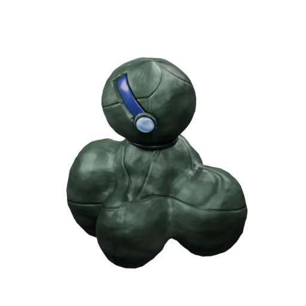

[Blend](../sources/objects/mikotaj/resonance/model.blend) · [GLB](../sources/objects/mikotaj/resonance/model.glb)

Additional views: [Front](../gallery/media/objects/mikotaj/resonance/front.png) · [Rear quarter](../gallery/media/objects/mikotaj/resonance/rear-quarter.png) · [Canonical technical wireframe](../gallery/media/objects/mikotaj/resonance/technical-wireframe.png) · [Concept and actual GLB](../gallery/media/objects/mikotaj/resonance/concept-glb-comparison.jpg)

## Fa-lanth

`openfa:building/legacy/093`

**First available iteration — silhouette-study**

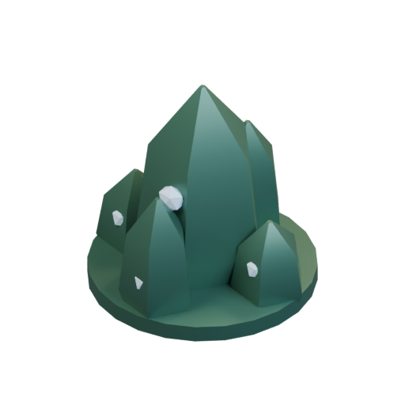

[Blend](../sources/docs/assets/bootstrap-3d/full-catalogue/mikotaj/mk08/model.blend) · [GLB](../sources/docs/assets/bootstrap-3d/full-catalogue/mikotaj/mk08/model.glb)

## Mask

`openfa:building/legacy/094`

**First available iteration — silhouette-study**

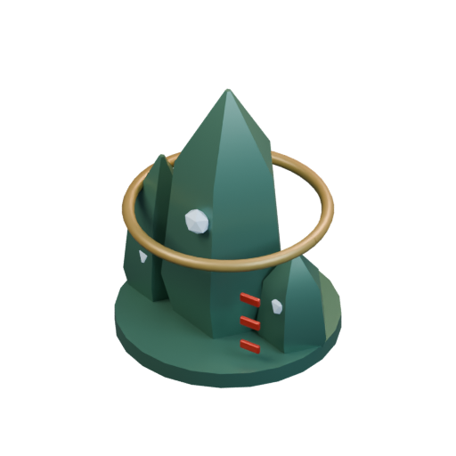

[Blend](../sources/docs/assets/bootstrap-3d/full-catalogue/mikotaj/mk09/model.blend) · [GLB](../sources/docs/assets/bootstrap-3d/full-catalogue/mikotaj/mk09/model.glb)

## Structures Matrix

`openfa:building/legacy/095`

**First available iteration — silhouette-study**

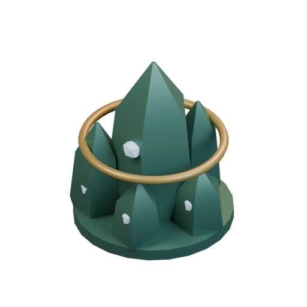

[Blend](../sources/docs/assets/bootstrap-3d/full-catalogue/mikotaj/mk10/model.blend) · [GLB](../sources/docs/assets/bootstrap-3d/full-catalogue/mikotaj/mk10/model.glb)

## Volition

`openfa:building/legacy/096`

**First available iteration — silhouette-study**

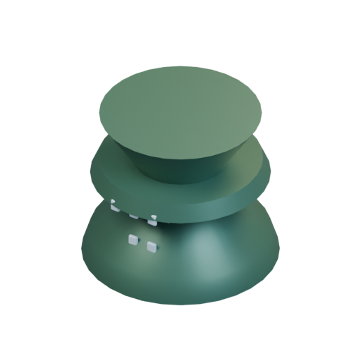

[Blend](../sources/docs/assets/bootstrap-3d/full-catalogue/mikotaj/mk11/model.blend) · [GLB](../sources/docs/assets/bootstrap-3d/full-catalogue/mikotaj/mk11/model.glb)

**Additional iteration — verified-launch-mechanism**

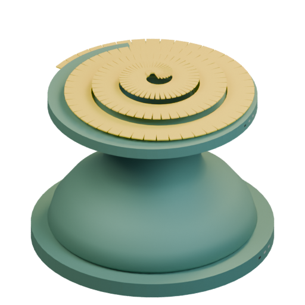

[Blend](../sources/docs/assets/reconstruction/launch-facilities/mikotaj/mk11/model.blend) · [GLB](../sources/docs/assets/reconstruction/launch-facilities/mikotaj/mk11/model.glb)

[Play animation: LaunchFacilityCycle](../gallery/media/docs/assets/reconstruction/launch-facilities/mikotaj/mk11/animation-00.webm)

## Visibility

`openfa:building/legacy/097`

**First available iteration — silhouette-study**

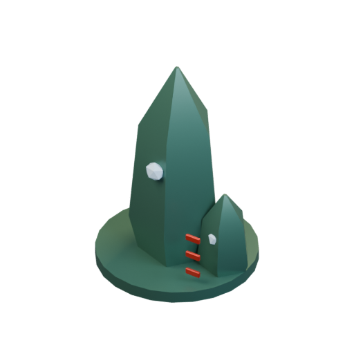

[Blend](../sources/docs/assets/bootstrap-3d/full-catalogue/mikotaj/mk12/model.blend) · [GLB](../sources/docs/assets/bootstrap-3d/full-catalogue/mikotaj/mk12/model.glb)

**Additional iteration — verified-launch-mechanism**

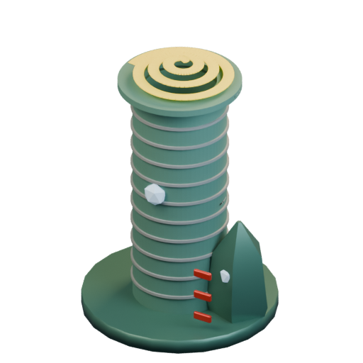

[Blend](../sources/docs/assets/reconstruction/launch-facilities/mikotaj/mk12/model.blend) · [GLB](../sources/docs/assets/reconstruction/launch-facilities/mikotaj/mk12/model.glb)

[Play animation: LaunchFacilityCycle](../gallery/media/docs/assets/reconstruction/launch-facilities/mikotaj/mk12/animation-00.webm)

## Perception

`openfa:building/legacy/098`

**First available iteration — silhouette-study**

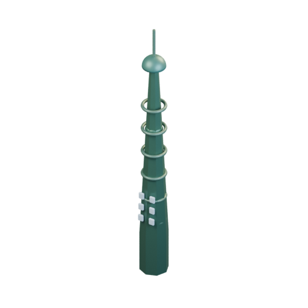

[Blend](../sources/docs/assets/bootstrap-3d/full-catalogue/mikotaj/mk13/model.blend) · [GLB](../sources/docs/assets/bootstrap-3d/full-catalogue/mikotaj/mk13/model.glb)

## Capacitors

`openfa:building/legacy/099`

**First available iteration — silhouette-study**

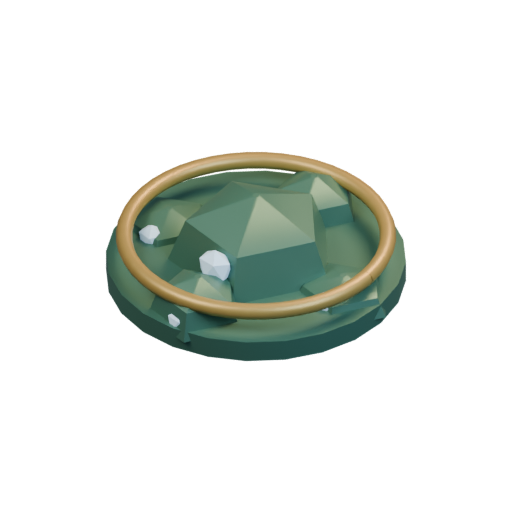

[Blend](../sources/docs/assets/bootstrap-3d/full-catalogue/mikotaj/mk14/model.blend) · [GLB](../sources/docs/assets/bootstrap-3d/full-catalogue/mikotaj/mk14/model.glb)

## Lanth

`openfa:building/legacy/100`

**First available iteration — silhouette-study**

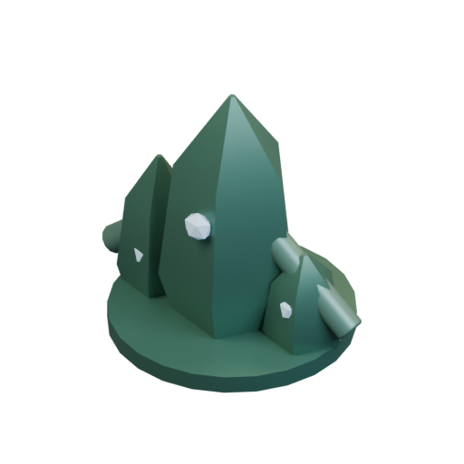

[Blend](../sources/docs/assets/bootstrap-3d/full-catalogue/mikotaj/mk15/model.blend) · [GLB](../sources/docs/assets/bootstrap-3d/full-catalogue/mikotaj/mk15/model.glb)

## Sharir

`openfa:building/legacy/101`

**First available iteration — silhouette-study**

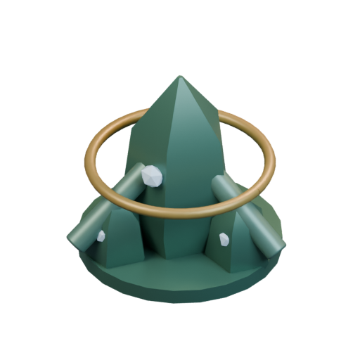

[Blend](../sources/docs/assets/bootstrap-3d/full-catalogue/mikotaj/mk16/model.blend) · [GLB](../sources/docs/assets/bootstrap-3d/full-catalogue/mikotaj/mk16/model.glb)

## Shrekn

`openfa:building/legacy/102`

**First available iteration — silhouette-study**

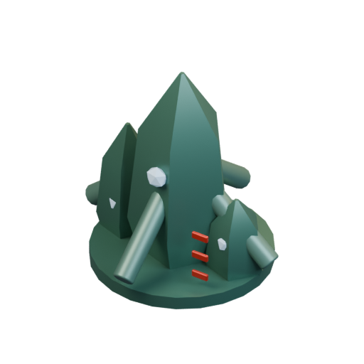

[Blend](../sources/docs/assets/bootstrap-3d/full-catalogue/mikotaj/mk17/model.blend) · [GLB](../sources/docs/assets/bootstrap-3d/full-catalogue/mikotaj/mk17/model.glb)

**Additional iteration — verified-launch-mechanism**

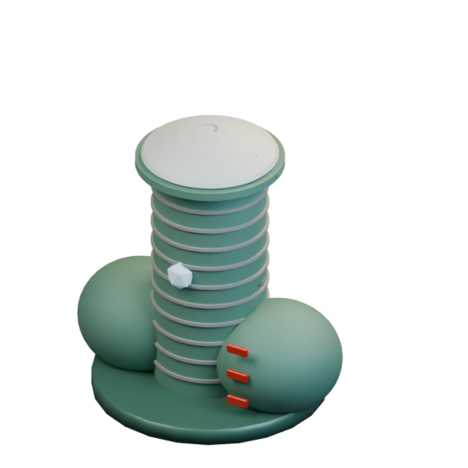

[Blend](../sources/docs/assets/reconstruction/launch-facilities/mikotaj/mk17/model.blend) · [GLB](../sources/docs/assets/reconstruction/launch-facilities/mikotaj/mk17/model.glb)

[Play animation: LaunchFacilityCycle](../gallery/media/docs/assets/reconstruction/launch-facilities/mikotaj/mk17/animation-00.webm)

## Ruth-feror

`openfa:building/legacy/103`

**First available iteration — silhouette-study**

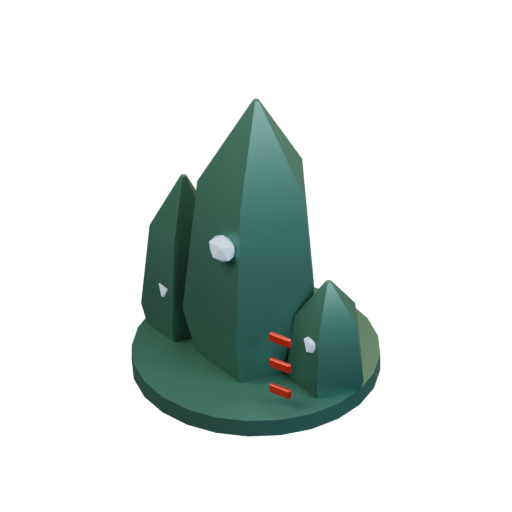

[Blend](../sources/docs/assets/bootstrap-3d/full-catalogue/mikotaj/mk18/model.blend) · [GLB](../sources/docs/assets/bootstrap-3d/full-catalogue/mikotaj/mk18/model.glb)

## Ruth-fett

`openfa:building/legacy/104`

**First available iteration — silhouette-study**

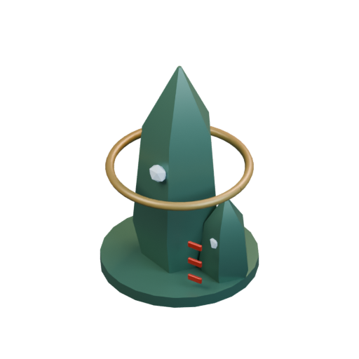

[Blend](../sources/docs/assets/bootstrap-3d/full-catalogue/mikotaj/mk19/model.blend) · [GLB](../sources/docs/assets/bootstrap-3d/full-catalogue/mikotaj/mk19/model.glb)

## Merl

`openfa:building/legacy/105`

**First available iteration — silhouette-study**

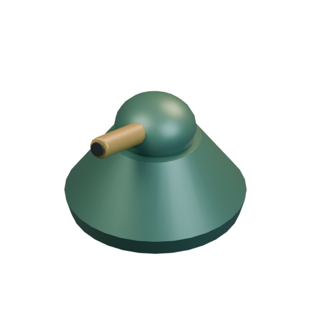

[Blend](../sources/docs/assets/bootstrap-3d/full-catalogue/mikotaj/mk20/model.blend) · [GLB](../sources/docs/assets/bootstrap-3d/full-catalogue/mikotaj/mk20/model.glb)

[Play animation: Animation](../gallery/media/docs/assets/bootstrap-3d/full-catalogue/mikotaj/mk20/animation-00.webm)

## Na-Shrekn

`openfa:building/legacy/106`

**First available iteration — silhouette-study**

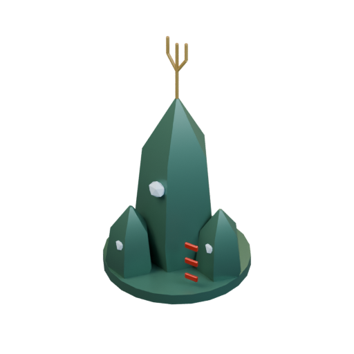

[Blend](../sources/docs/assets/bootstrap-3d/full-catalogue/mikotaj/mk21/model.blend) · [GLB](../sources/docs/assets/bootstrap-3d/full-catalogue/mikotaj/mk21/model.glb)

[Play animation: Animation](../gallery/media/docs/assets/bootstrap-3d/full-catalogue/mikotaj/mk21/animation-00.webm)
