# Buildings / Rigellian

[All groups](README.md)

## Central Unit

`openfa:building/legacy/040`

**First available iteration — silhouette-study**

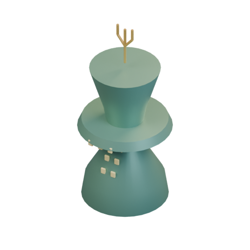

[Blend](../sources/docs/assets/bootstrap-3d/full-catalogue/rigellian/ri01/model.blend) · [GLB](../sources/docs/assets/bootstrap-3d/full-catalogue/rigellian/ri01/model.glb)

**Additional iteration — reference-refined-study**

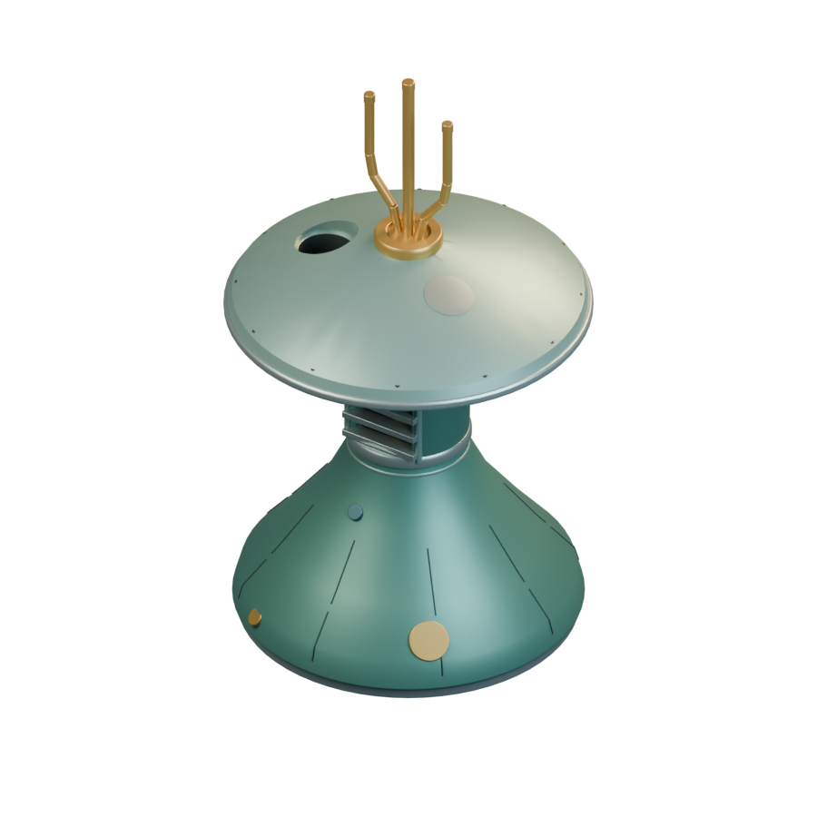

[Blend](../sources/docs/assets/reconstruction/buildings/rigellian/central-unit/model.blend) · [GLB](../sources/docs/assets/reconstruction/buildings/rigellian/central-unit/model.glb)

**Additional iteration — crown-refinement-study**

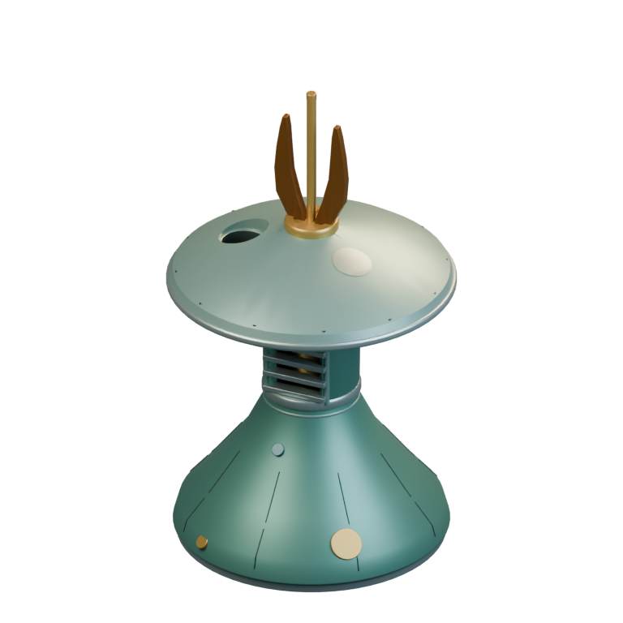

[Blend](../sources/docs/assets/reconstruction/rigellian-refined/ri01/model.blend) · [GLB](../sources/docs/assets/reconstruction/rigellian-refined/ri01/model.glb)

## Filtration Plant

`openfa:building/legacy/041`

**First available iteration — silhouette-study**

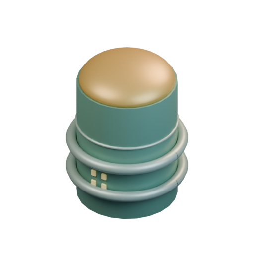

[Blend](../sources/docs/assets/bootstrap-3d/full-catalogue/rigellian/ri02/model.blend) · [GLB](../sources/docs/assets/bootstrap-3d/full-catalogue/rigellian/ri02/model.glb)

**Additional iteration — reference-refined-study**

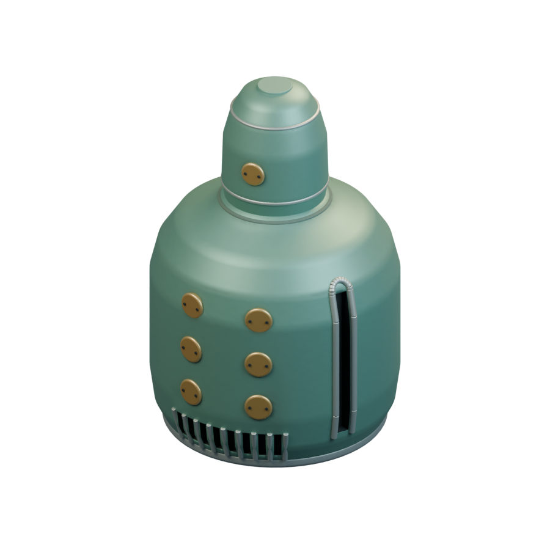

[Blend](../sources/docs/assets/reconstruction/buildings/rigellian/filtration-plant/model.blend) · [GLB](../sources/docs/assets/reconstruction/buildings/rigellian/filtration-plant/model.glb)

## Nourishment Bank

`openfa:building/legacy/042`

**First available iteration — silhouette-study**

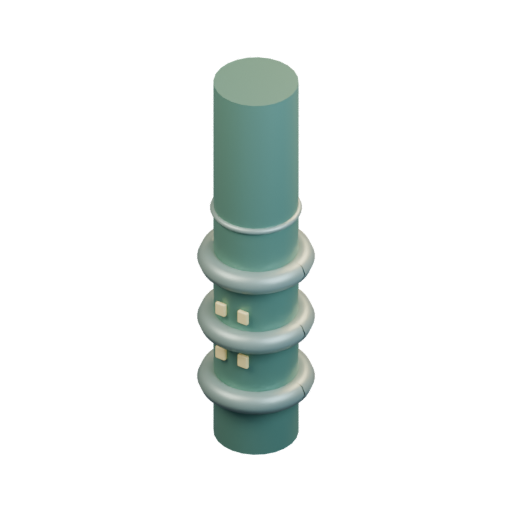

[Blend](../sources/docs/assets/bootstrap-3d/full-catalogue/rigellian/ri03/model.blend) · [GLB](../sources/docs/assets/bootstrap-3d/full-catalogue/rigellian/ri03/model.glb)

**Additional iteration — reference-refined-study**

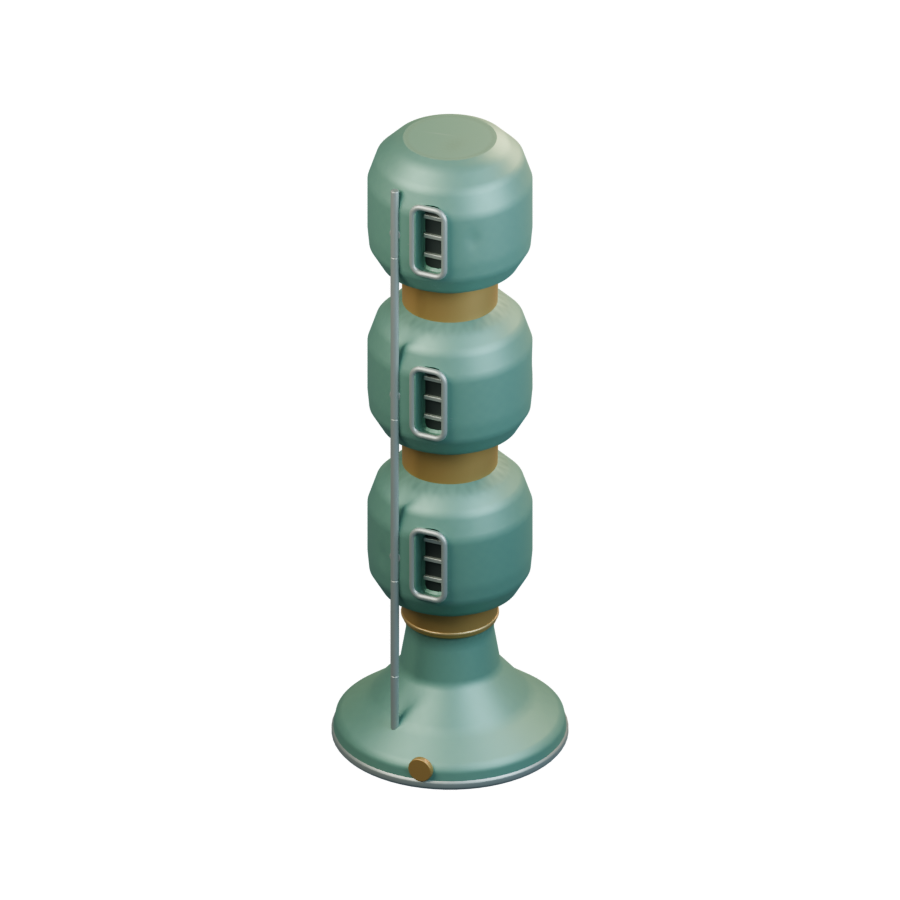

[Blend](../sources/docs/assets/reconstruction/buildings/rigellian/nourishment-bank/model.blend) · [GLB](../sources/docs/assets/reconstruction/buildings/rigellian/nourishment-bank/model.glb)

**Additional iteration — structural-detail-refinement**

[Blend](../sources/docs/assets/reconstruction/rigellian-refined/ri03/model.blend) · [GLB](../sources/docs/assets/reconstruction/rigellian-refined/ri03/model.glb)

## Community

`openfa:building/legacy/043`

**First available iteration — silhouette-study**

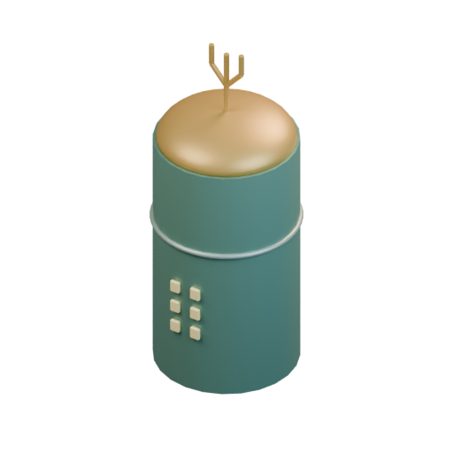

[Blend](../sources/docs/assets/bootstrap-3d/full-catalogue/rigellian/ri04/model.blend) · [GLB](../sources/docs/assets/bootstrap-3d/full-catalogue/rigellian/ri04/model.glb)

**Additional iteration — reference-refined-study**

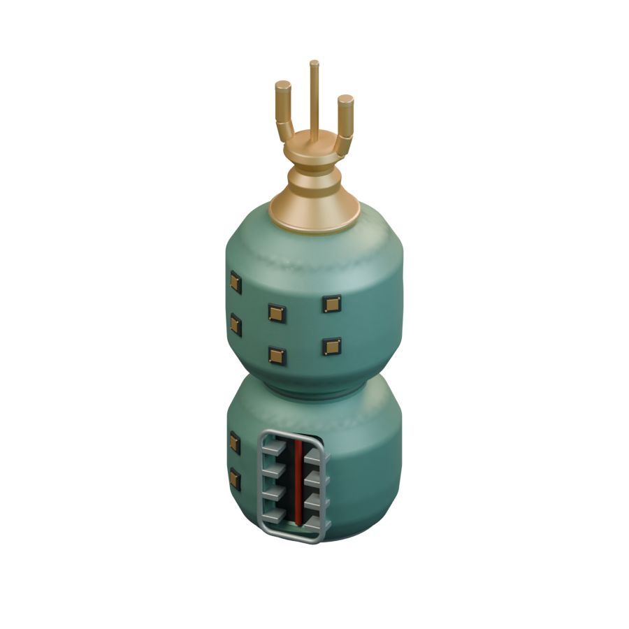

[Blend](../sources/docs/assets/reconstruction/buildings/rigellian/community/model.blend) · [GLB](../sources/docs/assets/reconstruction/buildings/rigellian/community/model.glb)

**Additional iteration — crown-refinement-study**

[Blend](../sources/docs/assets/reconstruction/rigellian-refined/ri04/model.blend) · [GLB](../sources/docs/assets/reconstruction/rigellian-refined/ri04/model.glb)

## Health Unit

`openfa:building/legacy/044`

**First available iteration — silhouette-study**

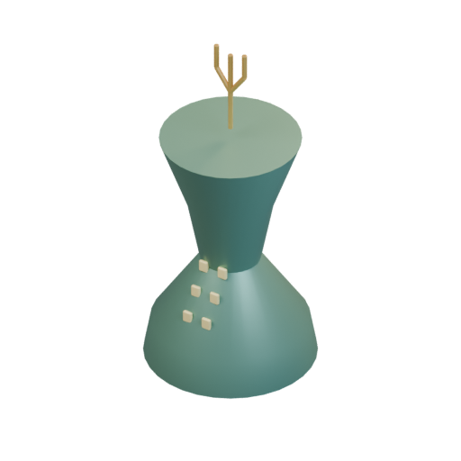

[Blend](../sources/docs/assets/bootstrap-3d/full-catalogue/rigellian/ri05/model.blend) · [GLB](../sources/docs/assets/bootstrap-3d/full-catalogue/rigellian/ri05/model.glb)

**Additional iteration — reference-refined-study**

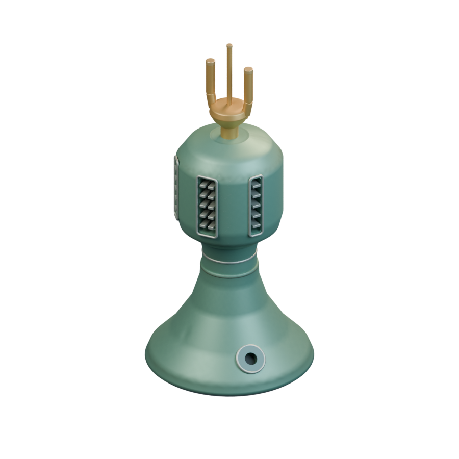

[Blend](../sources/docs/assets/reconstruction/buildings/rigellian/health-unit/model.blend) · [GLB](../sources/docs/assets/reconstruction/buildings/rigellian/health-unit/model.glb)

**Additional iteration — crown-refinement-study**

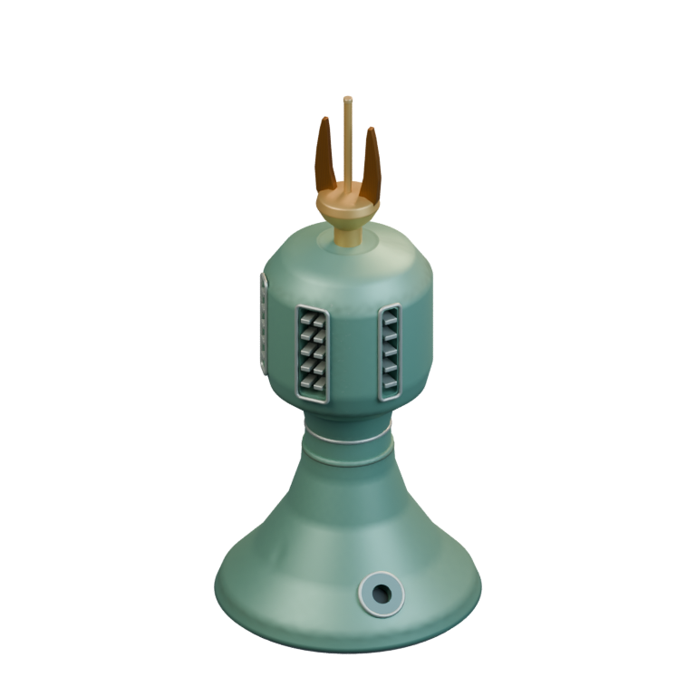

[Blend](../sources/docs/assets/reconstruction/rigellian-refined/ri05/model.blend) · [GLB](../sources/docs/assets/reconstruction/rigellian-refined/ri05/model.glb)

## Strategic Bunker

`openfa:building/legacy/045`

**First available iteration — silhouette-study**

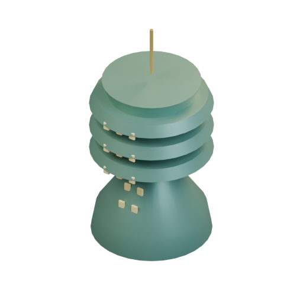

[Blend](../sources/docs/assets/bootstrap-3d/full-catalogue/rigellian/ri06/model.blend) · [GLB](../sources/docs/assets/bootstrap-3d/full-catalogue/rigellian/ri06/model.glb)

**Additional iteration — reference-refined-study**

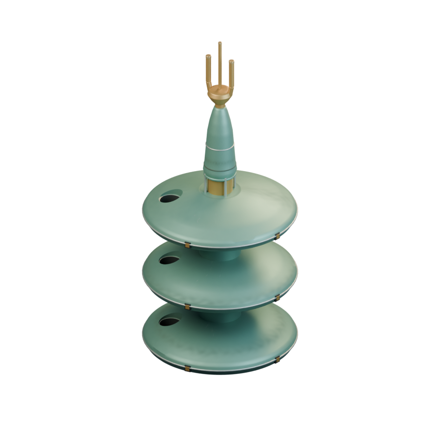

[Blend](../sources/docs/assets/reconstruction/buildings/rigellian/strategic-bunker/model.blend) · [GLB](../sources/docs/assets/reconstruction/buildings/rigellian/strategic-bunker/model.glb)

**Additional iteration — crown-refinement-study**

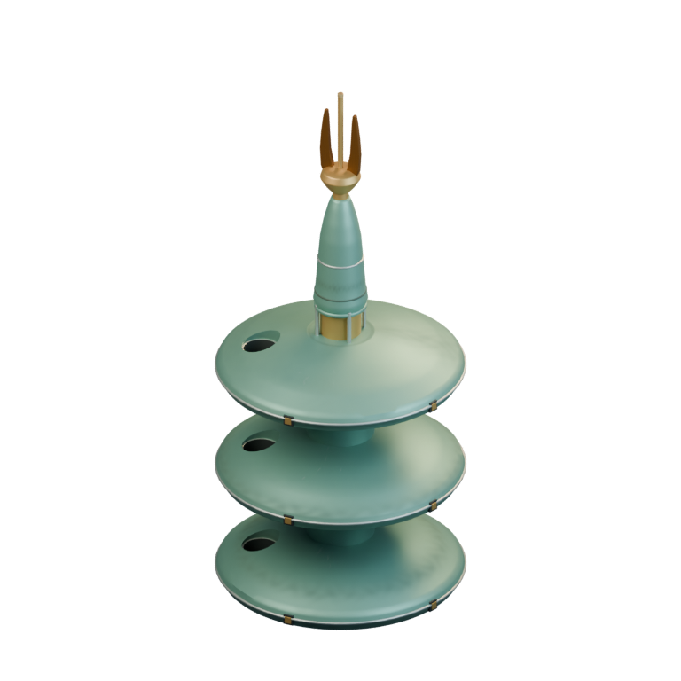

[Blend](../sources/docs/assets/reconstruction/rigellian-refined/ri06/model.blend) · [GLB](../sources/docs/assets/reconstruction/rigellian-refined/ri06/model.glb)

## Science Labs

`openfa:building/legacy/046`

**First available iteration — silhouette-study**

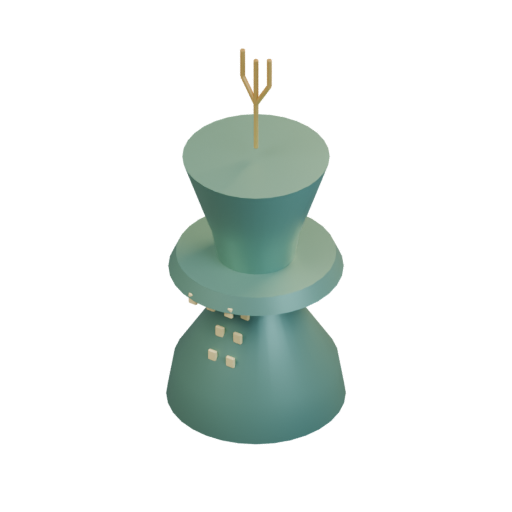

[Blend](../sources/docs/assets/bootstrap-3d/full-catalogue/rigellian/ri07/model.blend) · [GLB](../sources/docs/assets/bootstrap-3d/full-catalogue/rigellian/ri07/model.glb)

**Additional iteration — reference-refined-study**

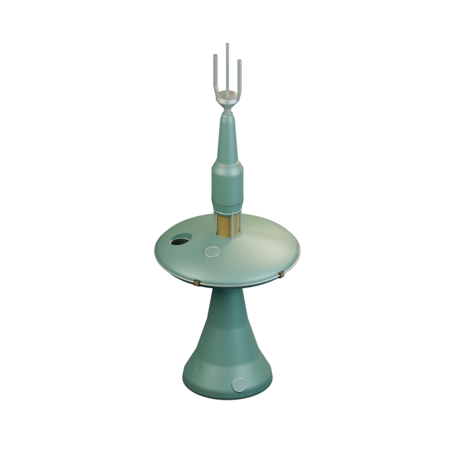

[Blend](../sources/docs/assets/reconstruction/buildings/rigellian/science-labs/model.blend) · [GLB](../sources/docs/assets/reconstruction/buildings/rigellian/science-labs/model.glb)

## Databanks

`openfa:building/legacy/047`

**First available iteration — silhouette-study**

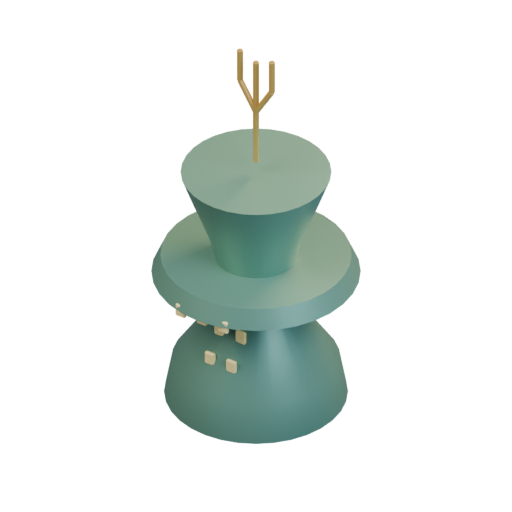

[Blend](../sources/docs/assets/bootstrap-3d/full-catalogue/rigellian/ri08/model.blend) · [GLB](../sources/docs/assets/bootstrap-3d/full-catalogue/rigellian/ri08/model.glb)

**Additional iteration — reference-refined-study**

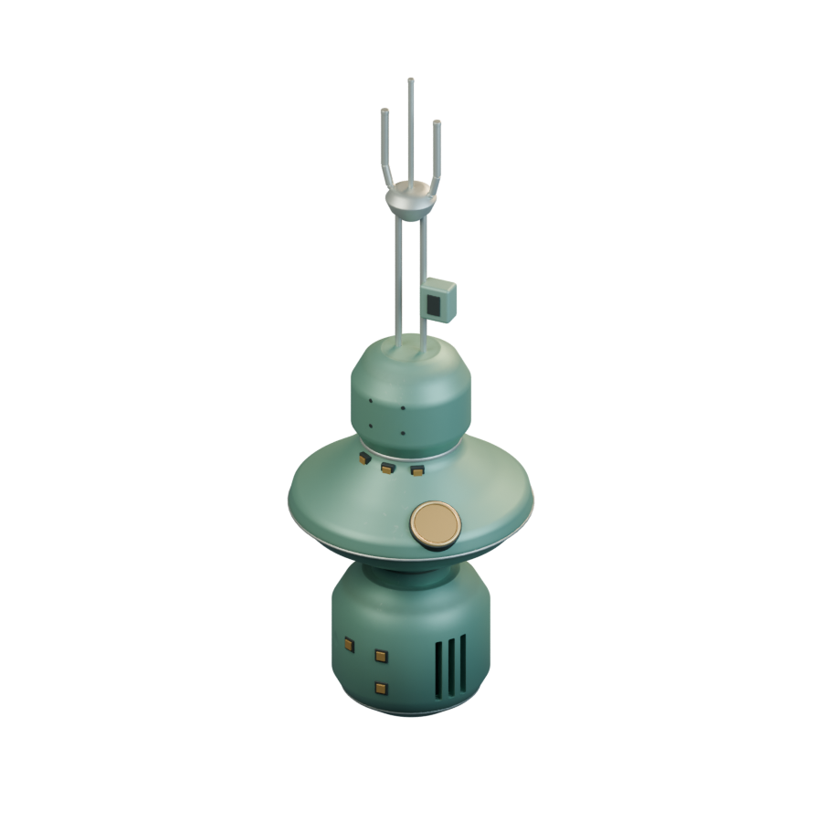

[Blend](../sources/docs/assets/reconstruction/buildings/rigellian/databanks/model.blend) · [GLB](../sources/docs/assets/reconstruction/buildings/rigellian/databanks/model.glb)

**Additional iteration — visible-equipment-refinement**

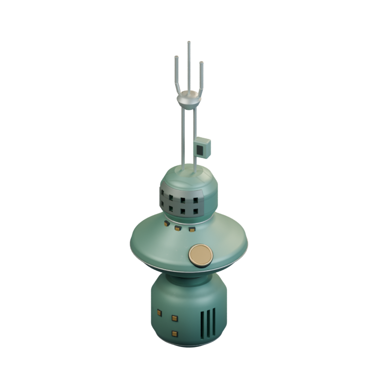

[Blend](../sources/docs/assets/reconstruction/rigellian-refined/ri08/model.blend) · [GLB](../sources/docs/assets/reconstruction/rigellian-refined/ri08/model.glb)

## Construction Unit

`openfa:building/legacy/048`

**First available iteration — silhouette-study**

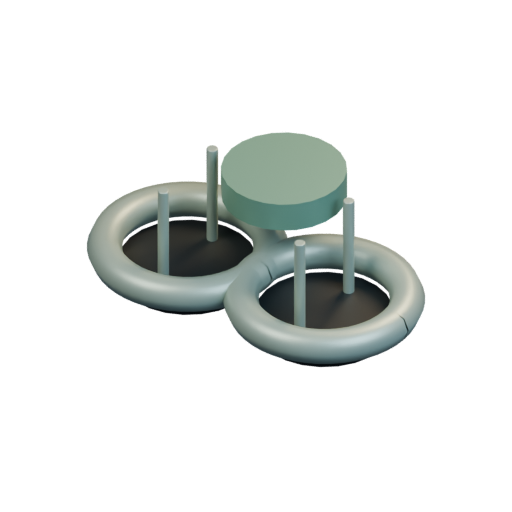

[Blend](../sources/docs/assets/bootstrap-3d/full-catalogue/rigellian/ri09/model.blend) · [GLB](../sources/docs/assets/bootstrap-3d/full-catalogue/rigellian/ri09/model.glb)

**Additional iteration — reference-refined-study**

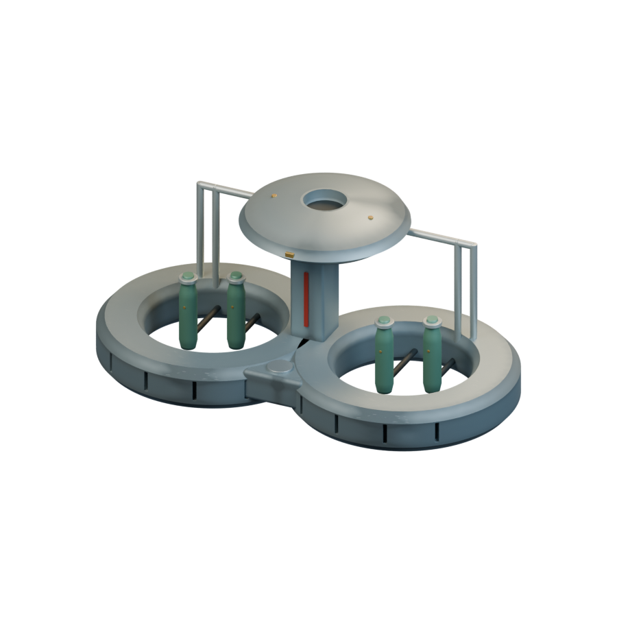

[Blend](../sources/docs/assets/reconstruction/buildings/rigellian/construction-unit/model.blend) · [GLB](../sources/docs/assets/reconstruction/buildings/rigellian/construction-unit/model.glb)

## Ground Deck

`openfa:building/legacy/049`

**First available iteration — silhouette-study**

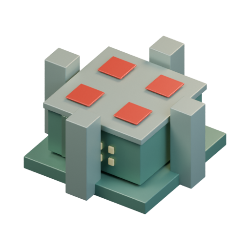

[Blend](../sources/docs/assets/bootstrap-3d/full-catalogue/rigellian/ri10/model.blend) · [GLB](../sources/docs/assets/bootstrap-3d/full-catalogue/rigellian/ri10/model.glb)

**Additional iteration — animated-mechanism-study**

[Blend](../sources/docs/assets/reconstruction/buildings/rigellian/ground-deck/model.blend) · [GLB](../sources/docs/assets/reconstruction/buildings/rigellian/ground-deck/model.glb)

[Play animation: GroundDeckCoverCycle](../gallery/media/docs/assets/reconstruction/buildings/rigellian/ground-deck/animation-00.webm)

## Probe Launch

`openfa:building/legacy/050`

**First available iteration — silhouette-study**

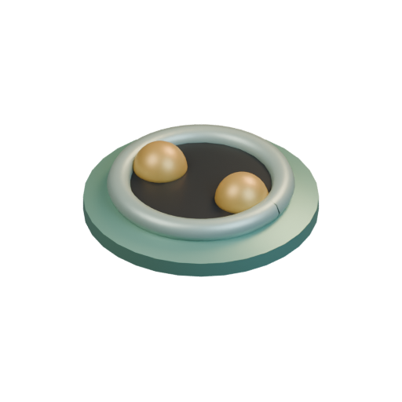

[Blend](../sources/docs/assets/bootstrap-3d/full-catalogue/rigellian/ri11/model.blend) · [GLB](../sources/docs/assets/bootstrap-3d/full-catalogue/rigellian/ri11/model.glb)

**Additional iteration — initial-reference-study**

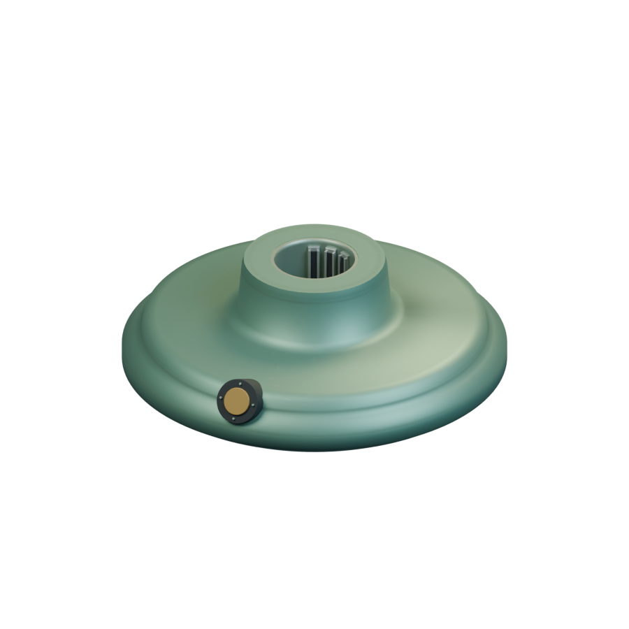

[Blend](../sources/docs/assets/reconstruction/buildings/rigellian/probe-launch/model.blend) · [GLB](../sources/docs/assets/reconstruction/buildings/rigellian/probe-launch/model.glb)

## Deep Space Probes

`openfa:building/legacy/051`

**First available iteration — silhouette-study**

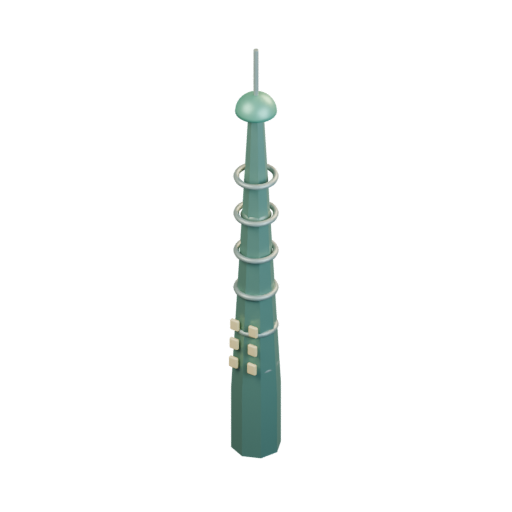

[Blend](../sources/docs/assets/bootstrap-3d/full-catalogue/rigellian/ri12/model.blend) · [GLB](../sources/docs/assets/bootstrap-3d/full-catalogue/rigellian/ri12/model.glb)

**Additional iteration — initial-reference-study**

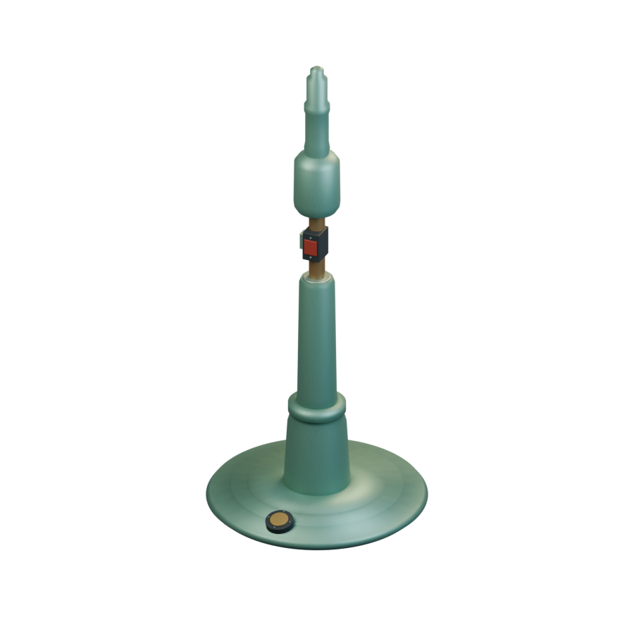

[Blend](../sources/docs/assets/reconstruction/buildings/rigellian/deep-space-probes/model.blend) · [GLB](../sources/docs/assets/reconstruction/buildings/rigellian/deep-space-probes/model.glb)

## Gravitic Converter

`openfa:building/legacy/052`

**First available iteration — silhouette-study**

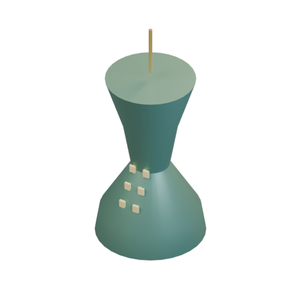

[Blend](../sources/docs/assets/bootstrap-3d/full-catalogue/rigellian/ri13/model.blend) · [GLB](../sources/docs/assets/bootstrap-3d/full-catalogue/rigellian/ri13/model.glb)

**Additional iteration — reference-refined-study**

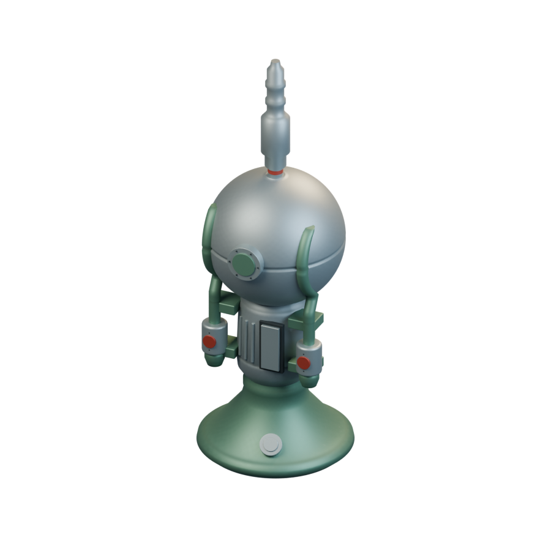

[Blend](../sources/docs/assets/reconstruction/buildings/rigellian/gravitic-converter/model.blend) · [GLB](../sources/docs/assets/reconstruction/buildings/rigellian/gravitic-converter/model.glb)

## Energy Gatherer

`openfa:building/legacy/053`

**First available iteration — silhouette-study**

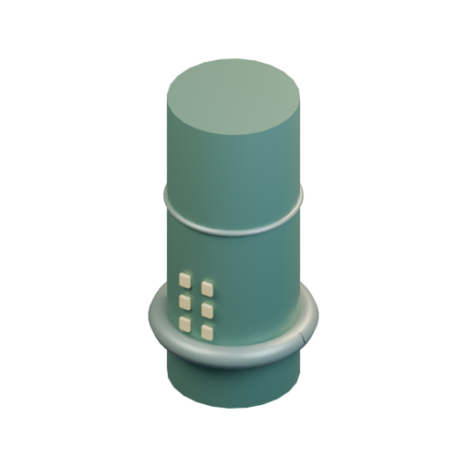

[Blend](../sources/docs/assets/bootstrap-3d/full-catalogue/rigellian/ri14/model.blend) · [GLB](../sources/docs/assets/bootstrap-3d/full-catalogue/rigellian/ri14/model.glb)

**Additional iteration — reference-refined-study**

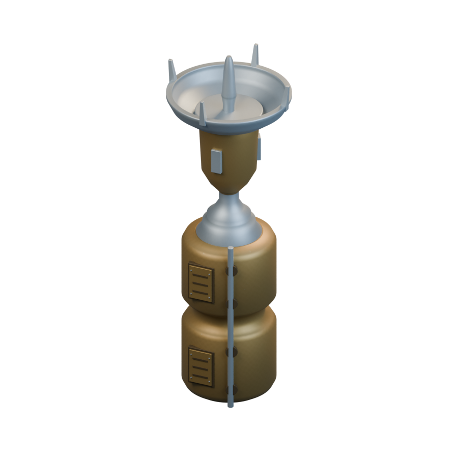

[Blend](../sources/docs/assets/reconstruction/buildings/rigellian/energy-gatherer/model.blend) · [GLB](../sources/docs/assets/reconstruction/buildings/rigellian/energy-gatherer/model.glb)

**Additional iteration — visible-casing-refinement**

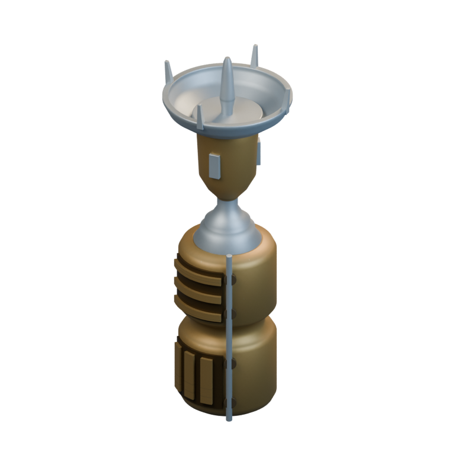

[Blend](../sources/docs/assets/reconstruction/rigellian-refined/ri14/model.blend) · [GLB](../sources/docs/assets/reconstruction/rigellian-refined/ri14/model.glb)

## Energy Globe

`openfa:building/legacy/054`

**First available iteration — silhouette-study**

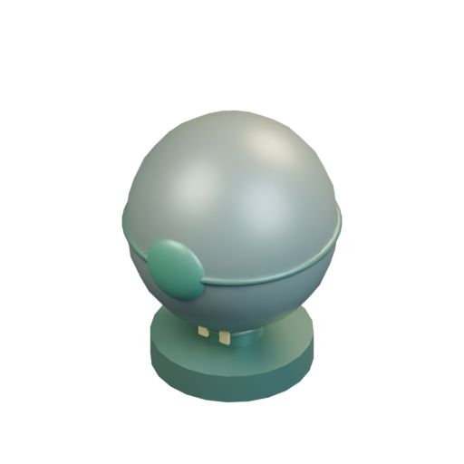

[Blend](../sources/docs/assets/bootstrap-3d/full-catalogue/rigellian/ri15/model.blend) · [GLB](../sources/docs/assets/bootstrap-3d/full-catalogue/rigellian/ri15/model.glb)

**Additional iteration — reference-refined-study**

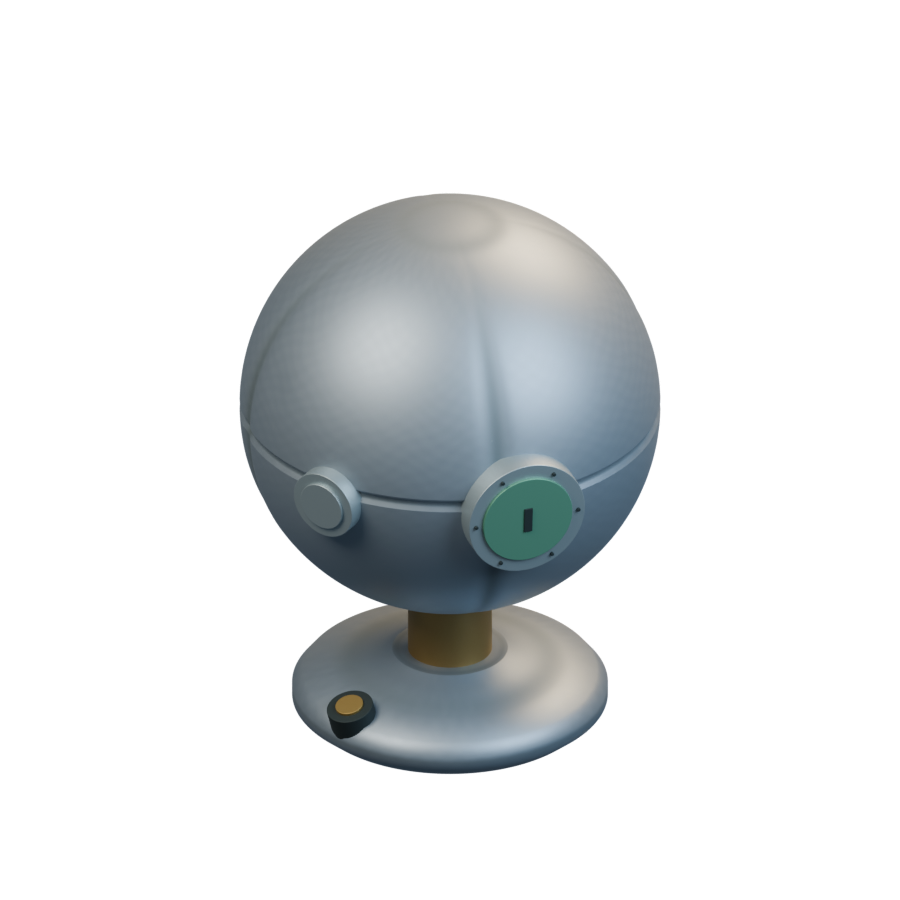

[Blend](../sources/docs/assets/reconstruction/buildings/rigellian/energy-globe/model.blend) · [GLB](../sources/docs/assets/reconstruction/buildings/rigellian/energy-globe/model.glb)

## Shield Generator

`openfa:building/legacy/055`

**First available iteration — silhouette-study**

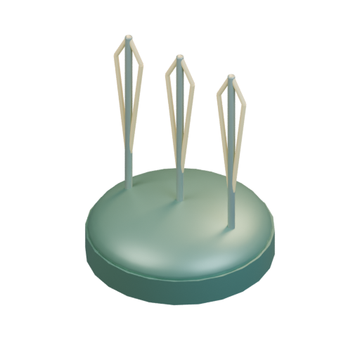

[Blend](../sources/docs/assets/bootstrap-3d/full-catalogue/rigellian/ri16/model.blend) · [GLB](../sources/docs/assets/bootstrap-3d/full-catalogue/rigellian/ri16/model.glb)

**Additional iteration — initial-reference-study**

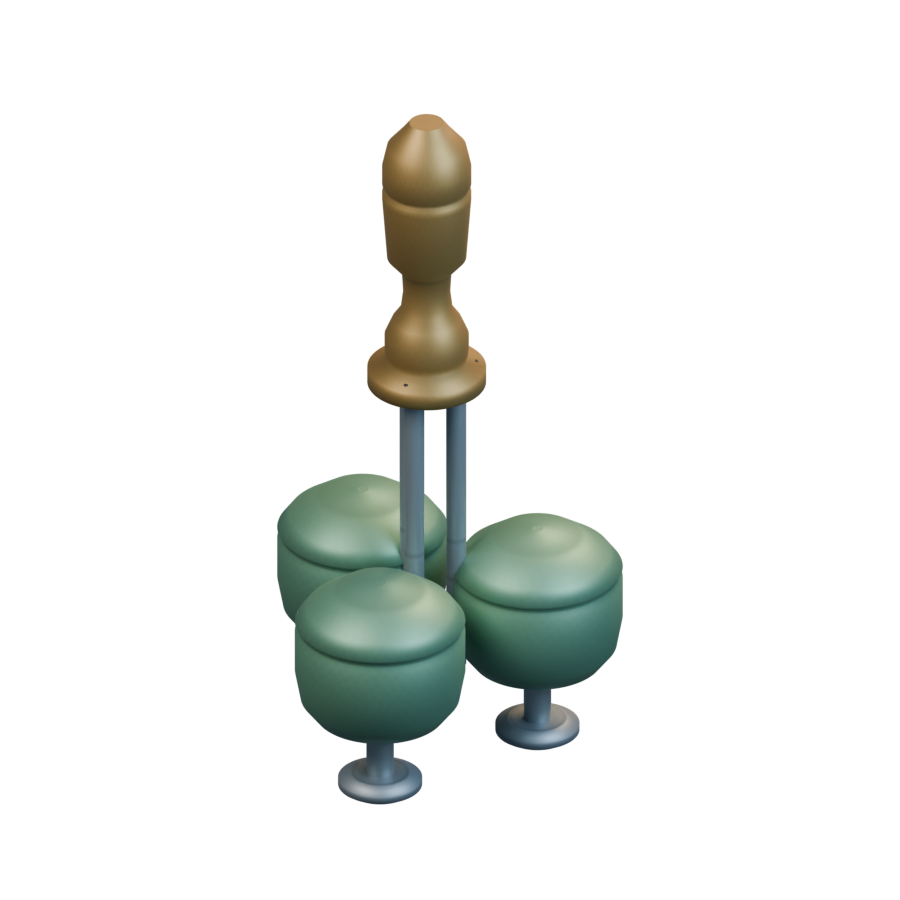

[Blend](../sources/docs/assets/reconstruction/buildings/rigellian/shield-generator/model.blend) · [GLB](../sources/docs/assets/reconstruction/buildings/rigellian/shield-generator/model.glb)

## Arms Unit

`openfa:building/legacy/056`

**First available iteration — silhouette-study**

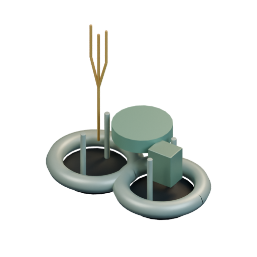

[Blend](../sources/docs/assets/bootstrap-3d/full-catalogue/rigellian/ri17/model.blend) · [GLB](../sources/docs/assets/bootstrap-3d/full-catalogue/rigellian/ri17/model.glb)

**Additional iteration — initial-reference-study**

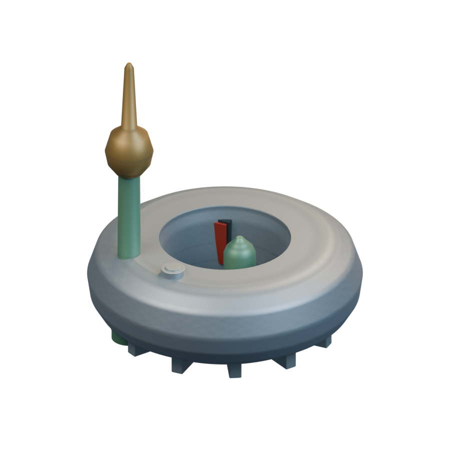

[Blend](../sources/docs/assets/reconstruction/buildings/rigellian/arms-unit/model.blend) · [GLB](../sources/docs/assets/reconstruction/buildings/rigellian/arms-unit/model.glb)

**Additional iteration — crown-refinement-study**

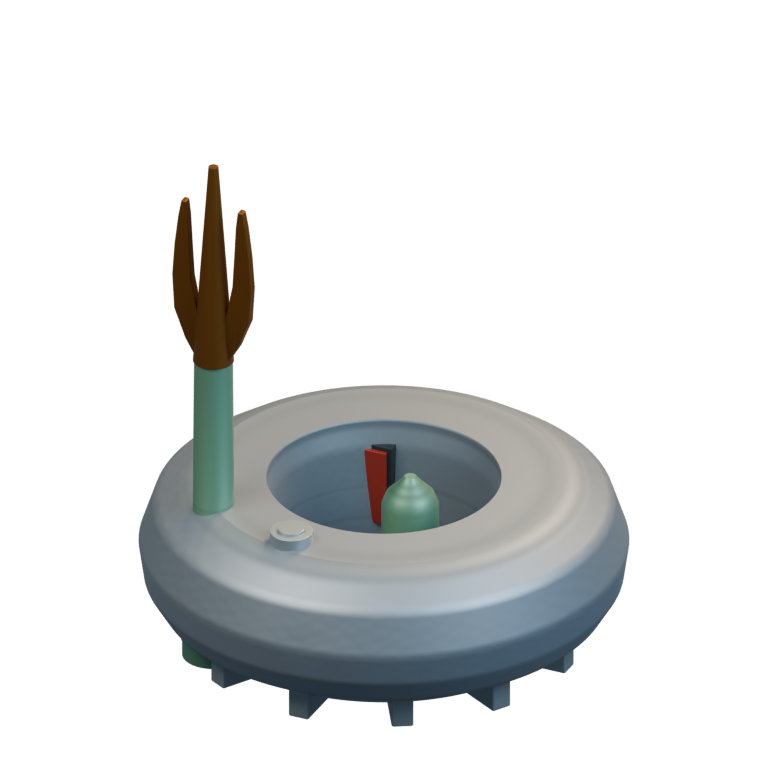

[Blend](../sources/docs/assets/reconstruction/rigellian-refined/ri17/model.blend) · [GLB](../sources/docs/assets/reconstruction/rigellian-refined/ri17/model.glb)

## Missile Launcher

`openfa:building/legacy/057`

**First available iteration — silhouette-study**

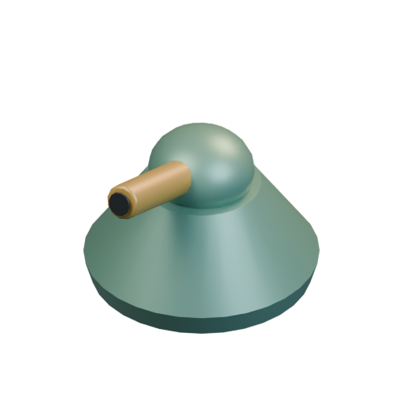

[Blend](../sources/docs/assets/bootstrap-3d/full-catalogue/rigellian/ri18/model.blend) · [GLB](../sources/docs/assets/bootstrap-3d/full-catalogue/rigellian/ri18/model.glb)

[Play animation: Animation](../gallery/media/docs/assets/bootstrap-3d/full-catalogue/rigellian/ri18/animation-00.webm)

**Additional iteration — initial-reference-study**

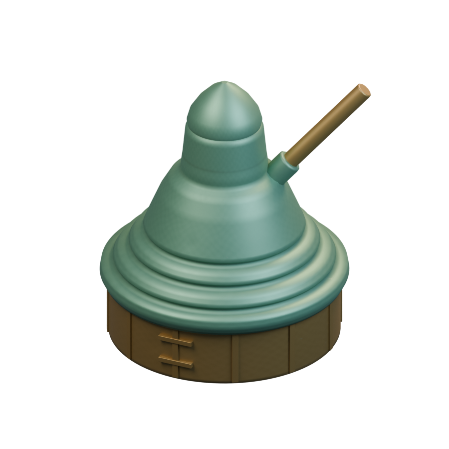

[Blend](../sources/docs/assets/reconstruction/buildings/rigellian/missile-launcher/model.blend) · [GLB](../sources/docs/assets/reconstruction/buildings/rigellian/missile-launcher/model.glb)

**Additional iteration — verified-launch-mechanism**

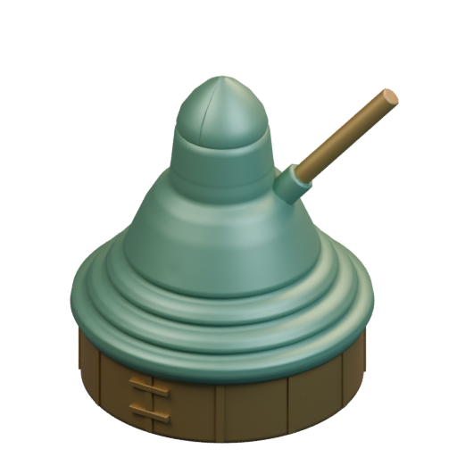

[Blend](../sources/docs/assets/reconstruction/launch-facilities/rigellian/ri18/model.blend) · [GLB](../sources/docs/assets/reconstruction/launch-facilities/rigellian/ri18/model.glb)

[Play animation: LaunchFacilityCycle](../gallery/media/docs/assets/reconstruction/launch-facilities/rigellian/ri18/animation-00.webm)

## Thermal Lance

`openfa:building/legacy/058`

**First available iteration — silhouette-study**

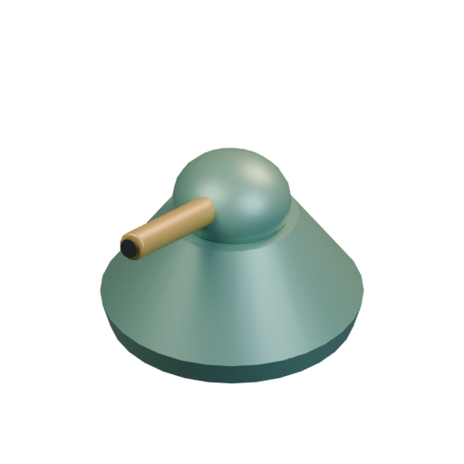

[Blend](../sources/docs/assets/bootstrap-3d/full-catalogue/rigellian/ri19/model.blend) · [GLB](../sources/docs/assets/bootstrap-3d/full-catalogue/rigellian/ri19/model.glb)

[Play animation: Animation](../gallery/media/docs/assets/bootstrap-3d/full-catalogue/rigellian/ri19/animation-00.webm)

**Additional iteration — initial-reference-study**

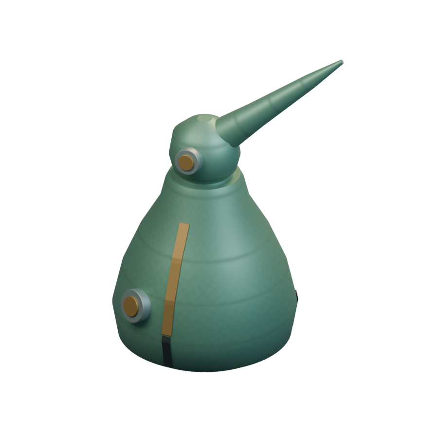

[Blend](../sources/docs/assets/reconstruction/buildings/rigellian/thermal-lance/model.blend) · [GLB](../sources/docs/assets/reconstruction/buildings/rigellian/thermal-lance/model.glb)

## Extractor

`openfa:building/legacy/059`

**First available iteration — silhouette-study**

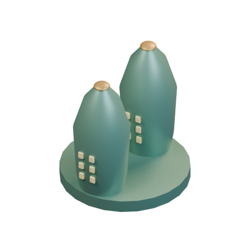

[Blend](../sources/docs/assets/bootstrap-3d/full-catalogue/rigellian/ri20/model.blend) · [GLB](../sources/docs/assets/bootstrap-3d/full-catalogue/rigellian/ri20/model.glb)

**Additional iteration — initial-reference-study**

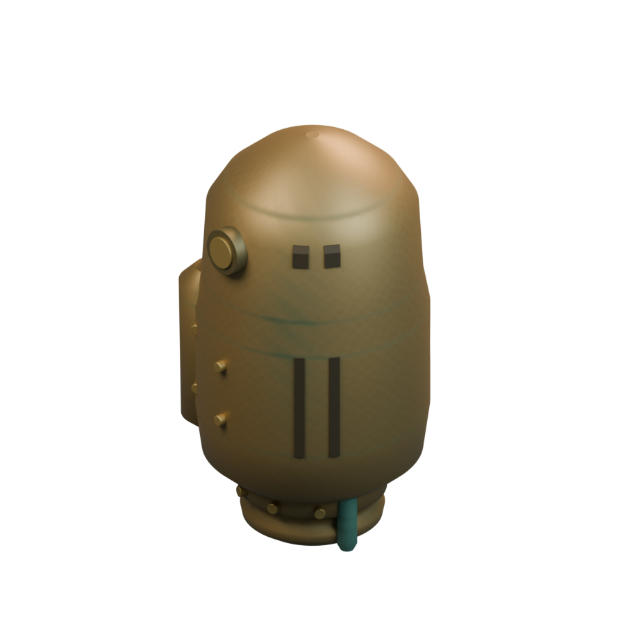

[Blend](../sources/docs/assets/reconstruction/buildings/rigellian/extractor/model.blend) · [GLB](../sources/docs/assets/reconstruction/buildings/rigellian/extractor/model.glb)

**Additional iteration — structural-detail-refinement**

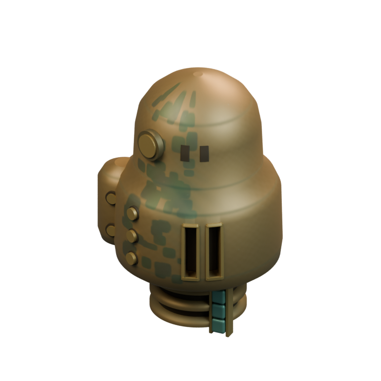

[Blend](../sources/docs/assets/reconstruction/rigellian-refined/ri20/model.blend) · [GLB](../sources/docs/assets/reconstruction/rigellian-refined/ri20/model.glb)

## Storage racks

`openfa:building/legacy/060`

**First available iteration — silhouette-study**

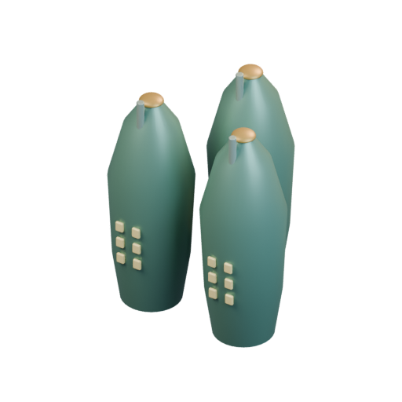

[Blend](../sources/docs/assets/bootstrap-3d/full-catalogue/rigellian/ri21/model.blend) · [GLB](../sources/docs/assets/bootstrap-3d/full-catalogue/rigellian/ri21/model.glb)

**Additional iteration — initial-reference-study**

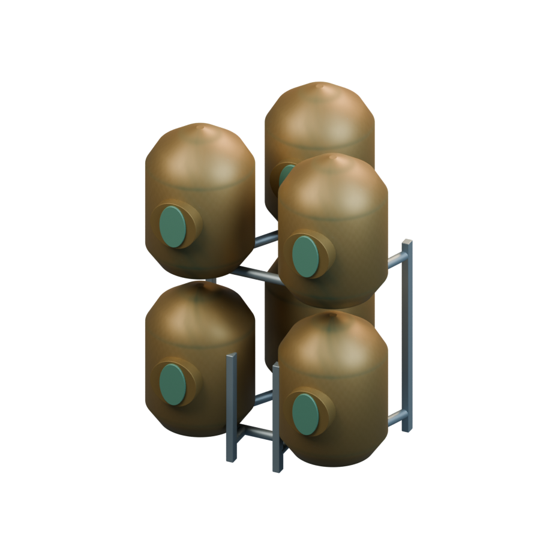

[Blend](../sources/docs/assets/reconstruction/buildings/rigellian/storage-racks/model.blend) · [GLB](../sources/docs/assets/reconstruction/buildings/rigellian/storage-racks/model.glb)

## Ex-Fang

`openfa:building/legacy/061`

**First available iteration — silhouette-study**

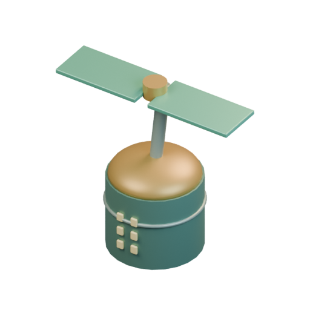

[Blend](../sources/docs/assets/bootstrap-3d/full-catalogue/rigellian/ri22/model.blend) · [GLB](../sources/docs/assets/bootstrap-3d/full-catalogue/rigellian/ri22/model.glb)

[Play animation: Animation](../gallery/media/docs/assets/bootstrap-3d/full-catalogue/rigellian/ri22/animation-00.webm)

**Additional iteration — initial-reference-study**

[Blend](../sources/docs/assets/reconstruction/buildings/rigellian/ex-fang/model.blend) · [GLB](../sources/docs/assets/reconstruction/buildings/rigellian/ex-fang/model.glb)

## Ultrathermal Lance

`openfa:building/legacy/062`

**First available iteration — silhouette-study**

[Blend](../sources/docs/assets/bootstrap-3d/full-catalogue/rigellian/ri23/model.blend) · [GLB](../sources/docs/assets/bootstrap-3d/full-catalogue/rigellian/ri23/model.glb)

[Play animation: Animation](../gallery/media/docs/assets/bootstrap-3d/full-catalogue/rigellian/ri23/animation-00.webm)

**Additional iteration — initial-reference-study**

[Blend](../sources/docs/assets/reconstruction/buildings/rigellian/ultrathermal-lance/model.blend) · [GLB](../sources/docs/assets/reconstruction/buildings/rigellian/ultrathermal-lance/model.glb)

**Additional iteration — visible-base-refinement**

[Blend](../sources/docs/assets/reconstruction/rigellian-refined/ri23/model.blend) · [GLB](../sources/docs/assets/reconstruction/rigellian-refined/ri23/model.glb)
