# Buildings / Rigellian

[All groups](README.md)

## Central Unit

`openfa:building/legacy/040`

**Canonical version — canonical-game-remaster**

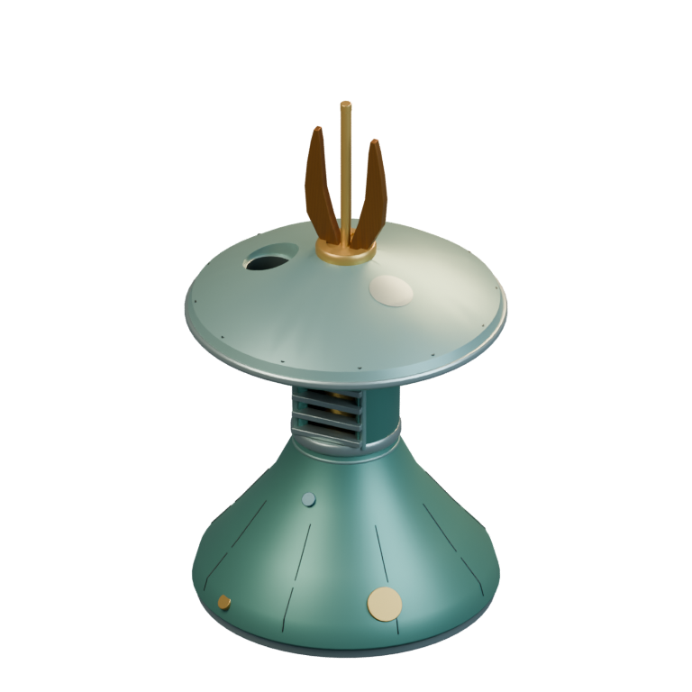

[Blend](../sources/objects/rigellian/central-unit/model.blend) · [GLB](../sources/objects/rigellian/central-unit/model.glb)

Additional views: [Legacy-based concept (interpreted details)](../gallery/media/concepts/rigellian/ri01-review-2.png) · [Actual independent GLB](../gallery/media/objects/rigellian/central-unit/imported-front-quarter.png)

## Filtration Plant

`openfa:building/legacy/041`

**Canonical version — canonical-game-remaster**

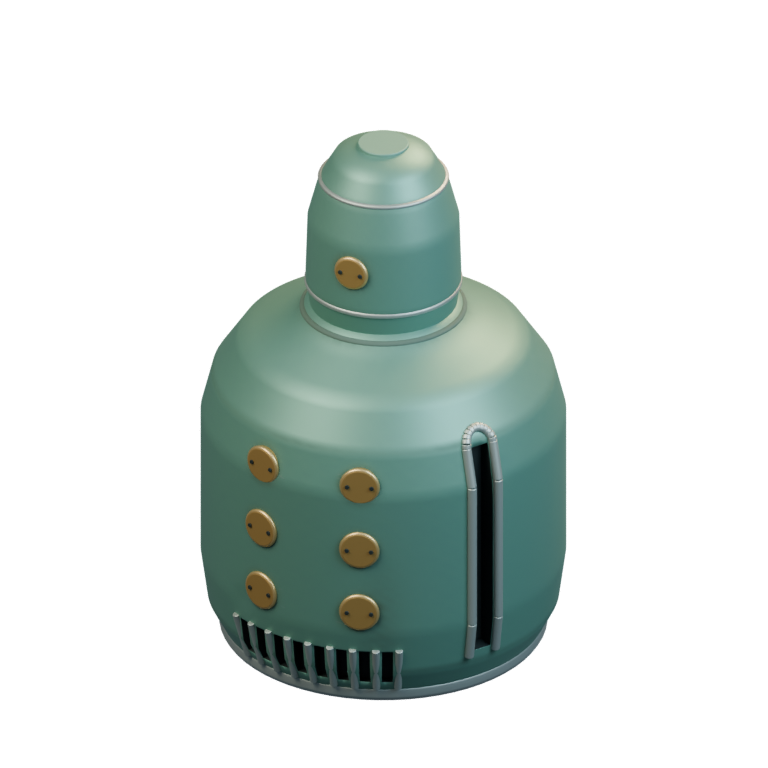

[Blend](../sources/objects/rigellian/filtration-plant/model.blend) · [GLB](../sources/objects/rigellian/filtration-plant/model.glb)

Additional views: [Legacy-based concept (interpreted details)](../gallery/media/concepts/rigellian/ri02-review-1.png) · [Actual independent GLB](../gallery/media/objects/rigellian/filtration-plant/imported-front-quarter.png)

## Nourishment Bank

`openfa:building/legacy/042`

**Canonical version — canonical-game-remaster**

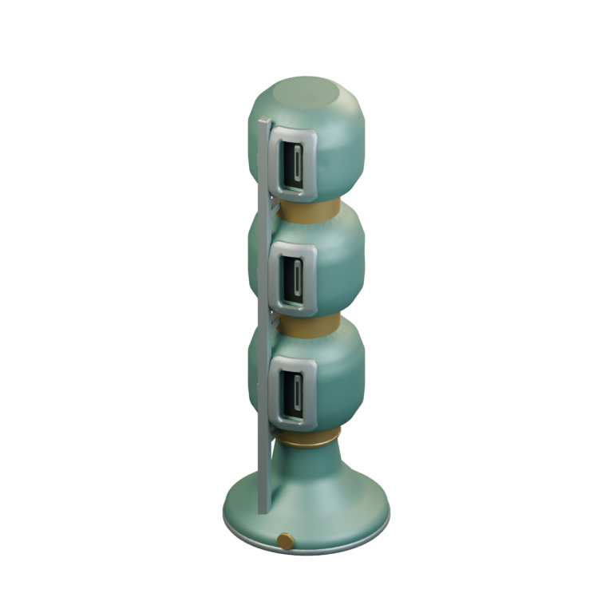

[Blend](../sources/objects/rigellian/nourishment-bank/model.blend) · [GLB](../sources/objects/rigellian/nourishment-bank/model.glb)

Additional views: [Concept review (legacy-based; interpreted sleeves)](../gallery/media/concepts/rigellian/ri03-review-1.png) · [Actual independent GLB](../gallery/media/objects/rigellian/nourishment-bank/imported-front-quarter.png)

## Community

`openfa:building/legacy/043`

**Canonical version — canonical-game-remaster**

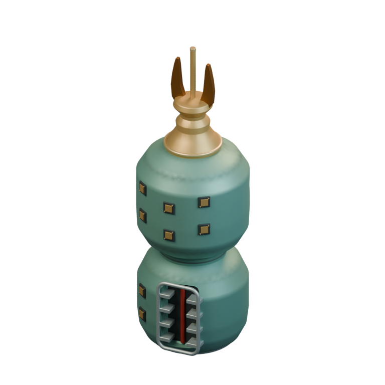

[Blend](../sources/objects/rigellian/community/model.blend) · [GLB](../sources/objects/rigellian/community/model.glb)

Additional views: [Legacy-based concept (interpreted details)](../gallery/media/concepts/rigellian/ri04-review-1.png) · [Actual independent GLB](../gallery/media/objects/rigellian/community/imported-front-quarter.png)

## Health Unit

`openfa:building/legacy/044`

**Canonical version — canonical-game-remaster**

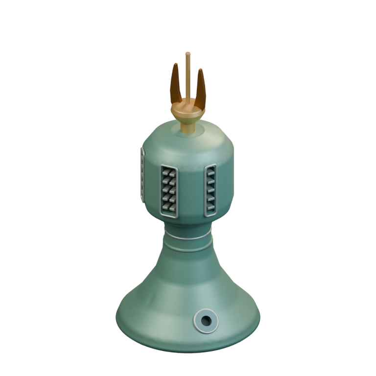

[Blend](../sources/objects/rigellian/health-unit/model.blend) · [GLB](../sources/objects/rigellian/health-unit/model.glb)

Additional views: [Legacy-based concept (interpreted details)](../gallery/media/concepts/rigellian/ri05-review-1.png) · [Actual independent GLB](../gallery/media/objects/rigellian/health-unit/imported-front-quarter.png)

## Strategic Bunker

`openfa:building/legacy/045`

**Canonical version — canonical-game-remaster**

[Blend](../sources/objects/rigellian/strategic-bunker/model.blend) · [GLB](../sources/objects/rigellian/strategic-bunker/model.glb)

Additional views: [Legacy-based concept (interpreted details)](../gallery/media/concepts/rigellian/ri06-review-1.png) · [Actual independent GLB](../gallery/media/objects/rigellian/strategic-bunker/imported-front-quarter.png)

## Science Labs

`openfa:building/legacy/046`

**Canonical version — canonical-game-remaster**

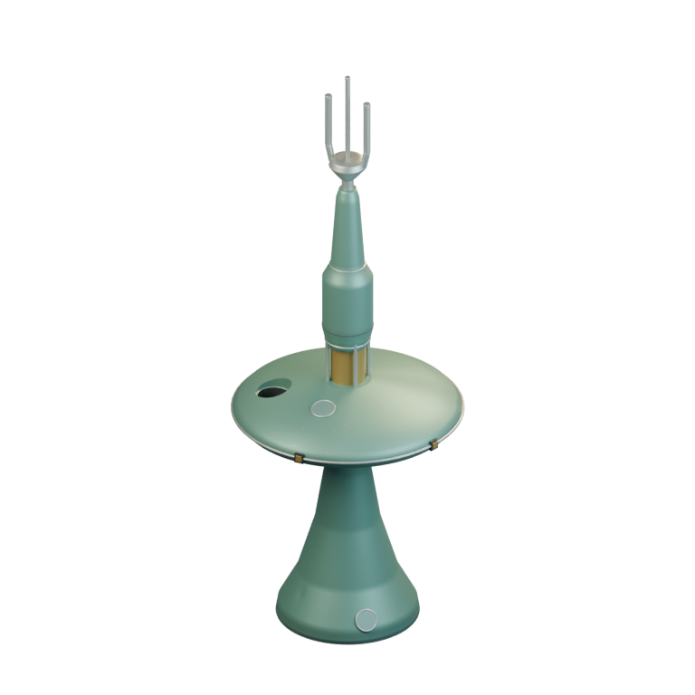

[Blend](../sources/objects/rigellian/science-labs/model.blend) · [GLB](../sources/objects/rigellian/science-labs/model.glb)

Additional views: [Legacy-based concept (interpreted details)](../gallery/media/concepts/rigellian/ri07-review-1.png) · [Actual independent GLB](../gallery/media/objects/rigellian/science-labs/imported-front-quarter.png)

## Databanks

`openfa:building/legacy/047`

**Canonical version — canonical-game-remaster**

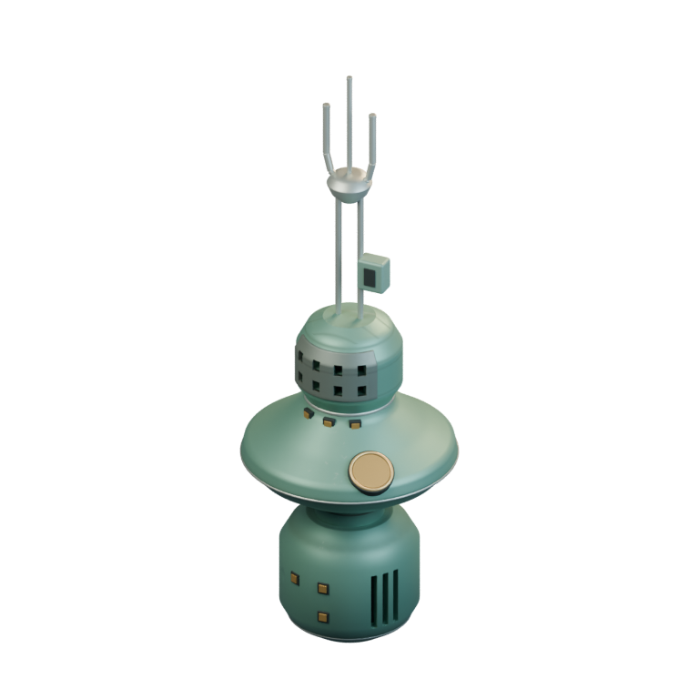

[Blend](../sources/objects/rigellian/databanks/model.blend) · [GLB](../sources/objects/rigellian/databanks/model.glb)

Additional views: [Legacy-based concept (interpreted details)](../gallery/media/concepts/rigellian/ri08-review-1.png) · [Actual independent GLB](../gallery/media/objects/rigellian/databanks/imported-front-quarter.png)

## Construction Unit

`openfa:building/legacy/048`

**Canonical version — canonical-game-remaster**

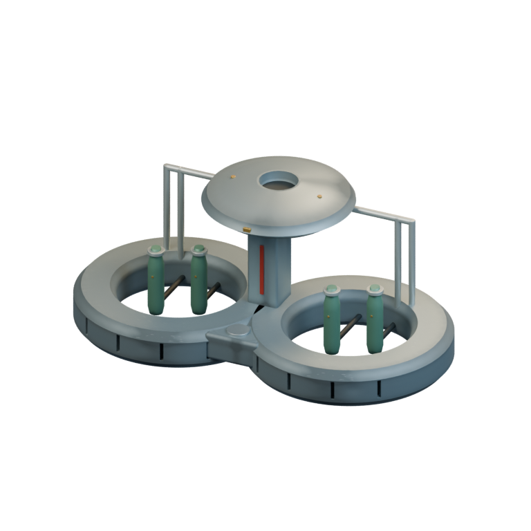

[Blend](../sources/objects/rigellian/construction-unit/model.blend) · [GLB](../sources/objects/rigellian/construction-unit/model.glb)

Additional views: [Legacy-based concept (interpreted details)](../gallery/media/concepts/rigellian/ri09-review-1.png) · [Actual independent GLB](../gallery/media/objects/rigellian/construction-unit/imported-front-quarter.png)

## Ground Deck

`openfa:building/legacy/049`

**Canonical version — canonical-game-remaster**

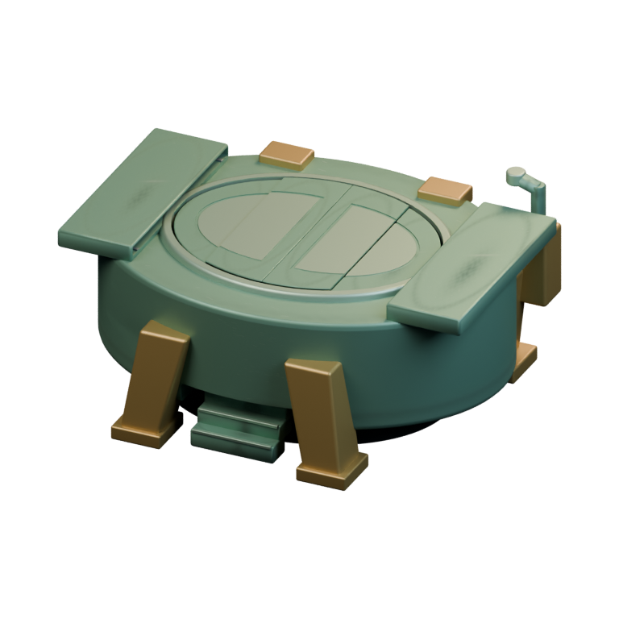

[Blend](../sources/objects/rigellian/ground-deck/model.blend) · [GLB](../sources/objects/rigellian/ground-deck/model.glb)

Additional views: [Legacy-based concept (interpreted details)](../gallery/media/concepts/rigellian/ri10-review-1.png) · [Actual independent GLB](../gallery/media/objects/rigellian/ground-deck/imported-front-quarter.png)

[Play animation: GroundDeckCoverCycle](../gallery/media/objects/rigellian/ground-deck/animation-00.webm)

[Play animation: GroundDeckDescriptorStates](../gallery/media/objects/rigellian/ground-deck/animation-01.webm)

## Probe Launch

`openfa:building/legacy/050`

**Canonical version — canonical-game-remaster**

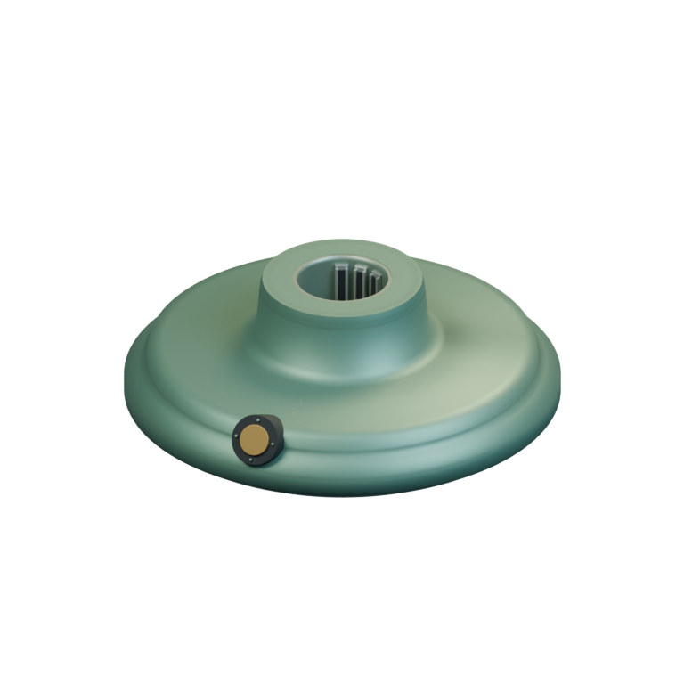

[Blend](../sources/objects/rigellian/probe-launch/model.blend) · [GLB](../sources/objects/rigellian/probe-launch/model.glb)

Additional views: [Legacy-based concept (interpreted details)](../gallery/media/concepts/rigellian/ri11-review-1.png) · [Actual independent GLB](../gallery/media/objects/rigellian/probe-launch/imported-front-quarter.png)

## Deep Space Probes

`openfa:building/legacy/051`

**Canonical version — canonical-game-remaster**

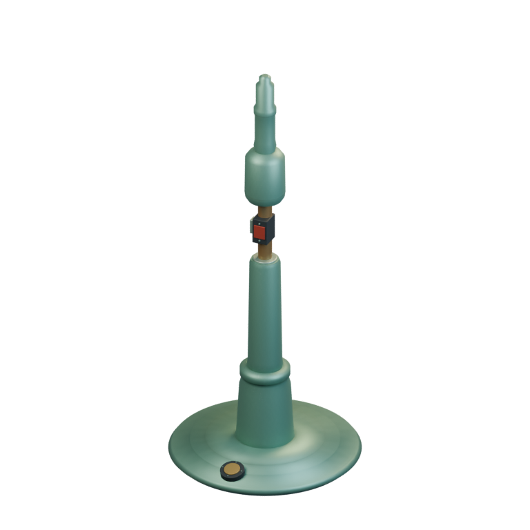

[Blend](../sources/objects/rigellian/deep-space-probes/model.blend) · [GLB](../sources/objects/rigellian/deep-space-probes/model.glb)

Additional views: [Legacy-based concept (interpreted details)](../gallery/media/concepts/rigellian/ri12-review-2.png) · [Actual independent GLB](../gallery/media/objects/rigellian/deep-space-probes/imported-front-quarter.png)

## Gravitic Converter

`openfa:building/legacy/052`

**Canonical version — canonical-game-remaster**

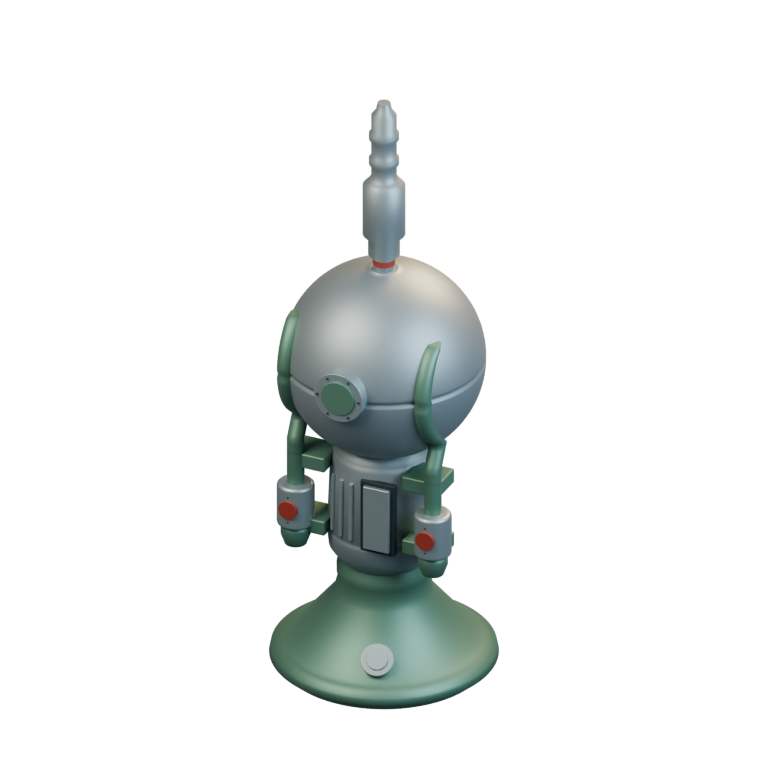

[Blend](../sources/objects/rigellian/gravitic-converter/model.blend) · [GLB](../sources/objects/rigellian/gravitic-converter/model.glb)

Additional views: [Legacy-based concept (interpreted details)](../gallery/media/concepts/rigellian/ri13-review-1.png) · [Actual independent GLB](../gallery/media/objects/rigellian/gravitic-converter/imported-front-quarter.png)

## Energy Gatherer

`openfa:building/legacy/053`

**Canonical version — canonical-game-remaster**

[Blend](../sources/objects/rigellian/energy-gatherer/model.blend) · [GLB](../sources/objects/rigellian/energy-gatherer/model.glb)

Additional views: [Legacy-based concept (interpreted details)](../gallery/media/concepts/rigellian/ri14-review-1.png) · [Actual independent GLB](../gallery/media/objects/rigellian/energy-gatherer/imported-front-quarter.png)

## Energy Globe

`openfa:building/legacy/054`

**Canonical version — canonical-game-remaster**

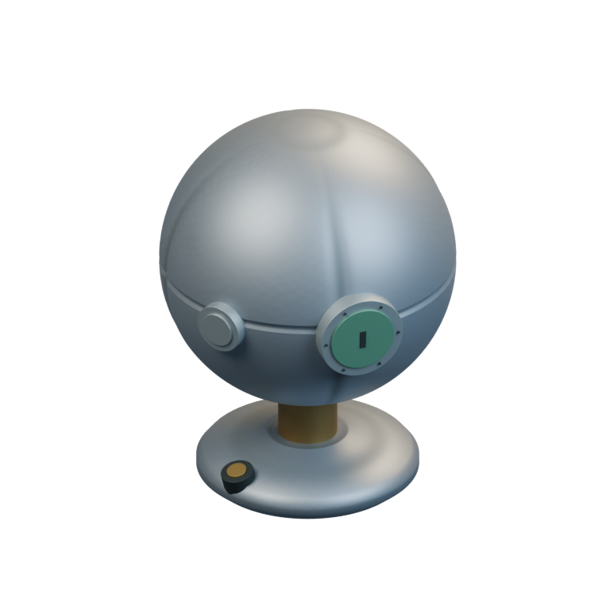

[Blend](../sources/objects/rigellian/energy-globe/model.blend) · [GLB](../sources/objects/rigellian/energy-globe/model.glb)

Additional views: [Legacy-based concept (interpreted details)](../gallery/media/concepts/rigellian/ri15-review-1.png) · [Actual independent GLB](../gallery/media/objects/rigellian/energy-globe/imported-front-quarter.png)

## Shield Generator

`openfa:building/legacy/055`

**Canonical version — canonical-game-remaster**

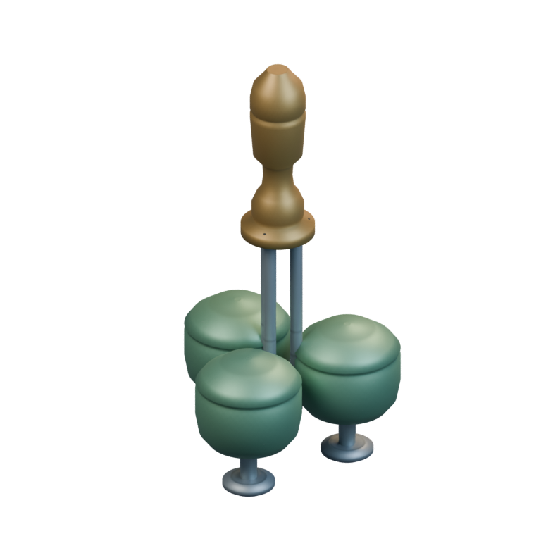

[Blend](../sources/objects/rigellian/shield-generator/model.blend) · [GLB](../sources/objects/rigellian/shield-generator/model.glb)

Additional views: [Legacy-based concept (interpreted details)](../gallery/media/concepts/rigellian/ri16-review-2.png) · [Actual independent GLB](../gallery/media/objects/rigellian/shield-generator/imported-front-quarter.png)

## Arms Unit

`openfa:building/legacy/056`

**Canonical version — canonical-game-remaster**

[Blend](../sources/objects/rigellian/arms-unit/model.blend) · [GLB](../sources/objects/rigellian/arms-unit/model.glb)

Additional views: [Legacy-based concept (interpreted details)](../gallery/media/concepts/rigellian/ri17-review-2.png) · [Actual independent GLB](../gallery/media/objects/rigellian/arms-unit/imported-front-quarter.png)

## Missile Launcher

`openfa:building/legacy/057`

**Canonical version — canonical-game-remaster**

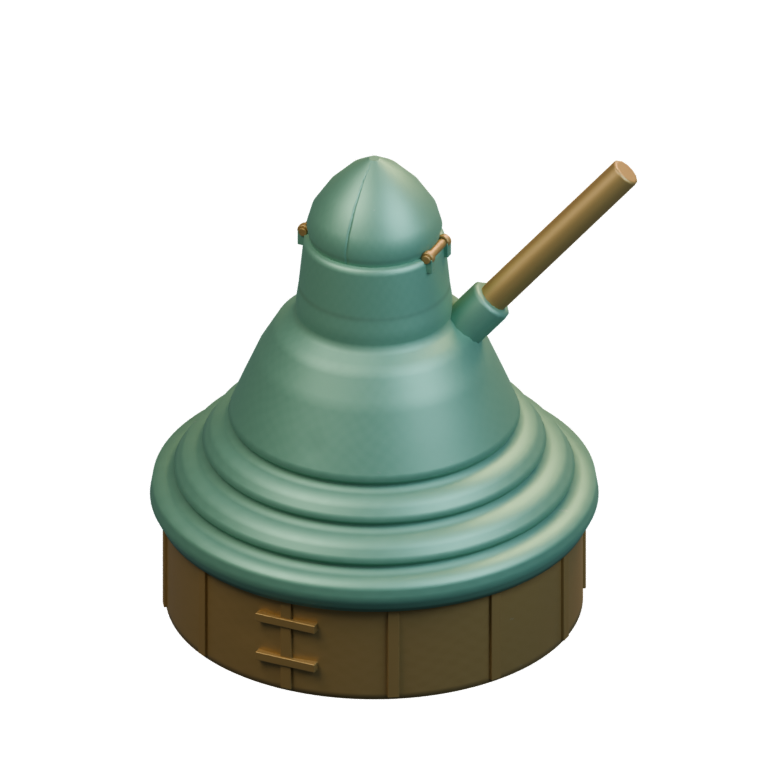

[Blend](../sources/objects/rigellian/missile-launcher/model.blend) · [GLB](../sources/objects/rigellian/missile-launcher/model.glb)

Additional views: [Legacy-based concept (interpreted details)](../gallery/media/concepts/rigellian/ri18-review-2.png) · [Actual independent GLB](../gallery/media/objects/rigellian/missile-launcher/imported-front-quarter.png)

[Play animation: MissileDomeCycle](../gallery/media/objects/rigellian/missile-launcher/animation-00.webm)

[Play animation: MissileDomeDescriptorStates](../gallery/media/objects/rigellian/missile-launcher/animation-01.webm)

## Thermal Lance

`openfa:building/legacy/058`

**Canonical version — canonical-game-remaster**

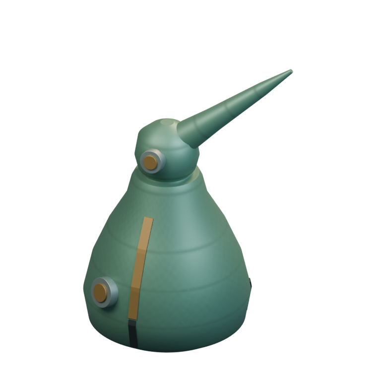

[Blend](../sources/objects/rigellian/thermal-lance/model.blend) · [GLB](../sources/objects/rigellian/thermal-lance/model.glb)

Additional views: [Legacy-based concept (interpreted details)](../gallery/media/concepts/rigellian/ri19-review-1.png) · [Actual independent GLB](../gallery/media/objects/rigellian/thermal-lance/imported-front-quarter.png) · [Articulated head: authored yaw 90 degrees (fixed base)](../gallery/media/objects/rigellian/thermal-lance/imported-yaw-04.png) · [Articulated head: authored yaw 180 degrees (fixed base)](../gallery/media/objects/rigellian/thermal-lance/imported-yaw-08.png) · [Articulated head: authored yaw 270 degrees (fixed base)](../gallery/media/objects/rigellian/thermal-lance/imported-yaw-12.png)

## Extractor

`openfa:building/legacy/059`

**Canonical version — canonical-game-remaster**

[Blend](../sources/objects/rigellian/extractor/model.blend) · [GLB](../sources/objects/rigellian/extractor/model.glb)

Additional views: [Legacy-based concept (interpreted details)](../gallery/media/concepts/rigellian/ri20-review-1.png) · [Actual independent GLB](../gallery/media/objects/rigellian/extractor/imported-front-quarter.png)

## Storage racks

`openfa:building/legacy/060`

**Canonical version — canonical-game-remaster**

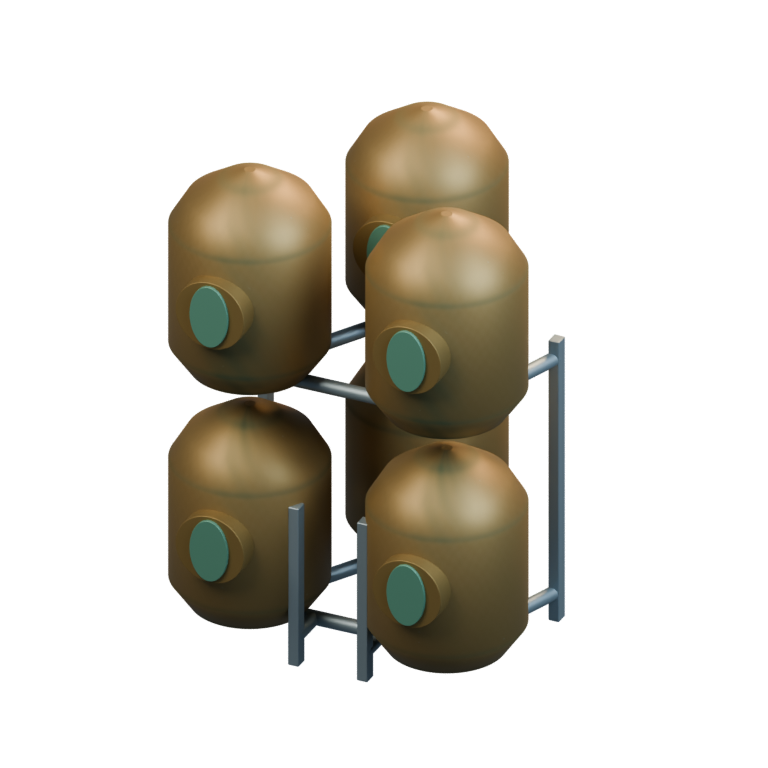

[Blend](../sources/objects/rigellian/storage-racks/model.blend) · [GLB](../sources/objects/rigellian/storage-racks/model.glb)

Additional views: [Legacy-based concept (interpreted details)](../gallery/media/concepts/rigellian/ri21-review-1.png) · [Actual independent GLB](../gallery/media/objects/rigellian/storage-racks/imported-front-quarter.png)

## Ex-Fang

`openfa:building/legacy/061`

**Canonical version — canonical-game-remaster**

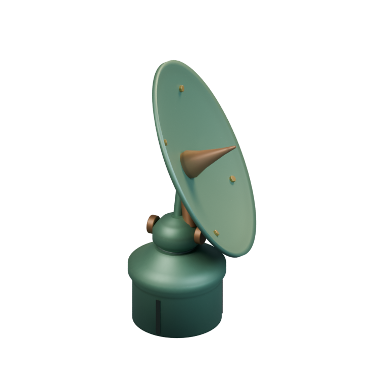

[Blend](../sources/objects/rigellian/ex-fang/model.blend) · [GLB](../sources/objects/rigellian/ex-fang/model.glb)

Additional views: [Legacy-based concept (interpreted details)](../gallery/media/concepts/rigellian/ri22-review-2.png) · [Actual independent GLB](../gallery/media/objects/rigellian/ex-fang/imported-front-quarter.png) · [Articulated head: authored yaw 90 degrees (fixed base)](../gallery/media/objects/rigellian/ex-fang/imported-yaw-04.png) · [Articulated head: authored yaw 180 degrees (fixed base)](../gallery/media/objects/rigellian/ex-fang/imported-yaw-08.png) · [Articulated head: authored yaw 270 degrees (fixed base)](../gallery/media/objects/rigellian/ex-fang/imported-yaw-12.png)

## Ultrathermal Lance

`openfa:building/legacy/062`

**Canonical version — canonical-game-remaster**

[Blend](../sources/objects/rigellian/ultrathermal-lance/model.blend) · [GLB](../sources/objects/rigellian/ultrathermal-lance/model.glb)

Additional views: [Legacy-based concept (interpreted details)](../gallery/media/concepts/rigellian/ri23-review-1.png) · [Actual independent GLB](../gallery/media/objects/rigellian/ultrathermal-lance/imported-front-quarter.png) · [Articulated head: authored yaw 90 degrees (fixed base)](../gallery/media/objects/rigellian/ultrathermal-lance/imported-yaw-04.png) · [Articulated head: authored yaw 180 degrees (fixed base)](../gallery/media/objects/rigellian/ultrathermal-lance/imported-yaw-08.png) · [Articulated head: authored yaw 270 degrees (fixed base)](../gallery/media/objects/rigellian/ultrathermal-lance/imported-yaw-12.png)
