# Buildings / Terran

[All groups](README.md)

## Living Quarters

`terran:living-quarters`

**Canonical version — refined-study**

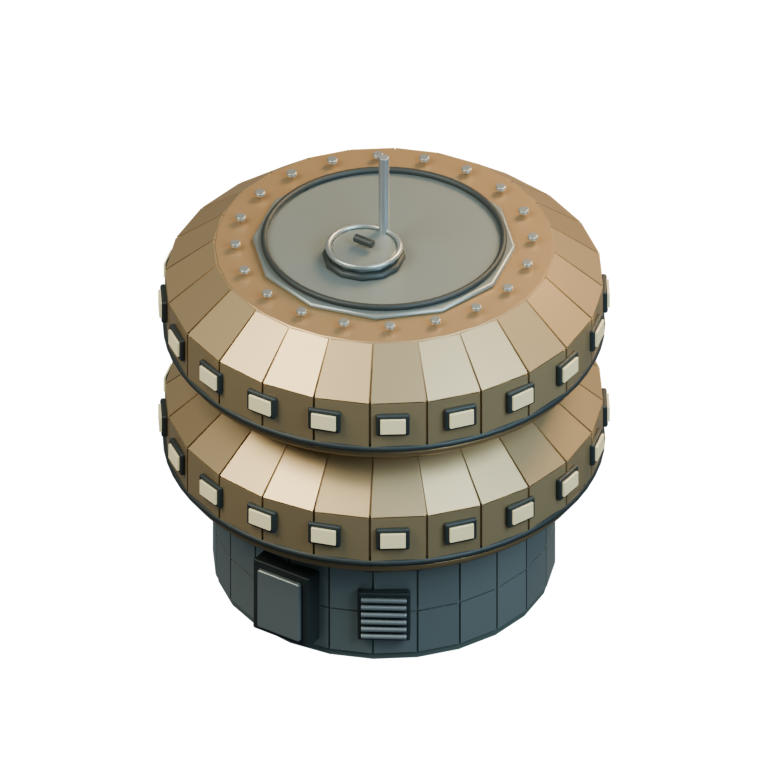

[Blend](../sources/docs/assets/bootstrap-3d/terran-refined/pb00/model.blend) · [GLB](../sources/docs/assets/bootstrap-3d/terran-refined/pb00/model.glb)

## Power Store

`terran:power-store`

**Canonical version — refined-study**

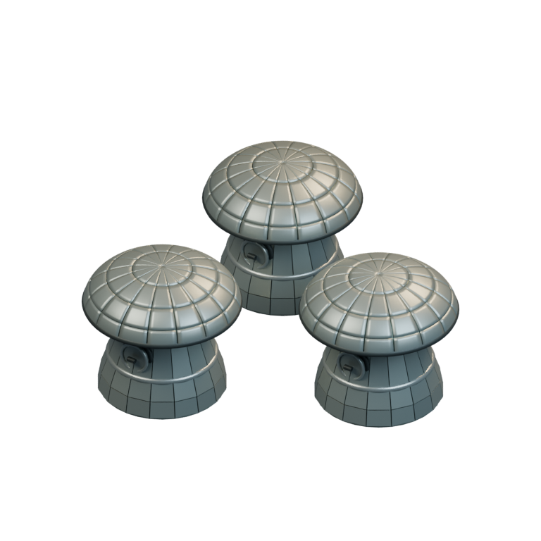

[Blend](../sources/docs/assets/bootstrap-3d/terran-refined/pb01/model.blend) · [GLB](../sources/docs/assets/bootstrap-3d/terran-refined/pb01/model.glb)

## Storage Facility

`terran:storage-facility`

**Canonical version — refined-study**

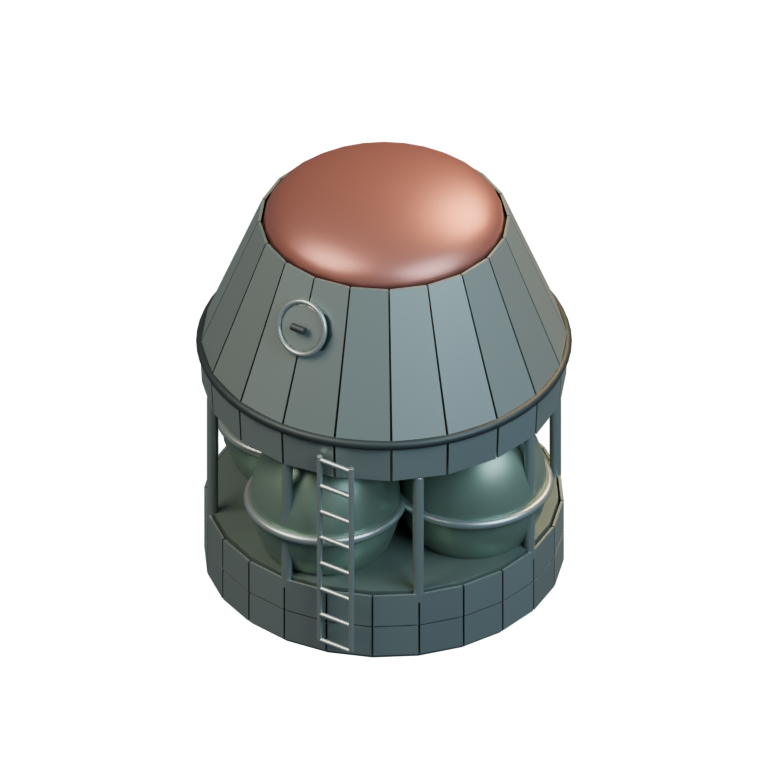

[Blend](../sources/docs/assets/bootstrap-3d/terran-refined/pb02/model.blend) · [GLB](../sources/docs/assets/bootstrap-3d/terran-refined/pb02/model.glb)

## Anti-Missile Pod

`terran:anti-missile-pod`

**Canonical version — shared-refined**

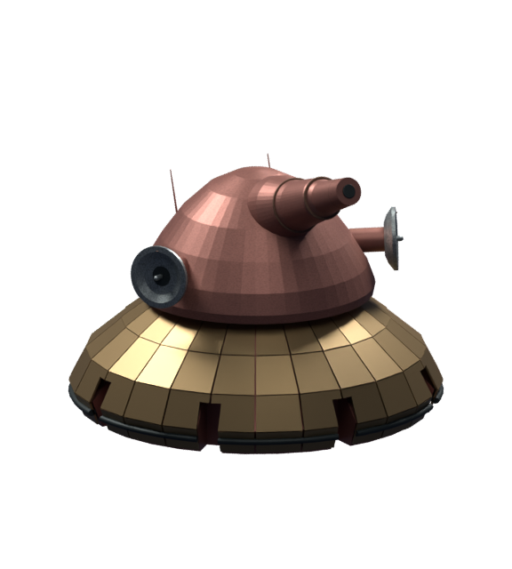

[Blend](../sources/objects/terran/anti-missile-pod/refined/model.blend) · [GLB](../sources/objects/terran/anti-missile-pod/refined/model.glb)

[Play animation: Animation](../gallery/media/objects/terran/anti-missile-pod/refined/animation-00.webm)

## Solar Panel

`terran:solar-panel`

**Canonical version — refined-study**

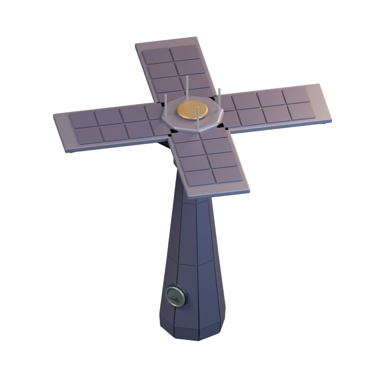

[Blend](../sources/docs/assets/bootstrap-3d/terran-refined/pb04/model.blend) · [GLB](../sources/docs/assets/bootstrap-3d/terran-refined/pb04/model.glb)

## Radiation Filter

`terran:radiation-filter`

**Canonical version — refined-study**

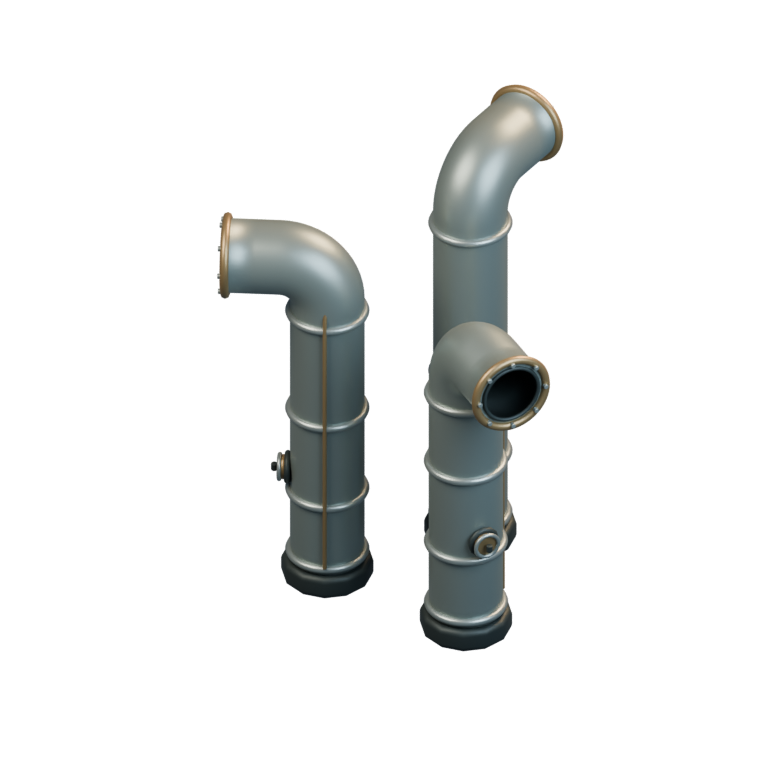

[Blend](../sources/docs/assets/bootstrap-3d/terran-refined/pb05/model.blend) · [GLB](../sources/docs/assets/bootstrap-3d/terran-refined/pb05/model.glb)

## Solar Generator

`terran:solar-generator`

**Canonical version — refined-study**

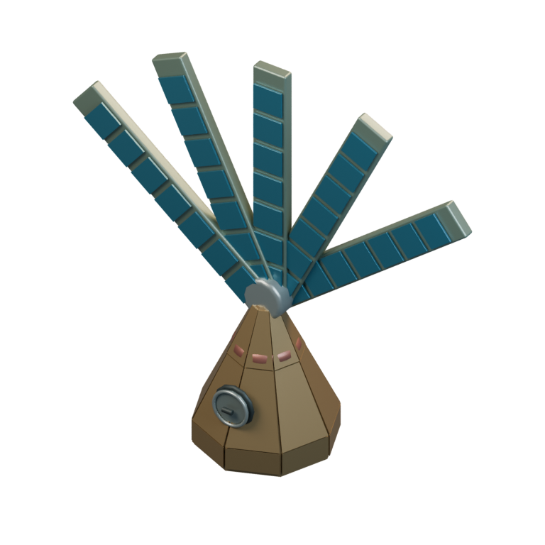

[Blend](../sources/docs/assets/bootstrap-3d/terran-refined/pb06/model.blend) · [GLB](../sources/docs/assets/bootstrap-3d/terran-refined/pb06/model.glb)

## Weapons Factory

`terran:weapons-factory`

**Canonical version — refined-study**

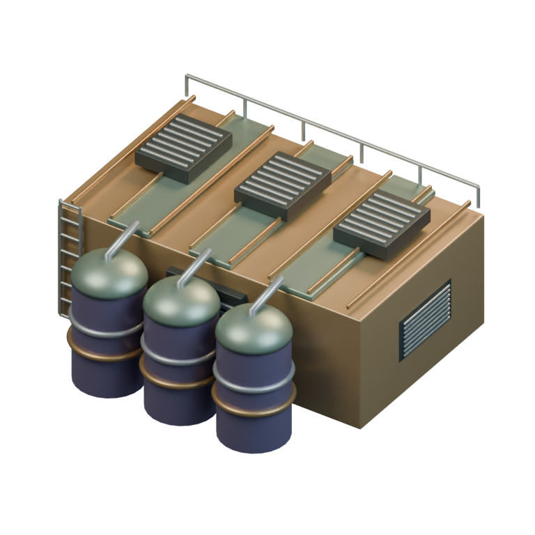

[Blend](../sources/docs/assets/bootstrap-3d/terran-refined/pb07/model.blend) · [GLB](../sources/docs/assets/bootstrap-3d/terran-refined/pb07/model.glb)

## Mine

`terran:mine`

**Canonical version — refined-study**

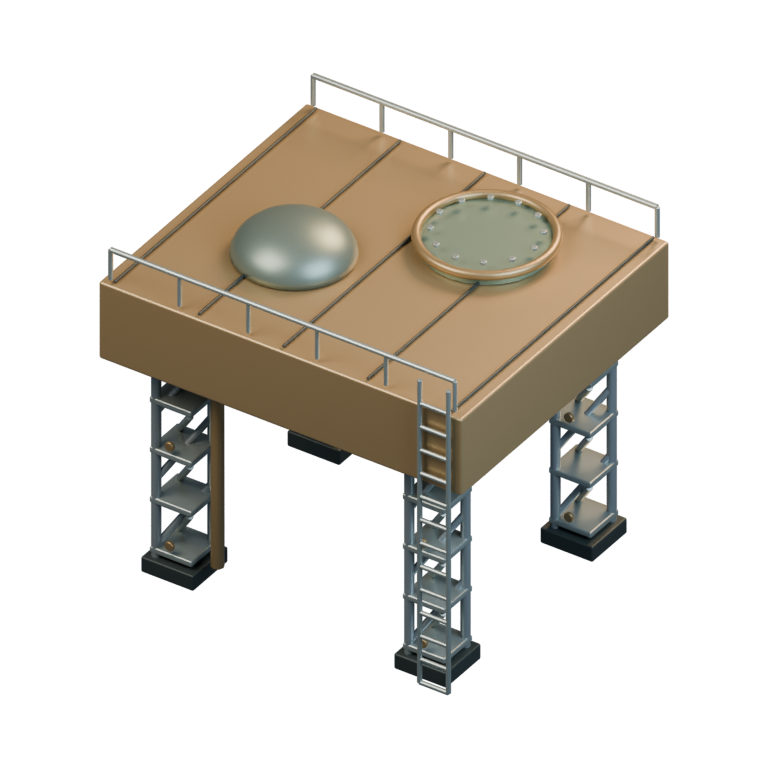

[Blend](../sources/docs/assets/bootstrap-3d/terran-refined/pb08/model.blend) · [GLB](../sources/docs/assets/bootstrap-3d/terran-refined/pb08/model.glb)

## Satellite Silo

`terran:satellite-silo`

**Canonical version — verified-launch-mechanism**

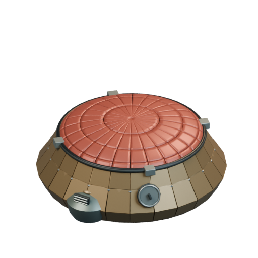

[Blend](../sources/docs/assets/reconstruction/launch-facilities/terran/pb09/model.blend) · [GLB](../sources/docs/assets/reconstruction/launch-facilities/terran/pb09/model.glb)

[Play animation: LaunchFacilityCycle](../gallery/media/docs/assets/reconstruction/launch-facilities/terran/pb09/animation-00.webm)

## Screen Generator

`terran:screen-generator`

**Canonical version — shared-refined**

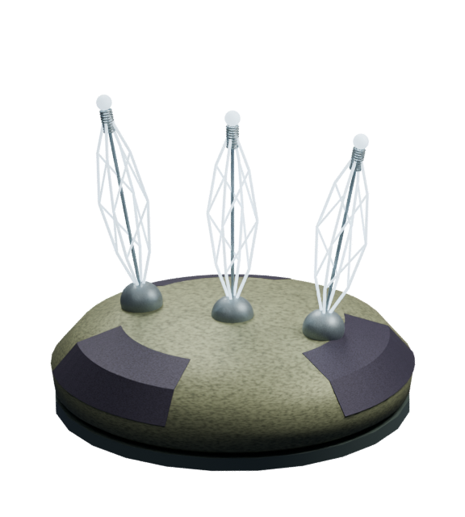

[Blend](../sources/objects/terran/screen-generator/refined/model.blend) · [GLB](../sources/objects/terran/screen-generator/refined/model.glb)

[Play animation: Animation](../gallery/media/objects/terran/screen-generator/refined/animation-00.webm)

## Ore Teleporter

`terran:ore-teleporter`

**Canonical version — shared-refined**

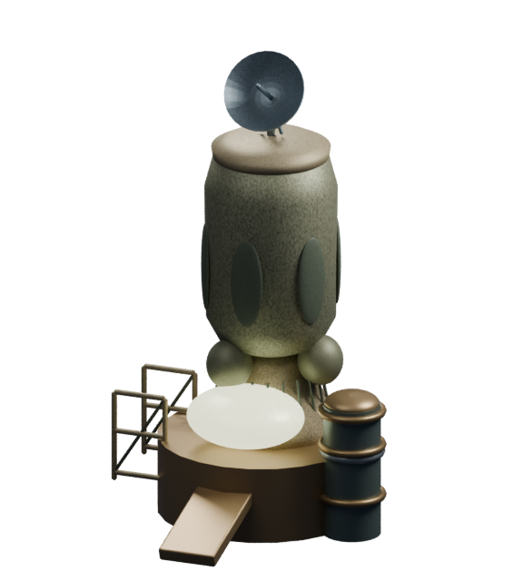

[Blend](../sources/objects/terran/ore-teleporter/refined/model.blend) · [GLB](../sources/objects/terran/ore-teleporter/refined/model.glb)

[Play animation: Animation](../gallery/media/objects/terran/ore-teleporter/refined/animation-00.webm)

## Gravity Nullifier

`terran:gravity-nullifier`

**Canonical version — shared-refined**

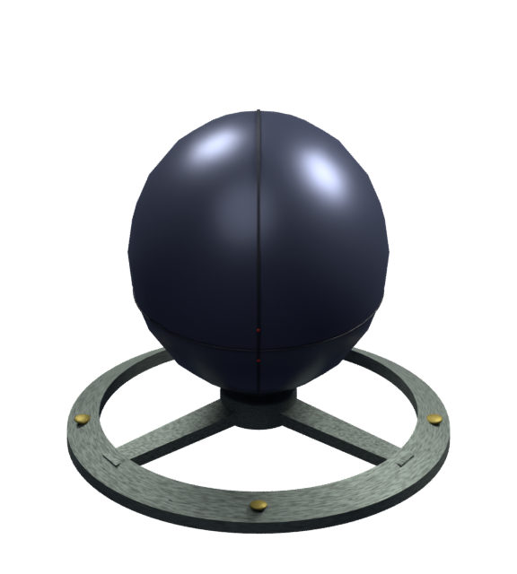

[Blend](../sources/objects/terran/gravity-nullifier/refined/model.blend) · [GLB](../sources/objects/terran/gravity-nullifier/refined/model.glb)

[Play animation: Animation](../gallery/media/objects/terran/gravity-nullifier/refined/animation-00.webm)

## Deep Bore Mine

`terran:deep-bore-mine`

**Canonical version — refined-study**

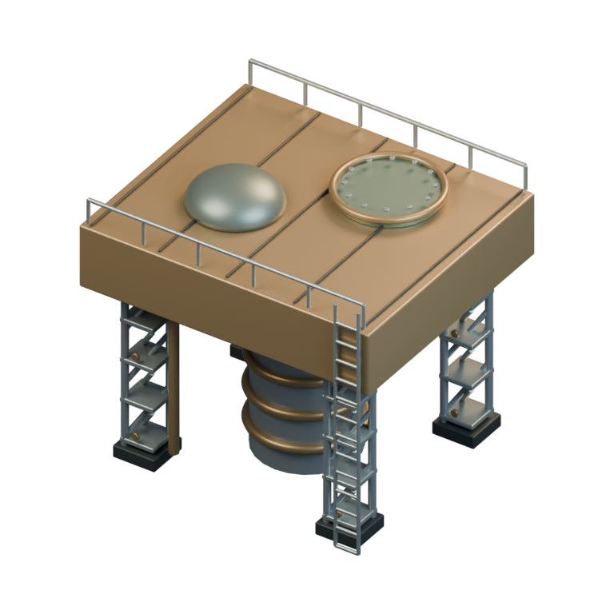

[Blend](../sources/docs/assets/bootstrap-3d/terran-refined/pb13/model.blend) · [GLB](../sources/docs/assets/bootstrap-3d/terran-refined/pb13/model.glb)

## Missile Silo

`terran:missile-silo`

**Canonical version — refined-study**

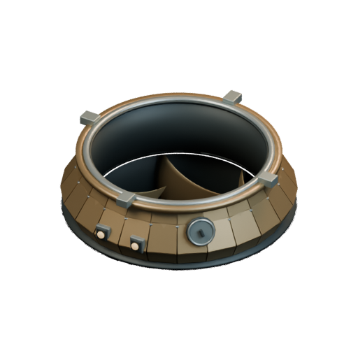

[Blend](../sources/docs/assets/bootstrap-3d/terran-refined/pb14/model.blend) · [GLB](../sources/docs/assets/bootstrap-3d/terran-refined/pb14/model.glb)

[Play animation: Animation](../gallery/media/docs/assets/bootstrap-3d/terran-refined/pb14/animation-00.webm)

## Repair Facility

`terran:repair-facility`

**Canonical version — shared-refined**

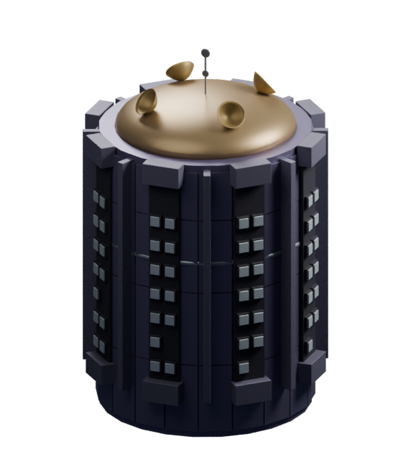

[Blend](../sources/objects/terran/repair-facility/refined/model.blend) · [GLB](../sources/objects/terran/repair-facility/refined/model.glb)

[Play animation: Animation](../gallery/media/objects/terran/repair-facility/refined/animation-00.webm)

## Sensor Array

`terran:sensor-array`

**Canonical version — refined-study**

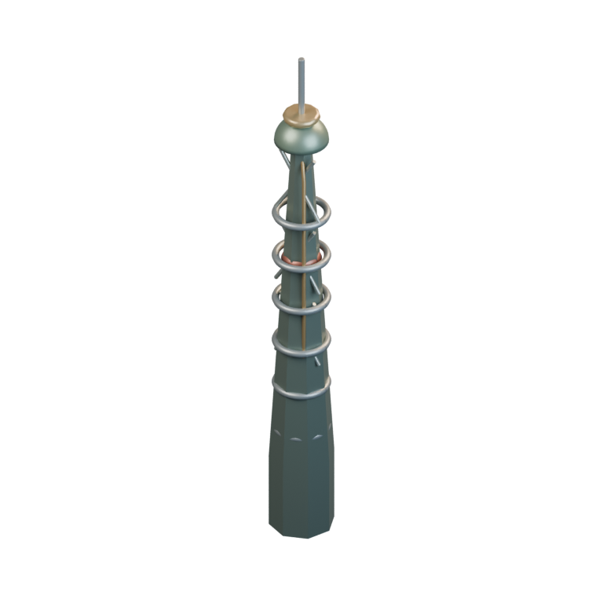

[Blend](../sources/docs/assets/bootstrap-3d/terran-refined/pb16/model.blend) · [GLB](../sources/docs/assets/bootstrap-3d/terran-refined/pb16/model.glb)

## Plasma Turret

`terran:plasma-turret`

**Canonical version — shared-refined**

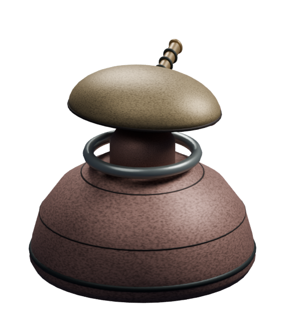

[Blend](../sources/objects/terran/plasma-turret/refined/model.blend) · [GLB](../sources/objects/terran/plasma-turret/refined/model.glb)

[Play animation: Animation](../gallery/media/objects/terran/plasma-turret/refined/animation-00.webm)

## Photon Turret

`terran:photon-turret`

**Canonical version — shared-refined**

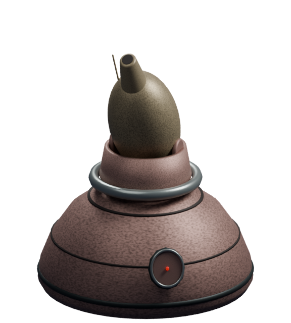

[Blend](../sources/objects/terran/photon-turret/refined/model.blend) · [GLB](../sources/objects/terran/photon-turret/refined/model.glb)

[Play animation: Animation](../gallery/media/objects/terran/photon-turret/refined/animation-00.webm)

## Air Processor

`terran:air-processor`

**Canonical version — refined-study**

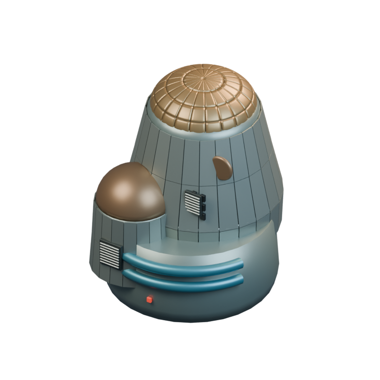

[Blend](../sources/docs/assets/bootstrap-3d/terran-refined/pb19/model.blend) · [GLB](../sources/docs/assets/bootstrap-3d/terran-refined/pb19/model.glb)

## C.P.U.

`terran:cpu`

**Canonical version — refined-study**

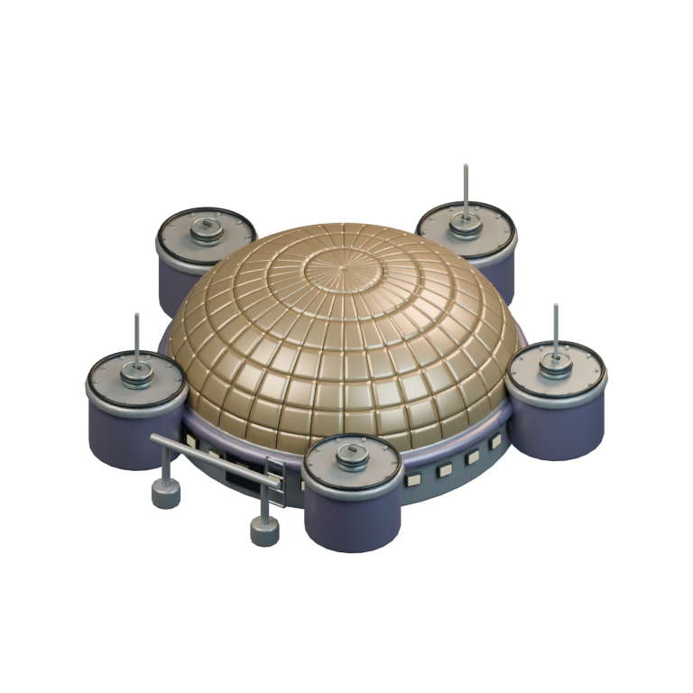

[Blend](../sources/docs/assets/bootstrap-3d/terran-refined/pb20/model.blend) · [GLB](../sources/docs/assets/bootstrap-3d/terran-refined/pb20/model.glb)

## Seismic Penetrator

`terran:seismic-penetrator`

**Canonical version — shared-refined**

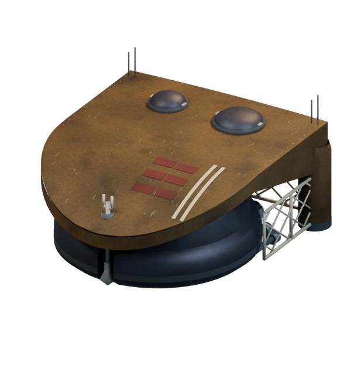

[Blend](../sources/objects/terran/seismic-penetrator/refined/model.blend) · [GLB](../sources/objects/terran/seismic-penetrator/refined/model.glb)

[Play animation: Animation](../gallery/media/objects/terran/seismic-penetrator/refined/animation-00.webm)

## Asteroid Engine

`terran:asteroid-engine`

**Canonical version — shared-refined**

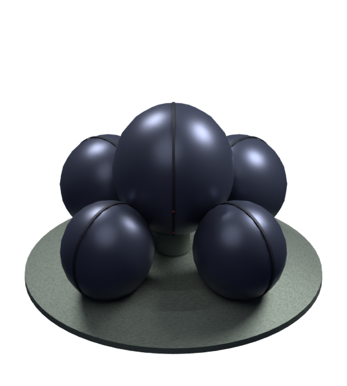

[Blend](../sources/objects/terran/asteroid-engines/refined/model.blend) · [GLB](../sources/objects/terran/asteroid-engines/refined/model.glb)

[Play animation: Animation](../gallery/media/objects/terran/asteroid-engines/refined/animation-00.webm)

## Powerplant

`terran:powerplant`

**Canonical version — shared-refined**

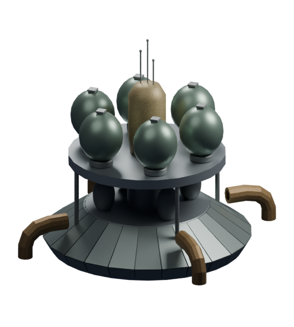

[Blend](../sources/objects/terran/powerplant/refined/model.blend) · [GLB](../sources/objects/terran/powerplant/refined/model.glb)

[Play animation: Animation](../gallery/media/objects/terran/powerplant/refined/animation-00.webm)

## Command Centre

`terran:command-centre`

**Canonical version — refined-study**

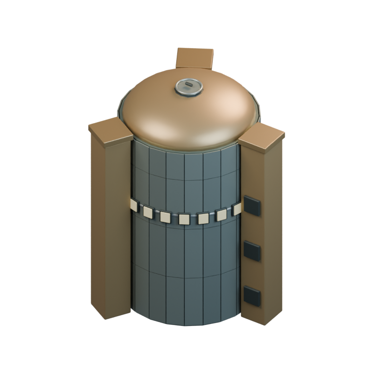

[Blend](../sources/docs/assets/bootstrap-3d/terran-refined/pb24/model.blend) · [GLB](../sources/docs/assets/bootstrap-3d/terran-refined/pb24/model.glb)

## Ship Yard

`terran:ship-yard`

**Canonical version — layered-construction-hangar**

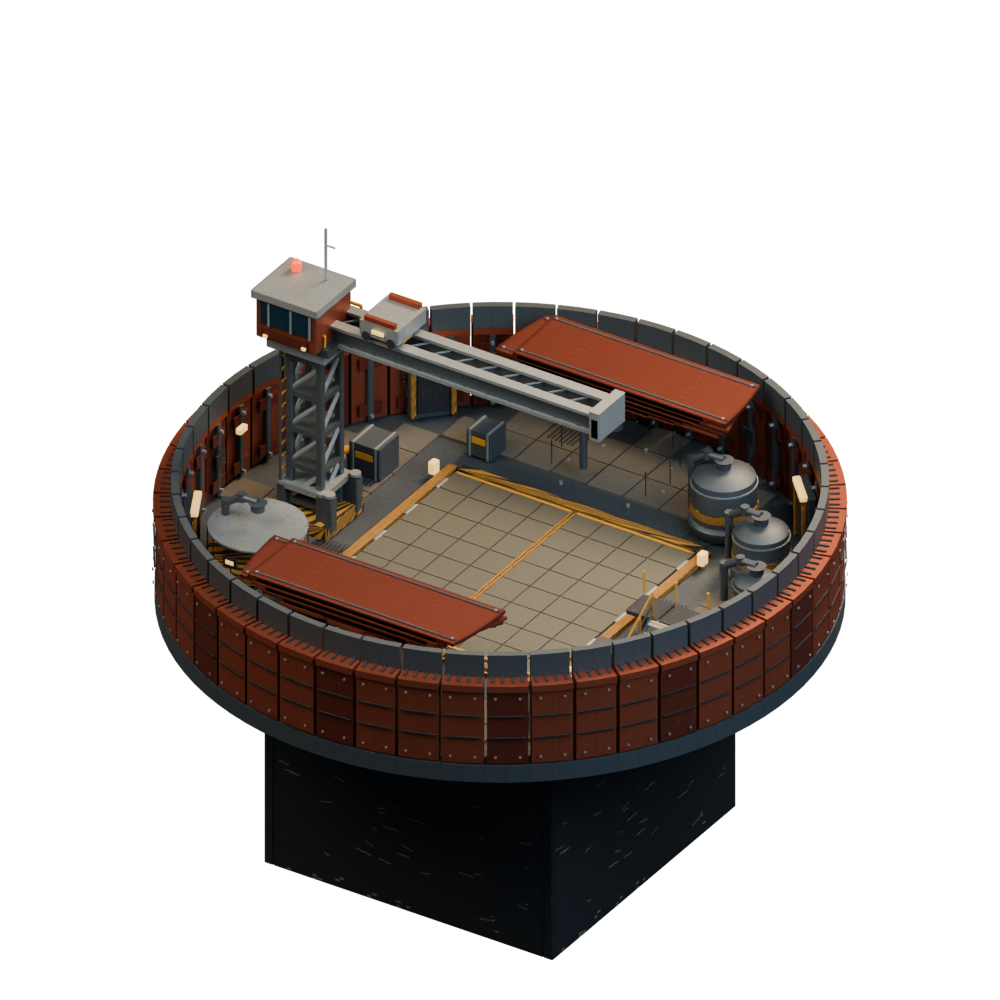

[Blend](../sources/objects/terran/ship-yard/model.blend) · [GLB](../sources/objects/terran/ship-yard/model.glb)

Additional views: [Build: frame foundation](../gallery/media/objects/terran/ship-yard/hangar/assault-fighter-build-base.png) · [Build: expanded frame](../gallery/media/objects/terran/ship-yard/hangar/assault-fighter-build-frame.png) · [Build: solid components](../gallery/media/objects/terran/ship-yard/hangar/assault-fighter-build-systems.png) · [Build: partial skin](../gallery/media/objects/terran/ship-yard/hangar/assault-fighter-partial-hull.png) · [Complete ship](../gallery/media/objects/terran/ship-yard/hangar/assault-fighter-complete.png) · [Lifted](../gallery/media/objects/terran/ship-yard/hangar/assault-fighter-lifted.png) · [Hatch open](../gallery/media/objects/terran/ship-yard/hangar/assault-fighter-hatch-open-loaded.png) · [Lowering](../gallery/media/objects/terran/ship-yard/hangar/assault-fighter-lowering.png) · [Received below ground](../gallery/media/objects/terran/ship-yard/hangar/assault-fighter-received.png) · [Ready](../gallery/media/objects/terran/ship-yard/hangar/assault-fighter-ready.png) · [Five construction stages](../gallery/media/objects/terran/ship-yard/hangar/construction-stages.png) · [Transfer sequence](../gallery/media/objects/terran/ship-yard/hangar/transfer-contact-sheet.png) · [Combat Eagle on hatch](../gallery/media/objects/terran/ship-yard/hangar/combat-eagle-complete.png) · [Scoutship on hatch](../gallery/media/objects/terran/ship-yard/hangar/scoutship-complete.png)

[Play animation: Assault Fighter — complete 3D construction and hangar transfer](../gallery/media/objects/terran/ship-yard/hangar/complete-3d-assault-fighter.webm)

[Play animation: Combat Eagle — complete 3D construction and hangar transfer](../gallery/media/objects/terran/ship-yard/hangar/complete-3d-combat-eagle.webm)

[Play animation: Scoutship — complete 3D construction and hangar transfer](../gallery/media/objects/terran/ship-yard/hangar/complete-3d-scoutship.webm)

[Play animation: Scene](../gallery/media/objects/terran/ship-yard/hangar/animation-00.webm)

## Landing Pad

`terran:landing-pad`

**Canonical version — animated-covers**

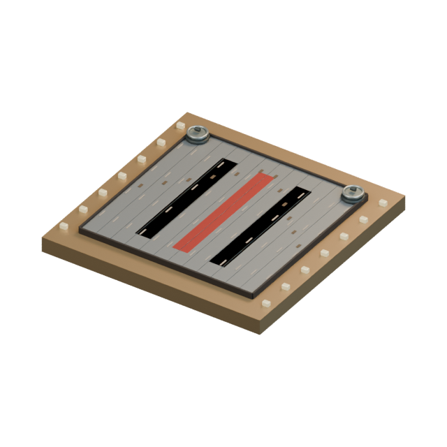

[Blend](../sources/docs/assets/reconstruction/buildings/terran/landing-pad/model.blend) · [GLB](../sources/docs/assets/reconstruction/buildings/terran/landing-pad/model.glb)

[Play animation: GroundDeckCoverCycle](../gallery/media/docs/assets/reconstruction/buildings/terran/landing-pad/animation-00.webm)

## Laser Turret

`terran:laser-turret`

**Canonical version — refined-study**

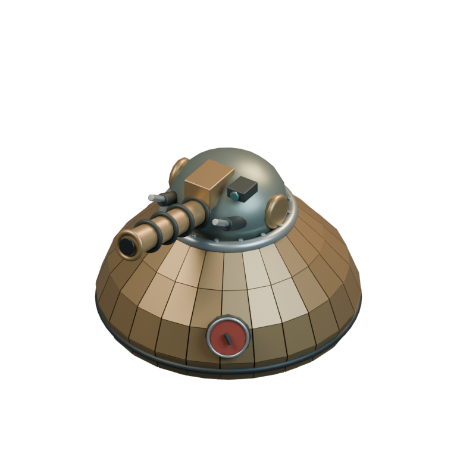

[Blend](../sources/docs/assets/bootstrap-3d/terran-refined/pb27/model.blend) · [GLB](../sources/docs/assets/bootstrap-3d/terran-refined/pb27/model.glb)

[Play animation: Animation](../gallery/media/docs/assets/bootstrap-3d/terran-refined/pb27/animation-00.webm)

## Solar Matrix

`terran:solar-matrix`

**Canonical version — shared-refined**

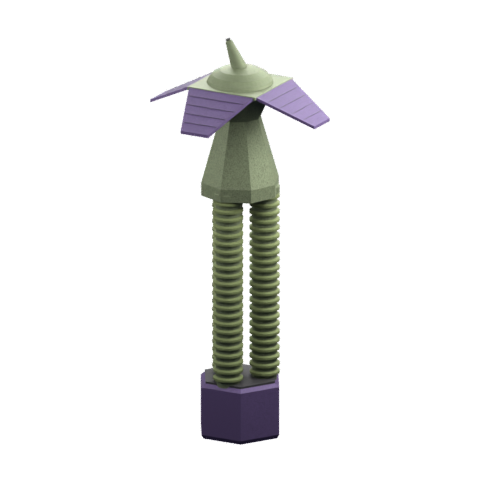

[Blend](../sources/objects/terran/solar-matrix/refined/model.blend) · [GLB](../sources/objects/terran/solar-matrix/refined/model.glb)

[Play animation: CatalogueTurn](../gallery/media/objects/terran/solar-matrix/refined/animation-00.webm)

[Play animation: PanelsClose](../gallery/media/objects/terran/solar-matrix/refined/animation-01.webm)

[Play animation: PanelsOpen](../gallery/media/objects/terran/solar-matrix/refined/animation-02.webm)

## Resiblock

`terran:resiblock`

**Canonical version — refined-study**

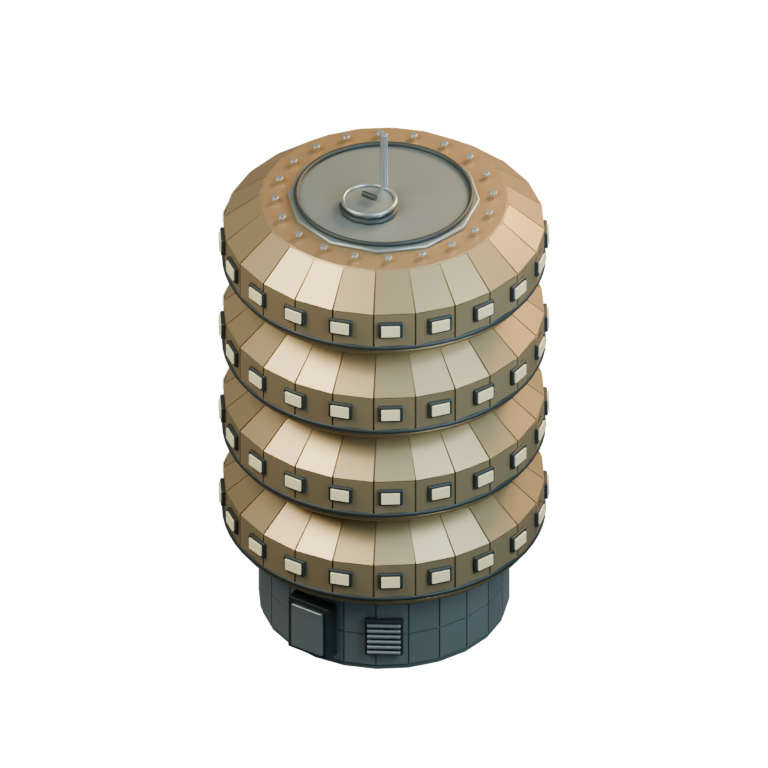

[Blend](../sources/docs/assets/bootstrap-3d/terran-refined/pb29/model.blend) · [GLB](../sources/docs/assets/bootstrap-3d/terran-refined/pb29/model.glb)

## Storage Tower

`terran:storage-tower`

**Canonical version — refined-study**

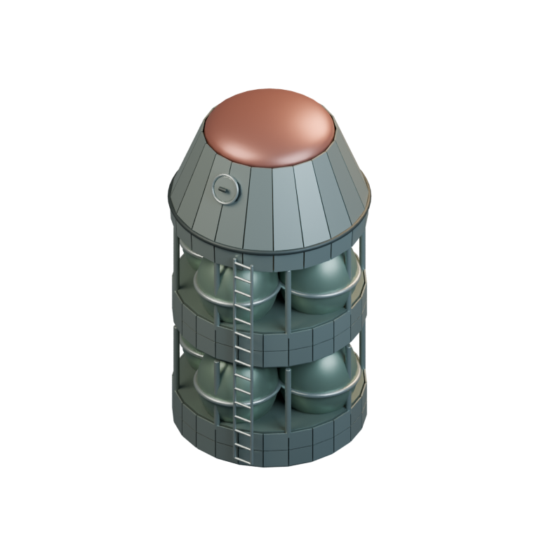

[Blend](../sources/docs/assets/bootstrap-3d/terran-refined/pb30/model.blend) · [GLB](../sources/docs/assets/bootstrap-3d/terran-refined/pb30/model.glb)

## P. Solar Matrix

`terran:protected-solar-matrix`

**Canonical version — refined-study**

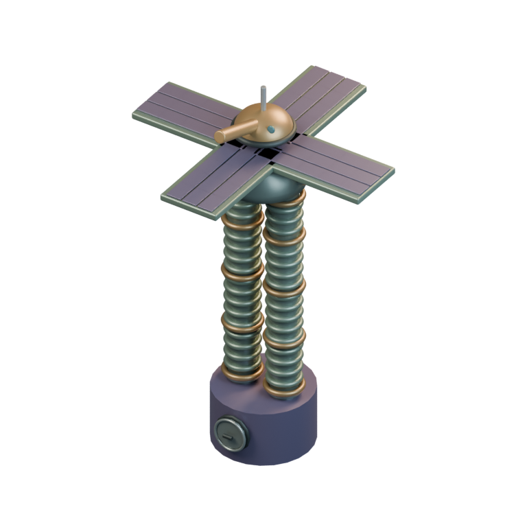

[Blend](../sources/docs/assets/bootstrap-3d/terran-refined/pb31/model.blend) · [GLB](../sources/docs/assets/bootstrap-3d/terran-refined/pb31/model.glb)

[Play animation: Animation](../gallery/media/docs/assets/bootstrap-3d/terran-refined/pb31/animation-00.webm)

## Refuelling Depot

`terran:refuelling-depot`

**Canonical version — refined-study**

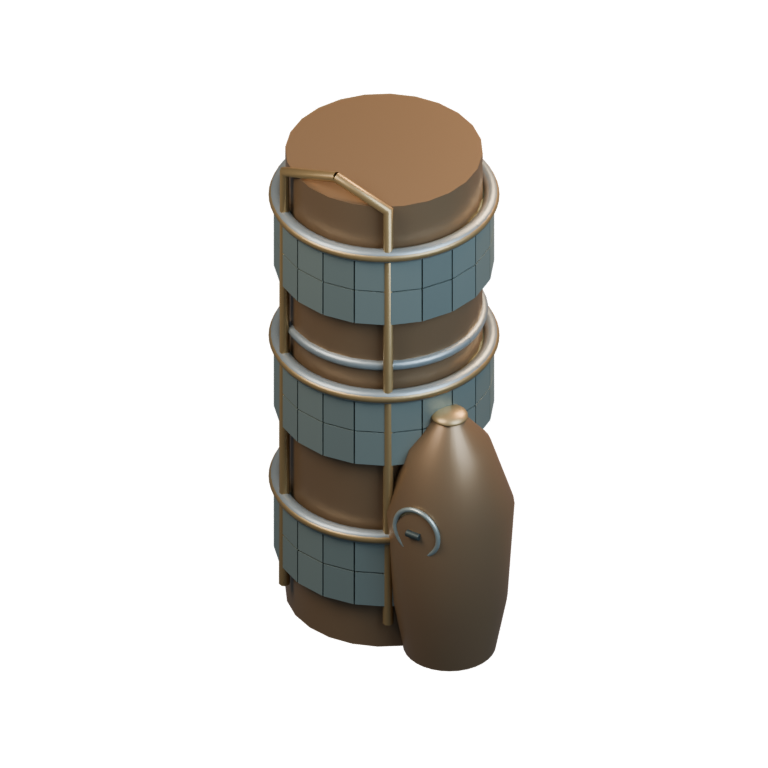

[Blend](../sources/docs/assets/bootstrap-3d/terran-refined/pb32/model.blend) · [GLB](../sources/docs/assets/bootstrap-3d/terran-refined/pb32/model.glb)

## P. Storage Tower

`terran:protected-storage-tower`

**Canonical version — refined-study**

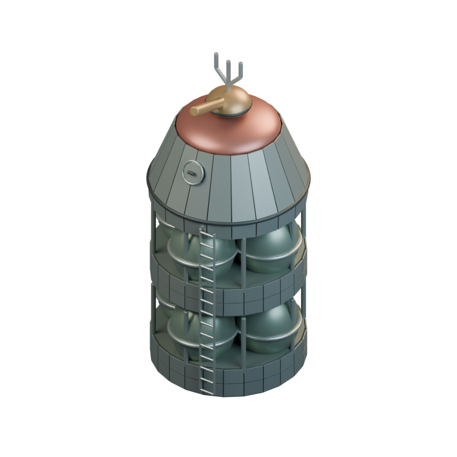

[Blend](../sources/docs/assets/bootstrap-3d/terran-refined/pb33/model.blend) · [GLB](../sources/docs/assets/bootstrap-3d/terran-refined/pb33/model.glb)

[Play animation: Animation](../gallery/media/docs/assets/bootstrap-3d/terran-refined/pb33/animation-00.webm)

## Medical Centre

`terran:medical-centre`

**Canonical version — refined-study**

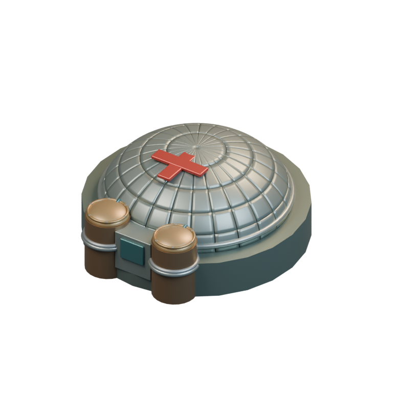

[Blend](../sources/docs/assets/bootstrap-3d/terran-refined/pb34/model.blend) · [GLB](../sources/docs/assets/bootstrap-3d/terran-refined/pb34/model.glb)

## Environment Control

`terran:environment-control`

**Canonical version — refined-study**

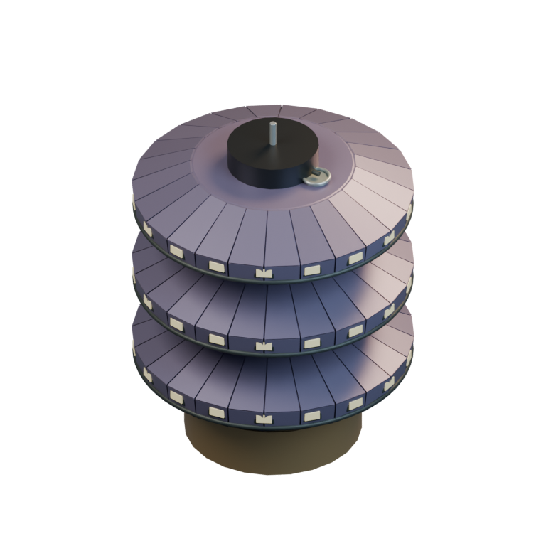

[Blend](../sources/docs/assets/bootstrap-3d/terran-refined/pb35/model.blend) · [GLB](../sources/docs/assets/bootstrap-3d/terran-refined/pb35/model.glb)

## Pleasure Dome

`terran:pleasure-dome`

**Canonical version — refined-study**

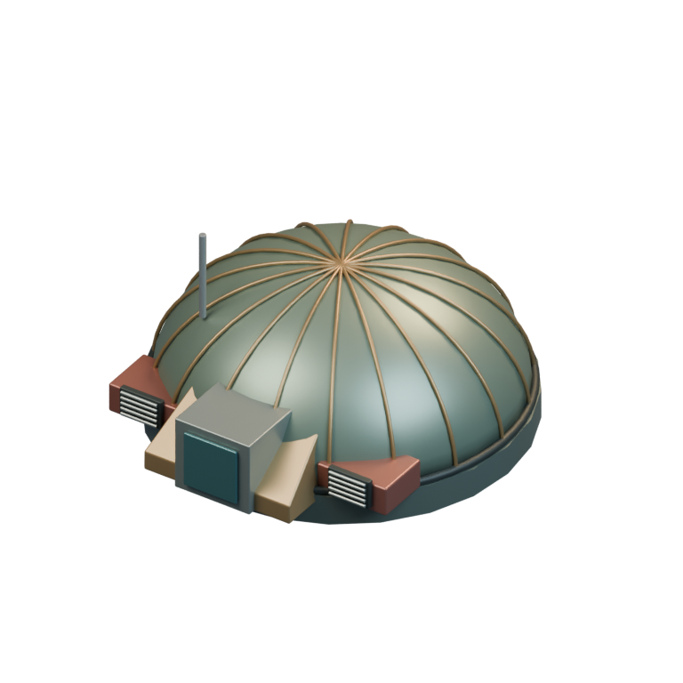

[Blend](../sources/docs/assets/bootstrap-3d/terran-refined/pb36/model.blend) · [GLB](../sources/docs/assets/bootstrap-3d/terran-refined/pb36/model.glb)

## Hydroponics Plant

`terran:hydroponics-plant`

**Canonical version — refined-study**

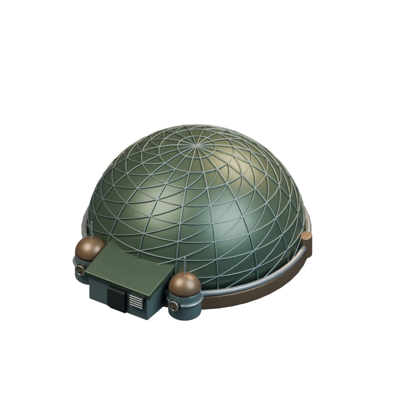

[Blend](../sources/docs/assets/bootstrap-3d/terran-refined/pb37/model.blend) · [GLB](../sources/docs/assets/bootstrap-3d/terran-refined/pb37/model.glb)

## Hydration Plant

`terran:hydration-plant`

**Canonical version — refined-study**

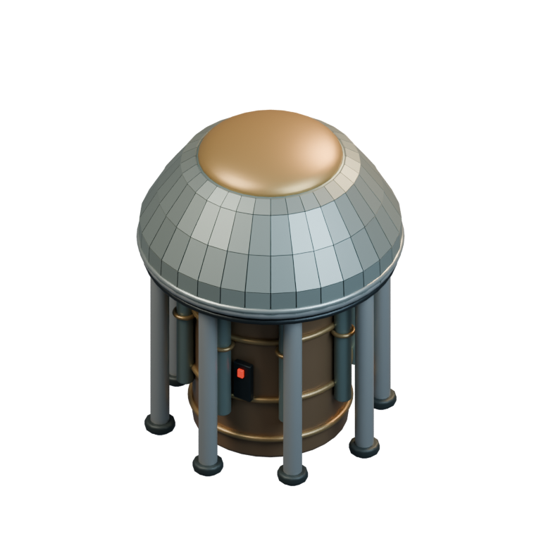

[Blend](../sources/docs/assets/bootstrap-3d/terran-refined/pb38/model.blend) · [GLB](../sources/docs/assets/bootstrap-3d/terran-refined/pb38/model.glb)

## Security Centre

`terran:security-centre`

**Canonical version — refined-study**

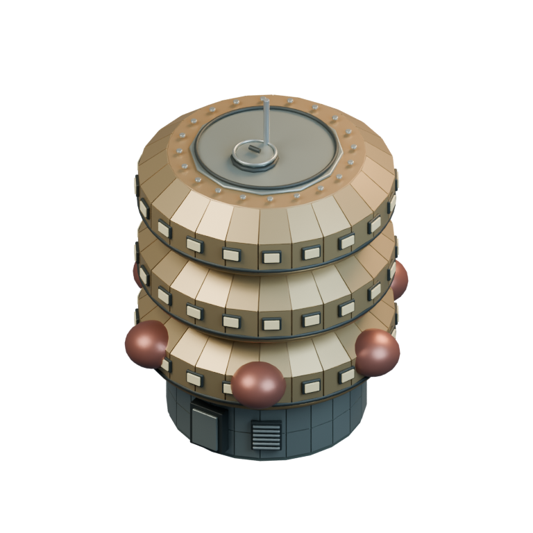

[Blend](../sources/docs/assets/bootstrap-3d/terran-refined/pb39/model.blend) · [GLB](../sources/docs/assets/bootstrap-3d/terran-refined/pb39/model.glb)
