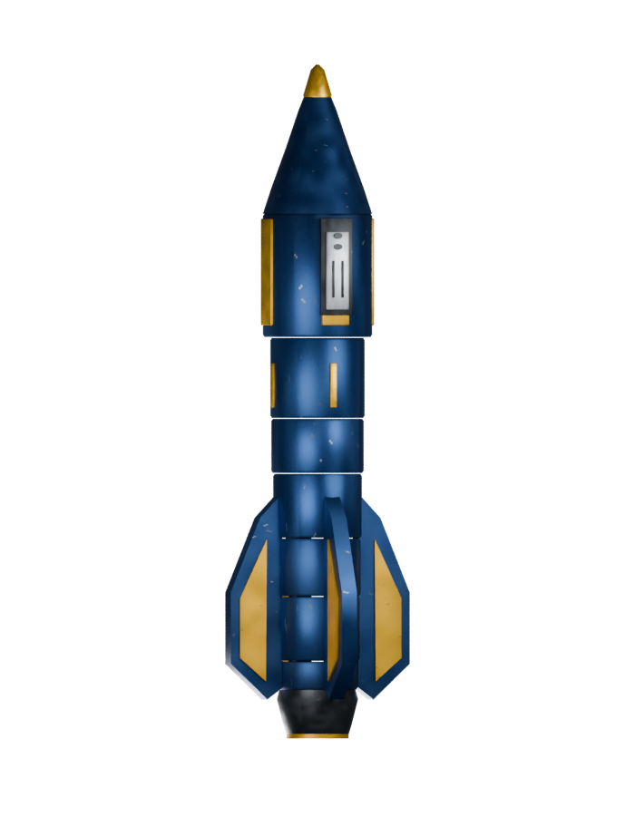
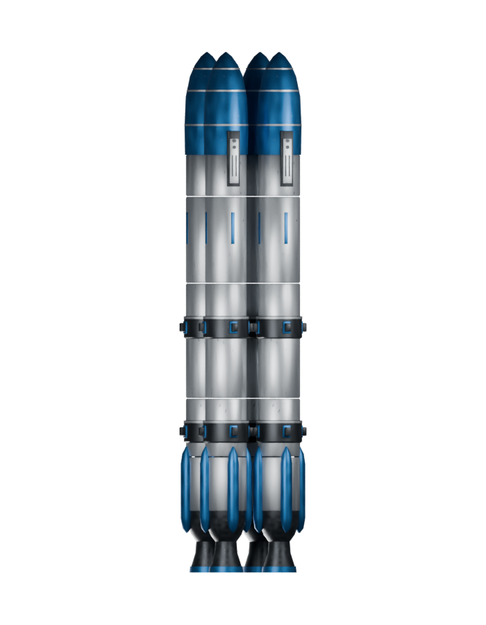
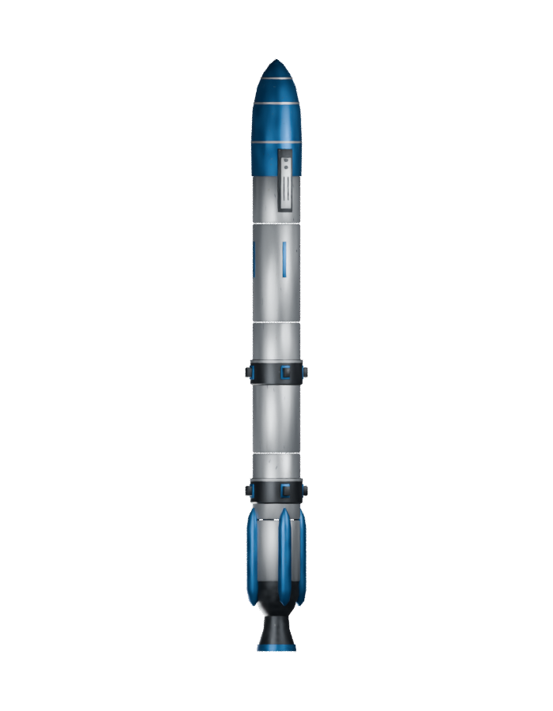

# Extension missiles

[Interactive catalogue](index.html#race=shared&type=missiles) � [All models](README.md)

Authored OpenFA extension products, not recovered legacy missiles. [Source and integration contract](../sources/objects/extensions/munitions/README.md).

## Interceptor

[Blend](../sources/objects/extensions/munitions/interceptor/model.blend) � [GLB](../sources/objects/extensions/munitions/interceptor/model.glb)

## Decoy bundle / separation

[Blend](../sources/objects/extensions/munitions/decoy/model.blend) � [GLB](../sources/objects/extensions/munitions/decoy/model.glb)

[Play full continuous separation animation](../gallery/media/objects/extensions/munitions/decoy/separation.webm)

## Decoy individual segment

[Blend](../sources/objects/extensions/munitions/decoy/model.blend) � [GLB](../sources/objects/extensions/munitions/decoy/segment.glb)

