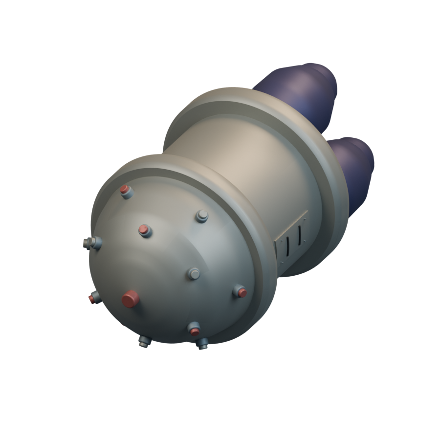
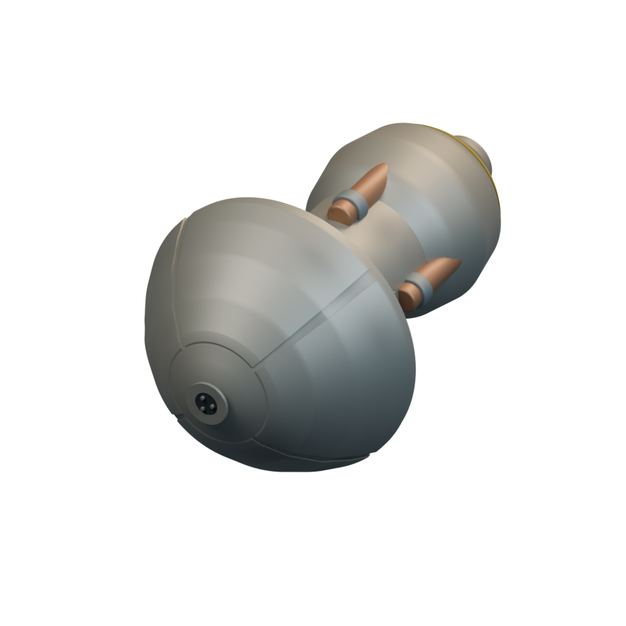
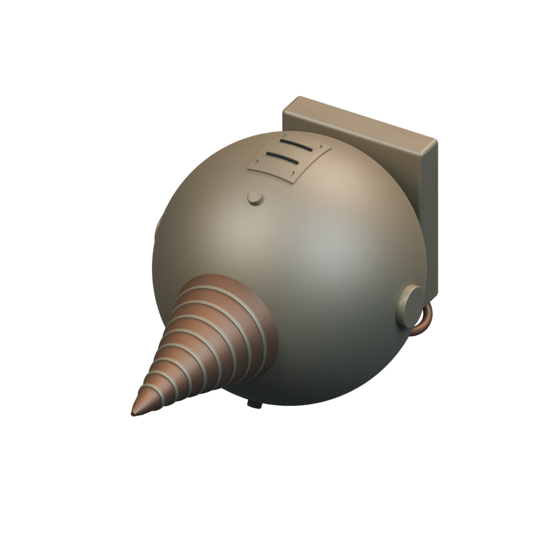
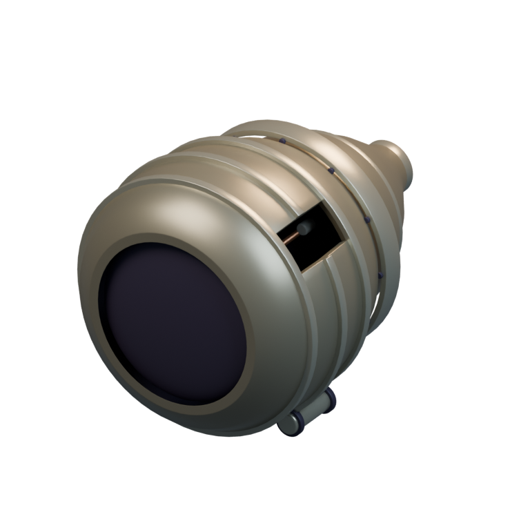
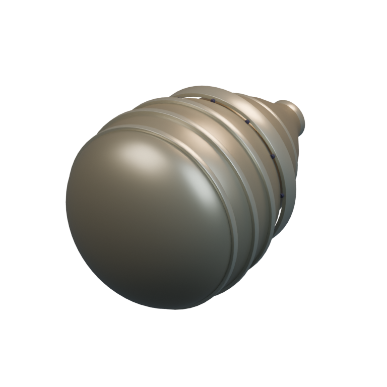

# Hardpoints / Shared

[All groups](README.md)

## Ion Cannon

`openfa:ion-cannon`

**First available iteration — initial-reference-study**

[Blend](../sources/docs/assets/reconstruction/hardpoints/ion-cannon/model.blend) · [GLB](../sources/docs/assets/reconstruction/hardpoints/ion-cannon/model.glb)

## Disruptor

`openfa:disruptor`

**First available iteration — initial-reference-study**

[Blend](../sources/docs/assets/reconstruction/hardpoints/disruptor/model.blend) · [GLB](../sources/docs/assets/reconstruction/hardpoints/disruptor/model.glb)

## Napalm Orb

`openfa:napalm-orb`

**First available iteration — initial-reference-study**

[Blend](../sources/docs/assets/reconstruction/hardpoints/napalm-orb/model.blend) · [GLB](../sources/docs/assets/reconstruction/hardpoints/napalm-orb/model.glb)

## Chaos Bomb

`openfa:chaos-bomb`

**First available iteration — initial-reference-study**

[Blend](../sources/docs/assets/reconstruction/hardpoints/chaos-bomb/model.blend) · [GLB](../sources/docs/assets/reconstruction/hardpoints/chaos-bomb/model.glb)

## Vortex Mine

`openfa:vortex-mine`

**First available iteration — initial-reference-study**

[Blend](../sources/docs/assets/reconstruction/hardpoints/vortex-mine/model.blend) · [GLB](../sources/docs/assets/reconstruction/hardpoints/vortex-mine/model.glb)

## Laser

`openfa:laser`

**First available iteration — initial-reference-study**

[Blend](../sources/docs/assets/reconstruction/hardpoints/laser/model.blend) · [GLB](../sources/docs/assets/reconstruction/hardpoints/laser/model.glb)

## Photon Cannon

`openfa:photon-cannon`

**First available iteration — reference-refined-study**

[Blend](../sources/docs/assets/reconstruction/hardpoints/photon-cannon/model.blend) · [GLB](../sources/docs/assets/reconstruction/hardpoints/photon-cannon/model.glb)

## Plasma Cannon

`openfa:plasma-cannon`

**First available iteration — reference-refined-study**

[Blend](../sources/docs/assets/reconstruction/hardpoints/plasma-cannon/model.blend) · [GLB](../sources/docs/assets/reconstruction/hardpoints/plasma-cannon/model.glb)

## Static Inducer

`openfa:static-inducer`

**First available iteration — initial-reference-study**

[Blend](../sources/docs/assets/reconstruction/hardpoints/static-inducer/model.blend) · [GLB](../sources/docs/assets/reconstruction/hardpoints/static-inducer/model.glb)

## Warp Generator

`openfa:warp-generator`

**First available iteration — initial-reference-study**

[Blend](../sources/docs/assets/reconstruction/hardpoints/warp-generator/model.blend) · [GLB](../sources/docs/assets/reconstruction/hardpoints/warp-generator/model.glb)

## Deflector

`openfa:deflector`

**First available iteration — initial-reference-study**

[Blend](../sources/docs/assets/reconstruction/hardpoints/deflector/model.blend) · [GLB](../sources/docs/assets/reconstruction/hardpoints/deflector/model.glb)

## Shield x10

`openfa:shield-x10`

**First available iteration — reference-refined-study**

[Blend](../sources/docs/assets/reconstruction/hardpoints/shield-x10/model.blend) · [GLB](../sources/docs/assets/reconstruction/hardpoints/shield-x10/model.glb)

## Shield x20

`openfa:shield-x20`

**First available iteration — reference-refined-study**

[Blend](../sources/docs/assets/reconstruction/hardpoints/shield-x20/model.blend) · [GLB](../sources/docs/assets/reconstruction/hardpoints/shield-x20/model.glb)

## Shield x30

`openfa:shield-x30`

**First available iteration — reference-refined-study**

[Blend](../sources/docs/assets/reconstruction/hardpoints/shield-x30/model.blend) · [GLB](../sources/docs/assets/reconstruction/hardpoints/shield-x30/model.glb)

## Shield x40

`openfa:shield-x40`

**First available iteration — reference-refined-study**

[Blend](../sources/docs/assets/reconstruction/hardpoints/shield-x40/model.blend) · [GLB](../sources/docs/assets/reconstruction/hardpoints/shield-x40/model.glb)

**Additional iteration — shared-refined**

[Blend](../sources/objects/shared/shield-x40/refined/model.blend) · [GLB](../sources/objects/shared/shield-x40/refined/model.glb)

[Play animation: Animation](../gallery/media/objects/shared/shield-x40/refined/animation-00.webm)

## Shield x50

`openfa:shield-x50`

**First available iteration — reference-refined-study**

[Blend](../sources/docs/assets/reconstruction/hardpoints/shield-x50/model.blend) · [GLB](../sources/docs/assets/reconstruction/hardpoints/shield-x50/model.glb)
