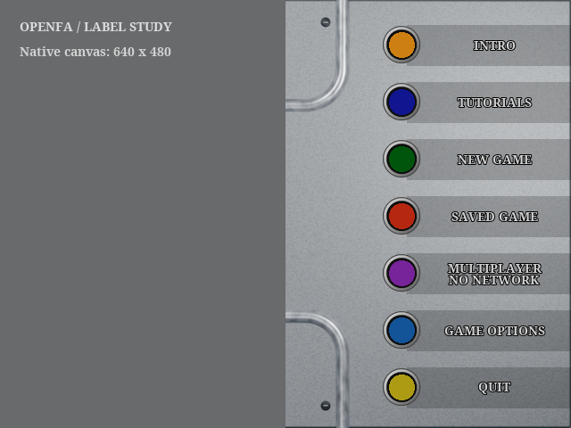
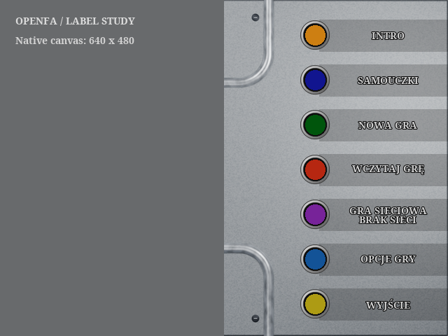
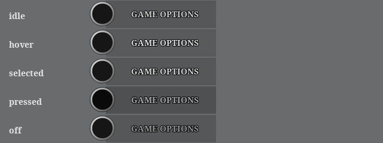

# Main-menu labels

[Integration contract and sources](../sources/ui/legacy-menu-labels/README.md) ·
[Asset catalogue](media/ui/legacy-menu-labels/catalog.json)

New shade-only labels follow the original menu hierarchy: the panel texture remains
visible, lettering is small grey serif with a black edge, and colored circular
controls stay independent. The rejected metal frames and orange rails are removed.

These are 640x480 asset compositions, not game-runtime captures. The left field
is neutral to isolate the label delivery; the existing sphere is not replaced.
Noto Serif Bold is a compatible stylistic interpretation, not the original font.

