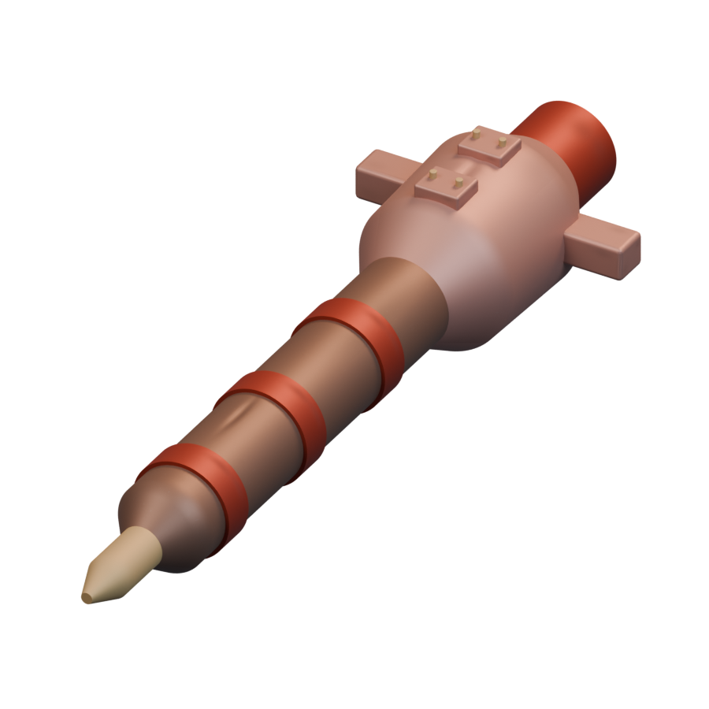
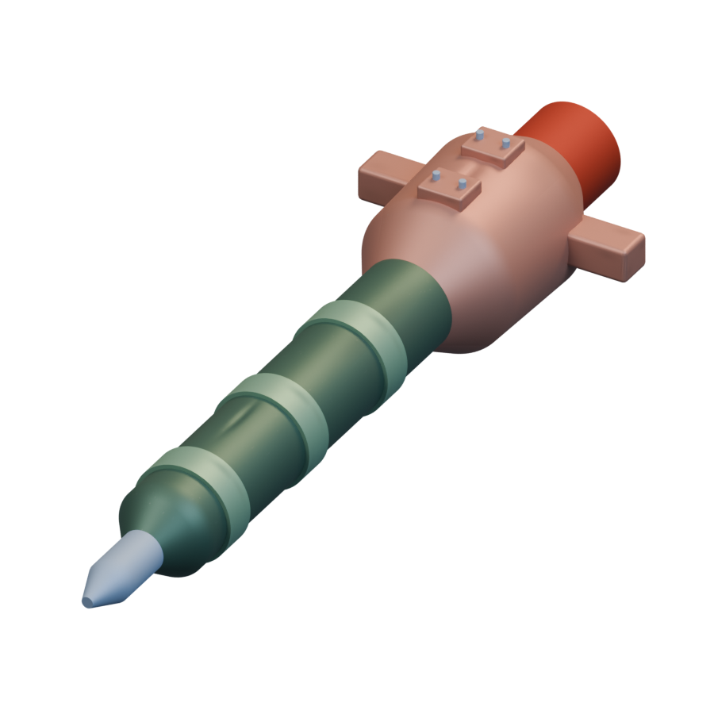
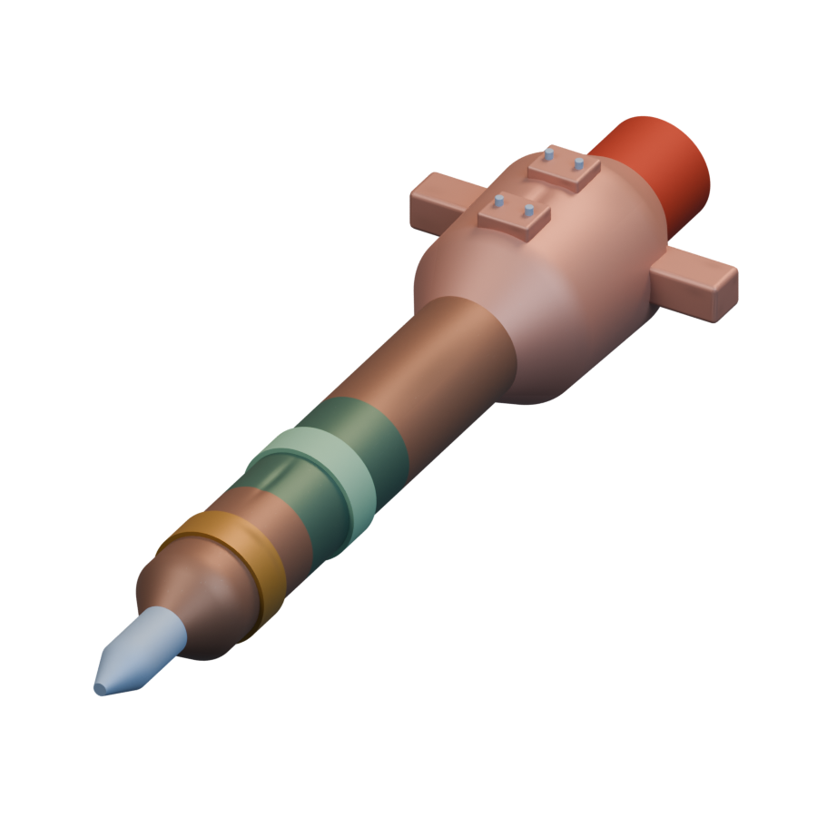
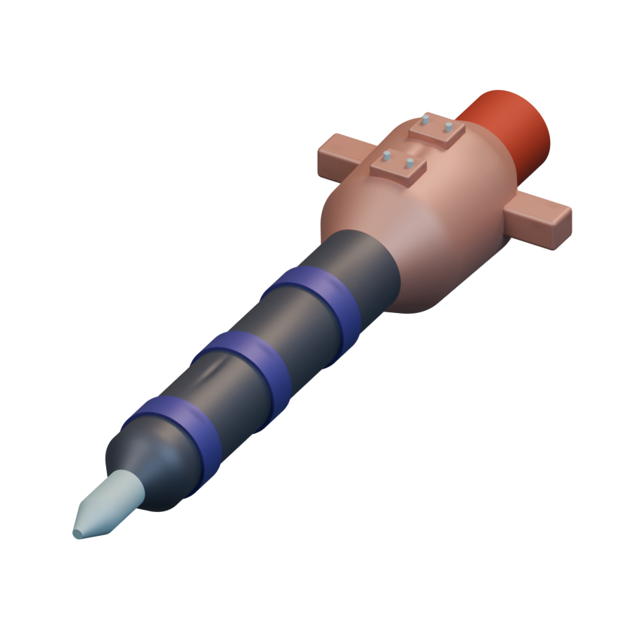
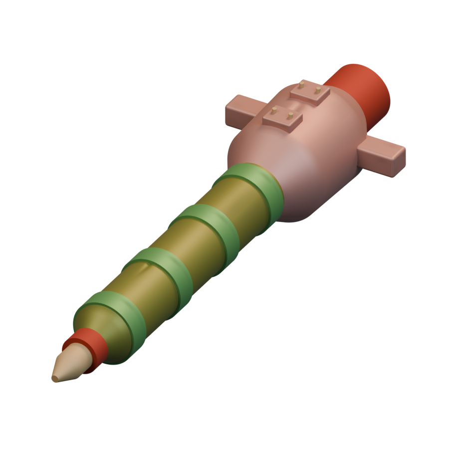
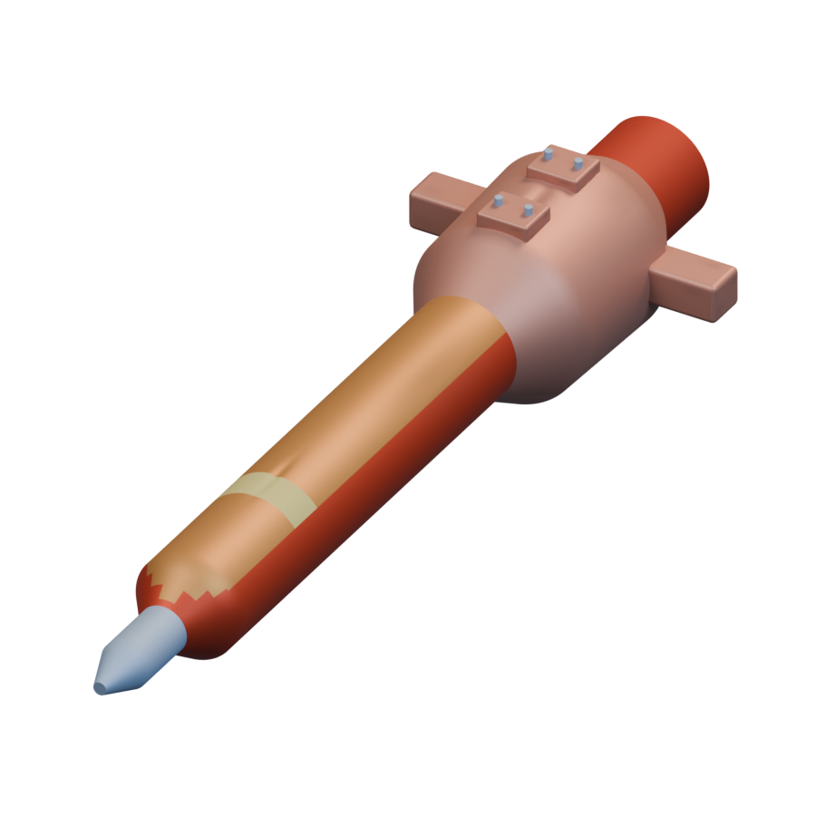
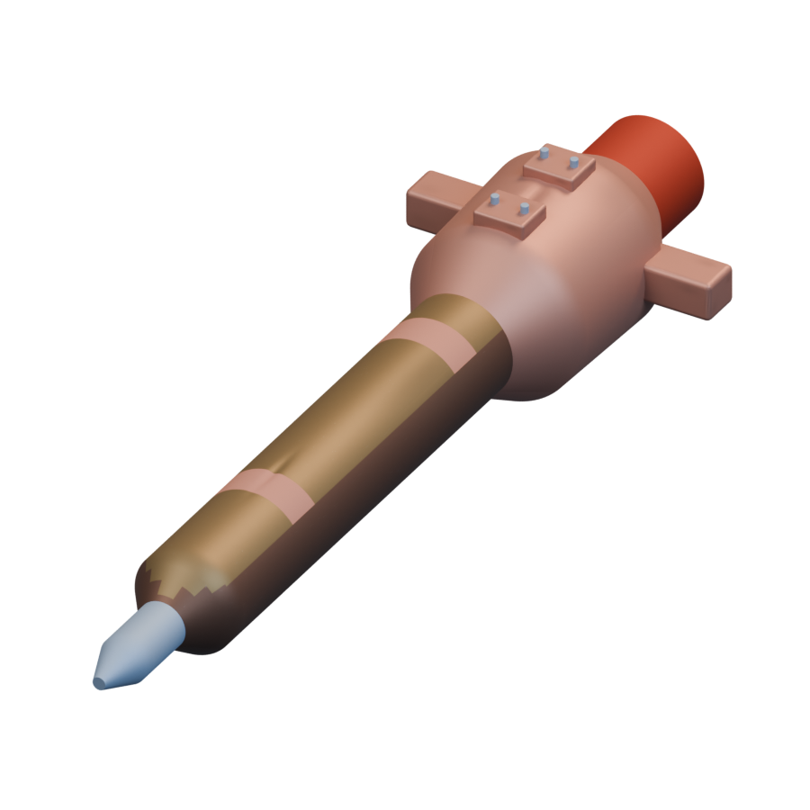

# Missiles / Achaean

[All groups](README.md)

## Frighteners

`openfa:missile/achaean/frighteners`

**Canonical version — initial-low-resolution-interpretation**

[Blend](../sources/docs/assets/reconstruction/missiles/achaean/frighteners/model.blend) · [GLB](../sources/docs/assets/reconstruction/missiles/achaean/frighteners/model.glb)

## Harmers

`openfa:missile/achaean/harmers`

**Canonical version — initial-low-resolution-interpretation**

[Blend](../sources/docs/assets/reconstruction/missiles/achaean/harmers/model.blend) · [GLB](../sources/docs/assets/reconstruction/missiles/achaean/harmers/model.glb)

## DripFire

`openfa:missile/achaean/dripfire`

**Canonical version — initial-low-resolution-interpretation**

[Blend](../sources/docs/assets/reconstruction/missiles/achaean/dripfire/model.blend) · [GLB](../sources/docs/assets/reconstruction/missiles/achaean/dripfire/model.glb)

## Seizure

`openfa:missile/achaean/seizure`

**Canonical version — initial-low-resolution-interpretation**

[Blend](../sources/docs/assets/reconstruction/missiles/achaean/seizure/model.blend) · [GLB](../sources/docs/assets/reconstruction/missiles/achaean/seizure/model.glb)

## Ground Breaker

`openfa:missile/achaean/ground-breaker`

**Canonical version — initial-low-resolution-interpretation**

[Blend](../sources/docs/assets/reconstruction/missiles/achaean/ground-breaker/model.blend) · [GLB](../sources/docs/assets/reconstruction/missiles/achaean/ground-breaker/model.glb)

## Ground Maker

`openfa:missile/achaean/ground-maker`

**Canonical version — initial-low-resolution-interpretation**

[Blend](../sources/docs/assets/reconstruction/missiles/achaean/ground-maker/model.blend) · [GLB](../sources/docs/assets/reconstruction/missiles/achaean/ground-maker/model.glb)

## Hold It There

`openfa:missile/achaean/hold-it-there`

**Canonical version — initial-low-resolution-interpretation**

[Blend](../sources/docs/assets/reconstruction/missiles/achaean/hold-it-there/model.blend) · [GLB](../sources/docs/assets/reconstruction/missiles/achaean/hold-it-there/model.glb)

## Thief-in-the-Night

`openfa:missile/achaean/thief-in-the-night`

**Canonical version — initial-low-resolution-interpretation**

[Blend](../sources/docs/assets/reconstruction/missiles/achaean/thief-in-the-night/model.blend) · [GLB](../sources/docs/assets/reconstruction/missiles/achaean/thief-in-the-night/model.glb)
