# Missiles / Artemian

[All groups](README.md)

## Standard Warhead

`openfa:missile/artemian/standard-warhead`

**First available iteration — initial-low-resolution-interpretation**

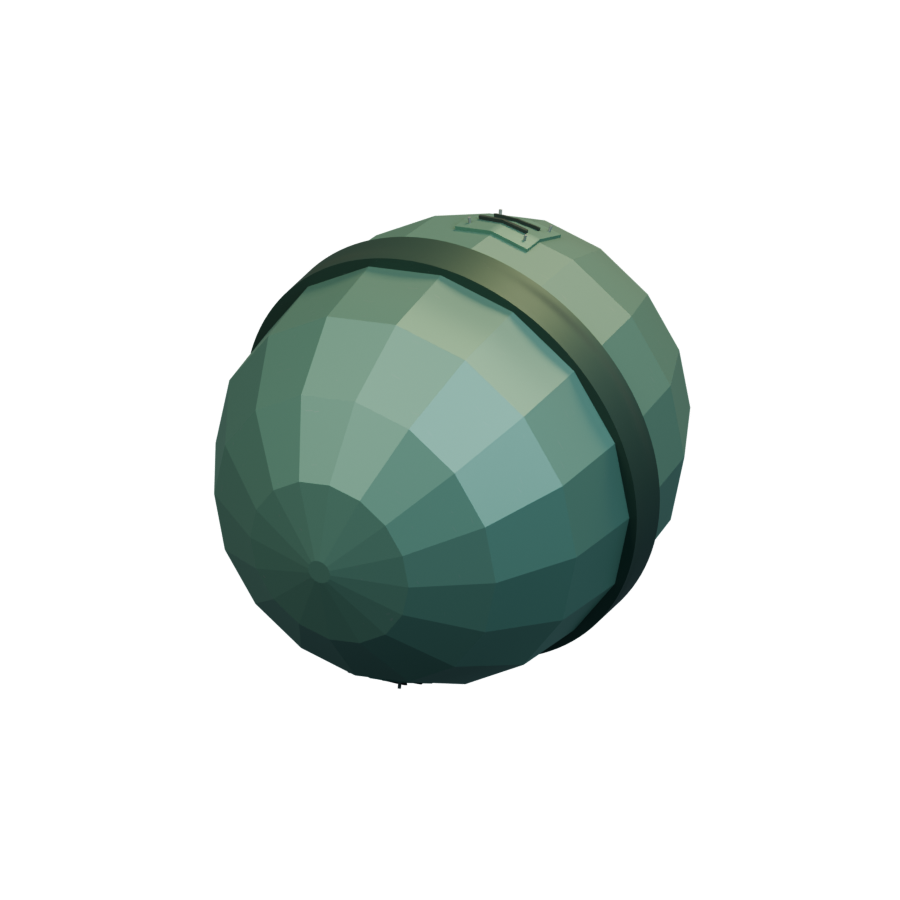

[Blend](../sources/docs/assets/reconstruction/missiles/artemian/standard-warhead/model.blend) · [GLB](../sources/docs/assets/reconstruction/missiles/artemian/standard-warhead/model.glb)

## Advanced Warhead

`openfa:missile/artemian/advanced-warhead`

**First available iteration — initial-low-resolution-interpretation**

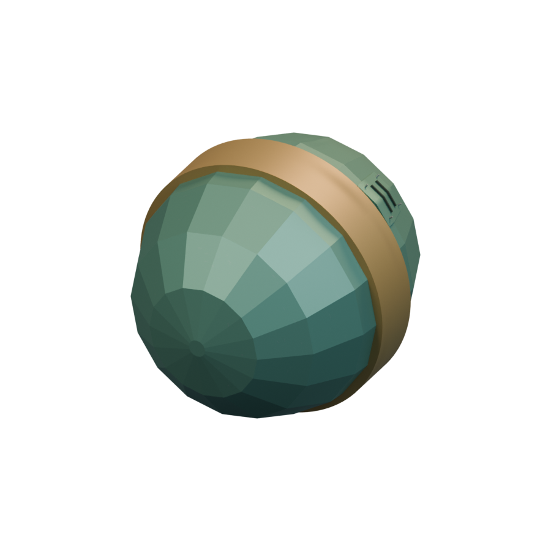

[Blend](../sources/docs/assets/reconstruction/missiles/artemian/advanced-warhead/model.blend) · [GLB](../sources/docs/assets/reconstruction/missiles/artemian/advanced-warhead/model.glb)

## Liquid Flame

`openfa:missile/artemian/liquid-flame`

**First available iteration — initial-low-resolution-interpretation**

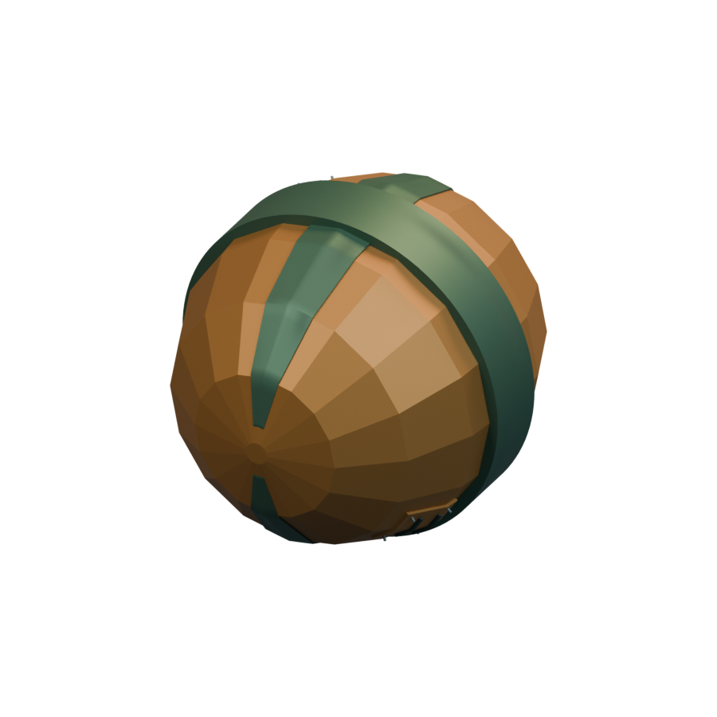

[Blend](../sources/docs/assets/reconstruction/missiles/artemian/liquid-flame/model.blend) · [GLB](../sources/docs/assets/reconstruction/missiles/artemian/liquid-flame/model.glb)

## Coagulant Flame

`openfa:missile/artemian/coagulant-flame`

**First available iteration — initial-low-resolution-interpretation**

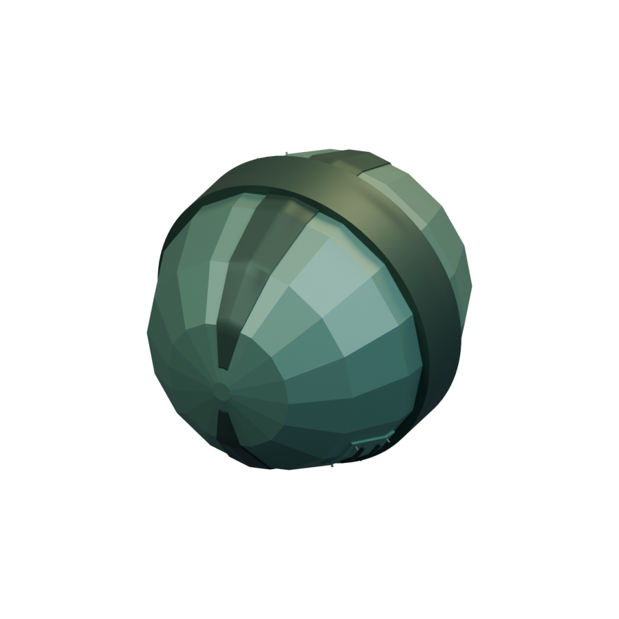

[Blend](../sources/docs/assets/reconstruction/missiles/artemian/coagulant-flame/model.blend) · [GLB](../sources/docs/assets/reconstruction/missiles/artemian/coagulant-flame/model.glb)

## Multiple Warhead

`openfa:missile/artemian/multiple-warhead`

**First available iteration — initial-low-resolution-interpretation**

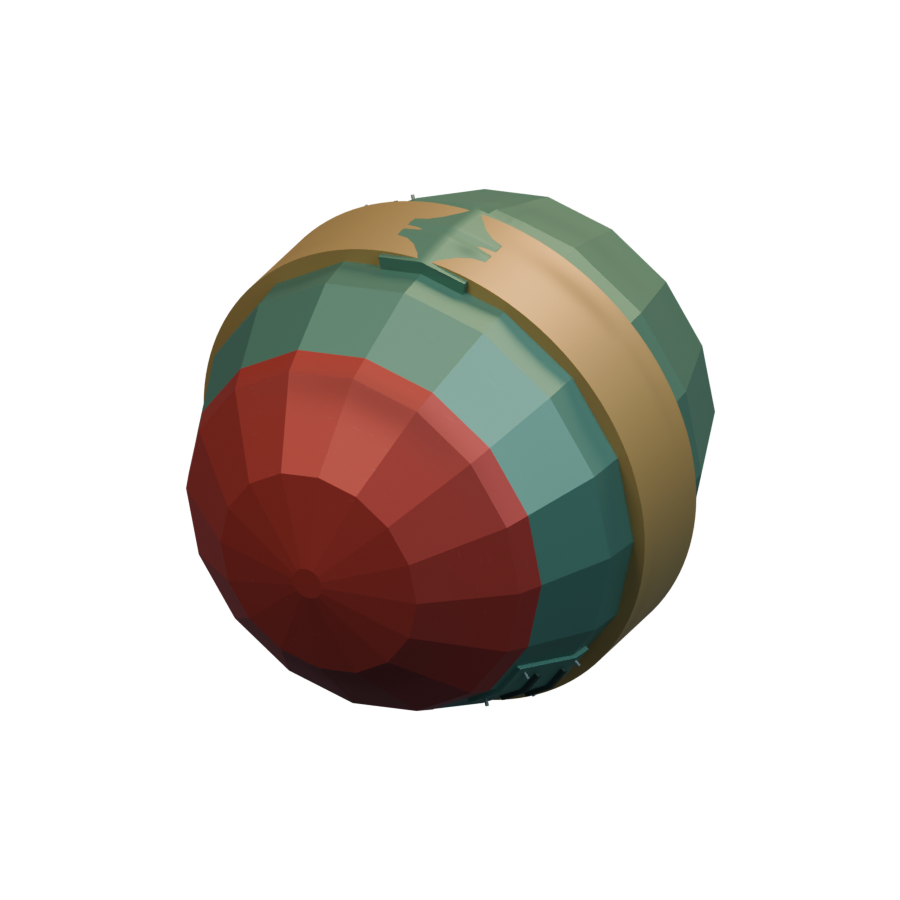

[Blend](../sources/docs/assets/reconstruction/missiles/artemian/multiple-warhead/model.blend) · [GLB](../sources/docs/assets/reconstruction/missiles/artemian/multiple-warhead/model.glb)

## Spiral

`openfa:missile/artemian/spiral`

**First available iteration — initial-low-resolution-interpretation**

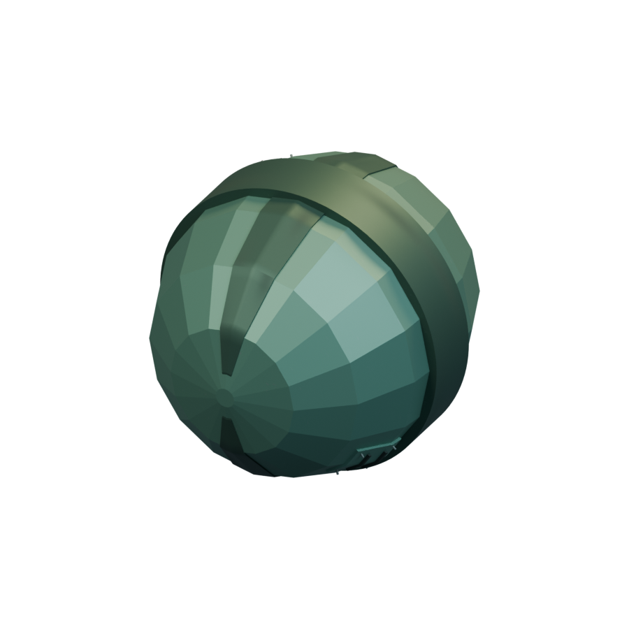

[Blend](../sources/docs/assets/reconstruction/missiles/artemian/spiral/model.blend) · [GLB](../sources/docs/assets/reconstruction/missiles/artemian/spiral/model.glb)

## Nova

`openfa:missile/artemian/nova`

**First available iteration — initial-low-resolution-interpretation**

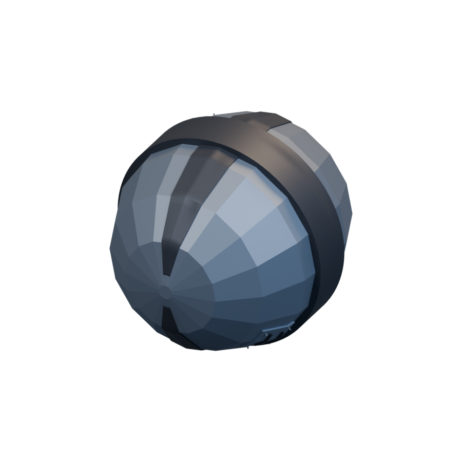

[Blend](../sources/docs/assets/reconstruction/missiles/artemian/nova/model.blend) · [GLB](../sources/docs/assets/reconstruction/missiles/artemian/nova/model.glb)

## Demon

`openfa:missile/artemian/demon`

**First available iteration — initial-low-resolution-interpretation**

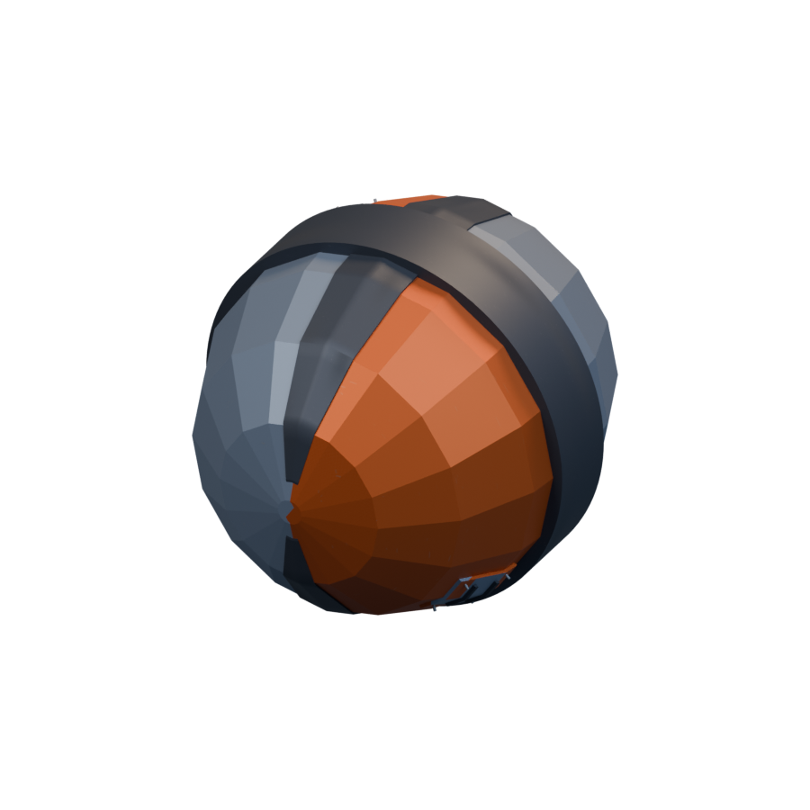

[Blend](../sources/docs/assets/reconstruction/missiles/artemian/demon/model.blend) · [GLB](../sources/docs/assets/reconstruction/missiles/artemian/demon/model.glb)

## Saviour

`openfa:missile/artemian/saviour`

**First available iteration — initial-low-resolution-interpretation**

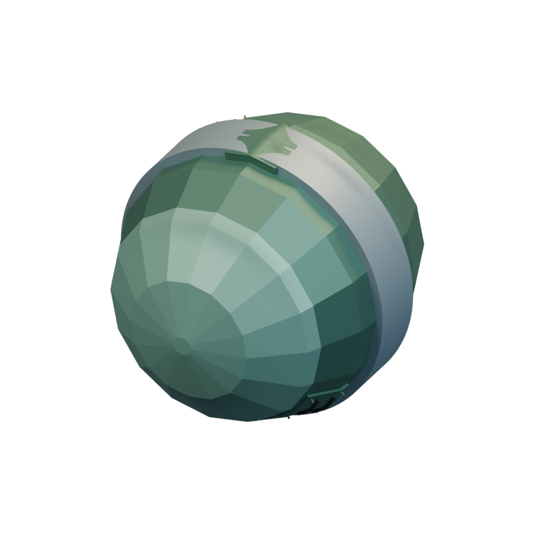

[Blend](../sources/docs/assets/reconstruction/missiles/artemian/saviour/model.blend) · [GLB](../sources/docs/assets/reconstruction/missiles/artemian/saviour/model.glb)

## Star-Shatterer

`openfa:missile/artemian/star-shatterer`

**First available iteration — initial-low-resolution-interpretation**

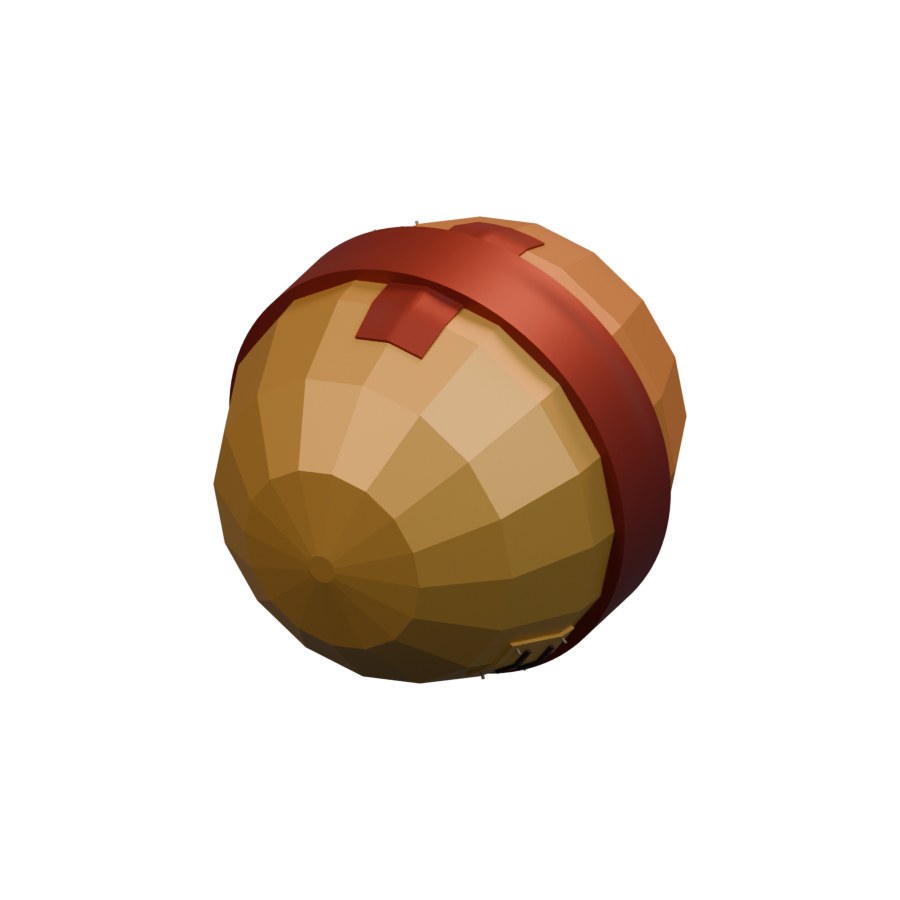

[Blend](../sources/docs/assets/reconstruction/missiles/artemian/star-shatterer/model.blend) · [GLB](../sources/docs/assets/reconstruction/missiles/artemian/star-shatterer/model.glb)

## Freezer

`openfa:missile/artemian/freezer`

**First available iteration — initial-low-resolution-interpretation**

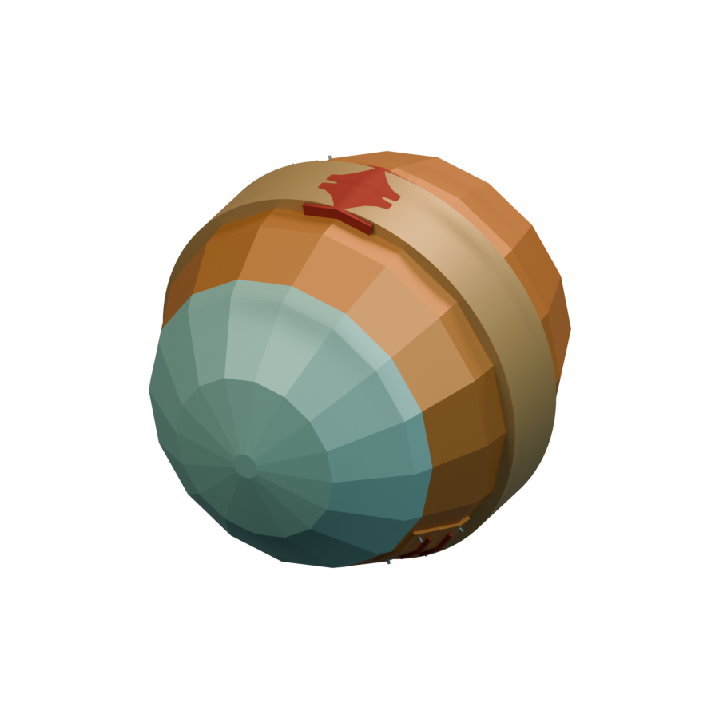

[Blend](../sources/docs/assets/reconstruction/missiles/artemian/freezer/model.blend) · [GLB](../sources/docs/assets/reconstruction/missiles/artemian/freezer/model.glb)

## Space Hunger

`openfa:missile/artemian/space-hunger`

**First available iteration — initial-low-resolution-interpretation**

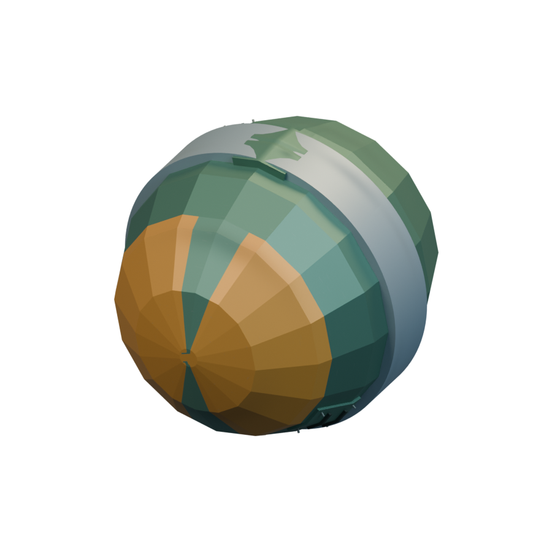

[Blend](../sources/docs/assets/reconstruction/missiles/artemian/space-hunger/model.blend) · [GLB](../sources/docs/assets/reconstruction/missiles/artemian/space-hunger/model.glb)
