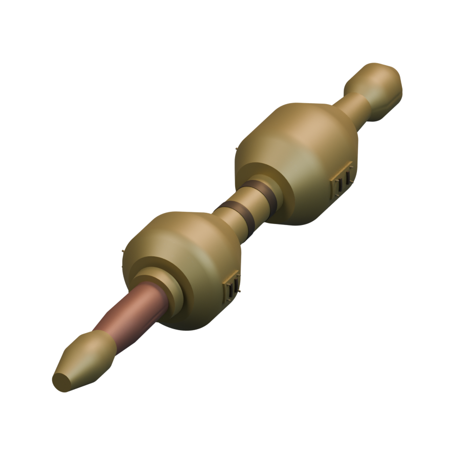
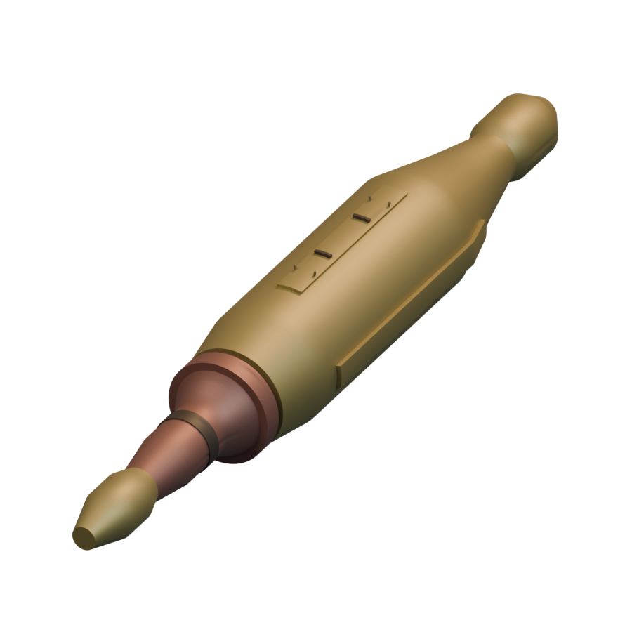
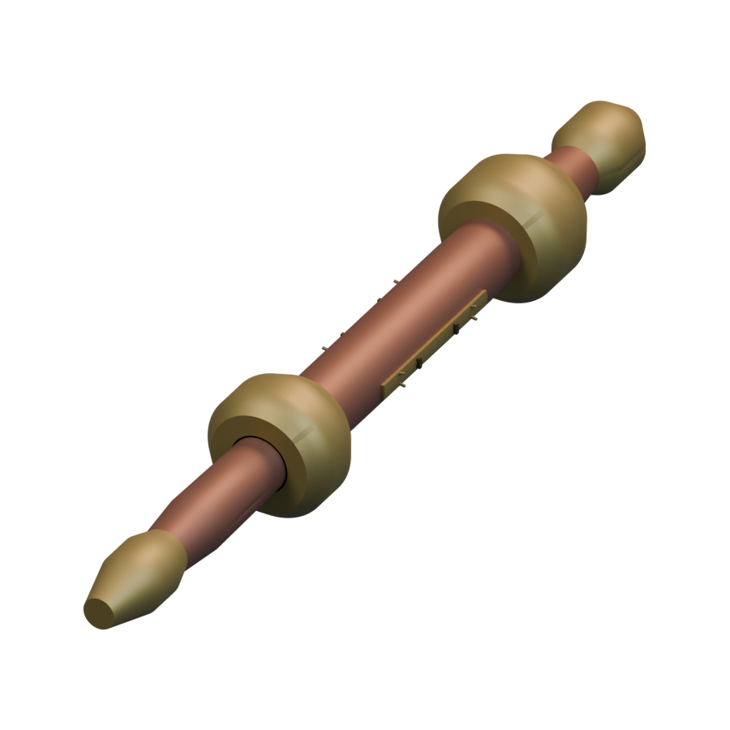
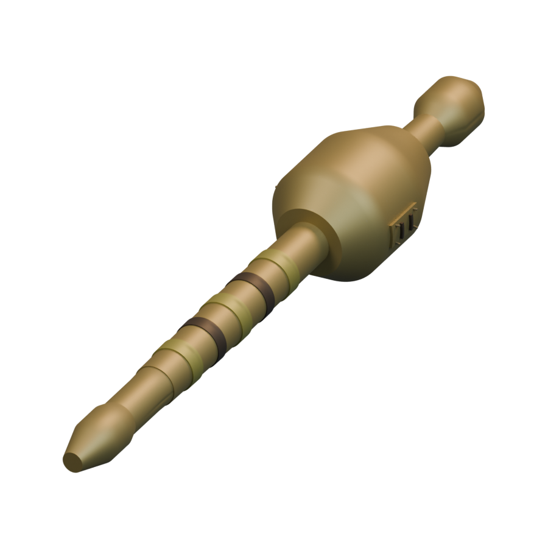
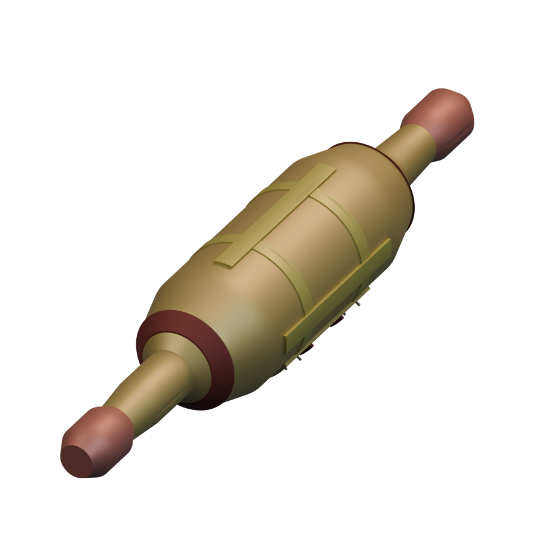
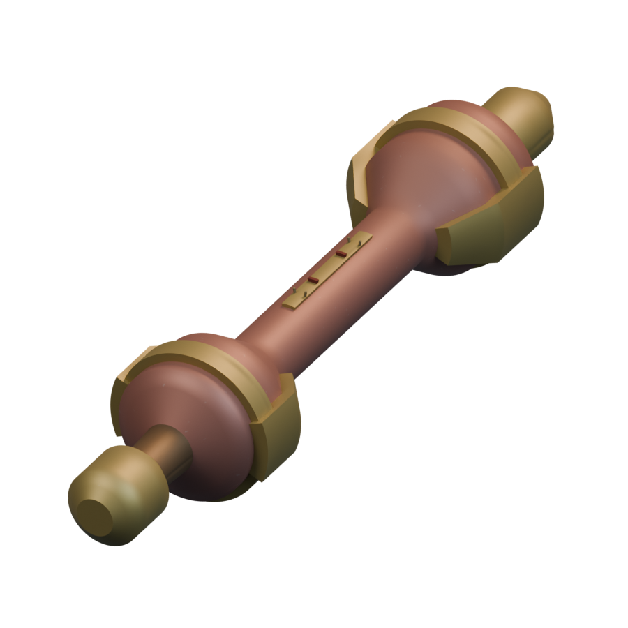
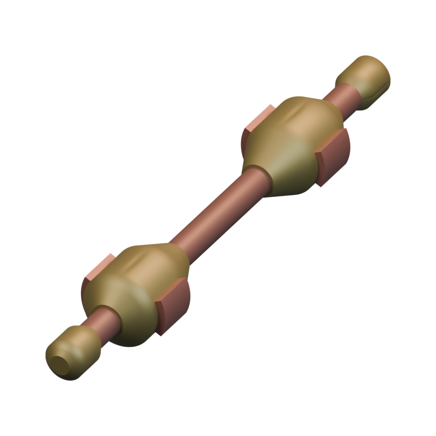
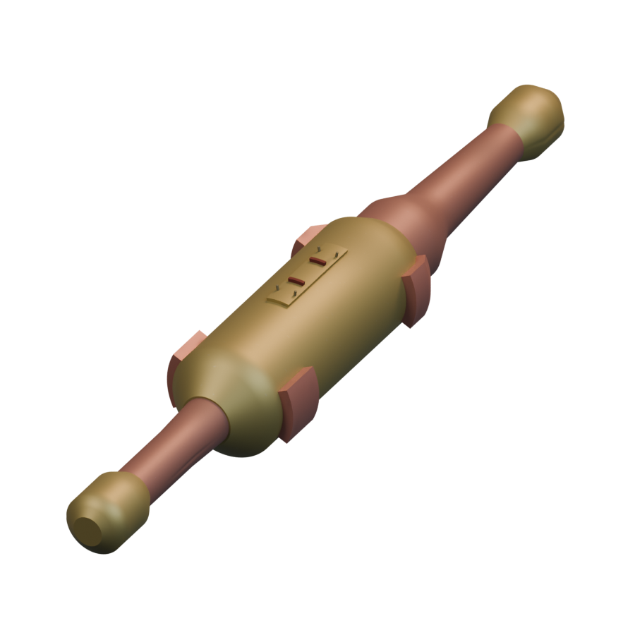
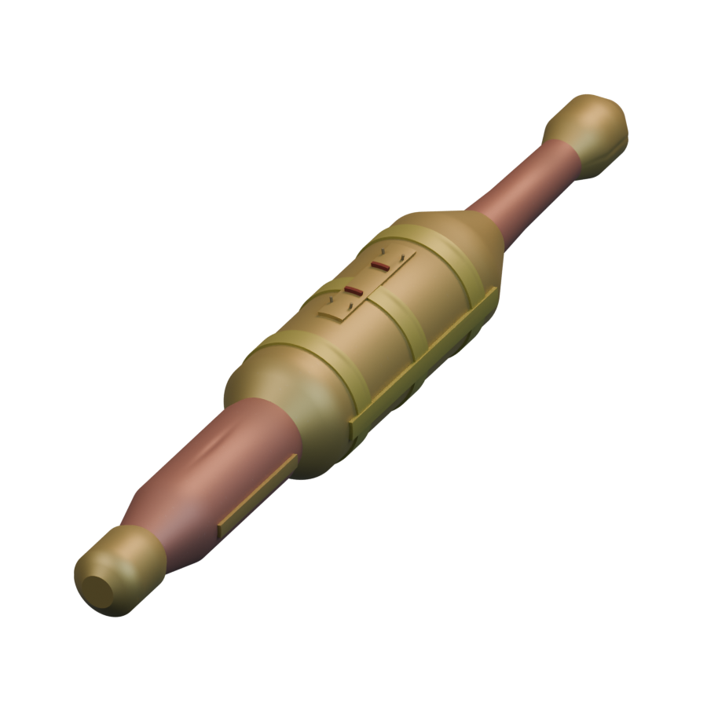
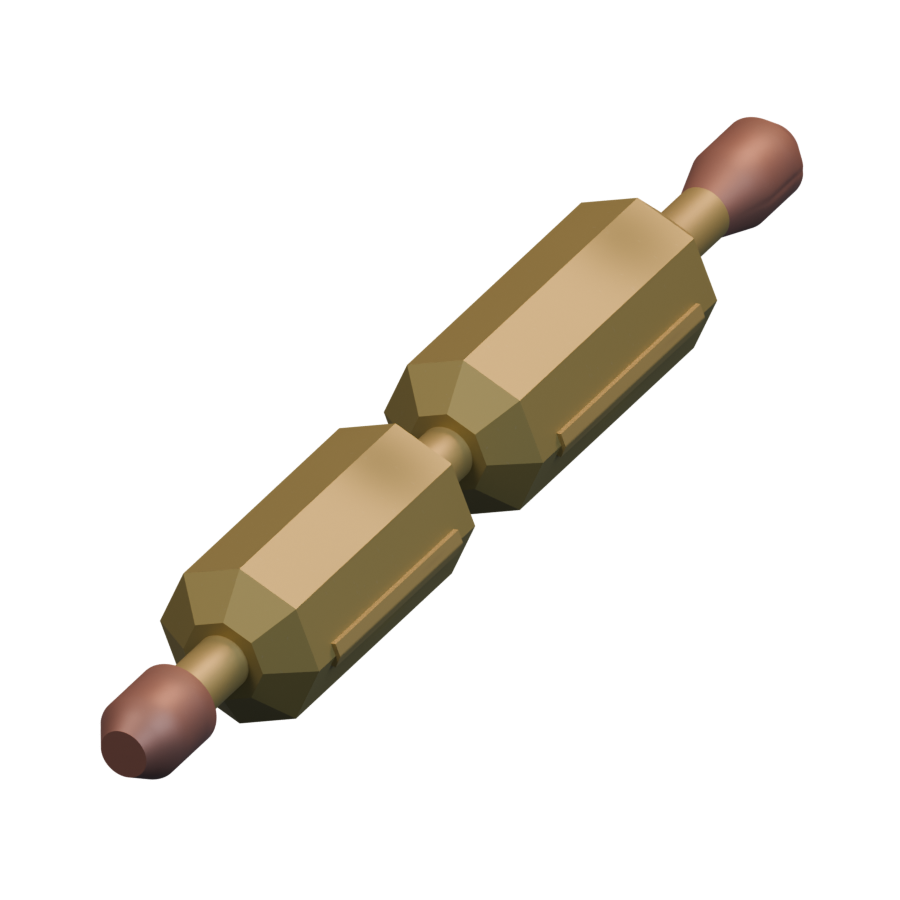

# Missiles / Braccatian

[All groups](README.md)

## Mega Blast

`openfa:missile/braccatian/mega-blast`

**Canonical version — initial-low-resolution-interpretation**

[Blend](../sources/docs/assets/reconstruction/missiles/braccatian/mega-blast/model.blend) · [GLB](../sources/docs/assets/reconstruction/missiles/braccatian/mega-blast/model.glb)

## Flaming Ruin

`openfa:missile/braccatian/flaming-ruin`

**Canonical version — initial-low-resolution-interpretation**

[Blend](../sources/docs/assets/reconstruction/missiles/braccatian/flaming-ruin/model.blend) · [GLB](../sources/docs/assets/reconstruction/missiles/braccatian/flaming-ruin/model.glb)

## Volcano

`openfa:missile/braccatian/volcano`

**Canonical version — initial-low-resolution-interpretation**

[Blend](../sources/docs/assets/reconstruction/missiles/braccatian/volcano/model.blend) · [GLB](../sources/docs/assets/reconstruction/missiles/braccatian/volcano/model.glb)

## Multi Blast

`openfa:missile/braccatian/multi-blast`

**Canonical version — initial-low-resolution-interpretation**

[Blend](../sources/docs/assets/reconstruction/missiles/braccatian/multi-blast/model.blend) · [GLB](../sources/docs/assets/reconstruction/missiles/braccatian/multi-blast/model.glb)

## Dancing Bolt

`openfa:missile/braccatian/dancing-bolt`

**Canonical version — initial-low-resolution-interpretation**

[Blend](../sources/docs/assets/reconstruction/missiles/braccatian/dancing-bolt/model.blend) · [GLB](../sources/docs/assets/reconstruction/missiles/braccatian/dancing-bolt/model.glb)

## HotBomb

`openfa:missile/braccatian/hotbomb`

**Canonical version — initial-low-resolution-interpretation**

[Blend](../sources/docs/assets/reconstruction/missiles/braccatian/hotbomb/model.blend) · [GLB](../sources/docs/assets/reconstruction/missiles/braccatian/hotbomb/model.glb)

## Outbreak

`openfa:missile/braccatian/outbreak`

**Canonical version — initial-low-resolution-interpretation**

[Blend](../sources/docs/assets/reconstruction/missiles/braccatian/outbreak/model.blend) · [GLB](../sources/docs/assets/reconstruction/missiles/braccatian/outbreak/model.glb)

## Anti-Outbreak

`openfa:missile/braccatian/anti-outbreak`

**Canonical version — initial-low-resolution-interpretation**

[Blend](../sources/docs/assets/reconstruction/missiles/braccatian/anti-outbreak/model.blend) · [GLB](../sources/docs/assets/reconstruction/missiles/braccatian/anti-outbreak/model.glb)

## Midwinter

`openfa:missile/braccatian/midwinter`

**Canonical version — initial-low-resolution-interpretation**

[Blend](../sources/docs/assets/reconstruction/missiles/braccatian/midwinter/model.blend) · [GLB](../sources/docs/assets/reconstruction/missiles/braccatian/midwinter/model.glb)

## Comms Killer

`openfa:missile/braccatian/comms-killer`

**Canonical version — initial-low-resolution-interpretation**

[Blend](../sources/docs/assets/reconstruction/missiles/braccatian/comms-killer/model.blend) · [GLB](../sources/docs/assets/reconstruction/missiles/braccatian/comms-killer/model.glb)
