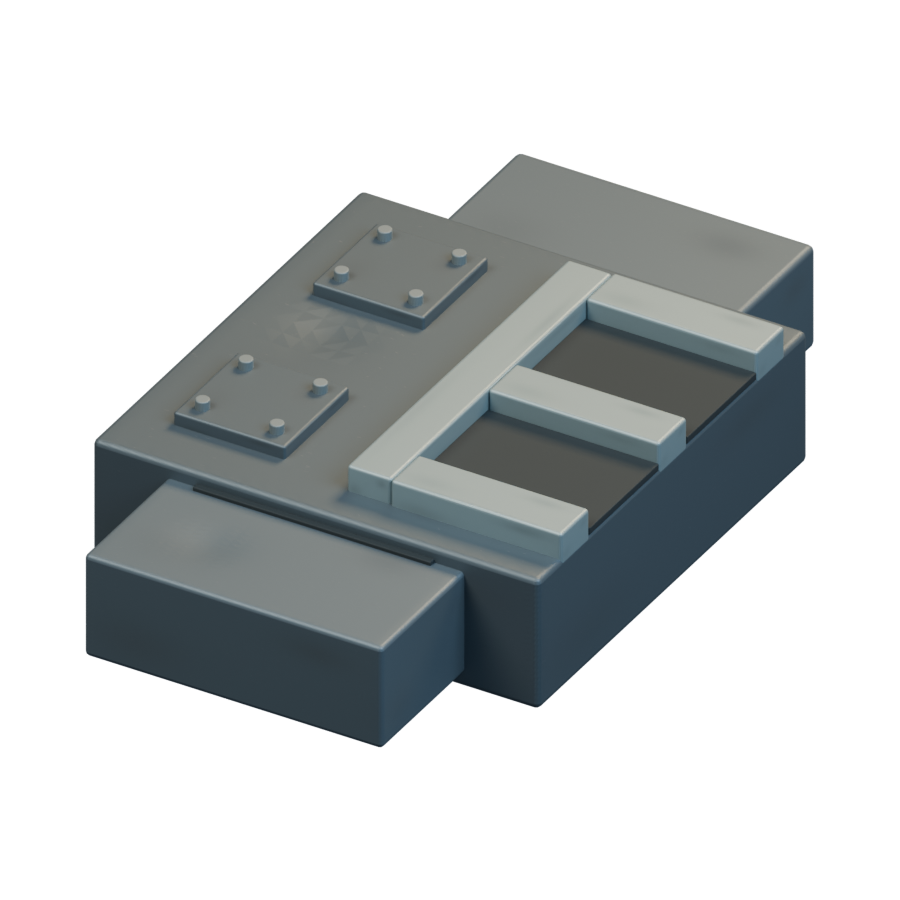
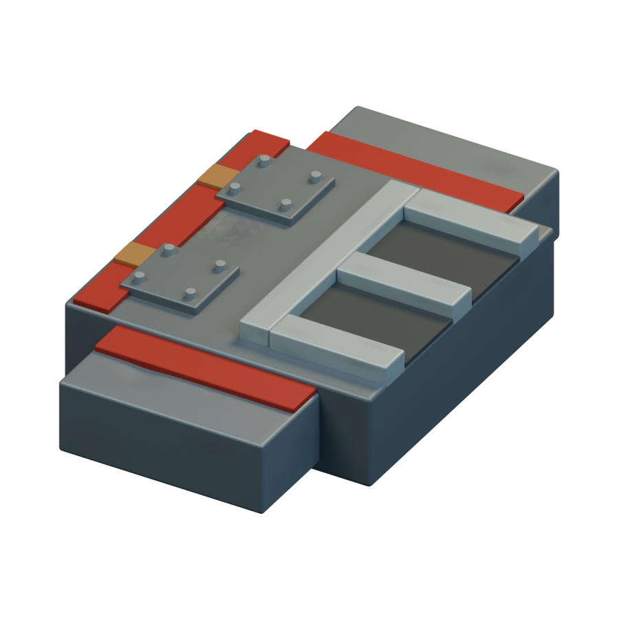
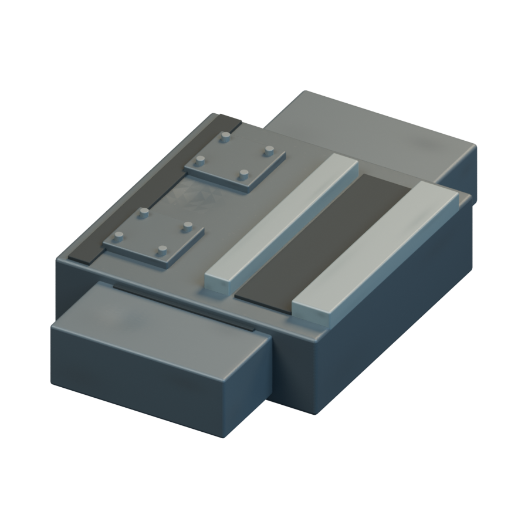
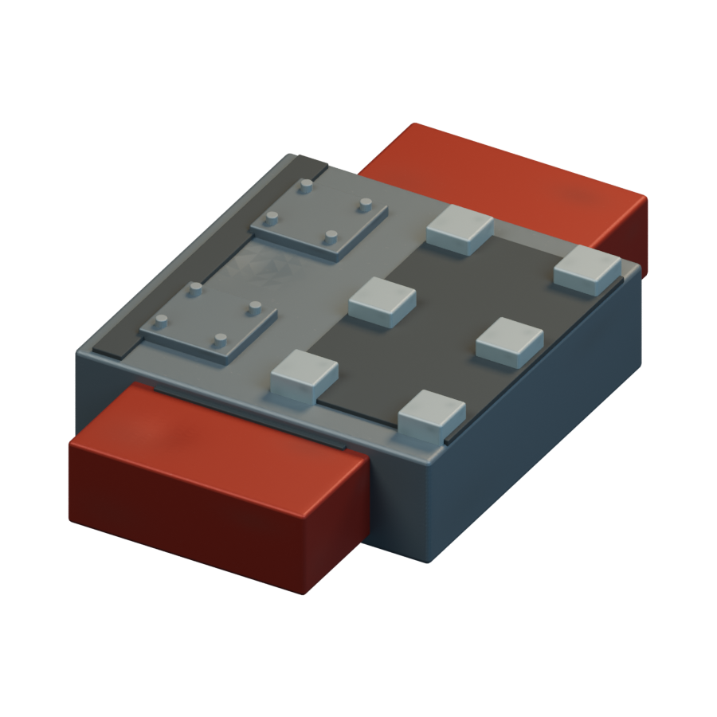
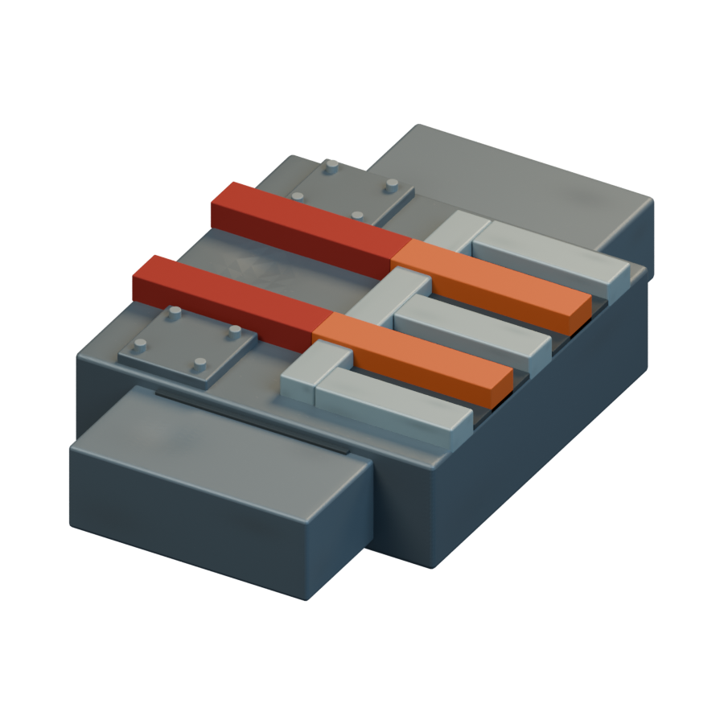
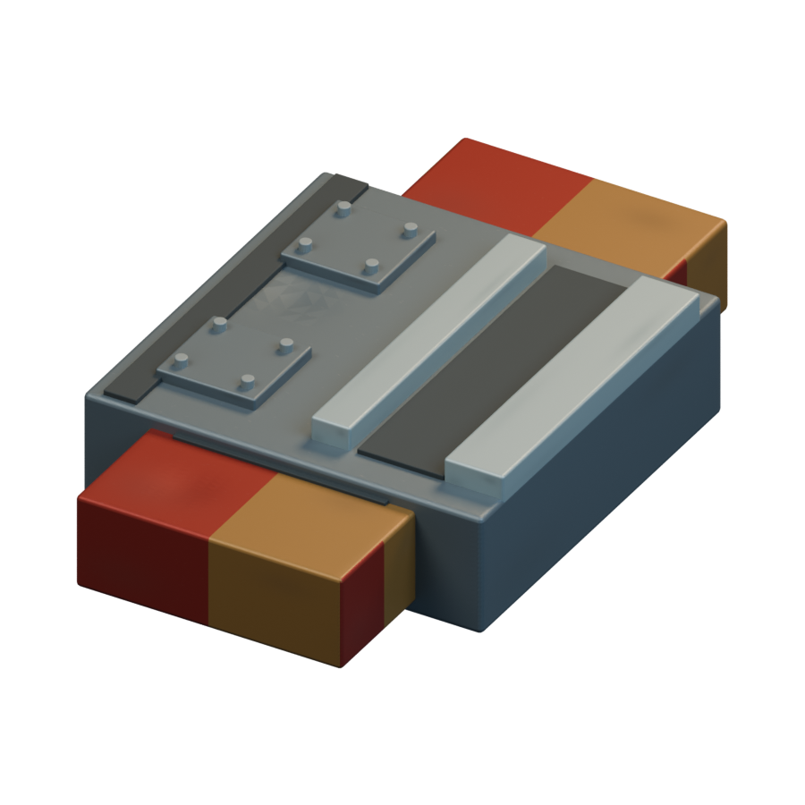
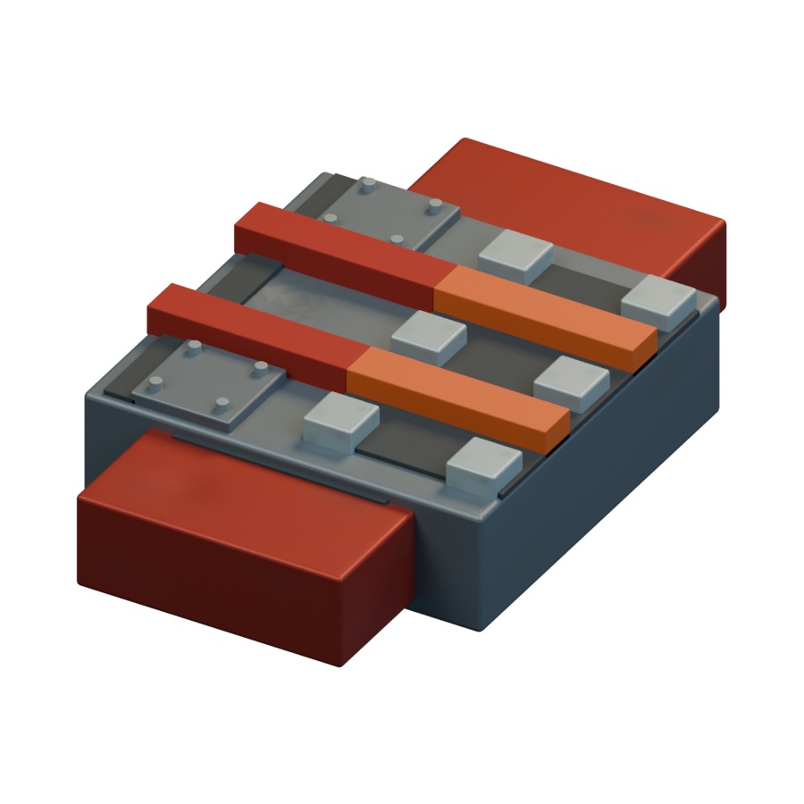
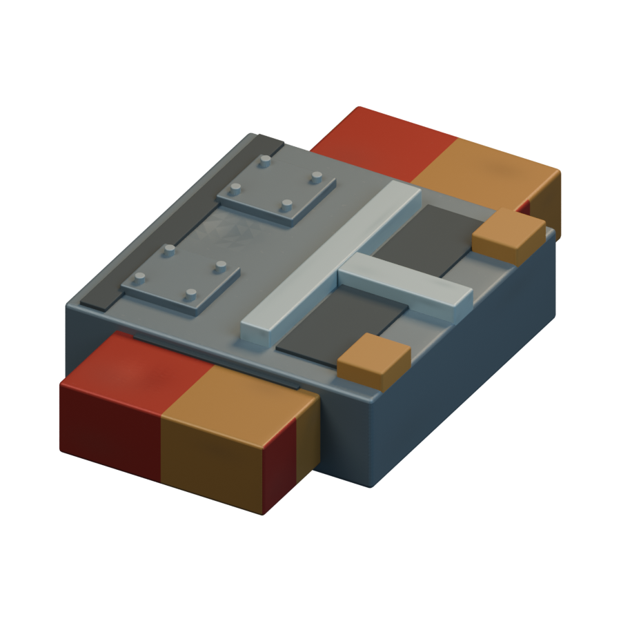
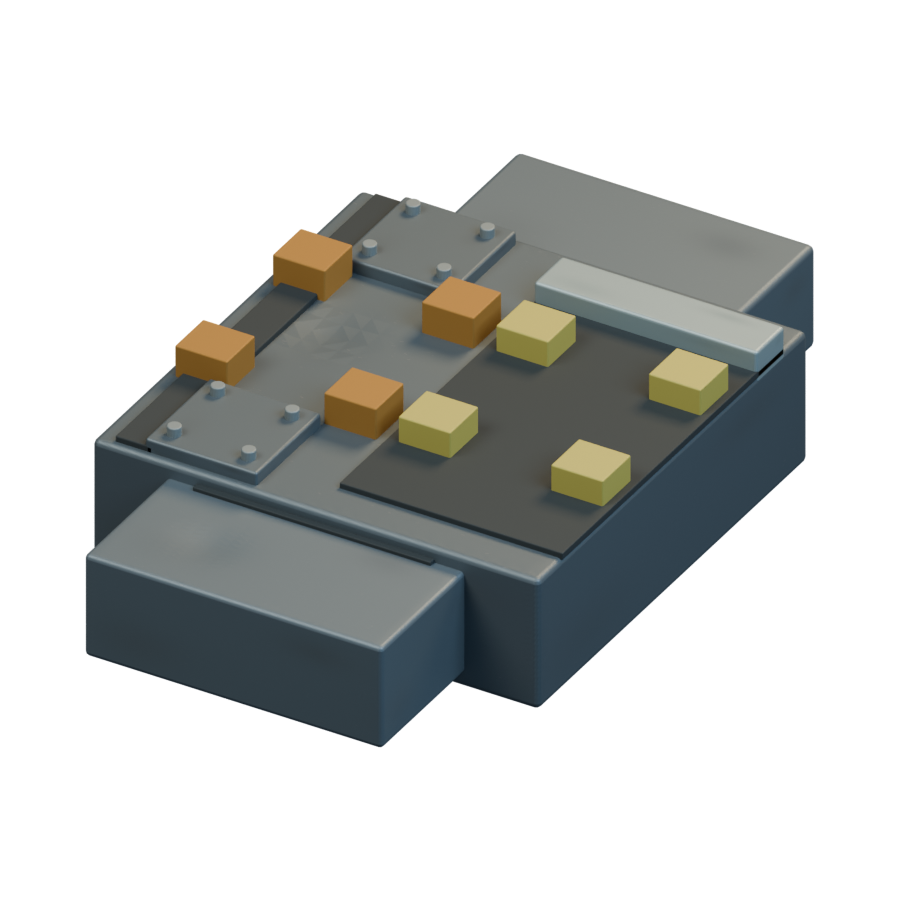
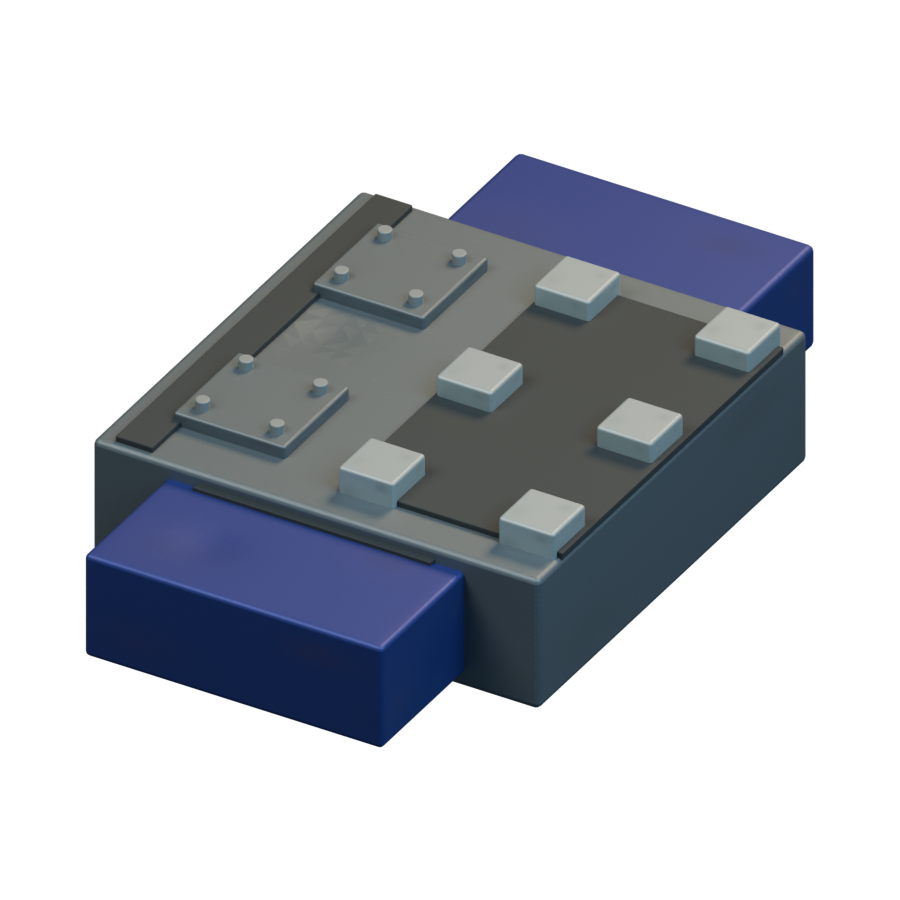

# Missiles / Mauna

[All groups](README.md)

## Minor Hurt Unit

`openfa:missile/mauna/minor-hurt-unit`

**First available iteration — initial-low-resolution-interpretation**

[Blend](../sources/docs/assets/reconstruction/missiles/mauna/minor-hurt-unit/model.blend) · [GLB](../sources/docs/assets/reconstruction/missiles/mauna/minor-hurt-unit/model.glb)

## Major Hurt Unit

`openfa:missile/mauna/major-hurt-unit`

**First available iteration — initial-low-resolution-interpretation**

[Blend](../sources/docs/assets/reconstruction/missiles/mauna/major-hurt-unit/model.blend) · [GLB](../sources/docs/assets/reconstruction/missiles/mauna/major-hurt-unit/model.glb)

## Burns Unit

`openfa:missile/mauna/burns-unit`

**First available iteration — initial-low-resolution-interpretation**

[Blend](../sources/docs/assets/reconstruction/missiles/mauna/burns-unit/model.blend) · [GLB](../sources/docs/assets/reconstruction/missiles/mauna/burns-unit/model.glb)

## Multiple Burns Unit

`openfa:missile/mauna/multiple-burns-unit`

**First available iteration — initial-low-resolution-interpretation**

[Blend](../sources/docs/assets/reconstruction/missiles/mauna/multiple-burns-unit/model.blend) · [GLB](../sources/docs/assets/reconstruction/missiles/mauna/multiple-burns-unit/model.glb)

## Multiple Hurt Unit

`openfa:missile/mauna/multiple-hurt-unit`

**First available iteration — initial-low-resolution-interpretation**

[Blend](../sources/docs/assets/reconstruction/missiles/mauna/multiple-hurt-unit/model.blend) · [GLB](../sources/docs/assets/reconstruction/missiles/mauna/multiple-hurt-unit/model.glb)

## Lightning Destruction Unit

`openfa:missile/mauna/lightning-destruction-unit`

**First available iteration — initial-low-resolution-interpretation**

[Blend](../sources/docs/assets/reconstruction/missiles/mauna/lightning-destruction-unit/model.blend) · [GLB](../sources/docs/assets/reconstruction/missiles/mauna/lightning-destruction-unit/model.glb)

## Radiation Sickness Unit

`openfa:missile/mauna/radiation-sickness-unit`

**First available iteration — initial-low-resolution-interpretation**

[Blend](../sources/docs/assets/reconstruction/missiles/mauna/radiation-sickness-unit/model.blend) · [GLB](../sources/docs/assets/reconstruction/missiles/mauna/radiation-sickness-unit/model.glb)

## Ground Breaking Unit

`openfa:missile/mauna/ground-breaking-unit`

**First available iteration — initial-low-resolution-interpretation**

[Blend](../sources/docs/assets/reconstruction/missiles/mauna/ground-breaking-unit/model.blend) · [GLB](../sources/docs/assets/reconstruction/missiles/mauna/ground-breaking-unit/model.glb)

## Anti-Ground Breaking Unit

`openfa:missile/mauna/anti-ground-breaking-unit`

**First available iteration — initial-low-resolution-interpretation**

[Blend](../sources/docs/assets/reconstruction/missiles/mauna/anti-ground-breaking-unit/model.blend) · [GLB](../sources/docs/assets/reconstruction/missiles/mauna/anti-ground-breaking-unit/model.glb)

## Ore Dissolver

`openfa:missile/mauna/ore-dissolver`

**First available iteration — initial-low-resolution-interpretation**

[Blend](../sources/docs/assets/reconstruction/missiles/mauna/ore-dissolver/model.blend) · [GLB](../sources/docs/assets/reconstruction/missiles/mauna/ore-dissolver/model.glb)
