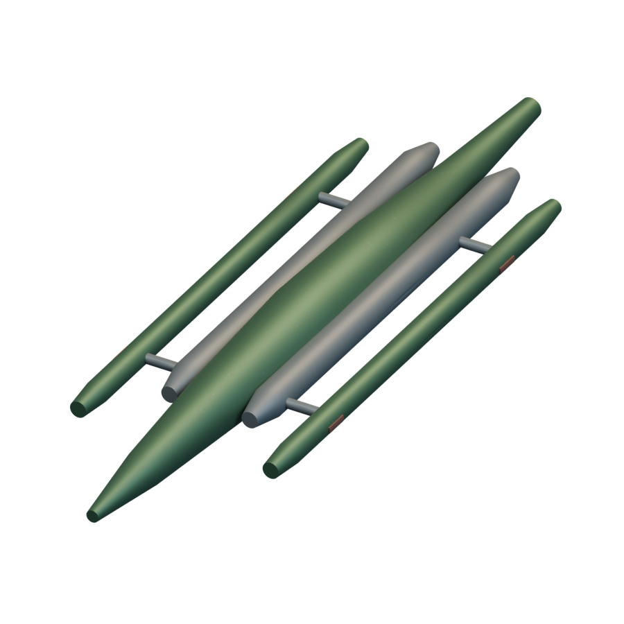
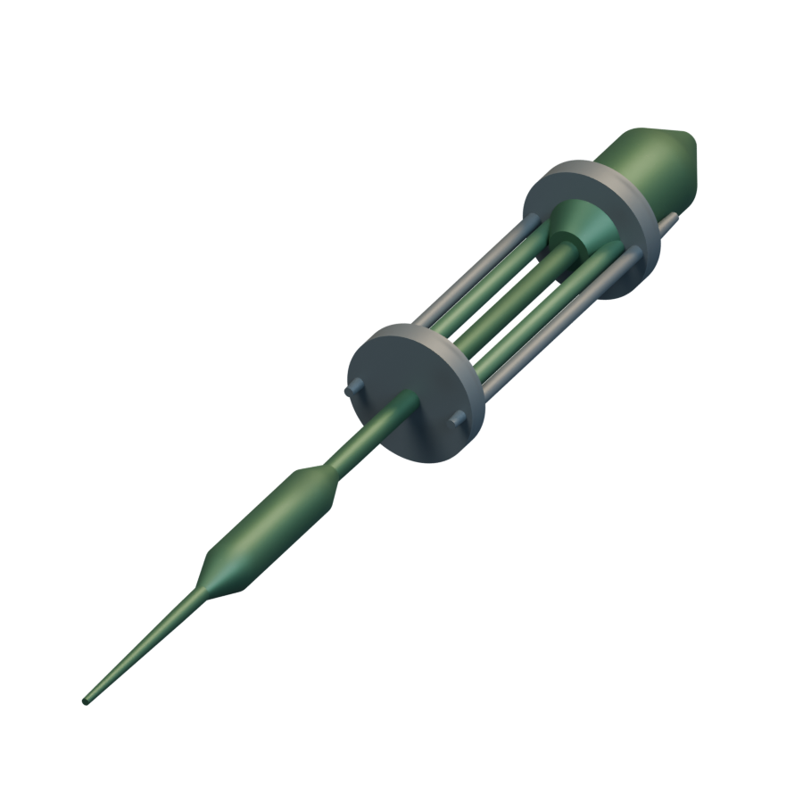
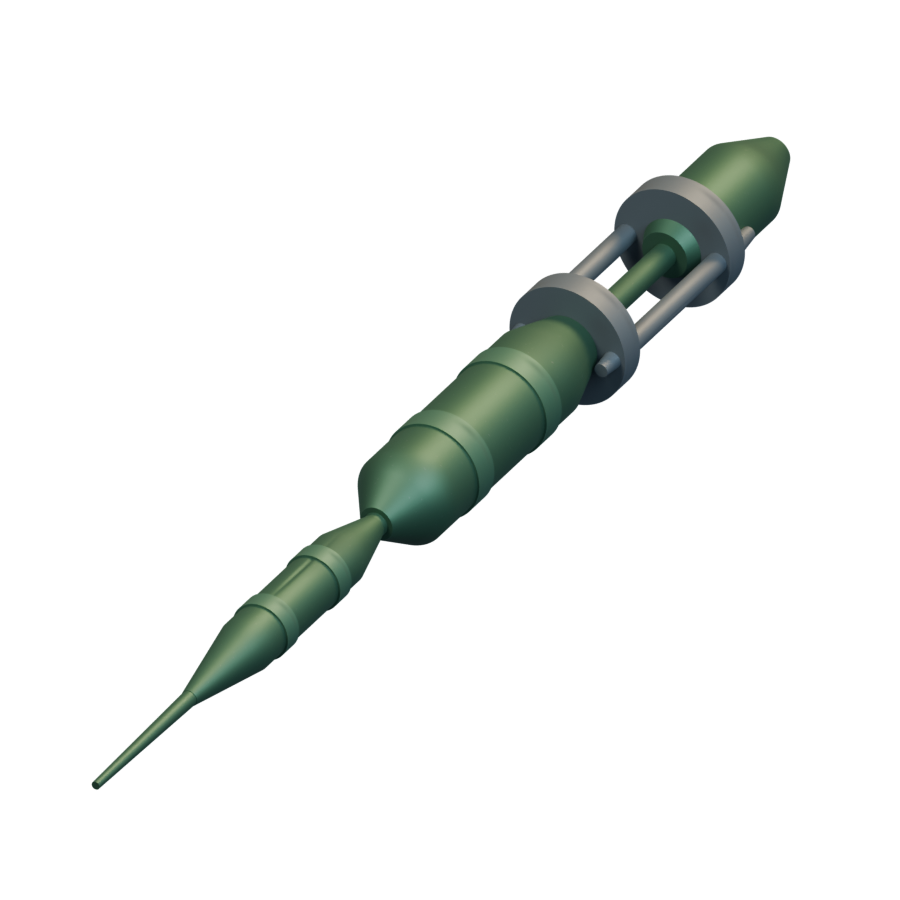
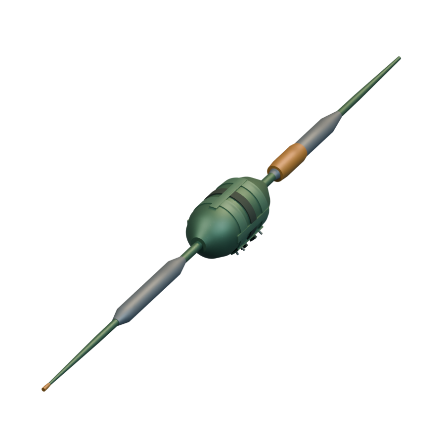
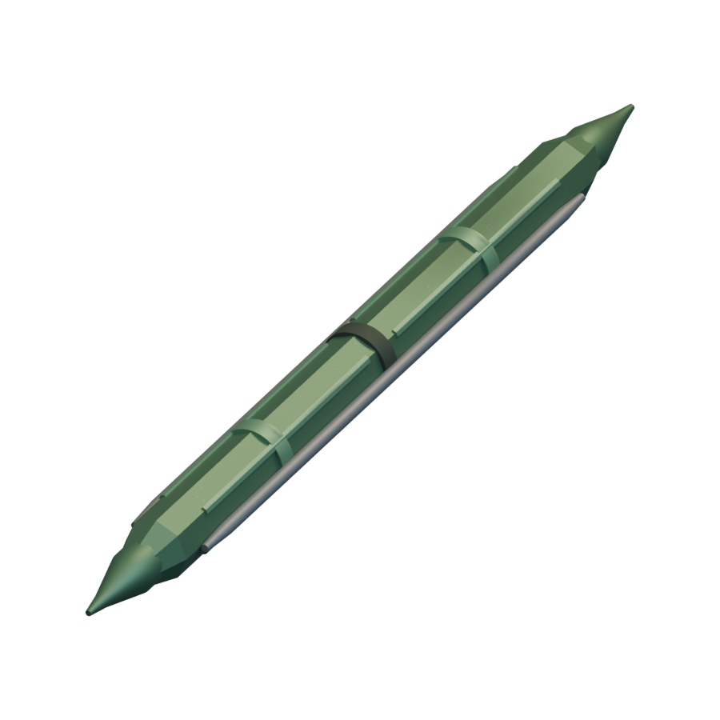
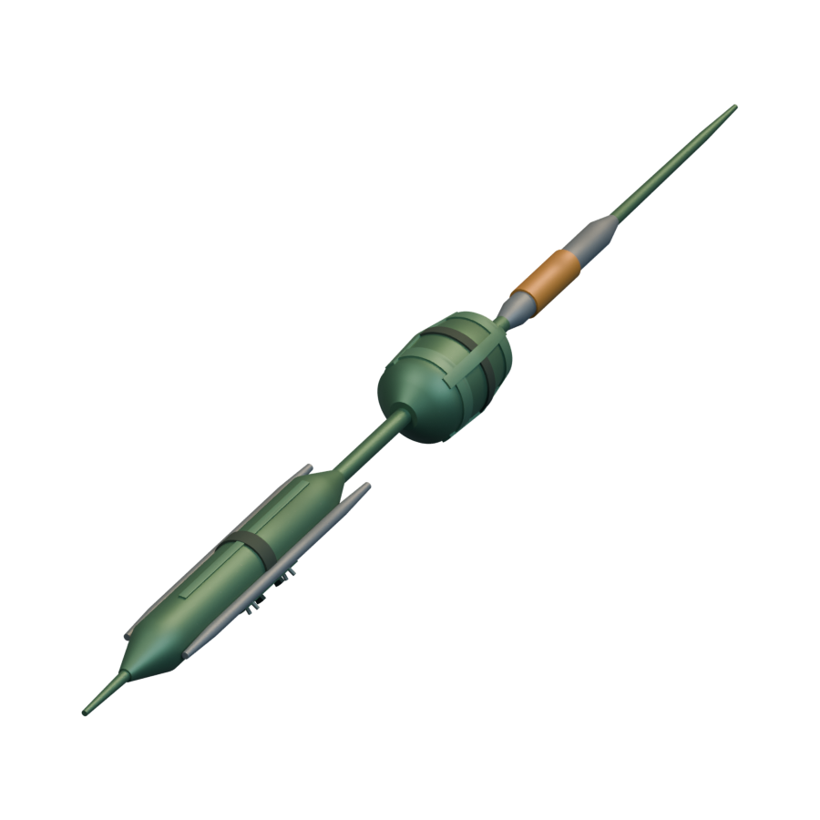
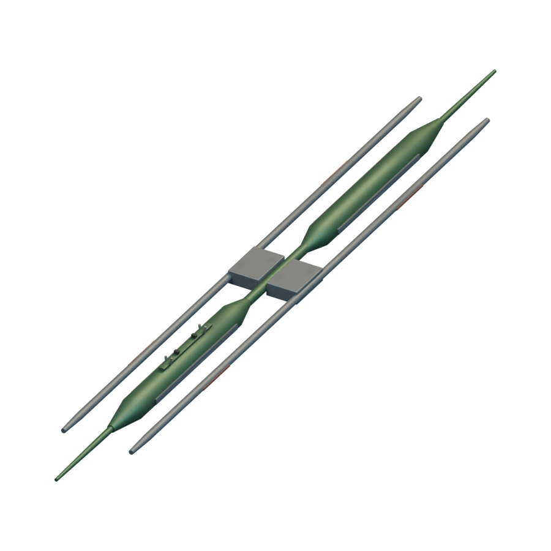
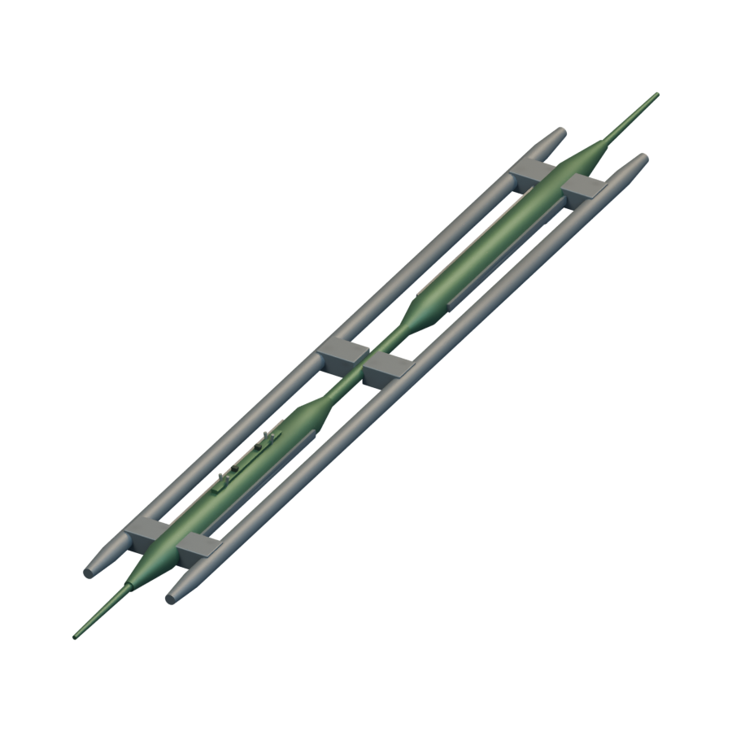
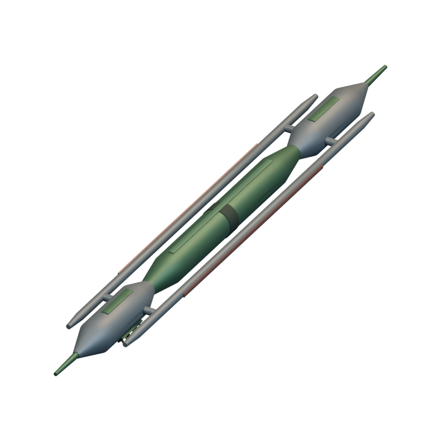

# Missiles / Mikotaj

[All groups](README.md)

## Shri-Merl

`openfa:missile/mikotaj/shri-merl`

**Canonical version — initial-low-resolution-interpretation**

[Blend](../sources/docs/assets/reconstruction/missiles/mikotaj/shri-merl/model.blend) · [GLB](../sources/docs/assets/reconstruction/missiles/mikotaj/shri-merl/model.glb)

## Shri-Jaar

`openfa:missile/mikotaj/shri-jaar`

**Canonical version — initial-low-resolution-interpretation**

[Blend](../sources/docs/assets/reconstruction/missiles/mikotaj/shri-jaar/model.blend) · [GLB](../sources/docs/assets/reconstruction/missiles/mikotaj/shri-jaar/model.glb)

## Greek Fire

`openfa:missile/mikotaj/greek-fire`

**Canonical version — initial-low-resolution-interpretation**

[Blend](../sources/docs/assets/reconstruction/missiles/mikotaj/greek-fire/model.blend) · [GLB](../sources/docs/assets/reconstruction/missiles/mikotaj/greek-fire/model.glb)

## Shri-Sharir

`openfa:missile/mikotaj/shri-sharir`

**Canonical version — initial-low-resolution-interpretation**

[Blend](../sources/docs/assets/reconstruction/missiles/mikotaj/shri-sharir/model.blend) · [GLB](../sources/docs/assets/reconstruction/missiles/mikotaj/shri-sharir/model.glb)

## Bruj-Mahal

`openfa:missile/mikotaj/bruj-mahal`

**Canonical version — initial-low-resolution-interpretation**

[Blend](../sources/docs/assets/reconstruction/missiles/mikotaj/bruj-mahal/model.blend) · [GLB](../sources/docs/assets/reconstruction/missiles/mikotaj/bruj-mahal/model.glb)

## Convulsion

`openfa:missile/mikotaj/convulsion`

**Canonical version — initial-low-resolution-interpretation**

[Blend](../sources/docs/assets/reconstruction/missiles/mikotaj/convulsion/model.blend) · [GLB](../sources/docs/assets/reconstruction/missiles/mikotaj/convulsion/model.glb)

## Stabiliser

`openfa:missile/mikotaj/stabiliser`

**Canonical version — initial-low-resolution-interpretation**

[Blend](../sources/docs/assets/reconstruction/missiles/mikotaj/stabiliser/model.blend) · [GLB](../sources/docs/assets/reconstruction/missiles/mikotaj/stabiliser/model.glb)

## Kal-Na-Xanth

`openfa:missile/mikotaj/kal-na-xanth`

**Canonical version — initial-low-resolution-interpretation**

[Blend](../sources/docs/assets/reconstruction/missiles/mikotaj/kal-na-xanth/model.blend) · [GLB](../sources/docs/assets/reconstruction/missiles/mikotaj/kal-na-xanth/model.glb)

## Bruj-Garor

`openfa:missile/mikotaj/bruj-garor`

**Canonical version — initial-low-resolution-interpretation**

[Blend](../sources/docs/assets/reconstruction/missiles/mikotaj/bruj-garor/model.blend) · [GLB](../sources/docs/assets/reconstruction/missiles/mikotaj/bruj-garor/model.glb)
