# Missiles / Rigellian

[All groups](README.md)

## Detonator

`openfa:missile/rigellian/detonator`

**First available iteration — initial-low-resolution-interpretation**

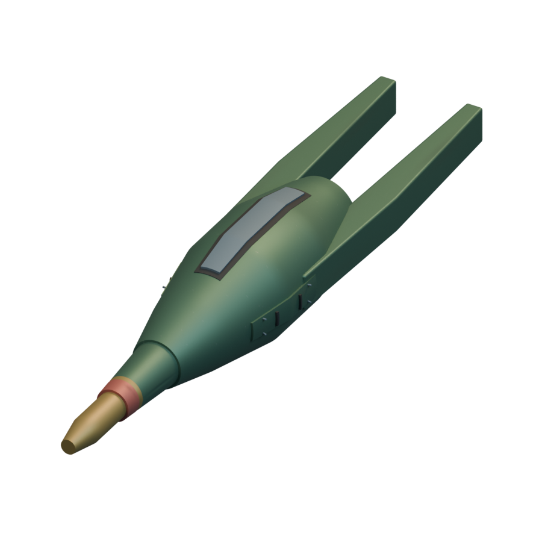

[Blend](../sources/docs/assets/reconstruction/missiles/rigellian/detonator/model.blend) · [GLB](../sources/docs/assets/reconstruction/missiles/rigellian/detonator/model.glb)

**Additional iteration — visible-section-refinement**

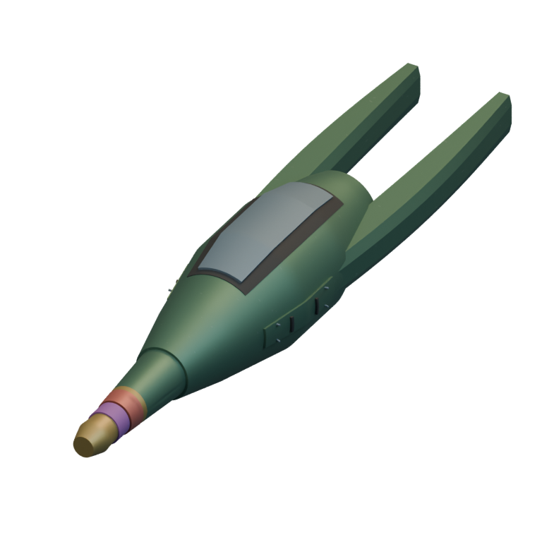

[Blend](../sources/docs/assets/reconstruction/rigellian-refined/missiles/detonator/model.blend) · [GLB](../sources/docs/assets/reconstruction/rigellian-refined/missiles/detonator/model.glb)

## Multi-det

`openfa:missile/rigellian/multi-det`

**First available iteration — initial-low-resolution-interpretation**

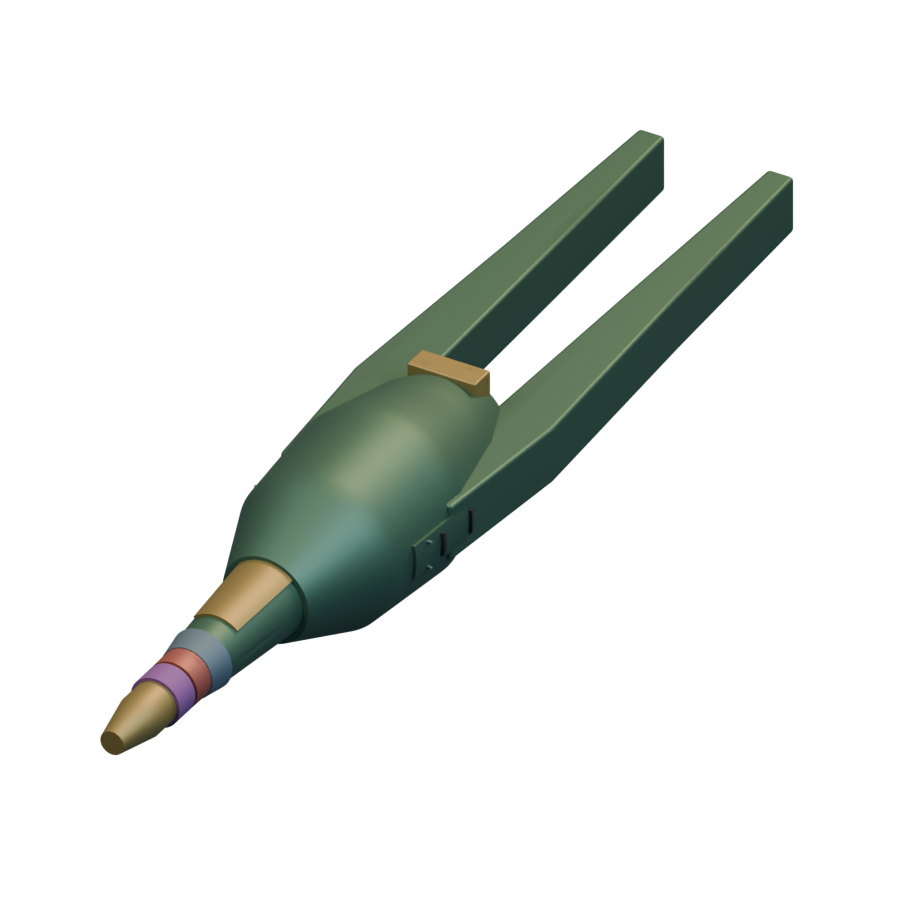

[Blend](../sources/docs/assets/reconstruction/missiles/rigellian/multi-det/model.blend) · [GLB](../sources/docs/assets/reconstruction/missiles/rigellian/multi-det/model.glb)

**Additional iteration — visible-section-refinement**

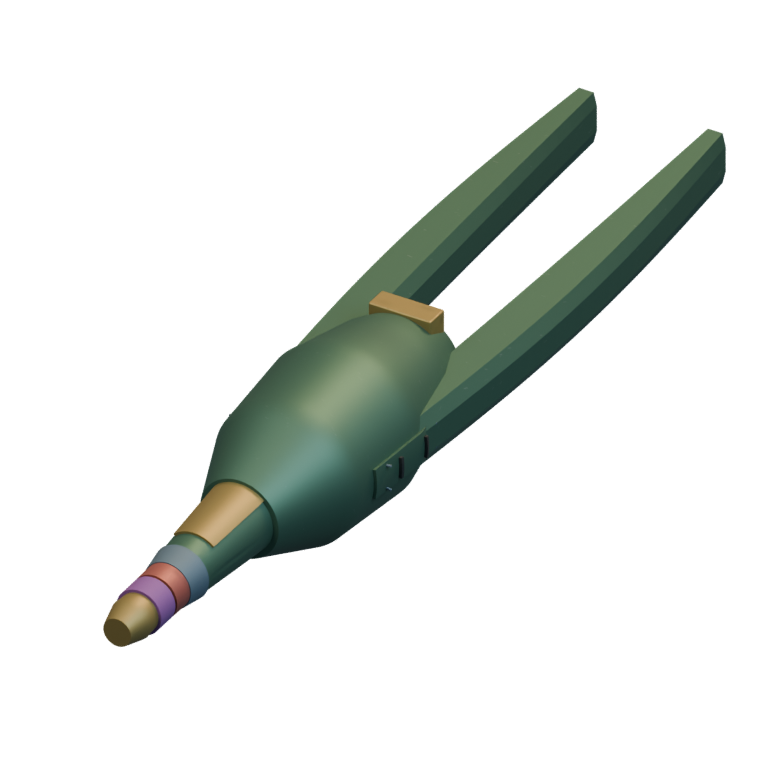

[Blend](../sources/docs/assets/reconstruction/rigellian-refined/missiles/multi-det/model.blend) · [GLB](../sources/docs/assets/reconstruction/rigellian-refined/missiles/multi-det/model.glb)

## Flamejell

`openfa:missile/rigellian/flamejell`

**First available iteration — initial-low-resolution-interpretation**

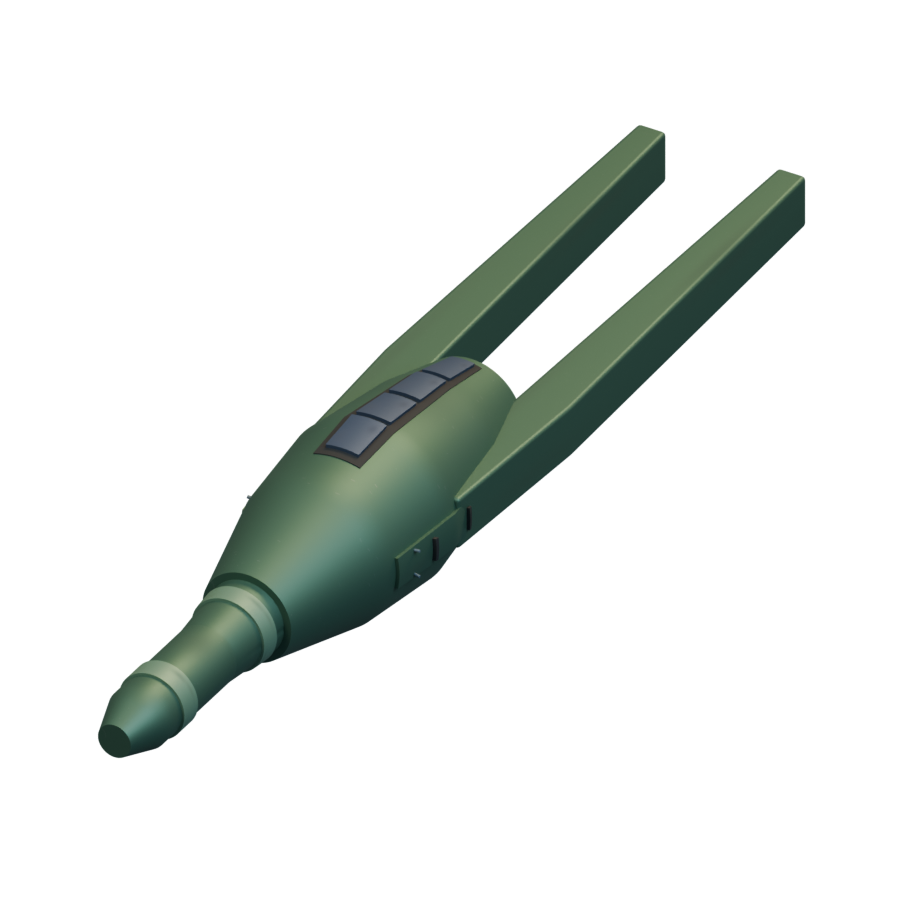

[Blend](../sources/docs/assets/reconstruction/missiles/rigellian/flamejell/model.blend) · [GLB](../sources/docs/assets/reconstruction/missiles/rigellian/flamejell/model.glb)

**Additional iteration — visible-section-refinement**

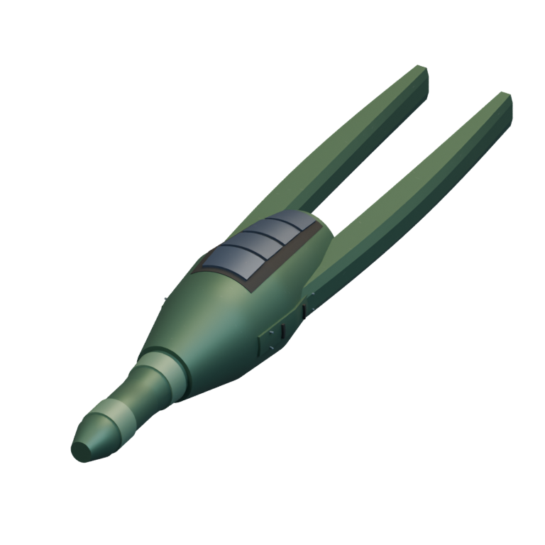

[Blend](../sources/docs/assets/reconstruction/rigellian-refined/missiles/flamejell/model.blend) · [GLB](../sources/docs/assets/reconstruction/rigellian-refined/missiles/flamejell/model.glb)

## Maxi-det

`openfa:missile/rigellian/maxi-det`

**First available iteration — initial-low-resolution-interpretation**

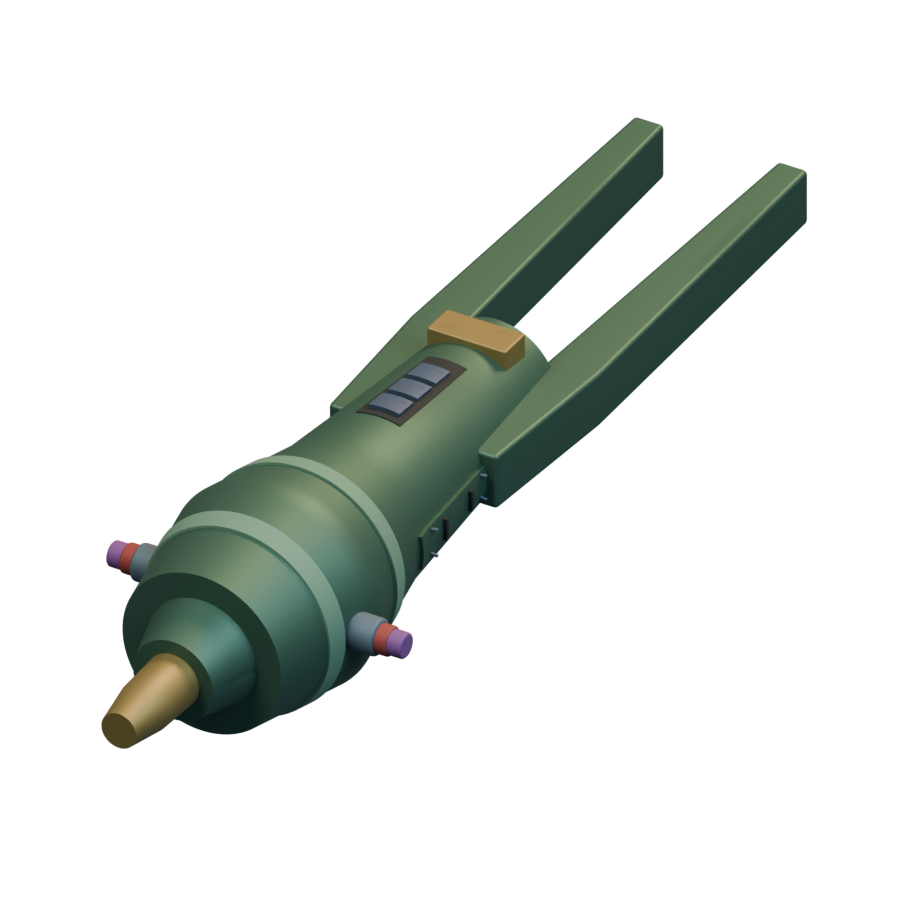

[Blend](../sources/docs/assets/reconstruction/missiles/rigellian/maxi-det/model.blend) · [GLB](../sources/docs/assets/reconstruction/missiles/rigellian/maxi-det/model.glb)

**Additional iteration — visible-section-refinement**

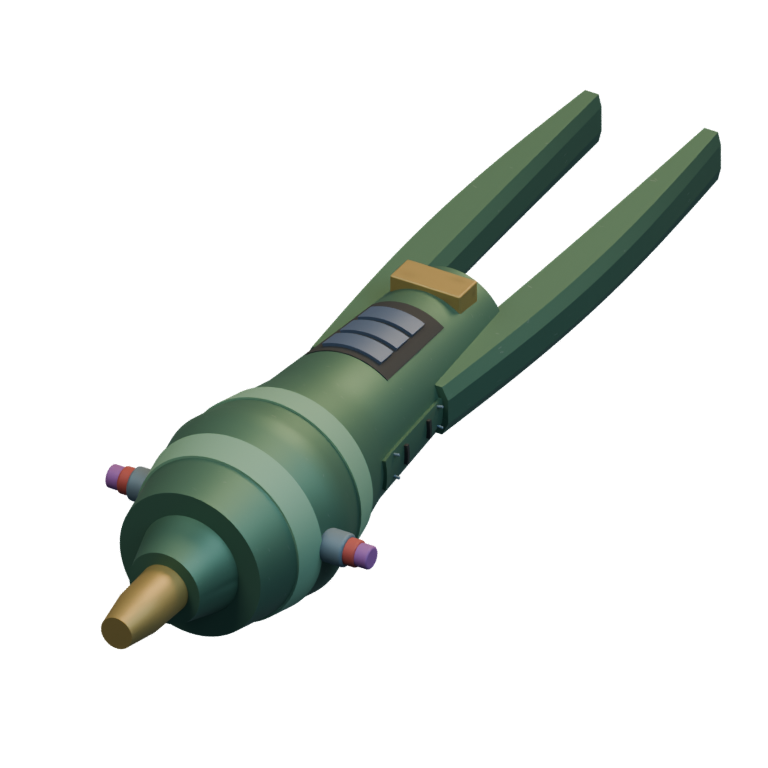

[Blend](../sources/docs/assets/reconstruction/rigellian-refined/missiles/maxi-det/model.blend) · [GLB](../sources/docs/assets/reconstruction/rigellian-refined/missiles/maxi-det/model.glb)

## Flare

`openfa:missile/rigellian/flare`

**First available iteration — initial-low-resolution-interpretation**

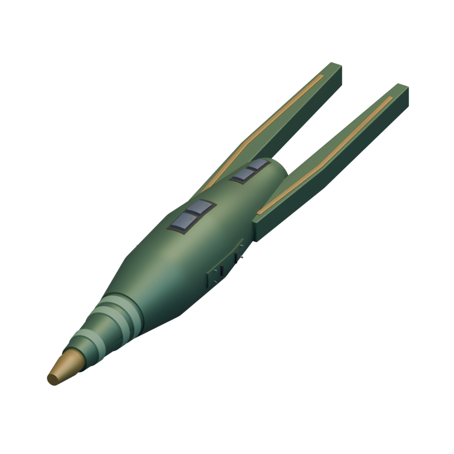

[Blend](../sources/docs/assets/reconstruction/missiles/rigellian/flare/model.blend) · [GLB](../sources/docs/assets/reconstruction/missiles/rigellian/flare/model.glb)

**Additional iteration — visible-section-refinement**

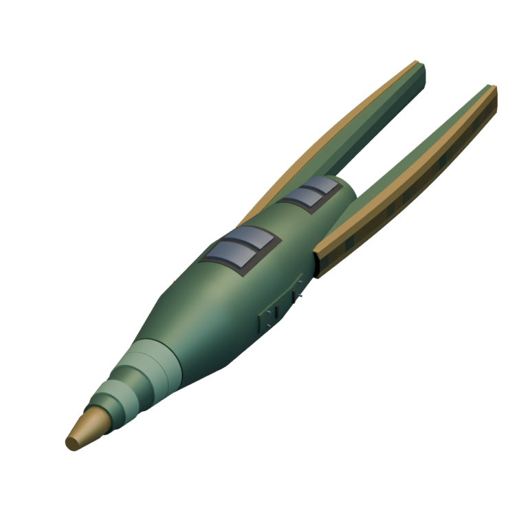

[Blend](../sources/docs/assets/reconstruction/rigellian-refined/missiles/flare/model.blend) · [GLB](../sources/docs/assets/reconstruction/rigellian-refined/missiles/flare/model.glb)

## Viral Repair

`openfa:missile/rigellian/viral-repair`

**First available iteration — initial-low-resolution-interpretation**

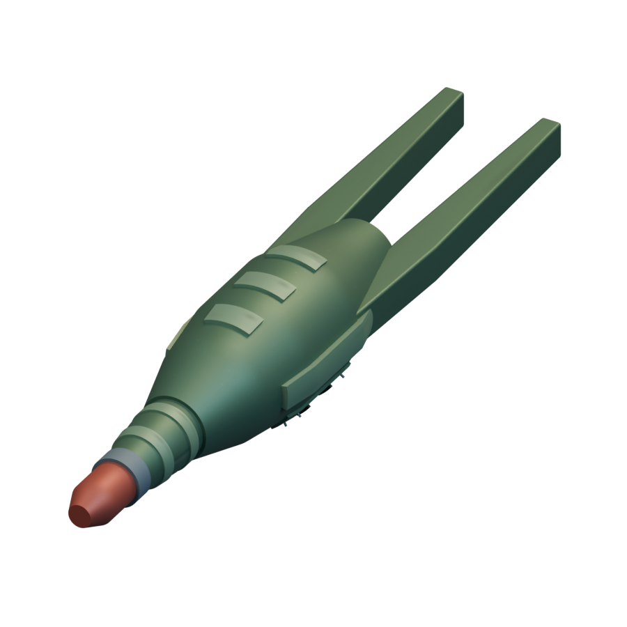

[Blend](../sources/docs/assets/reconstruction/missiles/rigellian/viral-repair/model.blend) · [GLB](../sources/docs/assets/reconstruction/missiles/rigellian/viral-repair/model.glb)

**Additional iteration — visible-section-refinement**

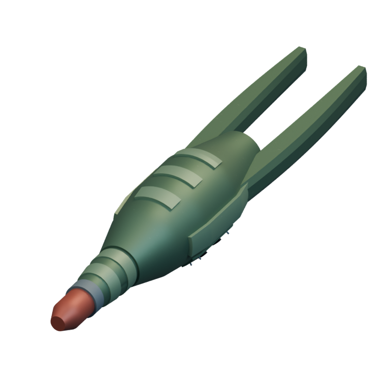

[Blend](../sources/docs/assets/reconstruction/rigellian-refined/missiles/viral-repair/model.blend) · [GLB](../sources/docs/assets/reconstruction/rigellian-refined/missiles/viral-repair/model.glb)

## Temporal Stasis

`openfa:missile/rigellian/temporal-stasis`

**First available iteration — initial-low-resolution-interpretation**

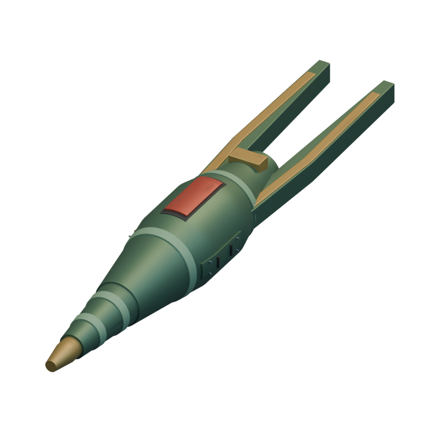

[Blend](../sources/docs/assets/reconstruction/missiles/rigellian/temporal-stasis/model.blend) · [GLB](../sources/docs/assets/reconstruction/missiles/rigellian/temporal-stasis/model.glb)

**Additional iteration — visible-section-refinement**

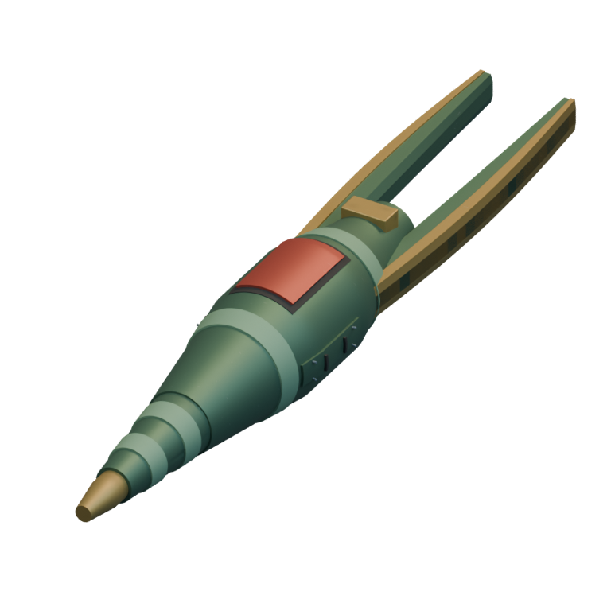

[Blend](../sources/docs/assets/reconstruction/rigellian-refined/missiles/temporal-stasis/model.blend) · [GLB](../sources/docs/assets/reconstruction/rigellian-refined/missiles/temporal-stasis/model.glb)
