# Missiles / Terran

[All groups](README.md)

## Explosive Missile

`openfa:explosive`

**First available iteration — reference-refined-study**

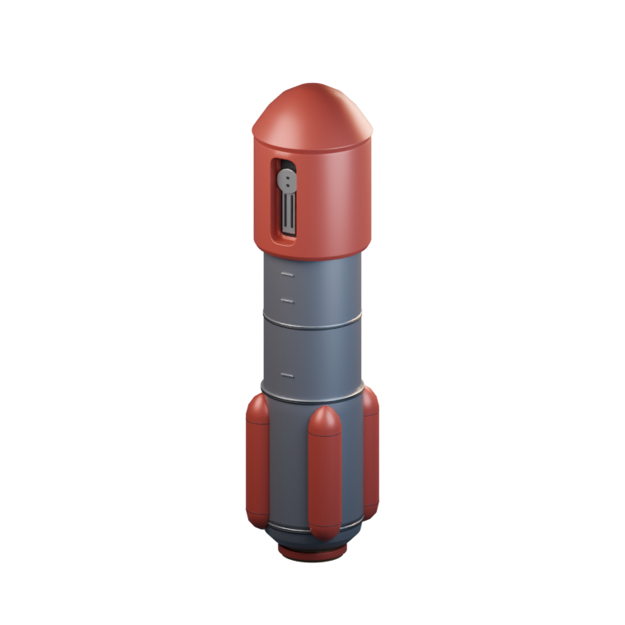

[Blend](../sources/docs/assets/reconstruction/missiles/terran/explosive/model.blend) · [GLB](../sources/docs/assets/reconstruction/missiles/terran/explosive/model.glb)

## Area Explosive Missile

`openfa:area-explosive`

**First available iteration — reference-refined-study**

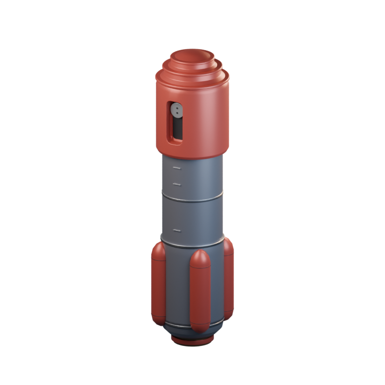

[Blend](../sources/docs/assets/reconstruction/missiles/terran/area-explosive/model.blend) · [GLB](../sources/docs/assets/reconstruction/missiles/terran/area-explosive/model.glb)

## Napalm Missile

`openfa:napalm`

**First available iteration — reference-refined-study**

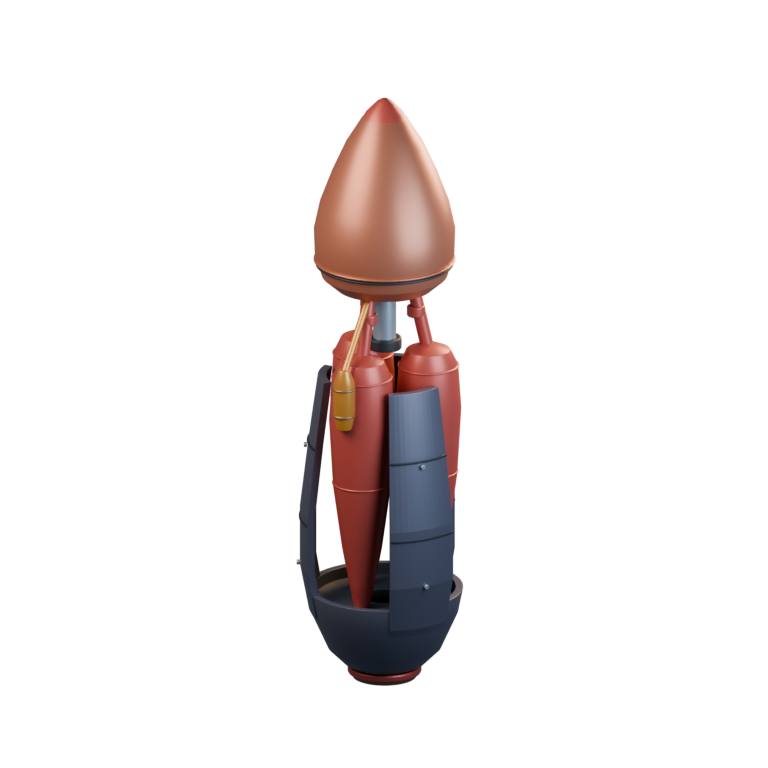

[Blend](../sources/docs/assets/reconstruction/missiles/terran/napalm/model.blend) · [GLB](../sources/docs/assets/reconstruction/missiles/terran/napalm/model.glb)

## Hellfire Missile

`openfa:hellfire`

**First available iteration — reference-refined-study**

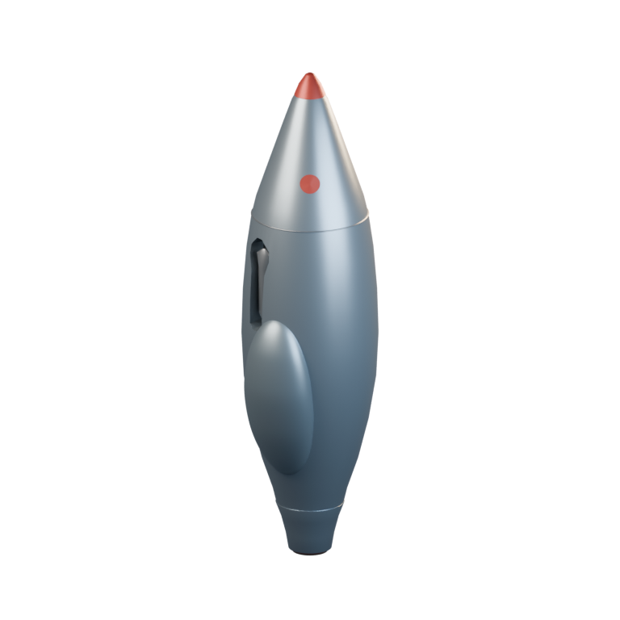

[Blend](../sources/docs/assets/reconstruction/missiles/terran/hellfire/model.blend) · [GLB](../sources/docs/assets/reconstruction/missiles/terran/hellfire/model.glb)

## Scatter Missile

`openfa:scatter`

**First available iteration — reference-refined-study**

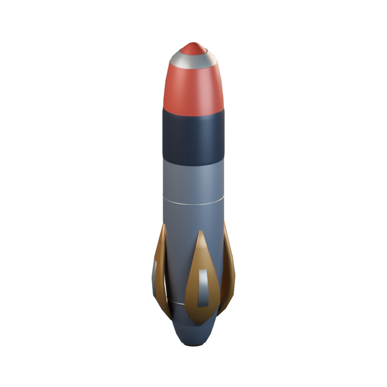

[Blend](../sources/docs/assets/reconstruction/missiles/terran/scatter/model.blend) · [GLB](../sources/docs/assets/reconstruction/missiles/terran/scatter/model.glb)

## Vortex Missile

`openfa:vortex`

**First available iteration — reference-refined-study**

[Blend](../sources/docs/assets/reconstruction/missiles/terran/vortex/model.blend) · [GLB](../sources/docs/assets/reconstruction/missiles/terran/vortex/model.glb)

## Nuclear Missile

`openfa:nuclear`

**First available iteration — reference-refined-study**

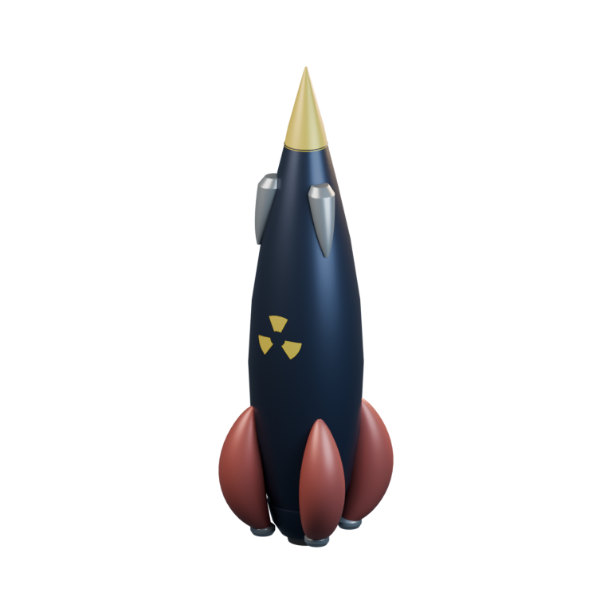

[Blend](../sources/docs/assets/reconstruction/missiles/terran/nuclear/model.blend) · [GLB](../sources/docs/assets/reconstruction/missiles/terran/nuclear/model.glb)

**Additional iteration — shared-refined**

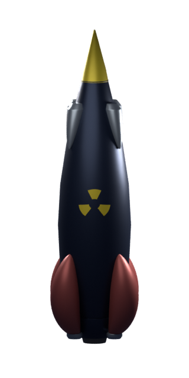

[Blend](../sources/objects/terran/nuclear-missile/refined/model.blend) · [GLB](../sources/objects/terran/nuclear-missile/refined/model.glb)

[Play animation: Animation](../gallery/media/objects/terran/nuclear-missile/refined/animation-00.webm)

## Virus Missile

`openfa:virus`

**First available iteration — reference-refined-study**

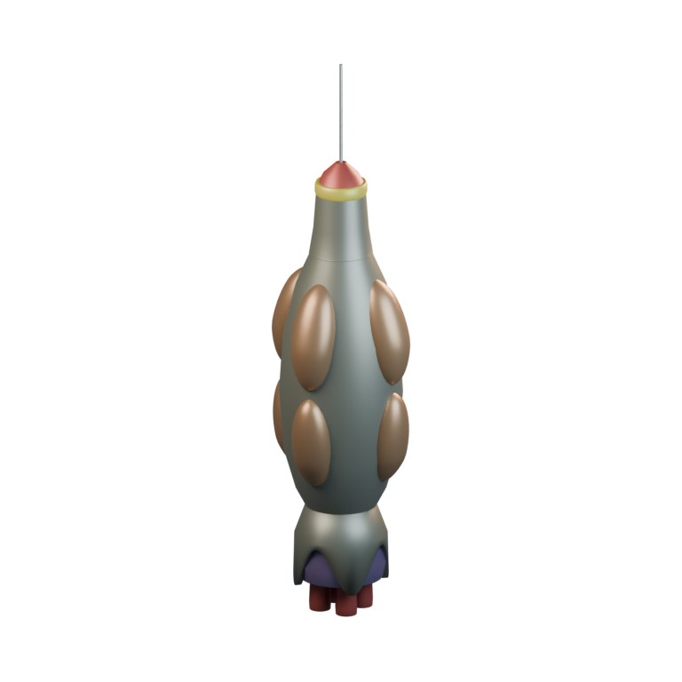

[Blend](../sources/docs/assets/reconstruction/missiles/terran/virus/model.blend) · [GLB](../sources/docs/assets/reconstruction/missiles/terran/virus/model.glb)

**Additional iteration — shared-refined**

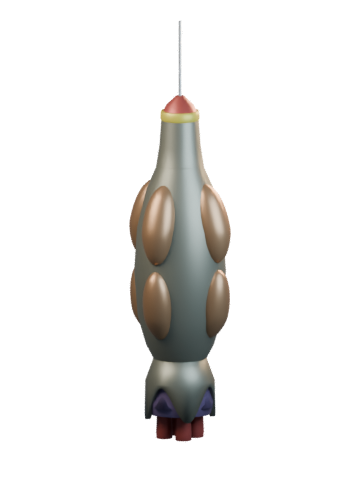

[Blend](../sources/objects/terran/virus-missile/refined/model.blend) · [GLB](../sources/objects/terran/virus-missile/refined/model.glb)

[Play animation: Animation](../gallery/media/objects/terran/virus-missile/refined/animation-00.webm)

## Anti-Virus Missile

`openfa:anti-virus`

**First available iteration — reference-refined-study**

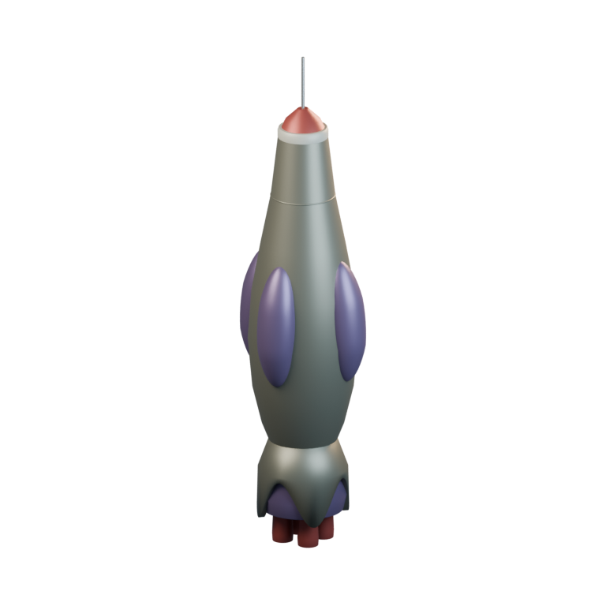

[Blend](../sources/docs/assets/reconstruction/missiles/terran/anti-virus/model.blend) · [GLB](../sources/docs/assets/reconstruction/missiles/terran/anti-virus/model.glb)

**Additional iteration — shared-refined**

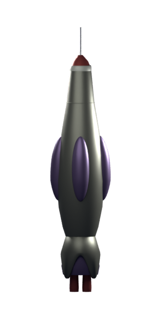

[Blend](../sources/objects/terran/anti-virus-missile/refined/model.blend) · [GLB](../sources/objects/terran/anti-virus-missile/refined/model.glb)

[Play animation: Animation](../gallery/media/objects/terran/anti-virus-missile/refined/animation-00.webm)

## Mega Missile

`openfa:mega`

**First available iteration — reference-refined-study**

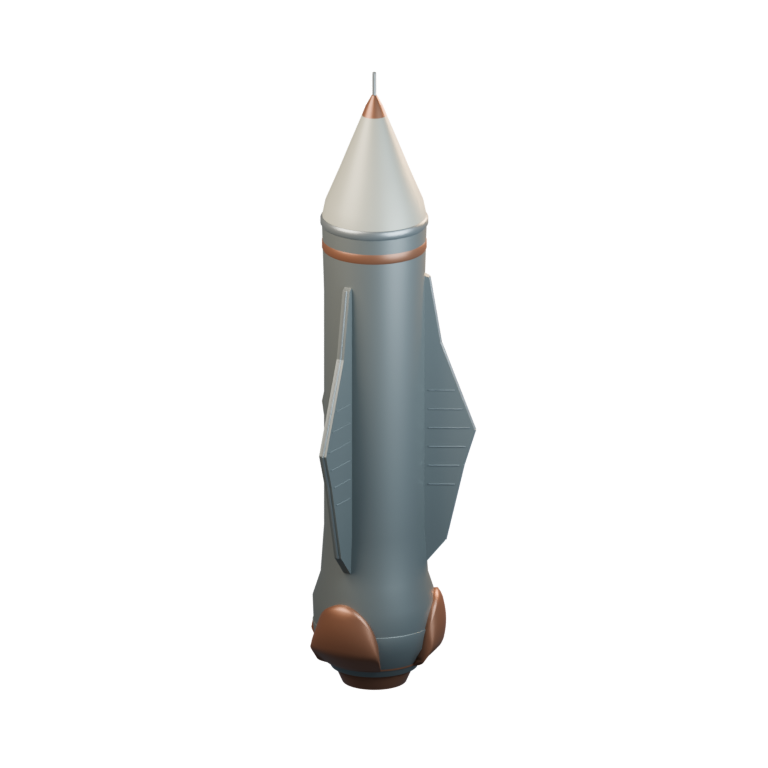

[Blend](../sources/docs/assets/reconstruction/missiles/terran/mega/model.blend) · [GLB](../sources/docs/assets/reconstruction/missiles/terran/mega/model.glb)

**Additional iteration — shared-refined**

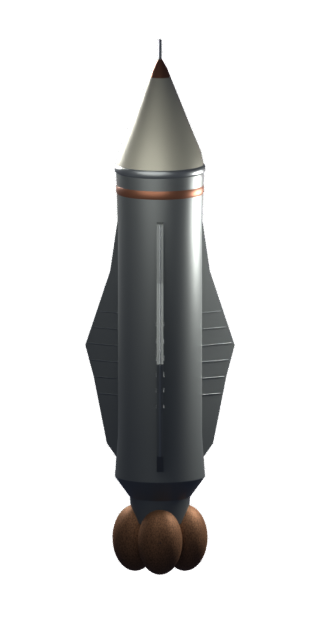

[Blend](../sources/objects/terran/mega-missile/refined/model.blend) · [GLB](../sources/objects/terran/mega-missile/refined/model.glb)

[Play animation: Animation](../gallery/media/objects/terran/mega-missile/refined/animation-00.webm)

## Stasis Missile

`openfa:stasis`

**First available iteration — reference-refined-study**

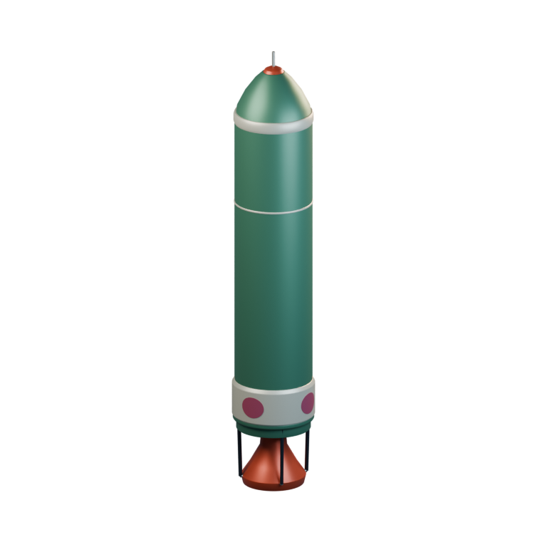

[Blend](../sources/docs/assets/reconstruction/missiles/terran/stasis/model.blend) · [GLB](../sources/docs/assets/reconstruction/missiles/terran/stasis/model.glb)

**Additional iteration — shared-refined**

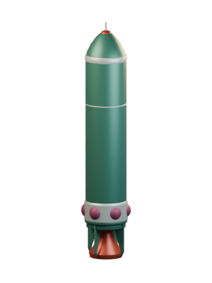

[Blend](../sources/objects/terran/stasis-missile/refined/model.blend) · [GLB](../sources/objects/terran/stasis-missile/refined/model.glb)

[Play animation: Animation](../gallery/media/objects/terran/stasis-missile/refined/animation-00.webm)

## Bug Hunter

`openfa:missile/terran/bug-hunter`

**First available iteration — low-resolution-interpretation-study**

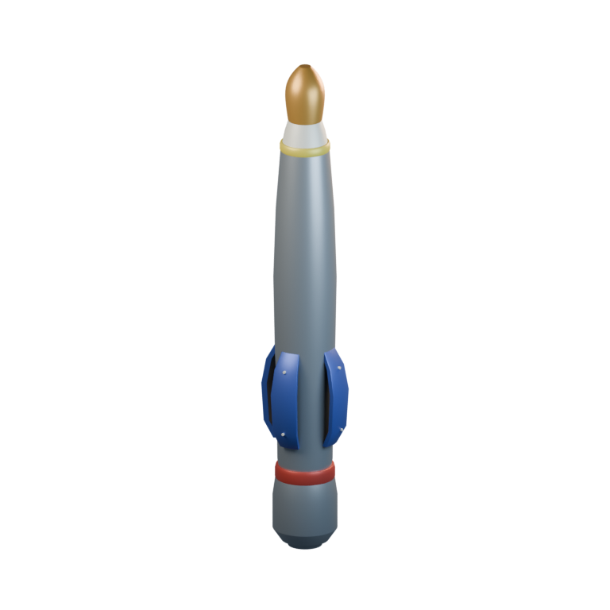

[Blend](../sources/docs/assets/reconstruction/missiles/terran/bug-hunter/model.blend) · [GLB](../sources/docs/assets/reconstruction/missiles/terran/bug-hunter/model.glb)

## Meat-Eater

`openfa:missile/terran/meat-eater`

**First available iteration — low-resolution-interpretation-study**

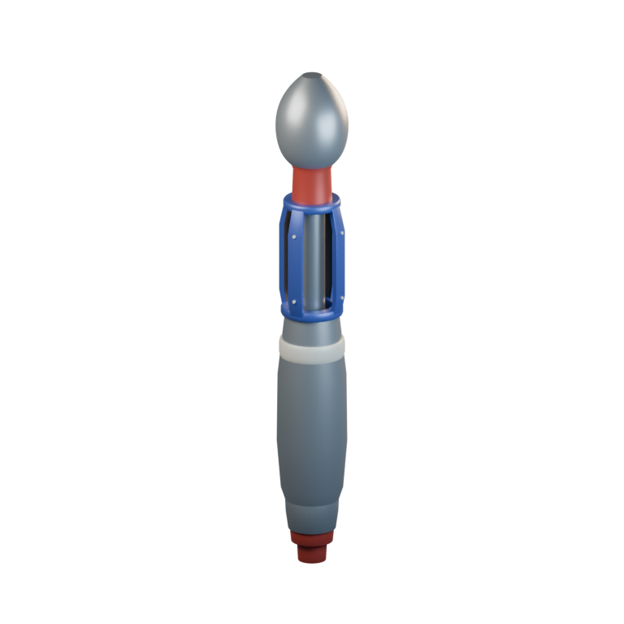

[Blend](../sources/docs/assets/reconstruction/missiles/terran/meat-eater/model.blend) · [GLB](../sources/docs/assets/reconstruction/missiles/terran/meat-eater/model.glb)
