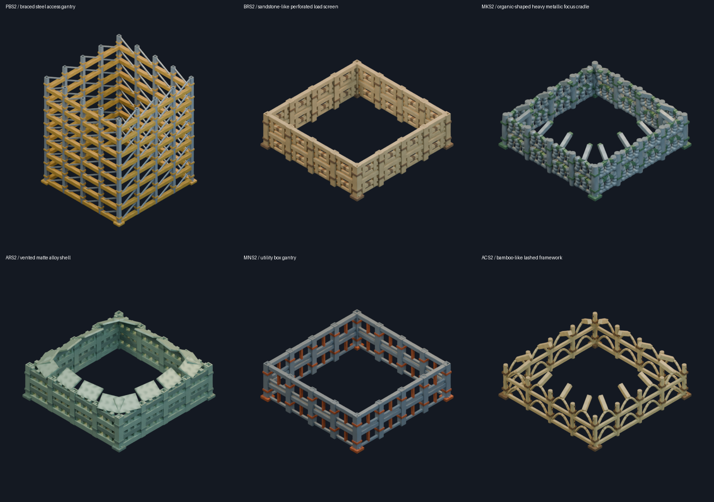
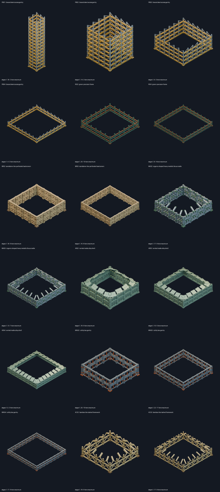

# Culture-specific construction scaffolds

[Watch seven construction cycles rendered by the OpenFA engine](construction-animations.html). Each culture has a separate playable example; these are asset-studio demonstrations, with live gameplay integration tracked separately. [Reproduction and provenance](../docs/construction-previews.md).

Six additional cultures plus Rigellian size-3/4: 18 new families, 264 new stage sources/exports. Together with the [preserved RIS2 refinement](scaffolds-ris2.md), 19 used families cover all 177 building definitions.

[Evidence, lore precedence and integration contract](../sources/docs/reconstruction/models/culture-scaffold-study.md).

[Normalized integration index](../sources/docs/assets/reconstruction/scaffolds/culture-kits/integration.json) includes canonical asset paths and all original global-type keys.

The building appears at full scaffold height. Dismantling reverses erection and exposes the building from the top. The model and presenter own timing and phases.

MK retains organic contours in heavy ore-like metal; AR uses matte advanced alloy. BR has sandstone-like cassettes and AC bamboo-like canes where the CDB does not prescribe a material. Authored mechanisms are distinguished from lore.

| Family | Culture | Stages | Maximum tiers |
| --- | --- | --- | --- |
| [PBS1](#pbs1) | terran | 18 | 2 |
| [PBS2](#pbs2) | terran | 14 | 2 |
| [PBS3](#pbs3) | terran | 9 | 3 |
| [PBS4](#pbs4) | terran | 4 | 2 |
| [RIS3](#ris3) | rigellian | 20 | 10 |
| [RIS4](#ris4) | rigellian | 8 | 4 |
| [BRS2](#brs2) | braccatian | 18 | 9 |
| [BRS3](#brs3) | braccatian | 16 | 8 |
| [MKS2](#mks2) | mikotaj | 17 | 9 |
| [MKS3](#mks3) | mikotaj | 13 | 7 |
| [ARS2](#ars2) | artemian | 18 | 9 |
| [ARS3](#ars3) | artemian | 10 | 5 |
| [ARS4](#ars4) | artemian | 5 | 3 |
| [MNS2](#mns2) | mauna | 20 | 10 |
| [MNS3](#mns3) | mauna | 22 | 11 |
| [MNS4](#mns4) | mauna | 17 | 9 |
| [ACS2](#acs2) | achaean | 18 | 9 |
| [ACS3](#acs3) | achaean | 17 | 9 |

## PBS1

braced steel access gantry. Bolted trusses and removable service decks.

[Manifest](../sources/docs/assets/reconstruction/scaffolds/culture-kits/families/PBS1/model.json) · [Native/GLB checks](../sources/docs/assets/reconstruction/scaffolds/culture-kits/families/PBS1/technical-review.json) · [Render checks](../sources/docs/assets/reconstruction/scaffolds/culture-kits/families/PBS1/render-review.json)

[Maximum stack preview](media/docs/assets/reconstruction/scaffolds/culture-kits/families/PBS1/stage-18/front-quarter.png)

| Stage | View | Editable Blend | Standalone GLB |
| --- | --- | --- | --- |
| 1 | [View](media/docs/assets/reconstruction/scaffolds/culture-kits/families/PBS1/stage-01/front-quarter.png) | [Blend](../sources/docs/assets/reconstruction/scaffolds/culture-kits/families/PBS1/stage-01/model.blend) | [GLB](../sources/docs/assets/reconstruction/scaffolds/culture-kits/families/PBS1/stage-01/model.glb) |
| 2 | [View](media/docs/assets/reconstruction/scaffolds/culture-kits/families/PBS1/stage-02/front-quarter.png) | [Blend](../sources/docs/assets/reconstruction/scaffolds/culture-kits/families/PBS1/stage-02/model.blend) | [GLB](../sources/docs/assets/reconstruction/scaffolds/culture-kits/families/PBS1/stage-02/model.glb) |
| 3 | [View](media/docs/assets/reconstruction/scaffolds/culture-kits/families/PBS1/stage-03/front-quarter.png) | [Blend](../sources/docs/assets/reconstruction/scaffolds/culture-kits/families/PBS1/stage-03/model.blend) | [GLB](../sources/docs/assets/reconstruction/scaffolds/culture-kits/families/PBS1/stage-03/model.glb) |
| 4 | [View](media/docs/assets/reconstruction/scaffolds/culture-kits/families/PBS1/stage-04/front-quarter.png) | [Blend](../sources/docs/assets/reconstruction/scaffolds/culture-kits/families/PBS1/stage-04/model.blend) | [GLB](../sources/docs/assets/reconstruction/scaffolds/culture-kits/families/PBS1/stage-04/model.glb) |
| 5 | [View](media/docs/assets/reconstruction/scaffolds/culture-kits/families/PBS1/stage-05/front-quarter.png) | [Blend](../sources/docs/assets/reconstruction/scaffolds/culture-kits/families/PBS1/stage-05/model.blend) | [GLB](../sources/docs/assets/reconstruction/scaffolds/culture-kits/families/PBS1/stage-05/model.glb) |
| 6 | [View](media/docs/assets/reconstruction/scaffolds/culture-kits/families/PBS1/stage-06/front-quarter.png) | [Blend](../sources/docs/assets/reconstruction/scaffolds/culture-kits/families/PBS1/stage-06/model.blend) | [GLB](../sources/docs/assets/reconstruction/scaffolds/culture-kits/families/PBS1/stage-06/model.glb) |
| 7 | [View](media/docs/assets/reconstruction/scaffolds/culture-kits/families/PBS1/stage-07/front-quarter.png) | [Blend](../sources/docs/assets/reconstruction/scaffolds/culture-kits/families/PBS1/stage-07/model.blend) | [GLB](../sources/docs/assets/reconstruction/scaffolds/culture-kits/families/PBS1/stage-07/model.glb) |
| 8 | [View](media/docs/assets/reconstruction/scaffolds/culture-kits/families/PBS1/stage-08/front-quarter.png) | [Blend](../sources/docs/assets/reconstruction/scaffolds/culture-kits/families/PBS1/stage-08/model.blend) | [GLB](../sources/docs/assets/reconstruction/scaffolds/culture-kits/families/PBS1/stage-08/model.glb) |
| 9 | [View](media/docs/assets/reconstruction/scaffolds/culture-kits/families/PBS1/stage-09/front-quarter.png) | [Blend](../sources/docs/assets/reconstruction/scaffolds/culture-kits/families/PBS1/stage-09/model.blend) | [GLB](../sources/docs/assets/reconstruction/scaffolds/culture-kits/families/PBS1/stage-09/model.glb) |
| 10 | [View](media/docs/assets/reconstruction/scaffolds/culture-kits/families/PBS1/stage-10/front-quarter.png) | [Blend](../sources/docs/assets/reconstruction/scaffolds/culture-kits/families/PBS1/stage-10/model.blend) | [GLB](../sources/docs/assets/reconstruction/scaffolds/culture-kits/families/PBS1/stage-10/model.glb) |
| 11 | [View](media/docs/assets/reconstruction/scaffolds/culture-kits/families/PBS1/stage-11/front-quarter.png) | [Blend](../sources/docs/assets/reconstruction/scaffolds/culture-kits/families/PBS1/stage-11/model.blend) | [GLB](../sources/docs/assets/reconstruction/scaffolds/culture-kits/families/PBS1/stage-11/model.glb) |
| 12 | [View](media/docs/assets/reconstruction/scaffolds/culture-kits/families/PBS1/stage-12/front-quarter.png) | [Blend](../sources/docs/assets/reconstruction/scaffolds/culture-kits/families/PBS1/stage-12/model.blend) | [GLB](../sources/docs/assets/reconstruction/scaffolds/culture-kits/families/PBS1/stage-12/model.glb) |
| 13 | [View](media/docs/assets/reconstruction/scaffolds/culture-kits/families/PBS1/stage-13/front-quarter.png) | [Blend](../sources/docs/assets/reconstruction/scaffolds/culture-kits/families/PBS1/stage-13/model.blend) | [GLB](../sources/docs/assets/reconstruction/scaffolds/culture-kits/families/PBS1/stage-13/model.glb) |
| 14 | [View](media/docs/assets/reconstruction/scaffolds/culture-kits/families/PBS1/stage-14/front-quarter.png) | [Blend](../sources/docs/assets/reconstruction/scaffolds/culture-kits/families/PBS1/stage-14/model.blend) | [GLB](../sources/docs/assets/reconstruction/scaffolds/culture-kits/families/PBS1/stage-14/model.glb) |
| 15 | [View](media/docs/assets/reconstruction/scaffolds/culture-kits/families/PBS1/stage-15/front-quarter.png) | [Blend](../sources/docs/assets/reconstruction/scaffolds/culture-kits/families/PBS1/stage-15/model.blend) | [GLB](../sources/docs/assets/reconstruction/scaffolds/culture-kits/families/PBS1/stage-15/model.glb) |
| 16 | [View](media/docs/assets/reconstruction/scaffolds/culture-kits/families/PBS1/stage-16/front-quarter.png) | [Blend](../sources/docs/assets/reconstruction/scaffolds/culture-kits/families/PBS1/stage-16/model.blend) | [GLB](../sources/docs/assets/reconstruction/scaffolds/culture-kits/families/PBS1/stage-16/model.glb) |
| 17 | [View](media/docs/assets/reconstruction/scaffolds/culture-kits/families/PBS1/stage-17/front-quarter.png) | [Blend](../sources/docs/assets/reconstruction/scaffolds/culture-kits/families/PBS1/stage-17/model.blend) | [GLB](../sources/docs/assets/reconstruction/scaffolds/culture-kits/families/PBS1/stage-17/model.glb) |
| 18 | [View](media/docs/assets/reconstruction/scaffolds/culture-kits/families/PBS1/stage-18/front-quarter.png) | [Blend](../sources/docs/assets/reconstruction/scaffolds/culture-kits/families/PBS1/stage-18/model.blend) | [GLB](../sources/docs/assets/reconstruction/scaffolds/culture-kits/families/PBS1/stage-18/model.glb) |

## PBS2

braced steel access gantry. Bolted trusses and removable service decks.

[Manifest](../sources/docs/assets/reconstruction/scaffolds/culture-kits/families/PBS2/model.json) · [Native/GLB checks](../sources/docs/assets/reconstruction/scaffolds/culture-kits/families/PBS2/technical-review.json) · [Render checks](../sources/docs/assets/reconstruction/scaffolds/culture-kits/families/PBS2/render-review.json)

[Maximum stack preview](media/docs/assets/reconstruction/scaffolds/culture-kits/families/PBS2/stage-14/front-quarter.png)

| Stage | View | Editable Blend | Standalone GLB |
| --- | --- | --- | --- |
| 1 | [View](media/docs/assets/reconstruction/scaffolds/culture-kits/families/PBS2/stage-01/front-quarter.png) | [Blend](../sources/docs/assets/reconstruction/scaffolds/culture-kits/families/PBS2/stage-01/model.blend) | [GLB](../sources/docs/assets/reconstruction/scaffolds/culture-kits/families/PBS2/stage-01/model.glb) |
| 2 | [View](media/docs/assets/reconstruction/scaffolds/culture-kits/families/PBS2/stage-02/front-quarter.png) | [Blend](../sources/docs/assets/reconstruction/scaffolds/culture-kits/families/PBS2/stage-02/model.blend) | [GLB](../sources/docs/assets/reconstruction/scaffolds/culture-kits/families/PBS2/stage-02/model.glb) |
| 3 | [View](media/docs/assets/reconstruction/scaffolds/culture-kits/families/PBS2/stage-03/front-quarter.png) | [Blend](../sources/docs/assets/reconstruction/scaffolds/culture-kits/families/PBS2/stage-03/model.blend) | [GLB](../sources/docs/assets/reconstruction/scaffolds/culture-kits/families/PBS2/stage-03/model.glb) |
| 4 | [View](media/docs/assets/reconstruction/scaffolds/culture-kits/families/PBS2/stage-04/front-quarter.png) | [Blend](../sources/docs/assets/reconstruction/scaffolds/culture-kits/families/PBS2/stage-04/model.blend) | [GLB](../sources/docs/assets/reconstruction/scaffolds/culture-kits/families/PBS2/stage-04/model.glb) |
| 5 | [View](media/docs/assets/reconstruction/scaffolds/culture-kits/families/PBS2/stage-05/front-quarter.png) | [Blend](../sources/docs/assets/reconstruction/scaffolds/culture-kits/families/PBS2/stage-05/model.blend) | [GLB](../sources/docs/assets/reconstruction/scaffolds/culture-kits/families/PBS2/stage-05/model.glb) |
| 6 | [View](media/docs/assets/reconstruction/scaffolds/culture-kits/families/PBS2/stage-06/front-quarter.png) | [Blend](../sources/docs/assets/reconstruction/scaffolds/culture-kits/families/PBS2/stage-06/model.blend) | [GLB](../sources/docs/assets/reconstruction/scaffolds/culture-kits/families/PBS2/stage-06/model.glb) |
| 7 | [View](media/docs/assets/reconstruction/scaffolds/culture-kits/families/PBS2/stage-07/front-quarter.png) | [Blend](../sources/docs/assets/reconstruction/scaffolds/culture-kits/families/PBS2/stage-07/model.blend) | [GLB](../sources/docs/assets/reconstruction/scaffolds/culture-kits/families/PBS2/stage-07/model.glb) |
| 8 | [View](media/docs/assets/reconstruction/scaffolds/culture-kits/families/PBS2/stage-08/front-quarter.png) | [Blend](../sources/docs/assets/reconstruction/scaffolds/culture-kits/families/PBS2/stage-08/model.blend) | [GLB](../sources/docs/assets/reconstruction/scaffolds/culture-kits/families/PBS2/stage-08/model.glb) |
| 9 | [View](media/docs/assets/reconstruction/scaffolds/culture-kits/families/PBS2/stage-09/front-quarter.png) | [Blend](../sources/docs/assets/reconstruction/scaffolds/culture-kits/families/PBS2/stage-09/model.blend) | [GLB](../sources/docs/assets/reconstruction/scaffolds/culture-kits/families/PBS2/stage-09/model.glb) |
| 10 | [View](media/docs/assets/reconstruction/scaffolds/culture-kits/families/PBS2/stage-10/front-quarter.png) | [Blend](../sources/docs/assets/reconstruction/scaffolds/culture-kits/families/PBS2/stage-10/model.blend) | [GLB](../sources/docs/assets/reconstruction/scaffolds/culture-kits/families/PBS2/stage-10/model.glb) |
| 11 | [View](media/docs/assets/reconstruction/scaffolds/culture-kits/families/PBS2/stage-11/front-quarter.png) | [Blend](../sources/docs/assets/reconstruction/scaffolds/culture-kits/families/PBS2/stage-11/model.blend) | [GLB](../sources/docs/assets/reconstruction/scaffolds/culture-kits/families/PBS2/stage-11/model.glb) |
| 12 | [View](media/docs/assets/reconstruction/scaffolds/culture-kits/families/PBS2/stage-12/front-quarter.png) | [Blend](../sources/docs/assets/reconstruction/scaffolds/culture-kits/families/PBS2/stage-12/model.blend) | [GLB](../sources/docs/assets/reconstruction/scaffolds/culture-kits/families/PBS2/stage-12/model.glb) |
| 13 | [View](media/docs/assets/reconstruction/scaffolds/culture-kits/families/PBS2/stage-13/front-quarter.png) | [Blend](../sources/docs/assets/reconstruction/scaffolds/culture-kits/families/PBS2/stage-13/model.blend) | [GLB](../sources/docs/assets/reconstruction/scaffolds/culture-kits/families/PBS2/stage-13/model.glb) |
| 14 | [View](media/docs/assets/reconstruction/scaffolds/culture-kits/families/PBS2/stage-14/front-quarter.png) | [Blend](../sources/docs/assets/reconstruction/scaffolds/culture-kits/families/PBS2/stage-14/model.blend) | [GLB](../sources/docs/assets/reconstruction/scaffolds/culture-kits/families/PBS2/stage-14/model.glb) |

## PBS3

braced steel access gantry. Bolted trusses and removable service decks.

[Manifest](../sources/docs/assets/reconstruction/scaffolds/culture-kits/families/PBS3/model.json) · [Native/GLB checks](../sources/docs/assets/reconstruction/scaffolds/culture-kits/families/PBS3/technical-review.json) · [Render checks](../sources/docs/assets/reconstruction/scaffolds/culture-kits/families/PBS3/render-review.json)

[Maximum stack preview](media/docs/assets/reconstruction/scaffolds/culture-kits/families/PBS3/stage-09/front-quarter.png)

| Stage | View | Editable Blend | Standalone GLB |
| --- | --- | --- | --- |
| 1 | [View](media/docs/assets/reconstruction/scaffolds/culture-kits/families/PBS3/stage-01/front-quarter.png) | [Blend](../sources/docs/assets/reconstruction/scaffolds/culture-kits/families/PBS3/stage-01/model.blend) | [GLB](../sources/docs/assets/reconstruction/scaffolds/culture-kits/families/PBS3/stage-01/model.glb) |
| 2 | [View](media/docs/assets/reconstruction/scaffolds/culture-kits/families/PBS3/stage-02/front-quarter.png) | [Blend](../sources/docs/assets/reconstruction/scaffolds/culture-kits/families/PBS3/stage-02/model.blend) | [GLB](../sources/docs/assets/reconstruction/scaffolds/culture-kits/families/PBS3/stage-02/model.glb) |
| 3 | [View](media/docs/assets/reconstruction/scaffolds/culture-kits/families/PBS3/stage-03/front-quarter.png) | [Blend](../sources/docs/assets/reconstruction/scaffolds/culture-kits/families/PBS3/stage-03/model.blend) | [GLB](../sources/docs/assets/reconstruction/scaffolds/culture-kits/families/PBS3/stage-03/model.glb) |
| 4 | [View](media/docs/assets/reconstruction/scaffolds/culture-kits/families/PBS3/stage-04/front-quarter.png) | [Blend](../sources/docs/assets/reconstruction/scaffolds/culture-kits/families/PBS3/stage-04/model.blend) | [GLB](../sources/docs/assets/reconstruction/scaffolds/culture-kits/families/PBS3/stage-04/model.glb) |
| 5 | [View](media/docs/assets/reconstruction/scaffolds/culture-kits/families/PBS3/stage-05/front-quarter.png) | [Blend](../sources/docs/assets/reconstruction/scaffolds/culture-kits/families/PBS3/stage-05/model.blend) | [GLB](../sources/docs/assets/reconstruction/scaffolds/culture-kits/families/PBS3/stage-05/model.glb) |
| 6 | [View](media/docs/assets/reconstruction/scaffolds/culture-kits/families/PBS3/stage-06/front-quarter.png) | [Blend](../sources/docs/assets/reconstruction/scaffolds/culture-kits/families/PBS3/stage-06/model.blend) | [GLB](../sources/docs/assets/reconstruction/scaffolds/culture-kits/families/PBS3/stage-06/model.glb) |
| 7 | [View](media/docs/assets/reconstruction/scaffolds/culture-kits/families/PBS3/stage-07/front-quarter.png) | [Blend](../sources/docs/assets/reconstruction/scaffolds/culture-kits/families/PBS3/stage-07/model.blend) | [GLB](../sources/docs/assets/reconstruction/scaffolds/culture-kits/families/PBS3/stage-07/model.glb) |
| 8 | [View](media/docs/assets/reconstruction/scaffolds/culture-kits/families/PBS3/stage-08/front-quarter.png) | [Blend](../sources/docs/assets/reconstruction/scaffolds/culture-kits/families/PBS3/stage-08/model.blend) | [GLB](../sources/docs/assets/reconstruction/scaffolds/culture-kits/families/PBS3/stage-08/model.glb) |
| 9 | [View](media/docs/assets/reconstruction/scaffolds/culture-kits/families/PBS3/stage-09/front-quarter.png) | [Blend](../sources/docs/assets/reconstruction/scaffolds/culture-kits/families/PBS3/stage-09/model.blend) | [GLB](../sources/docs/assets/reconstruction/scaffolds/culture-kits/families/PBS3/stage-09/model.glb) |

## PBS4

braced steel access gantry. Bolted trusses and removable service decks.

[Manifest](../sources/docs/assets/reconstruction/scaffolds/culture-kits/families/PBS4/model.json) · [Native/GLB checks](../sources/docs/assets/reconstruction/scaffolds/culture-kits/families/PBS4/technical-review.json) · [Render checks](../sources/docs/assets/reconstruction/scaffolds/culture-kits/families/PBS4/render-review.json)

[Maximum stack preview](media/docs/assets/reconstruction/scaffolds/culture-kits/families/PBS4/stage-04/front-quarter.png)

| Stage | View | Editable Blend | Standalone GLB |
| --- | --- | --- | --- |
| 1 | [View](media/docs/assets/reconstruction/scaffolds/culture-kits/families/PBS4/stage-01/front-quarter.png) | [Blend](../sources/docs/assets/reconstruction/scaffolds/culture-kits/families/PBS4/stage-01/model.blend) | [GLB](../sources/docs/assets/reconstruction/scaffolds/culture-kits/families/PBS4/stage-01/model.glb) |
| 2 | [View](media/docs/assets/reconstruction/scaffolds/culture-kits/families/PBS4/stage-02/front-quarter.png) | [Blend](../sources/docs/assets/reconstruction/scaffolds/culture-kits/families/PBS4/stage-02/model.blend) | [GLB](../sources/docs/assets/reconstruction/scaffolds/culture-kits/families/PBS4/stage-02/model.glb) |
| 3 | [View](media/docs/assets/reconstruction/scaffolds/culture-kits/families/PBS4/stage-03/front-quarter.png) | [Blend](../sources/docs/assets/reconstruction/scaffolds/culture-kits/families/PBS4/stage-03/model.blend) | [GLB](../sources/docs/assets/reconstruction/scaffolds/culture-kits/families/PBS4/stage-03/model.glb) |
| 4 | [View](media/docs/assets/reconstruction/scaffolds/culture-kits/families/PBS4/stage-04/front-quarter.png) | [Blend](../sources/docs/assets/reconstruction/scaffolds/culture-kits/families/PBS4/stage-04/model.blend) | [GLB](../sources/docs/assets/reconstruction/scaffolds/culture-kits/families/PBS4/stage-04/model.glb) |

## RIS3

green precision frame. Indexed copper rail clamps.

[Manifest](../sources/docs/assets/reconstruction/scaffolds/culture-kits/families/RIS3/model.json) · [Native/GLB checks](../sources/docs/assets/reconstruction/scaffolds/culture-kits/families/RIS3/technical-review.json) · [Render checks](../sources/docs/assets/reconstruction/scaffolds/culture-kits/families/RIS3/render-review.json)

[Maximum stack preview](media/docs/assets/reconstruction/scaffolds/culture-kits/families/RIS3/stage-20/front-quarter.png)

| Stage | View | Editable Blend | Standalone GLB |
| --- | --- | --- | --- |
| 1 | [View](media/docs/assets/reconstruction/scaffolds/culture-kits/families/RIS3/stage-01/front-quarter.png) | [Blend](../sources/docs/assets/reconstruction/scaffolds/culture-kits/families/RIS3/stage-01/model.blend) | [GLB](../sources/docs/assets/reconstruction/scaffolds/culture-kits/families/RIS3/stage-01/model.glb) |
| 2 | [View](media/docs/assets/reconstruction/scaffolds/culture-kits/families/RIS3/stage-02/front-quarter.png) | [Blend](../sources/docs/assets/reconstruction/scaffolds/culture-kits/families/RIS3/stage-02/model.blend) | [GLB](../sources/docs/assets/reconstruction/scaffolds/culture-kits/families/RIS3/stage-02/model.glb) |
| 3 | [View](media/docs/assets/reconstruction/scaffolds/culture-kits/families/RIS3/stage-03/front-quarter.png) | [Blend](../sources/docs/assets/reconstruction/scaffolds/culture-kits/families/RIS3/stage-03/model.blend) | [GLB](../sources/docs/assets/reconstruction/scaffolds/culture-kits/families/RIS3/stage-03/model.glb) |
| 4 | [View](media/docs/assets/reconstruction/scaffolds/culture-kits/families/RIS3/stage-04/front-quarter.png) | [Blend](../sources/docs/assets/reconstruction/scaffolds/culture-kits/families/RIS3/stage-04/model.blend) | [GLB](../sources/docs/assets/reconstruction/scaffolds/culture-kits/families/RIS3/stage-04/model.glb) |
| 5 | [View](media/docs/assets/reconstruction/scaffolds/culture-kits/families/RIS3/stage-05/front-quarter.png) | [Blend](../sources/docs/assets/reconstruction/scaffolds/culture-kits/families/RIS3/stage-05/model.blend) | [GLB](../sources/docs/assets/reconstruction/scaffolds/culture-kits/families/RIS3/stage-05/model.glb) |
| 6 | [View](media/docs/assets/reconstruction/scaffolds/culture-kits/families/RIS3/stage-06/front-quarter.png) | [Blend](../sources/docs/assets/reconstruction/scaffolds/culture-kits/families/RIS3/stage-06/model.blend) | [GLB](../sources/docs/assets/reconstruction/scaffolds/culture-kits/families/RIS3/stage-06/model.glb) |
| 7 | [View](media/docs/assets/reconstruction/scaffolds/culture-kits/families/RIS3/stage-07/front-quarter.png) | [Blend](../sources/docs/assets/reconstruction/scaffolds/culture-kits/families/RIS3/stage-07/model.blend) | [GLB](../sources/docs/assets/reconstruction/scaffolds/culture-kits/families/RIS3/stage-07/model.glb) |
| 8 | [View](media/docs/assets/reconstruction/scaffolds/culture-kits/families/RIS3/stage-08/front-quarter.png) | [Blend](../sources/docs/assets/reconstruction/scaffolds/culture-kits/families/RIS3/stage-08/model.blend) | [GLB](../sources/docs/assets/reconstruction/scaffolds/culture-kits/families/RIS3/stage-08/model.glb) |
| 9 | [View](media/docs/assets/reconstruction/scaffolds/culture-kits/families/RIS3/stage-09/front-quarter.png) | [Blend](../sources/docs/assets/reconstruction/scaffolds/culture-kits/families/RIS3/stage-09/model.blend) | [GLB](../sources/docs/assets/reconstruction/scaffolds/culture-kits/families/RIS3/stage-09/model.glb) |
| 10 | [View](media/docs/assets/reconstruction/scaffolds/culture-kits/families/RIS3/stage-10/front-quarter.png) | [Blend](../sources/docs/assets/reconstruction/scaffolds/culture-kits/families/RIS3/stage-10/model.blend) | [GLB](../sources/docs/assets/reconstruction/scaffolds/culture-kits/families/RIS3/stage-10/model.glb) |
| 11 | [View](media/docs/assets/reconstruction/scaffolds/culture-kits/families/RIS3/stage-11/front-quarter.png) | [Blend](../sources/docs/assets/reconstruction/scaffolds/culture-kits/families/RIS3/stage-11/model.blend) | [GLB](../sources/docs/assets/reconstruction/scaffolds/culture-kits/families/RIS3/stage-11/model.glb) |
| 12 | [View](media/docs/assets/reconstruction/scaffolds/culture-kits/families/RIS3/stage-12/front-quarter.png) | [Blend](../sources/docs/assets/reconstruction/scaffolds/culture-kits/families/RIS3/stage-12/model.blend) | [GLB](../sources/docs/assets/reconstruction/scaffolds/culture-kits/families/RIS3/stage-12/model.glb) |
| 13 | [View](media/docs/assets/reconstruction/scaffolds/culture-kits/families/RIS3/stage-13/front-quarter.png) | [Blend](../sources/docs/assets/reconstruction/scaffolds/culture-kits/families/RIS3/stage-13/model.blend) | [GLB](../sources/docs/assets/reconstruction/scaffolds/culture-kits/families/RIS3/stage-13/model.glb) |
| 14 | [View](media/docs/assets/reconstruction/scaffolds/culture-kits/families/RIS3/stage-14/front-quarter.png) | [Blend](../sources/docs/assets/reconstruction/scaffolds/culture-kits/families/RIS3/stage-14/model.blend) | [GLB](../sources/docs/assets/reconstruction/scaffolds/culture-kits/families/RIS3/stage-14/model.glb) |
| 15 | [View](media/docs/assets/reconstruction/scaffolds/culture-kits/families/RIS3/stage-15/front-quarter.png) | [Blend](../sources/docs/assets/reconstruction/scaffolds/culture-kits/families/RIS3/stage-15/model.blend) | [GLB](../sources/docs/assets/reconstruction/scaffolds/culture-kits/families/RIS3/stage-15/model.glb) |
| 16 | [View](media/docs/assets/reconstruction/scaffolds/culture-kits/families/RIS3/stage-16/front-quarter.png) | [Blend](../sources/docs/assets/reconstruction/scaffolds/culture-kits/families/RIS3/stage-16/model.blend) | [GLB](../sources/docs/assets/reconstruction/scaffolds/culture-kits/families/RIS3/stage-16/model.glb) |
| 17 | [View](media/docs/assets/reconstruction/scaffolds/culture-kits/families/RIS3/stage-17/front-quarter.png) | [Blend](../sources/docs/assets/reconstruction/scaffolds/culture-kits/families/RIS3/stage-17/model.blend) | [GLB](../sources/docs/assets/reconstruction/scaffolds/culture-kits/families/RIS3/stage-17/model.glb) |
| 18 | [View](media/docs/assets/reconstruction/scaffolds/culture-kits/families/RIS3/stage-18/front-quarter.png) | [Blend](../sources/docs/assets/reconstruction/scaffolds/culture-kits/families/RIS3/stage-18/model.blend) | [GLB](../sources/docs/assets/reconstruction/scaffolds/culture-kits/families/RIS3/stage-18/model.glb) |
| 19 | [View](media/docs/assets/reconstruction/scaffolds/culture-kits/families/RIS3/stage-19/front-quarter.png) | [Blend](../sources/docs/assets/reconstruction/scaffolds/culture-kits/families/RIS3/stage-19/model.blend) | [GLB](../sources/docs/assets/reconstruction/scaffolds/culture-kits/families/RIS3/stage-19/model.glb) |
| 20 | [View](media/docs/assets/reconstruction/scaffolds/culture-kits/families/RIS3/stage-20/front-quarter.png) | [Blend](../sources/docs/assets/reconstruction/scaffolds/culture-kits/families/RIS3/stage-20/model.blend) | [GLB](../sources/docs/assets/reconstruction/scaffolds/culture-kits/families/RIS3/stage-20/model.glb) |

## RIS4

green precision frame. Indexed copper rail clamps.

[Manifest](../sources/docs/assets/reconstruction/scaffolds/culture-kits/families/RIS4/model.json) · [Native/GLB checks](../sources/docs/assets/reconstruction/scaffolds/culture-kits/families/RIS4/technical-review.json) · [Render checks](../sources/docs/assets/reconstruction/scaffolds/culture-kits/families/RIS4/render-review.json)

[Maximum stack preview](media/docs/assets/reconstruction/scaffolds/culture-kits/families/RIS4/stage-08/front-quarter.png)

| Stage | View | Editable Blend | Standalone GLB |
| --- | --- | --- | --- |
| 1 | [View](media/docs/assets/reconstruction/scaffolds/culture-kits/families/RIS4/stage-01/front-quarter.png) | [Blend](../sources/docs/assets/reconstruction/scaffolds/culture-kits/families/RIS4/stage-01/model.blend) | [GLB](../sources/docs/assets/reconstruction/scaffolds/culture-kits/families/RIS4/stage-01/model.glb) |
| 2 | [View](media/docs/assets/reconstruction/scaffolds/culture-kits/families/RIS4/stage-02/front-quarter.png) | [Blend](../sources/docs/assets/reconstruction/scaffolds/culture-kits/families/RIS4/stage-02/model.blend) | [GLB](../sources/docs/assets/reconstruction/scaffolds/culture-kits/families/RIS4/stage-02/model.glb) |
| 3 | [View](media/docs/assets/reconstruction/scaffolds/culture-kits/families/RIS4/stage-03/front-quarter.png) | [Blend](../sources/docs/assets/reconstruction/scaffolds/culture-kits/families/RIS4/stage-03/model.blend) | [GLB](../sources/docs/assets/reconstruction/scaffolds/culture-kits/families/RIS4/stage-03/model.glb) |
| 4 | [View](media/docs/assets/reconstruction/scaffolds/culture-kits/families/RIS4/stage-04/front-quarter.png) | [Blend](../sources/docs/assets/reconstruction/scaffolds/culture-kits/families/RIS4/stage-04/model.blend) | [GLB](../sources/docs/assets/reconstruction/scaffolds/culture-kits/families/RIS4/stage-04/model.glb) |
| 5 | [View](media/docs/assets/reconstruction/scaffolds/culture-kits/families/RIS4/stage-05/front-quarter.png) | [Blend](../sources/docs/assets/reconstruction/scaffolds/culture-kits/families/RIS4/stage-05/model.blend) | [GLB](../sources/docs/assets/reconstruction/scaffolds/culture-kits/families/RIS4/stage-05/model.glb) |
| 6 | [View](media/docs/assets/reconstruction/scaffolds/culture-kits/families/RIS4/stage-06/front-quarter.png) | [Blend](../sources/docs/assets/reconstruction/scaffolds/culture-kits/families/RIS4/stage-06/model.blend) | [GLB](../sources/docs/assets/reconstruction/scaffolds/culture-kits/families/RIS4/stage-06/model.glb) |
| 7 | [View](media/docs/assets/reconstruction/scaffolds/culture-kits/families/RIS4/stage-07/front-quarter.png) | [Blend](../sources/docs/assets/reconstruction/scaffolds/culture-kits/families/RIS4/stage-07/model.blend) | [GLB](../sources/docs/assets/reconstruction/scaffolds/culture-kits/families/RIS4/stage-07/model.glb) |
| 8 | [View](media/docs/assets/reconstruction/scaffolds/culture-kits/families/RIS4/stage-08/front-quarter.png) | [Blend](../sources/docs/assets/reconstruction/scaffolds/culture-kits/families/RIS4/stage-08/model.blend) | [GLB](../sources/docs/assets/reconstruction/scaffolds/culture-kits/families/RIS4/stage-08/model.glb) |

## BRS2

sandstone-like perforated load screen. Reusable porous mineral-composite cassettes; user material interpretation.

[Manifest](../sources/docs/assets/reconstruction/scaffolds/culture-kits/families/BRS2/model.json) · [Native/GLB checks](../sources/docs/assets/reconstruction/scaffolds/culture-kits/families/BRS2/technical-review.json) · [Render checks](../sources/docs/assets/reconstruction/scaffolds/culture-kits/families/BRS2/render-review.json)

[Maximum stack preview](media/docs/assets/reconstruction/scaffolds/culture-kits/families/BRS2/stage-18/front-quarter.png)

| Stage | View | Editable Blend | Standalone GLB |
| --- | --- | --- | --- |
| 1 | [View](media/docs/assets/reconstruction/scaffolds/culture-kits/families/BRS2/stage-01/front-quarter.png) | [Blend](../sources/docs/assets/reconstruction/scaffolds/culture-kits/families/BRS2/stage-01/model.blend) | [GLB](../sources/docs/assets/reconstruction/scaffolds/culture-kits/families/BRS2/stage-01/model.glb) |
| 2 | [View](media/docs/assets/reconstruction/scaffolds/culture-kits/families/BRS2/stage-02/front-quarter.png) | [Blend](../sources/docs/assets/reconstruction/scaffolds/culture-kits/families/BRS2/stage-02/model.blend) | [GLB](../sources/docs/assets/reconstruction/scaffolds/culture-kits/families/BRS2/stage-02/model.glb) |
| 3 | [View](media/docs/assets/reconstruction/scaffolds/culture-kits/families/BRS2/stage-03/front-quarter.png) | [Blend](../sources/docs/assets/reconstruction/scaffolds/culture-kits/families/BRS2/stage-03/model.blend) | [GLB](../sources/docs/assets/reconstruction/scaffolds/culture-kits/families/BRS2/stage-03/model.glb) |
| 4 | [View](media/docs/assets/reconstruction/scaffolds/culture-kits/families/BRS2/stage-04/front-quarter.png) | [Blend](../sources/docs/assets/reconstruction/scaffolds/culture-kits/families/BRS2/stage-04/model.blend) | [GLB](../sources/docs/assets/reconstruction/scaffolds/culture-kits/families/BRS2/stage-04/model.glb) |
| 5 | [View](media/docs/assets/reconstruction/scaffolds/culture-kits/families/BRS2/stage-05/front-quarter.png) | [Blend](../sources/docs/assets/reconstruction/scaffolds/culture-kits/families/BRS2/stage-05/model.blend) | [GLB](../sources/docs/assets/reconstruction/scaffolds/culture-kits/families/BRS2/stage-05/model.glb) |
| 6 | [View](media/docs/assets/reconstruction/scaffolds/culture-kits/families/BRS2/stage-06/front-quarter.png) | [Blend](../sources/docs/assets/reconstruction/scaffolds/culture-kits/families/BRS2/stage-06/model.blend) | [GLB](../sources/docs/assets/reconstruction/scaffolds/culture-kits/families/BRS2/stage-06/model.glb) |
| 7 | [View](media/docs/assets/reconstruction/scaffolds/culture-kits/families/BRS2/stage-07/front-quarter.png) | [Blend](../sources/docs/assets/reconstruction/scaffolds/culture-kits/families/BRS2/stage-07/model.blend) | [GLB](../sources/docs/assets/reconstruction/scaffolds/culture-kits/families/BRS2/stage-07/model.glb) |
| 8 | [View](media/docs/assets/reconstruction/scaffolds/culture-kits/families/BRS2/stage-08/front-quarter.png) | [Blend](../sources/docs/assets/reconstruction/scaffolds/culture-kits/families/BRS2/stage-08/model.blend) | [GLB](../sources/docs/assets/reconstruction/scaffolds/culture-kits/families/BRS2/stage-08/model.glb) |
| 9 | [View](media/docs/assets/reconstruction/scaffolds/culture-kits/families/BRS2/stage-09/front-quarter.png) | [Blend](../sources/docs/assets/reconstruction/scaffolds/culture-kits/families/BRS2/stage-09/model.blend) | [GLB](../sources/docs/assets/reconstruction/scaffolds/culture-kits/families/BRS2/stage-09/model.glb) |
| 10 | [View](media/docs/assets/reconstruction/scaffolds/culture-kits/families/BRS2/stage-10/front-quarter.png) | [Blend](../sources/docs/assets/reconstruction/scaffolds/culture-kits/families/BRS2/stage-10/model.blend) | [GLB](../sources/docs/assets/reconstruction/scaffolds/culture-kits/families/BRS2/stage-10/model.glb) |
| 11 | [View](media/docs/assets/reconstruction/scaffolds/culture-kits/families/BRS2/stage-11/front-quarter.png) | [Blend](../sources/docs/assets/reconstruction/scaffolds/culture-kits/families/BRS2/stage-11/model.blend) | [GLB](../sources/docs/assets/reconstruction/scaffolds/culture-kits/families/BRS2/stage-11/model.glb) |
| 12 | [View](media/docs/assets/reconstruction/scaffolds/culture-kits/families/BRS2/stage-12/front-quarter.png) | [Blend](../sources/docs/assets/reconstruction/scaffolds/culture-kits/families/BRS2/stage-12/model.blend) | [GLB](../sources/docs/assets/reconstruction/scaffolds/culture-kits/families/BRS2/stage-12/model.glb) |
| 13 | [View](media/docs/assets/reconstruction/scaffolds/culture-kits/families/BRS2/stage-13/front-quarter.png) | [Blend](../sources/docs/assets/reconstruction/scaffolds/culture-kits/families/BRS2/stage-13/model.blend) | [GLB](../sources/docs/assets/reconstruction/scaffolds/culture-kits/families/BRS2/stage-13/model.glb) |
| 14 | [View](media/docs/assets/reconstruction/scaffolds/culture-kits/families/BRS2/stage-14/front-quarter.png) | [Blend](../sources/docs/assets/reconstruction/scaffolds/culture-kits/families/BRS2/stage-14/model.blend) | [GLB](../sources/docs/assets/reconstruction/scaffolds/culture-kits/families/BRS2/stage-14/model.glb) |
| 15 | [View](media/docs/assets/reconstruction/scaffolds/culture-kits/families/BRS2/stage-15/front-quarter.png) | [Blend](../sources/docs/assets/reconstruction/scaffolds/culture-kits/families/BRS2/stage-15/model.blend) | [GLB](../sources/docs/assets/reconstruction/scaffolds/culture-kits/families/BRS2/stage-15/model.glb) |
| 16 | [View](media/docs/assets/reconstruction/scaffolds/culture-kits/families/BRS2/stage-16/front-quarter.png) | [Blend](../sources/docs/assets/reconstruction/scaffolds/culture-kits/families/BRS2/stage-16/model.blend) | [GLB](../sources/docs/assets/reconstruction/scaffolds/culture-kits/families/BRS2/stage-16/model.glb) |
| 17 | [View](media/docs/assets/reconstruction/scaffolds/culture-kits/families/BRS2/stage-17/front-quarter.png) | [Blend](../sources/docs/assets/reconstruction/scaffolds/culture-kits/families/BRS2/stage-17/model.blend) | [GLB](../sources/docs/assets/reconstruction/scaffolds/culture-kits/families/BRS2/stage-17/model.glb) |
| 18 | [View](media/docs/assets/reconstruction/scaffolds/culture-kits/families/BRS2/stage-18/front-quarter.png) | [Blend](../sources/docs/assets/reconstruction/scaffolds/culture-kits/families/BRS2/stage-18/model.blend) | [GLB](../sources/docs/assets/reconstruction/scaffolds/culture-kits/families/BRS2/stage-18/model.glb) |

## BRS3

sandstone-like perforated load screen. Reusable porous mineral-composite cassettes; user material interpretation.

[Manifest](../sources/docs/assets/reconstruction/scaffolds/culture-kits/families/BRS3/model.json) · [Native/GLB checks](../sources/docs/assets/reconstruction/scaffolds/culture-kits/families/BRS3/technical-review.json) · [Render checks](../sources/docs/assets/reconstruction/scaffolds/culture-kits/families/BRS3/render-review.json)

[Maximum stack preview](media/docs/assets/reconstruction/scaffolds/culture-kits/families/BRS3/stage-16/front-quarter.png)

| Stage | View | Editable Blend | Standalone GLB |
| --- | --- | --- | --- |
| 1 | [View](media/docs/assets/reconstruction/scaffolds/culture-kits/families/BRS3/stage-01/front-quarter.png) | [Blend](../sources/docs/assets/reconstruction/scaffolds/culture-kits/families/BRS3/stage-01/model.blend) | [GLB](../sources/docs/assets/reconstruction/scaffolds/culture-kits/families/BRS3/stage-01/model.glb) |
| 2 | [View](media/docs/assets/reconstruction/scaffolds/culture-kits/families/BRS3/stage-02/front-quarter.png) | [Blend](../sources/docs/assets/reconstruction/scaffolds/culture-kits/families/BRS3/stage-02/model.blend) | [GLB](../sources/docs/assets/reconstruction/scaffolds/culture-kits/families/BRS3/stage-02/model.glb) |
| 3 | [View](media/docs/assets/reconstruction/scaffolds/culture-kits/families/BRS3/stage-03/front-quarter.png) | [Blend](../sources/docs/assets/reconstruction/scaffolds/culture-kits/families/BRS3/stage-03/model.blend) | [GLB](../sources/docs/assets/reconstruction/scaffolds/culture-kits/families/BRS3/stage-03/model.glb) |
| 4 | [View](media/docs/assets/reconstruction/scaffolds/culture-kits/families/BRS3/stage-04/front-quarter.png) | [Blend](../sources/docs/assets/reconstruction/scaffolds/culture-kits/families/BRS3/stage-04/model.blend) | [GLB](../sources/docs/assets/reconstruction/scaffolds/culture-kits/families/BRS3/stage-04/model.glb) |
| 5 | [View](media/docs/assets/reconstruction/scaffolds/culture-kits/families/BRS3/stage-05/front-quarter.png) | [Blend](../sources/docs/assets/reconstruction/scaffolds/culture-kits/families/BRS3/stage-05/model.blend) | [GLB](../sources/docs/assets/reconstruction/scaffolds/culture-kits/families/BRS3/stage-05/model.glb) |
| 6 | [View](media/docs/assets/reconstruction/scaffolds/culture-kits/families/BRS3/stage-06/front-quarter.png) | [Blend](../sources/docs/assets/reconstruction/scaffolds/culture-kits/families/BRS3/stage-06/model.blend) | [GLB](../sources/docs/assets/reconstruction/scaffolds/culture-kits/families/BRS3/stage-06/model.glb) |
| 7 | [View](media/docs/assets/reconstruction/scaffolds/culture-kits/families/BRS3/stage-07/front-quarter.png) | [Blend](../sources/docs/assets/reconstruction/scaffolds/culture-kits/families/BRS3/stage-07/model.blend) | [GLB](../sources/docs/assets/reconstruction/scaffolds/culture-kits/families/BRS3/stage-07/model.glb) |
| 8 | [View](media/docs/assets/reconstruction/scaffolds/culture-kits/families/BRS3/stage-08/front-quarter.png) | [Blend](../sources/docs/assets/reconstruction/scaffolds/culture-kits/families/BRS3/stage-08/model.blend) | [GLB](../sources/docs/assets/reconstruction/scaffolds/culture-kits/families/BRS3/stage-08/model.glb) |
| 9 | [View](media/docs/assets/reconstruction/scaffolds/culture-kits/families/BRS3/stage-09/front-quarter.png) | [Blend](../sources/docs/assets/reconstruction/scaffolds/culture-kits/families/BRS3/stage-09/model.blend) | [GLB](../sources/docs/assets/reconstruction/scaffolds/culture-kits/families/BRS3/stage-09/model.glb) |
| 10 | [View](media/docs/assets/reconstruction/scaffolds/culture-kits/families/BRS3/stage-10/front-quarter.png) | [Blend](../sources/docs/assets/reconstruction/scaffolds/culture-kits/families/BRS3/stage-10/model.blend) | [GLB](../sources/docs/assets/reconstruction/scaffolds/culture-kits/families/BRS3/stage-10/model.glb) |
| 11 | [View](media/docs/assets/reconstruction/scaffolds/culture-kits/families/BRS3/stage-11/front-quarter.png) | [Blend](../sources/docs/assets/reconstruction/scaffolds/culture-kits/families/BRS3/stage-11/model.blend) | [GLB](../sources/docs/assets/reconstruction/scaffolds/culture-kits/families/BRS3/stage-11/model.glb) |
| 12 | [View](media/docs/assets/reconstruction/scaffolds/culture-kits/families/BRS3/stage-12/front-quarter.png) | [Blend](../sources/docs/assets/reconstruction/scaffolds/culture-kits/families/BRS3/stage-12/model.blend) | [GLB](../sources/docs/assets/reconstruction/scaffolds/culture-kits/families/BRS3/stage-12/model.glb) |
| 13 | [View](media/docs/assets/reconstruction/scaffolds/culture-kits/families/BRS3/stage-13/front-quarter.png) | [Blend](../sources/docs/assets/reconstruction/scaffolds/culture-kits/families/BRS3/stage-13/model.blend) | [GLB](../sources/docs/assets/reconstruction/scaffolds/culture-kits/families/BRS3/stage-13/model.glb) |
| 14 | [View](media/docs/assets/reconstruction/scaffolds/culture-kits/families/BRS3/stage-14/front-quarter.png) | [Blend](../sources/docs/assets/reconstruction/scaffolds/culture-kits/families/BRS3/stage-14/model.blend) | [GLB](../sources/docs/assets/reconstruction/scaffolds/culture-kits/families/BRS3/stage-14/model.glb) |
| 15 | [View](media/docs/assets/reconstruction/scaffolds/culture-kits/families/BRS3/stage-15/front-quarter.png) | [Blend](../sources/docs/assets/reconstruction/scaffolds/culture-kits/families/BRS3/stage-15/model.blend) | [GLB](../sources/docs/assets/reconstruction/scaffolds/culture-kits/families/BRS3/stage-15/model.glb) |
| 16 | [View](media/docs/assets/reconstruction/scaffolds/culture-kits/families/BRS3/stage-16/front-quarter.png) | [Blend](../sources/docs/assets/reconstruction/scaffolds/culture-kits/families/BRS3/stage-16/model.blend) | [GLB](../sources/docs/assets/reconstruction/scaffolds/culture-kits/families/BRS3/stage-16/model.glb) |

## MKS2

organic-shaped heavy metallic focus cradle. Ore-like metallic lifting ribs with organic contours; CDB colony materials take precedence over biological appearance.

[Manifest](../sources/docs/assets/reconstruction/scaffolds/culture-kits/families/MKS2/model.json) · [Native/GLB checks](../sources/docs/assets/reconstruction/scaffolds/culture-kits/families/MKS2/technical-review.json) · [Render checks](../sources/docs/assets/reconstruction/scaffolds/culture-kits/families/MKS2/render-review.json)

[Maximum stack preview](media/docs/assets/reconstruction/scaffolds/culture-kits/families/MKS2/stage-17/front-quarter.png)

| Stage | View | Editable Blend | Standalone GLB |
| --- | --- | --- | --- |
| 1 | [View](media/docs/assets/reconstruction/scaffolds/culture-kits/families/MKS2/stage-01/front-quarter.png) | [Blend](../sources/docs/assets/reconstruction/scaffolds/culture-kits/families/MKS2/stage-01/model.blend) | [GLB](../sources/docs/assets/reconstruction/scaffolds/culture-kits/families/MKS2/stage-01/model.glb) |
| 2 | [View](media/docs/assets/reconstruction/scaffolds/culture-kits/families/MKS2/stage-02/front-quarter.png) | [Blend](../sources/docs/assets/reconstruction/scaffolds/culture-kits/families/MKS2/stage-02/model.blend) | [GLB](../sources/docs/assets/reconstruction/scaffolds/culture-kits/families/MKS2/stage-02/model.glb) |
| 3 | [View](media/docs/assets/reconstruction/scaffolds/culture-kits/families/MKS2/stage-03/front-quarter.png) | [Blend](../sources/docs/assets/reconstruction/scaffolds/culture-kits/families/MKS2/stage-03/model.blend) | [GLB](../sources/docs/assets/reconstruction/scaffolds/culture-kits/families/MKS2/stage-03/model.glb) |
| 4 | [View](media/docs/assets/reconstruction/scaffolds/culture-kits/families/MKS2/stage-04/front-quarter.png) | [Blend](../sources/docs/assets/reconstruction/scaffolds/culture-kits/families/MKS2/stage-04/model.blend) | [GLB](../sources/docs/assets/reconstruction/scaffolds/culture-kits/families/MKS2/stage-04/model.glb) |
| 5 | [View](media/docs/assets/reconstruction/scaffolds/culture-kits/families/MKS2/stage-05/front-quarter.png) | [Blend](../sources/docs/assets/reconstruction/scaffolds/culture-kits/families/MKS2/stage-05/model.blend) | [GLB](../sources/docs/assets/reconstruction/scaffolds/culture-kits/families/MKS2/stage-05/model.glb) |
| 6 | [View](media/docs/assets/reconstruction/scaffolds/culture-kits/families/MKS2/stage-06/front-quarter.png) | [Blend](../sources/docs/assets/reconstruction/scaffolds/culture-kits/families/MKS2/stage-06/model.blend) | [GLB](../sources/docs/assets/reconstruction/scaffolds/culture-kits/families/MKS2/stage-06/model.glb) |
| 7 | [View](media/docs/assets/reconstruction/scaffolds/culture-kits/families/MKS2/stage-07/front-quarter.png) | [Blend](../sources/docs/assets/reconstruction/scaffolds/culture-kits/families/MKS2/stage-07/model.blend) | [GLB](../sources/docs/assets/reconstruction/scaffolds/culture-kits/families/MKS2/stage-07/model.glb) |
| 8 | [View](media/docs/assets/reconstruction/scaffolds/culture-kits/families/MKS2/stage-08/front-quarter.png) | [Blend](../sources/docs/assets/reconstruction/scaffolds/culture-kits/families/MKS2/stage-08/model.blend) | [GLB](../sources/docs/assets/reconstruction/scaffolds/culture-kits/families/MKS2/stage-08/model.glb) |
| 9 | [View](media/docs/assets/reconstruction/scaffolds/culture-kits/families/MKS2/stage-09/front-quarter.png) | [Blend](../sources/docs/assets/reconstruction/scaffolds/culture-kits/families/MKS2/stage-09/model.blend) | [GLB](../sources/docs/assets/reconstruction/scaffolds/culture-kits/families/MKS2/stage-09/model.glb) |
| 10 | [View](media/docs/assets/reconstruction/scaffolds/culture-kits/families/MKS2/stage-10/front-quarter.png) | [Blend](../sources/docs/assets/reconstruction/scaffolds/culture-kits/families/MKS2/stage-10/model.blend) | [GLB](../sources/docs/assets/reconstruction/scaffolds/culture-kits/families/MKS2/stage-10/model.glb) |
| 11 | [View](media/docs/assets/reconstruction/scaffolds/culture-kits/families/MKS2/stage-11/front-quarter.png) | [Blend](../sources/docs/assets/reconstruction/scaffolds/culture-kits/families/MKS2/stage-11/model.blend) | [GLB](../sources/docs/assets/reconstruction/scaffolds/culture-kits/families/MKS2/stage-11/model.glb) |
| 12 | [View](media/docs/assets/reconstruction/scaffolds/culture-kits/families/MKS2/stage-12/front-quarter.png) | [Blend](../sources/docs/assets/reconstruction/scaffolds/culture-kits/families/MKS2/stage-12/model.blend) | [GLB](../sources/docs/assets/reconstruction/scaffolds/culture-kits/families/MKS2/stage-12/model.glb) |
| 13 | [View](media/docs/assets/reconstruction/scaffolds/culture-kits/families/MKS2/stage-13/front-quarter.png) | [Blend](../sources/docs/assets/reconstruction/scaffolds/culture-kits/families/MKS2/stage-13/model.blend) | [GLB](../sources/docs/assets/reconstruction/scaffolds/culture-kits/families/MKS2/stage-13/model.glb) |
| 14 | [View](media/docs/assets/reconstruction/scaffolds/culture-kits/families/MKS2/stage-14/front-quarter.png) | [Blend](../sources/docs/assets/reconstruction/scaffolds/culture-kits/families/MKS2/stage-14/model.blend) | [GLB](../sources/docs/assets/reconstruction/scaffolds/culture-kits/families/MKS2/stage-14/model.glb) |
| 15 | [View](media/docs/assets/reconstruction/scaffolds/culture-kits/families/MKS2/stage-15/front-quarter.png) | [Blend](../sources/docs/assets/reconstruction/scaffolds/culture-kits/families/MKS2/stage-15/model.blend) | [GLB](../sources/docs/assets/reconstruction/scaffolds/culture-kits/families/MKS2/stage-15/model.glb) |
| 16 | [View](media/docs/assets/reconstruction/scaffolds/culture-kits/families/MKS2/stage-16/front-quarter.png) | [Blend](../sources/docs/assets/reconstruction/scaffolds/culture-kits/families/MKS2/stage-16/model.blend) | [GLB](../sources/docs/assets/reconstruction/scaffolds/culture-kits/families/MKS2/stage-16/model.glb) |
| 17 | [View](media/docs/assets/reconstruction/scaffolds/culture-kits/families/MKS2/stage-17/front-quarter.png) | [Blend](../sources/docs/assets/reconstruction/scaffolds/culture-kits/families/MKS2/stage-17/model.blend) | [GLB](../sources/docs/assets/reconstruction/scaffolds/culture-kits/families/MKS2/stage-17/model.glb) |

## MKS3

organic-shaped heavy metallic focus cradle. Ore-like metallic lifting ribs with organic contours; CDB colony materials take precedence over biological appearance.

[Manifest](../sources/docs/assets/reconstruction/scaffolds/culture-kits/families/MKS3/model.json) · [Native/GLB checks](../sources/docs/assets/reconstruction/scaffolds/culture-kits/families/MKS3/technical-review.json) · [Render checks](../sources/docs/assets/reconstruction/scaffolds/culture-kits/families/MKS3/render-review.json)

[Maximum stack preview](media/docs/assets/reconstruction/scaffolds/culture-kits/families/MKS3/stage-13/front-quarter.png)

| Stage | View | Editable Blend | Standalone GLB |
| --- | --- | --- | --- |
| 1 | [View](media/docs/assets/reconstruction/scaffolds/culture-kits/families/MKS3/stage-01/front-quarter.png) | [Blend](../sources/docs/assets/reconstruction/scaffolds/culture-kits/families/MKS3/stage-01/model.blend) | [GLB](../sources/docs/assets/reconstruction/scaffolds/culture-kits/families/MKS3/stage-01/model.glb) |
| 2 | [View](media/docs/assets/reconstruction/scaffolds/culture-kits/families/MKS3/stage-02/front-quarter.png) | [Blend](../sources/docs/assets/reconstruction/scaffolds/culture-kits/families/MKS3/stage-02/model.blend) | [GLB](../sources/docs/assets/reconstruction/scaffolds/culture-kits/families/MKS3/stage-02/model.glb) |
| 3 | [View](media/docs/assets/reconstruction/scaffolds/culture-kits/families/MKS3/stage-03/front-quarter.png) | [Blend](../sources/docs/assets/reconstruction/scaffolds/culture-kits/families/MKS3/stage-03/model.blend) | [GLB](../sources/docs/assets/reconstruction/scaffolds/culture-kits/families/MKS3/stage-03/model.glb) |
| 4 | [View](media/docs/assets/reconstruction/scaffolds/culture-kits/families/MKS3/stage-04/front-quarter.png) | [Blend](../sources/docs/assets/reconstruction/scaffolds/culture-kits/families/MKS3/stage-04/model.blend) | [GLB](../sources/docs/assets/reconstruction/scaffolds/culture-kits/families/MKS3/stage-04/model.glb) |
| 5 | [View](media/docs/assets/reconstruction/scaffolds/culture-kits/families/MKS3/stage-05/front-quarter.png) | [Blend](../sources/docs/assets/reconstruction/scaffolds/culture-kits/families/MKS3/stage-05/model.blend) | [GLB](../sources/docs/assets/reconstruction/scaffolds/culture-kits/families/MKS3/stage-05/model.glb) |
| 6 | [View](media/docs/assets/reconstruction/scaffolds/culture-kits/families/MKS3/stage-06/front-quarter.png) | [Blend](../sources/docs/assets/reconstruction/scaffolds/culture-kits/families/MKS3/stage-06/model.blend) | [GLB](../sources/docs/assets/reconstruction/scaffolds/culture-kits/families/MKS3/stage-06/model.glb) |
| 7 | [View](media/docs/assets/reconstruction/scaffolds/culture-kits/families/MKS3/stage-07/front-quarter.png) | [Blend](../sources/docs/assets/reconstruction/scaffolds/culture-kits/families/MKS3/stage-07/model.blend) | [GLB](../sources/docs/assets/reconstruction/scaffolds/culture-kits/families/MKS3/stage-07/model.glb) |
| 8 | [View](media/docs/assets/reconstruction/scaffolds/culture-kits/families/MKS3/stage-08/front-quarter.png) | [Blend](../sources/docs/assets/reconstruction/scaffolds/culture-kits/families/MKS3/stage-08/model.blend) | [GLB](../sources/docs/assets/reconstruction/scaffolds/culture-kits/families/MKS3/stage-08/model.glb) |
| 9 | [View](media/docs/assets/reconstruction/scaffolds/culture-kits/families/MKS3/stage-09/front-quarter.png) | [Blend](../sources/docs/assets/reconstruction/scaffolds/culture-kits/families/MKS3/stage-09/model.blend) | [GLB](../sources/docs/assets/reconstruction/scaffolds/culture-kits/families/MKS3/stage-09/model.glb) |
| 10 | [View](media/docs/assets/reconstruction/scaffolds/culture-kits/families/MKS3/stage-10/front-quarter.png) | [Blend](../sources/docs/assets/reconstruction/scaffolds/culture-kits/families/MKS3/stage-10/model.blend) | [GLB](../sources/docs/assets/reconstruction/scaffolds/culture-kits/families/MKS3/stage-10/model.glb) |
| 11 | [View](media/docs/assets/reconstruction/scaffolds/culture-kits/families/MKS3/stage-11/front-quarter.png) | [Blend](../sources/docs/assets/reconstruction/scaffolds/culture-kits/families/MKS3/stage-11/model.blend) | [GLB](../sources/docs/assets/reconstruction/scaffolds/culture-kits/families/MKS3/stage-11/model.glb) |
| 12 | [View](media/docs/assets/reconstruction/scaffolds/culture-kits/families/MKS3/stage-12/front-quarter.png) | [Blend](../sources/docs/assets/reconstruction/scaffolds/culture-kits/families/MKS3/stage-12/model.blend) | [GLB](../sources/docs/assets/reconstruction/scaffolds/culture-kits/families/MKS3/stage-12/model.glb) |
| 13 | [View](media/docs/assets/reconstruction/scaffolds/culture-kits/families/MKS3/stage-13/front-quarter.png) | [Blend](../sources/docs/assets/reconstruction/scaffolds/culture-kits/families/MKS3/stage-13/model.blend) | [GLB](../sources/docs/assets/reconstruction/scaffolds/culture-kits/families/MKS3/stage-13/model.glb) |

## ARS2

vented matte alloy shell. Segmented advanced-alloy shield petals; CDB metal preference takes precedence over ceramic appearance.

[Manifest](../sources/docs/assets/reconstruction/scaffolds/culture-kits/families/ARS2/model.json) · [Native/GLB checks](../sources/docs/assets/reconstruction/scaffolds/culture-kits/families/ARS2/technical-review.json) · [Render checks](../sources/docs/assets/reconstruction/scaffolds/culture-kits/families/ARS2/render-review.json)

[Maximum stack preview](media/docs/assets/reconstruction/scaffolds/culture-kits/families/ARS2/stage-18/front-quarter.png)

| Stage | View | Editable Blend | Standalone GLB |
| --- | --- | --- | --- |
| 1 | [View](media/docs/assets/reconstruction/scaffolds/culture-kits/families/ARS2/stage-01/front-quarter.png) | [Blend](../sources/docs/assets/reconstruction/scaffolds/culture-kits/families/ARS2/stage-01/model.blend) | [GLB](../sources/docs/assets/reconstruction/scaffolds/culture-kits/families/ARS2/stage-01/model.glb) |
| 2 | [View](media/docs/assets/reconstruction/scaffolds/culture-kits/families/ARS2/stage-02/front-quarter.png) | [Blend](../sources/docs/assets/reconstruction/scaffolds/culture-kits/families/ARS2/stage-02/model.blend) | [GLB](../sources/docs/assets/reconstruction/scaffolds/culture-kits/families/ARS2/stage-02/model.glb) |
| 3 | [View](media/docs/assets/reconstruction/scaffolds/culture-kits/families/ARS2/stage-03/front-quarter.png) | [Blend](../sources/docs/assets/reconstruction/scaffolds/culture-kits/families/ARS2/stage-03/model.blend) | [GLB](../sources/docs/assets/reconstruction/scaffolds/culture-kits/families/ARS2/stage-03/model.glb) |
| 4 | [View](media/docs/assets/reconstruction/scaffolds/culture-kits/families/ARS2/stage-04/front-quarter.png) | [Blend](../sources/docs/assets/reconstruction/scaffolds/culture-kits/families/ARS2/stage-04/model.blend) | [GLB](../sources/docs/assets/reconstruction/scaffolds/culture-kits/families/ARS2/stage-04/model.glb) |
| 5 | [View](media/docs/assets/reconstruction/scaffolds/culture-kits/families/ARS2/stage-05/front-quarter.png) | [Blend](../sources/docs/assets/reconstruction/scaffolds/culture-kits/families/ARS2/stage-05/model.blend) | [GLB](../sources/docs/assets/reconstruction/scaffolds/culture-kits/families/ARS2/stage-05/model.glb) |
| 6 | [View](media/docs/assets/reconstruction/scaffolds/culture-kits/families/ARS2/stage-06/front-quarter.png) | [Blend](../sources/docs/assets/reconstruction/scaffolds/culture-kits/families/ARS2/stage-06/model.blend) | [GLB](../sources/docs/assets/reconstruction/scaffolds/culture-kits/families/ARS2/stage-06/model.glb) |
| 7 | [View](media/docs/assets/reconstruction/scaffolds/culture-kits/families/ARS2/stage-07/front-quarter.png) | [Blend](../sources/docs/assets/reconstruction/scaffolds/culture-kits/families/ARS2/stage-07/model.blend) | [GLB](../sources/docs/assets/reconstruction/scaffolds/culture-kits/families/ARS2/stage-07/model.glb) |
| 8 | [View](media/docs/assets/reconstruction/scaffolds/culture-kits/families/ARS2/stage-08/front-quarter.png) | [Blend](../sources/docs/assets/reconstruction/scaffolds/culture-kits/families/ARS2/stage-08/model.blend) | [GLB](../sources/docs/assets/reconstruction/scaffolds/culture-kits/families/ARS2/stage-08/model.glb) |
| 9 | [View](media/docs/assets/reconstruction/scaffolds/culture-kits/families/ARS2/stage-09/front-quarter.png) | [Blend](../sources/docs/assets/reconstruction/scaffolds/culture-kits/families/ARS2/stage-09/model.blend) | [GLB](../sources/docs/assets/reconstruction/scaffolds/culture-kits/families/ARS2/stage-09/model.glb) |
| 10 | [View](media/docs/assets/reconstruction/scaffolds/culture-kits/families/ARS2/stage-10/front-quarter.png) | [Blend](../sources/docs/assets/reconstruction/scaffolds/culture-kits/families/ARS2/stage-10/model.blend) | [GLB](../sources/docs/assets/reconstruction/scaffolds/culture-kits/families/ARS2/stage-10/model.glb) |
| 11 | [View](media/docs/assets/reconstruction/scaffolds/culture-kits/families/ARS2/stage-11/front-quarter.png) | [Blend](../sources/docs/assets/reconstruction/scaffolds/culture-kits/families/ARS2/stage-11/model.blend) | [GLB](../sources/docs/assets/reconstruction/scaffolds/culture-kits/families/ARS2/stage-11/model.glb) |
| 12 | [View](media/docs/assets/reconstruction/scaffolds/culture-kits/families/ARS2/stage-12/front-quarter.png) | [Blend](../sources/docs/assets/reconstruction/scaffolds/culture-kits/families/ARS2/stage-12/model.blend) | [GLB](../sources/docs/assets/reconstruction/scaffolds/culture-kits/families/ARS2/stage-12/model.glb) |
| 13 | [View](media/docs/assets/reconstruction/scaffolds/culture-kits/families/ARS2/stage-13/front-quarter.png) | [Blend](../sources/docs/assets/reconstruction/scaffolds/culture-kits/families/ARS2/stage-13/model.blend) | [GLB](../sources/docs/assets/reconstruction/scaffolds/culture-kits/families/ARS2/stage-13/model.glb) |
| 14 | [View](media/docs/assets/reconstruction/scaffolds/culture-kits/families/ARS2/stage-14/front-quarter.png) | [Blend](../sources/docs/assets/reconstruction/scaffolds/culture-kits/families/ARS2/stage-14/model.blend) | [GLB](../sources/docs/assets/reconstruction/scaffolds/culture-kits/families/ARS2/stage-14/model.glb) |
| 15 | [View](media/docs/assets/reconstruction/scaffolds/culture-kits/families/ARS2/stage-15/front-quarter.png) | [Blend](../sources/docs/assets/reconstruction/scaffolds/culture-kits/families/ARS2/stage-15/model.blend) | [GLB](../sources/docs/assets/reconstruction/scaffolds/culture-kits/families/ARS2/stage-15/model.glb) |
| 16 | [View](media/docs/assets/reconstruction/scaffolds/culture-kits/families/ARS2/stage-16/front-quarter.png) | [Blend](../sources/docs/assets/reconstruction/scaffolds/culture-kits/families/ARS2/stage-16/model.blend) | [GLB](../sources/docs/assets/reconstruction/scaffolds/culture-kits/families/ARS2/stage-16/model.glb) |
| 17 | [View](media/docs/assets/reconstruction/scaffolds/culture-kits/families/ARS2/stage-17/front-quarter.png) | [Blend](../sources/docs/assets/reconstruction/scaffolds/culture-kits/families/ARS2/stage-17/model.blend) | [GLB](../sources/docs/assets/reconstruction/scaffolds/culture-kits/families/ARS2/stage-17/model.glb) |
| 18 | [View](media/docs/assets/reconstruction/scaffolds/culture-kits/families/ARS2/stage-18/front-quarter.png) | [Blend](../sources/docs/assets/reconstruction/scaffolds/culture-kits/families/ARS2/stage-18/model.blend) | [GLB](../sources/docs/assets/reconstruction/scaffolds/culture-kits/families/ARS2/stage-18/model.glb) |

## ARS3

vented matte alloy shell. Segmented advanced-alloy shield petals; CDB metal preference takes precedence over ceramic appearance.

[Manifest](../sources/docs/assets/reconstruction/scaffolds/culture-kits/families/ARS3/model.json) · [Native/GLB checks](../sources/docs/assets/reconstruction/scaffolds/culture-kits/families/ARS3/technical-review.json) · [Render checks](../sources/docs/assets/reconstruction/scaffolds/culture-kits/families/ARS3/render-review.json)

[Maximum stack preview](media/docs/assets/reconstruction/scaffolds/culture-kits/families/ARS3/stage-10/front-quarter.png)

| Stage | View | Editable Blend | Standalone GLB |
| --- | --- | --- | --- |
| 1 | [View](media/docs/assets/reconstruction/scaffolds/culture-kits/families/ARS3/stage-01/front-quarter.png) | [Blend](../sources/docs/assets/reconstruction/scaffolds/culture-kits/families/ARS3/stage-01/model.blend) | [GLB](../sources/docs/assets/reconstruction/scaffolds/culture-kits/families/ARS3/stage-01/model.glb) |
| 2 | [View](media/docs/assets/reconstruction/scaffolds/culture-kits/families/ARS3/stage-02/front-quarter.png) | [Blend](../sources/docs/assets/reconstruction/scaffolds/culture-kits/families/ARS3/stage-02/model.blend) | [GLB](../sources/docs/assets/reconstruction/scaffolds/culture-kits/families/ARS3/stage-02/model.glb) |
| 3 | [View](media/docs/assets/reconstruction/scaffolds/culture-kits/families/ARS3/stage-03/front-quarter.png) | [Blend](../sources/docs/assets/reconstruction/scaffolds/culture-kits/families/ARS3/stage-03/model.blend) | [GLB](../sources/docs/assets/reconstruction/scaffolds/culture-kits/families/ARS3/stage-03/model.glb) |
| 4 | [View](media/docs/assets/reconstruction/scaffolds/culture-kits/families/ARS3/stage-04/front-quarter.png) | [Blend](../sources/docs/assets/reconstruction/scaffolds/culture-kits/families/ARS3/stage-04/model.blend) | [GLB](../sources/docs/assets/reconstruction/scaffolds/culture-kits/families/ARS3/stage-04/model.glb) |
| 5 | [View](media/docs/assets/reconstruction/scaffolds/culture-kits/families/ARS3/stage-05/front-quarter.png) | [Blend](../sources/docs/assets/reconstruction/scaffolds/culture-kits/families/ARS3/stage-05/model.blend) | [GLB](../sources/docs/assets/reconstruction/scaffolds/culture-kits/families/ARS3/stage-05/model.glb) |
| 6 | [View](media/docs/assets/reconstruction/scaffolds/culture-kits/families/ARS3/stage-06/front-quarter.png) | [Blend](../sources/docs/assets/reconstruction/scaffolds/culture-kits/families/ARS3/stage-06/model.blend) | [GLB](../sources/docs/assets/reconstruction/scaffolds/culture-kits/families/ARS3/stage-06/model.glb) |
| 7 | [View](media/docs/assets/reconstruction/scaffolds/culture-kits/families/ARS3/stage-07/front-quarter.png) | [Blend](../sources/docs/assets/reconstruction/scaffolds/culture-kits/families/ARS3/stage-07/model.blend) | [GLB](../sources/docs/assets/reconstruction/scaffolds/culture-kits/families/ARS3/stage-07/model.glb) |
| 8 | [View](media/docs/assets/reconstruction/scaffolds/culture-kits/families/ARS3/stage-08/front-quarter.png) | [Blend](../sources/docs/assets/reconstruction/scaffolds/culture-kits/families/ARS3/stage-08/model.blend) | [GLB](../sources/docs/assets/reconstruction/scaffolds/culture-kits/families/ARS3/stage-08/model.glb) |
| 9 | [View](media/docs/assets/reconstruction/scaffolds/culture-kits/families/ARS3/stage-09/front-quarter.png) | [Blend](../sources/docs/assets/reconstruction/scaffolds/culture-kits/families/ARS3/stage-09/model.blend) | [GLB](../sources/docs/assets/reconstruction/scaffolds/culture-kits/families/ARS3/stage-09/model.glb) |
| 10 | [View](media/docs/assets/reconstruction/scaffolds/culture-kits/families/ARS3/stage-10/front-quarter.png) | [Blend](../sources/docs/assets/reconstruction/scaffolds/culture-kits/families/ARS3/stage-10/model.blend) | [GLB](../sources/docs/assets/reconstruction/scaffolds/culture-kits/families/ARS3/stage-10/model.glb) |

## ARS4

vented matte alloy shell. Segmented advanced-alloy shield petals; CDB metal preference takes precedence over ceramic appearance.

[Manifest](../sources/docs/assets/reconstruction/scaffolds/culture-kits/families/ARS4/model.json) · [Native/GLB checks](../sources/docs/assets/reconstruction/scaffolds/culture-kits/families/ARS4/technical-review.json) · [Render checks](../sources/docs/assets/reconstruction/scaffolds/culture-kits/families/ARS4/render-review.json)

[Maximum stack preview](media/docs/assets/reconstruction/scaffolds/culture-kits/families/ARS4/stage-05/front-quarter.png)

| Stage | View | Editable Blend | Standalone GLB |
| --- | --- | --- | --- |
| 1 | [View](media/docs/assets/reconstruction/scaffolds/culture-kits/families/ARS4/stage-01/front-quarter.png) | [Blend](../sources/docs/assets/reconstruction/scaffolds/culture-kits/families/ARS4/stage-01/model.blend) | [GLB](../sources/docs/assets/reconstruction/scaffolds/culture-kits/families/ARS4/stage-01/model.glb) |
| 2 | [View](media/docs/assets/reconstruction/scaffolds/culture-kits/families/ARS4/stage-02/front-quarter.png) | [Blend](../sources/docs/assets/reconstruction/scaffolds/culture-kits/families/ARS4/stage-02/model.blend) | [GLB](../sources/docs/assets/reconstruction/scaffolds/culture-kits/families/ARS4/stage-02/model.glb) |
| 3 | [View](media/docs/assets/reconstruction/scaffolds/culture-kits/families/ARS4/stage-03/front-quarter.png) | [Blend](../sources/docs/assets/reconstruction/scaffolds/culture-kits/families/ARS4/stage-03/model.blend) | [GLB](../sources/docs/assets/reconstruction/scaffolds/culture-kits/families/ARS4/stage-03/model.glb) |
| 4 | [View](media/docs/assets/reconstruction/scaffolds/culture-kits/families/ARS4/stage-04/front-quarter.png) | [Blend](../sources/docs/assets/reconstruction/scaffolds/culture-kits/families/ARS4/stage-04/model.blend) | [GLB](../sources/docs/assets/reconstruction/scaffolds/culture-kits/families/ARS4/stage-04/model.glb) |
| 5 | [View](media/docs/assets/reconstruction/scaffolds/culture-kits/families/ARS4/stage-05/front-quarter.png) | [Blend](../sources/docs/assets/reconstruction/scaffolds/culture-kits/families/ARS4/stage-05/model.blend) | [GLB](../sources/docs/assets/reconstruction/scaffolds/culture-kits/families/ARS4/stage-05/model.glb) |

## MNS2

utility box gantry. Straight bolted beams and lifting lugs.

[Manifest](../sources/docs/assets/reconstruction/scaffolds/culture-kits/families/MNS2/model.json) · [Native/GLB checks](../sources/docs/assets/reconstruction/scaffolds/culture-kits/families/MNS2/technical-review.json) · [Render checks](../sources/docs/assets/reconstruction/scaffolds/culture-kits/families/MNS2/render-review.json)

[Maximum stack preview](media/docs/assets/reconstruction/scaffolds/culture-kits/families/MNS2/stage-20/front-quarter.png)

| Stage | View | Editable Blend | Standalone GLB |
| --- | --- | --- | --- |
| 1 | [View](media/docs/assets/reconstruction/scaffolds/culture-kits/families/MNS2/stage-01/front-quarter.png) | [Blend](../sources/docs/assets/reconstruction/scaffolds/culture-kits/families/MNS2/stage-01/model.blend) | [GLB](../sources/docs/assets/reconstruction/scaffolds/culture-kits/families/MNS2/stage-01/model.glb) |
| 2 | [View](media/docs/assets/reconstruction/scaffolds/culture-kits/families/MNS2/stage-02/front-quarter.png) | [Blend](../sources/docs/assets/reconstruction/scaffolds/culture-kits/families/MNS2/stage-02/model.blend) | [GLB](../sources/docs/assets/reconstruction/scaffolds/culture-kits/families/MNS2/stage-02/model.glb) |
| 3 | [View](media/docs/assets/reconstruction/scaffolds/culture-kits/families/MNS2/stage-03/front-quarter.png) | [Blend](../sources/docs/assets/reconstruction/scaffolds/culture-kits/families/MNS2/stage-03/model.blend) | [GLB](../sources/docs/assets/reconstruction/scaffolds/culture-kits/families/MNS2/stage-03/model.glb) |
| 4 | [View](media/docs/assets/reconstruction/scaffolds/culture-kits/families/MNS2/stage-04/front-quarter.png) | [Blend](../sources/docs/assets/reconstruction/scaffolds/culture-kits/families/MNS2/stage-04/model.blend) | [GLB](../sources/docs/assets/reconstruction/scaffolds/culture-kits/families/MNS2/stage-04/model.glb) |
| 5 | [View](media/docs/assets/reconstruction/scaffolds/culture-kits/families/MNS2/stage-05/front-quarter.png) | [Blend](../sources/docs/assets/reconstruction/scaffolds/culture-kits/families/MNS2/stage-05/model.blend) | [GLB](../sources/docs/assets/reconstruction/scaffolds/culture-kits/families/MNS2/stage-05/model.glb) |
| 6 | [View](media/docs/assets/reconstruction/scaffolds/culture-kits/families/MNS2/stage-06/front-quarter.png) | [Blend](../sources/docs/assets/reconstruction/scaffolds/culture-kits/families/MNS2/stage-06/model.blend) | [GLB](../sources/docs/assets/reconstruction/scaffolds/culture-kits/families/MNS2/stage-06/model.glb) |
| 7 | [View](media/docs/assets/reconstruction/scaffolds/culture-kits/families/MNS2/stage-07/front-quarter.png) | [Blend](../sources/docs/assets/reconstruction/scaffolds/culture-kits/families/MNS2/stage-07/model.blend) | [GLB](../sources/docs/assets/reconstruction/scaffolds/culture-kits/families/MNS2/stage-07/model.glb) |
| 8 | [View](media/docs/assets/reconstruction/scaffolds/culture-kits/families/MNS2/stage-08/front-quarter.png) | [Blend](../sources/docs/assets/reconstruction/scaffolds/culture-kits/families/MNS2/stage-08/model.blend) | [GLB](../sources/docs/assets/reconstruction/scaffolds/culture-kits/families/MNS2/stage-08/model.glb) |
| 9 | [View](media/docs/assets/reconstruction/scaffolds/culture-kits/families/MNS2/stage-09/front-quarter.png) | [Blend](../sources/docs/assets/reconstruction/scaffolds/culture-kits/families/MNS2/stage-09/model.blend) | [GLB](../sources/docs/assets/reconstruction/scaffolds/culture-kits/families/MNS2/stage-09/model.glb) |
| 10 | [View](media/docs/assets/reconstruction/scaffolds/culture-kits/families/MNS2/stage-10/front-quarter.png) | [Blend](../sources/docs/assets/reconstruction/scaffolds/culture-kits/families/MNS2/stage-10/model.blend) | [GLB](../sources/docs/assets/reconstruction/scaffolds/culture-kits/families/MNS2/stage-10/model.glb) |
| 11 | [View](media/docs/assets/reconstruction/scaffolds/culture-kits/families/MNS2/stage-11/front-quarter.png) | [Blend](../sources/docs/assets/reconstruction/scaffolds/culture-kits/families/MNS2/stage-11/model.blend) | [GLB](../sources/docs/assets/reconstruction/scaffolds/culture-kits/families/MNS2/stage-11/model.glb) |
| 12 | [View](media/docs/assets/reconstruction/scaffolds/culture-kits/families/MNS2/stage-12/front-quarter.png) | [Blend](../sources/docs/assets/reconstruction/scaffolds/culture-kits/families/MNS2/stage-12/model.blend) | [GLB](../sources/docs/assets/reconstruction/scaffolds/culture-kits/families/MNS2/stage-12/model.glb) |
| 13 | [View](media/docs/assets/reconstruction/scaffolds/culture-kits/families/MNS2/stage-13/front-quarter.png) | [Blend](../sources/docs/assets/reconstruction/scaffolds/culture-kits/families/MNS2/stage-13/model.blend) | [GLB](../sources/docs/assets/reconstruction/scaffolds/culture-kits/families/MNS2/stage-13/model.glb) |
| 14 | [View](media/docs/assets/reconstruction/scaffolds/culture-kits/families/MNS2/stage-14/front-quarter.png) | [Blend](../sources/docs/assets/reconstruction/scaffolds/culture-kits/families/MNS2/stage-14/model.blend) | [GLB](../sources/docs/assets/reconstruction/scaffolds/culture-kits/families/MNS2/stage-14/model.glb) |
| 15 | [View](media/docs/assets/reconstruction/scaffolds/culture-kits/families/MNS2/stage-15/front-quarter.png) | [Blend](../sources/docs/assets/reconstruction/scaffolds/culture-kits/families/MNS2/stage-15/model.blend) | [GLB](../sources/docs/assets/reconstruction/scaffolds/culture-kits/families/MNS2/stage-15/model.glb) |
| 16 | [View](media/docs/assets/reconstruction/scaffolds/culture-kits/families/MNS2/stage-16/front-quarter.png) | [Blend](../sources/docs/assets/reconstruction/scaffolds/culture-kits/families/MNS2/stage-16/model.blend) | [GLB](../sources/docs/assets/reconstruction/scaffolds/culture-kits/families/MNS2/stage-16/model.glb) |
| 17 | [View](media/docs/assets/reconstruction/scaffolds/culture-kits/families/MNS2/stage-17/front-quarter.png) | [Blend](../sources/docs/assets/reconstruction/scaffolds/culture-kits/families/MNS2/stage-17/model.blend) | [GLB](../sources/docs/assets/reconstruction/scaffolds/culture-kits/families/MNS2/stage-17/model.glb) |
| 18 | [View](media/docs/assets/reconstruction/scaffolds/culture-kits/families/MNS2/stage-18/front-quarter.png) | [Blend](../sources/docs/assets/reconstruction/scaffolds/culture-kits/families/MNS2/stage-18/model.blend) | [GLB](../sources/docs/assets/reconstruction/scaffolds/culture-kits/families/MNS2/stage-18/model.glb) |
| 19 | [View](media/docs/assets/reconstruction/scaffolds/culture-kits/families/MNS2/stage-19/front-quarter.png) | [Blend](../sources/docs/assets/reconstruction/scaffolds/culture-kits/families/MNS2/stage-19/model.blend) | [GLB](../sources/docs/assets/reconstruction/scaffolds/culture-kits/families/MNS2/stage-19/model.glb) |
| 20 | [View](media/docs/assets/reconstruction/scaffolds/culture-kits/families/MNS2/stage-20/front-quarter.png) | [Blend](../sources/docs/assets/reconstruction/scaffolds/culture-kits/families/MNS2/stage-20/model.blend) | [GLB](../sources/docs/assets/reconstruction/scaffolds/culture-kits/families/MNS2/stage-20/model.glb) |

## MNS3

utility box gantry. Straight bolted beams and lifting lugs.

[Manifest](../sources/docs/assets/reconstruction/scaffolds/culture-kits/families/MNS3/model.json) · [Native/GLB checks](../sources/docs/assets/reconstruction/scaffolds/culture-kits/families/MNS3/technical-review.json) · [Render checks](../sources/docs/assets/reconstruction/scaffolds/culture-kits/families/MNS3/render-review.json)

[Maximum stack preview](media/docs/assets/reconstruction/scaffolds/culture-kits/families/MNS3/stage-22/front-quarter.png)

| Stage | View | Editable Blend | Standalone GLB |
| --- | --- | --- | --- |
| 1 | [View](media/docs/assets/reconstruction/scaffolds/culture-kits/families/MNS3/stage-01/front-quarter.png) | [Blend](../sources/docs/assets/reconstruction/scaffolds/culture-kits/families/MNS3/stage-01/model.blend) | [GLB](../sources/docs/assets/reconstruction/scaffolds/culture-kits/families/MNS3/stage-01/model.glb) |
| 2 | [View](media/docs/assets/reconstruction/scaffolds/culture-kits/families/MNS3/stage-02/front-quarter.png) | [Blend](../sources/docs/assets/reconstruction/scaffolds/culture-kits/families/MNS3/stage-02/model.blend) | [GLB](../sources/docs/assets/reconstruction/scaffolds/culture-kits/families/MNS3/stage-02/model.glb) |
| 3 | [View](media/docs/assets/reconstruction/scaffolds/culture-kits/families/MNS3/stage-03/front-quarter.png) | [Blend](../sources/docs/assets/reconstruction/scaffolds/culture-kits/families/MNS3/stage-03/model.blend) | [GLB](../sources/docs/assets/reconstruction/scaffolds/culture-kits/families/MNS3/stage-03/model.glb) |
| 4 | [View](media/docs/assets/reconstruction/scaffolds/culture-kits/families/MNS3/stage-04/front-quarter.png) | [Blend](../sources/docs/assets/reconstruction/scaffolds/culture-kits/families/MNS3/stage-04/model.blend) | [GLB](../sources/docs/assets/reconstruction/scaffolds/culture-kits/families/MNS3/stage-04/model.glb) |
| 5 | [View](media/docs/assets/reconstruction/scaffolds/culture-kits/families/MNS3/stage-05/front-quarter.png) | [Blend](../sources/docs/assets/reconstruction/scaffolds/culture-kits/families/MNS3/stage-05/model.blend) | [GLB](../sources/docs/assets/reconstruction/scaffolds/culture-kits/families/MNS3/stage-05/model.glb) |
| 6 | [View](media/docs/assets/reconstruction/scaffolds/culture-kits/families/MNS3/stage-06/front-quarter.png) | [Blend](../sources/docs/assets/reconstruction/scaffolds/culture-kits/families/MNS3/stage-06/model.blend) | [GLB](../sources/docs/assets/reconstruction/scaffolds/culture-kits/families/MNS3/stage-06/model.glb) |
| 7 | [View](media/docs/assets/reconstruction/scaffolds/culture-kits/families/MNS3/stage-07/front-quarter.png) | [Blend](../sources/docs/assets/reconstruction/scaffolds/culture-kits/families/MNS3/stage-07/model.blend) | [GLB](../sources/docs/assets/reconstruction/scaffolds/culture-kits/families/MNS3/stage-07/model.glb) |
| 8 | [View](media/docs/assets/reconstruction/scaffolds/culture-kits/families/MNS3/stage-08/front-quarter.png) | [Blend](../sources/docs/assets/reconstruction/scaffolds/culture-kits/families/MNS3/stage-08/model.blend) | [GLB](../sources/docs/assets/reconstruction/scaffolds/culture-kits/families/MNS3/stage-08/model.glb) |
| 9 | [View](media/docs/assets/reconstruction/scaffolds/culture-kits/families/MNS3/stage-09/front-quarter.png) | [Blend](../sources/docs/assets/reconstruction/scaffolds/culture-kits/families/MNS3/stage-09/model.blend) | [GLB](../sources/docs/assets/reconstruction/scaffolds/culture-kits/families/MNS3/stage-09/model.glb) |
| 10 | [View](media/docs/assets/reconstruction/scaffolds/culture-kits/families/MNS3/stage-10/front-quarter.png) | [Blend](../sources/docs/assets/reconstruction/scaffolds/culture-kits/families/MNS3/stage-10/model.blend) | [GLB](../sources/docs/assets/reconstruction/scaffolds/culture-kits/families/MNS3/stage-10/model.glb) |
| 11 | [View](media/docs/assets/reconstruction/scaffolds/culture-kits/families/MNS3/stage-11/front-quarter.png) | [Blend](../sources/docs/assets/reconstruction/scaffolds/culture-kits/families/MNS3/stage-11/model.blend) | [GLB](../sources/docs/assets/reconstruction/scaffolds/culture-kits/families/MNS3/stage-11/model.glb) |
| 12 | [View](media/docs/assets/reconstruction/scaffolds/culture-kits/families/MNS3/stage-12/front-quarter.png) | [Blend](../sources/docs/assets/reconstruction/scaffolds/culture-kits/families/MNS3/stage-12/model.blend) | [GLB](../sources/docs/assets/reconstruction/scaffolds/culture-kits/families/MNS3/stage-12/model.glb) |
| 13 | [View](media/docs/assets/reconstruction/scaffolds/culture-kits/families/MNS3/stage-13/front-quarter.png) | [Blend](../sources/docs/assets/reconstruction/scaffolds/culture-kits/families/MNS3/stage-13/model.blend) | [GLB](../sources/docs/assets/reconstruction/scaffolds/culture-kits/families/MNS3/stage-13/model.glb) |
| 14 | [View](media/docs/assets/reconstruction/scaffolds/culture-kits/families/MNS3/stage-14/front-quarter.png) | [Blend](../sources/docs/assets/reconstruction/scaffolds/culture-kits/families/MNS3/stage-14/model.blend) | [GLB](../sources/docs/assets/reconstruction/scaffolds/culture-kits/families/MNS3/stage-14/model.glb) |
| 15 | [View](media/docs/assets/reconstruction/scaffolds/culture-kits/families/MNS3/stage-15/front-quarter.png) | [Blend](../sources/docs/assets/reconstruction/scaffolds/culture-kits/families/MNS3/stage-15/model.blend) | [GLB](../sources/docs/assets/reconstruction/scaffolds/culture-kits/families/MNS3/stage-15/model.glb) |
| 16 | [View](media/docs/assets/reconstruction/scaffolds/culture-kits/families/MNS3/stage-16/front-quarter.png) | [Blend](../sources/docs/assets/reconstruction/scaffolds/culture-kits/families/MNS3/stage-16/model.blend) | [GLB](../sources/docs/assets/reconstruction/scaffolds/culture-kits/families/MNS3/stage-16/model.glb) |
| 17 | [View](media/docs/assets/reconstruction/scaffolds/culture-kits/families/MNS3/stage-17/front-quarter.png) | [Blend](../sources/docs/assets/reconstruction/scaffolds/culture-kits/families/MNS3/stage-17/model.blend) | [GLB](../sources/docs/assets/reconstruction/scaffolds/culture-kits/families/MNS3/stage-17/model.glb) |
| 18 | [View](media/docs/assets/reconstruction/scaffolds/culture-kits/families/MNS3/stage-18/front-quarter.png) | [Blend](../sources/docs/assets/reconstruction/scaffolds/culture-kits/families/MNS3/stage-18/model.blend) | [GLB](../sources/docs/assets/reconstruction/scaffolds/culture-kits/families/MNS3/stage-18/model.glb) |
| 19 | [View](media/docs/assets/reconstruction/scaffolds/culture-kits/families/MNS3/stage-19/front-quarter.png) | [Blend](../sources/docs/assets/reconstruction/scaffolds/culture-kits/families/MNS3/stage-19/model.blend) | [GLB](../sources/docs/assets/reconstruction/scaffolds/culture-kits/families/MNS3/stage-19/model.glb) |
| 20 | [View](media/docs/assets/reconstruction/scaffolds/culture-kits/families/MNS3/stage-20/front-quarter.png) | [Blend](../sources/docs/assets/reconstruction/scaffolds/culture-kits/families/MNS3/stage-20/model.blend) | [GLB](../sources/docs/assets/reconstruction/scaffolds/culture-kits/families/MNS3/stage-20/model.glb) |
| 21 | [View](media/docs/assets/reconstruction/scaffolds/culture-kits/families/MNS3/stage-21/front-quarter.png) | [Blend](../sources/docs/assets/reconstruction/scaffolds/culture-kits/families/MNS3/stage-21/model.blend) | [GLB](../sources/docs/assets/reconstruction/scaffolds/culture-kits/families/MNS3/stage-21/model.glb) |
| 22 | [View](media/docs/assets/reconstruction/scaffolds/culture-kits/families/MNS3/stage-22/front-quarter.png) | [Blend](../sources/docs/assets/reconstruction/scaffolds/culture-kits/families/MNS3/stage-22/model.blend) | [GLB](../sources/docs/assets/reconstruction/scaffolds/culture-kits/families/MNS3/stage-22/model.glb) |

## MNS4

utility box gantry. Straight bolted beams and lifting lugs.

[Manifest](../sources/docs/assets/reconstruction/scaffolds/culture-kits/families/MNS4/model.json) · [Native/GLB checks](../sources/docs/assets/reconstruction/scaffolds/culture-kits/families/MNS4/technical-review.json) · [Render checks](../sources/docs/assets/reconstruction/scaffolds/culture-kits/families/MNS4/render-review.json)

[Maximum stack preview](media/docs/assets/reconstruction/scaffolds/culture-kits/families/MNS4/stage-17/front-quarter.png)

| Stage | View | Editable Blend | Standalone GLB |
| --- | --- | --- | --- |
| 1 | [View](media/docs/assets/reconstruction/scaffolds/culture-kits/families/MNS4/stage-01/front-quarter.png) | [Blend](../sources/docs/assets/reconstruction/scaffolds/culture-kits/families/MNS4/stage-01/model.blend) | [GLB](../sources/docs/assets/reconstruction/scaffolds/culture-kits/families/MNS4/stage-01/model.glb) |
| 2 | [View](media/docs/assets/reconstruction/scaffolds/culture-kits/families/MNS4/stage-02/front-quarter.png) | [Blend](../sources/docs/assets/reconstruction/scaffolds/culture-kits/families/MNS4/stage-02/model.blend) | [GLB](../sources/docs/assets/reconstruction/scaffolds/culture-kits/families/MNS4/stage-02/model.glb) |
| 3 | [View](media/docs/assets/reconstruction/scaffolds/culture-kits/families/MNS4/stage-03/front-quarter.png) | [Blend](../sources/docs/assets/reconstruction/scaffolds/culture-kits/families/MNS4/stage-03/model.blend) | [GLB](../sources/docs/assets/reconstruction/scaffolds/culture-kits/families/MNS4/stage-03/model.glb) |
| 4 | [View](media/docs/assets/reconstruction/scaffolds/culture-kits/families/MNS4/stage-04/front-quarter.png) | [Blend](../sources/docs/assets/reconstruction/scaffolds/culture-kits/families/MNS4/stage-04/model.blend) | [GLB](../sources/docs/assets/reconstruction/scaffolds/culture-kits/families/MNS4/stage-04/model.glb) |
| 5 | [View](media/docs/assets/reconstruction/scaffolds/culture-kits/families/MNS4/stage-05/front-quarter.png) | [Blend](../sources/docs/assets/reconstruction/scaffolds/culture-kits/families/MNS4/stage-05/model.blend) | [GLB](../sources/docs/assets/reconstruction/scaffolds/culture-kits/families/MNS4/stage-05/model.glb) |
| 6 | [View](media/docs/assets/reconstruction/scaffolds/culture-kits/families/MNS4/stage-06/front-quarter.png) | [Blend](../sources/docs/assets/reconstruction/scaffolds/culture-kits/families/MNS4/stage-06/model.blend) | [GLB](../sources/docs/assets/reconstruction/scaffolds/culture-kits/families/MNS4/stage-06/model.glb) |
| 7 | [View](media/docs/assets/reconstruction/scaffolds/culture-kits/families/MNS4/stage-07/front-quarter.png) | [Blend](../sources/docs/assets/reconstruction/scaffolds/culture-kits/families/MNS4/stage-07/model.blend) | [GLB](../sources/docs/assets/reconstruction/scaffolds/culture-kits/families/MNS4/stage-07/model.glb) |
| 8 | [View](media/docs/assets/reconstruction/scaffolds/culture-kits/families/MNS4/stage-08/front-quarter.png) | [Blend](../sources/docs/assets/reconstruction/scaffolds/culture-kits/families/MNS4/stage-08/model.blend) | [GLB](../sources/docs/assets/reconstruction/scaffolds/culture-kits/families/MNS4/stage-08/model.glb) |
| 9 | [View](media/docs/assets/reconstruction/scaffolds/culture-kits/families/MNS4/stage-09/front-quarter.png) | [Blend](../sources/docs/assets/reconstruction/scaffolds/culture-kits/families/MNS4/stage-09/model.blend) | [GLB](../sources/docs/assets/reconstruction/scaffolds/culture-kits/families/MNS4/stage-09/model.glb) |
| 10 | [View](media/docs/assets/reconstruction/scaffolds/culture-kits/families/MNS4/stage-10/front-quarter.png) | [Blend](../sources/docs/assets/reconstruction/scaffolds/culture-kits/families/MNS4/stage-10/model.blend) | [GLB](../sources/docs/assets/reconstruction/scaffolds/culture-kits/families/MNS4/stage-10/model.glb) |
| 11 | [View](media/docs/assets/reconstruction/scaffolds/culture-kits/families/MNS4/stage-11/front-quarter.png) | [Blend](../sources/docs/assets/reconstruction/scaffolds/culture-kits/families/MNS4/stage-11/model.blend) | [GLB](../sources/docs/assets/reconstruction/scaffolds/culture-kits/families/MNS4/stage-11/model.glb) |
| 12 | [View](media/docs/assets/reconstruction/scaffolds/culture-kits/families/MNS4/stage-12/front-quarter.png) | [Blend](../sources/docs/assets/reconstruction/scaffolds/culture-kits/families/MNS4/stage-12/model.blend) | [GLB](../sources/docs/assets/reconstruction/scaffolds/culture-kits/families/MNS4/stage-12/model.glb) |
| 13 | [View](media/docs/assets/reconstruction/scaffolds/culture-kits/families/MNS4/stage-13/front-quarter.png) | [Blend](../sources/docs/assets/reconstruction/scaffolds/culture-kits/families/MNS4/stage-13/model.blend) | [GLB](../sources/docs/assets/reconstruction/scaffolds/culture-kits/families/MNS4/stage-13/model.glb) |
| 14 | [View](media/docs/assets/reconstruction/scaffolds/culture-kits/families/MNS4/stage-14/front-quarter.png) | [Blend](../sources/docs/assets/reconstruction/scaffolds/culture-kits/families/MNS4/stage-14/model.blend) | [GLB](../sources/docs/assets/reconstruction/scaffolds/culture-kits/families/MNS4/stage-14/model.glb) |
| 15 | [View](media/docs/assets/reconstruction/scaffolds/culture-kits/families/MNS4/stage-15/front-quarter.png) | [Blend](../sources/docs/assets/reconstruction/scaffolds/culture-kits/families/MNS4/stage-15/model.blend) | [GLB](../sources/docs/assets/reconstruction/scaffolds/culture-kits/families/MNS4/stage-15/model.glb) |
| 16 | [View](media/docs/assets/reconstruction/scaffolds/culture-kits/families/MNS4/stage-16/front-quarter.png) | [Blend](../sources/docs/assets/reconstruction/scaffolds/culture-kits/families/MNS4/stage-16/model.blend) | [GLB](../sources/docs/assets/reconstruction/scaffolds/culture-kits/families/MNS4/stage-16/model.glb) |
| 17 | [View](media/docs/assets/reconstruction/scaffolds/culture-kits/families/MNS4/stage-17/front-quarter.png) | [Blend](../sources/docs/assets/reconstruction/scaffolds/culture-kits/families/MNS4/stage-17/model.blend) | [GLB](../sources/docs/assets/reconstruction/scaffolds/culture-kits/families/MNS4/stage-17/model.glb) |

## ACS2

bamboo-like lashed framework. Reusable composite canes and fibre lashings; user material interpretation.

[Manifest](../sources/docs/assets/reconstruction/scaffolds/culture-kits/families/ACS2/model.json) · [Native/GLB checks](../sources/docs/assets/reconstruction/scaffolds/culture-kits/families/ACS2/technical-review.json) · [Render checks](../sources/docs/assets/reconstruction/scaffolds/culture-kits/families/ACS2/render-review.json)

[Maximum stack preview](media/docs/assets/reconstruction/scaffolds/culture-kits/families/ACS2/stage-18/front-quarter.png)

| Stage | View | Editable Blend | Standalone GLB |
| --- | --- | --- | --- |
| 1 | [View](media/docs/assets/reconstruction/scaffolds/culture-kits/families/ACS2/stage-01/front-quarter.png) | [Blend](../sources/docs/assets/reconstruction/scaffolds/culture-kits/families/ACS2/stage-01/model.blend) | [GLB](../sources/docs/assets/reconstruction/scaffolds/culture-kits/families/ACS2/stage-01/model.glb) |
| 2 | [View](media/docs/assets/reconstruction/scaffolds/culture-kits/families/ACS2/stage-02/front-quarter.png) | [Blend](../sources/docs/assets/reconstruction/scaffolds/culture-kits/families/ACS2/stage-02/model.blend) | [GLB](../sources/docs/assets/reconstruction/scaffolds/culture-kits/families/ACS2/stage-02/model.glb) |
| 3 | [View](media/docs/assets/reconstruction/scaffolds/culture-kits/families/ACS2/stage-03/front-quarter.png) | [Blend](../sources/docs/assets/reconstruction/scaffolds/culture-kits/families/ACS2/stage-03/model.blend) | [GLB](../sources/docs/assets/reconstruction/scaffolds/culture-kits/families/ACS2/stage-03/model.glb) |
| 4 | [View](media/docs/assets/reconstruction/scaffolds/culture-kits/families/ACS2/stage-04/front-quarter.png) | [Blend](../sources/docs/assets/reconstruction/scaffolds/culture-kits/families/ACS2/stage-04/model.blend) | [GLB](../sources/docs/assets/reconstruction/scaffolds/culture-kits/families/ACS2/stage-04/model.glb) |
| 5 | [View](media/docs/assets/reconstruction/scaffolds/culture-kits/families/ACS2/stage-05/front-quarter.png) | [Blend](../sources/docs/assets/reconstruction/scaffolds/culture-kits/families/ACS2/stage-05/model.blend) | [GLB](../sources/docs/assets/reconstruction/scaffolds/culture-kits/families/ACS2/stage-05/model.glb) |
| 6 | [View](media/docs/assets/reconstruction/scaffolds/culture-kits/families/ACS2/stage-06/front-quarter.png) | [Blend](../sources/docs/assets/reconstruction/scaffolds/culture-kits/families/ACS2/stage-06/model.blend) | [GLB](../sources/docs/assets/reconstruction/scaffolds/culture-kits/families/ACS2/stage-06/model.glb) |
| 7 | [View](media/docs/assets/reconstruction/scaffolds/culture-kits/families/ACS2/stage-07/front-quarter.png) | [Blend](../sources/docs/assets/reconstruction/scaffolds/culture-kits/families/ACS2/stage-07/model.blend) | [GLB](../sources/docs/assets/reconstruction/scaffolds/culture-kits/families/ACS2/stage-07/model.glb) |
| 8 | [View](media/docs/assets/reconstruction/scaffolds/culture-kits/families/ACS2/stage-08/front-quarter.png) | [Blend](../sources/docs/assets/reconstruction/scaffolds/culture-kits/families/ACS2/stage-08/model.blend) | [GLB](../sources/docs/assets/reconstruction/scaffolds/culture-kits/families/ACS2/stage-08/model.glb) |
| 9 | [View](media/docs/assets/reconstruction/scaffolds/culture-kits/families/ACS2/stage-09/front-quarter.png) | [Blend](../sources/docs/assets/reconstruction/scaffolds/culture-kits/families/ACS2/stage-09/model.blend) | [GLB](../sources/docs/assets/reconstruction/scaffolds/culture-kits/families/ACS2/stage-09/model.glb) |
| 10 | [View](media/docs/assets/reconstruction/scaffolds/culture-kits/families/ACS2/stage-10/front-quarter.png) | [Blend](../sources/docs/assets/reconstruction/scaffolds/culture-kits/families/ACS2/stage-10/model.blend) | [GLB](../sources/docs/assets/reconstruction/scaffolds/culture-kits/families/ACS2/stage-10/model.glb) |
| 11 | [View](media/docs/assets/reconstruction/scaffolds/culture-kits/families/ACS2/stage-11/front-quarter.png) | [Blend](../sources/docs/assets/reconstruction/scaffolds/culture-kits/families/ACS2/stage-11/model.blend) | [GLB](../sources/docs/assets/reconstruction/scaffolds/culture-kits/families/ACS2/stage-11/model.glb) |
| 12 | [View](media/docs/assets/reconstruction/scaffolds/culture-kits/families/ACS2/stage-12/front-quarter.png) | [Blend](../sources/docs/assets/reconstruction/scaffolds/culture-kits/families/ACS2/stage-12/model.blend) | [GLB](../sources/docs/assets/reconstruction/scaffolds/culture-kits/families/ACS2/stage-12/model.glb) |
| 13 | [View](media/docs/assets/reconstruction/scaffolds/culture-kits/families/ACS2/stage-13/front-quarter.png) | [Blend](../sources/docs/assets/reconstruction/scaffolds/culture-kits/families/ACS2/stage-13/model.blend) | [GLB](../sources/docs/assets/reconstruction/scaffolds/culture-kits/families/ACS2/stage-13/model.glb) |
| 14 | [View](media/docs/assets/reconstruction/scaffolds/culture-kits/families/ACS2/stage-14/front-quarter.png) | [Blend](../sources/docs/assets/reconstruction/scaffolds/culture-kits/families/ACS2/stage-14/model.blend) | [GLB](../sources/docs/assets/reconstruction/scaffolds/culture-kits/families/ACS2/stage-14/model.glb) |
| 15 | [View](media/docs/assets/reconstruction/scaffolds/culture-kits/families/ACS2/stage-15/front-quarter.png) | [Blend](../sources/docs/assets/reconstruction/scaffolds/culture-kits/families/ACS2/stage-15/model.blend) | [GLB](../sources/docs/assets/reconstruction/scaffolds/culture-kits/families/ACS2/stage-15/model.glb) |
| 16 | [View](media/docs/assets/reconstruction/scaffolds/culture-kits/families/ACS2/stage-16/front-quarter.png) | [Blend](../sources/docs/assets/reconstruction/scaffolds/culture-kits/families/ACS2/stage-16/model.blend) | [GLB](../sources/docs/assets/reconstruction/scaffolds/culture-kits/families/ACS2/stage-16/model.glb) |
| 17 | [View](media/docs/assets/reconstruction/scaffolds/culture-kits/families/ACS2/stage-17/front-quarter.png) | [Blend](../sources/docs/assets/reconstruction/scaffolds/culture-kits/families/ACS2/stage-17/model.blend) | [GLB](../sources/docs/assets/reconstruction/scaffolds/culture-kits/families/ACS2/stage-17/model.glb) |
| 18 | [View](media/docs/assets/reconstruction/scaffolds/culture-kits/families/ACS2/stage-18/front-quarter.png) | [Blend](../sources/docs/assets/reconstruction/scaffolds/culture-kits/families/ACS2/stage-18/model.blend) | [GLB](../sources/docs/assets/reconstruction/scaffolds/culture-kits/families/ACS2/stage-18/model.glb) |

## ACS3

bamboo-like lashed framework. Reusable composite canes and fibre lashings; user material interpretation.

[Manifest](../sources/docs/assets/reconstruction/scaffolds/culture-kits/families/ACS3/model.json) · [Native/GLB checks](../sources/docs/assets/reconstruction/scaffolds/culture-kits/families/ACS3/technical-review.json) · [Render checks](../sources/docs/assets/reconstruction/scaffolds/culture-kits/families/ACS3/render-review.json)

[Maximum stack preview](media/docs/assets/reconstruction/scaffolds/culture-kits/families/ACS3/stage-17/front-quarter.png)

| Stage | View | Editable Blend | Standalone GLB |
| --- | --- | --- | --- |
| 1 | [View](media/docs/assets/reconstruction/scaffolds/culture-kits/families/ACS3/stage-01/front-quarter.png) | [Blend](../sources/docs/assets/reconstruction/scaffolds/culture-kits/families/ACS3/stage-01/model.blend) | [GLB](../sources/docs/assets/reconstruction/scaffolds/culture-kits/families/ACS3/stage-01/model.glb) |
| 2 | [View](media/docs/assets/reconstruction/scaffolds/culture-kits/families/ACS3/stage-02/front-quarter.png) | [Blend](../sources/docs/assets/reconstruction/scaffolds/culture-kits/families/ACS3/stage-02/model.blend) | [GLB](../sources/docs/assets/reconstruction/scaffolds/culture-kits/families/ACS3/stage-02/model.glb) |
| 3 | [View](media/docs/assets/reconstruction/scaffolds/culture-kits/families/ACS3/stage-03/front-quarter.png) | [Blend](../sources/docs/assets/reconstruction/scaffolds/culture-kits/families/ACS3/stage-03/model.blend) | [GLB](../sources/docs/assets/reconstruction/scaffolds/culture-kits/families/ACS3/stage-03/model.glb) |
| 4 | [View](media/docs/assets/reconstruction/scaffolds/culture-kits/families/ACS3/stage-04/front-quarter.png) | [Blend](../sources/docs/assets/reconstruction/scaffolds/culture-kits/families/ACS3/stage-04/model.blend) | [GLB](../sources/docs/assets/reconstruction/scaffolds/culture-kits/families/ACS3/stage-04/model.glb) |
| 5 | [View](media/docs/assets/reconstruction/scaffolds/culture-kits/families/ACS3/stage-05/front-quarter.png) | [Blend](../sources/docs/assets/reconstruction/scaffolds/culture-kits/families/ACS3/stage-05/model.blend) | [GLB](../sources/docs/assets/reconstruction/scaffolds/culture-kits/families/ACS3/stage-05/model.glb) |
| 6 | [View](media/docs/assets/reconstruction/scaffolds/culture-kits/families/ACS3/stage-06/front-quarter.png) | [Blend](../sources/docs/assets/reconstruction/scaffolds/culture-kits/families/ACS3/stage-06/model.blend) | [GLB](../sources/docs/assets/reconstruction/scaffolds/culture-kits/families/ACS3/stage-06/model.glb) |
| 7 | [View](media/docs/assets/reconstruction/scaffolds/culture-kits/families/ACS3/stage-07/front-quarter.png) | [Blend](../sources/docs/assets/reconstruction/scaffolds/culture-kits/families/ACS3/stage-07/model.blend) | [GLB](../sources/docs/assets/reconstruction/scaffolds/culture-kits/families/ACS3/stage-07/model.glb) |
| 8 | [View](media/docs/assets/reconstruction/scaffolds/culture-kits/families/ACS3/stage-08/front-quarter.png) | [Blend](../sources/docs/assets/reconstruction/scaffolds/culture-kits/families/ACS3/stage-08/model.blend) | [GLB](../sources/docs/assets/reconstruction/scaffolds/culture-kits/families/ACS3/stage-08/model.glb) |
| 9 | [View](media/docs/assets/reconstruction/scaffolds/culture-kits/families/ACS3/stage-09/front-quarter.png) | [Blend](../sources/docs/assets/reconstruction/scaffolds/culture-kits/families/ACS3/stage-09/model.blend) | [GLB](../sources/docs/assets/reconstruction/scaffolds/culture-kits/families/ACS3/stage-09/model.glb) |
| 10 | [View](media/docs/assets/reconstruction/scaffolds/culture-kits/families/ACS3/stage-10/front-quarter.png) | [Blend](../sources/docs/assets/reconstruction/scaffolds/culture-kits/families/ACS3/stage-10/model.blend) | [GLB](../sources/docs/assets/reconstruction/scaffolds/culture-kits/families/ACS3/stage-10/model.glb) |
| 11 | [View](media/docs/assets/reconstruction/scaffolds/culture-kits/families/ACS3/stage-11/front-quarter.png) | [Blend](../sources/docs/assets/reconstruction/scaffolds/culture-kits/families/ACS3/stage-11/model.blend) | [GLB](../sources/docs/assets/reconstruction/scaffolds/culture-kits/families/ACS3/stage-11/model.glb) |
| 12 | [View](media/docs/assets/reconstruction/scaffolds/culture-kits/families/ACS3/stage-12/front-quarter.png) | [Blend](../sources/docs/assets/reconstruction/scaffolds/culture-kits/families/ACS3/stage-12/model.blend) | [GLB](../sources/docs/assets/reconstruction/scaffolds/culture-kits/families/ACS3/stage-12/model.glb) |
| 13 | [View](media/docs/assets/reconstruction/scaffolds/culture-kits/families/ACS3/stage-13/front-quarter.png) | [Blend](../sources/docs/assets/reconstruction/scaffolds/culture-kits/families/ACS3/stage-13/model.blend) | [GLB](../sources/docs/assets/reconstruction/scaffolds/culture-kits/families/ACS3/stage-13/model.glb) |
| 14 | [View](media/docs/assets/reconstruction/scaffolds/culture-kits/families/ACS3/stage-14/front-quarter.png) | [Blend](../sources/docs/assets/reconstruction/scaffolds/culture-kits/families/ACS3/stage-14/model.blend) | [GLB](../sources/docs/assets/reconstruction/scaffolds/culture-kits/families/ACS3/stage-14/model.glb) |
| 15 | [View](media/docs/assets/reconstruction/scaffolds/culture-kits/families/ACS3/stage-15/front-quarter.png) | [Blend](../sources/docs/assets/reconstruction/scaffolds/culture-kits/families/ACS3/stage-15/model.blend) | [GLB](../sources/docs/assets/reconstruction/scaffolds/culture-kits/families/ACS3/stage-15/model.glb) |
| 16 | [View](media/docs/assets/reconstruction/scaffolds/culture-kits/families/ACS3/stage-16/front-quarter.png) | [Blend](../sources/docs/assets/reconstruction/scaffolds/culture-kits/families/ACS3/stage-16/model.blend) | [GLB](../sources/docs/assets/reconstruction/scaffolds/culture-kits/families/ACS3/stage-16/model.glb) |
| 17 | [View](media/docs/assets/reconstruction/scaffolds/culture-kits/families/ACS3/stage-17/front-quarter.png) | [Blend](../sources/docs/assets/reconstruction/scaffolds/culture-kits/families/ACS3/stage-17/model.blend) | [GLB](../sources/docs/assets/reconstruction/scaffolds/culture-kits/families/ACS3/stage-17/model.glb) |
