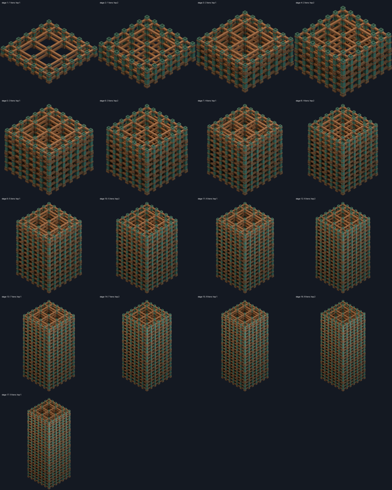

# Refined RIS2 modular scaffolding

Rigellian 2×2, stages 1–17. The original prototype is preserved. [Authoring and integration contract](../sources/docs/reconstruction/models/refined-rigellian-scaffold.md).

Construction: raise scaffolding, insert the target building, then dismantle stages in reverse order to reveal it from the top. Timing and game integration belong to the simulation/presenter.

| Stage | Render | Native source | GLB |
| --- | --- | --- | --- |
| 1 | [Preview](media/docs/assets/reconstruction/scaffolds/rigellian/size-2-refined/stage-01/front-quarter.png) | [Blend](../sources/docs/assets/reconstruction/scaffolds/rigellian/size-2-refined/stage-01/model.blend) | [GLB](../sources/docs/assets/reconstruction/scaffolds/rigellian/size-2-refined/stage-01/model.glb) |
| 2 | [Preview](media/docs/assets/reconstruction/scaffolds/rigellian/size-2-refined/stage-02/front-quarter.png) | [Blend](../sources/docs/assets/reconstruction/scaffolds/rigellian/size-2-refined/stage-02/model.blend) | [GLB](../sources/docs/assets/reconstruction/scaffolds/rigellian/size-2-refined/stage-02/model.glb) |
| 3 | [Preview](media/docs/assets/reconstruction/scaffolds/rigellian/size-2-refined/stage-03/front-quarter.png) | [Blend](../sources/docs/assets/reconstruction/scaffolds/rigellian/size-2-refined/stage-03/model.blend) | [GLB](../sources/docs/assets/reconstruction/scaffolds/rigellian/size-2-refined/stage-03/model.glb) |
| 4 | [Preview](media/docs/assets/reconstruction/scaffolds/rigellian/size-2-refined/stage-04/front-quarter.png) | [Blend](../sources/docs/assets/reconstruction/scaffolds/rigellian/size-2-refined/stage-04/model.blend) | [GLB](../sources/docs/assets/reconstruction/scaffolds/rigellian/size-2-refined/stage-04/model.glb) |
| 5 | [Preview](media/docs/assets/reconstruction/scaffolds/rigellian/size-2-refined/stage-05/front-quarter.png) | [Blend](../sources/docs/assets/reconstruction/scaffolds/rigellian/size-2-refined/stage-05/model.blend) | [GLB](../sources/docs/assets/reconstruction/scaffolds/rigellian/size-2-refined/stage-05/model.glb) |
| 6 | [Preview](media/docs/assets/reconstruction/scaffolds/rigellian/size-2-refined/stage-06/front-quarter.png) | [Blend](../sources/docs/assets/reconstruction/scaffolds/rigellian/size-2-refined/stage-06/model.blend) | [GLB](../sources/docs/assets/reconstruction/scaffolds/rigellian/size-2-refined/stage-06/model.glb) |
| 7 | [Preview](media/docs/assets/reconstruction/scaffolds/rigellian/size-2-refined/stage-07/front-quarter.png) | [Blend](../sources/docs/assets/reconstruction/scaffolds/rigellian/size-2-refined/stage-07/model.blend) | [GLB](../sources/docs/assets/reconstruction/scaffolds/rigellian/size-2-refined/stage-07/model.glb) |
| 8 | [Preview](media/docs/assets/reconstruction/scaffolds/rigellian/size-2-refined/stage-08/front-quarter.png) | [Blend](../sources/docs/assets/reconstruction/scaffolds/rigellian/size-2-refined/stage-08/model.blend) | [GLB](../sources/docs/assets/reconstruction/scaffolds/rigellian/size-2-refined/stage-08/model.glb) |
| 9 | [Preview](media/docs/assets/reconstruction/scaffolds/rigellian/size-2-refined/stage-09/front-quarter.png) | [Blend](../sources/docs/assets/reconstruction/scaffolds/rigellian/size-2-refined/stage-09/model.blend) | [GLB](../sources/docs/assets/reconstruction/scaffolds/rigellian/size-2-refined/stage-09/model.glb) |
| 10 | [Preview](media/docs/assets/reconstruction/scaffolds/rigellian/size-2-refined/stage-10/front-quarter.png) | [Blend](../sources/docs/assets/reconstruction/scaffolds/rigellian/size-2-refined/stage-10/model.blend) | [GLB](../sources/docs/assets/reconstruction/scaffolds/rigellian/size-2-refined/stage-10/model.glb) |
| 11 | [Preview](media/docs/assets/reconstruction/scaffolds/rigellian/size-2-refined/stage-11/front-quarter.png) | [Blend](../sources/docs/assets/reconstruction/scaffolds/rigellian/size-2-refined/stage-11/model.blend) | [GLB](../sources/docs/assets/reconstruction/scaffolds/rigellian/size-2-refined/stage-11/model.glb) |
| 12 | [Preview](media/docs/assets/reconstruction/scaffolds/rigellian/size-2-refined/stage-12/front-quarter.png) | [Blend](../sources/docs/assets/reconstruction/scaffolds/rigellian/size-2-refined/stage-12/model.blend) | [GLB](../sources/docs/assets/reconstruction/scaffolds/rigellian/size-2-refined/stage-12/model.glb) |
| 13 | [Preview](media/docs/assets/reconstruction/scaffolds/rigellian/size-2-refined/stage-13/front-quarter.png) | [Blend](../sources/docs/assets/reconstruction/scaffolds/rigellian/size-2-refined/stage-13/model.blend) | [GLB](../sources/docs/assets/reconstruction/scaffolds/rigellian/size-2-refined/stage-13/model.glb) |
| 14 | [Preview](media/docs/assets/reconstruction/scaffolds/rigellian/size-2-refined/stage-14/front-quarter.png) | [Blend](../sources/docs/assets/reconstruction/scaffolds/rigellian/size-2-refined/stage-14/model.blend) | [GLB](../sources/docs/assets/reconstruction/scaffolds/rigellian/size-2-refined/stage-14/model.glb) |
| 15 | [Preview](media/docs/assets/reconstruction/scaffolds/rigellian/size-2-refined/stage-15/front-quarter.png) | [Blend](../sources/docs/assets/reconstruction/scaffolds/rigellian/size-2-refined/stage-15/model.blend) | [GLB](../sources/docs/assets/reconstruction/scaffolds/rigellian/size-2-refined/stage-15/model.glb) |
| 16 | [Preview](media/docs/assets/reconstruction/scaffolds/rigellian/size-2-refined/stage-16/front-quarter.png) | [Blend](../sources/docs/assets/reconstruction/scaffolds/rigellian/size-2-refined/stage-16/model.blend) | [GLB](../sources/docs/assets/reconstruction/scaffolds/rigellian/size-2-refined/stage-16/model.glb) |
| 17 | [Preview](media/docs/assets/reconstruction/scaffolds/rigellian/size-2-refined/stage-17/front-quarter.png) | [Blend](../sources/docs/assets/reconstruction/scaffolds/rigellian/size-2-refined/stage-17/model.blend) | [GLB](../sources/docs/assets/reconstruction/scaffolds/rigellian/size-2-refined/stage-17/model.glb) |

[Construction sequence](../sources/docs/assets/reconstruction/scaffolds/rigellian/size-2-refined/construction-sequence.json) · [Technical checks](../sources/docs/assets/reconstruction/scaffolds/rigellian/size-2-refined/technical-review.json) · [Render comparison](../sources/docs/assets/reconstruction/scaffolds/rigellian/size-2-refined/render-review.json)

The physical repeat pitch is provisional. This is one scaffold family, not complete culture/footprint coverage or game integration.
