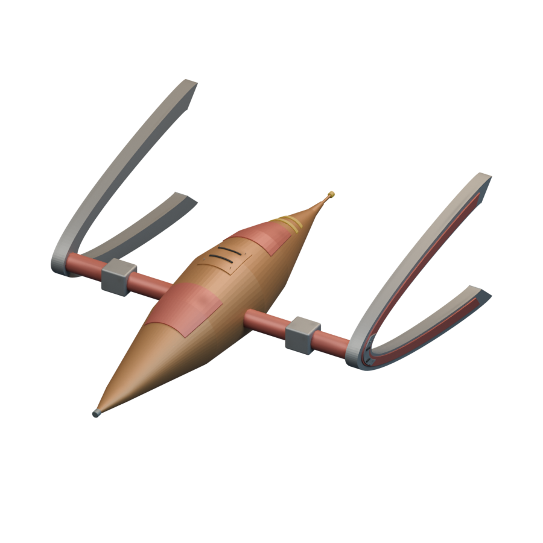

# Ships / Achaean

[All groups](README.md)

## Hunter/Prospector

`openfa:ship/achaean/hunter-prospector`

**First available iteration — initial-reference-study**

[Blend](../sources/docs/assets/reconstruction/ships/achaean/hunter-prospector/model.blend) · [GLB](../sources/docs/assets/reconstruction/ships/achaean/hunter-prospector/model.glb)

## Dedicated Fighter

`openfa:ship/achaean/dedicated-fighter`

**First available iteration — initial-reference-study**

[Blend](../sources/docs/assets/reconstruction/ships/achaean/dedicated-fighter/model.blend) · [GLB](../sources/docs/assets/reconstruction/ships/achaean/dedicated-fighter/model.glb)

## Dedicated Ore Transporter

`openfa:ship/achaean/dedicated-ore-transporter`

**First available iteration — initial-reference-study**

[Blend](../sources/docs/assets/reconstruction/ships/achaean/dedicated-ore-transporter/model.blend) · [GLB](../sources/docs/assets/reconstruction/ships/achaean/dedicated-ore-transporter/model.glb)

## Orbital Shipyard

`openfa:ship/achaean/orbital-shipyard`

**First available iteration — initial-reference-study**

[Blend](../sources/docs/assets/reconstruction/ships/achaean/orbital-shipyard/model.blend) · [GLB](../sources/docs/assets/reconstruction/ships/achaean/orbital-shipyard/model.glb)
