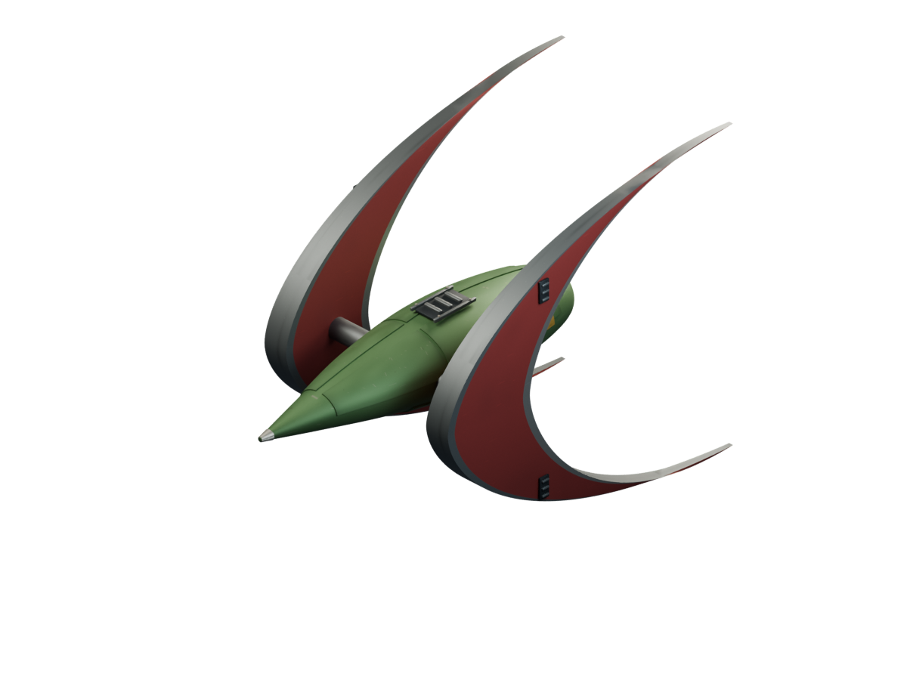
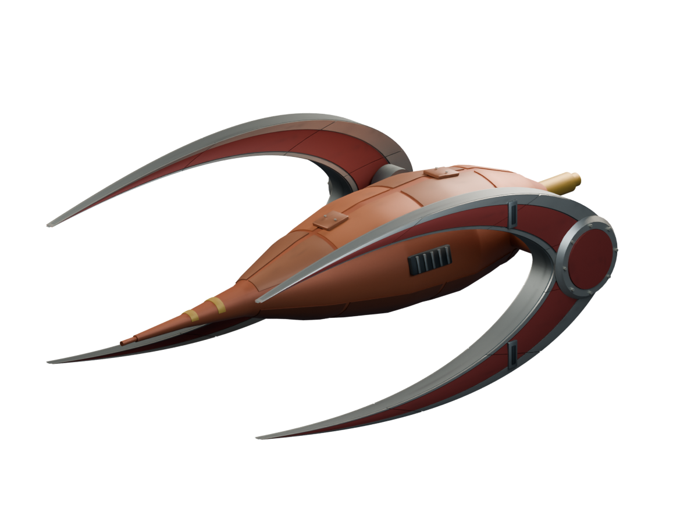

# Ships / Achaean

[All groups](README.md)

## Hunter/Prospector

`openfa:ship/achaean/hunter-prospector`

**Canonical version — legacy-hi-def-remaster**

[Blend](../sources/objects/achaean/hunter-prospector/model.blend) · [GLB](../sources/objects/achaean/hunter-prospector/model.glb)

Additional views: [Front Quarter](../gallery/media/objects/achaean/hunter-prospector/front-quarter.png) · [Rear Quarter](../gallery/media/objects/achaean/hunter-prospector/rear-quarter.png) · [Front](../gallery/media/objects/achaean/hunter-prospector/front.png) · [Side](../gallery/media/objects/achaean/hunter-prospector/side.png) · [Top](../gallery/media/objects/achaean/hunter-prospector/top.png) · [Underside](../gallery/media/objects/achaean/hunter-prospector/underside.png) · [Technical Wireframe](../gallery/media/objects/achaean/hunter-prospector/technical-wireframe.png) · [Concept](../gallery/media/objects/achaean/hunter-prospector/concept.png) · [Verified Heading 0](../gallery/media/objects/achaean/hunter-prospector/verified-heading-0.png) · [Verified Heading 4](../gallery/media/objects/achaean/hunter-prospector/verified-heading-4.png) · [Verified Heading 8](../gallery/media/objects/achaean/hunter-prospector/verified-heading-8.png) · [Verified Heading 12](../gallery/media/objects/achaean/hunter-prospector/verified-heading-12.png) · [Verified Heading 20](../gallery/media/objects/achaean/hunter-prospector/verified-heading-20.png) · [Concept and actual imported GLB](../gallery/media/objects/achaean/hunter-prospector/concept-model-comparison.jpg)

## Dedicated Fighter

`openfa:ship/achaean/dedicated-fighter`

**Canonical version — legacy-hi-def-remaster**

[Blend](../sources/objects/achaean/dedicated-fighter/model.blend) · [GLB](../sources/objects/achaean/dedicated-fighter/model.glb)

Additional views: [Front Quarter](../gallery/media/objects/achaean/dedicated-fighter/front-quarter.png) · [Rear Quarter](../gallery/media/objects/achaean/dedicated-fighter/rear-quarter.png) · [Front](../gallery/media/objects/achaean/dedicated-fighter/front.png) · [Side](../gallery/media/objects/achaean/dedicated-fighter/side.png) · [Top](../gallery/media/objects/achaean/dedicated-fighter/top.png) · [Underside](../gallery/media/objects/achaean/dedicated-fighter/underside.png) · [Technical Wireframe](../gallery/media/objects/achaean/dedicated-fighter/technical-wireframe.png) · [Concept](../gallery/media/objects/achaean/dedicated-fighter/concept.png) · [Verified Heading 0](../gallery/media/objects/achaean/dedicated-fighter/verified-heading-0.png) · [Verified Heading 4](../gallery/media/objects/achaean/dedicated-fighter/verified-heading-4.png) · [Verified Heading 8](../gallery/media/objects/achaean/dedicated-fighter/verified-heading-8.png) · [Verified Heading 12](../gallery/media/objects/achaean/dedicated-fighter/verified-heading-12.png) · [Verified Heading 20](../gallery/media/objects/achaean/dedicated-fighter/verified-heading-20.png) · [Concept and actual imported GLB](../gallery/media/objects/achaean/dedicated-fighter/concept-model-comparison.jpg)

## Dedicated Ore Transporter

`openfa:ship/achaean/dedicated-ore-transporter`

**Canonical version — legacy-hi-def-remaster**

[Blend](../sources/objects/achaean/dedicated-ore-transporter/model.blend) · [GLB](../sources/objects/achaean/dedicated-ore-transporter/model.glb)

Additional views: [Front Quarter](../gallery/media/objects/achaean/dedicated-ore-transporter/front-quarter.png) · [Rear Quarter](../gallery/media/objects/achaean/dedicated-ore-transporter/rear-quarter.png) · [Top](../gallery/media/objects/achaean/dedicated-ore-transporter/top.png) · [Front](../gallery/media/objects/achaean/dedicated-ore-transporter/front.png) · [Side](../gallery/media/objects/achaean/dedicated-ore-transporter/side.png) · [Underside](../gallery/media/objects/achaean/dedicated-ore-transporter/underside.png) · [Crescent Detail](../gallery/media/objects/achaean/dedicated-ore-transporter/crescent-detail.png) · [Hull Detail](../gallery/media/objects/achaean/dedicated-ore-transporter/hull-detail.png) · [Technical Wireframe](../gallery/media/objects/achaean/dedicated-ore-transporter/technical-wireframe.png) · [Concept](../gallery/media/objects/achaean/dedicated-ore-transporter/concept.png) · [Verified Side](../gallery/media/objects/achaean/dedicated-ore-transporter/verified-side.png) · [Verified Front](../gallery/media/objects/achaean/dedicated-ore-transporter/verified-front.png) · [Verified Legacy Side](../gallery/media/objects/achaean/dedicated-ore-transporter/verified-legacy-side.png) · [Verified Legacy Quarter](../gallery/media/objects/achaean/dedicated-ore-transporter/verified-legacy-quarter.png) · [Four glazed crew domes](../gallery/media/objects/achaean/dedicated-ore-transporter/verified-bridge-detail.png) · [Hull profile diagnostic - wing assemblies hidden](../gallery/media/objects/achaean/dedicated-ore-transporter/verified-hull-profile.png) · [Concept and GLB feedback comparison](../gallery/media/objects/achaean/dedicated-ore-transporter/feedback-comparison.jpg) · [Leading shield correction](../gallery/media/objects/achaean/dedicated-ore-transporter/wing-root-comparison.jpg) · [Asymmetric hull, lobes and glazing - before and after](../gallery/media/objects/achaean/dedicated-ore-transporter/round-shape-comparison.jpg)

## Orbital Shipyard

`openfa:ship/achaean/orbital-shipyard`

**Canonical version — orbital-station-construction-refinement**

[Blend](../sources/docs/assets/reconstruction/orbital-station-construction/achaean/orbital-shipyard/model.blend) · [GLB](../sources/docs/assets/reconstruction/orbital-station-construction/achaean/orbital-shipyard/model.glb)

[Play animation: ConstructionActivity](../gallery/media/docs/assets/reconstruction/orbital-station-construction/achaean/orbital-shipyard/animation-00.webm)
