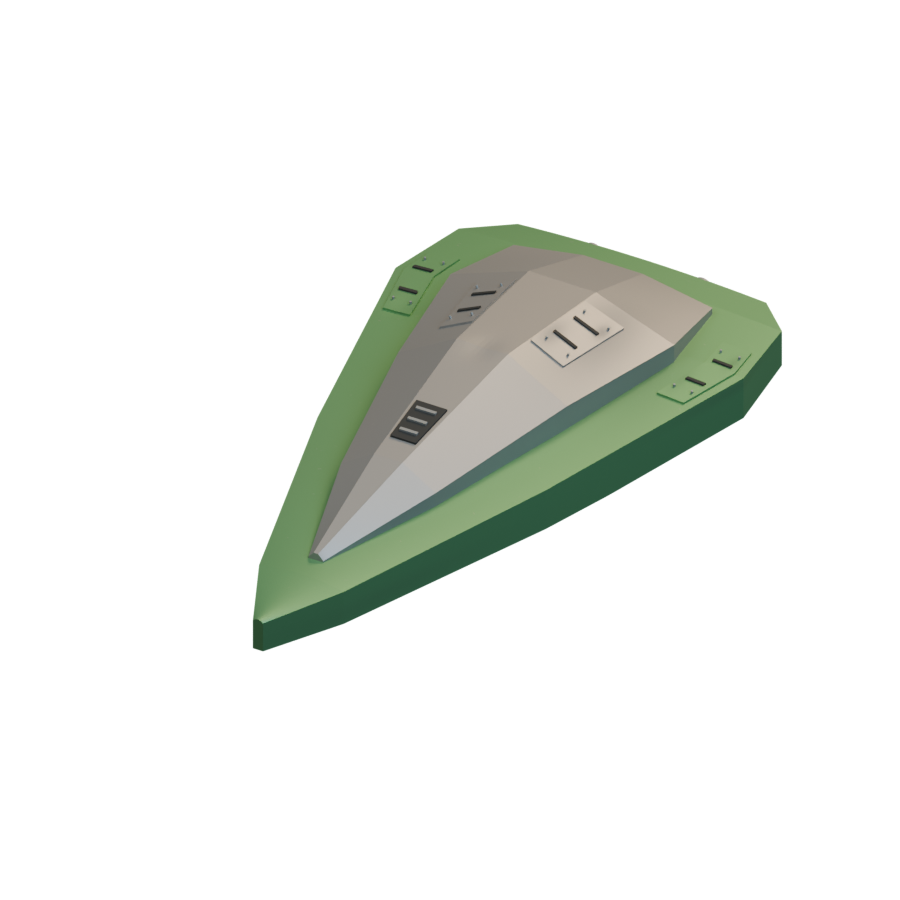
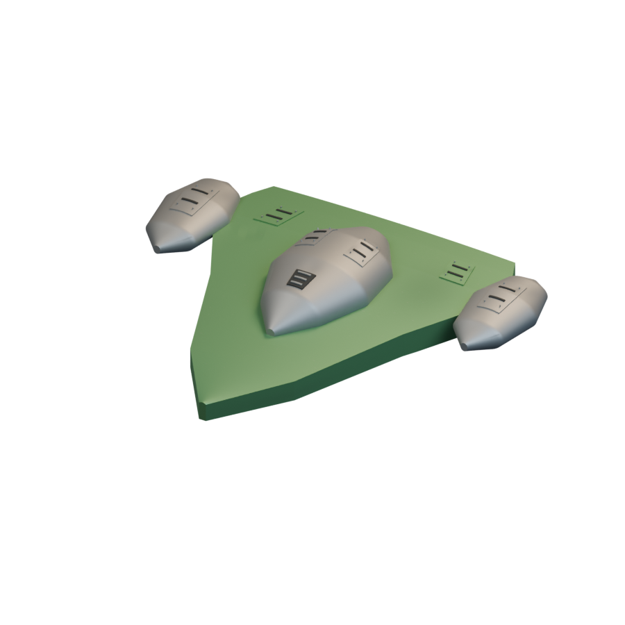
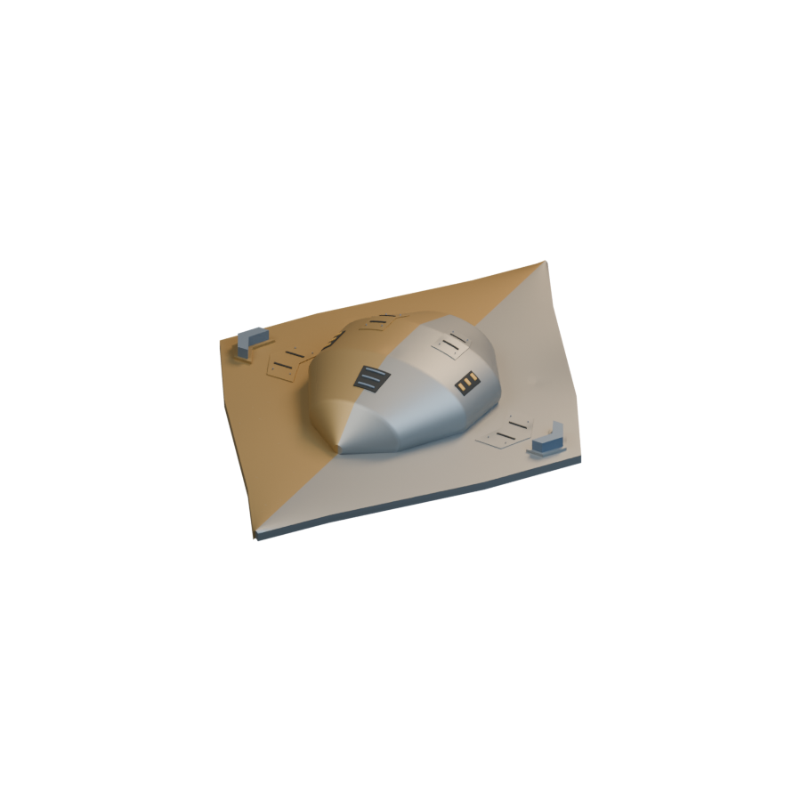
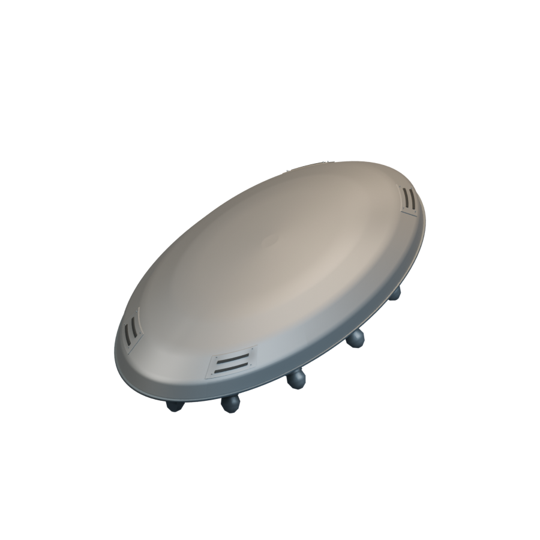
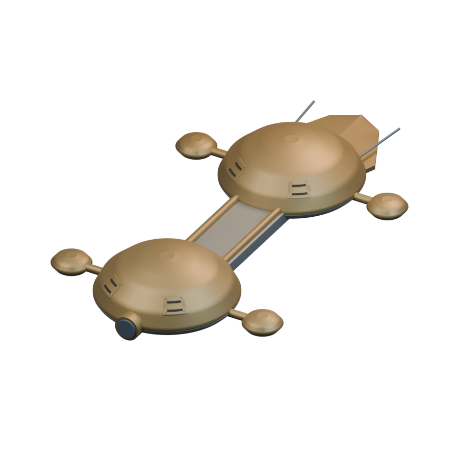
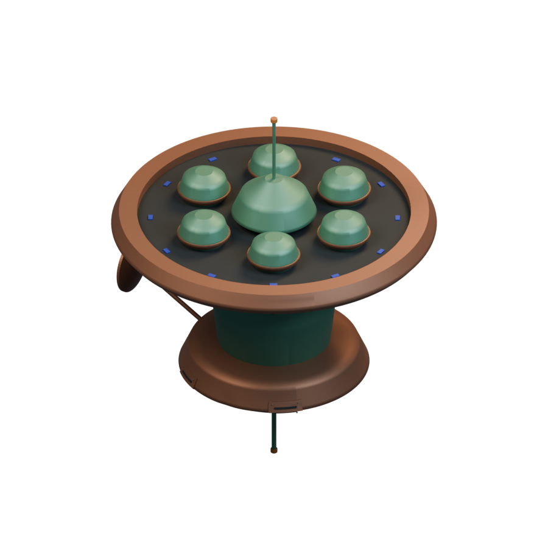

# Ships / Artemian

[All groups](README.md)

## Gerla-Kans Explorer

`openfa:ship/artemian/gerla-kans-explorer`

**First available iteration — initial-reference-study**

[Blend](../sources/docs/assets/reconstruction/ships/artemian/gerla-kans-explorer/model.blend) · [GLB](../sources/docs/assets/reconstruction/ships/artemian/gerla-kans-explorer/model.glb)

## All-Purpose Assault

`openfa:ship/artemian/all-purpose-assault`

**First available iteration — initial-reference-study**

[Blend](../sources/docs/assets/reconstruction/ships/artemian/all-purpose-assault/model.blend) · [GLB](../sources/docs/assets/reconstruction/ships/artemian/all-purpose-assault/model.glb)

## Shielded Multi-Assault

`openfa:ship/artemian/shielded-multi-assault`

**First available iteration — initial-reference-study**

[Blend](../sources/docs/assets/reconstruction/ships/artemian/shielded-multi-assault/model.blend) · [GLB](../sources/docs/assets/reconstruction/ships/artemian/shielded-multi-assault/model.glb)

## Ultimate Mk II

`openfa:ship/artemian/ultimate-mk-ii`

**First available iteration — initial-reference-study**

[Blend](../sources/docs/assets/reconstruction/ships/artemian/ultimate-mk-ii/model.blend) · [GLB](../sources/docs/assets/reconstruction/ships/artemian/ultimate-mk-ii/model.glb)

## Hardcore

`openfa:ship/artemian/hardcore`

**First available iteration — initial-reference-study**

[Blend](../sources/docs/assets/reconstruction/ships/artemian/hardcore/model.blend) · [GLB](../sources/docs/assets/reconstruction/ships/artemian/hardcore/model.glb)

## Geostationary Construction

`openfa:ship/artemian/geostationary-construction`

**First available iteration — initial-reference-study**

[Blend](../sources/docs/assets/reconstruction/ships/artemian/geostationary-construction/model.blend) · [GLB](../sources/docs/assets/reconstruction/ships/artemian/geostationary-construction/model.glb)
