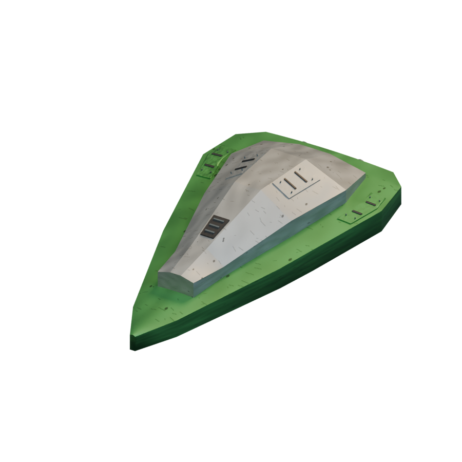
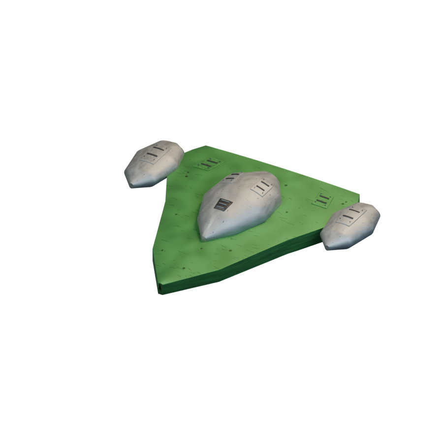
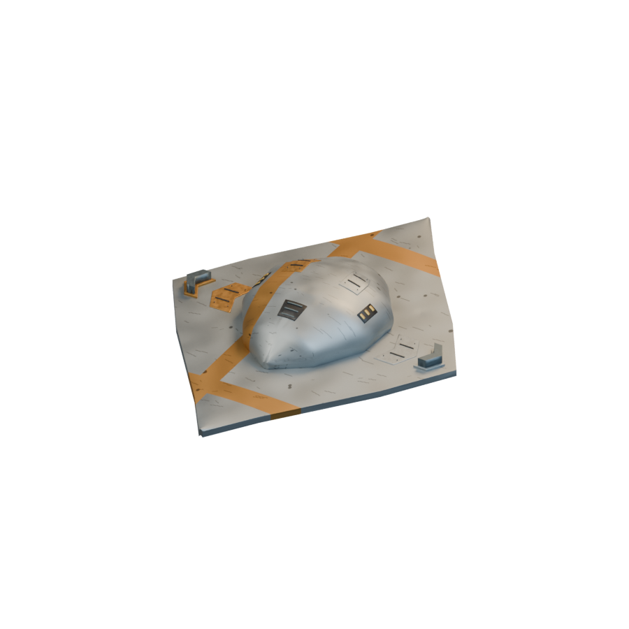
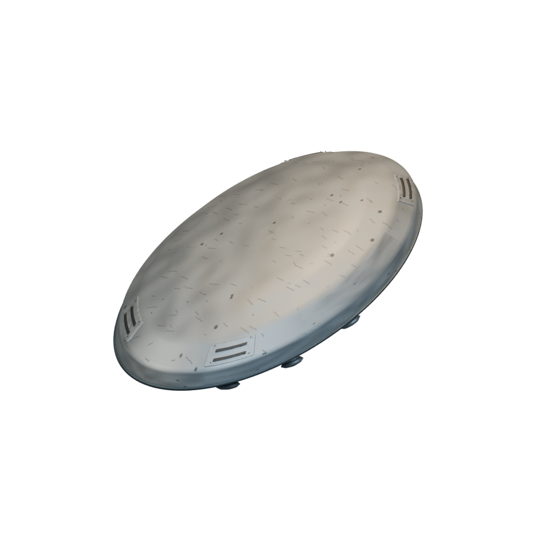
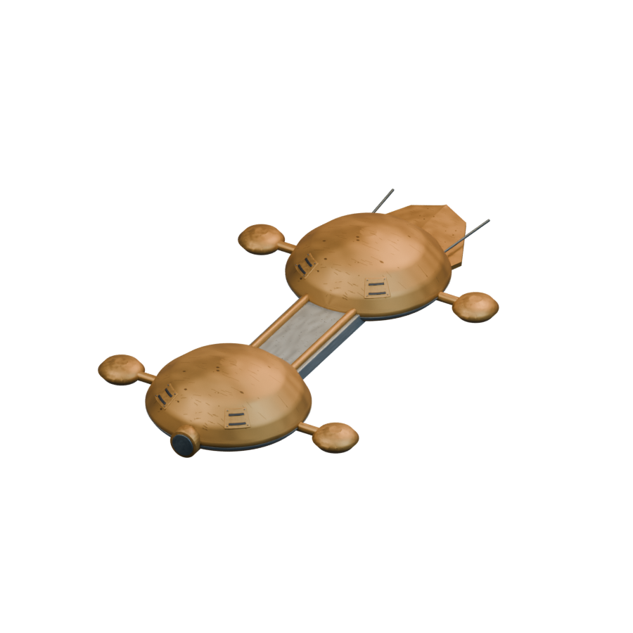
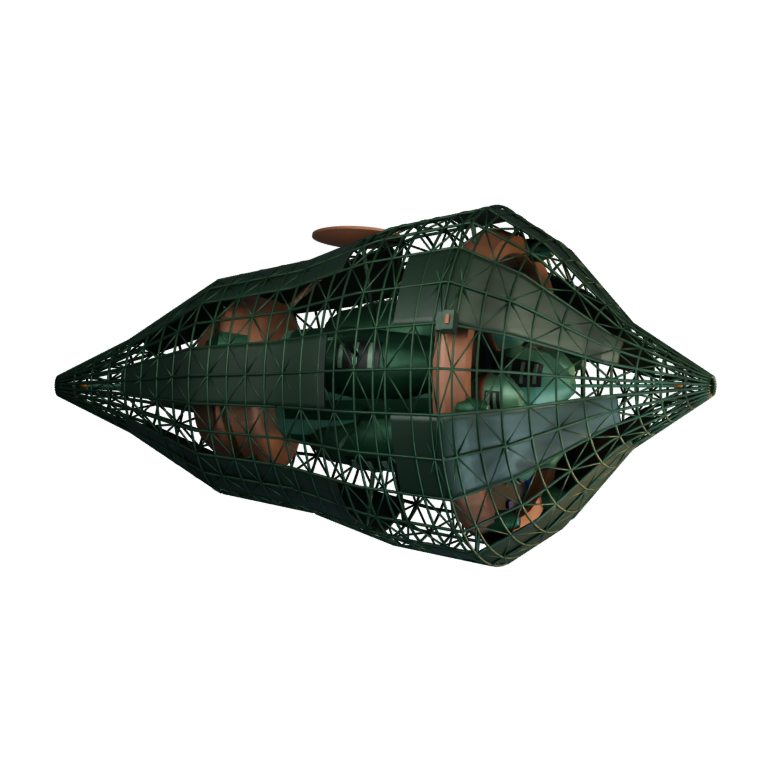

# Ships / Artemian

[All groups](README.md)

## Gerla-Kans Explorer

`openfa:ship/artemian/gerla-kans-explorer`

**Canonical version — mobile-ship-remaster**

[Blend](../sources/objects/artemian/gerla-kans-explorer/model.blend) · [GLB](../sources/objects/artemian/gerla-kans-explorer/model.glb)

Additional views: [Rear fittings](../gallery/media/objects/artemian/gerla-kans-explorer/rear-quarter.png) · [Actual imported wireframe](../gallery/media/objects/artemian/gerla-kans-explorer/technical-wireframe.png) · [Legacy heading4 comparison](../gallery/media/objects/artemian/gerla-kans-explorer/heading-04.png) · [Rejected elongated concept1](../gallery/media/concepts/artemian/gerla-kans-explorer-01.png) · [Reviewed compact concept2](../gallery/media/concepts/artemian/gerla-kans-explorer-02.png)

## All-Purpose Assault

`openfa:ship/artemian/all-purpose-assault`

**Canonical version — mobile-ship-remaster**

[Blend](../sources/objects/artemian/all-purpose-assault/model.blend) · [GLB](../sources/objects/artemian/all-purpose-assault/model.glb)

Additional views: [Rear fittings](../gallery/media/objects/artemian/all-purpose-assault/rear-quarter.png) · [Actual imported wireframe](../gallery/media/objects/artemian/all-purpose-assault/technical-wireframe.png) · [Legacy heading4 comparison](../gallery/media/objects/artemian/all-purpose-assault/heading-04.png) · [Rejected extra grey cowls](../gallery/media/concepts/artemian/all-purpose-assault-01.png) · [Reviewed three-cowl concept](../gallery/media/concepts/artemian/all-purpose-assault-02.png)

## Shielded Multi-Assault

`openfa:ship/artemian/shielded-multi-assault`

**Canonical version — mobile-ship-remaster**

[Blend](../sources/objects/artemian/shielded-multi-assault/model.blend) · [GLB](../sources/objects/artemian/shielded-multi-assault/model.glb)

Additional views: [Rear fittings](../gallery/media/objects/artemian/shielded-multi-assault/rear-quarter.png) · [Actual imported wireframe](../gallery/media/objects/artemian/shielded-multi-assault/technical-wireframe.png) · [Legacy heading4 comparison](../gallery/media/objects/artemian/shielded-multi-assault/heading-04.png) · [Rejected thin concept1](../gallery/media/concepts/artemian/shielded-multi-assault-01.png) · [Narrow planform concept2](../gallery/media/concepts/artemian/shielded-multi-assault-02.png) · [Reviewed broad concept3](../gallery/media/concepts/artemian/shielded-multi-assault-03.png)

## Ultimate Mk II

`openfa:ship/artemian/ultimate-mk-ii`

**Canonical version — mobile-ship-remaster**

[Blend](../sources/objects/artemian/ultimate-mk-ii/model.blend) · [GLB](../sources/objects/artemian/ultimate-mk-ii/model.glb)

Additional views: [Rear fittings](../gallery/media/objects/artemian/ultimate-mk-ii/rear-quarter.png) · [Actual imported wireframe](../gallery/media/objects/artemian/ultimate-mk-ii/technical-wireframe.png) · [Legacy heading4 comparison](../gallery/media/objects/artemian/ultimate-mk-ii/heading-04.png) · [Reviewed silver lid and green lower body concept](../gallery/media/concepts/artemian/ultimate-mk-ii-01.png)

## Hardcore

`openfa:ship/artemian/hardcore`

**Canonical version — mobile-ship-remaster**

[Blend](../sources/objects/artemian/hardcore/model.blend) · [GLB](../sources/objects/artemian/hardcore/model.glb)

Additional views: [Rear fittings](../gallery/media/objects/artemian/hardcore/rear-quarter.png) · [Actual imported wireframe](../gallery/media/objects/artemian/hardcore/technical-wireframe.png) · [Legacy heading4 comparison](../gallery/media/objects/artemian/hardcore/heading-04.png) · [Reviewed inline twin-body transporter concept](../gallery/media/concepts/artemian/hardcore-01.png)

## Geostationary Construction

`openfa:ship/artemian/geostationary-construction`

**Canonical version — orbital-station-construction-refinement**

[Blend](../sources/docs/assets/reconstruction/orbital-station-construction/artemian/geostationary-construction/model.blend) · [GLB](../sources/docs/assets/reconstruction/orbital-station-construction/artemian/geostationary-construction/model.glb)

[Play animation: ConstructionActivity](../gallery/media/docs/assets/reconstruction/orbital-station-construction/artemian/geostationary-construction/animation-00.webm)
