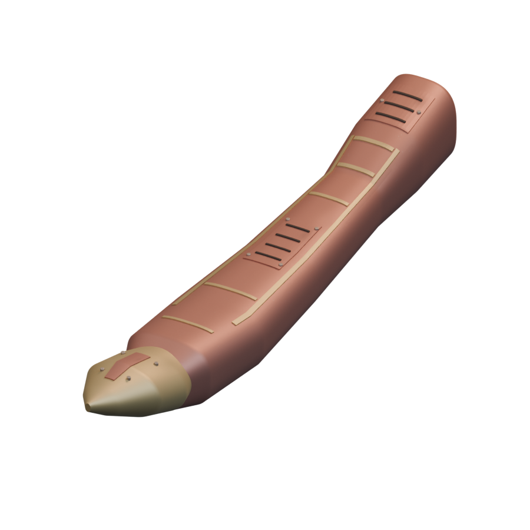
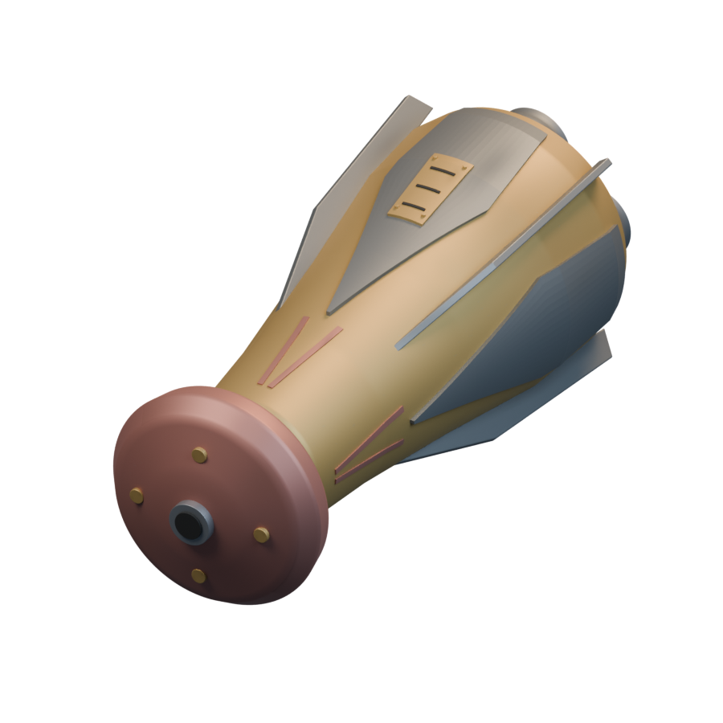
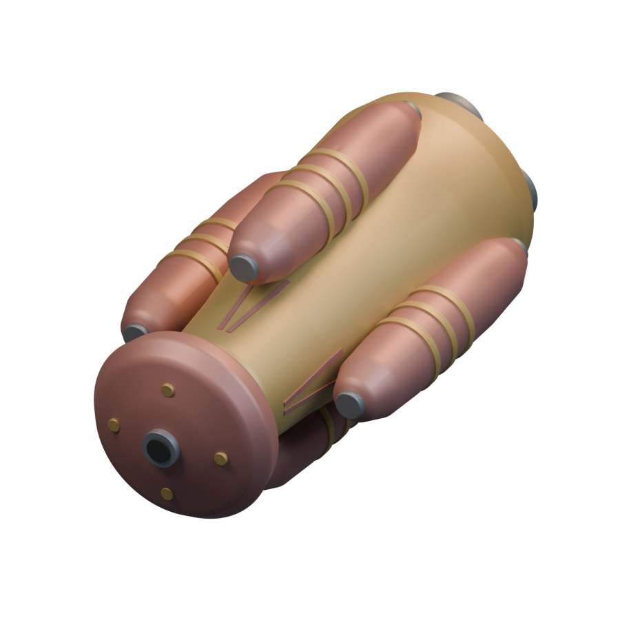
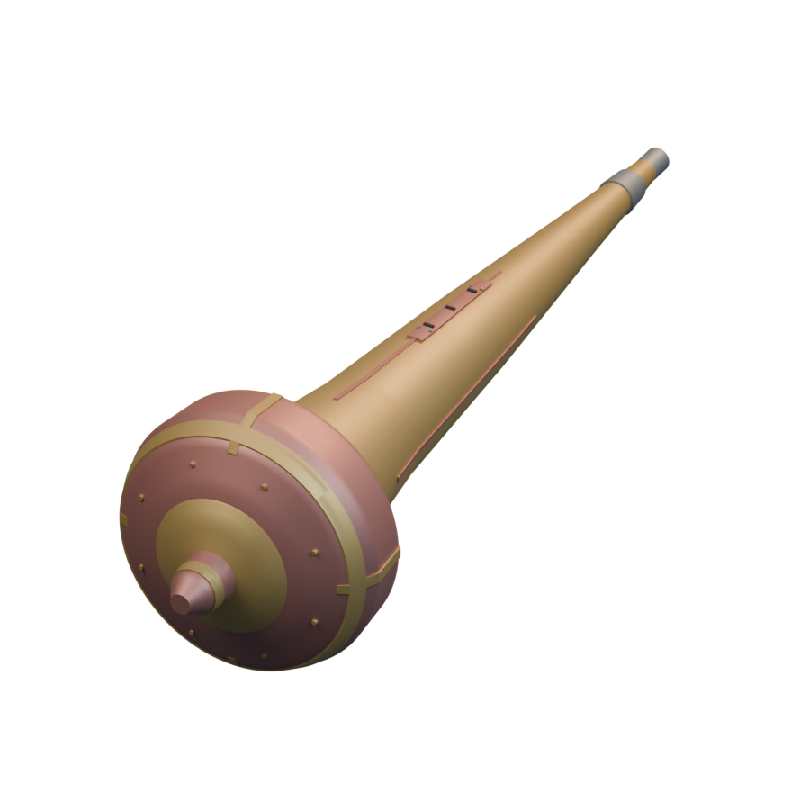

# Ships / Braccatian

[All groups](README.md)

## Rattlesnake

`openfa:ship/braccatian/rattlesnake`

**First available iteration — initial-reference-study**

[Blend](../sources/docs/assets/reconstruction/ships/braccatian/rattlesnake/model.blend) · [GLB](../sources/docs/assets/reconstruction/ships/braccatian/rattlesnake/model.glb)

## WidowMaker

`openfa:ship/braccatian/widowmaker`

**First available iteration — initial-reference-study**

[Blend](../sources/docs/assets/reconstruction/ships/braccatian/widowmaker/model.blend) · [GLB](../sources/docs/assets/reconstruction/ships/braccatian/widowmaker/model.glb)

## HeartsBlood

`openfa:ship/braccatian/heartsblood`

**First available iteration — initial-reference-study**

[Blend](../sources/docs/assets/reconstruction/ships/braccatian/heartsblood/model.blend) · [GLB](../sources/docs/assets/reconstruction/ships/braccatian/heartsblood/model.glb)

## Morning Glory

`openfa:ship/braccatian/morning-glory`

**First available iteration — initial-reference-study**

[Blend](../sources/docs/assets/reconstruction/ships/braccatian/morning-glory/model.blend) · [GLB](../sources/docs/assets/reconstruction/ships/braccatian/morning-glory/model.glb)

## SkyMech

`openfa:ship/braccatian/skymech`

**First available iteration — initial-reference-study**

[Blend](../sources/docs/assets/reconstruction/ships/braccatian/skymech/model.blend) · [GLB](../sources/docs/assets/reconstruction/ships/braccatian/skymech/model.glb)
