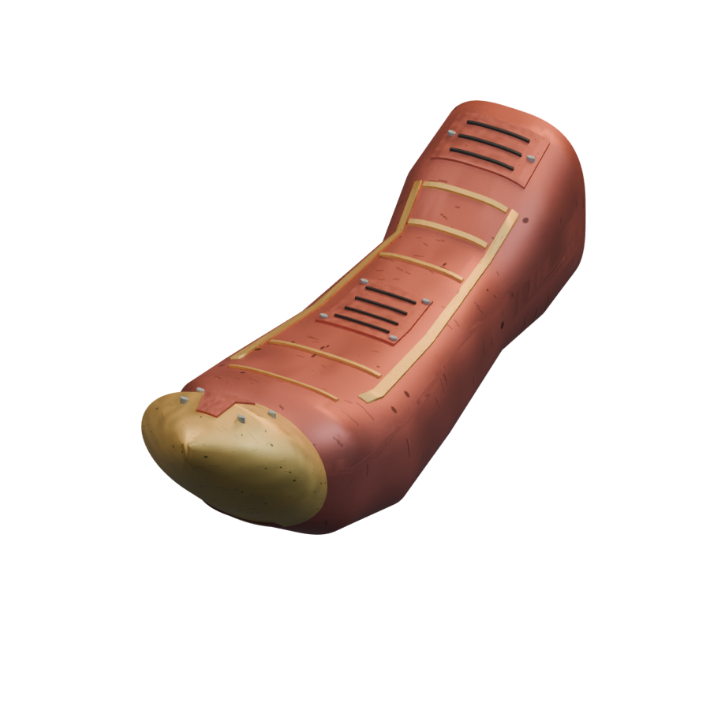
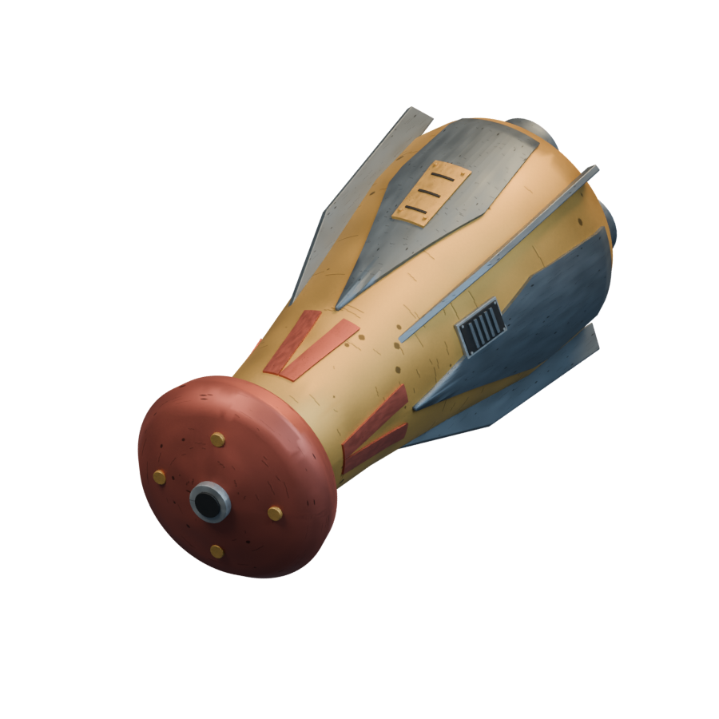
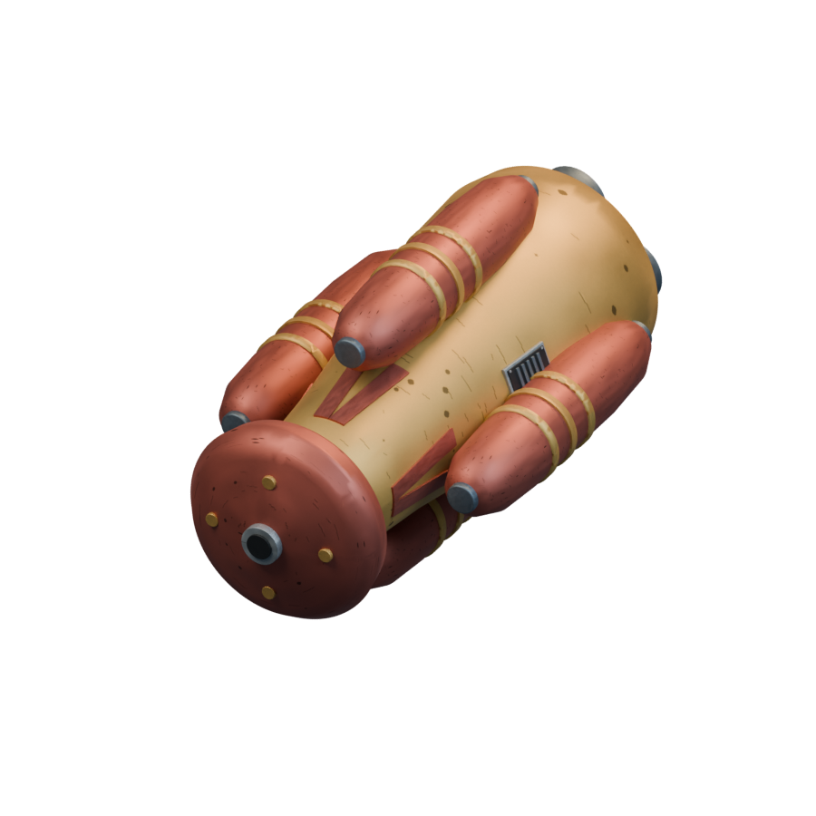
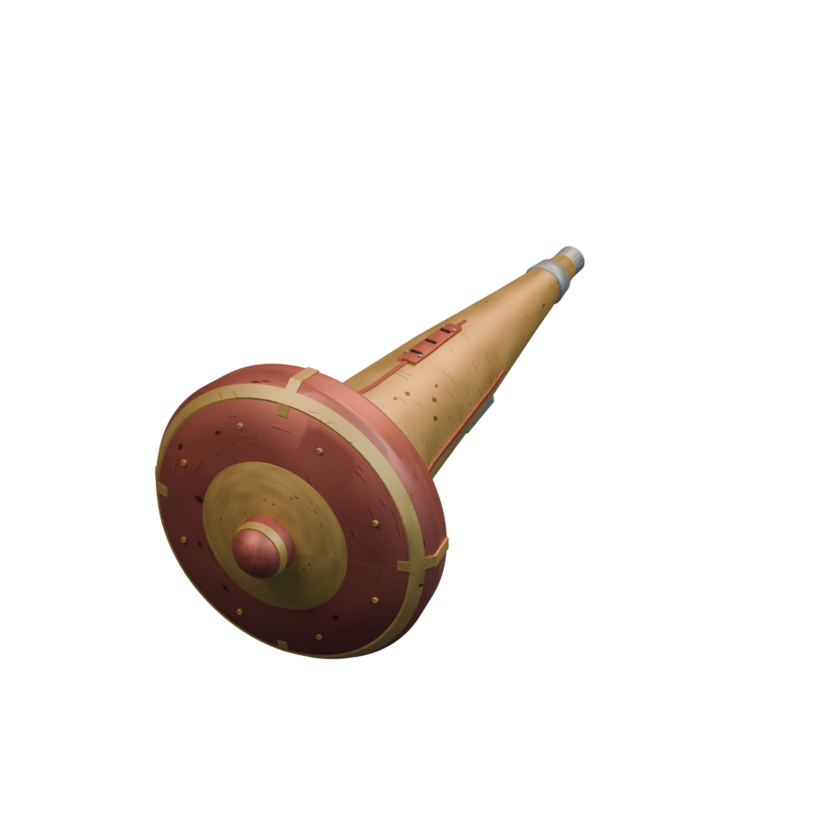
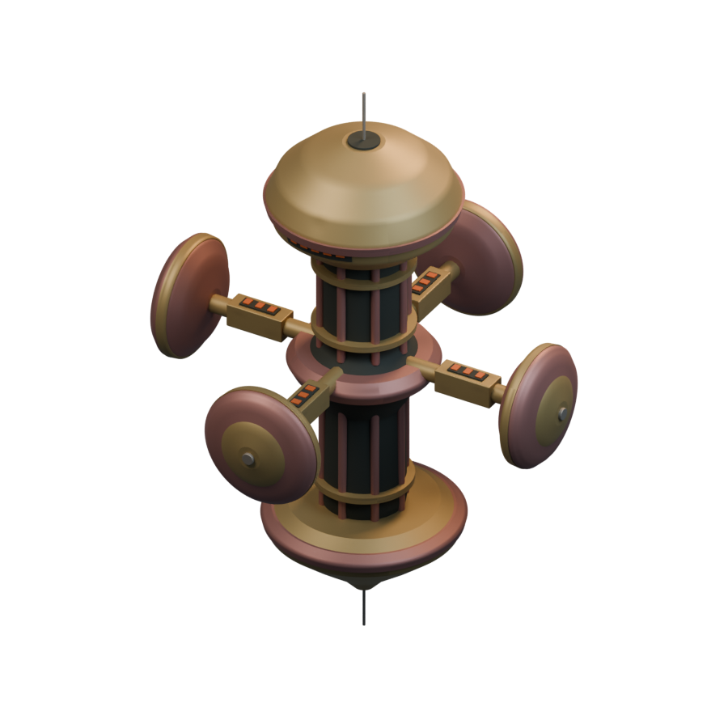
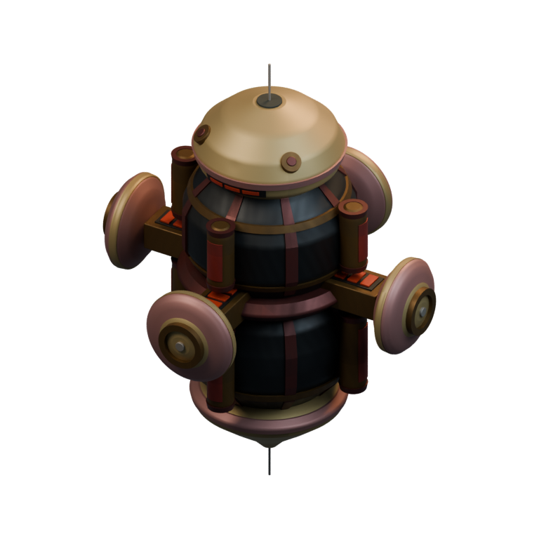
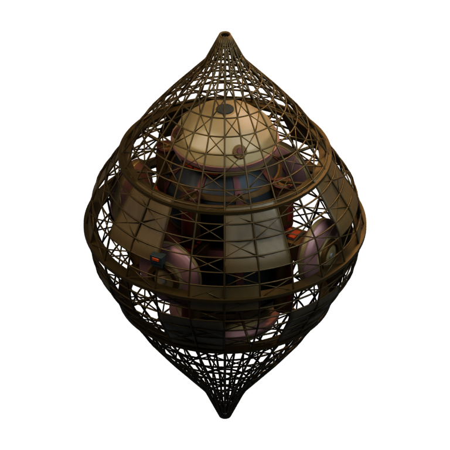

# Ships / Braccatian

[All groups](README.md)

## Rattlesnake

`openfa:ship/braccatian/rattlesnake`

**First available iteration — mobile-ship-remaster**

[Blend](../sources/objects/braccatian/rattlesnake/model.blend) · [GLB](../sources/objects/braccatian/rattlesnake/model.glb)

Additional views: [Rear machinery](../gallery/media/objects/braccatian/rattlesnake/rear-quarter.png) · [Actual imported wireframe](../gallery/media/objects/braccatian/rattlesnake/technical-wireframe.png) · [Legacy heading4 view](../gallery/media/objects/braccatian/rattlesnake/heading-04.png) · [Rejected concept 1](../gallery/media/concepts/braccatian/rattlesnake-01.png) · [Reviewed concept 2](../gallery/media/concepts/braccatian/rattlesnake-02.png)

## WidowMaker

`openfa:ship/braccatian/widowmaker`

**First available iteration — mobile-ship-remaster**

[Blend](../sources/objects/braccatian/widowmaker/model.blend) · [GLB](../sources/objects/braccatian/widowmaker/model.glb)

Additional views: [Rear machinery](../gallery/media/objects/braccatian/widowmaker/rear-quarter.png) · [Actual imported wireframe](../gallery/media/objects/braccatian/widowmaker/technical-wireframe.png) · [Legacy heading4 view](../gallery/media/objects/braccatian/widowmaker/heading-04.png) · [Reviewed concept 1](../gallery/media/concepts/braccatian/widowmaker-01.png)

## HeartsBlood

`openfa:ship/braccatian/heartsblood`

**First available iteration — mobile-ship-remaster**

[Blend](../sources/objects/braccatian/heartsblood/model.blend) · [GLB](../sources/objects/braccatian/heartsblood/model.glb)

Additional views: [Rear machinery](../gallery/media/objects/braccatian/heartsblood/rear-quarter.png) · [Actual imported wireframe](../gallery/media/objects/braccatian/heartsblood/technical-wireframe.png) · [Legacy heading4 view](../gallery/media/objects/braccatian/heartsblood/heading-04.png) · [Rejected concept 1](../gallery/media/concepts/braccatian/heartsblood-01.png) · [Reviewed concept 2](../gallery/media/concepts/braccatian/heartsblood-02.png)

## Morning Glory

`openfa:ship/braccatian/morning-glory`

**First available iteration — mobile-ship-remaster**

[Blend](../sources/objects/braccatian/morning-glory/model.blend) · [GLB](../sources/objects/braccatian/morning-glory/model.glb)

Additional views: [Rear machinery](../gallery/media/objects/braccatian/morning-glory/rear-quarter.png) · [Actual imported wireframe](../gallery/media/objects/braccatian/morning-glory/technical-wireframe.png) · [Legacy heading4 view](../gallery/media/objects/braccatian/morning-glory/heading-04.png) · [Reviewed concept 1](../gallery/media/concepts/braccatian/morning-glory-01.png)

## SkyMech

`openfa:ship/braccatian/skymech`

**First available iteration — initial-reference-study**

[Blend](../sources/docs/assets/reconstruction/ships/braccatian/skymech/model.blend) · [GLB](../sources/docs/assets/reconstruction/ships/braccatian/skymech/model.glb)

**Additional iteration — ship-visible-equipment-refinement**

[Blend](../sources/docs/assets/reconstruction/braccatian-refined/ships/skymech/model.blend) · [GLB](../sources/docs/assets/reconstruction/braccatian-refined/ships/skymech/model.glb)

**Additional iteration — orbital-station-construction-refinement**

[Blend](../sources/docs/assets/reconstruction/orbital-station-construction/braccatian/skymech/model.blend) · [GLB](../sources/docs/assets/reconstruction/orbital-station-construction/braccatian/skymech/model.glb)

[Play animation: ConstructionActivity](../gallery/media/docs/assets/reconstruction/orbital-station-construction/braccatian/skymech/animation-00.webm)
