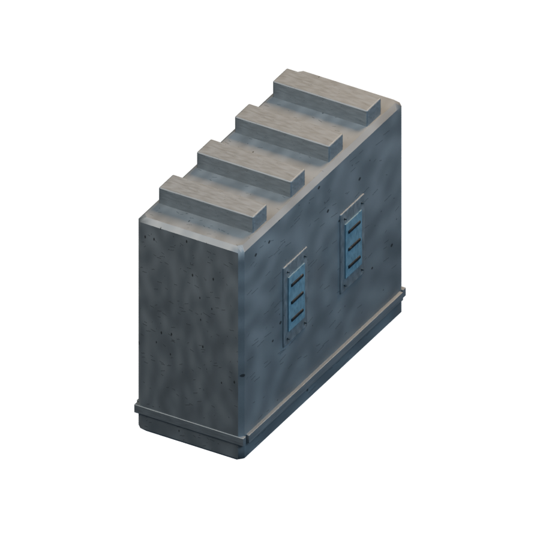
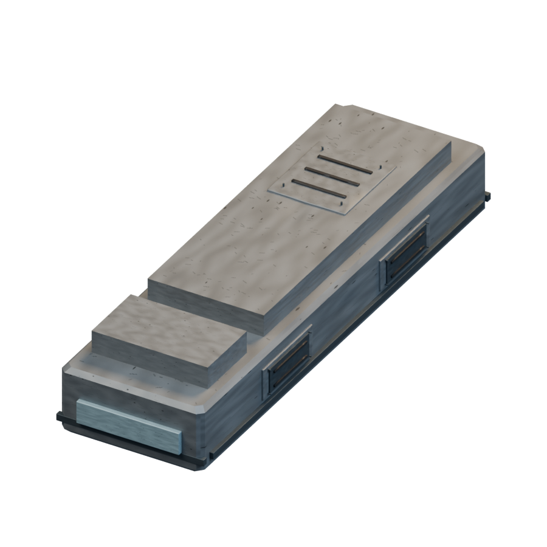
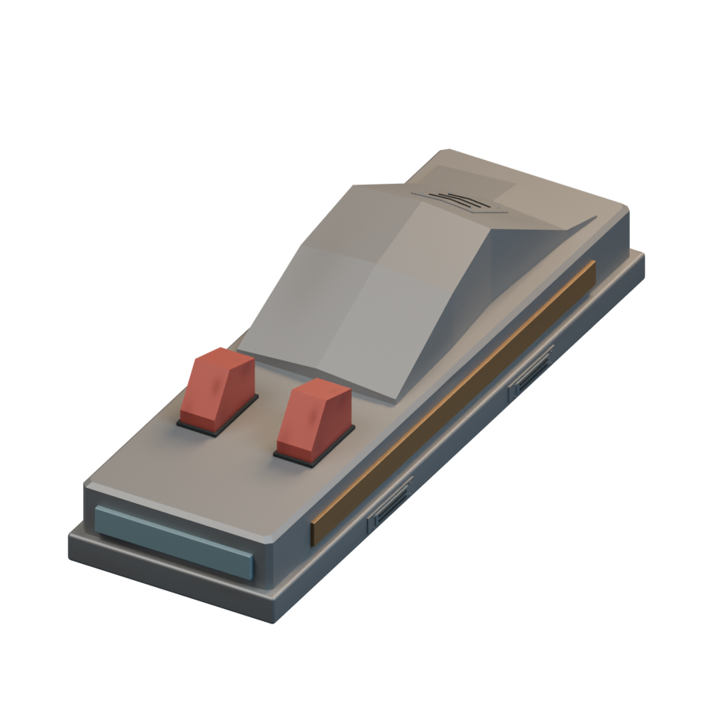
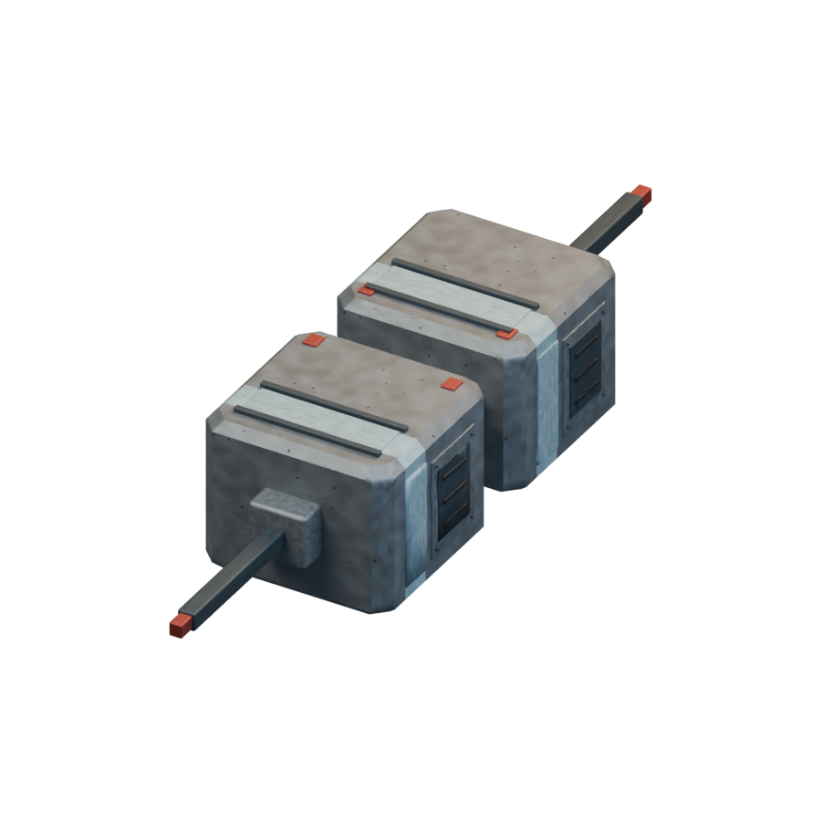
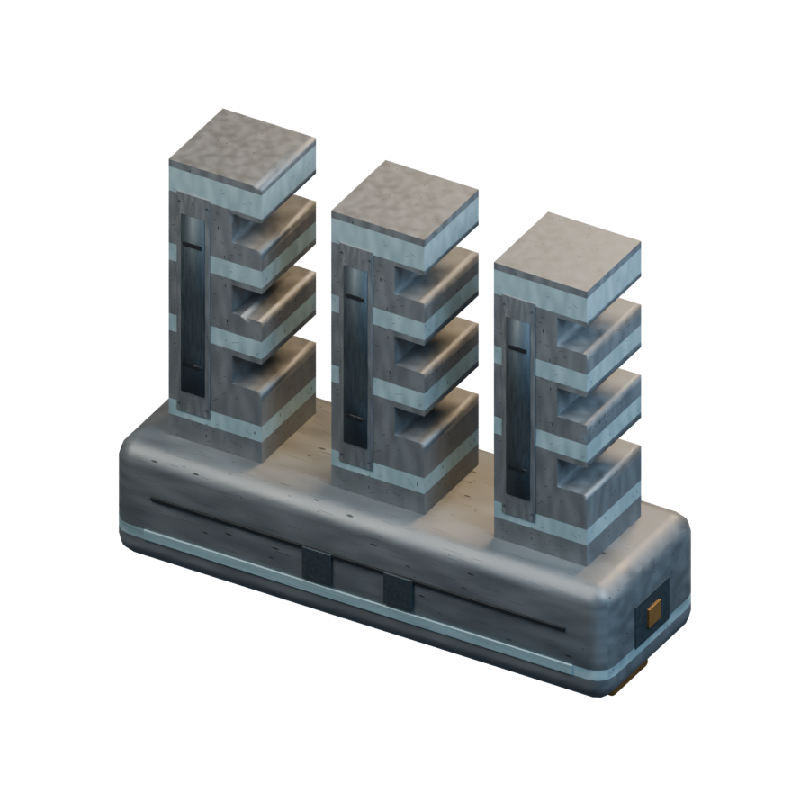
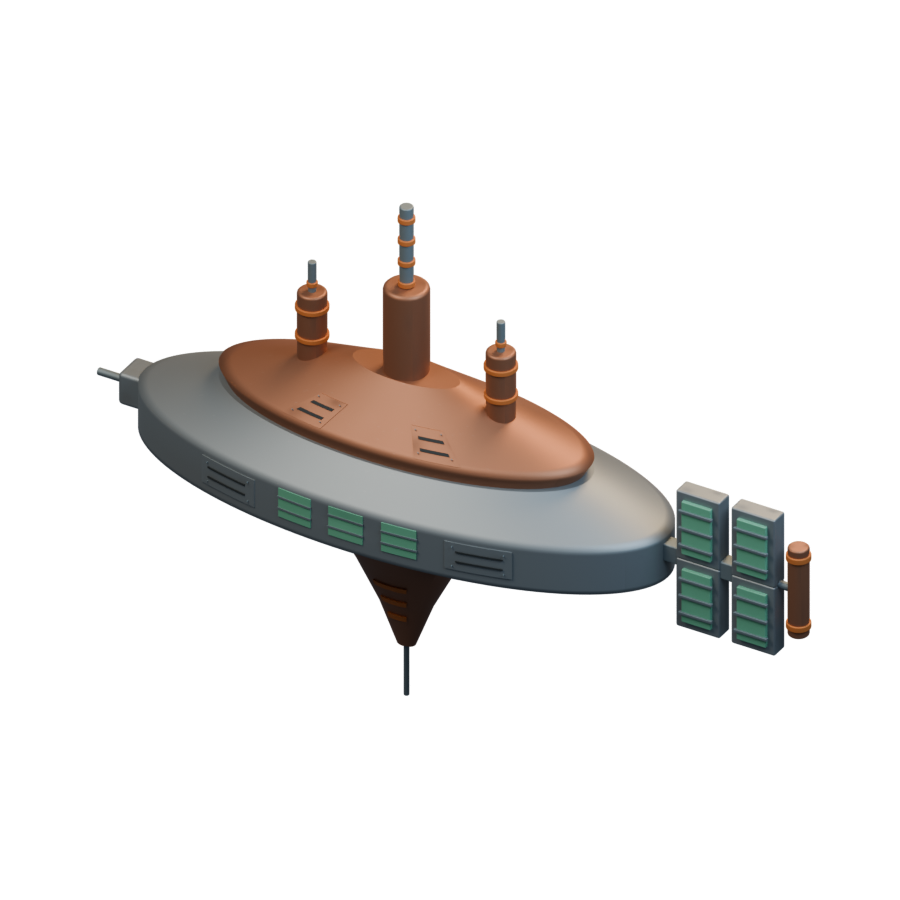
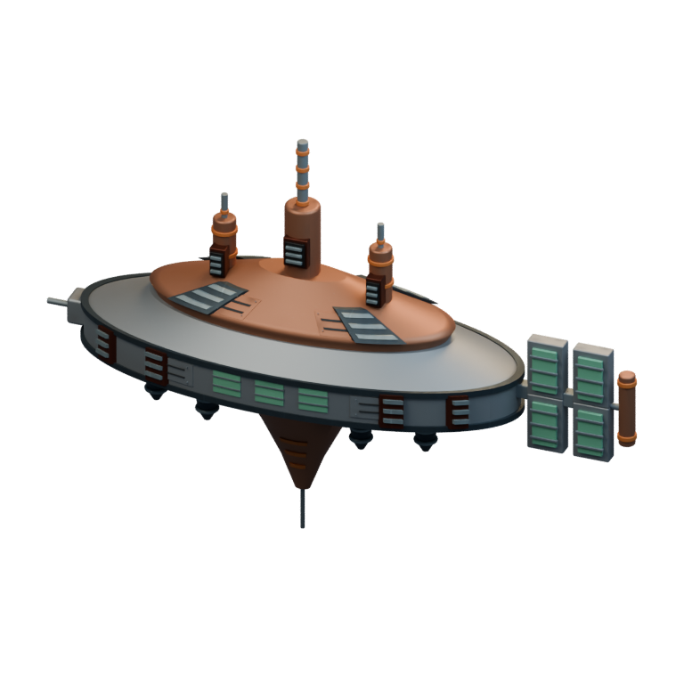
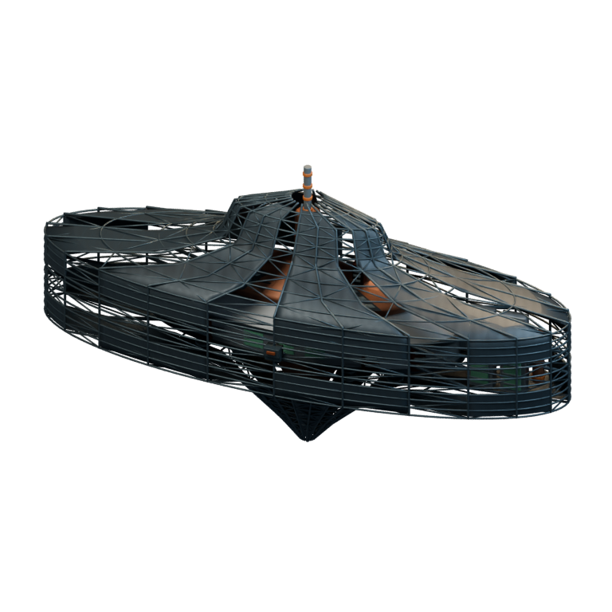

# Ships / Mauna

[All groups](README.md)

## Surveillance Craft Type 5

`openfa:ship/mauna/surveillance-craft-type-5`

**First available iteration — mobile-ship-remaster**

[Blend](../sources/objects/mauna/surveillance-craft-type-5/model.blend) · [GLB](../sources/objects/mauna/surveillance-craft-type-5/model.glb)

Additional views: [Rear fittings](../gallery/media/objects/mauna/surveillance-craft-type-5/rear-quarter.png) · [Actual imported wireframe](../gallery/media/objects/mauna/surveillance-craft-type-5/technical-wireframe.png) · [Legacy heading4 comparison](../gallery/media/objects/mauna/surveillance-craft-type-5/heading-04.png) · [Rejected numeral-like field concept1](../gallery/media/concepts/mauna/surveillance-craft-type-5-01.png) · [Reviewed plain opaque fields concept2](../gallery/media/concepts/mauna/surveillance-craft-type-5-02.png)

## Combat Craft Type 1.5

`openfa:ship/mauna/combat-craft-type-1-5`

**First available iteration — mobile-ship-remaster**

[Blend](../sources/objects/mauna/combat-craft-type-1-5/model.blend) · [GLB](../sources/objects/mauna/combat-craft-type-1-5/model.glb)

Additional views: [Rear fittings](../gallery/media/objects/mauna/combat-craft-type-1-5/rear-quarter.png) · [Actual imported wireframe](../gallery/media/objects/mauna/combat-craft-type-1-5/technical-wireframe.png) · [Legacy heading4 comparison](../gallery/media/objects/mauna/combat-craft-type-1-5/heading-04.png) · [Rejected thin/long beam concept1](../gallery/media/concepts/mauna/combat-craft-type-1-5-01.png) · [Reviewed stepped grey beam concept2](../gallery/media/concepts/mauna/combat-craft-type-1-5-02.png)

## Max Combat Craft Type 6

`openfa:ship/mauna/max-combat-craft-type-6`

**First available iteration — initial-reference-study**

[Blend](../sources/docs/assets/reconstruction/ships/mauna/max-combat-craft-type-6/model.blend) · [GLB](../sources/docs/assets/reconstruction/ships/mauna/max-combat-craft-type-6/model.glb)

## Elite Command Craft

`openfa:ship/mauna/elite-command-craft`

**First available iteration — mobile-ship-remaster**

[Blend](../sources/objects/mauna/elite-command-craft/model.blend) · [GLB](../sources/objects/mauna/elite-command-craft/model.glb)

Additional views: [Rear fittings](../gallery/media/objects/mauna/elite-command-craft/rear-quarter.png) · [Actual imported wireframe](../gallery/media/objects/mauna/elite-command-craft/technical-wireframe.png) · [Legacy heading4 comparison](../gallery/media/objects/mauna/elite-command-craft/heading-04.png) · [Reviewed tandem command-craft concept (attempt3)](../gallery/media/concepts/mauna/elite-command-craft-03.png)

## Transportation Craft Type 3

`openfa:ship/mauna/transportation-craft-type-3`

**First available iteration — mobile-ship-remaster**

[Blend](../sources/objects/mauna/transportation-craft-type-3/model.blend) · [GLB](../sources/objects/mauna/transportation-craft-type-3/model.glb)

Additional views: [Rear fittings](../gallery/media/objects/mauna/transportation-craft-type-3/rear-quarter.png) · [Actual imported wireframe](../gallery/media/objects/mauna/transportation-craft-type-3/technical-wireframe.png) · [Legacy heading4 comparison](../gallery/media/objects/mauna/transportation-craft-type-3/heading-04.png) · [Reviewed three-section cargo assembly concept1](../gallery/media/concepts/mauna/transportation-craft-type-3-01.png)

## Orbital Construction Area

`openfa:ship/mauna/orbital-construction-area`

**First available iteration — initial-reference-study**

[Blend](../sources/docs/assets/reconstruction/ships/mauna/orbital-construction-area/model.blend) · [GLB](../sources/docs/assets/reconstruction/ships/mauna/orbital-construction-area/model.glb)

**Additional iteration — orbital-station-structural-refinement**

[Blend](../sources/docs/assets/reconstruction/orbital-station-refined/mauna/orbital-construction-area/model.blend) · [GLB](../sources/docs/assets/reconstruction/orbital-station-refined/mauna/orbital-construction-area/model.glb)

**Additional iteration — orbital-station-construction-refinement**

[Blend](../sources/docs/assets/reconstruction/orbital-station-construction/mauna/orbital-construction-area/model.blend) · [GLB](../sources/docs/assets/reconstruction/orbital-station-construction/mauna/orbital-construction-area/model.glb)

[Play animation: ConstructionActivity](../gallery/media/docs/assets/reconstruction/orbital-station-construction/mauna/orbital-construction-area/animation-00.webm)
