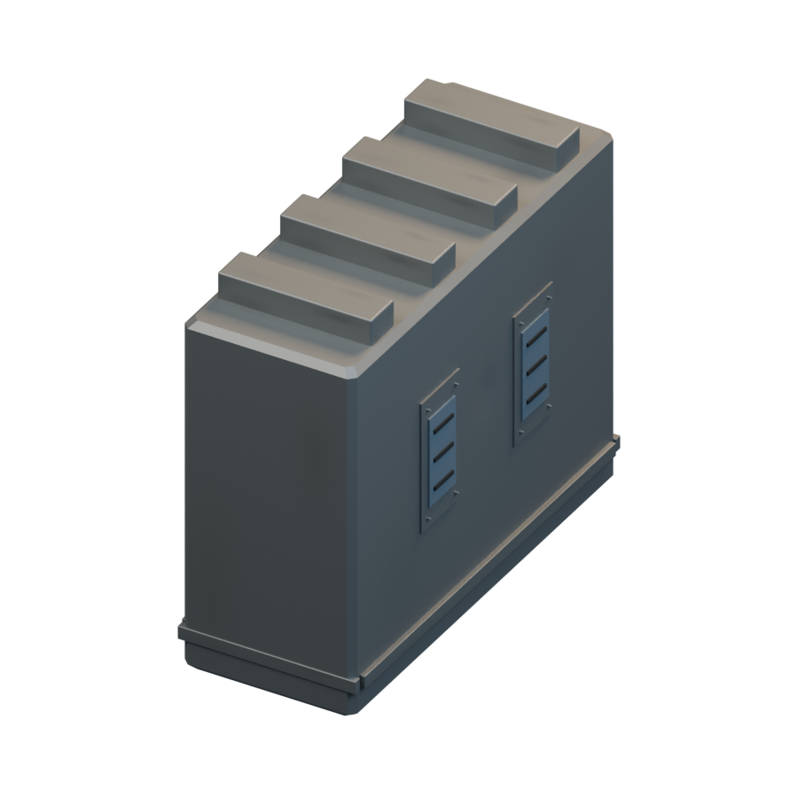
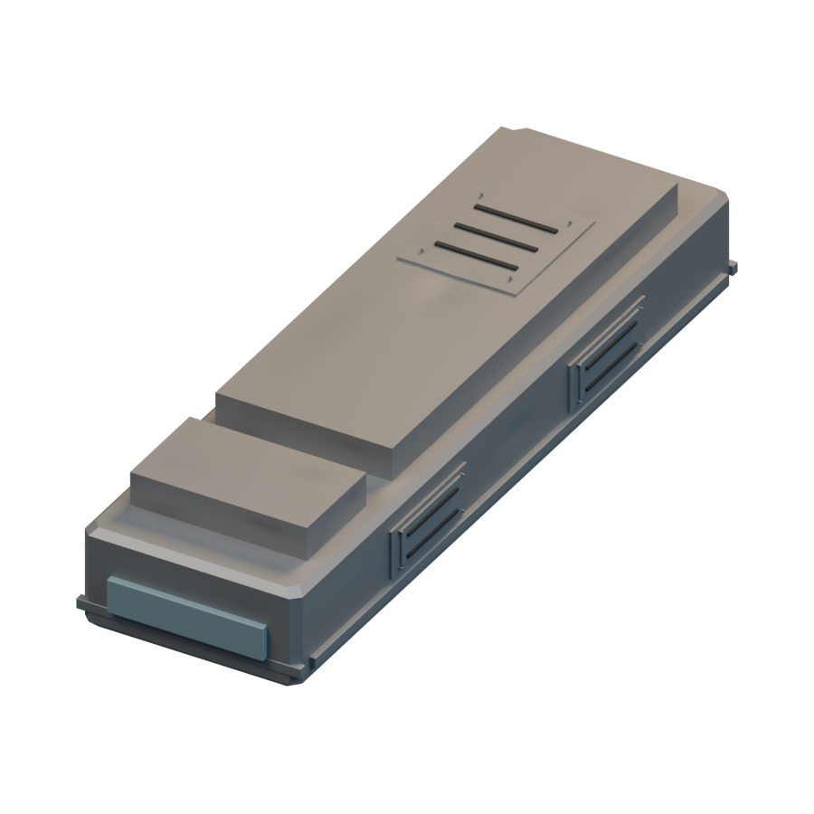
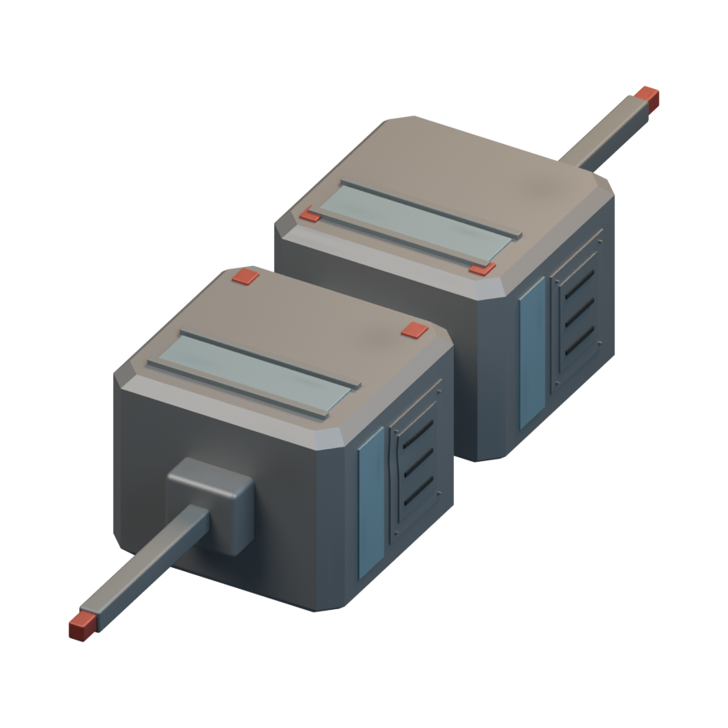
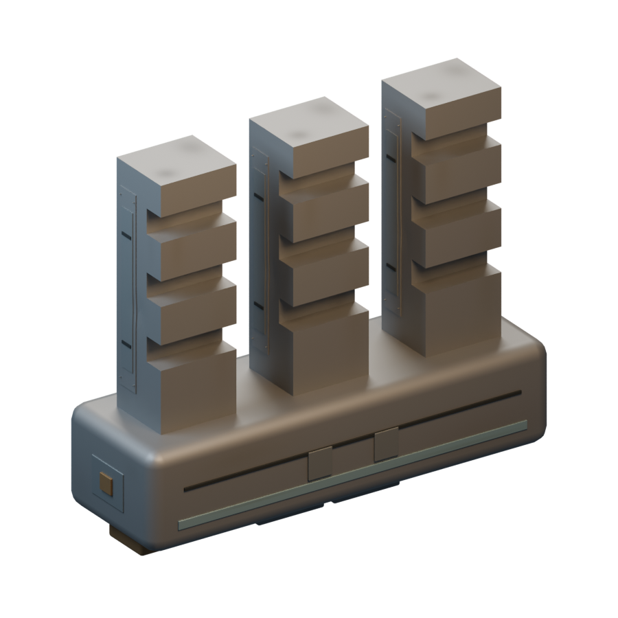

# Ships / Mauna

[All groups](README.md)

## Surveillance Craft Type 5

`openfa:ship/mauna/surveillance-craft-type-5`

**First available iteration — initial-reference-study**

[Blend](../sources/docs/assets/reconstruction/ships/mauna/surveillance-craft-type-5/model.blend) · [GLB](../sources/docs/assets/reconstruction/ships/mauna/surveillance-craft-type-5/model.glb)

## Combat Craft Type 1.5

`openfa:ship/mauna/combat-craft-type-1-5`

**First available iteration — initial-reference-study**

[Blend](../sources/docs/assets/reconstruction/ships/mauna/combat-craft-type-1-5/model.blend) · [GLB](../sources/docs/assets/reconstruction/ships/mauna/combat-craft-type-1-5/model.glb)

## Max Combat Craft Type 6

`openfa:ship/mauna/max-combat-craft-type-6`

**First available iteration — initial-reference-study**

[Blend](../sources/docs/assets/reconstruction/ships/mauna/max-combat-craft-type-6/model.blend) · [GLB](../sources/docs/assets/reconstruction/ships/mauna/max-combat-craft-type-6/model.glb)

## Elite Command Craft

`openfa:ship/mauna/elite-command-craft`

**First available iteration — initial-reference-study**

[Blend](../sources/docs/assets/reconstruction/ships/mauna/elite-command-craft/model.blend) · [GLB](../sources/docs/assets/reconstruction/ships/mauna/elite-command-craft/model.glb)

## Transportation Craft Type 3

`openfa:ship/mauna/transportation-craft-type-3`

**First available iteration — initial-reference-study**

[Blend](../sources/docs/assets/reconstruction/ships/mauna/transportation-craft-type-3/model.blend) · [GLB](../sources/docs/assets/reconstruction/ships/mauna/transportation-craft-type-3/model.glb)

## Orbital Construction Area

`openfa:ship/mauna/orbital-construction-area`

**First available iteration — initial-reference-study**

[Blend](../sources/docs/assets/reconstruction/ships/mauna/orbital-construction-area/model.blend) · [GLB](../sources/docs/assets/reconstruction/ships/mauna/orbital-construction-area/model.glb)
