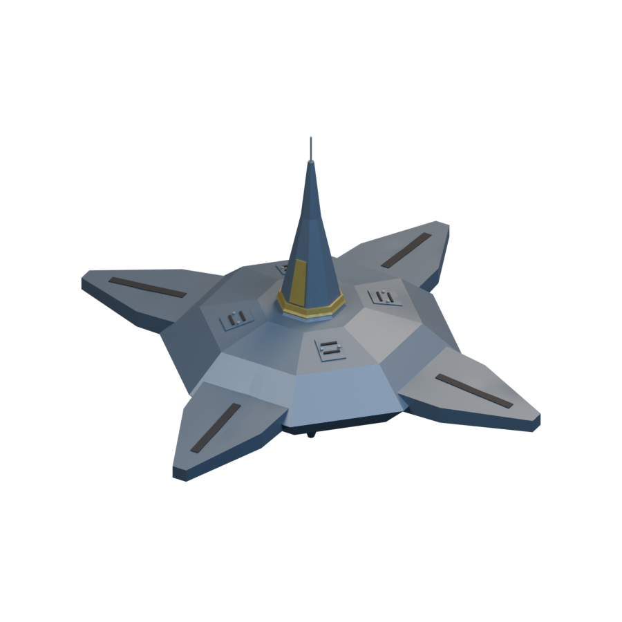
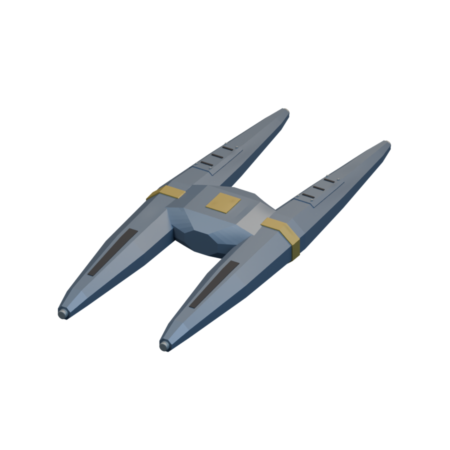
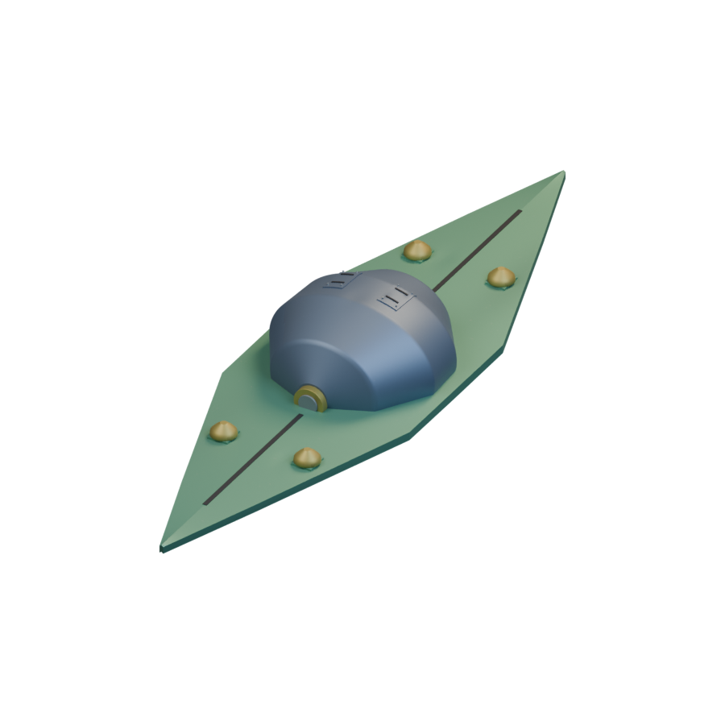
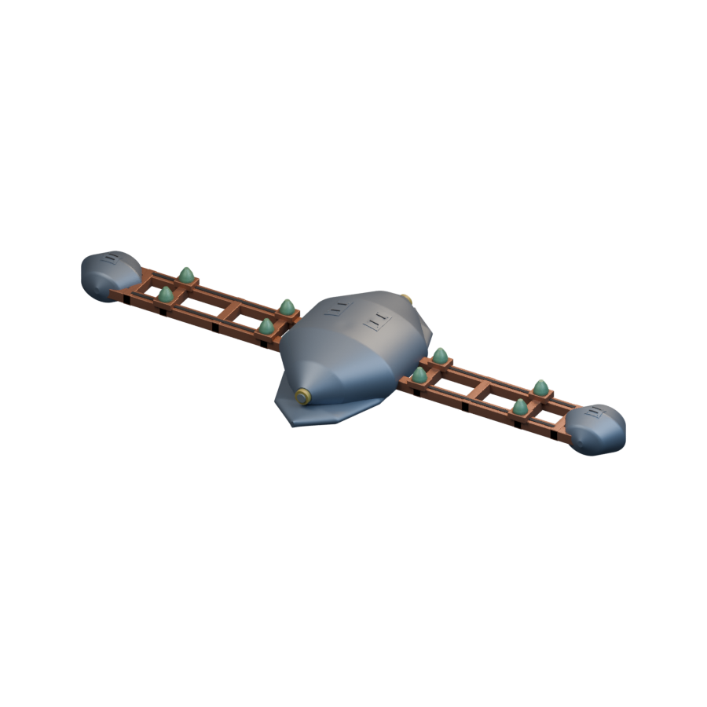
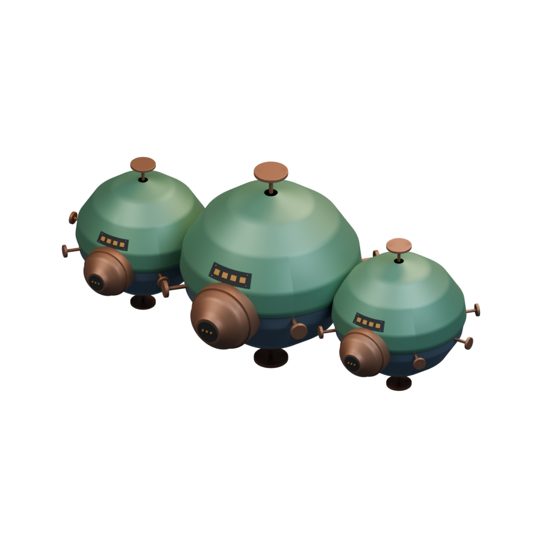
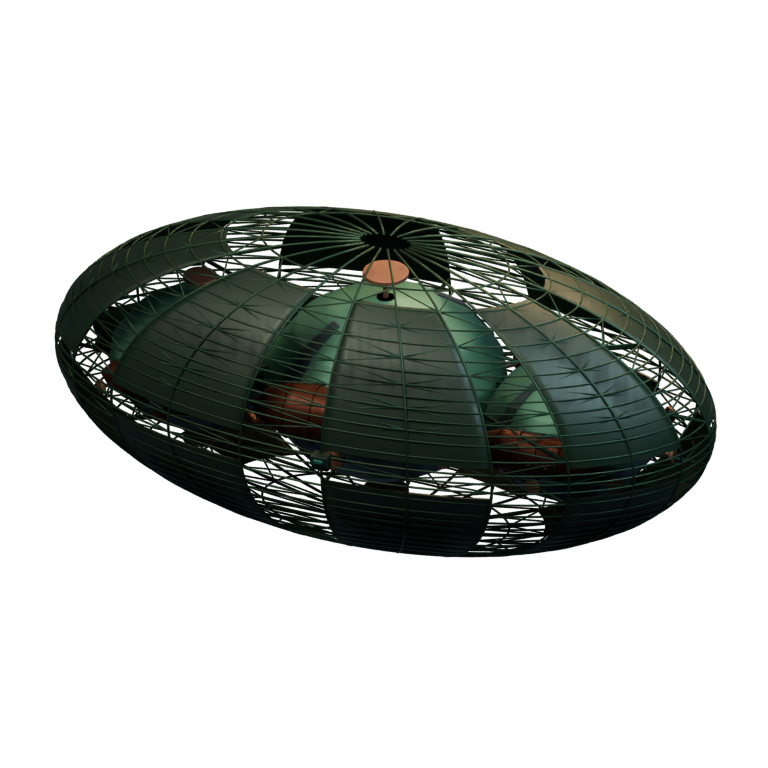

# Ships / Mikotaj

[All groups](README.md)

## Hiero

`openfa:ship/mikotaj/hiero`

**First available iteration — initial-reference-study**

[Blend](../sources/docs/assets/reconstruction/ships/mikotaj/hiero/model.blend) · [GLB](../sources/docs/assets/reconstruction/ships/mikotaj/hiero/model.glb)

## Ylikt-shan

`openfa:ship/mikotaj/ylikt-shan`

**First available iteration — initial-reference-study**

[Blend](../sources/docs/assets/reconstruction/ships/mikotaj/ylikt-shan/model.blend) · [GLB](../sources/docs/assets/reconstruction/ships/mikotaj/ylikt-shan/model.glb)

## Falari-Lourn

`openfa:ship/mikotaj/falari-lourn`

**First available iteration — initial-reference-study**

[Blend](../sources/docs/assets/reconstruction/ships/mikotaj/falari-lourn/model.blend) · [GLB](../sources/docs/assets/reconstruction/ships/mikotaj/falari-lourn/model.glb)

## Ruth-Strivakh

`openfa:ship/mikotaj/ruth-strivakh`

**First available iteration — initial-reference-study**

[Blend](../sources/docs/assets/reconstruction/ships/mikotaj/ruth-strivakh/model.blend) · [GLB](../sources/docs/assets/reconstruction/ships/mikotaj/ruth-strivakh/model.glb)

## Na-Xanth

`openfa:ship/mikotaj/na-xanth`

**First available iteration — initial-reference-study**

[Blend](../sources/docs/assets/reconstruction/ships/mikotaj/na-xanth/model.blend) · [GLB](../sources/docs/assets/reconstruction/ships/mikotaj/na-xanth/model.glb)

**Additional iteration — orbital-station-structural-refinement**

[Blend](../sources/docs/assets/reconstruction/orbital-station-refined/mikotaj/na-xanth/model.blend) · [GLB](../sources/docs/assets/reconstruction/orbital-station-refined/mikotaj/na-xanth/model.glb)

**Additional iteration — orbital-station-construction-refinement**

[Blend](../sources/docs/assets/reconstruction/orbital-station-construction/mikotaj/na-xanth/model.blend) · [GLB](../sources/docs/assets/reconstruction/orbital-station-construction/mikotaj/na-xanth/model.glb)

[Play animation: ConstructionActivity](../gallery/media/docs/assets/reconstruction/orbital-station-construction/mikotaj/na-xanth/animation-00.webm)
