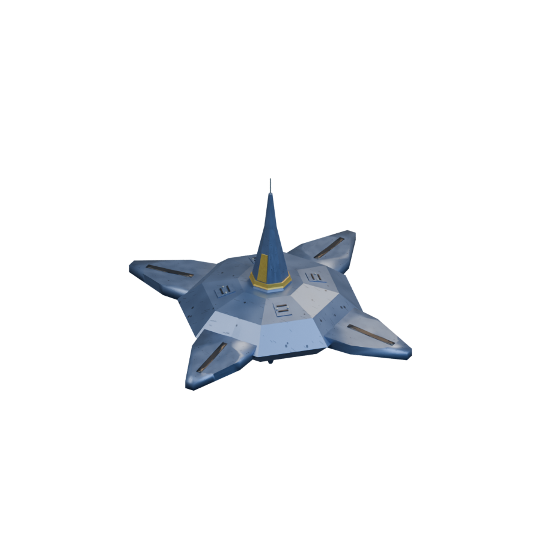
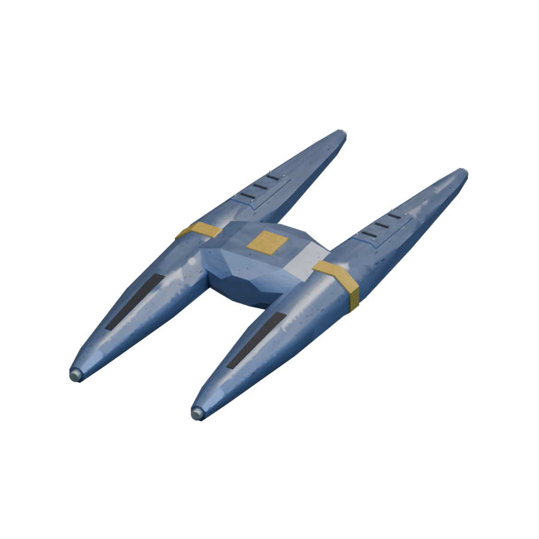
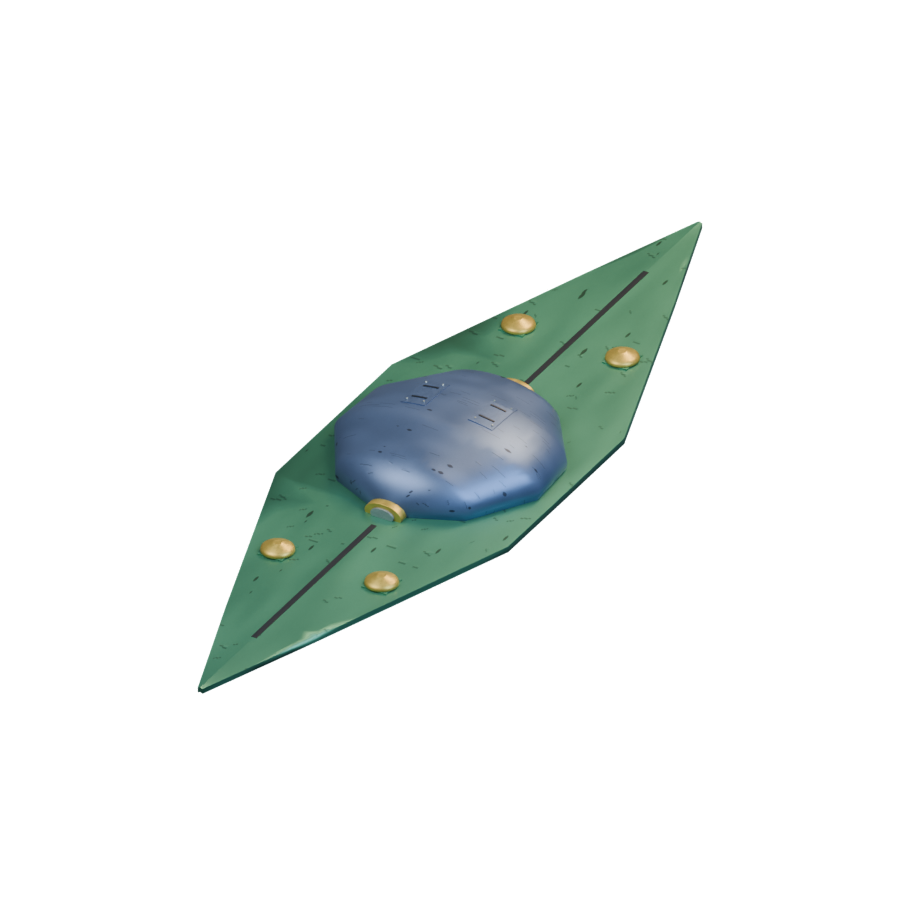
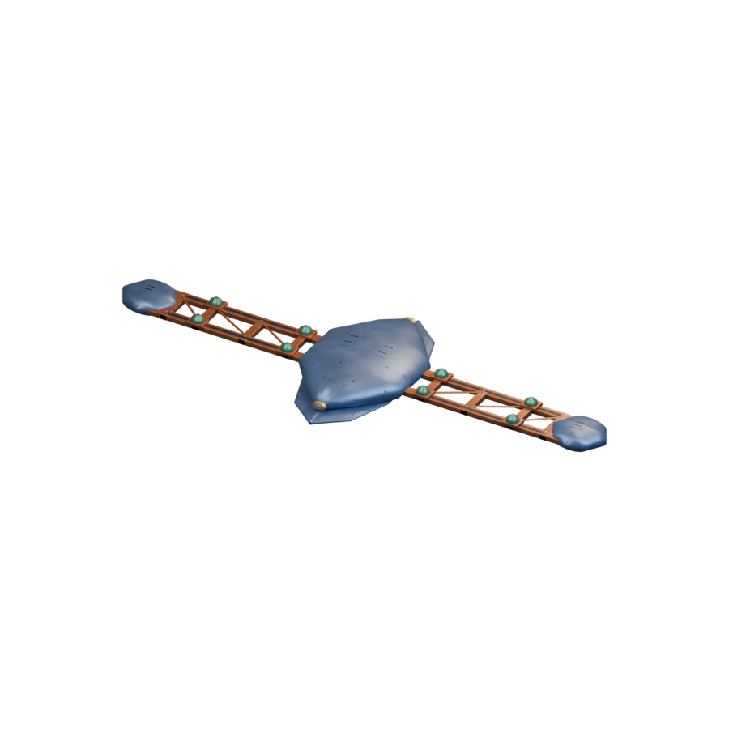
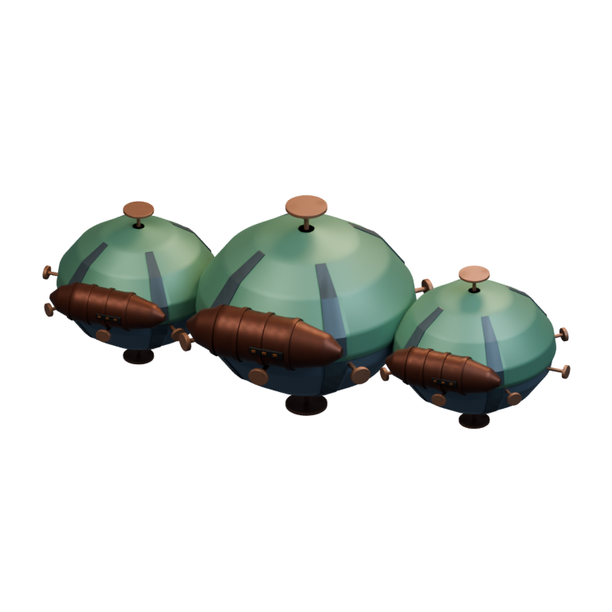

# Ships / Mikotaj

[All groups](README.md)

## Hiero

`openfa:ship/mikotaj/hiero`

**Canonical version — mobile-ship-remaster**

[Blend](../sources/objects/mikotaj/hiero/model.blend) · [GLB](../sources/objects/mikotaj/hiero/model.glb)

Additional views: [Rear machinery](../gallery/media/objects/mikotaj/hiero/rear-quarter.png) · [Actual imported wireframe](../gallery/media/objects/mikotaj/hiero/technical-wireframe.png) · [Legacy heading4 view](../gallery/media/objects/mikotaj/hiero/heading-04.png) · [Retrospective concept 1](../gallery/media/concepts/mikotaj/hiero-01.png)

## Ylikt-shan

`openfa:ship/mikotaj/ylikt-shan`

**Canonical version — mobile-ship-remaster**

[Blend](../sources/objects/mikotaj/ylikt-shan/model.blend) · [GLB](../sources/objects/mikotaj/ylikt-shan/model.glb)

Additional views: [Rear machinery](../gallery/media/objects/mikotaj/ylikt-shan/rear-quarter.png) · [Actual imported wireframe](../gallery/media/objects/mikotaj/ylikt-shan/technical-wireframe.png) · [Legacy heading4 view](../gallery/media/objects/mikotaj/ylikt-shan/heading-04.png) · [Retrospective concept 1](../gallery/media/concepts/mikotaj/ylikt-shan-01.png)

## Falari-Lourn

`openfa:ship/mikotaj/falari-lourn`

**Canonical version — mobile-ship-remaster**

[Blend](../sources/objects/mikotaj/falari-lourn/model.blend) · [GLB](../sources/objects/mikotaj/falari-lourn/model.glb)

Additional views: [Rear machinery](../gallery/media/objects/mikotaj/falari-lourn/rear-quarter.png) · [Actual imported wireframe](../gallery/media/objects/mikotaj/falari-lourn/technical-wireframe.png) · [Legacy heading4 view](../gallery/media/objects/mikotaj/falari-lourn/heading-04.png) · [Rejected concept 1 (geometry)](../gallery/media/concepts/mikotaj/falari-lourn-01.png) · [Rejected concept 2 (geometry)](../gallery/media/concepts/mikotaj/falari-lourn-02.png) · [Rejected concept 3 (geometry)](../gallery/media/concepts/mikotaj/falari-lourn-03.png) · [Four parallel modules — axial GLB](../gallery/media/objects/mikotaj/falari-lourn/axial-front.png)

## Ruth-Strivakh

`openfa:ship/mikotaj/ruth-strivakh`

**Canonical version — mobile-ship-remaster**

[Blend](../sources/objects/mikotaj/ruth-strivakh/model.blend) · [GLB](../sources/objects/mikotaj/ruth-strivakh/model.glb)

Additional views: [Rear machinery](../gallery/media/objects/mikotaj/ruth-strivakh/rear-quarter.png) · [Actual imported wireframe](../gallery/media/objects/mikotaj/ruth-strivakh/technical-wireframe.png) · [Legacy heading4 view](../gallery/media/objects/mikotaj/ruth-strivakh/heading-04.png) · [Retrospective concept 1](../gallery/media/concepts/mikotaj/ruth-strivakh-01.png)

## Na-Xanth

`openfa:ship/mikotaj/na-xanth`

**Canonical version — orbital-station-structural-refinement**

[Blend](../sources/docs/assets/reconstruction/orbital-station-refined/mikotaj/na-xanth/model.blend) · [GLB](../sources/docs/assets/reconstruction/orbital-station-refined/mikotaj/na-xanth/model.glb)

Construction animation source: [Blend](../sources/docs/assets/reconstruction/orbital-station-construction/mikotaj/na-xanth/model.blend) · [GLB](../sources/docs/assets/reconstruction/orbital-station-construction/mikotaj/na-xanth/model.glb)

Additional views: [Finished station (legacy frame 0)](../gallery/media/docs/assets/reconstruction/orbital-station-refined/mikotaj/na-xanth/front-quarter.png) · [Station under construction (legacy frame 1)](../gallery/media/docs/assets/reconstruction/orbital-station-construction/mikotaj/na-xanth/front-quarter.png) · [Restoration runtime native BLEND](../gallery/media/docs/assets/reconstruction/orbital-station-refined/mikotaj/na-xanth/restoration-native.png) · [Restoration runtime independent GLB](../gallery/media/docs/assets/reconstruction/orbital-station-refined/mikotaj/na-xanth/restoration-glb.png)

[Play animation: ConstructionActivity](../gallery/media/docs/assets/reconstruction/orbital-station-construction/mikotaj/na-xanth/animation-00.webm)
