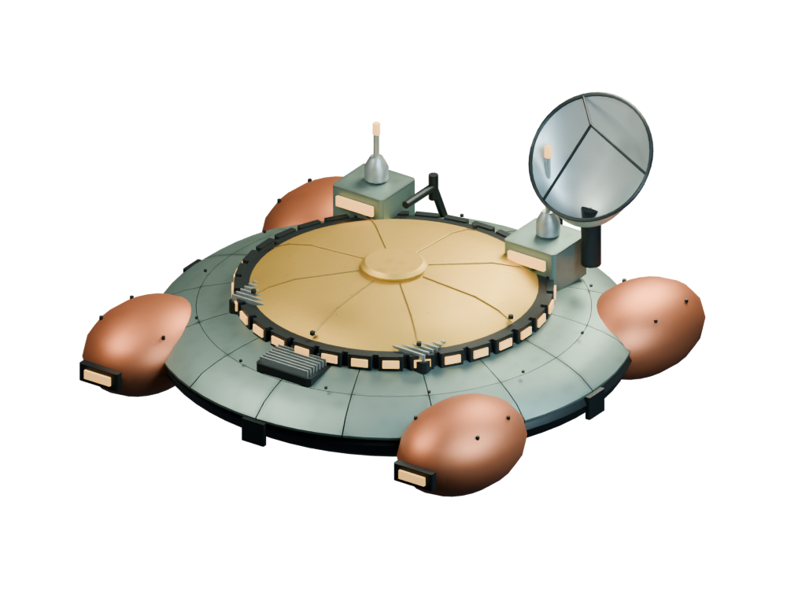
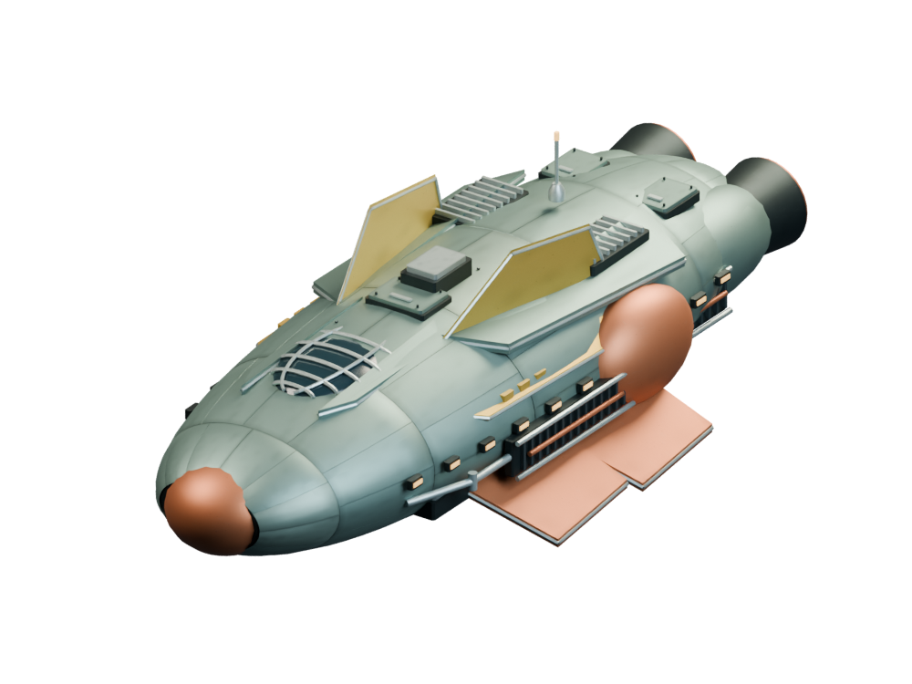
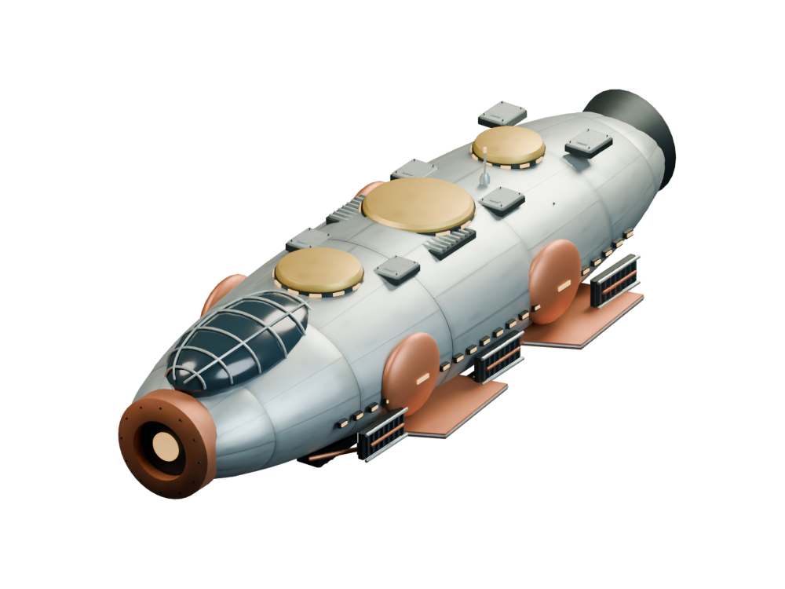
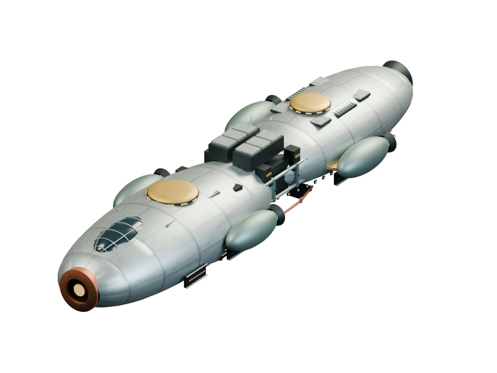

# Ships / Rigellian

[All groups](README.md)

## Lazzaro Research

`openfa:ship/rigellian/lazzaro-research`

**Canonical version — hi-def-broad-skin-refinement**

[Blend](../sources/objects/rigellian/lazzaro-research/model.blend) · [GLB](../sources/objects/rigellian/lazzaro-research/model.glb)

Additional views: [Front quarter](../gallery/media/objects/rigellian/lazzaro-research/front-quarter.png) · [Rear quarter](../gallery/media/objects/rigellian/lazzaro-research/rear-quarter.png) · [Top](../gallery/media/objects/rigellian/lazzaro-research/top.png) · [Underside](../gallery/media/objects/rigellian/lazzaro-research/underside.png) · [Saved native reopen](../gallery/media/objects/rigellian/lazzaro-research/verified-native.png) · [Independent GLB import](../gallery/media/objects/rigellian/lazzaro-research/verified-imported.png) · [Fleet: proposed sizes, common top camera](../gallery/media/objects/rigellian/fleet/shared-scale-top.png) · [Fleet: proposed sizes, common oblique camera](../gallery/media/objects/rigellian/fleet/shared-scale-oblique.png)

## Delphini Assault

`openfa:ship/rigellian/delphini-assault`

**Canonical version — hi-def-broad-skin-refinement**

[Blend](../sources/objects/rigellian/delphini-assault/model.blend) · [GLB](../sources/objects/rigellian/delphini-assault/model.glb)

Additional views: [Front quarter](../gallery/media/objects/rigellian/delphini-assault/front-quarter.png) · [Rear quarter](../gallery/media/objects/rigellian/delphini-assault/rear-quarter.png) · [Top](../gallery/media/objects/rigellian/delphini-assault/top.png) · [Underside](../gallery/media/objects/rigellian/delphini-assault/underside.png) · [Saved native reopen](../gallery/media/objects/rigellian/delphini-assault/verified-native.png) · [Independent GLB import](../gallery/media/objects/rigellian/delphini-assault/verified-imported.png) · [Fleet: proposed sizes, common top camera](../gallery/media/objects/rigellian/fleet/shared-scale-top.png) · [Fleet: proposed sizes, common oblique camera](../gallery/media/objects/rigellian/fleet/shared-scale-oblique.png)

## Messier-Lukannon

`openfa:ship/rigellian/messier-lukannon`

**Canonical version — hi-def-broad-skin-refinement**

[Blend](../sources/objects/rigellian/messier-lukannon/model.blend) · [GLB](../sources/objects/rigellian/messier-lukannon/model.glb)

Additional views: [Front quarter](../gallery/media/objects/rigellian/messier-lukannon/front-quarter.png) · [Rear quarter](../gallery/media/objects/rigellian/messier-lukannon/rear-quarter.png) · [Top](../gallery/media/objects/rigellian/messier-lukannon/top.png) · [Underside](../gallery/media/objects/rigellian/messier-lukannon/underside.png) · [Saved native reopen](../gallery/media/objects/rigellian/messier-lukannon/verified-native.png) · [Independent GLB import](../gallery/media/objects/rigellian/messier-lukannon/verified-imported.png) · [Fleet: proposed sizes, common top camera](../gallery/media/objects/rigellian/fleet/shared-scale-top.png) · [Fleet: proposed sizes, common oblique camera](../gallery/media/objects/rigellian/fleet/shared-scale-oblique.png)

## Transportation

`openfa:ship/rigellian/transportation`

**Canonical version — hi-def-broad-skin-refinement**

[Blend](../sources/objects/rigellian/transportation/model.blend) · [GLB](../sources/objects/rigellian/transportation/model.glb)

Additional views: [Front quarter](../gallery/media/objects/rigellian/transportation/front-quarter.png) · [Rear quarter](../gallery/media/objects/rigellian/transportation/rear-quarter.png) · [Top](../gallery/media/objects/rigellian/transportation/top.png) · [Underside](../gallery/media/objects/rigellian/transportation/underside.png) · [Saved native reopen](../gallery/media/objects/rigellian/transportation/verified-native.png) · [Independent GLB import](../gallery/media/objects/rigellian/transportation/verified-imported.png) · [Fleet: proposed sizes, common top camera](../gallery/media/objects/rigellian/fleet/shared-scale-top.png) · [Fleet: proposed sizes, common oblique camera](../gallery/media/objects/rigellian/fleet/shared-scale-oblique.png)

## Observatory

`openfa:ship/rigellian/observatory`

**Canonical version — structural-detail-refinement**

[Blend](../sources/docs/assets/reconstruction/rigellian-refined/observatory/model.blend) · [GLB](../sources/docs/assets/reconstruction/rigellian-refined/observatory/model.glb)

Construction animation source: [Blend](../sources/docs/assets/reconstruction/orbital-station-construction/rigellian/observatory/model.blend) · [GLB](../sources/docs/assets/reconstruction/orbital-station-construction/rigellian/observatory/model.glb)

Additional views: [Finished station (legacy frame 0)](../gallery/media/docs/assets/reconstruction/rigellian-refined/observatory/front-quarter.png) · [Station under construction (legacy frame 1)](../gallery/media/docs/assets/reconstruction/orbital-station-construction/rigellian/observatory/front-quarter.png) · [Restoration runtime native BLEND](../gallery/media/docs/assets/reconstruction/rigellian-refined/observatory/restoration-native.png) · [Restoration runtime independent GLB](../gallery/media/docs/assets/reconstruction/rigellian-refined/observatory/restoration-glb.png)

[Play animation: ConstructionActivity](../gallery/media/docs/assets/reconstruction/orbital-station-construction/rigellian/observatory/animation-00.webm)
