# Ships / Rigellian

[All groups](README.md)

## Lazzaro Research

`openfa:ship/rigellian/lazzaro-research`

**First available iteration — initial-reference-study**

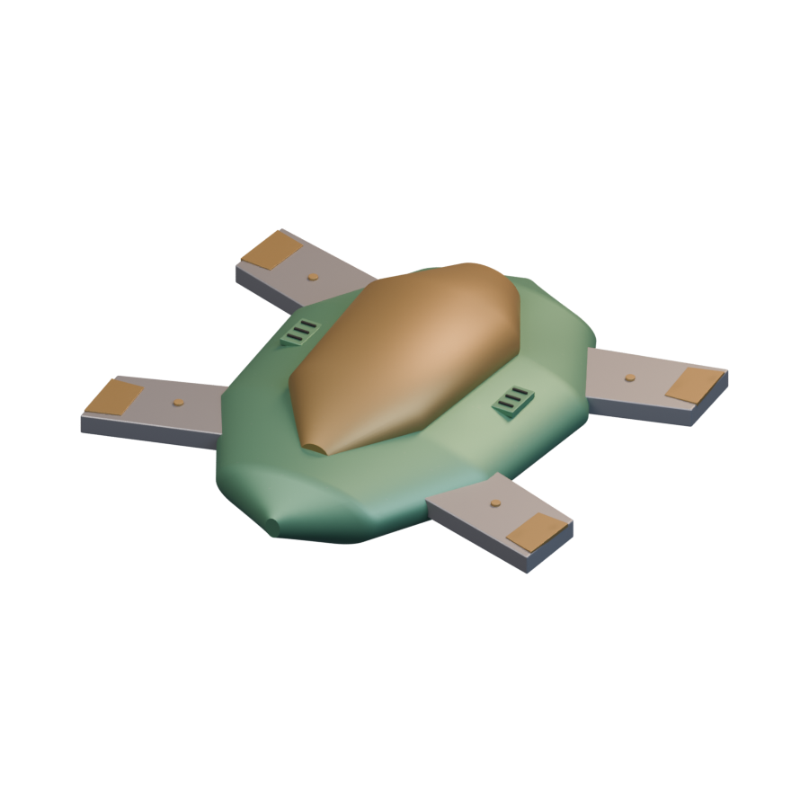

[Blend](../sources/docs/assets/reconstruction/ships/rigellian/lazzaro-research/model.blend) · [GLB](../sources/docs/assets/reconstruction/ships/rigellian/lazzaro-research/model.glb)

**Additional iteration — visible-form-refinement**

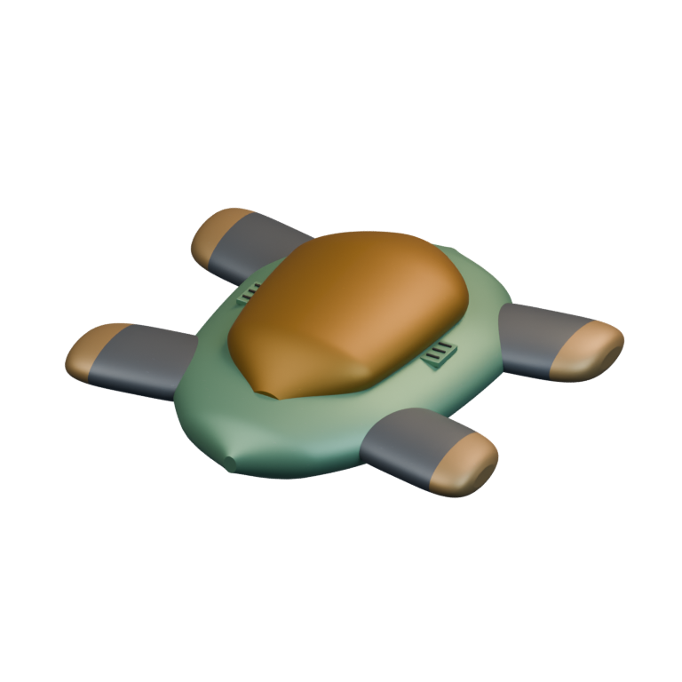

[Blend](../sources/docs/assets/reconstruction/rigellian-refined/lazzaro-research/model.blend) · [GLB](../sources/docs/assets/reconstruction/rigellian-refined/lazzaro-research/model.glb)

## Delphini Assault

`openfa:ship/rigellian/delphini-assault`

**First available iteration — initial-reference-study**

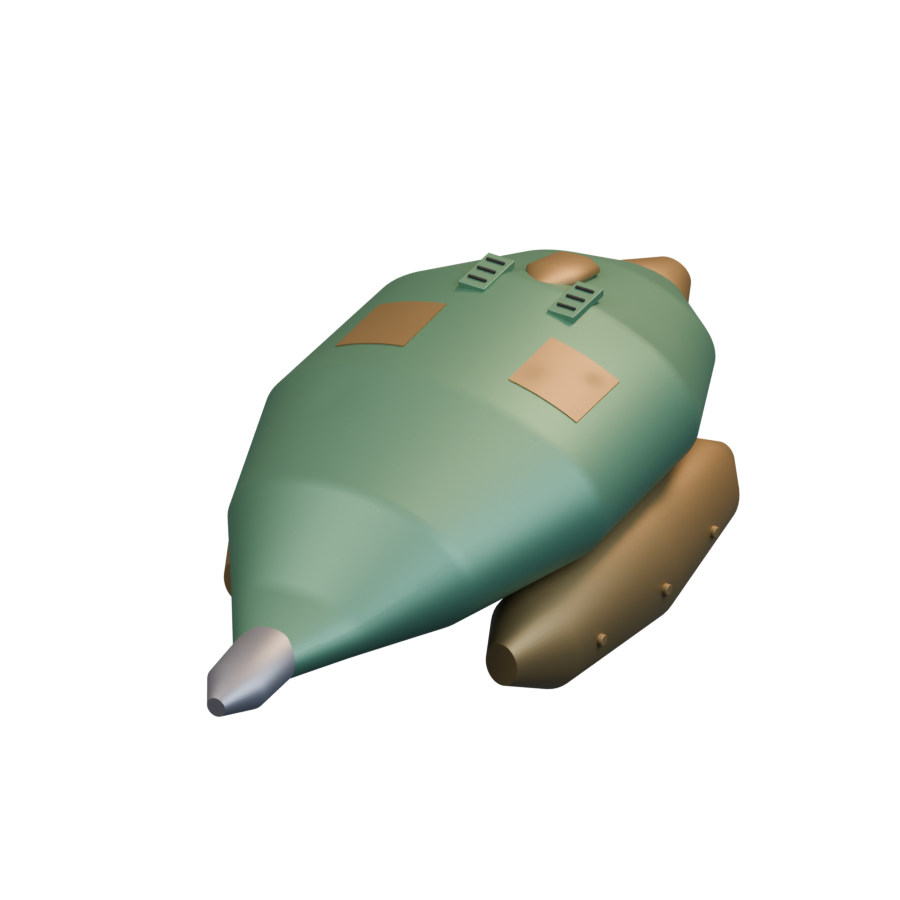

[Blend](../sources/docs/assets/reconstruction/ships/rigellian/delphini-assault/model.blend) · [GLB](../sources/docs/assets/reconstruction/ships/rigellian/delphini-assault/model.glb)

**Additional iteration — visible-section-refinement**

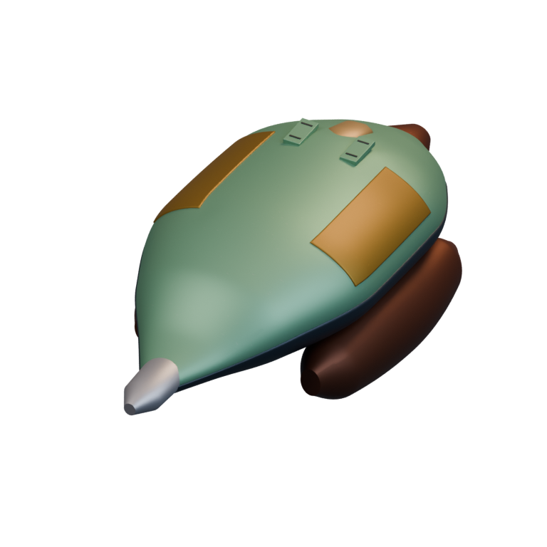

[Blend](../sources/docs/assets/reconstruction/rigellian-refined/delphini-assault/model.blend) · [GLB](../sources/docs/assets/reconstruction/rigellian-refined/delphini-assault/model.glb)

## Messier-Lukannon

`openfa:ship/rigellian/messier-lukannon`

**First available iteration — initial-reference-study**

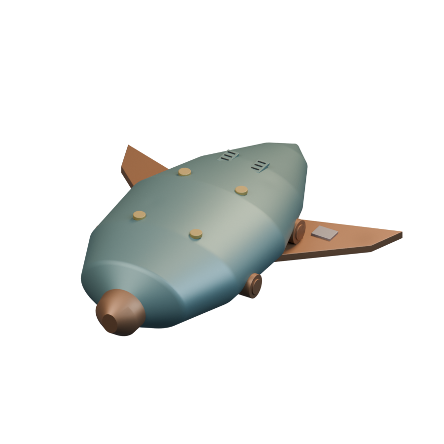

[Blend](../sources/docs/assets/reconstruction/ships/rigellian/messier-lukannon/model.blend) · [GLB](../sources/docs/assets/reconstruction/ships/rigellian/messier-lukannon/model.glb)

**Additional iteration — visible-section-refinement**

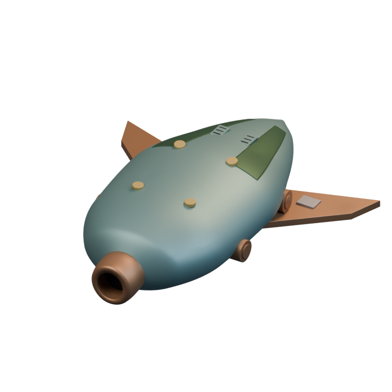

[Blend](../sources/docs/assets/reconstruction/rigellian-refined/messier-lukannon/model.blend) · [GLB](../sources/docs/assets/reconstruction/rigellian-refined/messier-lukannon/model.glb)

## Transportation

`openfa:ship/rigellian/transportation`

**First available iteration — initial-reference-study**

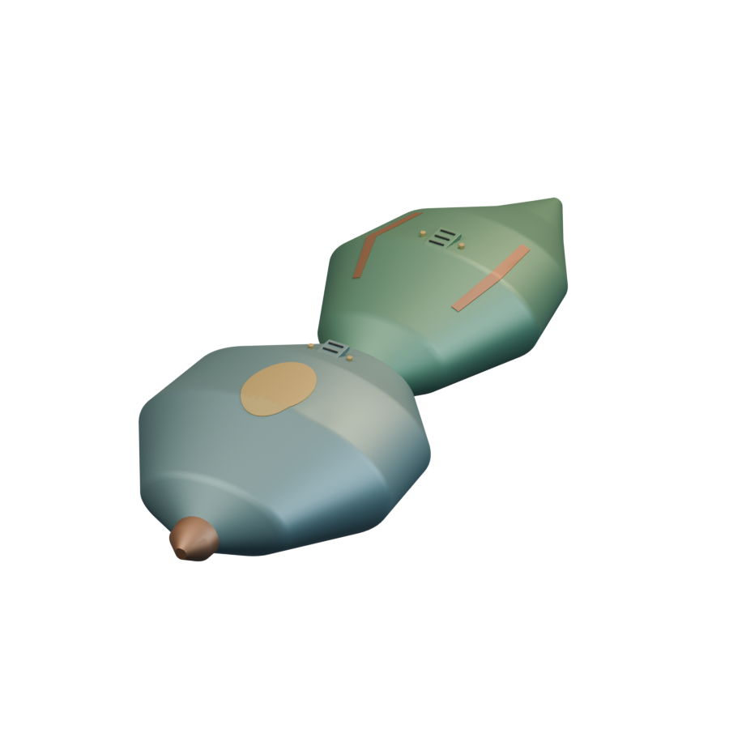

[Blend](../sources/docs/assets/reconstruction/ships/rigellian/transportation/model.blend) · [GLB](../sources/docs/assets/reconstruction/ships/rigellian/transportation/model.glb)

**Additional iteration — body-section-refinement**

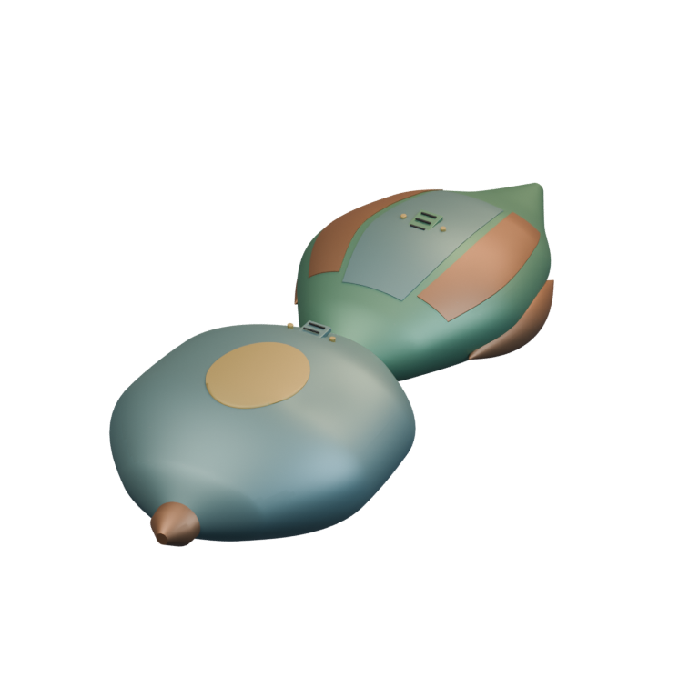

[Blend](../sources/docs/assets/reconstruction/rigellian-refined/transportation/model.blend) · [GLB](../sources/docs/assets/reconstruction/rigellian-refined/transportation/model.glb)

## Observatory

`openfa:ship/rigellian/observatory`

**First available iteration — initial-reference-study**

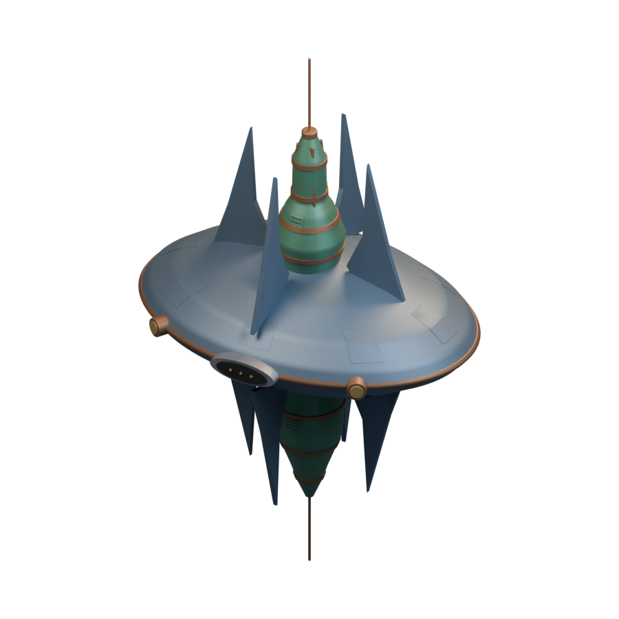

[Blend](../sources/docs/assets/reconstruction/ships/rigellian/observatory/model.blend) · [GLB](../sources/docs/assets/reconstruction/ships/rigellian/observatory/model.glb)

**Additional iteration — structural-detail-refinement**

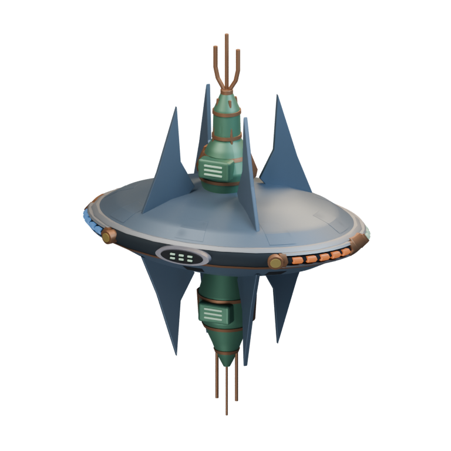

[Blend](../sources/docs/assets/reconstruction/rigellian-refined/observatory/model.blend) · [GLB](../sources/docs/assets/reconstruction/rigellian-refined/observatory/model.glb)

**Additional iteration — orbital-station-construction-refinement**

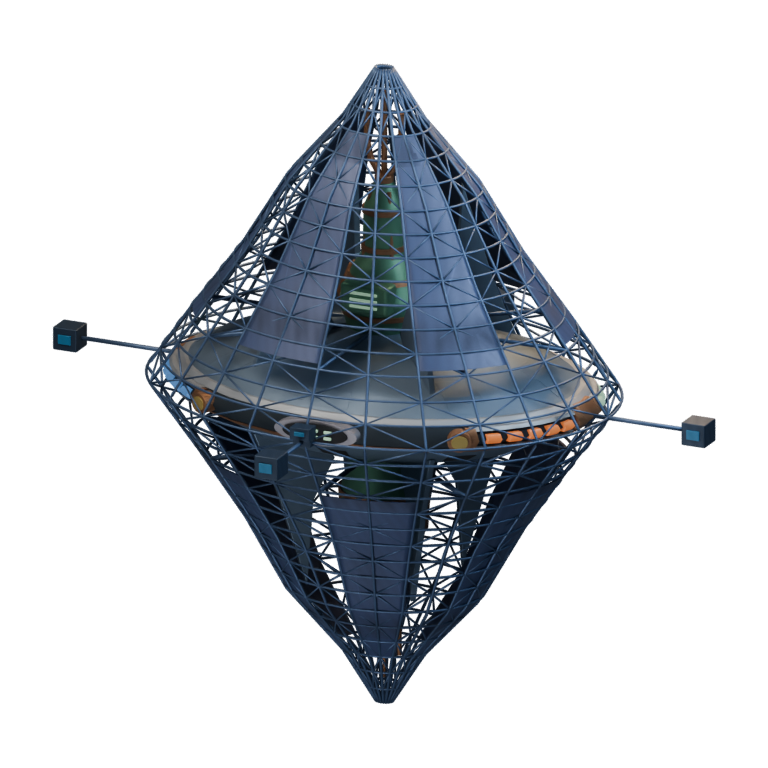

[Blend](../sources/docs/assets/reconstruction/orbital-station-construction/rigellian/observatory/model.blend) · [GLB](../sources/docs/assets/reconstruction/orbital-station-construction/rigellian/observatory/model.glb)

[Play animation: ConstructionActivity](../gallery/media/docs/assets/reconstruction/orbital-station-construction/rigellian/observatory/animation-00.webm)
