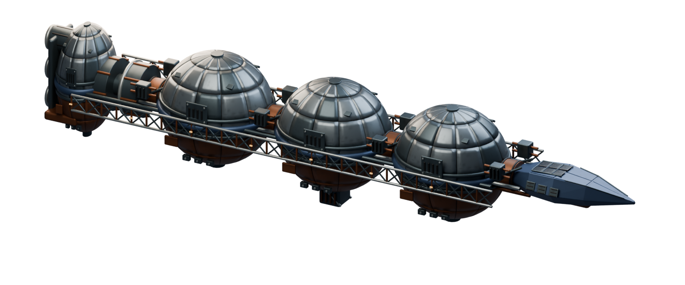

# Ships / Shared

[All groups](README.md)

## Federal Transporter (IS0C)

`openfa:federal-transporter`

**First available iteration — detailed-refined**

[Blend](../sources/objects/shared/federal-transporter/refined/model.blend) · [GLB](../sources/objects/shared/federal-transporter/refined/model.glb)
