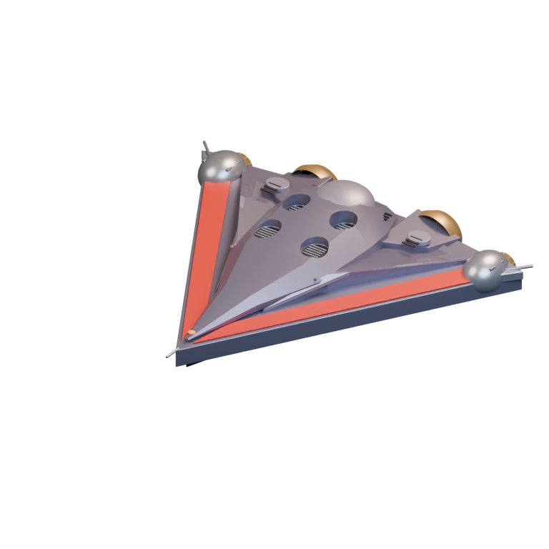
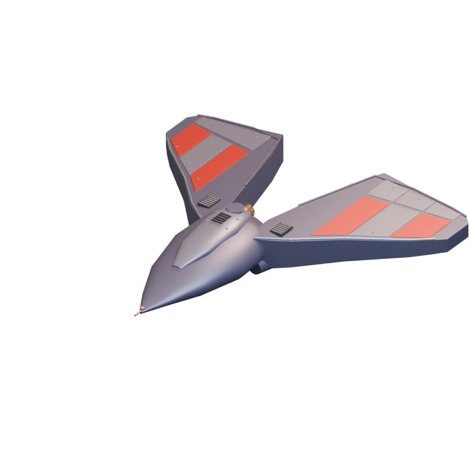
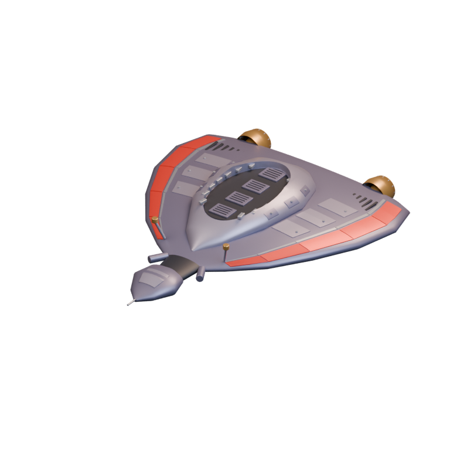
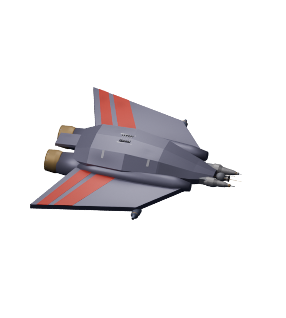
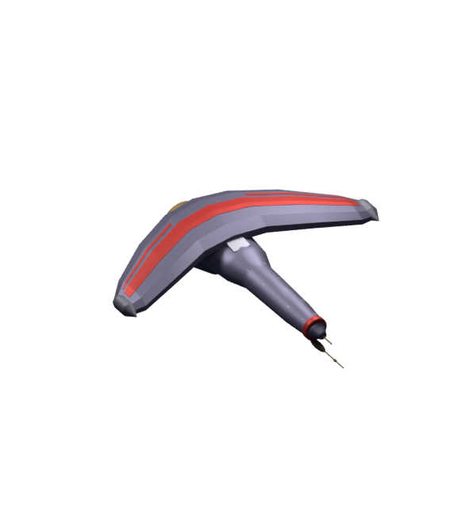
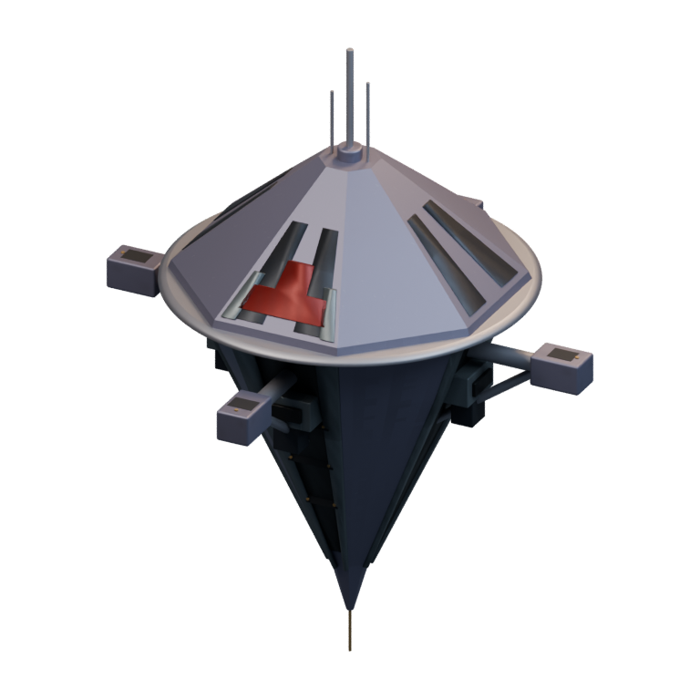
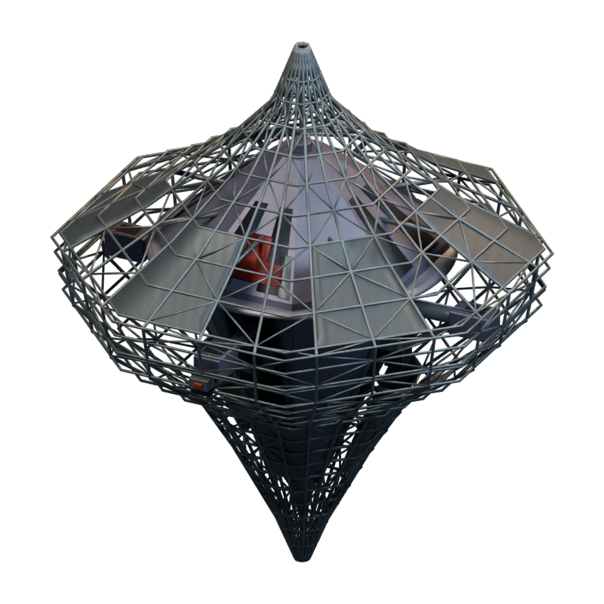
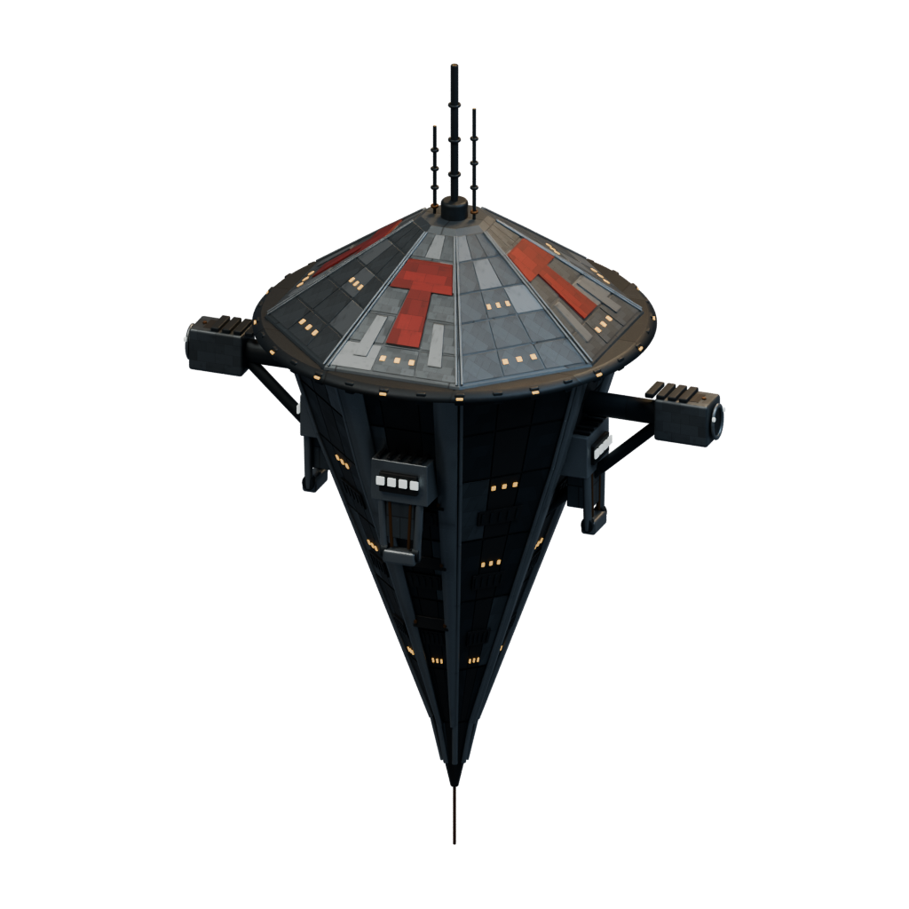
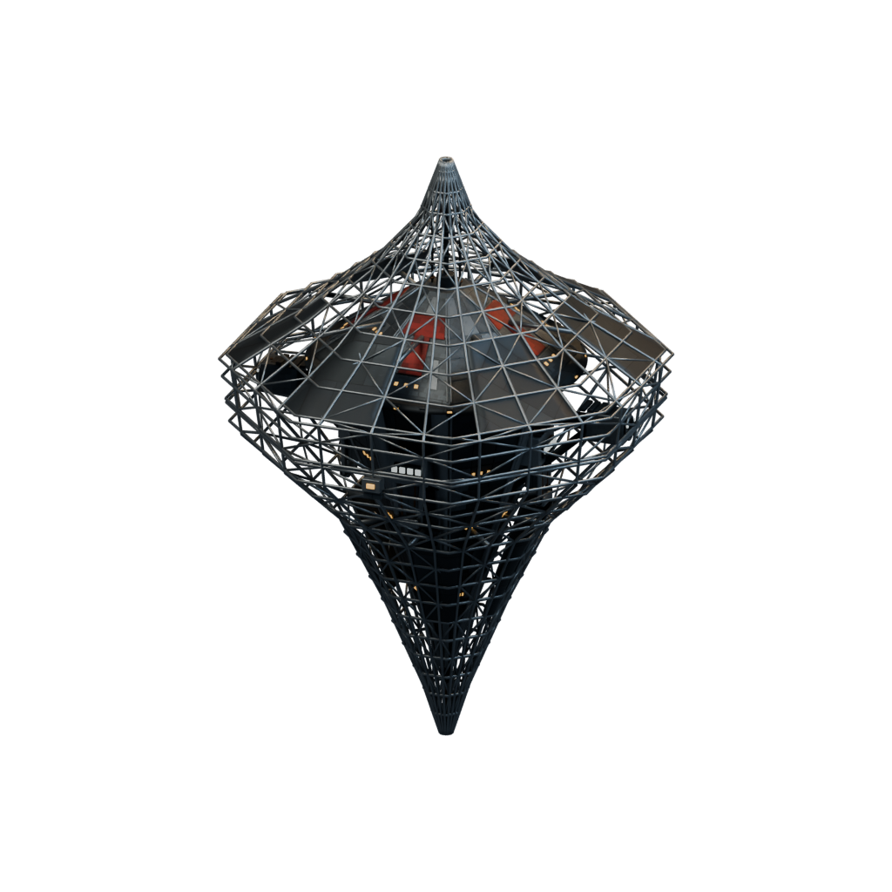
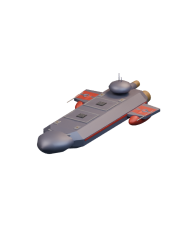

# Ships / Terran

[All groups](README.md)

## Assault Fighter

`openfa:assault-fighter`

**First available iteration — layered-construction**

[Blend](../sources/objects/terran/assault-fighter/model.blend) · [GLB](../sources/objects/terran/assault-fighter/model.glb)

Additional views: [Frame foundation](../gallery/media/objects/terran/assault-fighter/construction/stage-01.png) · [Expanded frame](../gallery/media/objects/terran/assault-fighter/construction/stage-02.png) · [Solid components](../gallery/media/objects/terran/assault-fighter/construction/stage-03.png) · [Partial skin](../gallery/media/objects/terran/assault-fighter/construction/stage-04.png) · [Complete skin](../gallery/media/objects/terran/assault-fighter/construction/stage-05.png)

[Play animation: Assault Fighter — complete 3D construction and hangar transfer](../gallery/media/objects/terran/ship-yard/hangar/complete-3d-assault-fighter.webm)

## Combat Eagle

`openfa:combat-eagle`

**First available iteration — layered-construction**

[Blend](../sources/objects/terran/combat-eagle/model.blend) · [GLB](../sources/objects/terran/combat-eagle/model.glb)

Additional views: [Frame foundation](../gallery/media/objects/terran/combat-eagle/construction/stage-01.png) · [Expanded frame](../gallery/media/objects/terran/combat-eagle/construction/stage-02.png) · [Solid components](../gallery/media/objects/terran/combat-eagle/construction/stage-03.png) · [Partial skin](../gallery/media/objects/terran/combat-eagle/construction/stage-04.png) · [Complete skin](../gallery/media/objects/terran/combat-eagle/construction/stage-05.png)

[Play animation: Combat Eagle — complete 3D construction and hangar transfer](../gallery/media/objects/terran/ship-yard/hangar/complete-3d-combat-eagle.webm)

## Scoutship

`openfa:scoutship`

**First available iteration — layered-construction**

[Blend](../sources/objects/terran/scoutship/model.blend) · [GLB](../sources/objects/terran/scoutship/model.glb)

Additional views: [Frame foundation](../gallery/media/objects/terran/scoutship/construction/stage-01.png) · [Expanded frame](../gallery/media/objects/terran/scoutship/construction/stage-02.png) · [Solid components](../gallery/media/objects/terran/scoutship/construction/stage-03.png) · [Partial skin](../gallery/media/objects/terran/scoutship/construction/stage-04.png) · [Complete skin](../gallery/media/objects/terran/scoutship/construction/stage-05.png)

[Play animation: Scoutship — complete 3D construction and hangar transfer](../gallery/media/objects/terran/ship-yard/hangar/complete-3d-scoutship.webm)

## Destructor

`openfa:destructor`

**First available iteration — initial-reference-study**

[Blend](../sources/docs/assets/reconstruction/ships/terran/destructor/model.blend) · [GLB](../sources/docs/assets/reconstruction/ships/terran/destructor/model.glb)

Additional views: [Retrospective concept (interpretations limited)](../gallery/media/concepts/terran/destructor-review-1.png) · [Protocol review: actual imported front](../gallery/media/docs/assets/reconstruction/evidence/destructor-protocol/imported-front-quarter.png) · [Protocol review: actual imported rear](../gallery/media/docs/assets/reconstruction/evidence/destructor-protocol/imported-rear-quarter.png)

## Terminator

`openfa:terminator`

**First available iteration — shared-refined**

[Blend](../sources/objects/terran/terminator/refined/model.blend) · [GLB](../sources/objects/terran/terminator/refined/model.glb)

Additional views: [Retrospective concept (interpretations limited)](../gallery/media/concepts/terran/terminator-review-1.png) · [Protocol review: actual imported front](../gallery/media/docs/assets/reconstruction/evidence/terminator-protocol/imported-front-quarter.png) · [Protocol review: actual imported rear](../gallery/media/docs/assets/reconstruction/evidence/terminator-protocol/imported-rear-quarter.png)

[Play animation: Animation](../gallery/media/objects/terran/terminator/refined/animation-00.webm)

## Transporter

`openfa:transporter`

**First available iteration — transporter-study**

[Blend](../sources/docs/assets/bootstrap-3d/transporter-inspired/transporter.blend) · [GLB](../sources/docs/assets/bootstrap-3d/transporter-inspired/transporter.glb)

## Fleet Battleship

`openfa:fleet-battleship`

**First available iteration — shared-refined**

[Blend](../sources/objects/terran/fleet-battleship/refined/model.blend) · [GLB](../sources/objects/terran/fleet-battleship/refined/model.glb)

Additional views: [Retrospective concept (interpretations limited)](../gallery/media/concepts/terran/fleet-battleship-review-1.png) · [Protocol review: actual imported front](../gallery/media/docs/assets/reconstruction/evidence/fleet-battleship-protocol/imported-front-quarter.png) · [Protocol review: actual imported rear](../gallery/media/docs/assets/reconstruction/evidence/fleet-battleship-protocol/imported-rear-quarter.png)

[Play animation: Animation](../gallery/media/objects/terran/fleet-battleship/refined/animation-00.webm)

## Space Dock

`openfa:space-dock`

**First available iteration — initial-reference-study**

[Blend](../sources/docs/assets/reconstruction/ships/terran/space-dock/model.blend) · [GLB](../sources/docs/assets/reconstruction/ships/terran/space-dock/model.glb)

**Additional iteration — orbital-station-structural-refinement**

[Blend](../sources/docs/assets/reconstruction/orbital-station-refined/terran/space-dock/model.blend) · [GLB](../sources/docs/assets/reconstruction/orbital-station-refined/terran/space-dock/model.glb)

**Additional iteration — orbital-station-construction-refinement**

[Blend](../sources/docs/assets/reconstruction/orbital-station-construction/terran/space-dock/model.blend) · [GLB](../sources/docs/assets/reconstruction/orbital-station-construction/terran/space-dock/model.glb)

[Play animation: ConstructionActivity](../gallery/media/docs/assets/reconstruction/orbital-station-construction/terran/space-dock/animation-00.webm)

**Additional iteration — ps7c-detailed-refinement**

[Blend](../sources/objects/terran/space-dock/refined/model.blend) · [GLB](../sources/objects/terran/space-dock/refined/model.glb)

**Additional iteration — ps7c-detailed-construction**

[Blend](../sources/objects/terran/space-dock/construction/model.blend) · [GLB](../sources/objects/terran/space-dock/construction/model.glb)

[Play animation: ConstructionActivity](../gallery/media/objects/terran/space-dock/construction/animation-00.webm)

## Command Cruiser

`openfa:command-cruiser`

**First available iteration — shared-refined**

[Blend](../sources/objects/terran/command-cruiser/refined/model.blend) · [GLB](../sources/objects/terran/command-cruiser/refined/model.glb)

Additional views: [Concept iteration 1: rejected anatomy](../gallery/media/concepts/terran/command-cruiser-review-1.png) · [Concept iteration 2: selected after legacy wire feedback](../gallery/media/concepts/terran/command-cruiser-review-2.png) · [Protocol review: actual imported front](../gallery/media/docs/assets/reconstruction/evidence/command-cruiser-protocol/imported-front-quarter.png) · [Protocol review: actual imported rear](../gallery/media/docs/assets/reconstruction/evidence/command-cruiser-protocol/imported-rear-quarter.png)

[Play animation: Animation](../gallery/media/objects/terran/command-cruiser/refined/animation-00.webm)

## Spy Satellite

`openfa:spy-satellite`

**First available iteration — initial-reference-study**

[Blend](../sources/docs/assets/reconstruction/ships/terran/spy-satellite/model.blend) · [GLB](../sources/docs/assets/reconstruction/ships/terran/spy-satellite/model.glb)
