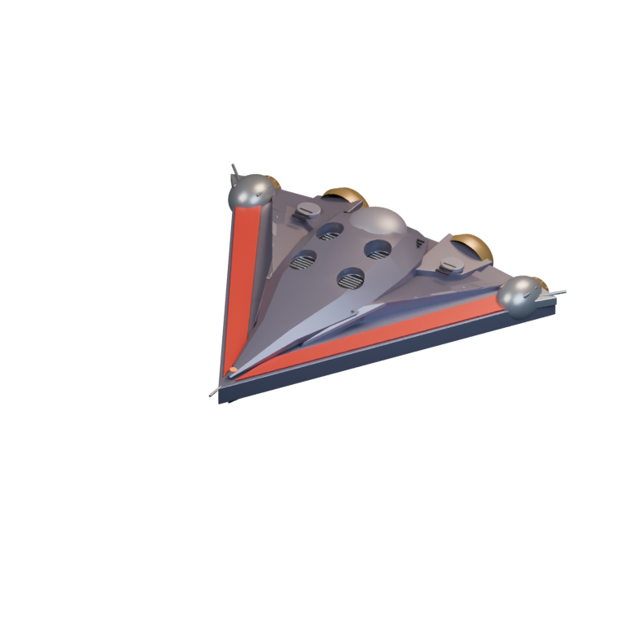
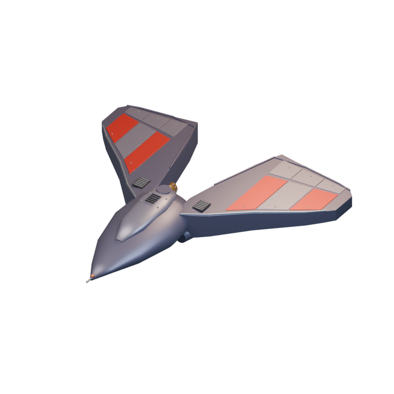
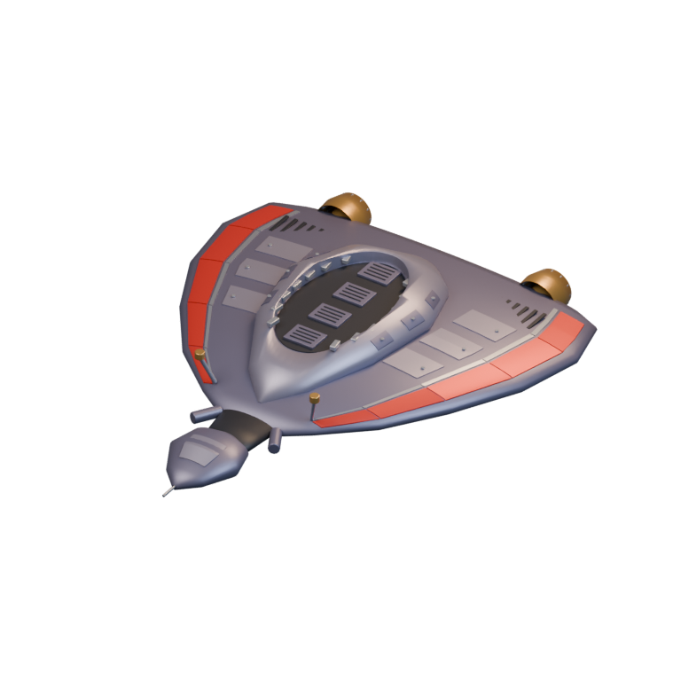
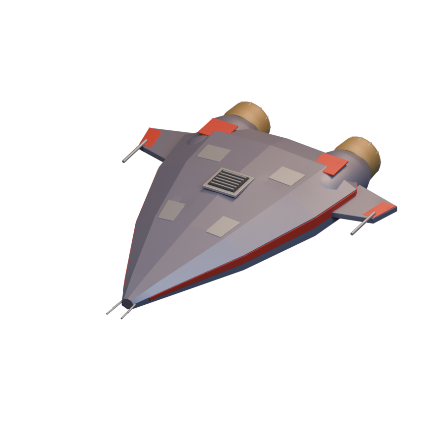
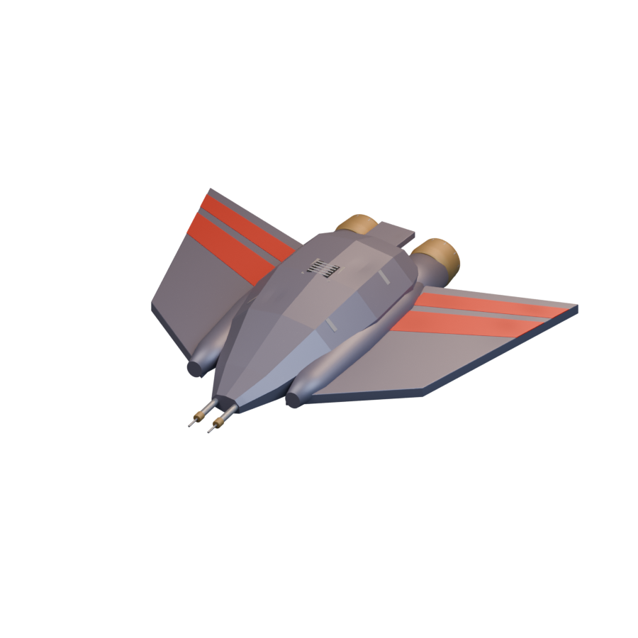
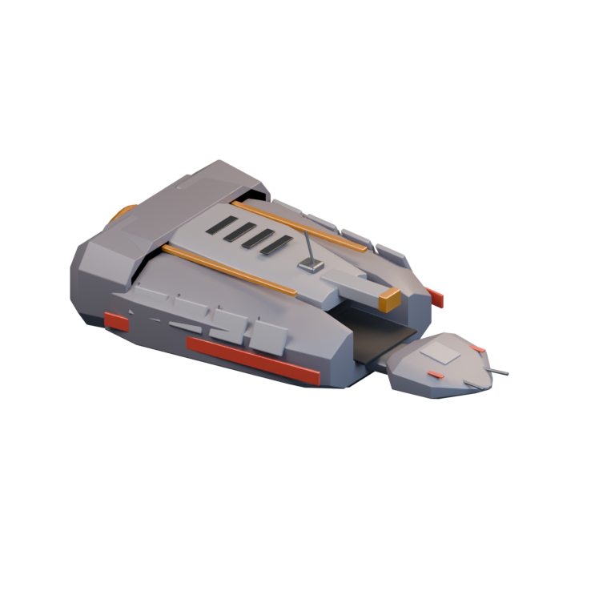
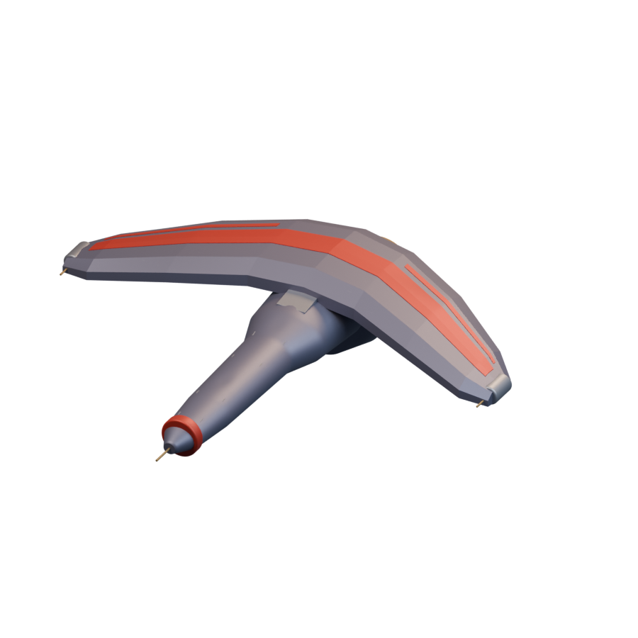
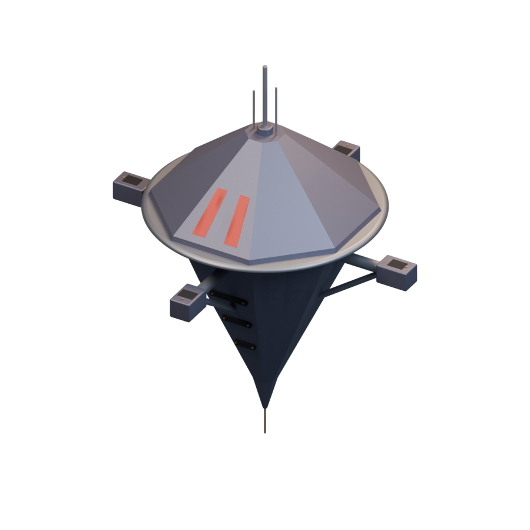
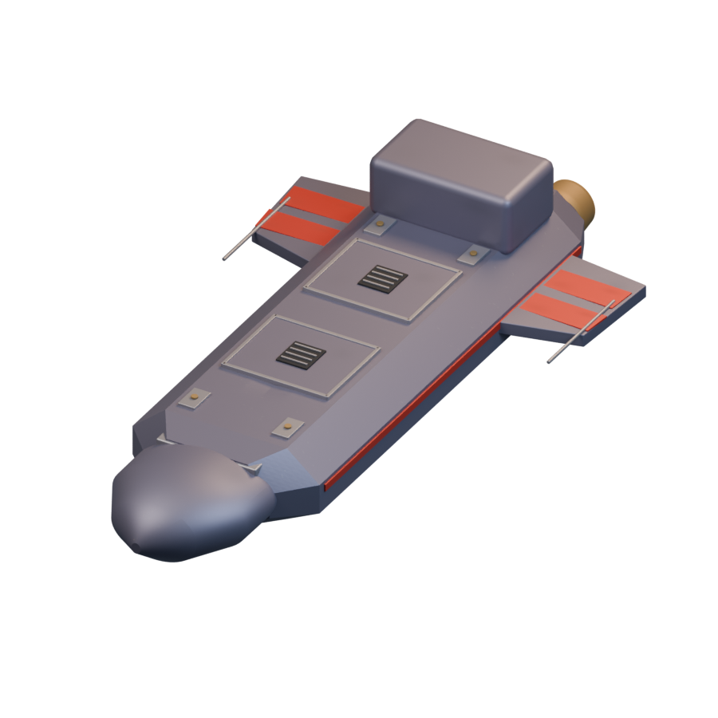
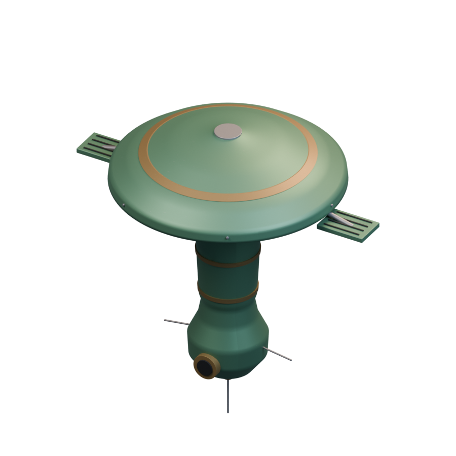

# Ships / Terran

[All groups](README.md)

## Assault Fighter

`openfa:assault-fighter`

**First available iteration — reference-refined-study**

[Blend](../sources/docs/assets/reconstruction/ships/terran/assault-fighter/model.blend) · [GLB](../sources/docs/assets/reconstruction/ships/terran/assault-fighter/model.glb)

## Combat Eagle

`openfa:combat-eagle`

**First available iteration — reference-refined-study**

[Blend](../sources/docs/assets/reconstruction/ships/terran/combat-eagle/model.blend) · [GLB](../sources/docs/assets/reconstruction/ships/terran/combat-eagle/model.glb)

## Scoutship

`openfa:scoutship`

**First available iteration — reference-refined-study**

[Blend](../sources/docs/assets/reconstruction/ships/terran/scoutship/model.blend) · [GLB](../sources/docs/assets/reconstruction/ships/terran/scoutship/model.glb)

## Destructor

`openfa:destructor`

**First available iteration — initial-reference-study**

[Blend](../sources/docs/assets/reconstruction/ships/terran/destructor/model.blend) · [GLB](../sources/docs/assets/reconstruction/ships/terran/destructor/model.glb)

## Terminator

`openfa:terminator`

**First available iteration — initial-reference-study**

[Blend](../sources/docs/assets/reconstruction/ships/terran/terminator/model.blend) · [GLB](../sources/docs/assets/reconstruction/ships/terran/terminator/model.glb)

## Transporter

`openfa:transporter`

**First available iteration — transporter-study**

[Blend](../sources/docs/assets/bootstrap-3d/transporter-inspired/transporter.blend) · [GLB](../sources/docs/assets/bootstrap-3d/transporter-inspired/transporter.glb)

## Fleet Battleship

`openfa:fleet-battleship`

**First available iteration — initial-reference-study**

[Blend](../sources/docs/assets/reconstruction/ships/terran/fleet-battleship/model.blend) · [GLB](../sources/docs/assets/reconstruction/ships/terran/fleet-battleship/model.glb)

## Space Dock

`openfa:space-dock`

**First available iteration — initial-reference-study**

[Blend](../sources/docs/assets/reconstruction/ships/terran/space-dock/model.blend) · [GLB](../sources/docs/assets/reconstruction/ships/terran/space-dock/model.glb)

## Command Cruiser

`openfa:command-cruiser`

**First available iteration — initial-reference-study**

[Blend](../sources/docs/assets/reconstruction/ships/terran/command-cruiser/model.blend) · [GLB](../sources/docs/assets/reconstruction/ships/terran/command-cruiser/model.glb)

## Spy Satellite

`openfa:spy-satellite`

**First available iteration — initial-reference-study**

[Blend](../sources/docs/assets/reconstruction/ships/terran/spy-satellite/model.blend) · [GLB](../sources/docs/assets/reconstruction/ships/terran/spy-satellite/model.glb)
