# Trading-Goods / Shared

[All groups](README.md)

## Beers

`trade:TI001`

**First available iteration — coloured-reconstruction**

[Blend](../sources/docs/assets/reconstruction/trading-goods/TI001/TI001.blend) · [GLB](../sources/docs/assets/reconstruction/trading-goods/TI001/TI001.glb)

## Wines

`trade:TI002`

**First available iteration — coloured-reconstruction**

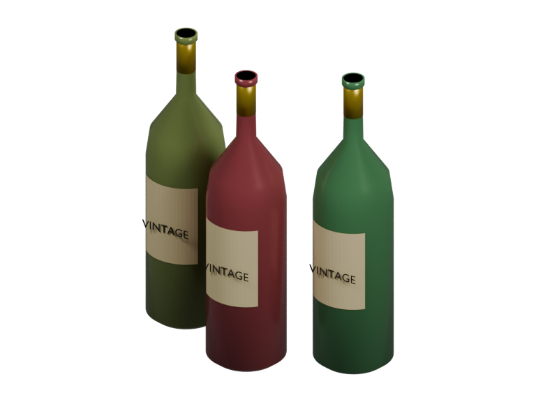

[Blend](../sources/docs/assets/reconstruction/trading-goods/TI002/TI002.blend) · [GLB](../sources/docs/assets/reconstruction/trading-goods/TI002/TI002.glb)

## Altarian Panther Sweat

`trade:TI003`

**First available iteration — coloured-reconstruction**

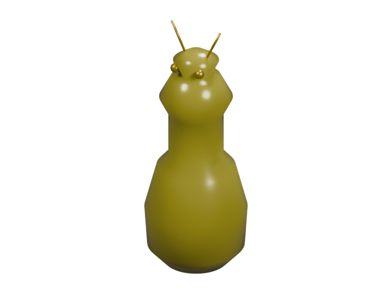

[Blend](../sources/docs/assets/reconstruction/trading-goods/TI003/TI003.blend) · [GLB](../sources/docs/assets/reconstruction/trading-goods/TI003/TI003.glb)

## St.Etienne's Real Cream & Honey Liqueur

`trade:TI004`

**First available iteration — coloured-reconstruction**

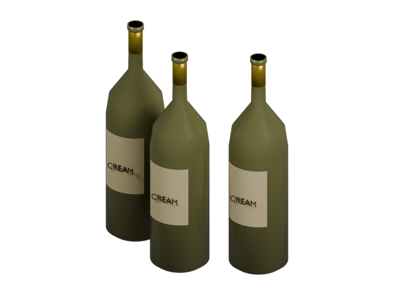

[Blend](../sources/docs/assets/reconstruction/trading-goods/TI004/TI004.blend) · [GLB](../sources/docs/assets/reconstruction/trading-goods/TI004/TI004.glb)

## Muet & Champignon vintage champagne

`trade:TI005`

**First available iteration — coloured-reconstruction**

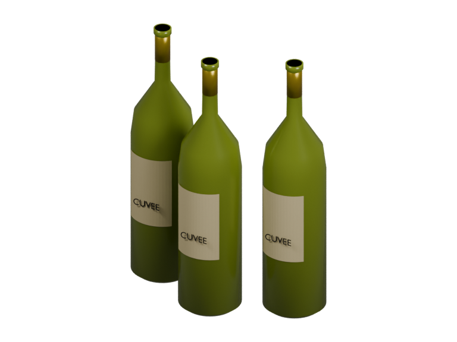

[Blend](../sources/docs/assets/reconstruction/trading-goods/TI005/TI005.blend) · [GLB](../sources/docs/assets/reconstruction/trading-goods/TI005/TI005.glb)

## Fizzimo Lumiere

`trade:TI006`

**First available iteration — coloured-reconstruction**

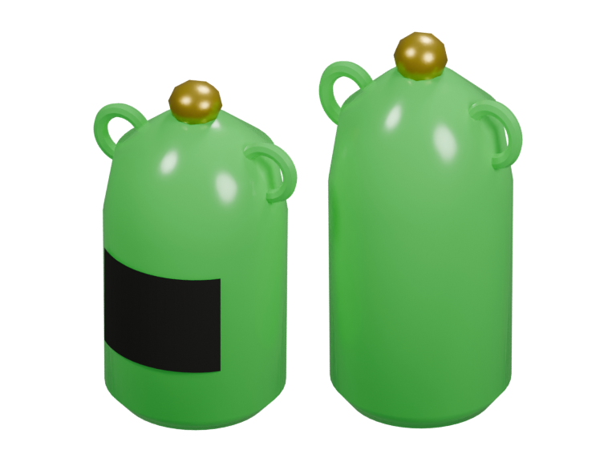

[Blend](../sources/docs/assets/reconstruction/trading-goods/TI006/TI006.blend) · [GLB](../sources/docs/assets/reconstruction/trading-goods/TI006/TI006.glb)

## Bristol glass

`trade:TI007`

**First available iteration — coloured-reconstruction**

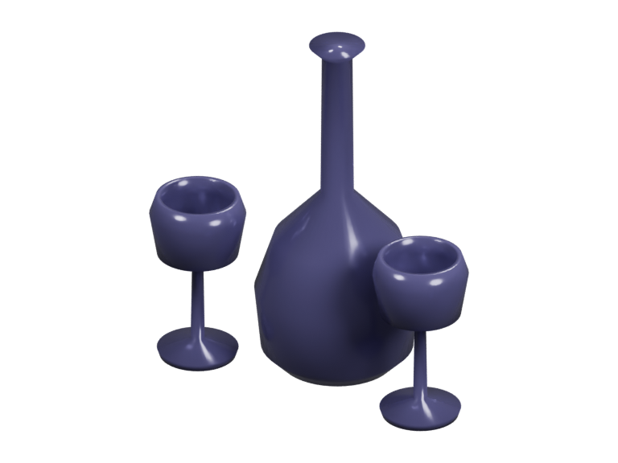

[Blend](../sources/docs/assets/reconstruction/trading-goods/TI007/TI007.blend) · [GLB](../sources/docs/assets/reconstruction/trading-goods/TI007/TI007.glb)

## Crystal Cantata Inc. products

`trade:TI008`

**First available iteration — coloured-reconstruction**

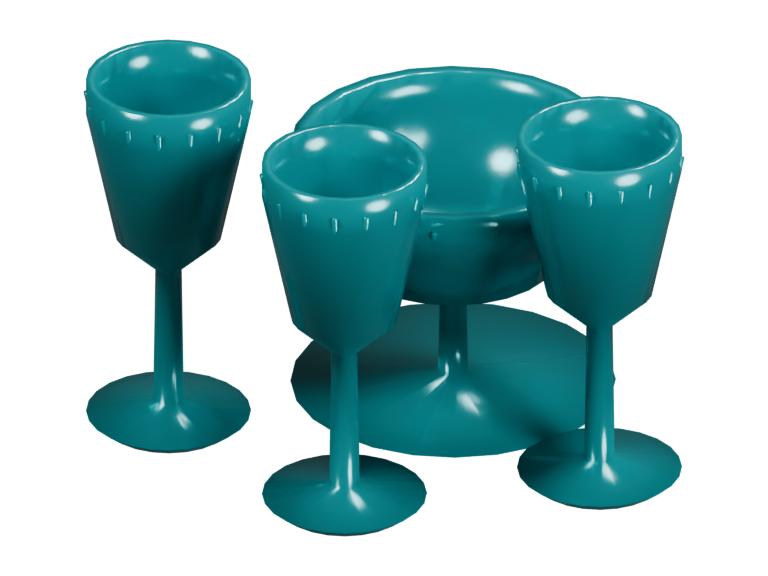

[Blend](../sources/docs/assets/reconstruction/trading-goods/TI008/TI008.blend) · [GLB](../sources/docs/assets/reconstruction/trading-goods/TI008/TI008.glb)

## Deep pile velvet

`trade:TI009`

**First available iteration — coloured-reconstruction**

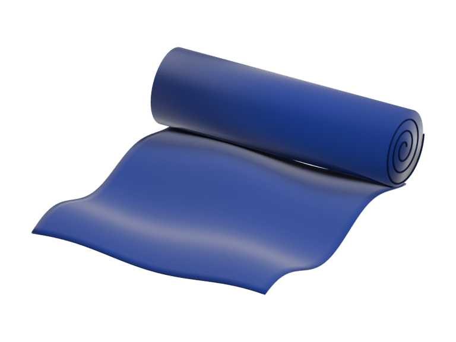

[Blend](../sources/docs/assets/reconstruction/trading-goods/TI009/TI009.blend) · [GLB](../sources/docs/assets/reconstruction/trading-goods/TI009/TI009.glb)

## Silk

`trade:TI010`

**First available iteration — coloured-reconstruction**

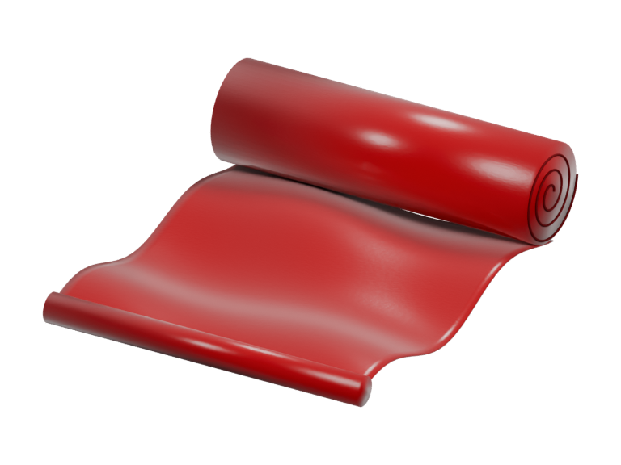

[Blend](../sources/docs/assets/reconstruction/trading-goods/TI010/TI010.blend) · [GLB](../sources/docs/assets/reconstruction/trading-goods/TI010/TI010.glb)

## Watered silk

`trade:TI011`

**First available iteration — coloured-reconstruction**

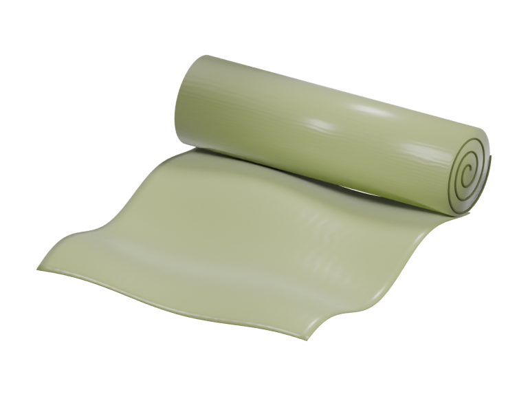

[Blend](../sources/docs/assets/reconstruction/trading-goods/TI011/TI011.blend) · [GLB](../sources/docs/assets/reconstruction/trading-goods/TI011/TI011.glb)

## Raw silk

`trade:TI012`

**First available iteration — coloured-reconstruction**

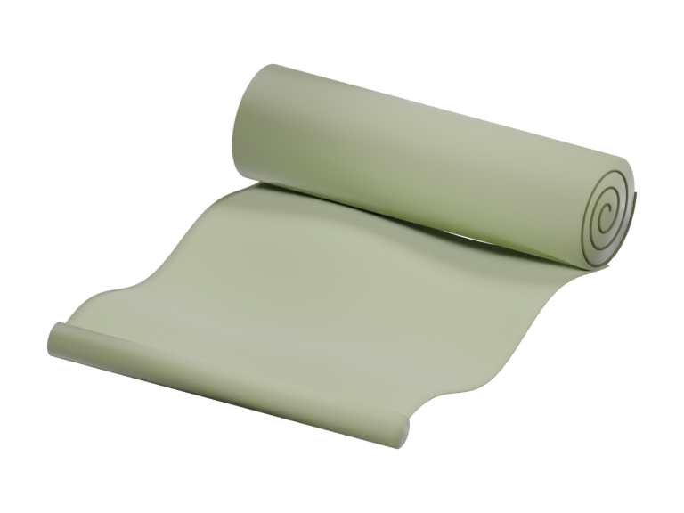

[Blend](../sources/docs/assets/reconstruction/trading-goods/TI012/TI012.blend) · [GLB](../sources/docs/assets/reconstruction/trading-goods/TI012/TI012.glb)

## Satin taffeta

`trade:TI013`

**First available iteration — coloured-reconstruction**

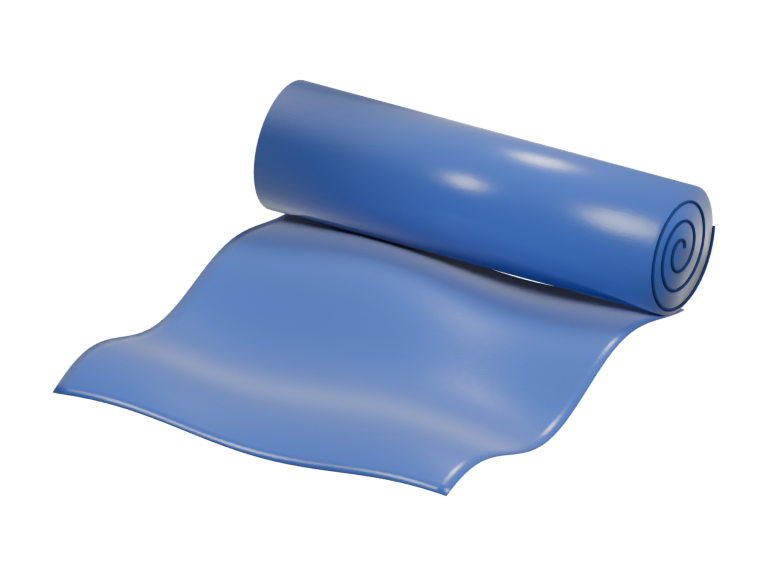

[Blend](../sources/docs/assets/reconstruction/trading-goods/TI013/TI013.blend) · [GLB](../sources/docs/assets/reconstruction/trading-goods/TI013/TI013.glb)

## Egyptian sea-cotton

`trade:TI014`

**First available iteration — coloured-reconstruction**

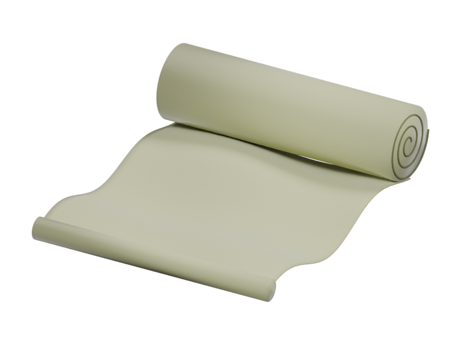

[Blend](../sources/docs/assets/reconstruction/trading-goods/TI014/TI014.blend) · [GLB](../sources/docs/assets/reconstruction/trading-goods/TI014/TI014.glb)

## Achaean angora

`trade:TI015`

**First available iteration — coloured-reconstruction**

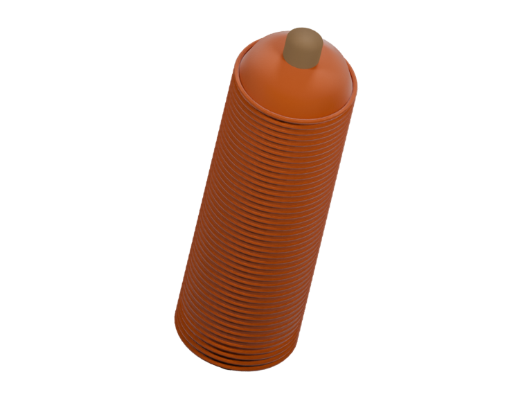

[Blend](../sources/docs/assets/reconstruction/trading-goods/TI015/TI015.blend) · [GLB](../sources/docs/assets/reconstruction/trading-goods/TI015/TI015.glb)

## Tiara & Bracelet set

`trade:TI016`

**First available iteration — coloured-reconstruction**

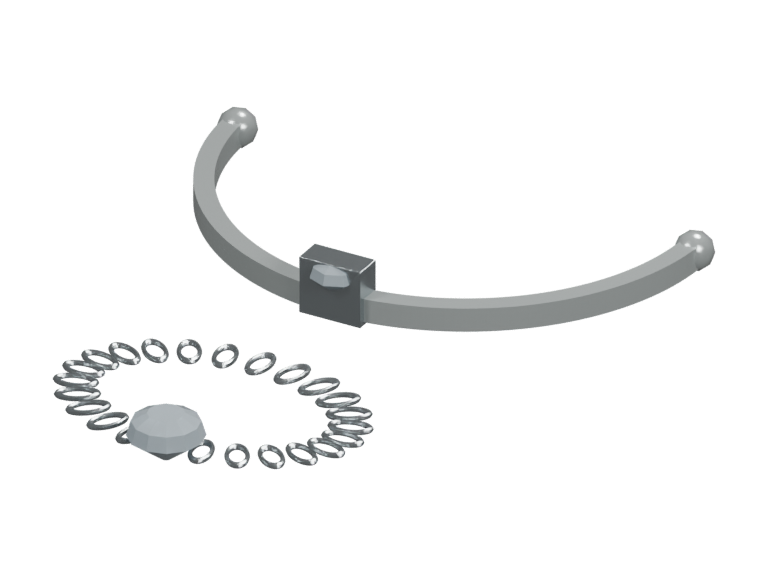

[Blend](../sources/docs/assets/reconstruction/trading-goods/TI016/TI016.blend) · [GLB](../sources/docs/assets/reconstruction/trading-goods/TI016/TI016.glb)

## Choker

`trade:TI017`

**First available iteration — coloured-reconstruction**

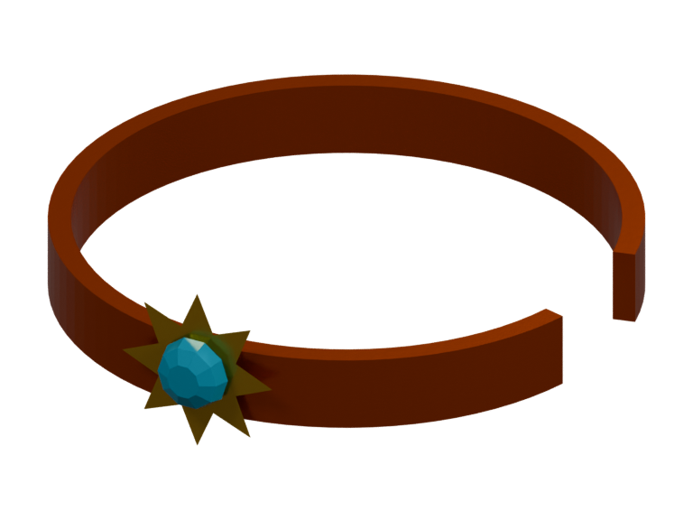

[Blend](../sources/docs/assets/reconstruction/trading-goods/TI017/TI017.blend) · [GLB](../sources/docs/assets/reconstruction/trading-goods/TI017/TI017.glb)

## Solitaire emerald

`trade:TI018`

**First available iteration — coloured-reconstruction**

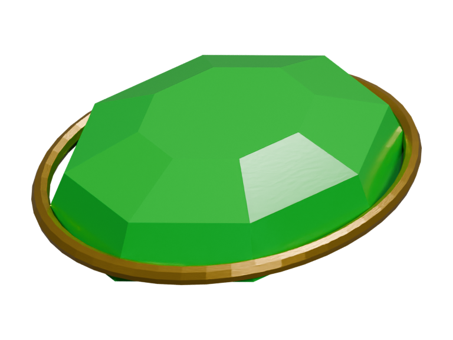

[Blend](../sources/docs/assets/reconstruction/trading-goods/TI018/TI018.blend) · [GLB](../sources/docs/assets/reconstruction/trading-goods/TI018/TI018.glb)

## Brooch

`trade:TI019`

**First available iteration — coloured-reconstruction**

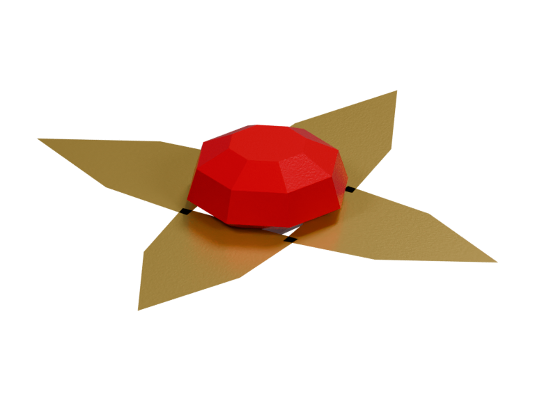

[Blend](../sources/docs/assets/reconstruction/trading-goods/TI019/TI019.blend) · [GLB](../sources/docs/assets/reconstruction/trading-goods/TI019/TI019.glb)

## Necklace

`trade:TI020`

**First available iteration — coloured-reconstruction**

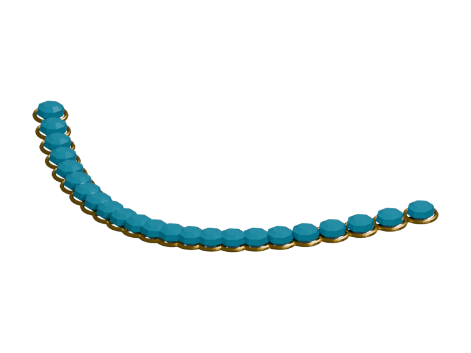

[Blend](../sources/docs/assets/reconstruction/trading-goods/TI020/TI020.blend) · [GLB](../sources/docs/assets/reconstruction/trading-goods/TI020/TI020.glb)

## Eternity ring

`trade:TI021`

**First available iteration — coloured-reconstruction**

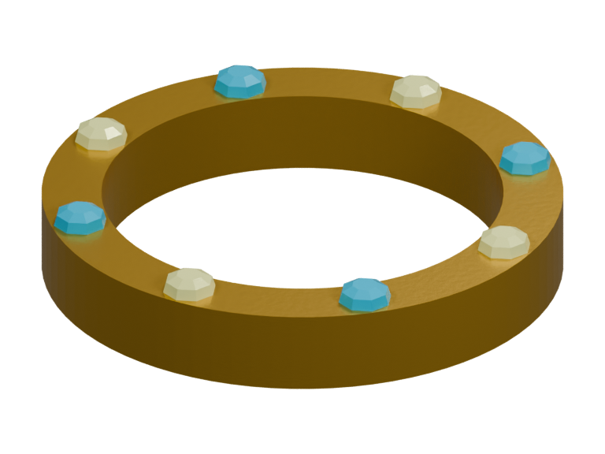

[Blend](../sources/docs/assets/reconstruction/trading-goods/TI021/TI021.blend) · [GLB](../sources/docs/assets/reconstruction/trading-goods/TI021/TI021.glb)

## Pectoral

`trade:TI022`

**First available iteration — coloured-reconstruction**

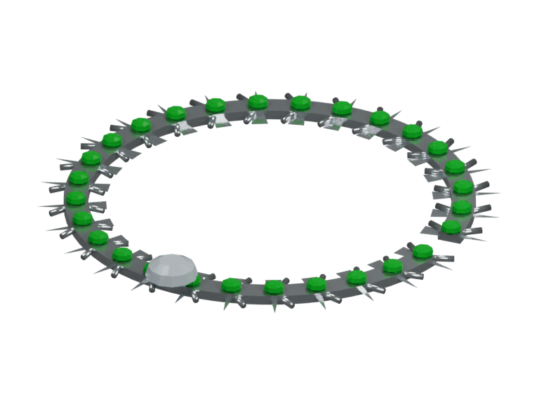

[Blend](../sources/docs/assets/reconstruction/trading-goods/TI022/TI022.blend) · [GLB](../sources/docs/assets/reconstruction/trading-goods/TI022/TI022.glb)

## Collar

`trade:TI023`

**First available iteration — coloured-reconstruction**

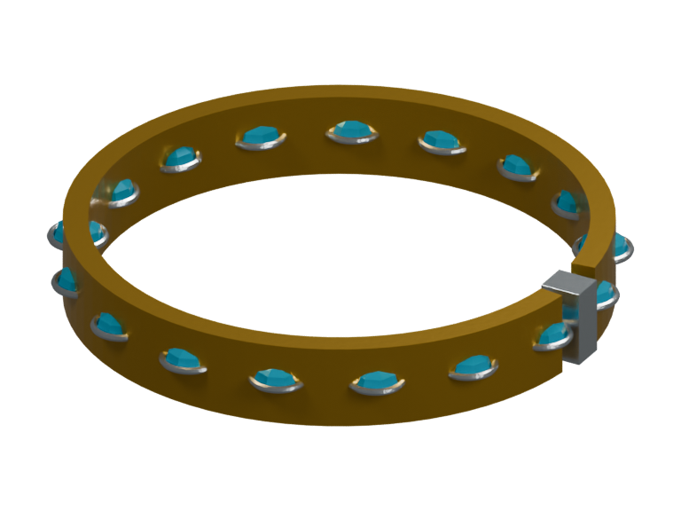

[Blend](../sources/docs/assets/reconstruction/trading-goods/TI023/TI023.blend) · [GLB](../sources/docs/assets/reconstruction/trading-goods/TI023/TI023.glb)

## 3-strand bracelet

`trade:TI024`

**First available iteration — coloured-reconstruction**

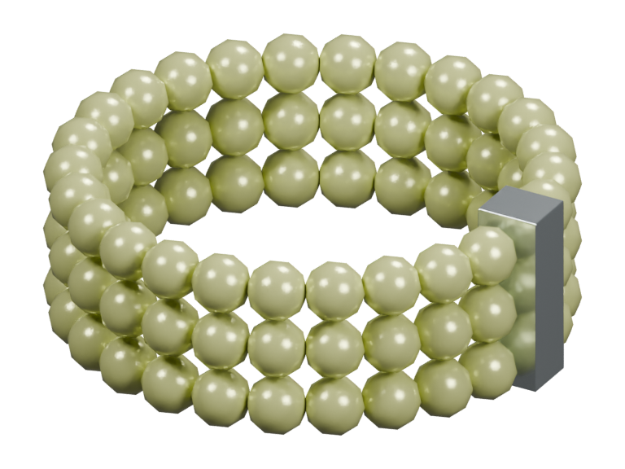

[Blend](../sources/docs/assets/reconstruction/trading-goods/TI024/TI024.blend) · [GLB](../sources/docs/assets/reconstruction/trading-goods/TI024/TI024.glb)

## Diamond

`trade:TI025`

**First available iteration — coloured-reconstruction**

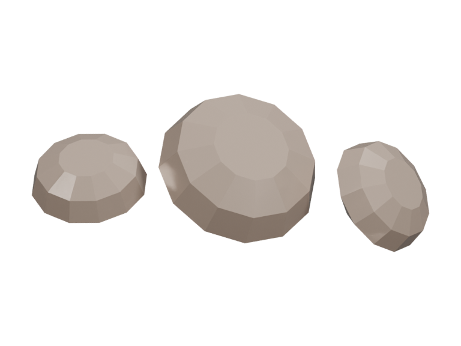

[Blend](../sources/docs/assets/reconstruction/trading-goods/TI025/TI025.blend) · [GLB](../sources/docs/assets/reconstruction/trading-goods/TI025/TI025.glb)

## Emerald

`trade:TI026`

**First available iteration — coloured-reconstruction**

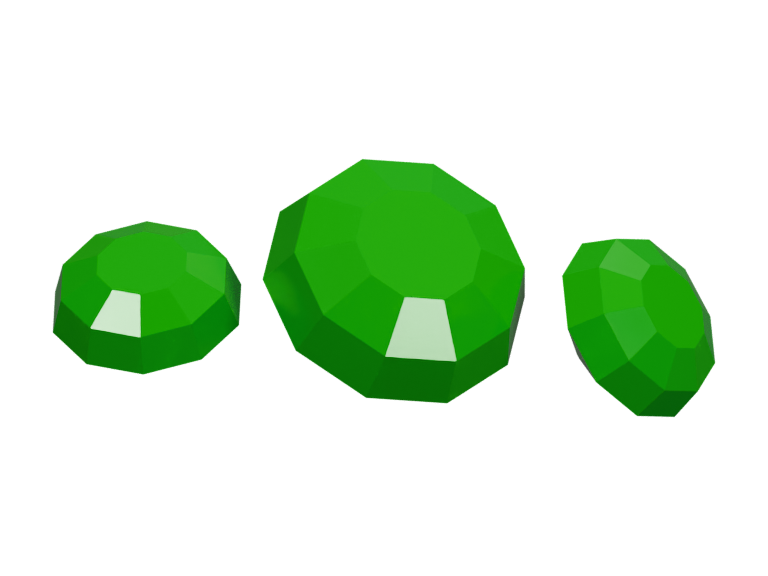

[Blend](../sources/docs/assets/reconstruction/trading-goods/TI026/TI026.blend) · [GLB](../sources/docs/assets/reconstruction/trading-goods/TI026/TI026.glb)

## Sapphire

`trade:TI027`

**First available iteration — coloured-reconstruction**

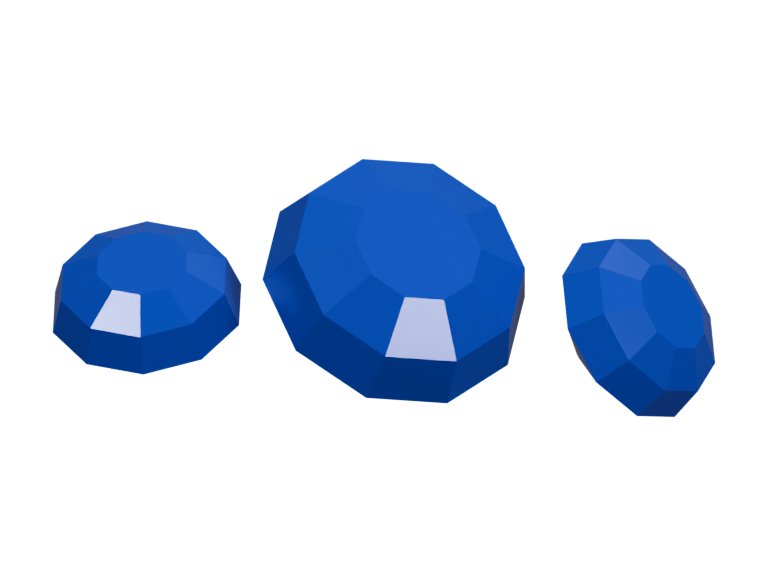

[Blend](../sources/docs/assets/reconstruction/trading-goods/TI027/TI027.blend) · [GLB](../sources/docs/assets/reconstruction/trading-goods/TI027/TI027.glb)

## Ruby

`trade:TI028`

**First available iteration — coloured-reconstruction**

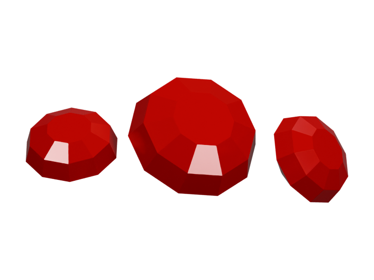

[Blend](../sources/docs/assets/reconstruction/trading-goods/TI028/TI028.blend) · [GLB](../sources/docs/assets/reconstruction/trading-goods/TI028/TI028.glb)

## Ultropaz

`trade:TI029`

**First available iteration — coloured-reconstruction**

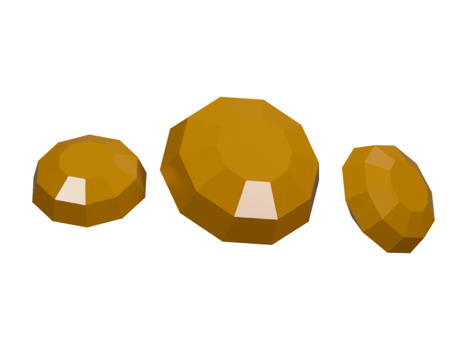

[Blend](../sources/docs/assets/reconstruction/trading-goods/TI029/TI029.blend) · [GLB](../sources/docs/assets/reconstruction/trading-goods/TI029/TI029.glb)

## Alexandrite

`trade:TI030`

**First available iteration — coloured-reconstruction**

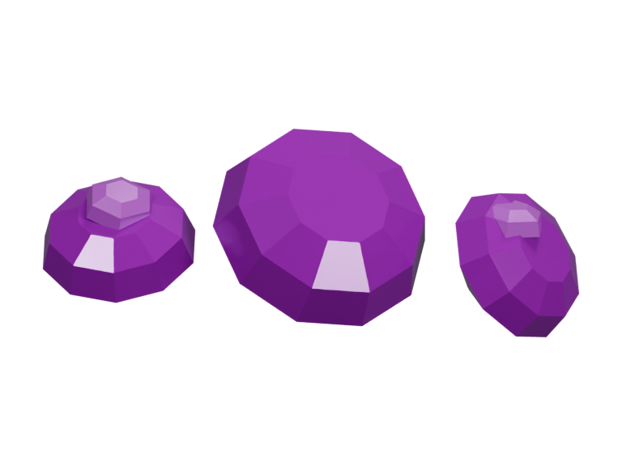

[Blend](../sources/docs/assets/reconstruction/trading-goods/TI030/TI030.blend) · [GLB](../sources/docs/assets/reconstruction/trading-goods/TI030/TI030.glb)

## Metachrome

`trade:TI031`

**First available iteration — coloured-reconstruction**

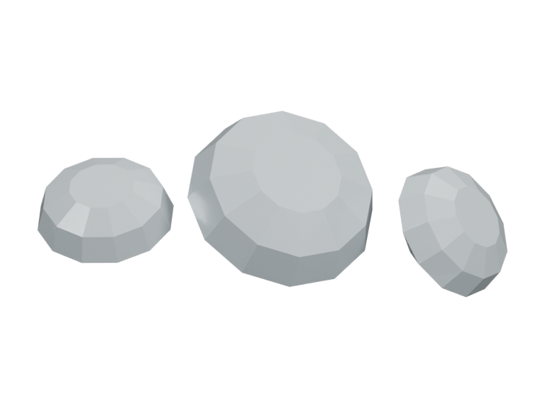

[Blend](../sources/docs/assets/reconstruction/trading-goods/TI031/TI031.blend) · [GLB](../sources/docs/assets/reconstruction/trading-goods/TI031/TI031.glb)

## Opal

`trade:TI032`

**First available iteration — coloured-reconstruction**

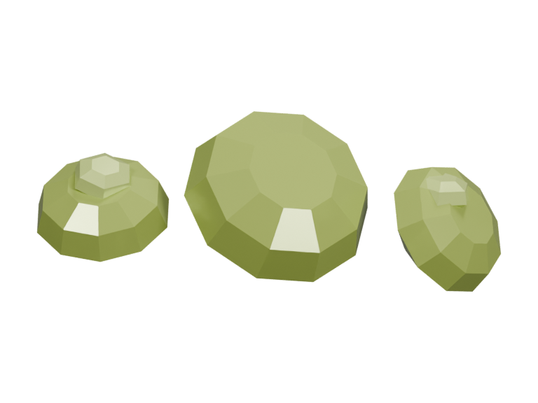

[Blend](../sources/docs/assets/reconstruction/trading-goods/TI032/TI032.blend) · [GLB](../sources/docs/assets/reconstruction/trading-goods/TI032/TI032.glb)

## Pearl

`trade:TI033`

**First available iteration — coloured-reconstruction**

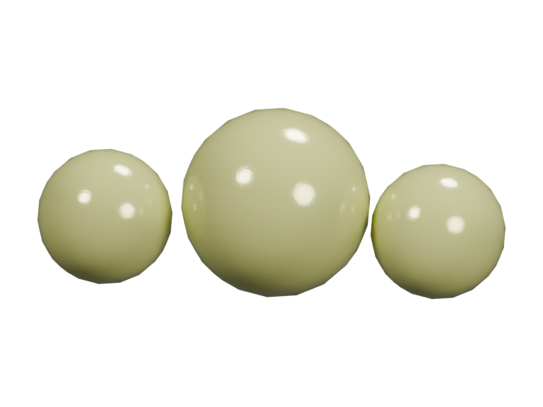

[Blend](../sources/docs/assets/reconstruction/trading-goods/TI033/TI033.blend) · [GLB](../sources/docs/assets/reconstruction/trading-goods/TI033/TI033.glb)

## Moonstone

`trade:TI034`

**First available iteration — coloured-reconstruction**

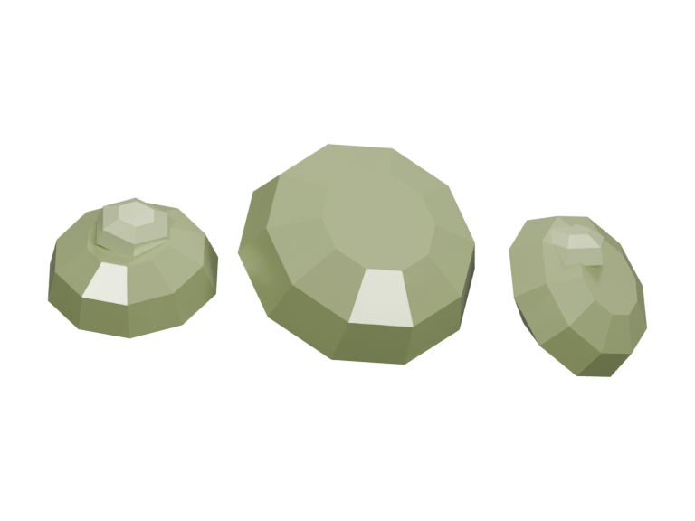

[Blend](../sources/docs/assets/reconstruction/trading-goods/TI034/TI034.blend) · [GLB](../sources/docs/assets/reconstruction/trading-goods/TI034/TI034.glb)

## Astramarine

`trade:TI035`

**First available iteration — coloured-reconstruction**

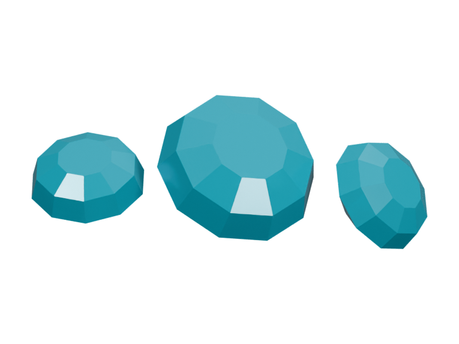

[Blend](../sources/docs/assets/reconstruction/trading-goods/TI035/TI035.blend) · [GLB](../sources/docs/assets/reconstruction/trading-goods/TI035/TI035.glb)

## Peridot

`trade:TI036`

**First available iteration — coloured-reconstruction**

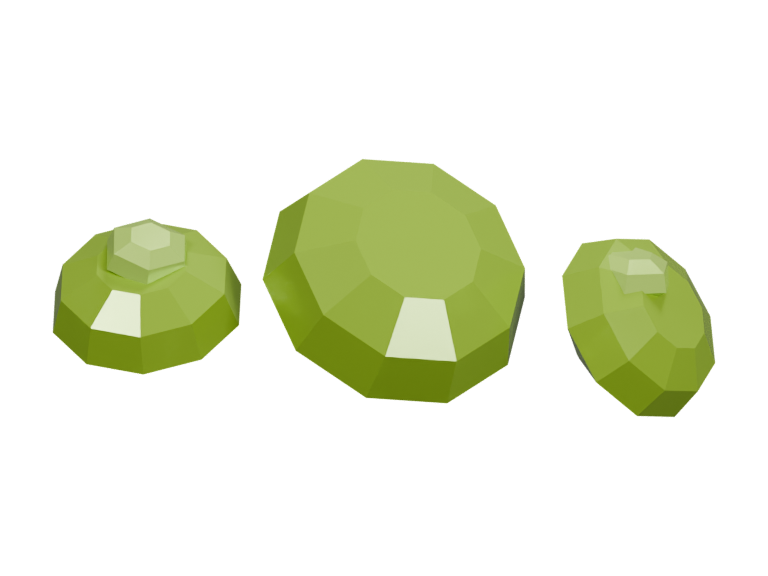

[Blend](../sources/docs/assets/reconstruction/trading-goods/TI036/TI036.blend) · [GLB](../sources/docs/assets/reconstruction/trading-goods/TI036/TI036.glb)

## Amethyst

`trade:TI037`

**First available iteration — coloured-reconstruction**

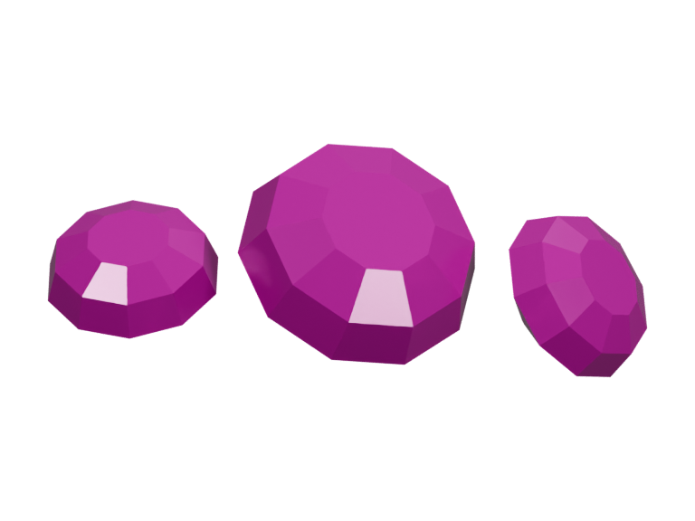

[Blend](../sources/docs/assets/reconstruction/trading-goods/TI037/TI037.blend) · [GLB](../sources/docs/assets/reconstruction/trading-goods/TI037/TI037.glb)

## Abstract Sculpture

`trade:TI038`

**First available iteration — coloured-reconstruction**

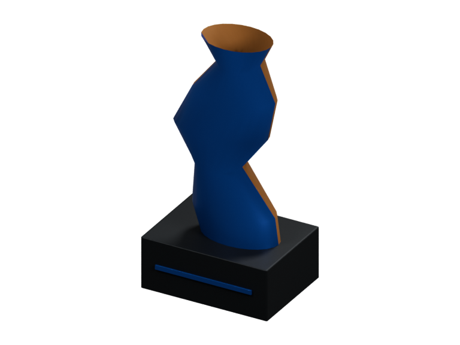

[Blend](../sources/docs/assets/reconstruction/trading-goods/TI038/TI038.blend) · [GLB](../sources/docs/assets/reconstruction/trading-goods/TI038/TI038.glb)

## Domestic interior units

`trade:TI039`

**First available iteration — coloured-reconstruction**

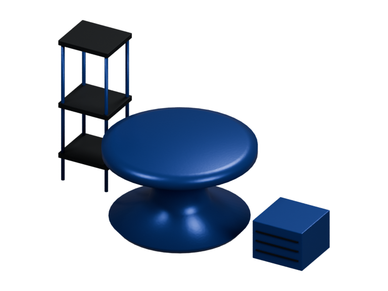

[Blend](../sources/docs/assets/reconstruction/trading-goods/TI039/TI039.blend) · [GLB](../sources/docs/assets/reconstruction/trading-goods/TI039/TI039.glb)

## Decorative drinking horns

`trade:TI040`

**First available iteration — coloured-reconstruction**

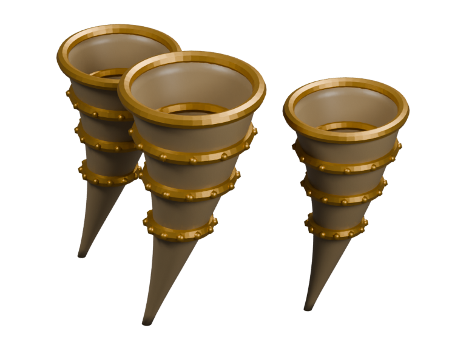

[Blend](../sources/docs/assets/reconstruction/trading-goods/TI040/TI040.blend) · [GLB](../sources/docs/assets/reconstruction/trading-goods/TI040/TI040.glb)

## Worked leather

`trade:TI041`

**First available iteration — coloured-reconstruction**

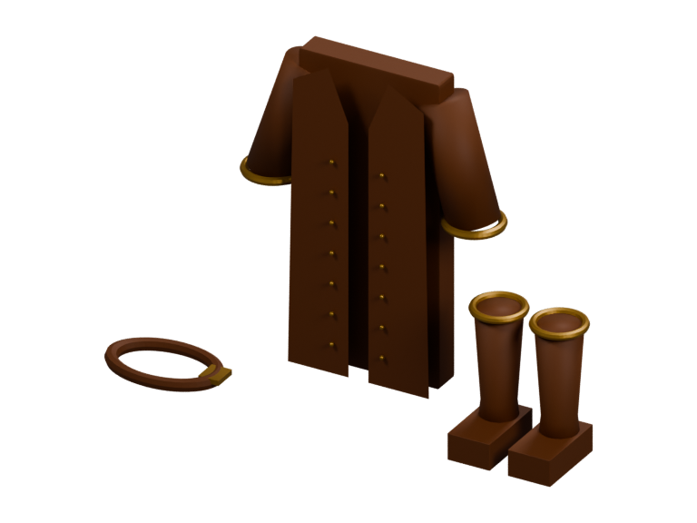

[Blend](../sources/docs/assets/reconstruction/trading-goods/TI041/TI041.blend) · [GLB](../sources/docs/assets/reconstruction/trading-goods/TI041/TI041.glb)

## Ornamental archaic weaponry

`trade:TI042`

**First available iteration — coloured-reconstruction**

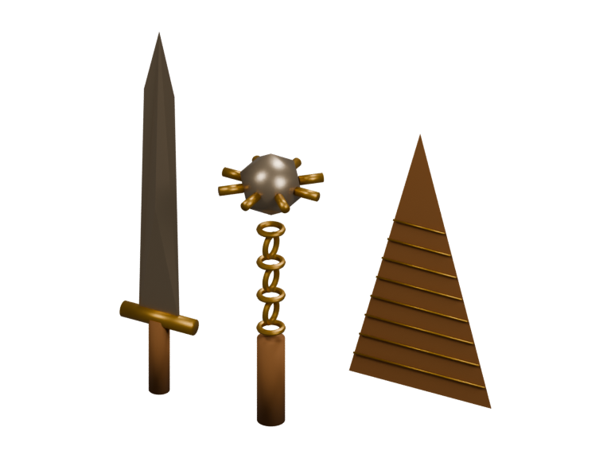

[Blend](../sources/docs/assets/reconstruction/trading-goods/TI042/TI042.blend) · [GLB](../sources/docs/assets/reconstruction/trading-goods/TI042/TI042.glb)

## Fizzimo Liqueurs

`trade:TI043`

**First available iteration — coloured-reconstruction**

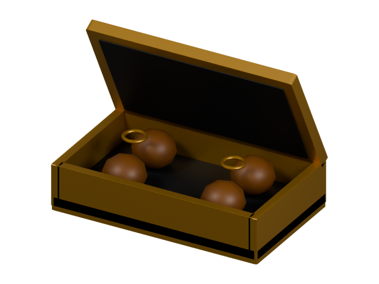

[Blend](../sources/docs/assets/reconstruction/trading-goods/TI043/TI043.blend) · [GLB](../sources/docs/assets/reconstruction/trading-goods/TI043/TI043.glb)

## Rigellian ant eggs

`trade:TI044`

**First available iteration — coloured-reconstruction**

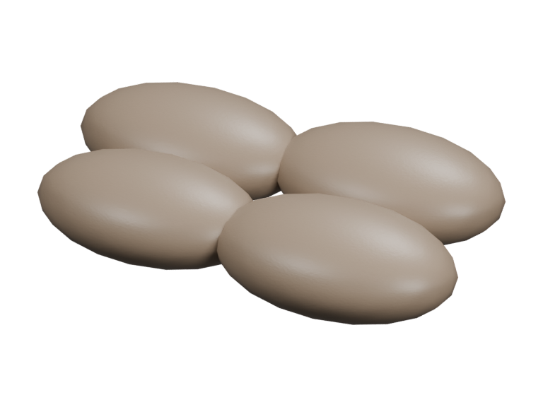

[Blend](../sources/docs/assets/reconstruction/trading-goods/TI044/TI044.blend) · [GLB](../sources/docs/assets/reconstruction/trading-goods/TI044/TI044.glb)

## Pearls dissolved in brandy

`trade:TI045`

**First available iteration — coloured-reconstruction**

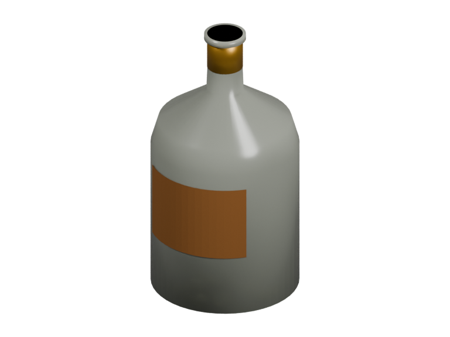

[Blend](../sources/docs/assets/reconstruction/trading-goods/TI045/TI045.blend) · [GLB](../sources/docs/assets/reconstruction/trading-goods/TI045/TI045.glb)

## Goat's ear mushrooms

`trade:TI046`

**First available iteration — coloured-reconstruction**

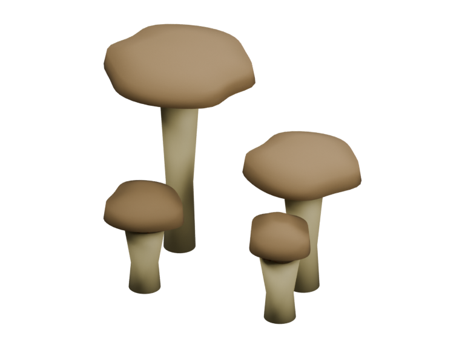

[Blend](../sources/docs/assets/reconstruction/trading-goods/TI046/TI046.blend) · [GLB](../sources/docs/assets/reconstruction/trading-goods/TI046/TI046.glb)

## Organic corn on the cob

`trade:TI047`

**First available iteration — coloured-reconstruction**

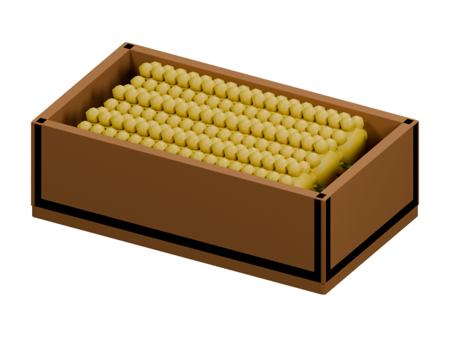

[Blend](../sources/docs/assets/reconstruction/trading-goods/TI047/TI047.blend) · [GLB](../sources/docs/assets/reconstruction/trading-goods/TI047/TI047.glb)

## Braccatian kulos cheese

`trade:TI048`

**First available iteration — coloured-reconstruction**

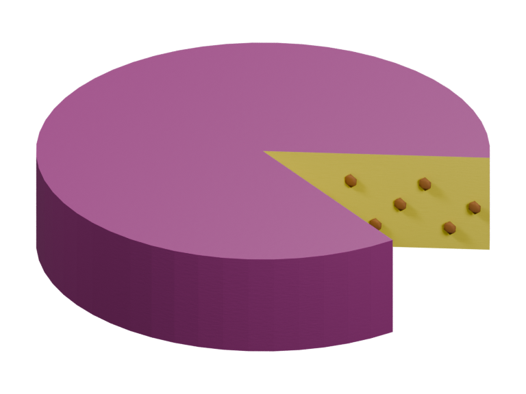

[Blend](../sources/docs/assets/reconstruction/trading-goods/TI048/TI048.blend) · [GLB](../sources/docs/assets/reconstruction/trading-goods/TI048/TI048.glb)

## Grains

`trade:TI049`

**First available iteration — coloured-reconstruction**

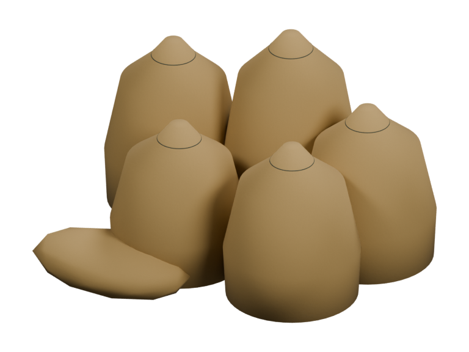

[Blend](../sources/docs/assets/reconstruction/trading-goods/TI049/TI049.blend) · [GLB](../sources/docs/assets/reconstruction/trading-goods/TI049/TI049.glb)

## Seaweed

`trade:TI050`

**First available iteration — coloured-reconstruction**

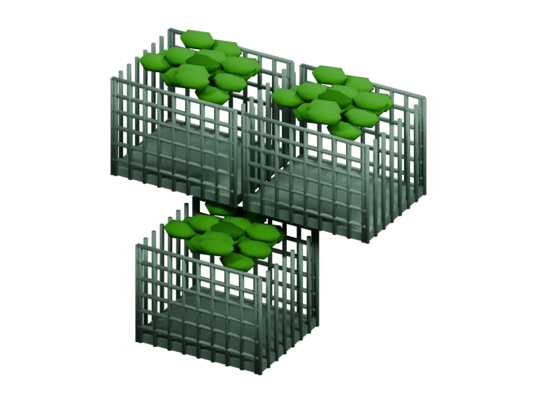

[Blend](../sources/docs/assets/reconstruction/trading-goods/TI050/TI050.blend) · [GLB](../sources/docs/assets/reconstruction/trading-goods/TI050/TI050.glb)

## Krill

`trade:TI051`

**First available iteration — coloured-reconstruction**

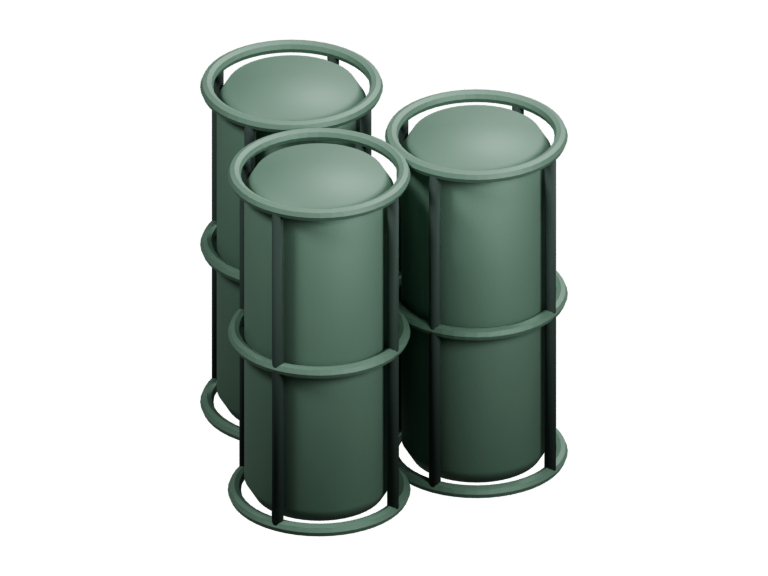

[Blend](../sources/docs/assets/reconstruction/trading-goods/TI051/TI051.blend) · [GLB](../sources/docs/assets/reconstruction/trading-goods/TI051/TI051.glb)

## Water

`trade:TI052`

**First available iteration — coloured-reconstruction**

[Blend](../sources/docs/assets/reconstruction/trading-goods/TI052/TI052.blend) · [GLB](../sources/docs/assets/reconstruction/trading-goods/TI052/TI052.glb)

## Ortok's Mansions

`trade:TI053`

**First available iteration — coloured-reconstruction**

[Blend](../sources/docs/assets/reconstruction/trading-goods/TI053/TI053.blend) · [GLB](../sources/docs/assets/reconstruction/trading-goods/TI053/TI053.glb)

## Shades of Brutos

`trade:TI054`

**First available iteration — coloured-reconstruction**

[Blend](../sources/docs/assets/reconstruction/trading-goods/TI054/TI054.blend) · [GLB](../sources/docs/assets/reconstruction/trading-goods/TI054/TI054.glb)

## Huskar Cigars

`trade:TI055`

**First available iteration — coloured-reconstruction**

[Blend](../sources/docs/assets/reconstruction/trading-goods/TI055/TI055.blend) · [GLB](../sources/docs/assets/reconstruction/trading-goods/TI055/TI055.glb)

## Maunik's Cube

`trade:TI056`

**First available iteration — coloured-reconstruction**

[Blend](../sources/docs/assets/reconstruction/trading-goods/TI056/TI056.blend) · [GLB](../sources/docs/assets/reconstruction/trading-goods/TI056/TI056.glb)

## Gong of Death Song

`trade:TI057`

**First available iteration — coloured-reconstruction**

[Blend](../sources/docs/assets/reconstruction/trading-goods/TI057/TI057.blend) · [GLB](../sources/docs/assets/reconstruction/trading-goods/TI057/TI057.glb)

## Holostar globes

`trade:TI058`

**First available iteration — coloured-reconstruction**

[Blend](../sources/docs/assets/reconstruction/trading-goods/TI058/TI058.blend) · [GLB](../sources/docs/assets/reconstruction/trading-goods/TI058/TI058.glb)

## Besthelda's Apothecary

`trade:TI059`

**First available iteration — coloured-reconstruction**

[Blend](../sources/docs/assets/reconstruction/trading-goods/TI059/TI059.blend) · [GLB](../sources/docs/assets/reconstruction/trading-goods/TI059/TI059.glb)

## Photoplasmic Cocoon

`trade:TI060`

**First available iteration — coloured-reconstruction**

[Blend](../sources/docs/assets/reconstruction/trading-goods/TI060/TI060.blend) · [GLB](../sources/docs/assets/reconstruction/trading-goods/TI060/TI060.glb)

## Steam Racers

`trade:TI061`

**First available iteration — coloured-reconstruction**

[Blend](../sources/docs/assets/reconstruction/trading-goods/TI061/TI061.blend) · [GLB](../sources/docs/assets/reconstruction/trading-goods/TI061/TI061.glb)

## KKZ Quad

`trade:TI062`

**First available iteration — coloured-reconstruction**

[Blend](../sources/docs/assets/reconstruction/trading-goods/TI062/TI062.blend) · [GLB](../sources/docs/assets/reconstruction/trading-goods/TI062/TI062.glb)

## Kraagil Oil

`trade:TI063`

**First available iteration — coloured-reconstruction**

[Blend](../sources/docs/assets/reconstruction/trading-goods/TI063/TI063.blend) · [GLB](../sources/docs/assets/reconstruction/trading-goods/TI063/TI063.glb)

## Sacrificial Axe

`trade:TI064`

**First available iteration — coloured-reconstruction**

[Blend](../sources/docs/assets/reconstruction/trading-goods/TI064/TI064.blend) · [GLB](../sources/docs/assets/reconstruction/trading-goods/TI064/TI064.glb)

## Horn of Plenty

`trade:TI065`

**First available iteration — coloured-reconstruction**

[Blend](../sources/docs/assets/reconstruction/trading-goods/TI065/TI065.blend) · [GLB](../sources/docs/assets/reconstruction/trading-goods/TI065/TI065.glb)

## Dionne's Lightwork

`trade:TI066`

**First available iteration — coloured-reconstruction**

[Blend](../sources/docs/assets/reconstruction/trading-goods/TI066/TI066.blend) · [GLB](../sources/docs/assets/reconstruction/trading-goods/TI066/TI066.glb)

## Loving Cup

`trade:TI067`

**First available iteration — coloured-reconstruction**

[Blend](../sources/docs/assets/reconstruction/trading-goods/TI067/TI067.blend) · [GLB](../sources/docs/assets/reconstruction/trading-goods/TI067/TI067.glb)

## Law of the Cube

`trade:TI068`

**First available iteration — coloured-reconstruction**

[Blend](../sources/docs/assets/reconstruction/trading-goods/TI068/TI068.blend) · [GLB](../sources/docs/assets/reconstruction/trading-goods/TI068/TI068.glb)

## Biofort (Pharmaceutical)

`trade:TI069`

**First available iteration — coloured-reconstruction**

[Blend](../sources/docs/assets/reconstruction/trading-goods/TI069/TI069.blend) · [GLB](../sources/docs/assets/reconstruction/trading-goods/TI069/TI069.glb)

## Vir-Attack (Pharmaceutical)

`trade:TI070`

**First available iteration — coloured-reconstruction**

[Blend](../sources/docs/assets/reconstruction/trading-goods/TI070/TI070.blend) · [GLB](../sources/docs/assets/reconstruction/trading-goods/TI070/TI070.glb)

## Supa-Shellac (Pharmaceutical)

`trade:TI071`

**First available iteration — coloured-reconstruction**

[Blend](../sources/docs/assets/reconstruction/trading-goods/TI071/TI071.blend) · [GLB](../sources/docs/assets/reconstruction/trading-goods/TI071/TI071.glb)

## Swat (Pharmaceutical)

`trade:TI072`

**First available iteration — coloured-reconstruction**

[Blend](../sources/docs/assets/reconstruction/trading-goods/TI072/TI072.blend) · [GLB](../sources/docs/assets/reconstruction/trading-goods/TI072/TI072.glb)

## Star Balm (Pharmaceutical)

`trade:TI073`

**First available iteration — coloured-reconstruction**

[Blend](../sources/docs/assets/reconstruction/trading-goods/TI073/TI073.blend) · [GLB](../sources/docs/assets/reconstruction/trading-goods/TI073/TI073.glb)

## Shell Shock (APV)

`trade:TI074`

**First available iteration — coloured-reconstruction**

[Blend](../sources/docs/assets/reconstruction/trading-goods/TI074/TI074.blend) · [GLB](../sources/docs/assets/reconstruction/trading-goods/TI074/TI074.glb)

## Phantom (APV)

`trade:TI075`

**First available iteration — coloured-reconstruction**

[Blend](../sources/docs/assets/reconstruction/trading-goods/TI075/TI075.blend) · [GLB](../sources/docs/assets/reconstruction/trading-goods/TI075/TI075.glb)

## Judgement Day (APV)

`trade:TI076`

**First available iteration — coloured-reconstruction**

[Blend](../sources/docs/assets/reconstruction/trading-goods/TI076/TI076.blend) · [GLB](../sources/docs/assets/reconstruction/trading-goods/TI076/TI076.glb)

## Silicon Death (APV)

`trade:TI077`

**First available iteration — coloured-reconstruction**

[Blend](../sources/docs/assets/reconstruction/trading-goods/TI077/TI077.blend) · [GLB](../sources/docs/assets/reconstruction/trading-goods/TI077/TI077.glb)

## Selenium Ore

`trade:TI078`

**First available iteration — coloured-reconstruction**

[Blend](../sources/docs/assets/reconstruction/trading-goods/TI078/TI078.blend) · [GLB](../sources/docs/assets/reconstruction/trading-goods/TI078/TI078.glb)

## Asteros Ore

`trade:TI079`

**First available iteration — coloured-reconstruction**

[Blend](../sources/docs/assets/reconstruction/trading-goods/TI079/TI079.blend) · [GLB](../sources/docs/assets/reconstruction/trading-goods/TI079/TI079.glb)

## Barium Ore

`trade:TI080`

**First available iteration — coloured-reconstruction**

[Blend](../sources/docs/assets/reconstruction/trading-goods/TI080/TI080.blend) · [GLB](../sources/docs/assets/reconstruction/trading-goods/TI080/TI080.glb)

## Crystalite Ore

`trade:TI081`

**First available iteration — coloured-reconstruction**

[Blend](../sources/docs/assets/reconstruction/trading-goods/TI081/TI081.blend) · [GLB](../sources/docs/assets/reconstruction/trading-goods/TI081/TI081.glb)

## Quazinc Ore

`trade:TI082`

**First available iteration — coloured-reconstruction**

[Blend](../sources/docs/assets/reconstruction/trading-goods/TI082/TI082.blend) · [GLB](../sources/docs/assets/reconstruction/trading-goods/TI082/TI082.glb)

## Bytanium Ore

`trade:TI083`

**First available iteration — coloured-reconstruction**

[Blend](../sources/docs/assets/reconstruction/trading-goods/TI083/TI083.blend) · [GLB](../sources/docs/assets/reconstruction/trading-goods/TI083/TI083.glb)

## Korellium Ore

`trade:TI084`

**First available iteration — coloured-reconstruction**

[Blend](../sources/docs/assets/reconstruction/trading-goods/TI084/TI084.blend) · [GLB](../sources/docs/assets/reconstruction/trading-goods/TI084/TI084.glb)

## Dragonium Ore

`trade:TI085`

**First available iteration — coloured-reconstruction**

[Blend](../sources/docs/assets/reconstruction/trading-goods/TI085/TI085.blend) · [GLB](../sources/docs/assets/reconstruction/trading-goods/TI085/TI085.glb)

## Traxium Ore

`trade:TI086`

**First available iteration — coloured-reconstruction**

[Blend](../sources/docs/assets/reconstruction/trading-goods/TI086/TI086.blend) · [GLB](../sources/docs/assets/reconstruction/trading-goods/TI086/TI086.glb)

## Nexos Ore

`trade:TI087`

**First available iteration — coloured-reconstruction**

[Blend](../sources/docs/assets/reconstruction/trading-goods/TI087/TI087.blend) · [GLB](../sources/docs/assets/reconstruction/trading-goods/TI087/TI087.glb)

## Explosive Missile

`trade:TI088`

**First available iteration — coloured-reconstruction**

[Blend](../sources/docs/assets/reconstruction/trading-goods/TI088/TI088.blend) · [GLB](../sources/docs/assets/reconstruction/trading-goods/TI088/TI088.glb)

## Area Explosive Missile

`trade:TI089`

**First available iteration — coloured-reconstruction**

[Blend](../sources/docs/assets/reconstruction/trading-goods/TI089/TI089.blend) · [GLB](../sources/docs/assets/reconstruction/trading-goods/TI089/TI089.glb)

## Napalm Missile

`trade:TI090`

**First available iteration — coloured-reconstruction**

[Blend](../sources/docs/assets/reconstruction/trading-goods/TI090/TI090.blend) · [GLB](../sources/docs/assets/reconstruction/trading-goods/TI090/TI090.glb)

## Hellfire Missile

`trade:TI091`

**First available iteration — coloured-reconstruction**

[Blend](../sources/docs/assets/reconstruction/trading-goods/TI091/TI091.blend) · [GLB](../sources/docs/assets/reconstruction/trading-goods/TI091/TI091.glb)

## Scatter Missile

`trade:TI092`

**First available iteration — coloured-reconstruction**

[Blend](../sources/docs/assets/reconstruction/trading-goods/TI092/TI092.blend) · [GLB](../sources/docs/assets/reconstruction/trading-goods/TI092/TI092.glb)

## Vortex Missile

`trade:TI093`

**First available iteration — coloured-reconstruction**

[Blend](../sources/docs/assets/reconstruction/trading-goods/TI093/TI093.blend) · [GLB](../sources/docs/assets/reconstruction/trading-goods/TI093/TI093.glb)

## Nuclear Missile

`trade:TI094`

**First available iteration — coloured-reconstruction**

[Blend](../sources/docs/assets/reconstruction/trading-goods/TI094/TI094.blend) · [GLB](../sources/docs/assets/reconstruction/trading-goods/TI094/TI094.glb)

## Virus Missile

`trade:TI095`

**First available iteration — coloured-reconstruction**

[Blend](../sources/docs/assets/reconstruction/trading-goods/TI095/TI095.blend) · [GLB](../sources/docs/assets/reconstruction/trading-goods/TI095/TI095.glb)

## Anti-Virus Missile

`trade:TI096`

**First available iteration — coloured-reconstruction**

[Blend](../sources/docs/assets/reconstruction/trading-goods/TI096/TI096.blend) · [GLB](../sources/docs/assets/reconstruction/trading-goods/TI096/TI096.glb)

## Mega Missile

`trade:TI097`

**First available iteration — coloured-reconstruction**

[Blend](../sources/docs/assets/reconstruction/trading-goods/TI097/TI097.blend) · [GLB](../sources/docs/assets/reconstruction/trading-goods/TI097/TI097.glb)

## Stasis Missile

`trade:TI098`

**First available iteration — coloured-reconstruction**

[Blend](../sources/docs/assets/reconstruction/trading-goods/TI098/TI098.blend) · [GLB](../sources/docs/assets/reconstruction/trading-goods/TI098/TI098.glb)

## Bug Hunter Missile

`trade:TI099`

**First available iteration — coloured-reconstruction**

[Blend](../sources/docs/assets/reconstruction/trading-goods/TI099/TI099.blend) · [GLB](../sources/docs/assets/reconstruction/trading-goods/TI099/TI099.glb)

## Meat-Eater Missile

`trade:TI100`

**First available iteration — coloured-reconstruction**

[Blend](../sources/docs/assets/reconstruction/trading-goods/TI100/TI100.blend) · [GLB](../sources/docs/assets/reconstruction/trading-goods/TI100/TI100.glb)

## Information

`trade:TI101`

**First available iteration — coloured-reconstruction**

[Blend](../sources/docs/assets/reconstruction/trading-goods/TI101/TI101.blend) · [GLB](../sources/docs/assets/reconstruction/trading-goods/TI101/TI101.glb)
