# Trading-Goods / Shared

[All groups](README.md)

## Beers

`trade:TI001`

**Canonical version — material-refined**

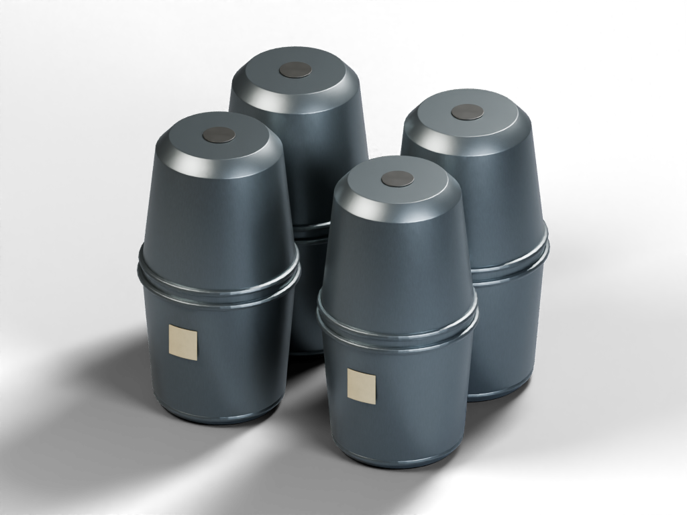

[Blend](../sources/docs/assets/reconstruction/trading-goods-refined/TI001/TI001.blend) · [GLB](../sources/docs/assets/reconstruction/trading-goods-refined/TI001/TI001.glb)

Full procedural materials are in Blend; GLB textures are not baked.

## Wines

`trade:TI002`

**Canonical version — material-refined**

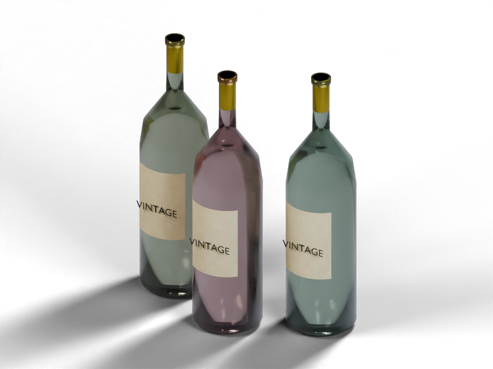

[Blend](../sources/docs/assets/reconstruction/trading-goods-refined/TI002/TI002.blend) · [GLB](../sources/docs/assets/reconstruction/trading-goods-refined/TI002/TI002.glb)

Full procedural materials are in Blend; GLB textures are not baked.

## Altarian Panther Sweat

`trade:TI003`

**Canonical version — material-refined**

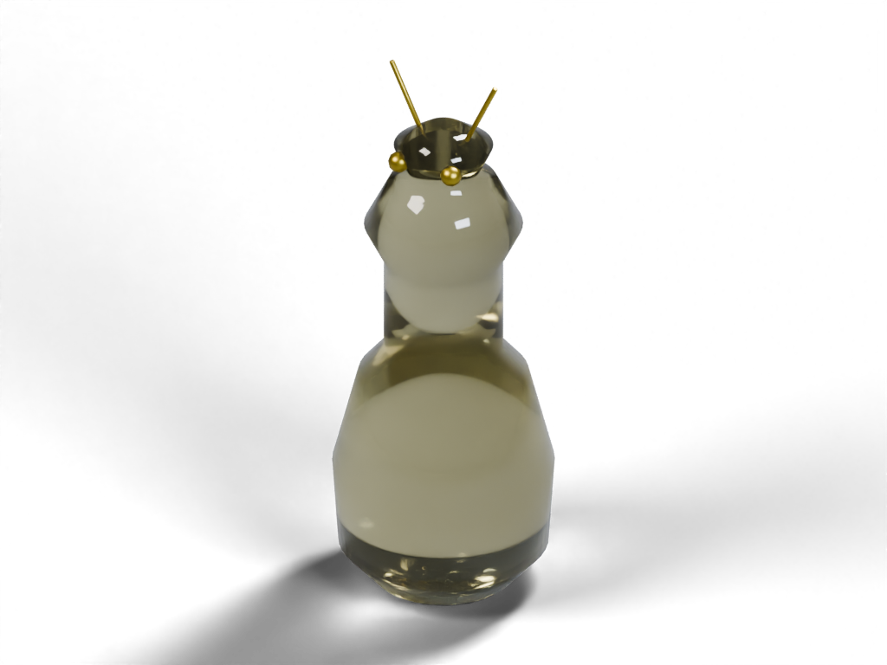

[Blend](../sources/docs/assets/reconstruction/trading-goods-refined/TI003/TI003.blend) · [GLB](../sources/docs/assets/reconstruction/trading-goods-refined/TI003/TI003.glb)

Full procedural materials are in Blend; GLB textures are not baked.

## St.Etienne's Real Cream & Honey Liqueur

`trade:TI004`

**Canonical version — material-refined**

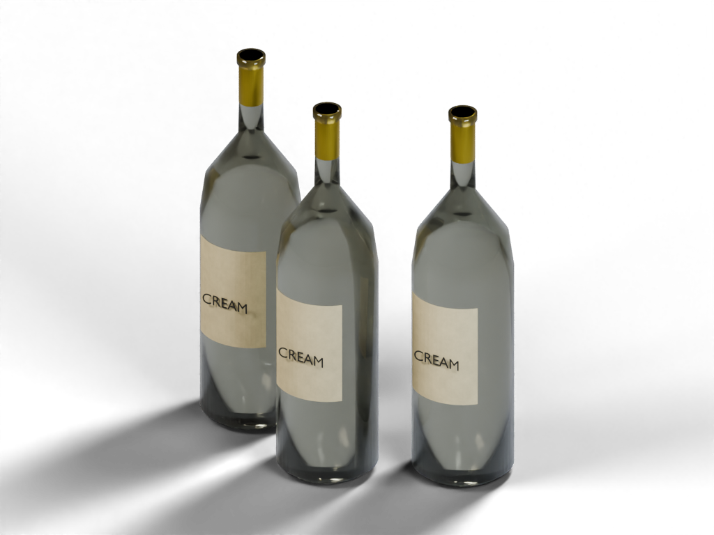

[Blend](../sources/docs/assets/reconstruction/trading-goods-refined/TI004/TI004.blend) · [GLB](../sources/docs/assets/reconstruction/trading-goods-refined/TI004/TI004.glb)

Full procedural materials are in Blend; GLB textures are not baked.

## Muet & Champignon vintage champagne

`trade:TI005`

**Canonical version — material-refined**

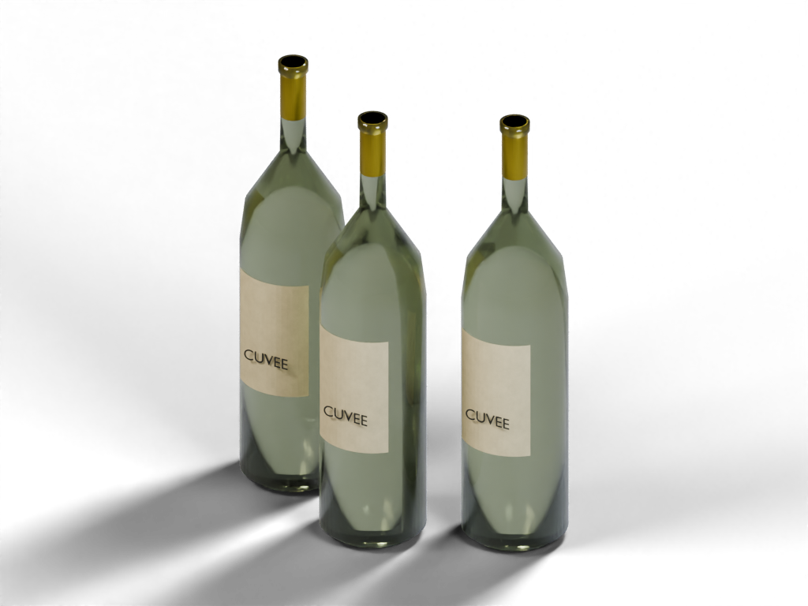

[Blend](../sources/docs/assets/reconstruction/trading-goods-refined/TI005/TI005.blend) · [GLB](../sources/docs/assets/reconstruction/trading-goods-refined/TI005/TI005.glb)

Full procedural materials are in Blend; GLB textures are not baked.

## Fizzimo Lumiere

`trade:TI006`

**Canonical version — material-refined**

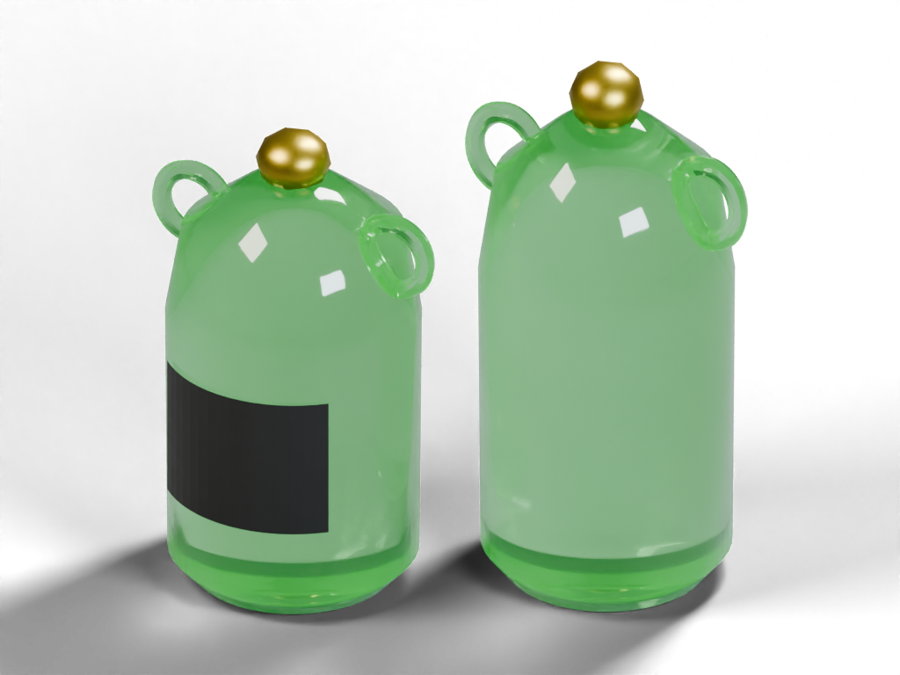

[Blend](../sources/docs/assets/reconstruction/trading-goods-refined/TI006/TI006.blend) · [GLB](../sources/docs/assets/reconstruction/trading-goods-refined/TI006/TI006.glb)

Full procedural materials are in Blend; GLB textures are not baked.

## Bristol glass

`trade:TI007`

**Canonical version — material-refined**

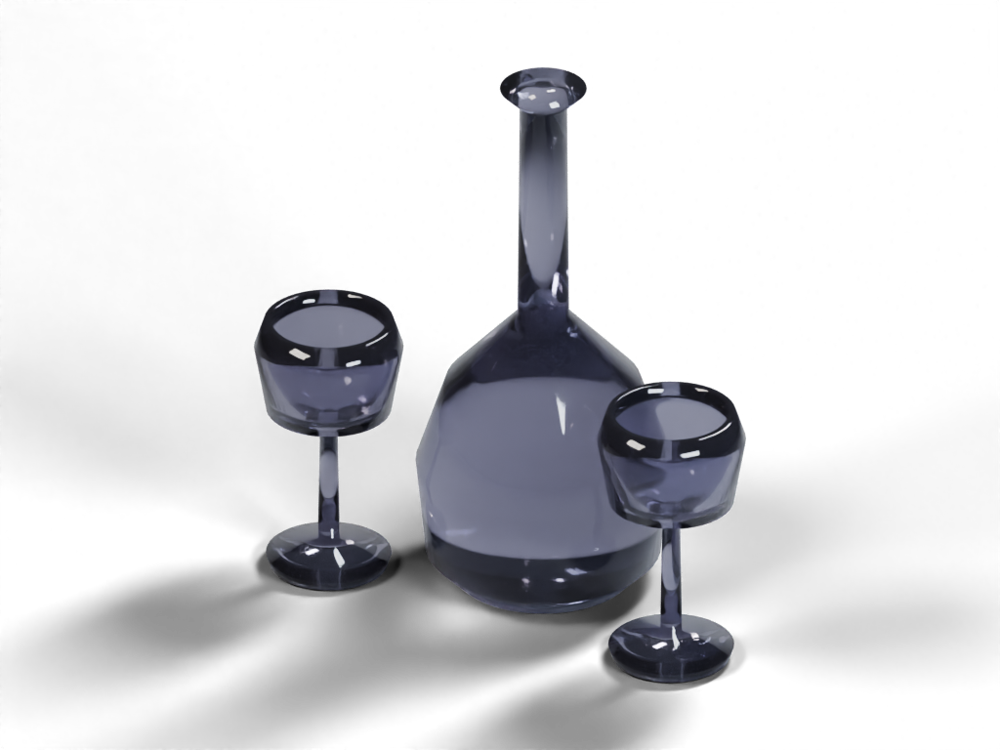

[Blend](../sources/docs/assets/reconstruction/trading-goods-refined/TI007/TI007.blend) · [GLB](../sources/docs/assets/reconstruction/trading-goods-refined/TI007/TI007.glb)

Full procedural materials are in Blend; GLB textures are not baked.

## Crystal Cantata Inc. products

`trade:TI008`

**Canonical version — material-refined**

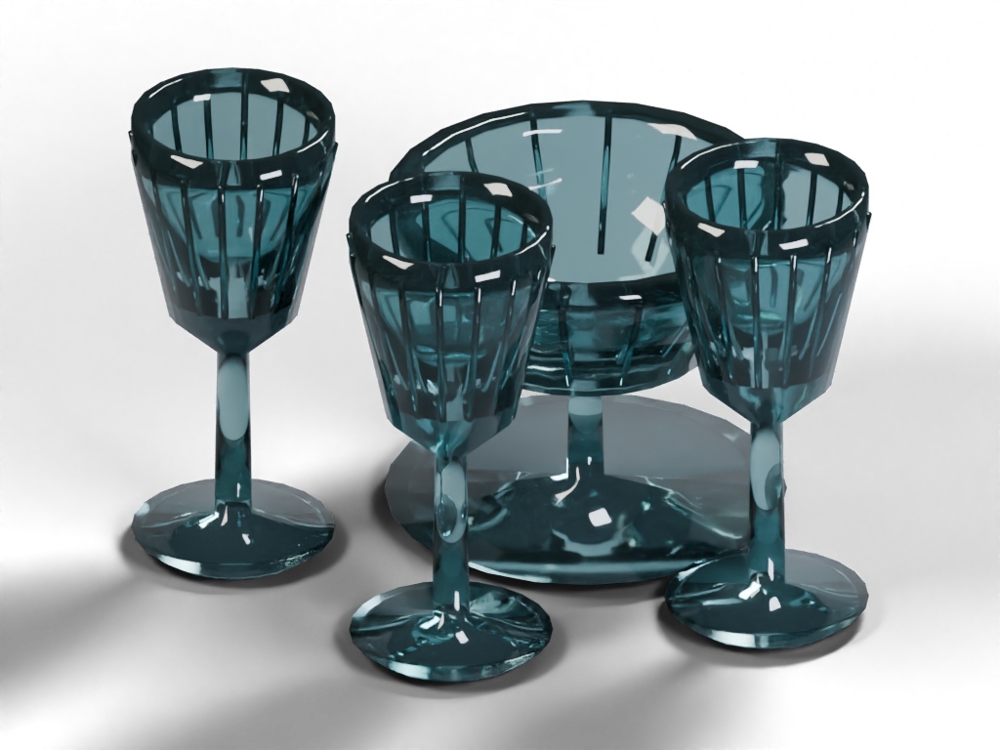

[Blend](../sources/docs/assets/reconstruction/trading-goods-refined/TI008/TI008.blend) · [GLB](../sources/docs/assets/reconstruction/trading-goods-refined/TI008/TI008.glb)

Full procedural materials are in Blend; GLB textures are not baked.

## Deep pile velvet

`trade:TI009`

**Canonical version — material-refined**

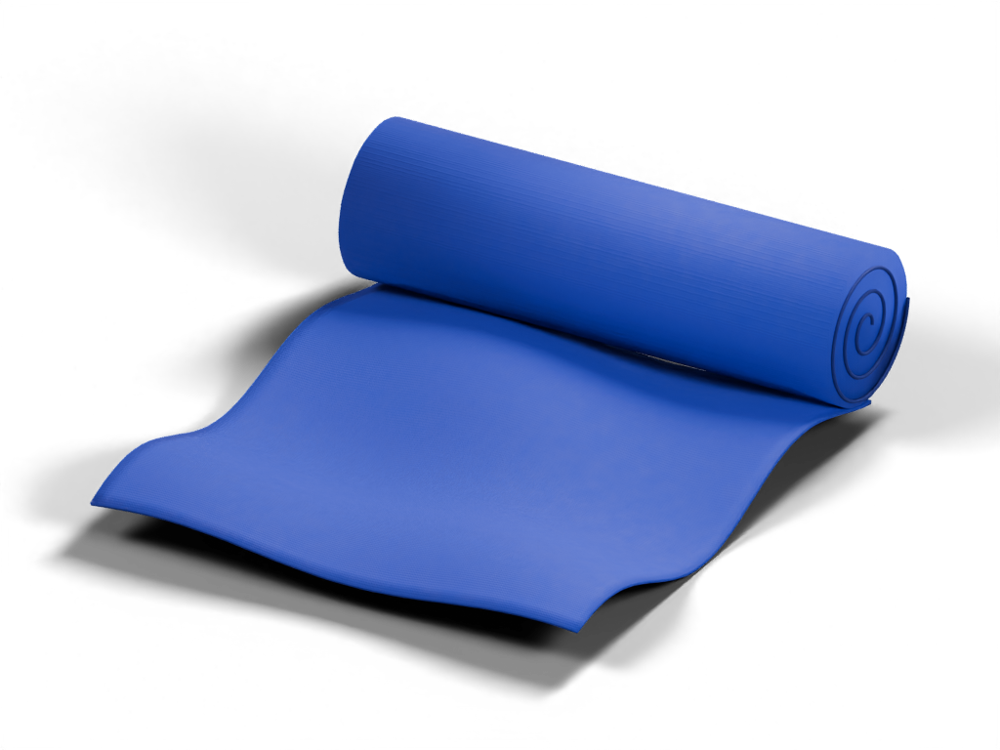

[Blend](../sources/docs/assets/reconstruction/trading-goods-refined/TI009/TI009.blend) · [GLB](../sources/docs/assets/reconstruction/trading-goods-refined/TI009/TI009.glb)

Full procedural materials are in Blend; GLB textures are not baked.

## Silk

`trade:TI010`

**Canonical version — material-refined**

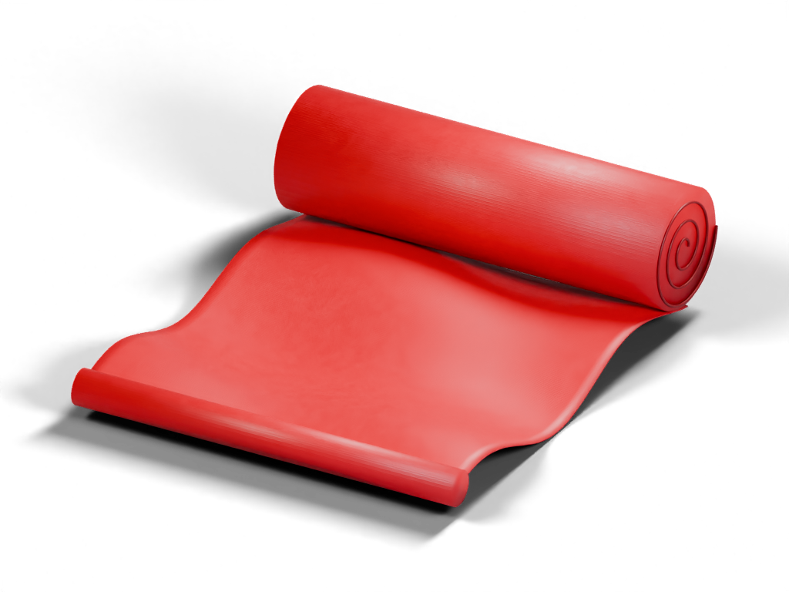

[Blend](../sources/docs/assets/reconstruction/trading-goods-refined/TI010/TI010.blend) · [GLB](../sources/docs/assets/reconstruction/trading-goods-refined/TI010/TI010.glb)

Full procedural materials are in Blend; GLB textures are not baked.

## Watered silk

`trade:TI011`

**Canonical version — material-refined**

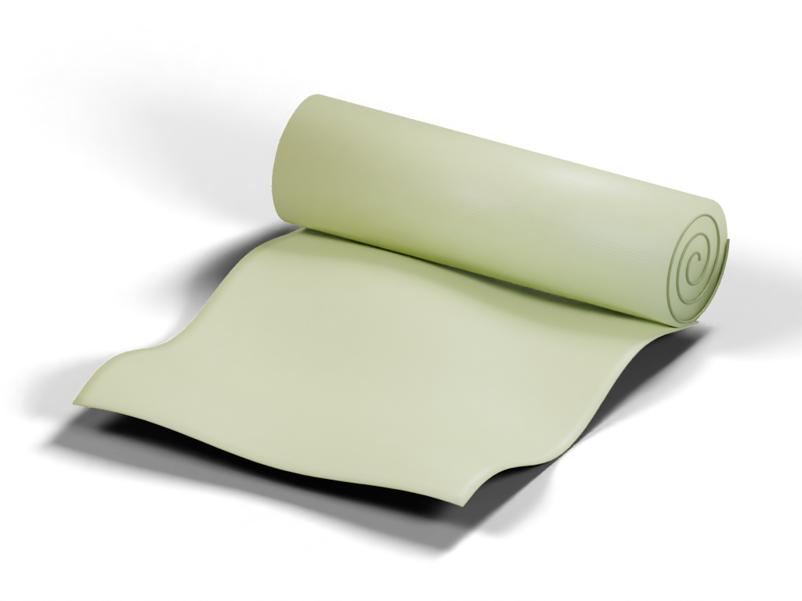

[Blend](../sources/docs/assets/reconstruction/trading-goods-refined/TI011/TI011.blend) · [GLB](../sources/docs/assets/reconstruction/trading-goods-refined/TI011/TI011.glb)

Full procedural materials are in Blend; GLB textures are not baked.

## Raw silk

`trade:TI012`

**Canonical version — material-refined**

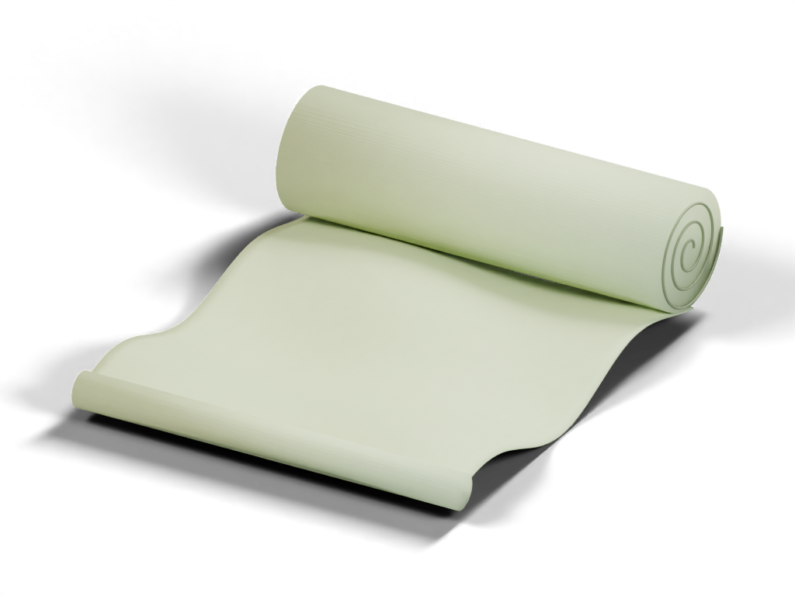

[Blend](../sources/docs/assets/reconstruction/trading-goods-refined/TI012/TI012.blend) · [GLB](../sources/docs/assets/reconstruction/trading-goods-refined/TI012/TI012.glb)

Full procedural materials are in Blend; GLB textures are not baked.

## Satin taffeta

`trade:TI013`

**Canonical version — material-refined**

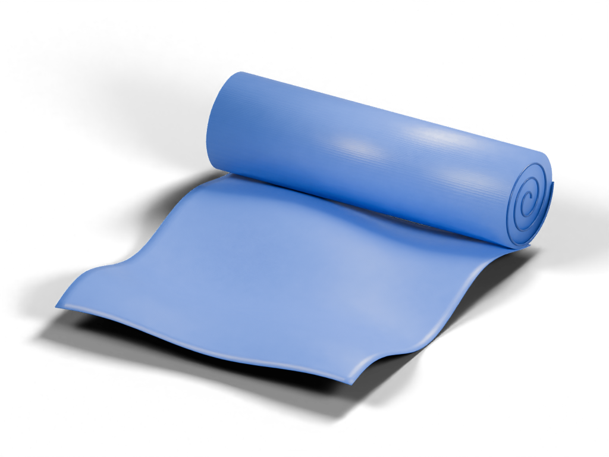

[Blend](../sources/docs/assets/reconstruction/trading-goods-refined/TI013/TI013.blend) · [GLB](../sources/docs/assets/reconstruction/trading-goods-refined/TI013/TI013.glb)

Full procedural materials are in Blend; GLB textures are not baked.

## Egyptian sea-cotton

`trade:TI014`

**Canonical version — material-refined**

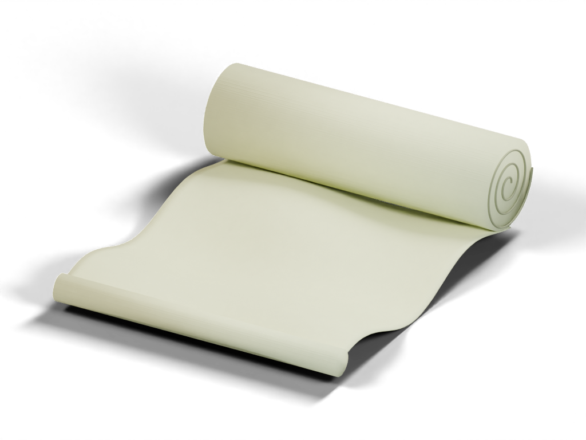

[Blend](../sources/docs/assets/reconstruction/trading-goods-refined/TI014/TI014.blend) · [GLB](../sources/docs/assets/reconstruction/trading-goods-refined/TI014/TI014.glb)

Full procedural materials are in Blend; GLB textures are not baked.

## Achaean angora

`trade:TI015`

**Canonical version — material-refined**

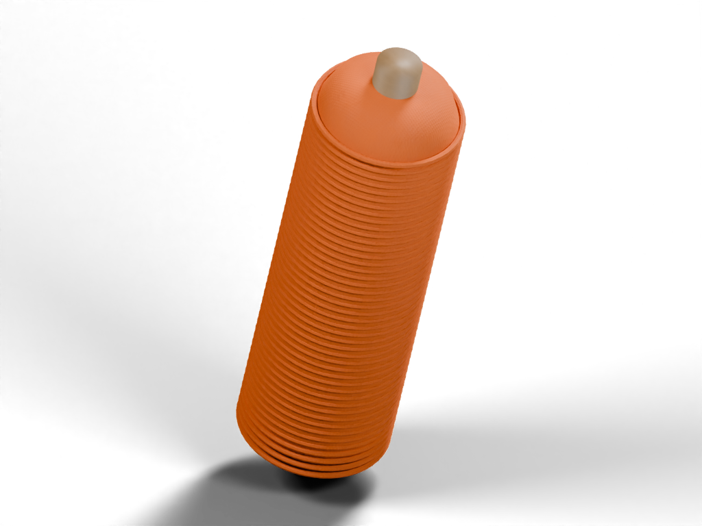

[Blend](../sources/docs/assets/reconstruction/trading-goods-refined/TI015/TI015.blend) · [GLB](../sources/docs/assets/reconstruction/trading-goods-refined/TI015/TI015.glb)

Full procedural materials are in Blend; GLB textures are not baked.

## Tiara & Bracelet set

`trade:TI016`

**Canonical version — material-refined**

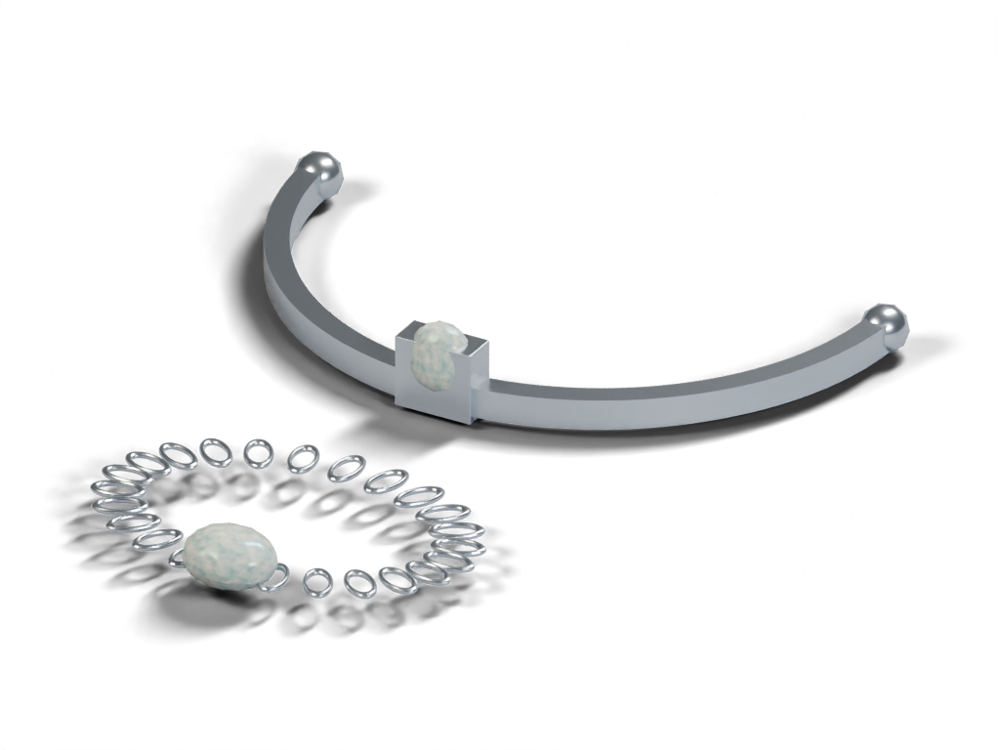

[Blend](../sources/docs/assets/reconstruction/trading-goods-refined/TI016/lore/TI016.blend) · [GLB](../sources/docs/assets/reconstruction/trading-goods-refined/TI016/lore/TI016.glb)

Full procedural materials are in Blend; GLB textures are not baked.

## Choker

`trade:TI017`

**Canonical version — material-refined**

[Blend](../sources/docs/assets/reconstruction/trading-goods-refined/TI017/optical/TI017.blend) · [GLB](../sources/docs/assets/reconstruction/trading-goods-refined/TI017/optical/TI017.glb)

Full procedural materials are in Blend; GLB textures are not baked.

## Solitaire emerald

`trade:TI018`

**Canonical version — material-refined**

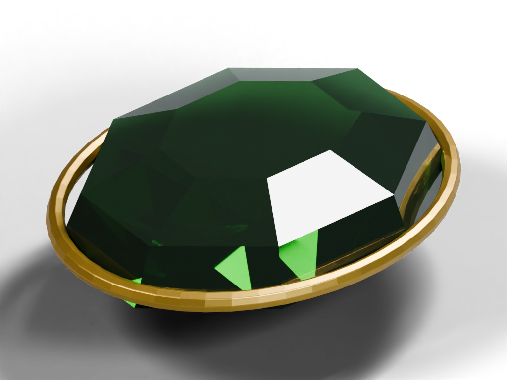

[Blend](../sources/docs/assets/reconstruction/trading-goods-refined/TI018/lore/TI018.blend) · [GLB](../sources/docs/assets/reconstruction/trading-goods-refined/TI018/lore/TI018.glb)

Full procedural materials are in Blend; GLB textures are not baked.

## Brooch

`trade:TI019`

**Canonical version — material-refined**

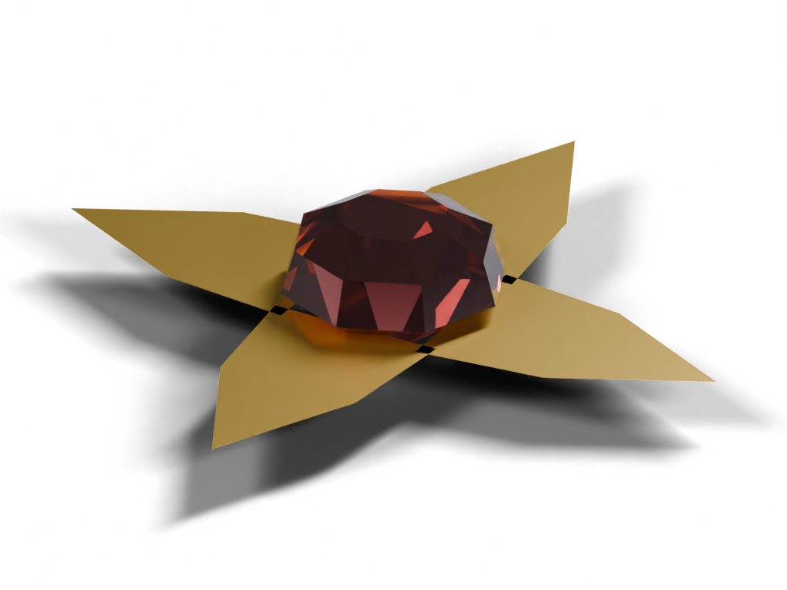

[Blend](../sources/docs/assets/reconstruction/trading-goods-refined/TI019/lore/TI019.blend) · [GLB](../sources/docs/assets/reconstruction/trading-goods-refined/TI019/lore/TI019.glb)

Full procedural materials are in Blend; GLB textures are not baked.

## Necklace

`trade:TI020`

**Canonical version — material-refined**

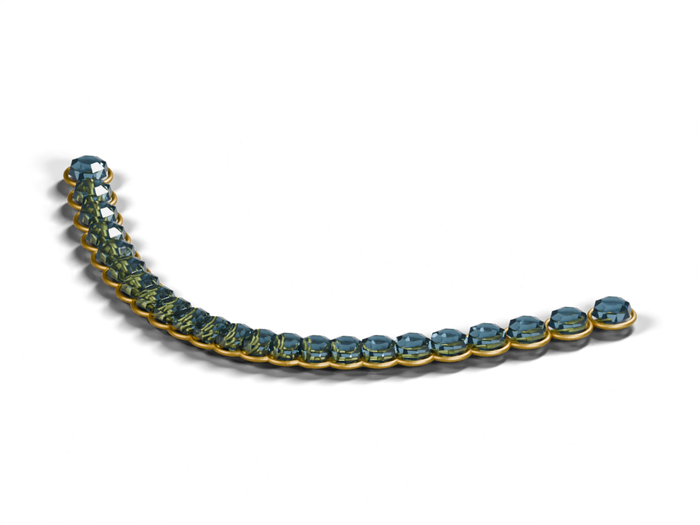

[Blend](../sources/docs/assets/reconstruction/trading-goods-refined/TI020/lore/TI020.blend) · [GLB](../sources/docs/assets/reconstruction/trading-goods-refined/TI020/lore/TI020.glb)

Full procedural materials are in Blend; GLB textures are not baked.

## Eternity ring

`trade:TI021`

**Canonical version — material-refined**

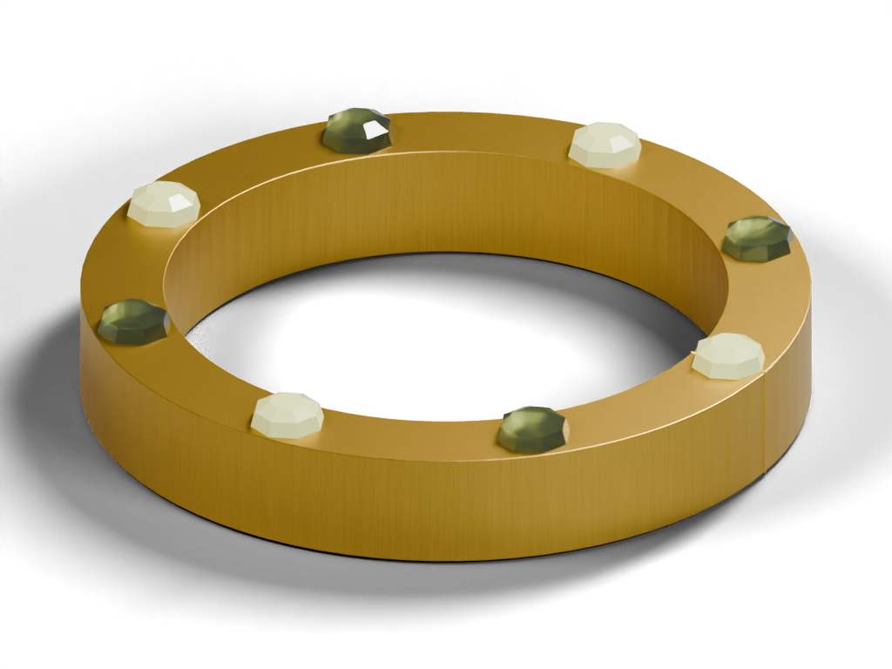

[Blend](../sources/docs/assets/reconstruction/trading-goods-refined/TI021/lore/TI021.blend) · [GLB](../sources/docs/assets/reconstruction/trading-goods-refined/TI021/lore/TI021.glb)

Full procedural materials are in Blend; GLB textures are not baked.

## Pectoral

`trade:TI022`

**Canonical version — material-refined**

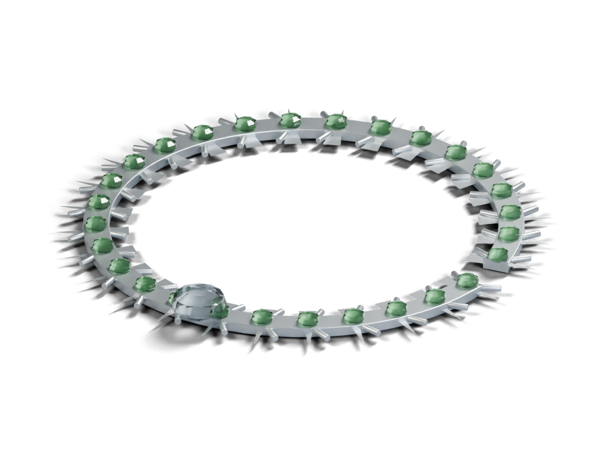

[Blend](../sources/docs/assets/reconstruction/trading-goods-refined/TI022/optical/TI022.blend) · [GLB](../sources/docs/assets/reconstruction/trading-goods-refined/TI022/optical/TI022.glb)

Full procedural materials are in Blend; GLB textures are not baked.

## Collar

`trade:TI023`

**Canonical version — material-refined**

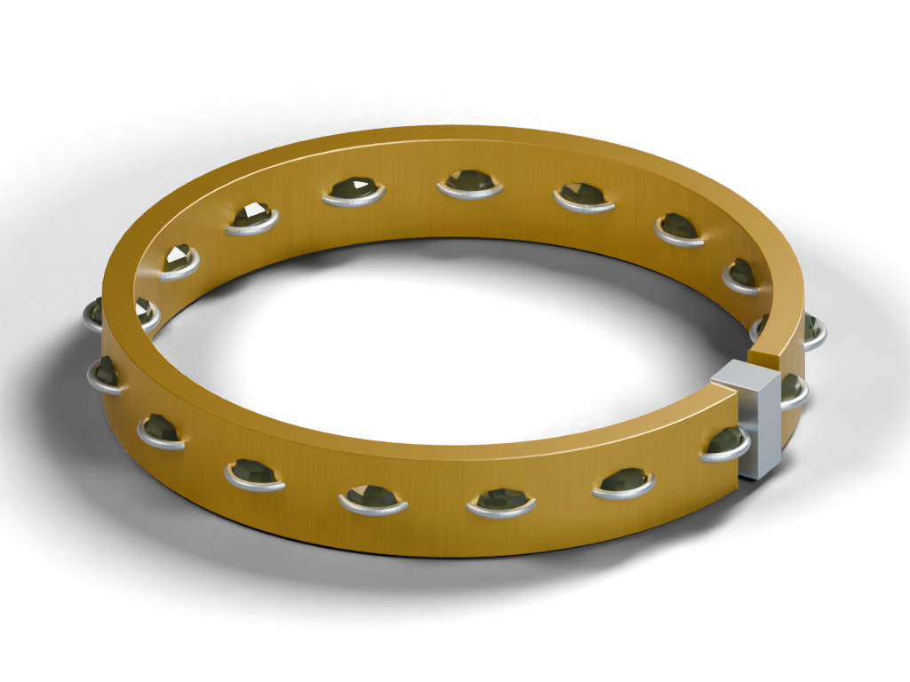

[Blend](../sources/docs/assets/reconstruction/trading-goods-refined/TI023/optical/TI023.blend) · [GLB](../sources/docs/assets/reconstruction/trading-goods-refined/TI023/optical/TI023.glb)

Full procedural materials are in Blend; GLB textures are not baked.

## 3-strand bracelet

`trade:TI024`

**Canonical version — material-refined**

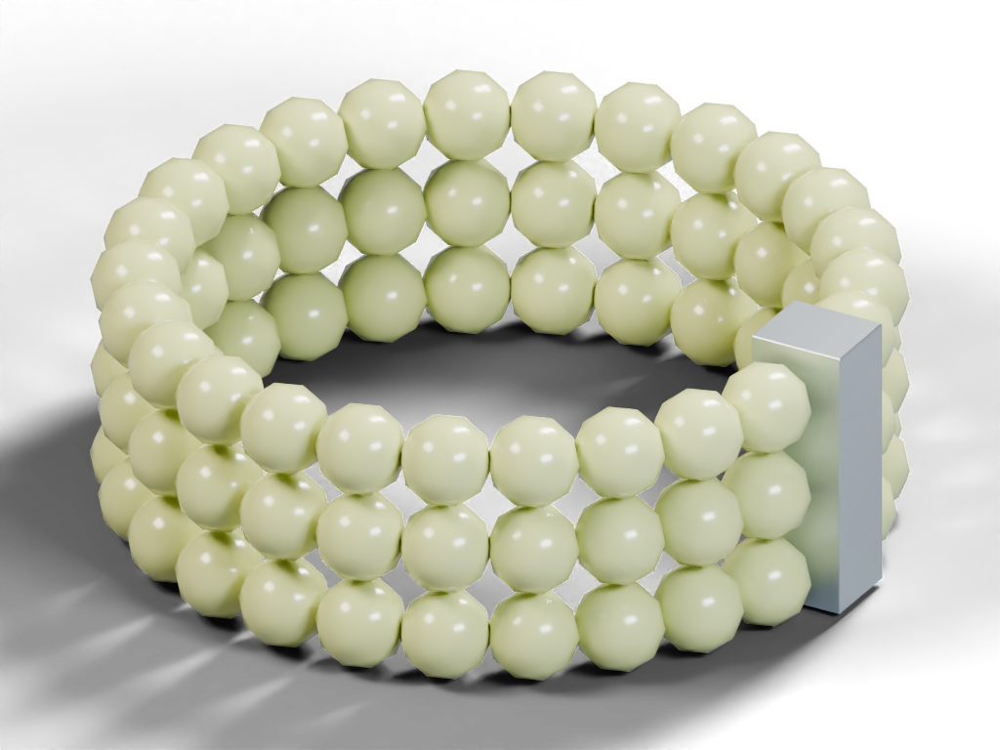

[Blend](../sources/docs/assets/reconstruction/trading-goods-refined/TI024/TI024.blend) · [GLB](../sources/docs/assets/reconstruction/trading-goods-refined/TI024/TI024.glb)

Full procedural materials are in Blend; GLB textures are not baked.

## Diamond

`trade:TI025`

**Canonical version — material-refined**

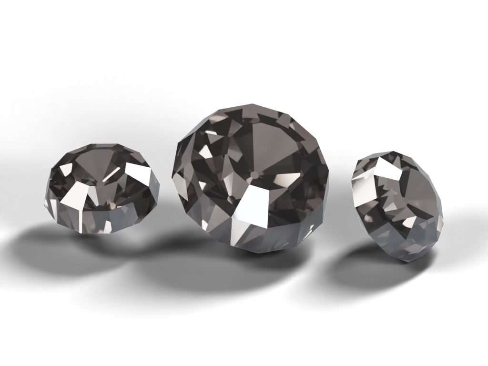

[Blend](../sources/docs/assets/reconstruction/trading-goods-refined/TI025/optical/TI025.blend) · [GLB](../sources/docs/assets/reconstruction/trading-goods-refined/TI025/optical/TI025.glb)

Full procedural materials are in Blend; GLB textures are not baked.

## Emerald

`trade:TI026`

**Canonical version — material-refined**

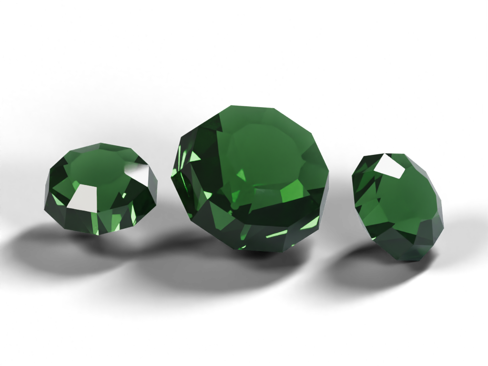

[Blend](../sources/docs/assets/reconstruction/trading-goods-refined/TI026/optical/TI026.blend) · [GLB](../sources/docs/assets/reconstruction/trading-goods-refined/TI026/optical/TI026.glb)

Full procedural materials are in Blend; GLB textures are not baked.

## Sapphire

`trade:TI027`

**Canonical version — material-refined**

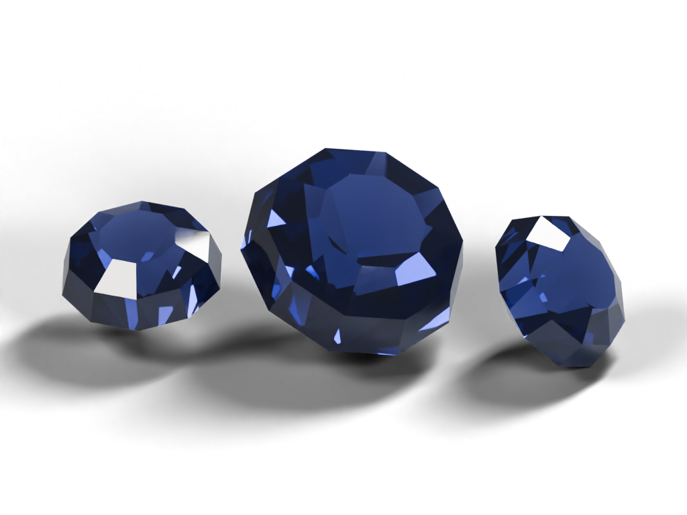

[Blend](../sources/docs/assets/reconstruction/trading-goods-refined/TI027/optical/TI027.blend) · [GLB](../sources/docs/assets/reconstruction/trading-goods-refined/TI027/optical/TI027.glb)

Full procedural materials are in Blend; GLB textures are not baked.

## Ruby

`trade:TI028`

**Canonical version — material-refined**

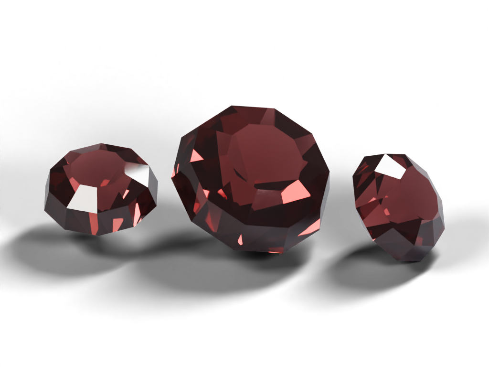

[Blend](../sources/docs/assets/reconstruction/trading-goods-refined/TI028/optical/TI028.blend) · [GLB](../sources/docs/assets/reconstruction/trading-goods-refined/TI028/optical/TI028.glb)

Full procedural materials are in Blend; GLB textures are not baked.

## Ultropaz

`trade:TI029`

**Canonical version — material-refined**

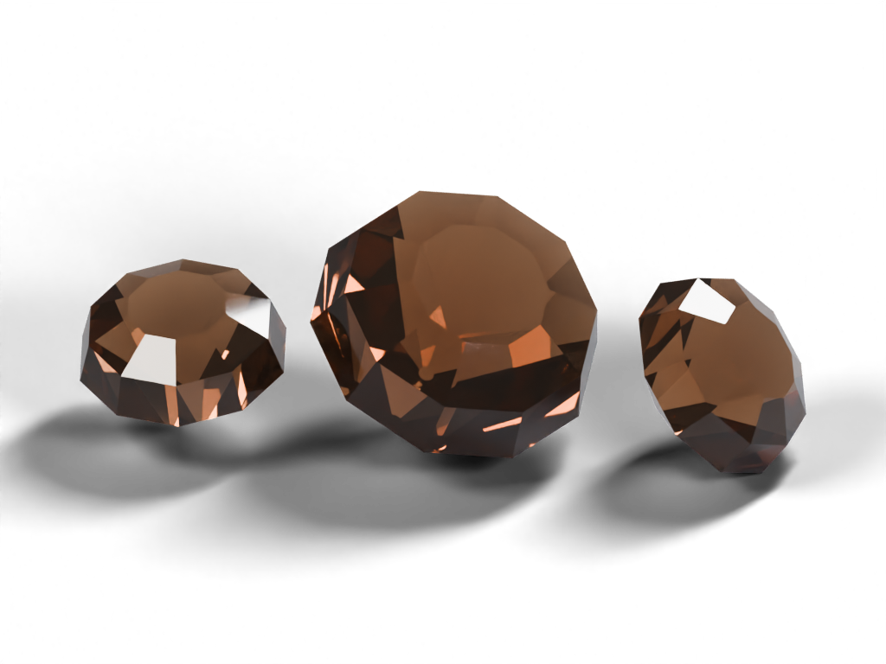

[Blend](../sources/docs/assets/reconstruction/trading-goods-refined/TI029/optical/TI029.blend) · [GLB](../sources/docs/assets/reconstruction/trading-goods-refined/TI029/optical/TI029.glb)

Full procedural materials are in Blend; GLB textures are not baked.

## Alexandrite

`trade:TI030`

**Canonical version — material-refined**

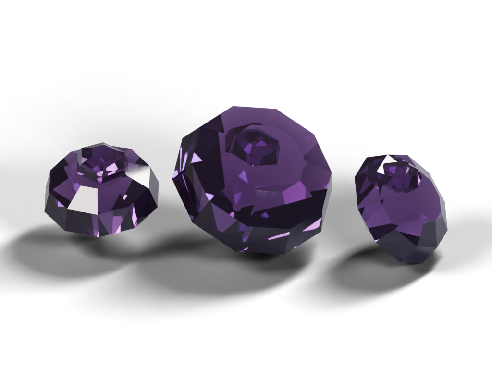

[Blend](../sources/docs/assets/reconstruction/trading-goods-refined/TI030/optical/TI030.blend) · [GLB](../sources/docs/assets/reconstruction/trading-goods-refined/TI030/optical/TI030.glb)

Full procedural materials are in Blend; GLB textures are not baked.

## Metachrome

`trade:TI031`

**Canonical version — material-refined**

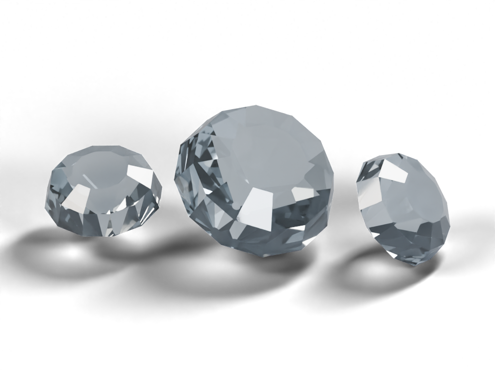

[Blend](../sources/docs/assets/reconstruction/trading-goods-refined/TI031/optical/TI031.blend) · [GLB](../sources/docs/assets/reconstruction/trading-goods-refined/TI031/optical/TI031.glb)

Full procedural materials are in Blend; GLB textures are not baked.

## Opal

`trade:TI032`

**Canonical version — material-refined**

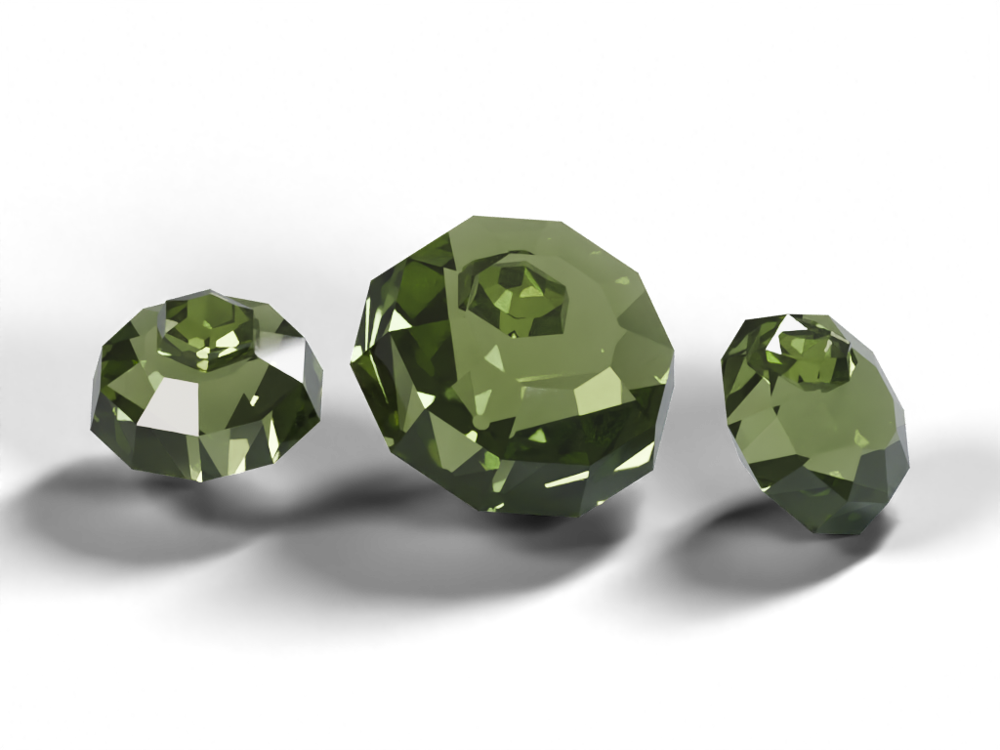

[Blend](../sources/docs/assets/reconstruction/trading-goods-refined/TI032/optical/TI032.blend) · [GLB](../sources/docs/assets/reconstruction/trading-goods-refined/TI032/optical/TI032.glb)

Full procedural materials are in Blend; GLB textures are not baked.

## Pearl

`trade:TI033`

**Canonical version — material-refined**

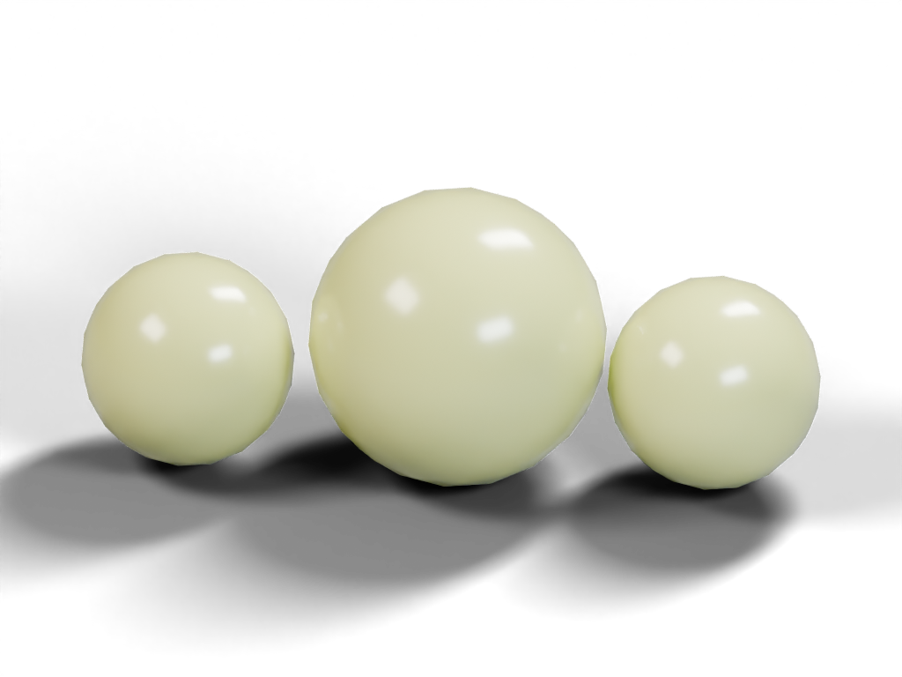

[Blend](../sources/docs/assets/reconstruction/trading-goods-refined/TI033/TI033.blend) · [GLB](../sources/docs/assets/reconstruction/trading-goods-refined/TI033/TI033.glb)

Full procedural materials are in Blend; GLB textures are not baked.

## Moonstone

`trade:TI034`

**Canonical version — material-refined**

[Blend](../sources/docs/assets/reconstruction/trading-goods-refined/TI034/optical/TI034.blend) · [GLB](../sources/docs/assets/reconstruction/trading-goods-refined/TI034/optical/TI034.glb)

Full procedural materials are in Blend; GLB textures are not baked.

## Astramarine

`trade:TI035`

**Canonical version — material-refined**

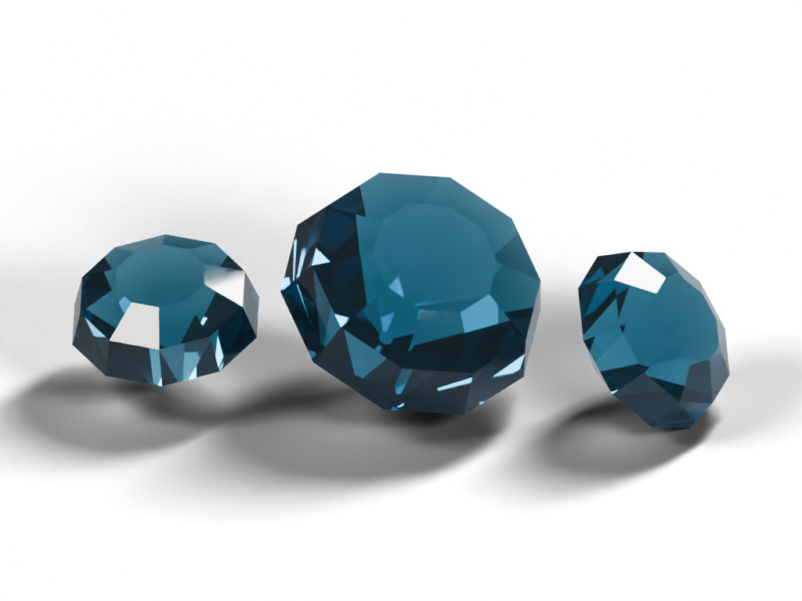

[Blend](../sources/docs/assets/reconstruction/trading-goods-refined/TI035/optical/TI035.blend) · [GLB](../sources/docs/assets/reconstruction/trading-goods-refined/TI035/optical/TI035.glb)

Full procedural materials are in Blend; GLB textures are not baked.

## Peridot

`trade:TI036`

**Canonical version — material-refined**

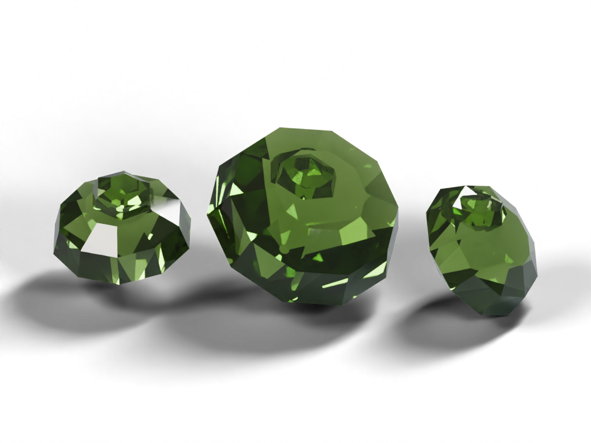

[Blend](../sources/docs/assets/reconstruction/trading-goods-refined/TI036/optical/TI036.blend) · [GLB](../sources/docs/assets/reconstruction/trading-goods-refined/TI036/optical/TI036.glb)

Full procedural materials are in Blend; GLB textures are not baked.

## Amethyst

`trade:TI037`

**Canonical version — material-refined**

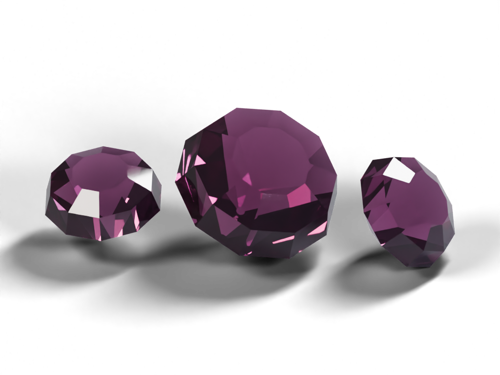

[Blend](../sources/docs/assets/reconstruction/trading-goods-refined/TI037/optical/TI037.blend) · [GLB](../sources/docs/assets/reconstruction/trading-goods-refined/TI037/optical/TI037.glb)

Full procedural materials are in Blend; GLB textures are not baked.

## Abstract Sculpture

`trade:TI038`

**Canonical version — material-refined**

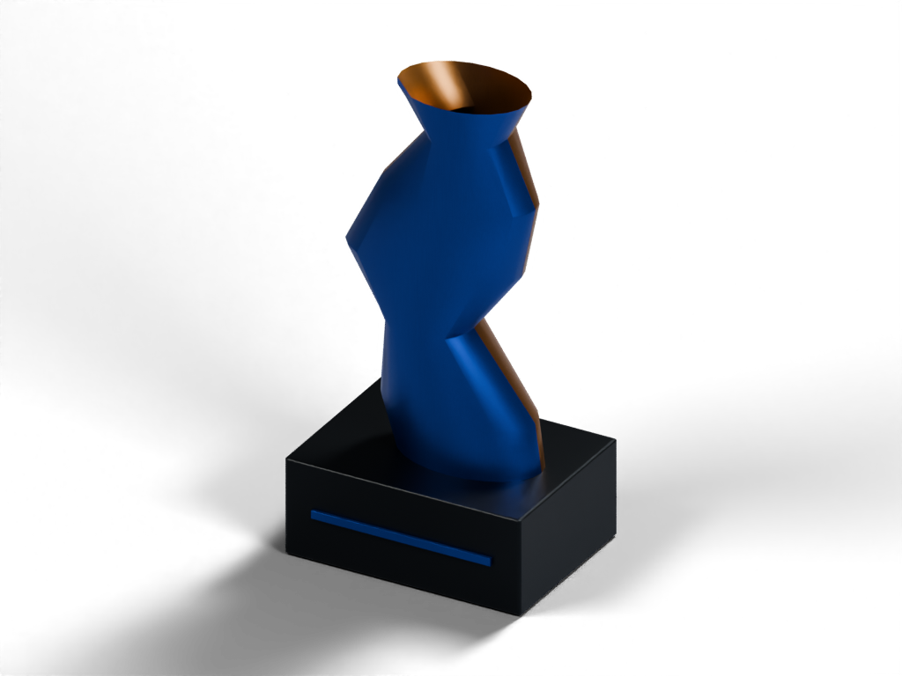

[Blend](../sources/docs/assets/reconstruction/trading-goods-refined/TI038/TI038.blend) · [GLB](../sources/docs/assets/reconstruction/trading-goods-refined/TI038/TI038.glb)

Full procedural materials are in Blend; GLB textures are not baked.

## Domestic interior units

`trade:TI039`

**Canonical version — material-refined**

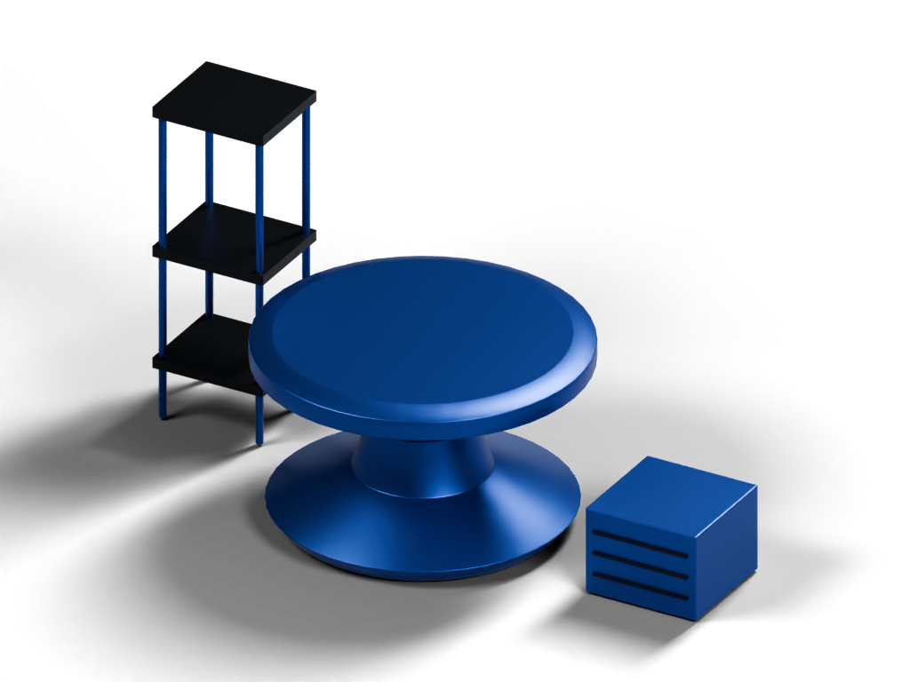

[Blend](../sources/docs/assets/reconstruction/trading-goods-refined/TI039/TI039.blend) · [GLB](../sources/docs/assets/reconstruction/trading-goods-refined/TI039/TI039.glb)

Full procedural materials are in Blend; GLB textures are not baked.

## Decorative drinking horns

`trade:TI040`

**Canonical version — material-refined**

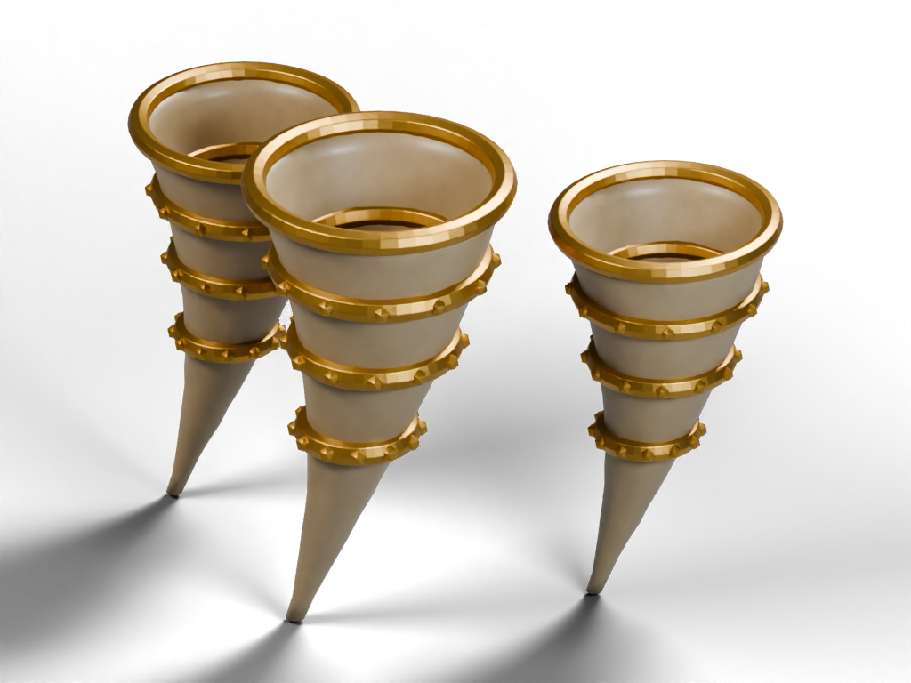

[Blend](../sources/docs/assets/reconstruction/trading-goods-refined/TI040/TI040.blend) · [GLB](../sources/docs/assets/reconstruction/trading-goods-refined/TI040/TI040.glb)

Full procedural materials are in Blend; GLB textures are not baked.

## Worked leather

`trade:TI041`

**Canonical version — material-refined**

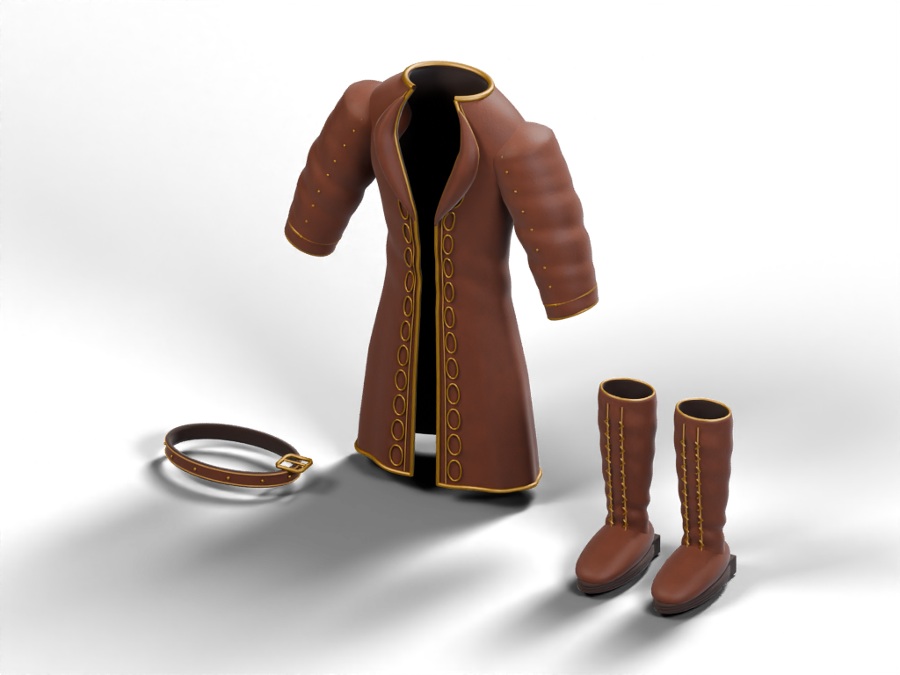

[Blend](../sources/docs/assets/reconstruction/trading-goods-refined/TI041/remodelled/TI041.blend) · [GLB](../sources/docs/assets/reconstruction/trading-goods-refined/TI041/remodelled/TI041.glb)

Full procedural materials are in Blend; GLB textures are not baked.

## Ornamental archaic weaponry

`trade:TI042`

**Canonical version — material-refined**

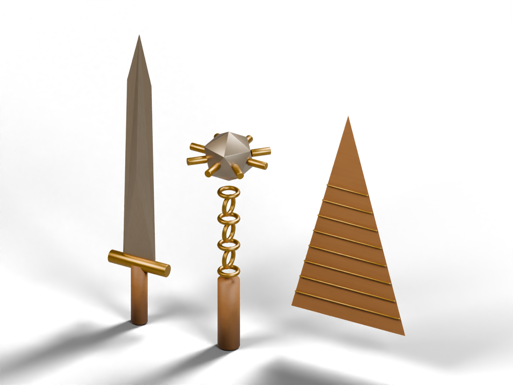

[Blend](../sources/docs/assets/reconstruction/trading-goods-refined/TI042/TI042.blend) · [GLB](../sources/docs/assets/reconstruction/trading-goods-refined/TI042/TI042.glb)

Full procedural materials are in Blend; GLB textures are not baked.

## Fizzimo Liqueurs

`trade:TI043`

**Canonical version — material-refined**

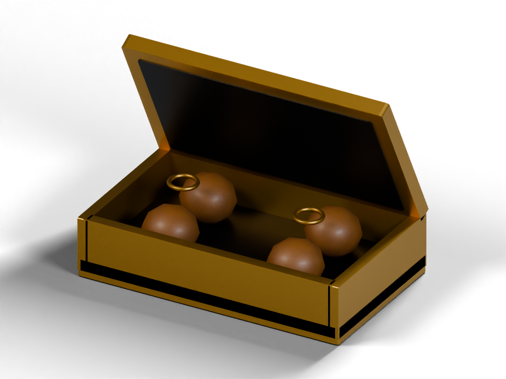

[Blend](../sources/docs/assets/reconstruction/trading-goods-refined/TI043/TI043.blend) · [GLB](../sources/docs/assets/reconstruction/trading-goods-refined/TI043/TI043.glb)

Full procedural materials are in Blend; GLB textures are not baked.

## Rigellian ant eggs

`trade:TI044`

**Canonical version — material-refined**

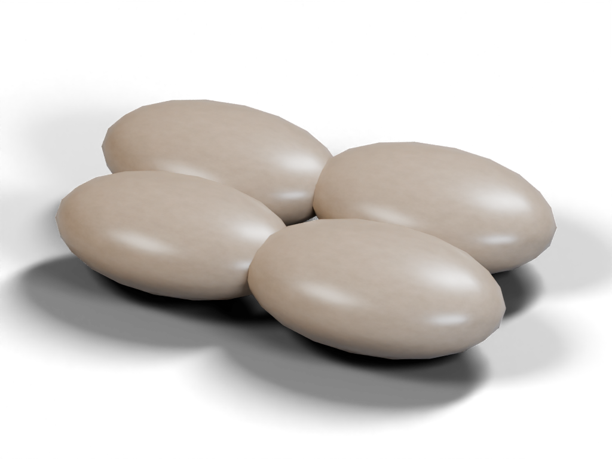

[Blend](../sources/docs/assets/reconstruction/trading-goods-refined/TI044/TI044.blend) · [GLB](../sources/docs/assets/reconstruction/trading-goods-refined/TI044/TI044.glb)

Full procedural materials are in Blend; GLB textures are not baked.

## Pearls dissolved in brandy

`trade:TI045`

**Canonical version — material-refined**

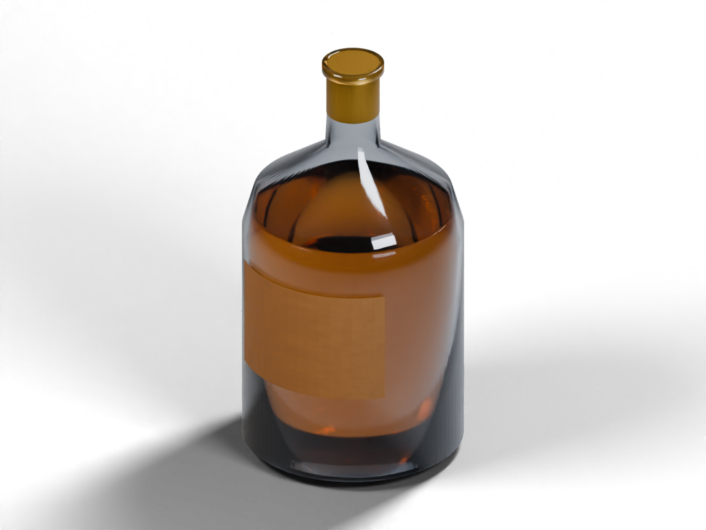

[Blend](../sources/docs/assets/reconstruction/trading-goods-refined/TI045/lore/TI045.blend) · [GLB](../sources/docs/assets/reconstruction/trading-goods-refined/TI045/lore/TI045.glb)

Full procedural materials are in Blend; GLB textures are not baked.

## Goat's ear mushrooms

`trade:TI046`

**Canonical version — material-refined**

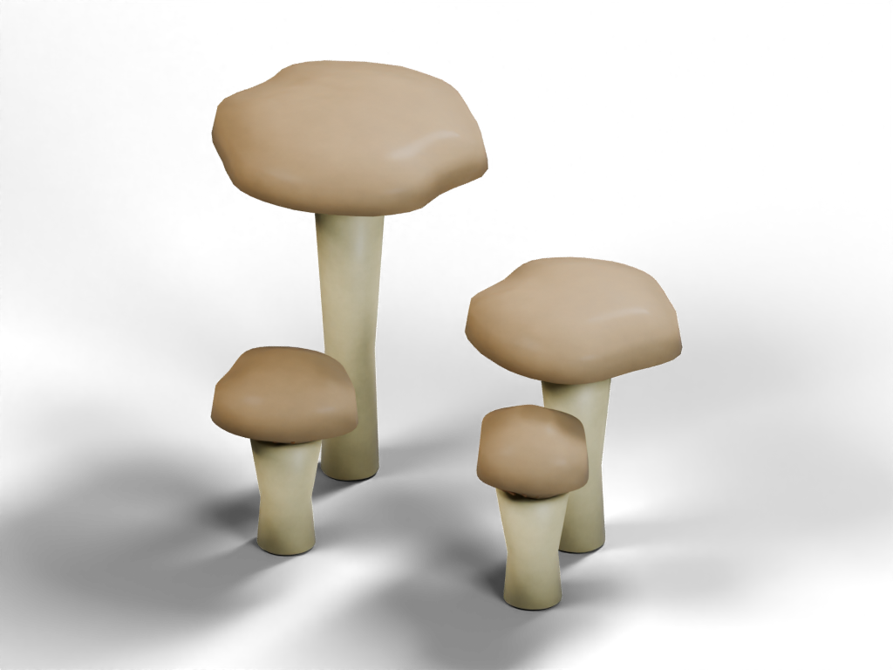

[Blend](../sources/docs/assets/reconstruction/trading-goods-refined/TI046/TI046.blend) · [GLB](../sources/docs/assets/reconstruction/trading-goods-refined/TI046/TI046.glb)

Full procedural materials are in Blend; GLB textures are not baked.

## Organic corn on the cob

`trade:TI047`

**Canonical version — material-refined**

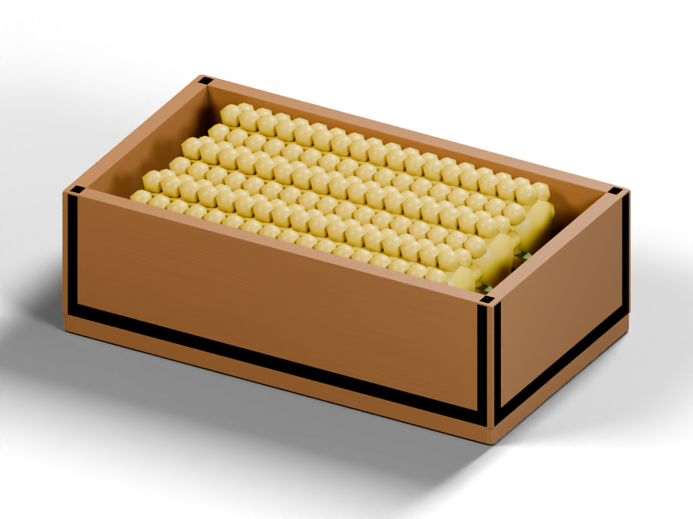

[Blend](../sources/docs/assets/reconstruction/trading-goods-refined/TI047/TI047.blend) · [GLB](../sources/docs/assets/reconstruction/trading-goods-refined/TI047/TI047.glb)

Full procedural materials are in Blend; GLB textures are not baked.

## Braccatian kulos cheese

`trade:TI048`

**Canonical version — material-refined**

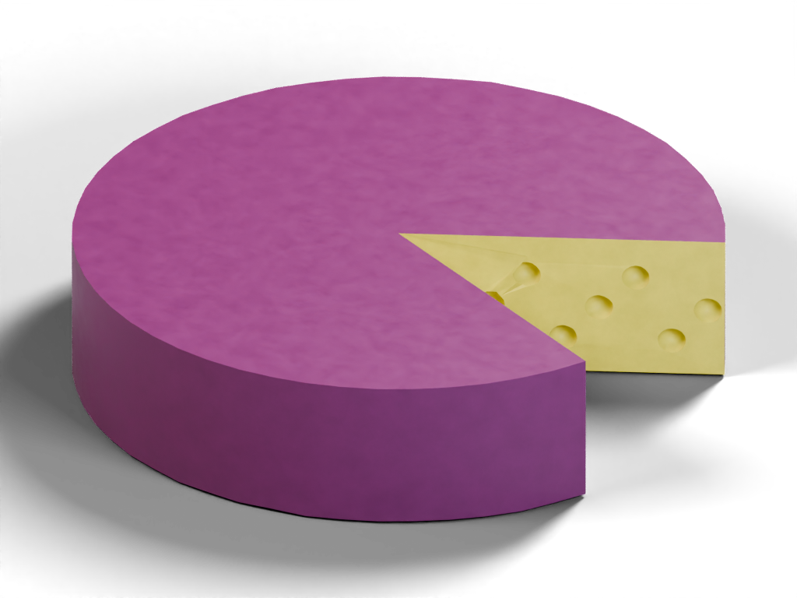

[Blend](../sources/docs/assets/reconstruction/trading-goods-refined/TI048/repaired/TI048.blend) · [GLB](../sources/docs/assets/reconstruction/trading-goods-refined/TI048/repaired/TI048.glb)

Full procedural materials are in Blend; GLB textures are not baked.

## Grains

`trade:TI049`

**Canonical version — material-refined**

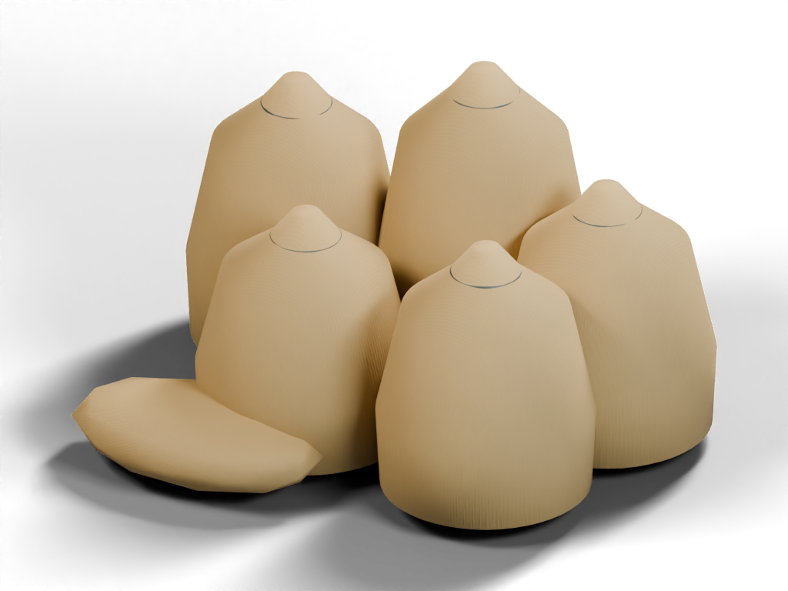

[Blend](../sources/docs/assets/reconstruction/trading-goods-refined/TI049/TI049.blend) · [GLB](../sources/docs/assets/reconstruction/trading-goods-refined/TI049/TI049.glb)

Full procedural materials are in Blend; GLB textures are not baked.

## Seaweed

`trade:TI050`

**Canonical version — material-refined**

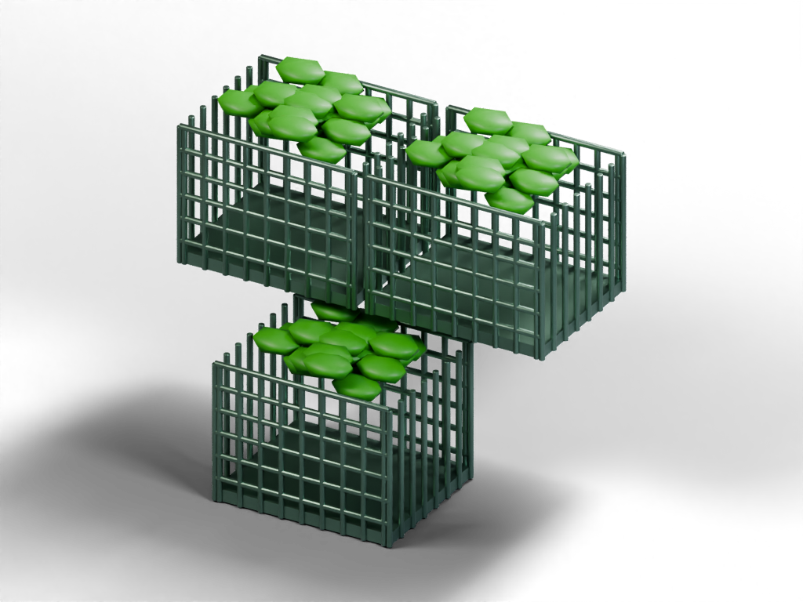

[Blend](../sources/docs/assets/reconstruction/trading-goods-refined/TI050/TI050.blend) · [GLB](../sources/docs/assets/reconstruction/trading-goods-refined/TI050/TI050.glb)

Full procedural materials are in Blend; GLB textures are not baked.

## Krill

`trade:TI051`

**Canonical version — material-refined**

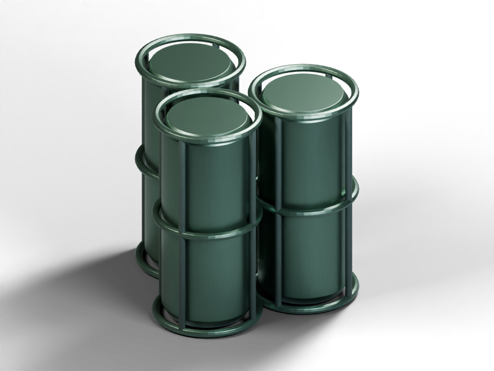

[Blend](../sources/docs/assets/reconstruction/trading-goods-refined/TI051/TI051.blend) · [GLB](../sources/docs/assets/reconstruction/trading-goods-refined/TI051/TI051.glb)

Full procedural materials are in Blend; GLB textures are not baked.

## Water

`trade:TI052`

**Canonical version — material-refined**

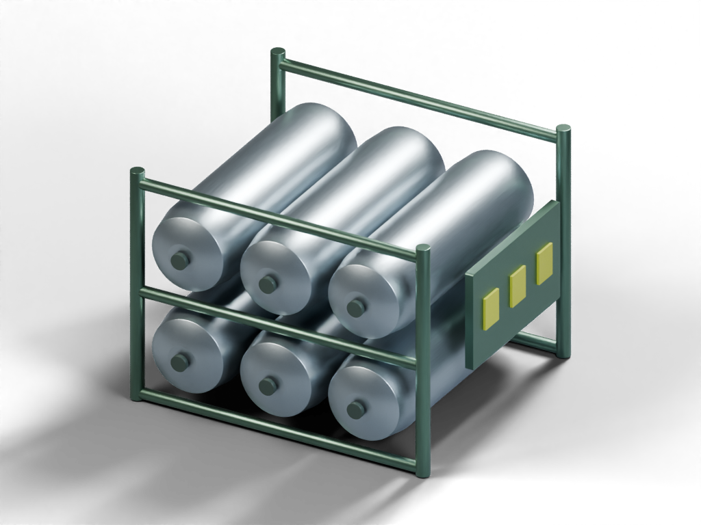

[Blend](../sources/docs/assets/reconstruction/trading-goods-refined/TI052/TI052.blend) · [GLB](../sources/docs/assets/reconstruction/trading-goods-refined/TI052/TI052.glb)

Full procedural materials are in Blend; GLB textures are not baked.

## Ortok's Mansions

`trade:TI053`

**Canonical version — material-refined**

[Blend](../sources/docs/assets/reconstruction/trading-goods-refined/TI053/lore/TI053.blend) · [GLB](../sources/docs/assets/reconstruction/trading-goods-refined/TI053/lore/TI053.glb)

Full procedural materials are in Blend; GLB textures are not baked.

## Shades of Brutos

`trade:TI054`

**Canonical version — material-refined**

[Blend](../sources/docs/assets/reconstruction/trading-goods-refined/TI054/TI054.blend) · [GLB](../sources/docs/assets/reconstruction/trading-goods-refined/TI054/TI054.glb)

Full procedural materials are in Blend; GLB textures are not baked.

## Huskar Cigars

`trade:TI055`

**Canonical version — material-refined**

[Blend](../sources/docs/assets/reconstruction/trading-goods-refined/TI055/TI055.blend) · [GLB](../sources/docs/assets/reconstruction/trading-goods-refined/TI055/TI055.glb)

Full procedural materials are in Blend; GLB textures are not baked.

## Maunik's Cube

`trade:TI056`

**Canonical version — material-refined**

[Blend](../sources/docs/assets/reconstruction/trading-goods-refined/TI056/TI056.blend) · [GLB](../sources/docs/assets/reconstruction/trading-goods-refined/TI056/TI056.glb)

Full procedural materials are in Blend; GLB textures are not baked.

## Gong of Death Song

`trade:TI057`

**Canonical version — material-refined**

[Blend](../sources/docs/assets/reconstruction/trading-goods-refined/TI057/TI057.blend) · [GLB](../sources/docs/assets/reconstruction/trading-goods-refined/TI057/TI057.glb)

Full procedural materials are in Blend; GLB textures are not baked.

## Holostar globes

`trade:TI058`

**Canonical version — material-refined**

[Blend](../sources/docs/assets/reconstruction/trading-goods-refined/TI058/TI058.blend) · [GLB](../sources/docs/assets/reconstruction/trading-goods-refined/TI058/TI058.glb)

Full procedural materials are in Blend; GLB textures are not baked.

## Besthelda's Apothecary

`trade:TI059`

**Canonical version — material-refined**

[Blend](../sources/docs/assets/reconstruction/trading-goods-refined/TI059/TI059.blend) · [GLB](../sources/docs/assets/reconstruction/trading-goods-refined/TI059/TI059.glb)

Full procedural materials are in Blend; GLB textures are not baked.

## Photoplasmic Cocoon

`trade:TI060`

**Canonical version — material-refined**

[Blend](../sources/docs/assets/reconstruction/trading-goods-refined/TI060/TI060.blend) · [GLB](../sources/docs/assets/reconstruction/trading-goods-refined/TI060/TI060.glb)

Full procedural materials are in Blend; GLB textures are not baked.

## Steam Racers

`trade:TI061`

**Canonical version — material-refined**

[Blend](../sources/docs/assets/reconstruction/trading-goods-refined/TI061/TI061.blend) · [GLB](../sources/docs/assets/reconstruction/trading-goods-refined/TI061/TI061.glb)

Full procedural materials are in Blend; GLB textures are not baked.

## KKZ Quad

`trade:TI062`

**Canonical version — material-refined**

[Blend](../sources/docs/assets/reconstruction/trading-goods-refined/TI062/TI062.blend) · [GLB](../sources/docs/assets/reconstruction/trading-goods-refined/TI062/TI062.glb)

Full procedural materials are in Blend; GLB textures are not baked.

## Kraagil Oil

`trade:TI063`

**Canonical version — material-refined**

[Blend](../sources/docs/assets/reconstruction/trading-goods-refined/TI063/TI063.blend) · [GLB](../sources/docs/assets/reconstruction/trading-goods-refined/TI063/TI063.glb)

Full procedural materials are in Blend; GLB textures are not baked.

## Sacrificial Axe

`trade:TI064`

**Canonical version — material-refined**

[Blend](../sources/docs/assets/reconstruction/trading-goods-refined/TI064/ceremonial/TI064.blend) · [GLB](../sources/docs/assets/reconstruction/trading-goods-refined/TI064/ceremonial/TI064.glb)

Full procedural materials are in Blend; GLB textures are not baked.

## Horn of Plenty

`trade:TI065`

**Canonical version — material-refined**

[Blend](../sources/docs/assets/reconstruction/trading-goods-refined/TI065/TI065.blend) · [GLB](../sources/docs/assets/reconstruction/trading-goods-refined/TI065/TI065.glb)

Full procedural materials are in Blend; GLB textures are not baked.

## Dionne's Lightwork

`trade:TI066`

**Canonical version — material-refined**

[Blend](../sources/docs/assets/reconstruction/trading-goods-refined/TI066/TI066.blend) · [GLB](../sources/docs/assets/reconstruction/trading-goods-refined/TI066/TI066.glb)

Full procedural materials are in Blend; GLB textures are not baked.

## Loving Cup

`trade:TI067`

**Canonical version — material-refined**

[Blend](../sources/docs/assets/reconstruction/trading-goods-refined/TI067/repaired/TI067.blend) · [GLB](../sources/docs/assets/reconstruction/trading-goods-refined/TI067/repaired/TI067.glb)

Full procedural materials are in Blend; GLB textures are not baked.

## Law of the Cube

`trade:TI068`

**Canonical version — material-refined**

[Blend](../sources/docs/assets/reconstruction/trading-goods-refined/TI068/TI068.blend) · [GLB](../sources/docs/assets/reconstruction/trading-goods-refined/TI068/TI068.glb)

Full procedural materials are in Blend; GLB textures are not baked.

## Biofort (Pharmaceutical)

`trade:TI069`

**Canonical version — material-refined**

[Blend](../sources/docs/assets/reconstruction/trading-goods-refined/TI069/TI069.blend) · [GLB](../sources/docs/assets/reconstruction/trading-goods-refined/TI069/TI069.glb)

Full procedural materials are in Blend; GLB textures are not baked.

## Vir-Attack (Pharmaceutical)

`trade:TI070`

**Canonical version — material-refined**

[Blend](../sources/docs/assets/reconstruction/trading-goods-refined/TI070/TI070.blend) · [GLB](../sources/docs/assets/reconstruction/trading-goods-refined/TI070/TI070.glb)

Full procedural materials are in Blend; GLB textures are not baked.

## Supa-Shellac (Pharmaceutical)

`trade:TI071`

**Canonical version — material-refined**

[Blend](../sources/docs/assets/reconstruction/trading-goods-refined/TI071/TI071.blend) · [GLB](../sources/docs/assets/reconstruction/trading-goods-refined/TI071/TI071.glb)

Full procedural materials are in Blend; GLB textures are not baked.

## Swat (Pharmaceutical)

`trade:TI072`

**Canonical version — material-refined**

[Blend](../sources/docs/assets/reconstruction/trading-goods-refined/TI072/TI072.blend) · [GLB](../sources/docs/assets/reconstruction/trading-goods-refined/TI072/TI072.glb)

Full procedural materials are in Blend; GLB textures are not baked.

## Star Balm (Pharmaceutical)

`trade:TI073`

**Canonical version — material-refined**

[Blend](../sources/docs/assets/reconstruction/trading-goods-refined/TI073/TI073.blend) · [GLB](../sources/docs/assets/reconstruction/trading-goods-refined/TI073/TI073.glb)

Full procedural materials are in Blend; GLB textures are not baked.

## Shell Shock (APV)

`trade:TI074`

**Canonical version — material-refined**

[Blend](../sources/docs/assets/reconstruction/trading-goods-refined/TI074/TI074.blend) · [GLB](../sources/docs/assets/reconstruction/trading-goods-refined/TI074/TI074.glb)

Full procedural materials are in Blend; GLB textures are not baked.

## Phantom (APV)

`trade:TI075`

**Canonical version — material-refined**

[Blend](../sources/docs/assets/reconstruction/trading-goods-refined/TI075/TI075.blend) · [GLB](../sources/docs/assets/reconstruction/trading-goods-refined/TI075/TI075.glb)

Full procedural materials are in Blend; GLB textures are not baked.

## Judgement Day (APV)

`trade:TI076`

**Canonical version — material-refined**

[Blend](../sources/docs/assets/reconstruction/trading-goods-refined/TI076/TI076.blend) · [GLB](../sources/docs/assets/reconstruction/trading-goods-refined/TI076/TI076.glb)

Full procedural materials are in Blend; GLB textures are not baked.

## Silicon Death (APV)

`trade:TI077`

**Canonical version — material-refined**

[Blend](../sources/docs/assets/reconstruction/trading-goods-refined/TI077/TI077.blend) · [GLB](../sources/docs/assets/reconstruction/trading-goods-refined/TI077/TI077.glb)

Full procedural materials are in Blend; GLB textures are not baked.

## Selenium Ore

`trade:TI078`

**Canonical version — material-refined**

[Blend](../sources/docs/assets/reconstruction/trading-goods-refined/TI078/TI078.blend) · [GLB](../sources/docs/assets/reconstruction/trading-goods-refined/TI078/TI078.glb)

Full procedural materials are in Blend; GLB textures are not baked.

## Asteros Ore

`trade:TI079`

**Canonical version — material-refined**

[Blend](../sources/docs/assets/reconstruction/trading-goods-refined/TI079/TI079.blend) · [GLB](../sources/docs/assets/reconstruction/trading-goods-refined/TI079/TI079.glb)

Full procedural materials are in Blend; GLB textures are not baked.

## Barium Ore

`trade:TI080`

**Canonical version — material-refined**

[Blend](../sources/docs/assets/reconstruction/trading-goods-refined/TI080/TI080.blend) · [GLB](../sources/docs/assets/reconstruction/trading-goods-refined/TI080/TI080.glb)

Full procedural materials are in Blend; GLB textures are not baked.

## Crystalite Ore

`trade:TI081`

**Canonical version — material-refined**

[Blend](../sources/docs/assets/reconstruction/trading-goods-refined/TI081/TI081.blend) · [GLB](../sources/docs/assets/reconstruction/trading-goods-refined/TI081/TI081.glb)

Full procedural materials are in Blend; GLB textures are not baked.

## Quazinc Ore

`trade:TI082`

**Canonical version — material-refined**

[Blend](../sources/docs/assets/reconstruction/trading-goods-refined/TI082/TI082.blend) · [GLB](../sources/docs/assets/reconstruction/trading-goods-refined/TI082/TI082.glb)

Full procedural materials are in Blend; GLB textures are not baked.

## Bytanium Ore

`trade:TI083`

**Canonical version — material-refined**

[Blend](../sources/docs/assets/reconstruction/trading-goods-refined/TI083/TI083.blend) · [GLB](../sources/docs/assets/reconstruction/trading-goods-refined/TI083/TI083.glb)

Full procedural materials are in Blend; GLB textures are not baked.

## Korellium Ore

`trade:TI084`

**Canonical version — material-refined**

[Blend](../sources/docs/assets/reconstruction/trading-goods-refined/TI084/TI084.blend) · [GLB](../sources/docs/assets/reconstruction/trading-goods-refined/TI084/TI084.glb)

Full procedural materials are in Blend; GLB textures are not baked.

## Dragonium Ore

`trade:TI085`

**Canonical version — material-refined**

[Blend](../sources/docs/assets/reconstruction/trading-goods-refined/TI085/TI085.blend) · [GLB](../sources/docs/assets/reconstruction/trading-goods-refined/TI085/TI085.glb)

Full procedural materials are in Blend; GLB textures are not baked.

## Traxium Ore

`trade:TI086`

**Canonical version — material-refined**

[Blend](../sources/docs/assets/reconstruction/trading-goods-refined/TI086/TI086.blend) · [GLB](../sources/docs/assets/reconstruction/trading-goods-refined/TI086/TI086.glb)

Full procedural materials are in Blend; GLB textures are not baked.

## Nexos Ore

`trade:TI087`

**Canonical version — material-refined**

[Blend](../sources/docs/assets/reconstruction/trading-goods-refined/TI087/TI087.blend) · [GLB](../sources/docs/assets/reconstruction/trading-goods-refined/TI087/TI087.glb)

Full procedural materials are in Blend; GLB textures are not baked.

## Explosive Missile

`trade:TI088`

**Canonical version — material-refined**

[Blend](../sources/docs/assets/reconstruction/trading-goods-refined/TI088/TI088.blend) · [GLB](../sources/docs/assets/reconstruction/trading-goods-refined/TI088/TI088.glb)

Full procedural materials are in Blend; GLB textures are not baked.

## Area Explosive Missile

`trade:TI089`

**Canonical version — material-refined**

[Blend](../sources/docs/assets/reconstruction/trading-goods-refined/TI089/TI089.blend) · [GLB](../sources/docs/assets/reconstruction/trading-goods-refined/TI089/TI089.glb)

Full procedural materials are in Blend; GLB textures are not baked.

## Napalm Missile

`trade:TI090`

**Canonical version — material-refined**

[Blend](../sources/docs/assets/reconstruction/trading-goods-refined/TI090/TI090.blend) · [GLB](../sources/docs/assets/reconstruction/trading-goods-refined/TI090/TI090.glb)

Full procedural materials are in Blend; GLB textures are not baked.

## Hellfire Missile

`trade:TI091`

**Canonical version — material-refined**

[Blend](../sources/docs/assets/reconstruction/trading-goods-refined/TI091/TI091.blend) · [GLB](../sources/docs/assets/reconstruction/trading-goods-refined/TI091/TI091.glb)

Full procedural materials are in Blend; GLB textures are not baked.

## Scatter Missile

`trade:TI092`

**Canonical version — material-refined**

[Blend](../sources/docs/assets/reconstruction/trading-goods-refined/TI092/TI092.blend) · [GLB](../sources/docs/assets/reconstruction/trading-goods-refined/TI092/TI092.glb)

Full procedural materials are in Blend; GLB textures are not baked.

## Vortex Missile

`trade:TI093`

**Canonical version — material-refined**

[Blend](../sources/docs/assets/reconstruction/trading-goods-refined/TI093/TI093.blend) · [GLB](../sources/docs/assets/reconstruction/trading-goods-refined/TI093/TI093.glb)

Full procedural materials are in Blend; GLB textures are not baked.

## Nuclear Missile

`trade:TI094`

**Canonical version — material-refined**

[Blend](../sources/docs/assets/reconstruction/trading-goods-refined/TI094/TI094.blend) · [GLB](../sources/docs/assets/reconstruction/trading-goods-refined/TI094/TI094.glb)

Full procedural materials are in Blend; GLB textures are not baked.

## Virus Missile

`trade:TI095`

**Canonical version — material-refined**

[Blend](../sources/docs/assets/reconstruction/trading-goods-refined/TI095/TI095.blend) · [GLB](../sources/docs/assets/reconstruction/trading-goods-refined/TI095/TI095.glb)

Full procedural materials are in Blend; GLB textures are not baked.

## Anti-Virus Missile

`trade:TI096`

**Canonical version — material-refined**

[Blend](../sources/docs/assets/reconstruction/trading-goods-refined/TI096/TI096.blend) · [GLB](../sources/docs/assets/reconstruction/trading-goods-refined/TI096/TI096.glb)

Full procedural materials are in Blend; GLB textures are not baked.

## Mega Missile

`trade:TI097`

**Canonical version — material-refined**

[Blend](../sources/docs/assets/reconstruction/trading-goods-refined/TI097/TI097.blend) · [GLB](../sources/docs/assets/reconstruction/trading-goods-refined/TI097/TI097.glb)

Full procedural materials are in Blend; GLB textures are not baked.

## Stasis Missile

`trade:TI098`

**Canonical version — material-refined**

[Blend](../sources/docs/assets/reconstruction/trading-goods-refined/TI098/TI098.blend) · [GLB](../sources/docs/assets/reconstruction/trading-goods-refined/TI098/TI098.glb)

Full procedural materials are in Blend; GLB textures are not baked.

## Bug Hunter Missile

`trade:TI099`

**Canonical version — material-refined**

[Blend](../sources/docs/assets/reconstruction/trading-goods-refined/TI099/TI099.blend) · [GLB](../sources/docs/assets/reconstruction/trading-goods-refined/TI099/TI099.glb)

Full procedural materials are in Blend; GLB textures are not baked.

## Meat-Eater Missile

`trade:TI100`

**Canonical version — material-refined**

[Blend](../sources/docs/assets/reconstruction/trading-goods-refined/TI100/TI100.blend) · [GLB](../sources/docs/assets/reconstruction/trading-goods-refined/TI100/TI100.glb)

Full procedural materials are in Blend; GLB textures are not baked.

## Information

`trade:TI101`

**Canonical version — material-refined**

[Blend](../sources/docs/assets/reconstruction/trading-goods-refined/TI101/TI101.blend) · [GLB](../sources/docs/assets/reconstruction/trading-goods-refined/TI101/TI101.glb)

Full procedural materials are in Blend; GLB textures are not baked.
