# Blender UI kit

[Browse current UI assets](ui.html) · Icons, registered menu panels and double-sided sphere.

[Complete legacy-referenced icon and oval-button set](../sources/ui/legacy-icon-set/README.md) — 111 records, including every original HUD icon.

Tracking: [#176](https://github.com/ender-dev-pl/openfa-assets/issues/176),
integrated by [game #1124](https://github.com/ender-dev-pl/ed-openfa-game/issues/1124).

64 semantic, extruded metal pictograms and 28 panel/button renders. The three
button sizes each have normal, selected, pressed, disabled and hover states.
The other thirteen renders provide reusable panel, header and quick-menu chrome.
New materials have restrained noise-based grime and abrasions; existing model
assets were not modified. Silver bevels, dark recesses and cobalt/amber accents
use the correctly paletted Legacy FA side of the game's
`docs/assets/issue-627/menu-comparison.png` as shape/layout evidence.


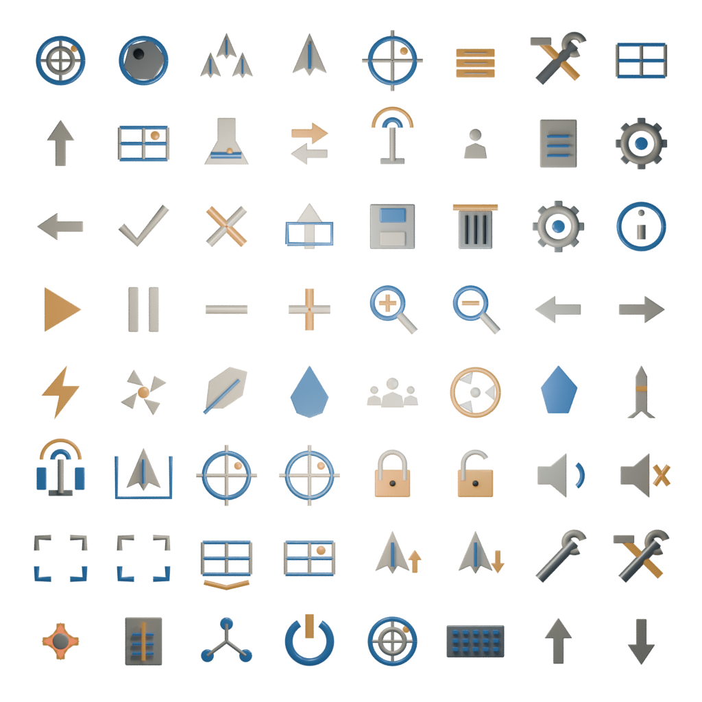

The frontend console includes a machined navigation globe and raised OPENFA plate.

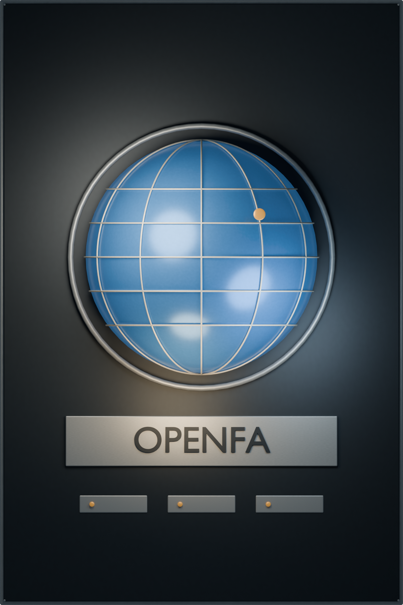

The GLB proof preserves evaluated geometry and constant base material parameters.
Procedural wear remains in the editable Blend and the delivered Cycles PNGs;
the GLB is a geometry/base-material verification export, not the game UI payload.

| Normal | Selected | Pressed | Disabled | Hover |
| --- | --- | --- | --- | --- |
| 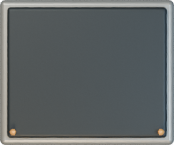 | 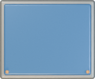 | 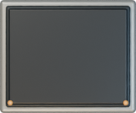 | 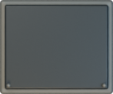 |  |

[Editable Blend](../sources/ui/blender-kit/ui-kit.blend),
[GLB proof](../sources/ui/blender-kit/ui-kit.glb),
[generator](../sources/ui/blender-kit/build_ui.py),
[metadata](../sources/ui/blender-kit/ui-kit.json).

Reproduce with Blender 4.5 LTS (Cycles CPU, 24 samples, AgX/None, transparent RGBA):

```powershell
blender --background --factory-startup --python-exit-code 1 `
  --python sources/ui/blender-kit/build_ui.py -- `
  --output gallery/media/ui/blender-kit
```

The generator creates only this kit's sources and renders. `--proof-only` refreshes
the source/contact/import checks without rerendering all deliverable PNGs.
Run `python sources/ui/blender-kit/verify_ui.py --renders gallery/media/ui/blender-kit`
to verify rendered silhouettes, occupied symbols and state coverage. The verified
native/imported silhouette IoU is 1.0 (125,550 occupied pixels on each side);
`verification.json` records the current source and rendered proof hashes.
The game publishes reviewed renders through `tools/Import-BlenderUi.py`, preserving
its resource IDs, dimensions, states and native/tiled view contracts. Runtime
requires no Blender installation or sibling asset checkout.


## Legacy-referenced HUD study

Five new samples reproduce the motifs from original ICONS.256/BUTTONS.256 files:
missile with arrow, two-ship fleet, coin with accounting bars, wrench with diamond,
and the Sci-Tek oval badge. They preserve the existing kit and remain an unintegrated
visual study. [Source, reference mapping and verification](../sources/ui/legacy-icon-study/README.md).

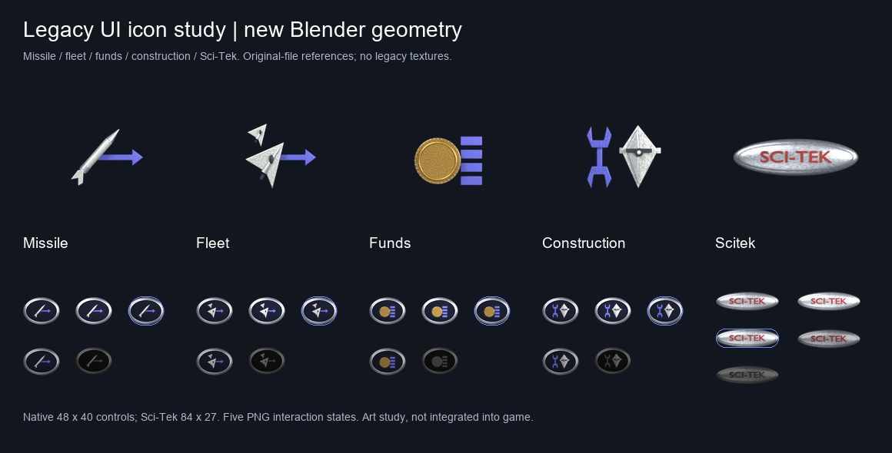


## Complete legacy-referenced icon set

111 authored records cover every original ICONS.256 HUD frame, all auxiliary
control/scroll motifs, player-colour markers and the Sci-Tek badge. Each has
transparent standalone icons and complete oval buttons, five interaction states
and native/8x resolutions. Blank oval chrome and an explicit original-frame map
are included. The earlier five-control study is preserved.

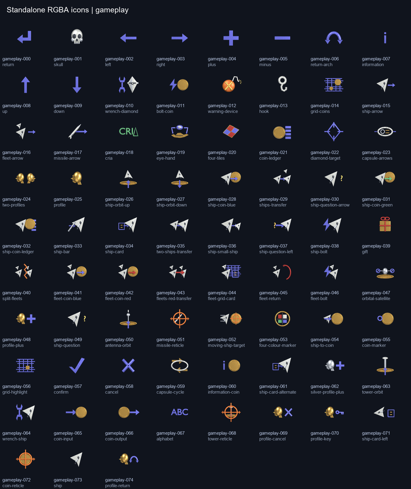

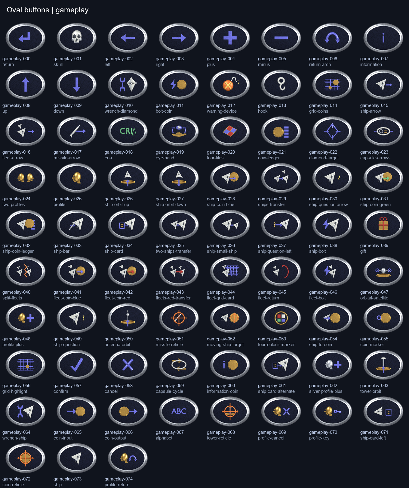

[Native-size preview](media/ui/legacy-icon-set/native-contact.png) ·
[Interaction states](media/ui/legacy-icon-set/interaction-states.png) ·
[Sources, reference mapping and verification](../sources/ui/legacy-icon-set/README.md).

Blender source and independent GLB renders match all 121 group silhouettes at
IoU 1.0. A separate saved-Blend runtime check also passes. This is a complete
asset delivery, with game package integration still separate.


## Main-menu sphere and neon kit

Legacy FE_DOME-inspired convex glass emblem, metal console, separate ornament,
neon rails, label rows and optional OPENFA lettering. Five hues have six lighting
states and eight halo pulse frames each. Native and larger transparent PNG layers
are independent; complete sphere and row composites are also supplied.

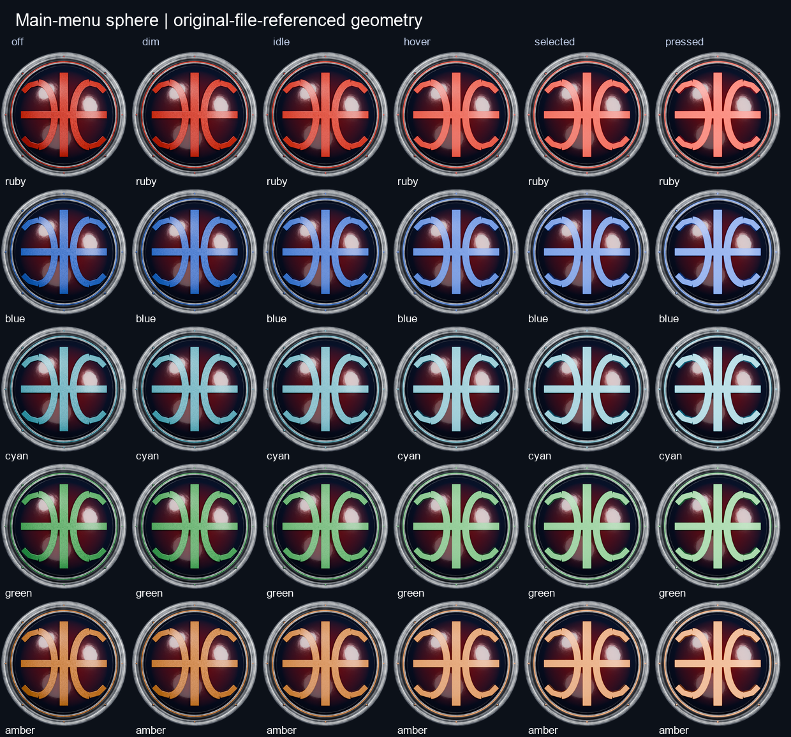

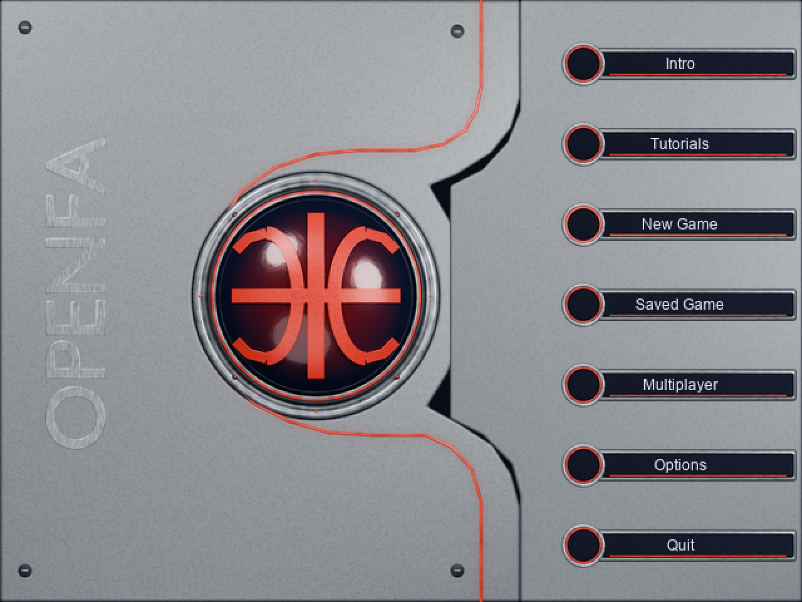

[Source, evidence boundaries and verification](../sources/ui/legacy-main-menu/README.md).
Only idle/bright pressed are confirmed legacy states; additional lighting is an
OpenFA extension. These are asset previews, not integrated game-runtime captures.


## Registered menu refinement (#193)

Shared-scene panel exports have identical overlap pixels and zero gaps. The
smooth recessed neon follows screen context; the red sphere remains invariant.
The logo is one welded manifold mesh, with smooth joined terminals.

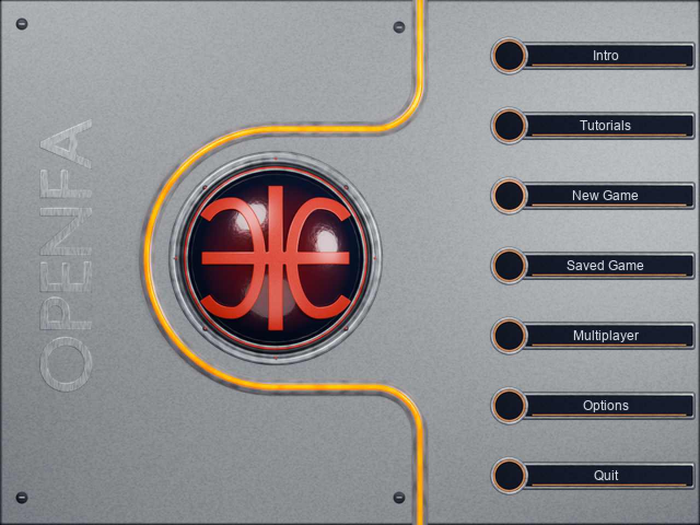
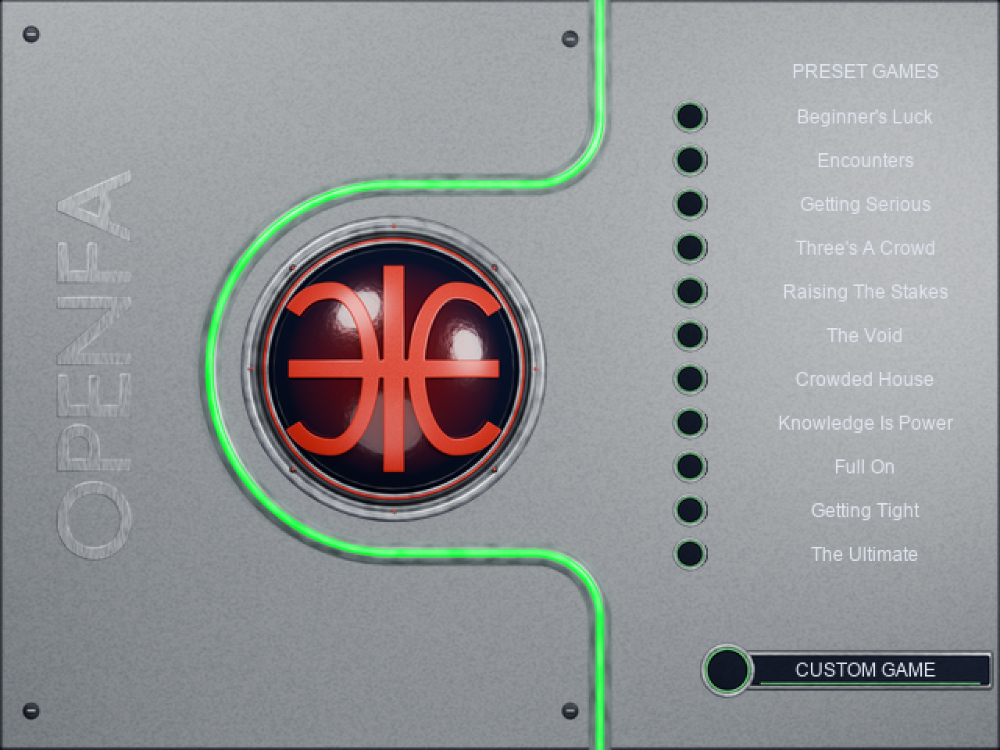

[Source, registration contracts and verification](../sources/ui/legacy-main-menu-refined/README.md).

## Interactive menu sphere (#193)

Full spherical rotor, mirrored continuous rear emblem and independent emissive pulse. Assets only.

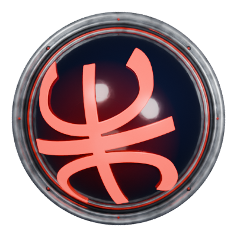

[Model contract](../sources/ui/interactive-menu-sphere/README.md).

[Play sphere rotation and illumination](media/ui/interactive-menu-sphere/sphere-spin.webm) · 37 Blender-rendered frames at 30 fps.

## Sci-Tek menu assets (#208)

Dedicated main-screen plaque, reconstructed from SCITEK.256 with its runtime palette. Separate from the HUD badge.

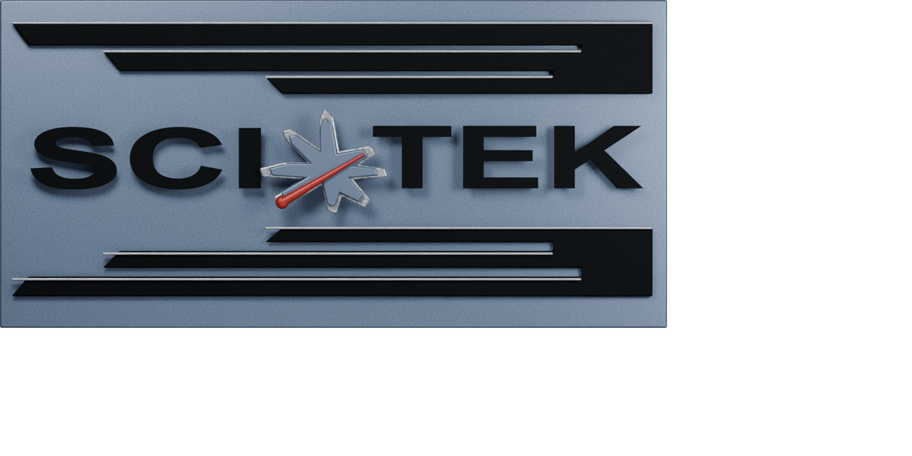

[Source and integration contract](../sources/ui/scitek/screen-logo/README.md).

### Asteroid Tracker

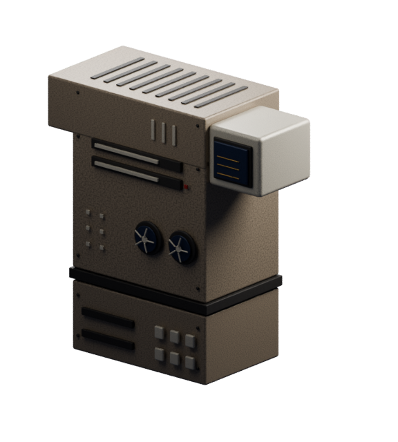

[Turntable](media/ui/scitek/asteroid-tracker/preview.webm) · [Wireframe](media/ui/scitek/asteroid-tracker/wireframe.png) · [Source and integration contract](../sources/ui/scitek/asteroid-tracker/README.md). [Full technical information animation](media/ui/scitek/asteroid-tracker/information.webm) follows the 564-frame clock and four caption phases; camera motion is authored.

### Hi-Energy Power Stores

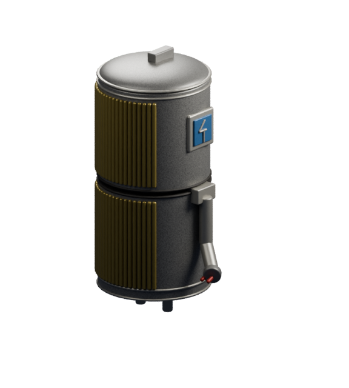

[Full technical animation](media/ui/scitek/hi-energy-power-stores/information.webm) · [Source and integration contract](../sources/ui/scitek/hi-energy-power-stores/README.md).

### Refined Asteroid Tracker

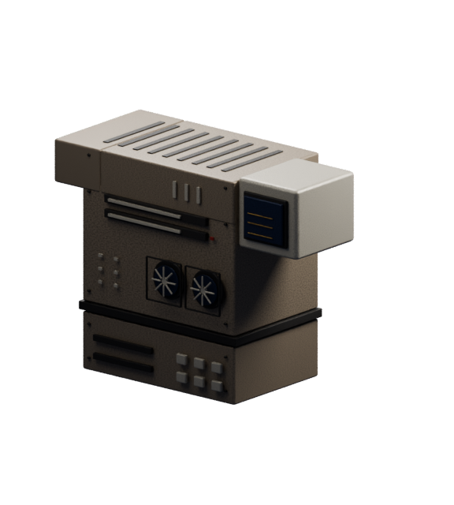

[Current source](../sources/ui/scitek/asteroid-tracker-refined/README.md) · [Corrected information sequence](media/ui/scitek/asteroid-tracker-refined/information.webm). Earlier iterations remain preserved.

### Improved Sensors

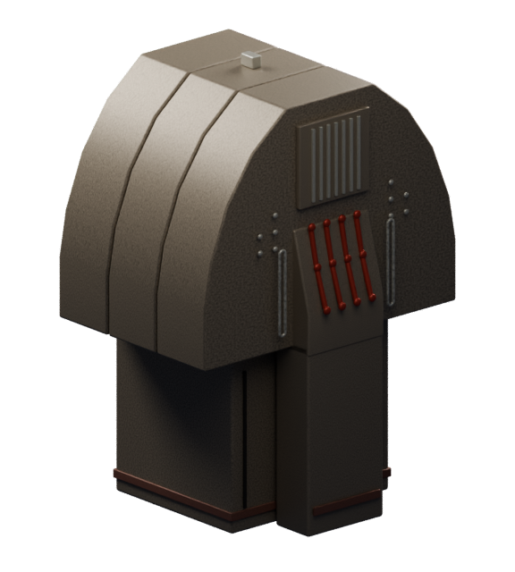

[Full technical animation](media/ui/scitek/improved-sensors/information.webm) · [Source and integration contract](../sources/ui/scitek/improved-sensors/README.md).

### Mk2 Mine

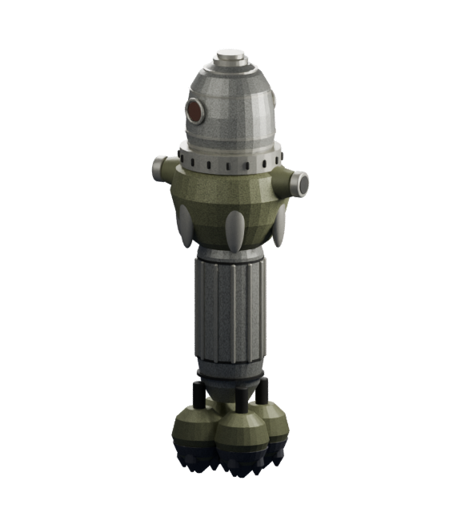

[Full technical animation](media/ui/scitek/mk2-mine/information.webm) · [Source and integration contract](../sources/ui/scitek/mk2-mine/README.md).

### Mk2 Deep Bore Mine

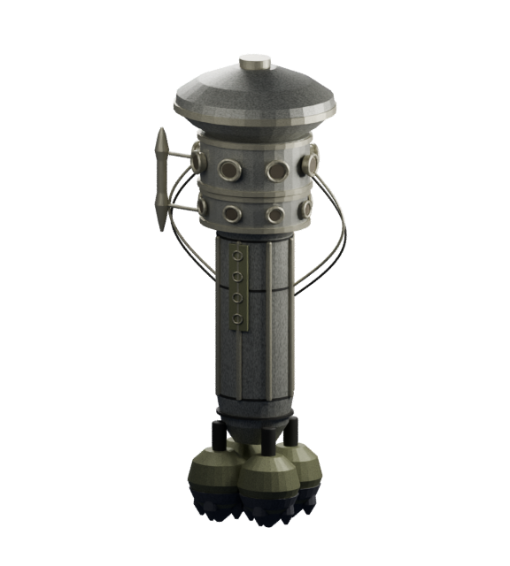

[Full technical animation](media/ui/scitek/mk2-deep-bore-mine/information.webm) · [Source and integration contract](../sources/ui/scitek/mk2-deep-bore-mine/README.md).

### Building Armour

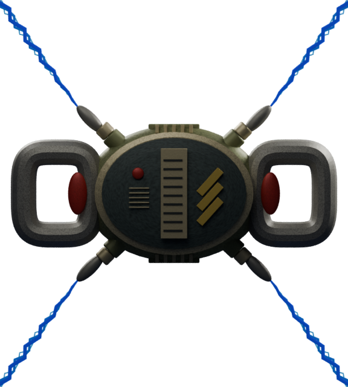

[Full technical animation](media/ui/scitek/building-armour/information.webm) · [Source and integration contract](../sources/ui/scitek/building-armour/README.md).

### Construction Droids

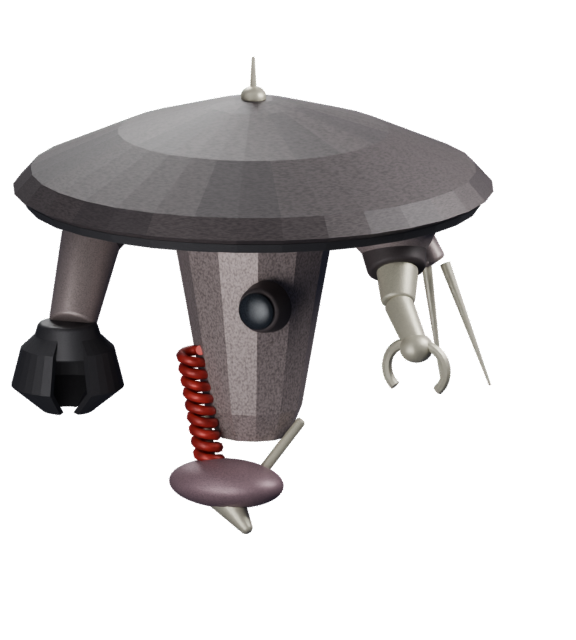

[Full technical animation](media/ui/scitek/construction-droids/information.webm) · [Source and integration contract](../sources/ui/scitek/construction-droids/README.md).

### Missile Bay Extension

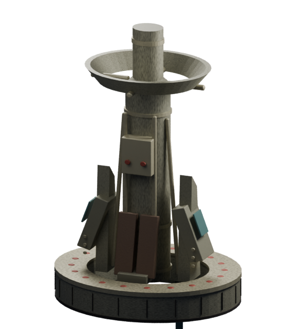

[Technical animation](media/ui/scitek/missile-bay-extension/information.webm) · [Source and integration contract](../sources/ui/scitek/missile-bay-extension/README.md).

### Missile Guidance System

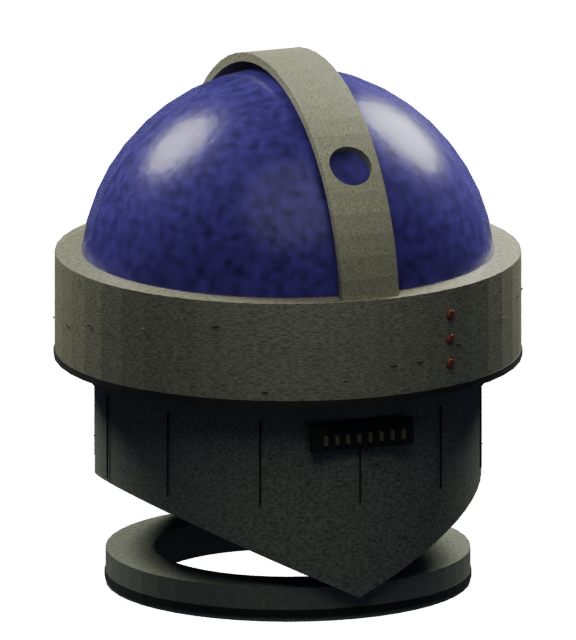

[Full technical animation](media/ui/scitek/missile-guidance-system/information.webm) · [Source and integration contract](../sources/ui/scitek/missile-guidance-system/README.md).

### Power Amplifier

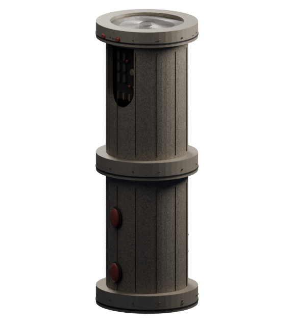

[Full technical animation](media/ui/scitek/power-amplifier/information.webm) · [Source and integration contract](../sources/ui/scitek/power-amplifier/README.md).

### Terminator

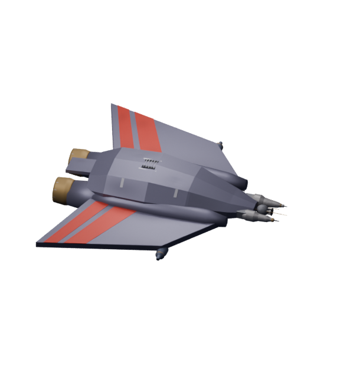

[Full technical animation](media/ui/scitek/terminator/information.webm) · [Source and integration contract](../sources/ui/scitek/terminator/README.md).

### Turret Optimiser

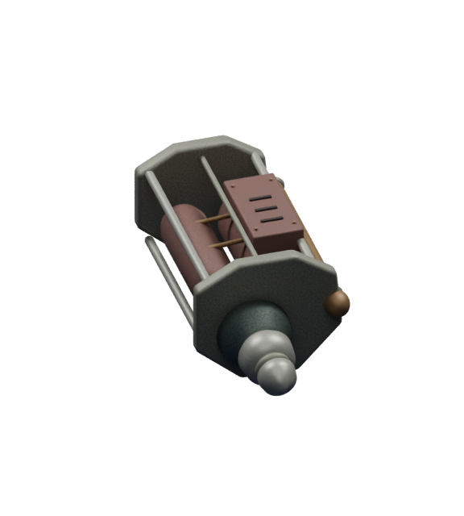

[Full technical animation](media/ui/scitek/turret-optimiser/information.webm) · [Source and integration contract](../sources/ui/scitek/turret-optimiser/README.md).

### Long Range Transmitter

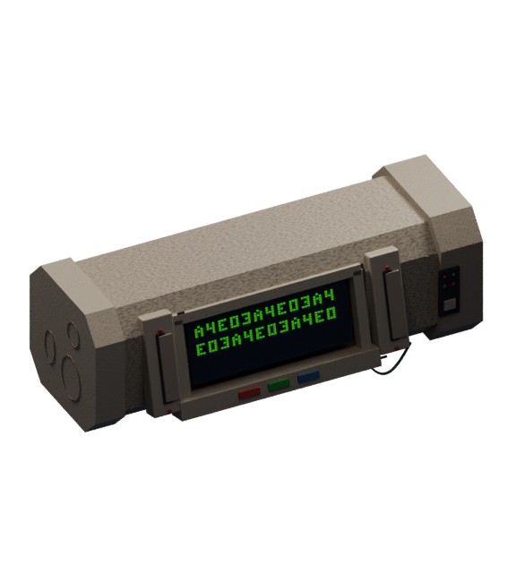

[Full technical animation](media/ui/scitek/long-range-transmitter/information.webm) · [Source and integration contract](../sources/ui/scitek/long-range-transmitter/README.md).

### Anti-Missile Pod

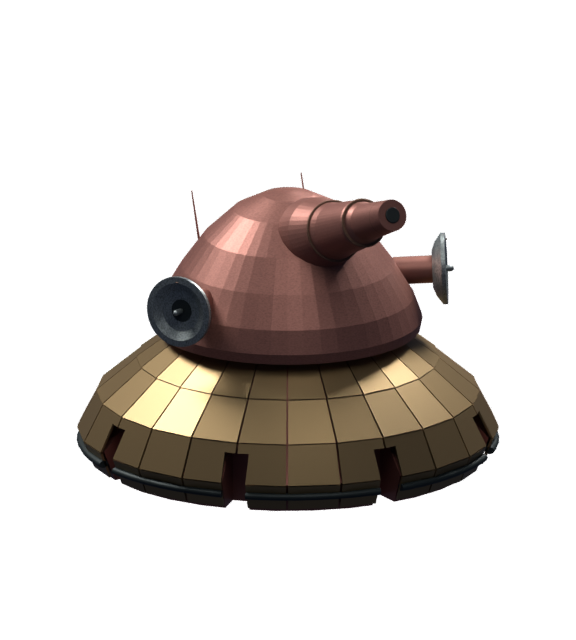

[Full technical animation](media/ui/scitek/anti-missile-pod/information.webm) · [Source and integration contract](../sources/ui/scitek/anti-missile-pod/README.md).

### Anti-Virus Missile

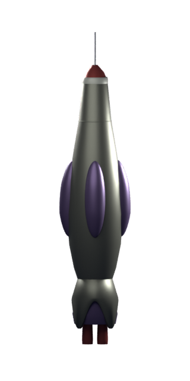

[Full technical animation](media/ui/scitek/anti-virus-missile/information.webm) · [Source and integration contract](../sources/ui/scitek/anti-virus-missile/README.md).

### Asteroid Engines

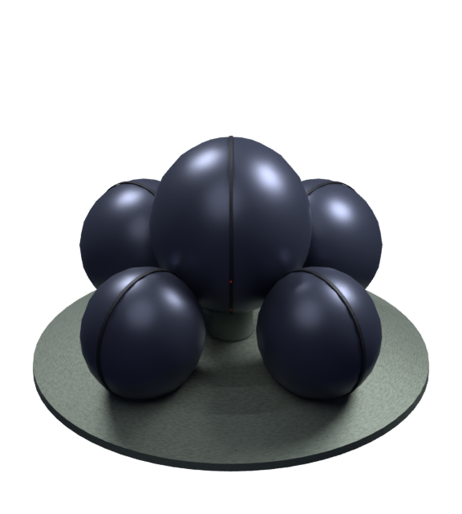

[Full technical animation](media/ui/scitek/asteroid-engines/information.webm) - [Source and integration](../sources/ui/scitek/asteroid-engines/README.md).

### Deflector

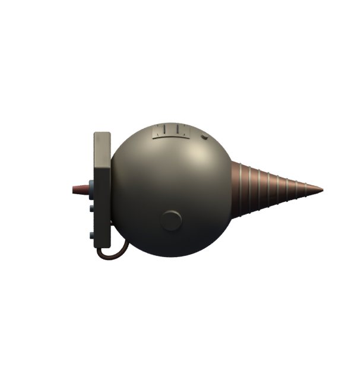

[Full technical animation](media/ui/scitek/deflector/information.webm) - [Source and integration](../sources/ui/scitek/deflector/README.md).
