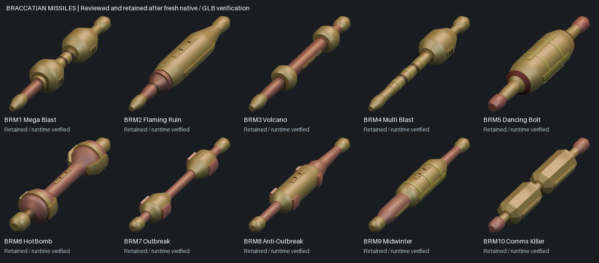

# Braccatian missile review (#190)

All ten missiles are retained after focused source and fresh runtime review. These are explicit unchanged-model decisions, not ten new refinements. Existing models already contain the larger visible forms, colour regions, collars, castings and meaningful service construction; the references do not establish more external machinery.

All 140 descriptors were inspected, then freshly re-decoded and checked against the prior indexed/colour references. Missile files carry grayscale placeholder palettes: the actual `_MS/BUTTONS.256` game palette is required and its identity is verified. Original pixels stay private. Full Braccatian CDB/function evidence is bound; names/effect roles do not establish internal mechanisms. The completed Sci-Tek applicability audit contains no Braccatian preview binding.

| Model | Reason to retain the existing geometry | Closed meshes |
| --- | --- | ---: |
| BRM1 Mega Blast | Two broad gold expansions separated by a thin banded waist, copper forward neck and gold terminals. | 37 |
| BRM2 Flaming Ruin | A broad continuous gold body with longitudinal divisions, copper neck/coupling and gold terminals. | 22 |
| BRM3 Volcano | A long narrow copper shaft between two broad gold collars, with gold terminals; the waist must remain exposed. | 20 |
| BRM4 Multi Blast | One broad gold rear section, narrow banded connecting shaft and separate small gold terminal regions. | 24 |
| BRM5 Dancing Bolt | Broad gold/yellow-green central body with visible bands and longitudinal divisions, red terminal pieces. | 25 |
| BRM6 HotBomb | Two expanded end regions with gold side castings/collars and a much narrower copper-coloured middle. | 24 |
| BRM7 Outbreak | Two separated gold masses with conspicuous pink side castings, narrow copper connection and gold terminals. | 23 |
| BRM8 Anti-Outbreak | One broad continuous gold chamber with pink side fittings and exposed copper forward/aft regions. | 23 |
| BRM9 Midwinter | Gold central body with yellow-green bands/longitudinal regions, copper neck and small gold terminal regions. | 26 |
| BRM10 Comms Killer | Two substantial gold bodies around a narrow central join, with copper-coloured terminals and longitudinal highlight regions. | 23 |

Actual Blender 4.5.15 native reopen and independent GLB import pass for 247 closed positive meshes and 40 paired renders. Construction tests recheck profiles/dents, connected core/end/collar assemblies, exposed narrow waists, actual annular voids, fitted skins/slots/fasteners, original helper rotations and UV projections. Packed effective colour/roughness/metallic channels, normal directions, geometry bounds and hierarchy agree. Source Blend/GLB pairs remain byte-identical to the baseline.

All 40 paired silhouettes have IoU 1.000000000. Maximum world position difference is 1.00024045e-06, helper error below 0.00001 and corner-normal difference 0.000750075855; RGB mean difference below 0.00102368117/255. All native/imported quarter, reverse, plan and detail views were inspected. Source/body comparisons were inspected against all fourteen original presentations, without claiming an exact recovered camera.

No model contains an authored operating clip. Bright plume frames remain effect evidence, not new solid exhaust geometry. Shorter body presentations do not justify invented unfolding components. Source direction, exact timing/sequence and gameplay orientation calibration are not newly recovered here. Existing Comms Killer faceting and HotBomb transverse casting shape remain qualified interpretations.

Reproduce evidence with `python tools/review_braccatian_missile_evidence.py --legacy-root <legacy-root>`. Run the fresh Blender verifier `sources/tools/blender/verify_braccatian_missile_retention.py -- --models <slugs>` without regenerating or overwriting accepted sources, then `python tools/register_braccatian_missile_review.py`. Per-model decisions bind exact source/report hashes in `braccatian-missile-decisions.json`; actual validation and new review renders are under `gallery/media/docs/assets/reconstruction/braccatian-refined/missile-retention/<slug>/`.

This closes the ten missile decisions. The separate final all-38 Braccatian scope/source/animation/gallery audit remains required before declaring the persistent goal complete.
