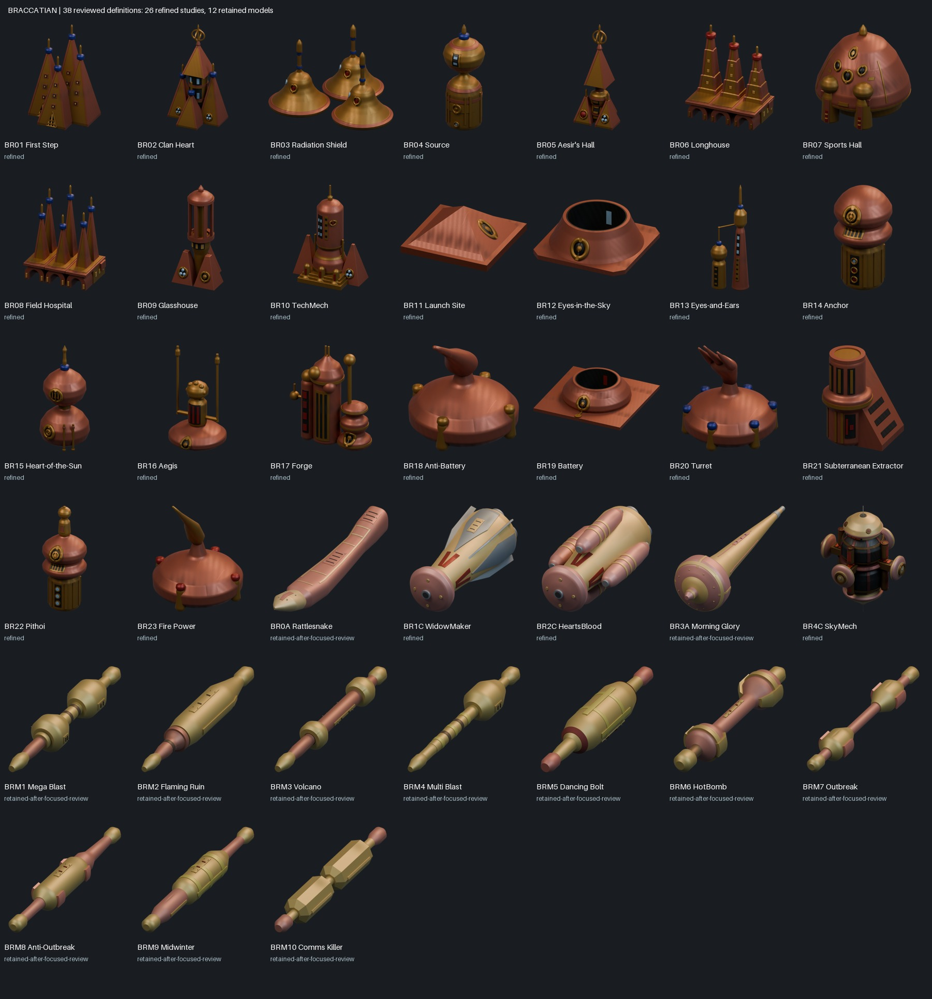

# Braccatian refining completion (#190)

The full asset programme is complete for all 38 definitions: 23 buildings, five ships and ten missiles. It delivers 26 separate refined normal-appearance studies and 12 explicit unchanged-model decisions (two ships and ten missiles), each with fresh relevant runtime verification. The original scope is preserved; retained models are not counted as new geometry. The requested seven-culture station extension is also complete in #192.

## Requirement-by-requirement evidence

| Requirement | Verified evidence |
| --- | --- |
| Complete 38-definition scope | Completion JSON enumerates unique canonical IDs/names and exact model/GLB/report hashes; 23/5/10 category and 26/12 decision counts are asserted. |
| Complete CDB/function evidence | Full Braccatian records 33-61 plus four cross-culture mentions are byte-bound in braccatian-lore-evidence.json. All 38 function mappings and 61 exact name/prose byte ranges are revalidated. Contextual lore and unknown alloys remain qualified. |
| Correctly paletted legacy forms and states | All 412 original sprite descriptors (365 populated) were freshly re-decoded, compared by indices and RGBA against private reviewed references, including original offsets. All 23 catalogue films were freshly decoded and all 943 phase images match the reviewed originals. Missile palettes use _MS/BUTTONS.256, not embedded grayscale placeholders. |
| Applicable animated Sci-Tek evidence | All 36 actual subject/preview/film bindings and cached original-codec frames/timelines were revalidated again. 7,282 image updates span 15,794 timeline frames; visual review sampled all 36 eighteen-phase sheets (648 updates). No direct Braccatian preview binding exists, so unrelated PM/PB/PH shapes are not substituted. This is not a new Sci-Tek decode or a claim to view every decoded update. |
| Visible structural refining | Per-model metadata/observations, source comparisons and inspected native/imported renders support meaningful silhouette, housing, entrance, shaft, equipment and material divisions. BR03 has three continuous flared handbells/handles; BR06 has three actual open entrance arches; BR08 has six blue-collared towers; SkyMech has a broad 0.88-radius core reaching near the peripheral hemispheres. Counts alone are not used as fidelity proof. |
| Materials and wear | Newly authored objects have independently authored colour/roughness maps, readable surface wear and shallow dents where applicable. Per-model actual runtime checks bind effective packed shader channels and physically fitted geometry; gold/copper colour names do not establish chemical alloys. Retained models/maps remain unchanged. |
| Native and independent GLB runtime | All 38 normal-appearance decisions have actual Blender 4.5.15 reopen/independent import reports, covering 1222 closed positive meshes and 135 inspected paired render views. Current file/generator/verifier/dependency/texture/render hashes match those individually executed reports. Aggregate audit does not claim to rerun 38 Blender jobs. |
| Meaningful mechanical checks | Individual checks cover actual profiles, connected/supported equipment, fitted skins/fasteners, door/silo clearances, annular voids, open arches, bearing contacts, exposed narrow waists, UVs/normals, material arrays and helper rotations. The aggregate also checks exported mesh counts and exact clip identities against original GLBs. |
| Preserved animation | BR11 retains native hatch curves and named floor/shaft/leaves across nine poses and 49 open-bore rays. BR18/20/23 preserve original controllers/actions and exported one-second directional preview identities across 17 poses. These are heading demos, not claimed idle/firing loops. All other static normal models remain clip-free. |
| Earlier studies and movies | All 406 pre-pass studies preserve their exact catalogue entries and Blend/GLB/poster bytes. All 43 pre-pass movie files retain their hashes. All 38 original Braccatian pairs remain byte-identical; refinements are separate selectable studies. |
| Gallery and playable previews | Current gallery has 303 definitions / 444 studies and 54 actual GLB-derived playable clips: 43 prior, four refined Braccatian clips and seven construction clips. Filters/player controls, 45 category/culture combinations, provide-models, animation integrity and complete video decode pass. |
| Seven-culture station pairs | Explicit descriptor 0/1 manifest maps 14 finished/construction models. Separate audit proves all 895 finished meshes preserve exported world geometry/UVs/normals/material assignments in construction, with zero direct attribute difference; 64 individual paired render checks and 13 mechanical poses per constructor pass. Dense scaffolds/covers are physical geometry; only each three-part carriage moves in its authored six-second loop. |
| Isolation and delivery | Work is in the isolated feat/braccatian-model-refining asset worktree; the active game/scaffold checkout is untouched. Verified milestones are committed and published in PR #191, stacked on #187. Technical issue comments link commits. Each station pair was handed immediately to the authorized main chat; the complete 38-model manifest is the final handoff input. |

## Complete normal-appearance decisions

| Legacy | Name | Decision | Closed meshes | Paired views |
| --- | --- | --- | ---: | ---: |
| BR01 | First Step | refined | 74 | 3 |
| BR02 | Clan Heart | refined | 47 | 4 |
| BR03 | Radiation Shield | refined | 24 | 3 |
| BR04 | Source | refined | 28 | 3 |
| BR05 | Aesir's Hall | refined | 37 | 4 |
| BR06 | Longhouse | refined | 61 | 3 |
| BR07 | Sports Hall | refined | 37 | 3 |
| BR08 | Field Hospital | refined | 67 | 3 |
| BR09 | Glasshouse | refined | 29 | 3 |
| BR10 | TechMech | refined | 37 | 3 |
| BR11 | Launch Site | refined | 10 | 4 |
| BR12 | Eyes-in-the-Sky | refined | 7 | 3 |
| BR13 | Eyes-and-Ears | refined | 25 | 3 |
| BR14 | Anchor | refined | 30 | 3 |
| BR15 | Heart-of-the-Sun | refined | 20 | 3 |
| BR16 | Aegis | refined | 22 | 3 |
| BR17 | Forge | refined | 29 | 3 |
| BR18 | Anti-Battery | refined | 10 | 4 |
| BR19 | Battery | refined | 9 | 3 |
| BR20 | Turret | refined | 17 | 4 |
| BR21 | Subterranean Extractor | refined | 20 | 3 |
| BR22 | Pithoi | refined | 36 | 3 |
| BR23 | Fire Power | refined | 10 | 4 |
| BR0A | Rattlesnake | retained-after-focused-review | 33 | 4 |
| BR1C | WidowMaker | refined | 48 | 4 |
| BR2C | HeartsBlood | refined | 56 | 4 |
| BR3A | Morning Glory | retained-after-focused-review | 40 | 4 |
| BR4C | SkyMech | refined | 112 | 4 |
| BRM1 | Mega Blast | retained-after-focused-review | 37 | 4 |
| BRM2 | Flaming Ruin | retained-after-focused-review | 22 | 4 |
| BRM3 | Volcano | retained-after-focused-review | 20 | 4 |
| BRM4 | Multi Blast | retained-after-focused-review | 24 | 4 |
| BRM5 | Dancing Bolt | retained-after-focused-review | 25 | 4 |
| BRM6 | HotBomb | retained-after-focused-review | 24 | 4 |
| BRM7 | Outbreak | retained-after-focused-review | 23 | 4 |
| BRM8 | Anti-Outbreak | retained-after-focused-review | 23 | 4 |
| BRM9 | Midwinter | retained-after-focused-review | 26 | 4 |
| BRM10 | Comms Killer | retained-after-focused-review | 23 | 4 |

Every row in the JSON provides exact editable/GLB paths, report hashes, reason/observations and actual animation previews. Construction states use orbital-station-variants.json; never choose the latest study as the finished model.

## Validation limits and interpretation

The 135 normal-model pairs have minimum silhouette IoU 0.999989731900: 134 exact masks and one retained-ship threshold pixel (Morning Glory). Maximum normal-model position difference is 1.47574167e-06. The station audit is reported separately; SkyMech finished views overlap these normal-model statistics and must not be counted twice as unique views.

Exact hidden construction, transverse sections, repeated hidden counts and named alloy identities remain authored interpretations. Source camera, final gameplay scale/orientation and equipment mount calibration remain integration work. Authored construction timing is six seconds; this does not claim recovered legacy timing. Both station states use the finished normalization and shared PlacementRoot. Mikotaj radial 1.18, Artemian longitudinal 1.65 and Achaean vertical 1.18 fits are already embedded in geometry. Final artistic approval is separate from this verified asset delivery.

The initial baseline/plan and per-milestone notes are historical evidence. This completion record supersedes their pending-work statements; their preserved hashes and accepted model files are not rewritten.

## Reproduction

Run `python tools/audit_braccatian_refining.py --legacy-root <legacy-root> --decoder-python <Python-with-Pillow-and-Unicorn>`; the decoder executes the original video codec through Unicorn, without DOSBox. On this host the decoder is legacy/system/python/python.exe. The audit freshly decodes building films, verifies all sprites/function/CDB evidence, binds all 38 runtime reports and checks all 406 prior studies/43 prior clips. Sci-Tek cache verification is `python tools/audit_braccatian_scitek_references.py --legacy-root <legacy-root> --reference-cache <prior-ST00-through-ST35-cache>`.

Run `python tools/test_braccatian_completion_audit.py`, `python tools/test_braccatian_scitek_audit.py`, `python tools/test_orbital_station_audit.py`, `python tools/test_gallery_animations.py`, `python tools/verify_project.py`, `node tools/test_gallery_filters.cjs`, `pwsh -NoProfile -File tools/Test-ProvideModels.ps1` and `python tools/verify_gallery_videos.py`. Registration and aggregate outputs are byte-idempotent. The label regression rejects a dependency filename in the model name and rejects missing/duplicate scope or counting retained models as new.
