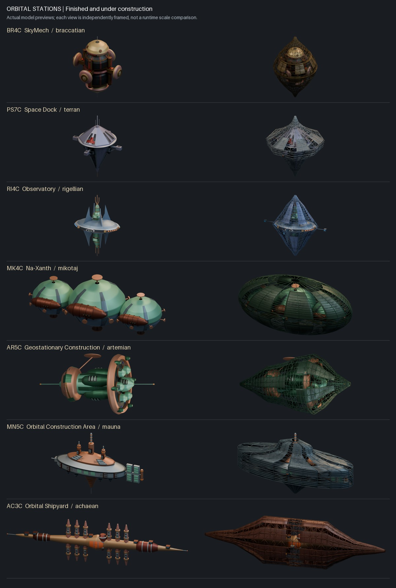

# Orbital station state-pair audit

All seven culture station pairs are complete for asset delivery: descriptor 0 is finished and descriptor 1 is under construction. Both states use the finished placement/normalization and shared PlacementRoot.

This aggregate check binds the current files to the individual Blender 4.5.15 native/independent-GLB runtime reports; it does not rerun fourteen Blender jobs. It separately reads current GLB accessors, hierarchy and animation channels. Every finished mesh preserves its topology, material assignment, world positions, normals and UV attributes in construction, with zero measured direct GLB attribute difference. Only each three-part service carriage is targeted by construction animation. All seven six-second clips close and contain actual translation activity.

| Legacy | Finished meshes | Construction meshes | Closed construction components | Native/imported render pairs |
| --- | ---: | ---: | ---: | ---: |
| BR4C | 112 | 138 | 975 | 9 |
| PS7C | 72 | 91 | 828 | 9 |
| RI4C | 118 | 146 | 936 | 9 |
| MK4C | 146 | 169 | 906 | 9 |
| AR5C | 132 | 151 | 963 | 10 |
| MN5C | 172 | 195 | 957 | 9 |
| AC3C | 143 | 166 | 1003 | 9 |

The 14 source descriptors were freshly re-decoded from the original archive with embedded palettes and compared pixel-for-pixel against the private reviewed references. Payload, codec, function-name bytes and CDB evidence match. Complete alien culture records remain source-bound; the original CDB heading inventory has no Terran culture/architecture section. Original pixels remain private. All 38 original Braccatian Blend/GLB pairs still match the baseline hashes.

The 64 individual native/imported render pairs have matching silhouettes and source-bound reports. Dense scaffold members and covers are closed positive physical geometry; individual checks cover supported attachments, temporary cover roots, helper/material preservation and 13 rail-contact motion poses per constructor. All seven actual GLB-derived movies contain 144 frames at 24 fps, and all 54 gallery movies fully decode. Every finished/construction study is selectable in the gallery; 45 filter combinations, player controls, provide-models and animation integrity pass. Eight mutation tests show the aggregate checker rejects moved geometry, changed UVs/normals/topology, station animation, static activity and non-closing cycles.

## Actual model previews

Views below are independently framed previews, not a runtime scale comparison.

## Reproduction

Run `python tools/audit_orbital_station_pairs.py --legacy-root <legacy-root>`, `python tools/test_orbital_station_audit.py`, `python tools/verify_project.py`, `node tools/test_gallery_filters.cjs`, `pwsh -NoProfile -File tools/Test-ProvideModels.ps1`, `python tools/test_gallery_animations.py` and `python tools/verify_gallery_videos.py`. The audit emits deterministic `orbital-station-audit.json` and the actual-model overview.

The JSON binds the manifest, gallery, overview, audit source, all fourteen runtime reports and each actual preview. Per-model source/decisions remain in `orbital-station-construction.md`, the state manifest and individual evidence/reports.

## Remaining interpretation and integration work

Profiles, hidden construction, repeated fitting counts and six-second service timing are authored, not recovered legacy animation. Final game scale/orientation and equipment mount calibration remain integration work. Mikotaj radial 1.18, Artemian longitudinal 1.65 and Achaean vertical 1.18 fits are already embedded in both states. Never reapply them or fit construction bounds independently. The active game checkout was not edited.

This completes station-pair issue #192 only. The prerequisite all-38 Braccatian work (#190) was independently verified and merged via PR #202 (main 6796ae3425e54ddd4a1559c188b2d13f79d97ce6) before this branch was created. Its finished SkyMech is used unchanged.
