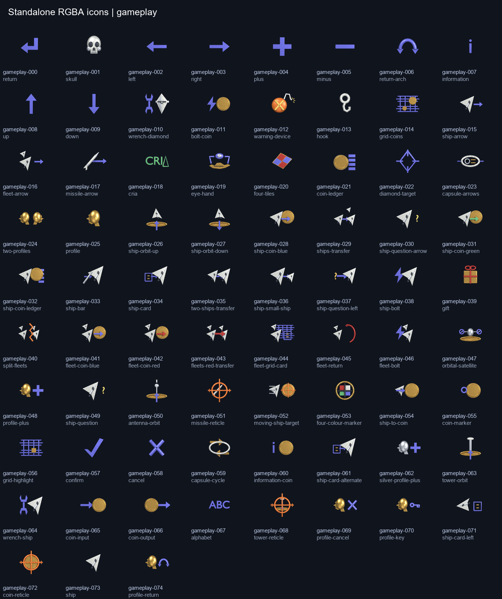
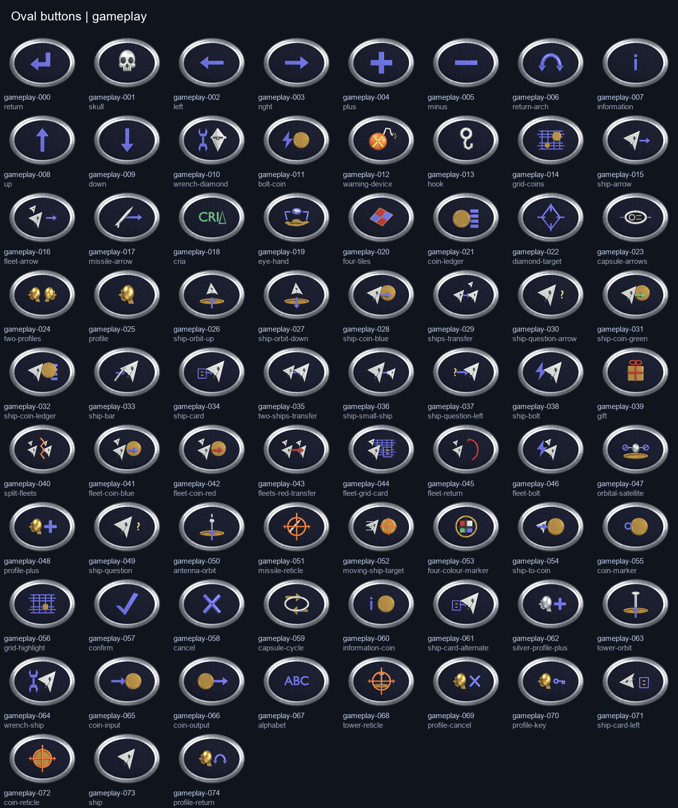

# Complete legacy-referenced UI icon set

Tracking: [openfa-assets #176](https://github.com/ender-dev-pl/openfa-assets/issues/176).
This completes the five-control visual study without replacing its preserved sources.

## Contents

The set contains 111 authored icon records:

- All 75 original HUD motifs from `_MS/ICONS.256`, preserving frame numbers 000–074.
- Four directional/control motifs from the 12 original `_MS/CICONS.256` frames.
- Fourteen scrolling/action motifs from the 42 original `_MS/SCROLL.256` frames.
- All 17 player-colour markers from `_MS/FE_ICONS.256`, including repeated neutral entries.
- The SCI-TEK label and oval badge, referenced to `_MS/BUTTONS.256` frame 002.

`BLUE.256` supplied the original icon/reference palette. `BUTTONS.256` uses its
embedded palette. References were freshly decoded from the original installation;
the earlier OpenFA before/after screenshot was not a design reference. Original
file/decoder SHA-256 values are recorded in `verification.json`. Original pixels
and original/new comparison boards remain local, outside the published gallery.

All forms are authored geometry: rounded/extruded directional signs, faceted hulls,
cylindrical missiles, gold coin rims, head profiles, sockets/teeth, hooks, orbital
hardware, grids, reticles and lettering. Materials have restrained grain, grime,
abrasions and small surface dents. No reference pixels, traced pixel contours or
legacy image textures are used to construct the new models.

## Payload layout

- `icons/native/`: transparent standalone PNGs, without a button or baked backdrop.
- `icons/hires/`: standalone PNGs at eight times the native dimensions.
- `buttons/native/` and `buttons/hires/`: complete oval buttons containing the icons.
- `chrome/native/` and `chrome/hires/`: blank matching oval controls and Sci-Tek plates.
- `masks/`: generated oval alpha masks for the original mask-frame roles.
- `catalog.json`: motif, original reference, dimensions and explicit paths per icon/state.
- `frame-map.json`: all 147 original frame roles across the included families.
- `verification.json`: source, scene, export, raw-render and payload hash evidence.

Each icon and complete button has `normal`, `hover`, `selected`, `pressed` and
`disabled` variants. Standalone normal files omit the state suffix, e.g.
`icons/native/gameplay-017.png`; complete buttons use
`buttons/native/gameplay-017-normal.png`. There are 1,110 standalone PNGs, 1,110
complete-button PNGs, 30 blank chrome PNGs, 18 masks and 12 preview sheets: 2,280 PNGs.

Native HUD icons are 48x38 and complete buttons are 48x40. Auxiliary icons are
30x30 and complete controls are 32x32. Player-colour markers are 40x40, with 48x40
buttons. The standalone SCI-TEK label and complete badge are 84x27. Hi-res dimensions
are eight times those sizes. All PNG payloads use RGBA transparency.

The ten button/plate chrome states are separately rendered Blender geometry.
Pillow composes the icon layers, adds state brightness/desaturation and offsets
the pressed glyph. This is not a claim of independently rendered icon geometry
for every interaction state. The GLB carries geometry and constant base materials;
procedural surface wear is retained in the Blend and native source renders.

## Preview and verification





[Native-size contact sheet](../../../gallery/media/ui/legacy-icon-set/native-contact.png)
and [interaction states](../../../gallery/media/ui/legacy-icon-set/interaction-states.png).

Blender 4.5.15 LTS / Cycles CPU / 40 samples / Standard–None / orthographic camera
rendered all 121 geometry/chrome groups. The generator exported GLB, removed source
objects, independently imported the GLB and rendered every group again. All object
counts match and all 121 source/import alpha silhouettes have IoU 1.0. A separate
Blender process reopened the saved Blend and rendered the visible missile group;
its silhouette also has IoU 1.0 with the original source render. Render-border
checks, complete original-frame coverage, dimensions, alpha and state checks pass.

The verifier also rejected four deliberate invalid cases in the local workspace:
changed generator source, a missing original frame, a changed payload pixel, and
an opaque standalone image even after its checksum was updated. The original
verified files were restored and the positive verification passed again.

The game `Verify-ChangedCodeQuality.ps1 -BaseSha HEAD` gate passed. This task changes
asset sources and generated media only. The target runtime for this delivery is
Blender; game integration and game-runtime visual acceptance remain separate.

## Reproduce

From the asset repository, using a separate ignored output workspace:

```powershell
blender --background --factory-startup --python-exit-code 1 `
  --python sources/ui/legacy-icon-set/build_icon_set.py -- `
  --output artifacts/legacy-ui-full/renders

blender --background --factory-startup --python-exit-code 1 `
  --python sources/ui/legacy-icon-set/verify_saved_scene.py -- `
  --blend artifacts/legacy-ui-full/renders/legacy-ui-full.blend `
  --output artifacts/legacy-ui-full

python sources/ui/legacy-icon-set/assemble_icon_set.py `
  --workspace artifacts/legacy-ui-full --output artifacts/legacy-ui-full/delivery

python sources/ui/legacy-icon-set/verify_icon_set.py `
  --source sources/ui/legacy-icon-set --media gallery/media/ui/legacy-icon-set `
  --renders gallery/media/ui/legacy-icon-set-proof
```

Blender generation and assembly do not require an original installation. For a
fresh local original/new comparison, first run `prepare_references.py` with
`--legacy-root`, `--decoder` pointing to the installation's `tools/fragile256.py`,
and `--output artifacts/legacy-ui-full/reference`. Pass that path to the assembly
script with `--references`. Never publish the generated original-pixel comparisons.

The final verification example checks the published canonical source and gallery.
For a newly generated local workspace, either publish its reviewed scene/media
first or place the generated Blend/GLB alongside its matching generator copies and
point `--source` there. Source hashes intentionally reject stale canonical scenes.
The saved Blend opens with `gameplay-017` visible; switch object render/viewport
visibility in the named Outliner collections to inspect another group.

## Integration notes

Use `frame-map.json`, not the semantic-symbol remapping from the older Blender kit.
Original control/scroll frames are grouped as mask/normal/pressed; all those roles
are explicit. The 17 frontend entries are original player-colour markers, not the
seven newly invented menu action symbols in the current portable package.

Choose either a standalone icon above existing chrome or a complete button;
do not layer a complete button on top of another button. The complete SCI-TEK
badge already contains its lettering, so suppress the existing separate label
when using it. Native sizes are explicit, but this delivery does not modify
package resource IDs, presenters, views or hotkeys and has not been tested as an
integrated game package. Names describe visible motifs where original callback
semantics have not been independently established.
