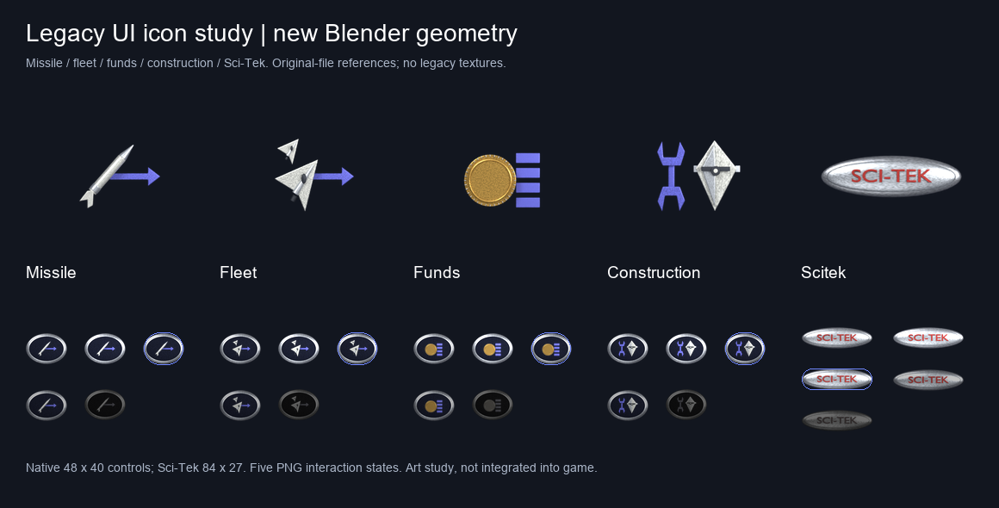

# Legacy-referenced HUD icon study

Tracking: [#176](https://github.com/ender-dev-pl/openfa-assets/issues/176).

This is a five-control visual study, not a replacement for the existing kit or
an accepted game integration. Reference shapes come directly from the original
`_MS/ICONS.256` frames 017 (missile), 016 (fleet), 021 (funds), 010 (construction),
using `_MS/BLUE.256`. The oval button and SCI-TEK badge come from original
`_MS/BUTTONS.256` frames 000/002, using its embedded palette. The local legacy
decoder was run against these original files, rather than relying on earlier
OpenFA screenshots. Reference file SHA-256 values are recorded in verification.

The missile retains the blue arrow, fleet retains two ships, funds retains one
coin and four accounting bars, and construction retains the blue double-ended
wrench beside a pale diamond. Sci-Tek uses the original badge motif, not a flask.
The round forms, facets and bevels are new geometry. Procedural metal/enamel wear
adds restrained material variation and small surface dents. No original pixels
are used as model textures. Original-pixel references and the comparison board
remain local evidence outside this repository's published gallery.



## Reproduction

Run from the asset repository, with a separate ignored output directory:

```powershell
blender --background --factory-startup --python-exit-code 1 `
  --python sources/ui/legacy-icon-study/build_legacy_ui_study.py -- `
  artifacts/legacy-ui-study/renders
```

To assemble the original/new comparison locally, use Pillow and the original
installation's `tools/fragile256.py` decoder. Export `ICONS.256` and `BUTTONS.256`
with `export-sprites` into `artifacts/legacy-ui-study/reference`, then run:

```powershell
python sources/ui/legacy-icon-study/assemble_study.py artifacts/legacy-ui-study `
  --legacy-root ../legacy
```

The Blender generator uses Cycles CPU, 40 samples, Standard/None, orthographic
projection and transparent RGBA. Its six source groups are exported to GLB,
removed from the scene and independently imported and rendered. The assembly
checks silhouette IoU >= 0.995 for each of the five symbols; observed IoU is 1.0
for all five. The saved Blend opens with the missile group visible; other groups
can be enabled from the Outliner. GLB proofs validate geometry and constant base
materials; procedural surface wear is retained in Blend/native PNGs.

Four controls have 48x40 PNG samples and separate 48x38 icon layers. Sci-Tek has
84x27 badge samples. All five have normal, hover, selected, pressed and disabled
PNG variants. These interaction variants are composed by the Pillow script;
they are not five separately rendered Blender states. They have not been tested
in the game runtime. Source and GLB were tested in Blender 4.5.15 LTS; the game
changed-code quality gate was also run with base HEAD (no game changes).
