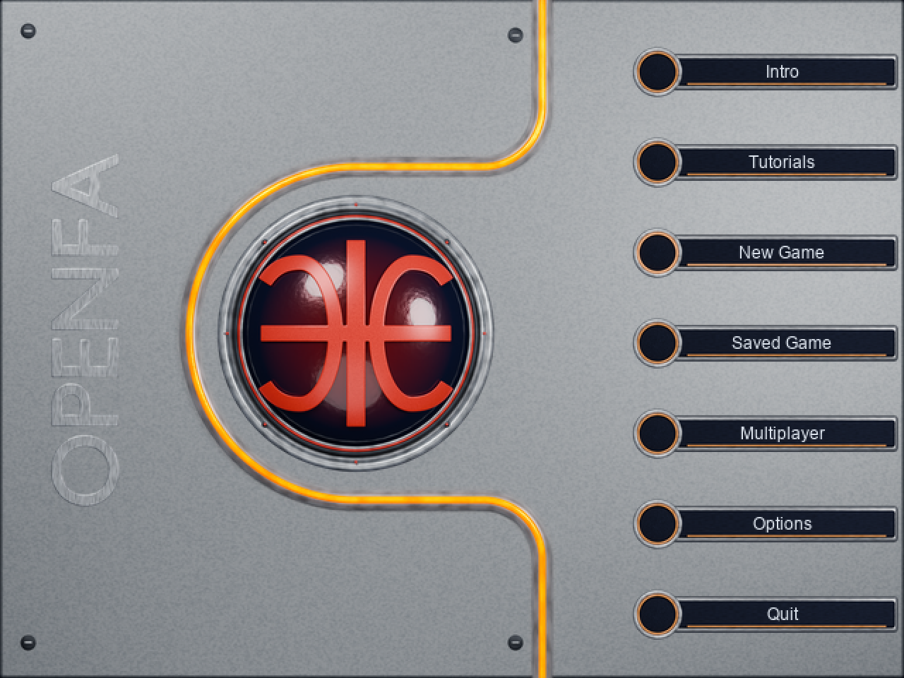
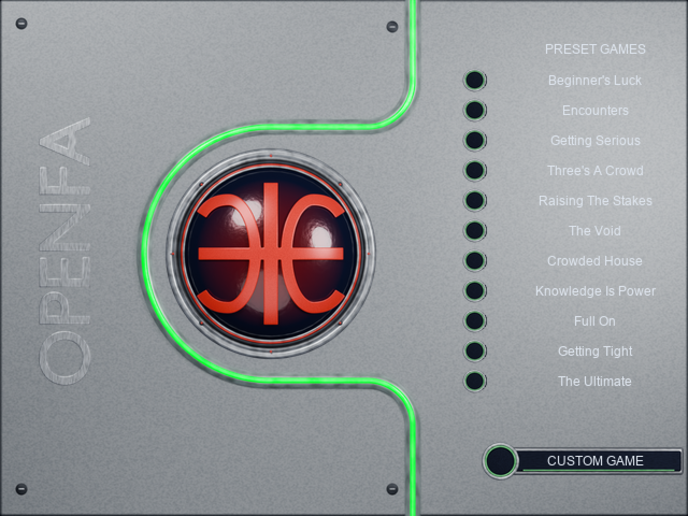

# Registered menu refinement

Tracking: [#193](https://github.com/ender-dev-pl/openfa-assets/issues/193), relates to #176.
This preserves the first menu kit and refines it against the supplied main-menu
and preset-game captures. It is an asset delivery, not a game-runtime capture.

## Corrected contracts

Both panel exports come from one 640x480 scene and one native-size resampling.
`layer-panel.png` covers x=0..415; `layer-menu-base.png` covers x=320..640 and is
placed at (320,0). Their 95px overlap has exactly identical RGBA pixels. The
reassembled interior matches `layer-shared-console.png` with maximum channel
error 0 and zero transparent gap pixels. A 320px-wide left half is also supplied
as `layer-panel-left-320.png` for consumers using a 320/320 split. Do not independently
resize the two halves to different pixel scales.

The recessed neon uses one tangent-continuous line/arc route shared with the
metal channel. Its left arc is centred at (252,236), radius 118px, outside the
98px sphere bezel. It no longer cuts through the sphere or follows an unrelated
polygonal silhouette. Neon saturation/exposure is finished after AgX downsampling
while keeping the exact rendered alpha and registration.

The red emblem is a single welded watertight mesh. Smooth Bezier terminals merge
into the lobes without width steps. The complete planar union is remeshed before
projection onto the convex glass; there are no intersecting surface strips.
The generator verifies one connected component and zero nonmanifold edges; a
fresh Blender reload independently verifies the saved mesh is manifold.

Neon hue follows screen context, not sphere material or pointer location:

| Screens | Neon profile |
| --- | --- |
| Main menu, Intro, Tutorials, quit confirmation | amber/orange |
| Preset Games, Custom Game, Scenario Details | green |
| Saved Games, Multiplayer, Game/Sound/Mouse Options | blue |
| Time Options | cyan |

`catalog.json.screen_neon_bindings` supplies this integration mapping. It is based
on the supplied orange/green captures and the existing frontend presenter themes.
For the same interaction state, every exported sphere color context is pixel-for-
pixel identical and retains the red logo. Only the console/row neon follows the
context. Additional illumination levels/pulse halos remain authored extensions.

## Delivery and verification

292 asset records / 590 PNGs provide native/source-resolution layers, complete
spheres, compatibility dome canvases, contextual neon rows/rails and pulse halos.
The registration and original dome anchors remain explicit in `catalog.json`.
Main/preset preview compositions use illustrative live-label layouts; they are
not screenshots of an integrated game package. OPENFA lettering is optional.

Blender 4.5.15/Cycles generated 140 renders. Ten source groups were independently
exported/imported through GLB and checked at alpha IoU 1.0. A fresh process reopened
the saved scene and checked its 19 visible objects and single manifold emblem.
The verifier independently reconstructs the panels, checks exact overlap/gap
coverage and asserts all five sphere contexts are identical per interaction state.
Source, scene, payload, coverage, state, size and alpha checks pass. Game
`Verify-ChangedCodeQuality.ps1 -BaseSha HEAD` passes; no game code is changed here.

Use `build_menu.py --output WORK/renders` in background Blender, then
`package_menu.py --workspace WORK` with Pillow. Run `reload_menu.py --blend BLEND
--output WORK` in a fresh Blender process and `verify_menu.py --source SOURCE
--media MEDIA --reload WORK`. Canonical sources include the Blend and GLB.
Original-pixel references remain local evidence outside the published gallery.
