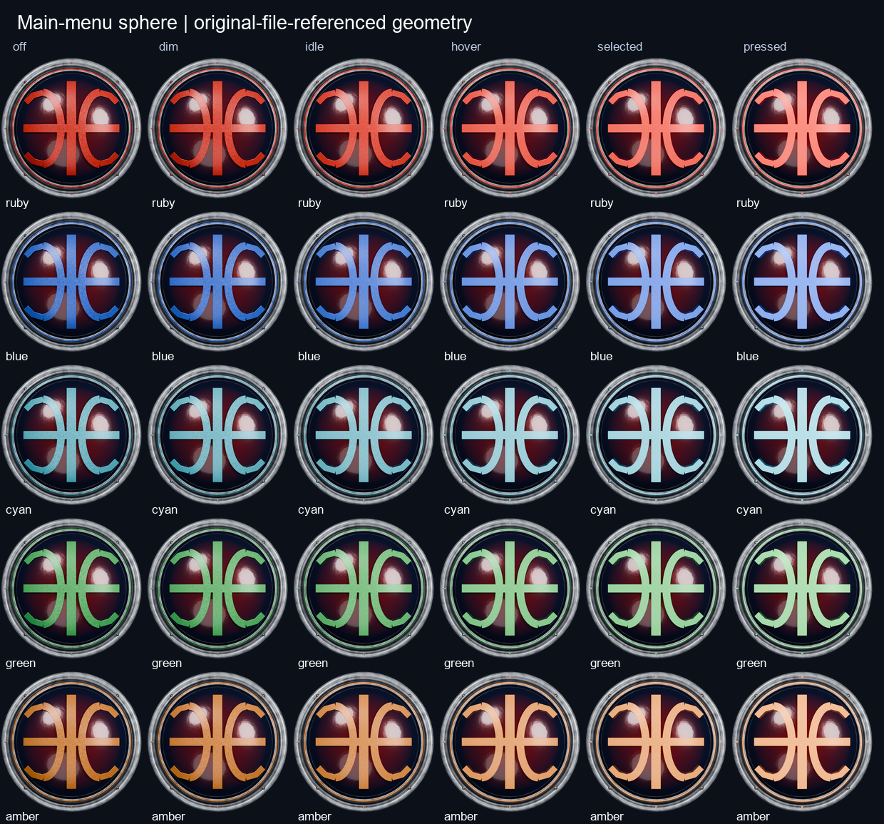
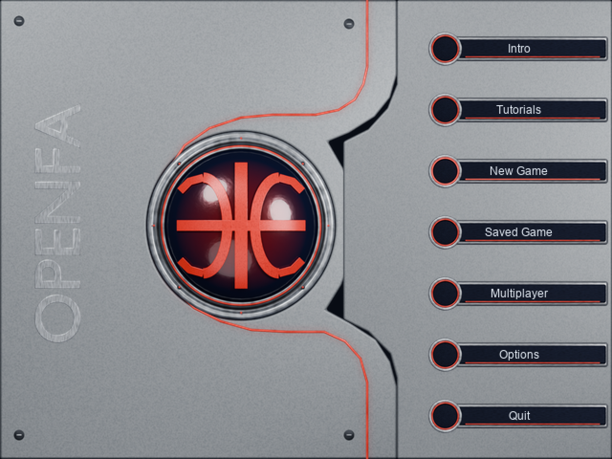

# Legacy-referenced main-menu elements

Tracking: [#176](https://github.com/ender-dev-pl/openfa-assets/issues/176).

The new menu kit extends the completed HUD icon set. It preserves the original
FE_DOME motif: a convex dark glass emblem with paired curved red ribbons, central
upright/crossbar, concentric metal bezel and a brighter pressed appearance. It is
not the earlier navigation globe with meridians. Source references were freshly
decoded from `_MS/FE_DOME.256`, `FE_EDGE.256` and `FE_BASE.256`; their embedded
palettes were inspected. FE_BUTTO/FE_TAG proportions informed the round leading
socket and long label rail. Original file hashes are in the verification report.
Original pixels are not textures in the generated models or published payload.

Evidence: game `docs/legacy/frontend-callbacks-and-composition.md` confirms that
FE_DOME frame 0 is idle and frame 1 is transient bright pressed. Only those two
states are established as original behavior. The original FE_EDGE wordmark is
not baked into the new panel: independent optional OPENFA lettering is supplied.

## Delivery

Five colorways are supplied: ruby, blue, cyan, green and amber. Each has off, dim,
idle, hover, selected and pressed illumination. Off disables emission; colored
inlays still reflect ambient light. Extra hues, neons, halos and interaction
states are deliberate OpenFA extensions, not claims of additional legacy states.

The 290 records / 585 PNGs comprise:

- Ten independent base layers: bezel, convex glass, curved emblem, perimeter neon,
  left console, console rail, right support plate, menu row, row neon and lettering.
- Thirty complete sphere variants, plus separate emission geometry and soft glow.
- Thirty legacy-canvas dome variants: 320x200 with the visible image at x=2,
  mapping frame 0 to ruby-idle and frame 1 to ruby-pressed.
- Thirty neon rails with separate halos, and thirty menu rows with separate halos.
- Eight loop-ready halo-only pulse frames for each colorway (40 total).
- Five overview/composition sheets. Compositions use illustrative labels and
  are asset previews, not actual game-runtime captures.

`native/` and `hires/` contain corresponding transparent RGBA assets. The native
sphere is 200x200, dome canvas 320x200, left console 415x480, right plate 320x480,
and menu rows 211x48. Hi-res sphere/layers are roughly three times native; console
and row renders are twice/four times native. Exact per-record sizes and paths are
recorded in `catalog.json`. Halos are independent source-over RGBA layers; a
renderer may choose linear-light additive blending deliberately. Do not stack a
complete sphere variant together with its glass/emblem base layers again.





[Separate layers](../../../gallery/media/ui/legacy-main-menu/layers.png) ·
[Cyan composition](../../../gallery/media/ui/legacy-main-menu/composition-cyan.png) ·
[Amber composition](../../../gallery/media/ui/legacy-main-menu/composition-amber.png).

## Authoring and verification

All forms are new editable Blender geometry. The ornament is projected onto the
convex surface with dense authored ribbons, avoiding lens penetration. Fine-grain
alloy, scoring, fastener recesses, worn metal and glass smudges provide restrained
use marks. No procedural renderer owns application state or navigation.

Blender 4.5.15 LTS, Cycles CPU, 24 samples, AgX/None generated 140 renders: ten
base layers, thirty sets of four state renders, and ten independent GLB imports.
Source objects were removed before GLB import. All ten group alpha silhouettes
match with IoU 1.0. GLB verifies geometry and constant base materials; procedural
wear and the complete shader graph remain in Blend/native renders. A separate
Blender process reopened the saved Blend and rendered the 26-object dome.

Pillow derives soft halos, halo pulse opacity and native-size conversions from
the actual Blender renders. Pulsation is a compositing option rather than a
separately simulated light animation. The source-off/idle/pressed values are
art-directed variants, not measured original radiance levels.

`verify_menu.py` checks source/scene/payload hashes, exact coverage, all six
distinguishable states per colorway, all pulse frames, dimensions and alpha.
`verify_project.py` and the game changed-code quality gate passed. This delivery
does not replace game package resources or establish game-runtime acceptance.

## Reproduce

From the asset repository, using an ignored workspace outside sources:

```powershell
blender --background --factory-startup --python-exit-code 1 `
  --python sources/ui/legacy-main-menu/build_menu.py -- `
  --output artifacts/legacy-main-menu/renders

python sources/ui/legacy-main-menu/package_menu.py --workspace artifacts/legacy-main-menu

blender --background --factory-startup --python-exit-code 1 `
  --python sources/ui/legacy-main-menu/reload_menu.py -- `
  --blend sources/ui/legacy-main-menu/main-menu.blend --output artifacts/legacy-main-menu

python sources/ui/legacy-main-menu/verify_menu.py `
  --source sources/ui/legacy-main-menu --media gallery/media/ui/legacy-main-menu `
  --reload artifacts/legacy-main-menu
```

The final two commands validate the published canonical scene/payload. Publish
reviewed newly generated scenes before checking them against canonical hashes.
Original reference hashing is optional in an independent checkout; geometry
generation requires only Blender. The menu composition previews contain a sample
seven-row layout; live labels, intents, hit regions, state and theme selection
remain responsibilities of the game's existing model/presenter/view contracts.
